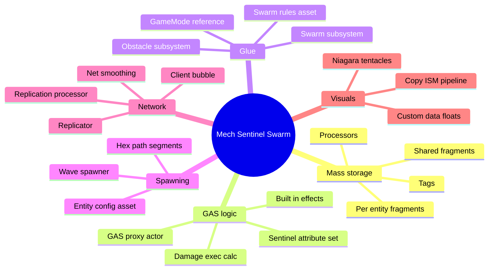
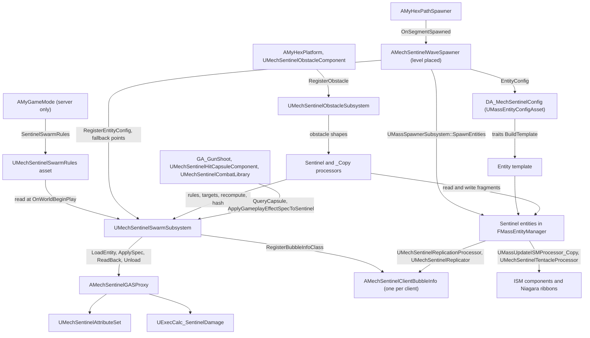
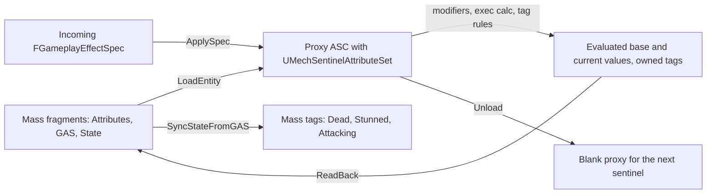

↑ [[MechSentinel Index]]

# MechSentinel Architecture

The Mech Sentinel swarm is a Mass Entity (ECS) simulation of flying, tentacled robots. Mass owns every value a sentinel has (position, health, armor, state, target), and the Gameplay Ability System is only used as a calculator that is loaded, run and emptied again for one sentinel at a time: **GAS logic, Mass storage**. A world subsystem joins Mass to the rest of the game (rules from the GameMode, player targets, the GAS bridge, hit queries). A level-placed, replicated wave spawner creates the entities on the server, and MassReplication sends each client a small snapshot of the sentinels near it, which the client only draws.

This page is the map: what lives in which folder, which class talks to which, where global data is kept, and what one sentinel entity is made of. The original request this was built from is in [[MyMassEntityTest]]; general Mass notes are in [[MassEntity]].

## Mind map

## How it flows

### Class dependencies

1. `AMyGameMode` holds a pointer to the `UMechSentinelSwarmRules` data asset. The GameMode exists only on the server, which is exactly where the rules are needed. `UMechSentinelSwarmSubsystem::OnWorldBeginPlay` copies that pointer into `GameModeRules` (server only).
2. `AMechSentinelWaveSpawner` is placed in the level. Its `EntityConfig` points at `DA_MechSentinelConfig`, the `UMassEntityConfigAsset` that lists the traits. The spawner registers the config with the subsystem (which validates it and builds the entity template on this machine) and, on the server, registers its fallback points if it has any.
3. The traits' `BuildTemplate` functions decide which fragments, shared fragments and tags a sentinel gets (see [[MechSentinel Architecture#What a sentinel entity is made of]]).
4. The spawner creates entities in batches through `UMassSpawnerSubsystem::SpawnEntities` and writes their start values (position, wave-scaled attributes, timers). In External mode the waves are started by `AMyHexPathSpawner::OnSegmentSpawned`.
5. Every processor works on fragments. Processors reach the outside world only through the subsystems: rules, player targets, fallback points, the GAS bridge and the hit hash come from `UMechSentinelSwarmSubsystem`; obstacles from `UMechSentinelObstacleSubsystem`.
6. Hits from actors (`GA_GunShoot`, `UMechSentinelHitCapsuleComponent`, the Blueprint library `UMechSentinelCombatLibrary`) query the capsule hash and send a gameplay effect spec to the subsystem, which runs it through the one `AMechSentinelGASProxy` and writes the result back into Mass.
7. On the server, `UMechSentinelReplicationProcessor` runs `UMechSentinelReplicator`, which fills one `AMechSentinelClientBubbleInfo` per client. The bubble class is registered by the subsystem in `Initialize`.
8. Wherever frames are rendered, the `_Copy` representation processors and the tentacle processor turn the fragments into instanced static mesh instances and Niagara ribbon data.

### GAS logic, Mass storage in one picture

1. `LoadEntity` writes the sentinel's base values from `FMechSentinelAttributesFragment` into the proxy's attribute set and re-creates the duration effects stored in `FMechSentinelGASFragment::ActiveEffects`, in application order.
2. `ApplySpec` lets real GAS run the incoming effect: executions such as `UExecCalc_SentinelDamage`, modifiers, tag requirements, immunity, stacking.
3. `ReadBack` copies base and current values and the owned gameplay tags back into the fragments and returns the damage removed from health.
4. `Unload` removes every active effect (also those GAS applied on its own) and the loose `State.Sentinel.Attacking` tag it added, so the shared proxy is blank for the next sentinel (its permanent `Unit.Sentinel` tag stays).
5. `SyncStateFromGAS` mirrors the result into Mass: `Health <= 0` sets `State = Dead`, adds `State.Sentinel.Dead` to the owned tags and the Mass tag `FMechSentinelDeadTag`; the `State.Sentinel.Stunned` gameplay tag becomes `FMechSentinelStunnedTag`. Processors can then filter on the Mass tags cheaply.

The full hit and buff paths are in [[MechSentinel Combat and GAS]] and [[MechSentinel Self Buffs]].

## GAS logic, Mass storage

| Concern | Stored in | Computed by |
|---|---|---|
| Health, MaxHealth, Armor, AttackDamage, AttackSpeed, MoveSpeedMultiplier (base and current) | `FMechSentinelAttributesFragment` (per entity) | GAS on the proxy |
| MovementSpeed of the whole swarm group | `FMechSentinelSharedAttributesFragment` (mutable shared fragment) | `UMechSentinelSwarmSubsystem::SetSwarmMovementSpeed` |
| Active buffs, debuffs, stuns, shields and the gameplay tags they grant | `FMechSentinelGASFragment` (`OwnedTags`, `ActiveEffects`) | GAS on the proxy |
| Seeking / Attacking / Stunned / Dead | `FMechSentinelStateFragment::State` plus Mass tags | processors and `SyncStateFromGAS` |
| Damage math, armor mitigation, Shielded rule | nothing (pure calculation) | `UExecCalc_SentinelDamage`, `UMechSentinelAttributeSet` |
| Movement, avoidance, LOD, ISM, hit queries | Mass fragments and the subsystem's hash | Mass processors |

Facts about the proxy (`AMechSentinelGASProxy`, `NotPlaceable`, `Transient`):

- One per world, spawned by `UMechSentinelSwarmSubsystem::GetOrCreateProxy` on the authority only. `bReplicates = false`, its ASC is not replicated and has `bSuppressGameplayCues = true` (cues would play at the world origin).
- It owns a `UAbilitySystemComponent`, a `UMechSentinelAttributeSet` and a default `UMyAttributeSet` (`SourceAttributeSet`). The second set exists because the proxy ASC is also the **source** of sentinel attacks on players, and the project's player damage exec calc captures source attributes from `UMyAttributeSet`.
- It carries the loose tag `Unit.Sentinel`, which `ReadBack` removes from the copied tags again.
- It costs nothing per frame: it only runs on combat events (hits, buff casts, effect expiries).

## Folder map

All swarm code lives in `Source/Aura/Public/MechSwarm/` and `Source/Aura/Private/MechSwarm/`, in eight subfolders.

| Folder | What lives there | Main types |
|---|---|---|
| `Core` | The hub, global rules, processor group names, the obstacle registry | `UMechSentinelSwarmSubsystem`, `UMechSentinelSwarmRules`, `FMechSentinelSelfBuffDef`, `MechSwarm::ProcessorGroups` (`MechSwarmProcessorGroups.h`), `UMechSentinelObstacleSubsystem`, `UMechSentinelObstacleComponent`, `FMechSentinelFallbackPoint`, `FMechSentinelHit` |
| `Spawning` | The replicated wave spawner and its wave types | `AMechSentinelWaveSpawner`, `FMechSentinelWave`, `FMechSentinelWaveCurves`, `EMechSentinelWaveAdvance`, `EMechSentinelWaveState`, `EMechSentinelSegmentCorners` |
| `Sentinel` | Every sentinel fragment, tag and shared fragment, the trait and the sentinel processors | `MechSentinelFragments.h`, `UMechSentinelTrait`, `MechSentinelProcessors.h` (declarations), `MechSentinelBehaviorProcessors.cpp`, `MechSentinelCombatProcessors.cpp`, `MechSentinelClientProcessors.cpp`, `UMechSentinelObstacleAvoidanceProcessor` |
| `Combat` | Hitting sentinels from actors | `UMechSentinelCombatLibrary` (capsule / sweep queries, damage and effect functions), `UMechSentinelHitCapsuleComponent` |
| `GAS` | The calculator side | `AMechSentinelGASProxy`, `UMechSentinelAttributeSet`, `UExecCalc_SentinelDamage`, `UMechSentinelDamageEffect`, `UMechSentinelAttackEffect`, `UMechSentinelArmorBuffEffect`, `UMechSentinelSpeedBuffEffect`, `UMechSentinelDamageBuffEffect`, `MechSentinelTags` |
| `Replication` | What goes over the network and how | `FMechSentinelReplicatedData`, `FReplicatedMechSentinelAgent`, `FMechSentinelFastArrayItem`, `FMechSentinelClientBubbleHandler`, `FMechSentinelClientBubbleSerializer`, `AMechSentinelClientBubbleInfo`, `UMechSentinelReplicator`, `UMechSentinelReplicationDestroyObserver`, `UMechSentinelReplicationProcessor` |
| `MassCopies` | Project-owned versions of engine Mass classes, named `<EngineName>_Copy` | movement, avoidance, smooth orientation, LOD collector, representation (see [[MechSentinel Architecture#The _Copy classes]]) |
| `Tentacles` | Niagara ribbon tentacles (visual only) | `FMechSentinelTentacleDesc`, `FMechSentinelTentacleFragment`, `FMechSentinelTentacleParams`, `UMechSentinelTentacleTrait`, `UMechSentinelTentacleSubsystem`, `UMechSentinelTentacleProcessor` |

Outside the folder, the swarm touches:

- `Source/Aura/Public/MyGameMode.h`: `SentinelSwarmRules` (category "Mech Sentinels").
- `Source/Aura/{Public,Private}/Actors/MyHexPathSpawner.*`: the `OnSegmentSpawned` delegate (`FOnHexPathSegmentSpawned`) and the "Sentinel Waves" settings `bSpawnSentinelWaves`, `FirstSegmentWithSentinelWave`.
- `Source/Aura/{Public,Private}/Actors/MyHexPathSegment.*`: the segment's assumed bounds box (`SetSegmentBounds`, `GetSegmentBoundsCorners`), whose corners the path waves spawn at.
- `Source/Aura/{Public,Private}/Actors/MyHexPlatform.*`: `RefreshSentinelObstacle` registers the standing tiles as an obstacle.
- `Source/Aura/Private/AbilitySystem/Abilities/GA_GunShoot.cpp`: gun shots damage sentinels on the server.
- `Config/DefaultMass.ini`: swaps the engine replication processor for the project's (see [[MechSentinel Replication and Multiplayer]]).
- `Source/Aura/Aura.Build.cs`: the modules `MassEntity`, `MassCore`, `MassCommon`, `MassSpawner`, `MassSimulation`, `MassLOD`, `MassReplication`; `Aura.uproject` enables the `MassGameplay` plugin.

## Main classes and their jobs

### UMechSentinelSwarmSubsystem (Core)

A `UWorldSubsystem` that only exists in Game and PIE worlds (`DoesSupportWorldType`). Its jobs, as grouped in the header:

- **Global data.** `GetRules()` never returns null: `RulesOverride` (set with `SetRulesOverride`, e.g. a difficulty change), else the GameMode's rules, else the class defaults of `UMechSentinelSwarmRules`. `SetSwarmMovementSpeed(SwarmGroup, Speed)` edits the shared movement fragment of one group.
- **Templates.** `RegisterEntityConfig` validates a config once (`ValidateEntityConfig`) and builds its template with `GetOrCreateEntityTemplate`. `EnsureTemplatesBuilt` does it for every registered config and every `AMechSentinelWaveSpawner` in the world. In `Initialize` it registers `AMechSentinelClientBubbleInfo` with `UMassReplicationSubsystem`, the earliest safe point.
- **Targets.** `RegisterFallbackTargets` / `UnregisterFallbackTargets` per owner and swarm group; `GatherPlayerTargets` lists valid player pawns from the GameState's `PlayerArray`, skipping pawns whose `IMyCombatInterface::IsDead` is true.
- **GAS bridge (server).** `ApplyGameplayEffectSpecToSentinel`, `RecomputeSentinel`, `KillSentinel`, `GetSentinelSourceASC`, and the self-buff queue (`QueueSelfBuff`, flushed by a next-tick timer).
- **Hit queries.** A spatial hash of sentinel capsules rebuilt every frame by `UMechSentinelCollisionHashProcessor` (`BeginCollisionFrame`, `AddCollisionCapsule`, `EndCollisionFrame`), queried with `QueryCapsule`. `GetNumAliveSentinels` is the hash size, so it is 0 on clients.
- **Events (server).** `OnSentinelDamaged`, `OnSentinelKilled`.

### AMechSentinelWaveSpawner (Spawning)

Place it in the level. `bReplicates = true`, `bAlwaysRelevant = true`, net update frequency 4 (minimum 1). It ticks in `TG_PostUpdateWork`, outside every Mass phase, and on the authority only. It owns `EntityConfig`, the wave list and curves, the per-spawner cap `MaxAlive` and the per-frame batch size `SpawnBatchSize`, and replicates `CurrentWaveNumber`, `WaveState`, `AliveCount`, `RemainingToSpawn`, `CurrentWaveTotal`. Details: [[MechSentinel Spawning and Waves]] and [[MechSentinel Path Segment Waves]].

### UMechSentinelTrait (Sentinel)

The "Mech Sentinel" trait. Its editable settings: `SwarmGroup` (default `Sentinels`), `Attributes` (`FMechSentinelAttributeDefaults`), `MovementSpeed` (900 cm/s) and `Parameters` (`FMechSentinelParameters`). It adds the sentinel fragments and decides, by net mode, which machine gets the smoothing and self-buff fragments.

### The processors

Nineteen processors and one observer run the swarm. Their order and what each reads and writes is the subject of [[MechSentinel Frame Flow]]. In short:

| Folder | Processors |
|---|---|
| `Sentinel` | `UMechSentinelEffectsProcessor`, `UMechSentinelTargetSelectionProcessor`, `UMechSentinelSelfBuffProcessor`, `UMechSentinelSteeringProcessor`, `UMechSentinelObstacleAvoidanceProcessor`, `UMechSentinelAttackProcessor`, `UMechSentinelDeathProcessor`, `UMechSentinelCollisionHashProcessor`, `UMechSentinelVisualDataProcessor`, `UMechSentinelNetSmoothingProcessor` |
| `MassCopies` | `UMassMovingAvoidanceProcessor_Copy`, `UMassApplyForceProcessor_Copy`, `UMassApplyMovementProcessor_Copy`, `UMassSmoothOrientationProcessor_Copy`, `UMassLODCollectorProcessor_Copy`, `UMassVisualizationLODProcessor_Copy`, `UMassUpdateISMProcessor_Copy` |
| `Tentacles` | `UMechSentinelTentacleProcessor` |
| `Replication` | `UMechSentinelReplicationProcessor`, observer `UMechSentinelReplicationDestroyObserver` |

### Other world subsystems

| Subsystem | Job | Where it runs |
|---|---|---|
| `UMechSentinelObstacleSubsystem` | Registry of 3D obstacles (hex platform cylinders, boxes) live sentinels steer around | Game and PIE worlds; `RegisterObstacle` is a no-op on network clients (`HasAuthority`: not `NM_Client`) |
| `UMassRepresentationSubsystem_Copy` | Table of visual descriptions, owner of the `AMassVisualizer_Copy` actor | Game and PIE worlds; `GetOrCreateVisualizationComponent` returns null on dedicated servers |
| `UMechSentinelTentacleSubsystem` | Rig pool per tentacle set, Niagara component and array upload | Game and PIE worlds; nothing is registered on dedicated servers (the tentacle trait adds nothing there) |

## Where global data lives

The project uses no `UDeveloperSettings` for the swarm. Global data is split by who needs it:

| Data | Lives in | Set by | Read by |
|---|---|---|---|
| Swarm rules (targeting, combat, caps, self-buffs) | `UMechSentinelSwarmRules` asset `/Game/MechSentinel/Data/DA_MechSentinelSwarmRules` | `AMyGameMode::SentinelSwarmRules` on `/Game/Level/BP_MyGameMode` (StartupMap) or `/Game/MechSentinel/Demo/BP_MechSentinelDemoGameMode` (demo map) | `UMechSentinelSwarmSubsystem::GetRules` (server) |
| Entity makeup (traits, meshes, attribute defaults, replication LOD) | `UMassEntityConfigAsset` `/Game/MechSentinel/Data/DA_MechSentinelConfig` | `AMechSentinelWaveSpawner::EntityConfig` (not replicated) | server and every client, from the level-placed spawner |
| Swarm-wide speed | `FMechSentinelSharedAttributesFragment` per `SwarmGroup` | trait default, `SetSwarmMovementSpeed` | `UMechSentinelSteeringProcessor` |
| Targeting board | `FMechSentinelTargetingSharedFragment` per `SwarmGroup` | `UMechSentinelTargetSelectionProcessor` | targeting, attack |
| Per-config constants | `FMechSentinelParameters` (const shared) | trait `Parameters` | most sentinel processors |
| Runtime registries | `UMechSentinelSwarmSubsystem` (fallbacks, collision hash, pending self-buffs) | spawners, processors | processors, hit code |

Why the split works: targeting, combat and spawning are server authoritative, so the rules only need to exist where the GameMode exists. Clients only draw sentinels, and everything they need to build the entity template is in the config asset, which they load with the map through the level-placed spawner. A shared fragment is unique per value of its `UPROPERTY` fields, and `SwarmGroup` is such a field, so every swarm group gets its own board and its own speed.

The setup scripts in `SourceArt/MechSentinel/` handle these assets: `ue_setup_mech_sentinel_demo.py` creates (or updates) them, plus `BP_MechSentinelDemoGameMode` and the demo map `/Game/MechSentinel/Demo/L_MechSentinelDemo`; `ue_setup_mech_sentinel_startup.py` only loads the existing ones, puts `DA_MechSentinelSwarmRules` on `BP_MyGameMode` and places one External-mode spawner on StartupMap. See [[MechSentinel Setup and Debugging]].

## What a sentinel entity is made of

`DA_MechSentinelConfig`, as built by `ue_setup_mech_sentinel_demo.py`, lists seven traits: Mech Sentinel, Movement (Copy), Avoidance (Copy), Smooth Orientation (Copy), Visualization ISM (Copy), Mech Sentinel Tentacles (Niagara) and the engine Replication trait.

| Trait (class) | Per-entity fragments | Shared / const shared | Tags | Not added on |
|---|---|---|---|---|
| Mech Sentinel (`UMechSentinelTrait`) | `FTransformFragment`, `FMechSentinelAttributesFragment`, `FMechSentinelGASFragment`, `FMechSentinelStateFragment`, `FMechSentinelTargetFragment`, `FMechSentinelAttackFragment`; `FMechSentinelNetSmoothingFragment` on `NM_Client` only; `FMechSentinelSelfBuffFragment` everywhere except `NM_Client` | const `FMechSentinelParameters`; shared `FMechSentinelSharedAttributesFragment`, `FMechSentinelTargetingSharedFragment` | `FMechSentinelTag` | - |
| Movement (Copy) (`UMassMovementTrait_Copy`) | `FMassVelocityFragment_Copy`, `FMassForceFragment_Copy`, `FMassDesiredMovementFragment_Copy` | const `FMassMovementParameters_Copy` | `FMassCodeDrivenMovementTag_Copy` | - |
| Avoidance (Copy) (`UMassObstacleAvoidanceTrait_Copy`) | requires transform, velocity, force | const `FMassMovingAvoidanceParameters_Copy`, `FMechSentinelObstacleAvoidanceParameters` | - | - |
| Smooth Orientation (Copy) (`UMassSmoothOrientationTrait_Copy`) | requires transform, velocity, desired movement | const `FMassSmoothOrientationParameters_Copy` | - | - |
| Visualization ISM (Copy) (`UMassVisualizationTrait_Copy`) | `FMassViewerInfoFragment_Copy`, `FMassRepresentationLODFragment_Copy`, `FMassRepresentationCustomDataFragment_Copy` | const `FMassVisualizationLODParameters_Copy`, `FMassRepresentationParameters_Copy` | `FMassVisualizationTag_Copy` | dedicated server |
| Mech Sentinel Tentacles (Niagara) (`UMechSentinelTentacleTrait`) | `FMechSentinelTentacleFragment` | const `FMechSentinelTentacleParams` | - | dedicated server |
| Replication (engine `UMassReplicationTrait`) | `FReplicationTemplateIDFragment`, `FMassNetworkIDFragment`, `FMassReplicatedAgentFragment`, `FMassReplicationViewerInfoFragment`, `FMassReplicationLODFragment`, `FMassReplicationGridCellLocationFragment` | const `FMassReplicationParameters`; shared `FMassReplicationSharedFragment` | - | standalone |

Tags added and removed at runtime: `FMechSentinelAttackingTag` (attack state), `FMechSentinelStunnedTag` (mirror of `State.Sentinel.Stunned`), `FMechSentinelDeadTag` (mirror of `State.Sentinel.Dead`) and `FMassCustomMovementTag_Copy` (added on death: the death fall owns the position from then on).

The engine `FTransformFragment` is kept on purpose: MassReplication reads it for relevancy. `FMechSentinelGASFragment` holds UE containers, so it opts out of the trivially-copyable check with `TMassFragmentTraits<...>::AuthorAcceptsItsNotTriviallyCopyable`.

Because the trait looks at the net mode, the same config gives a slightly different archetype on each machine: a client has the smoothing fragment and no self-buff fragment, a dedicated server has no visual fragments, and standalone has no replication fragments. The template ID is the same everywhere, which is what replication needs.

## The _Copy classes

The original request ([[MyMassEntityTest]]) asked to use the default Mass fragments and processors but to copy them under `originalName_Copy`. Each `_Copy` in `MassCopies/` is a project-owned implementation with the same role and data as its engine counterpart (the header comments say "Mirrors (by role)"), not pasted engine code. The project README gives the reason: the repository is public, and engine code falls under the Unreal Engine EULA.

Copying also lets them deviate where flying sentinels need it, and the engine's own movement / avoidance / representation processors never touch the sentinels, because those require the engine fragments, which sentinels do not have.

| Project class | Engine counterpart (role) | Deviation |
|---|---|---|
| `FMassVelocityFragment_Copy`, `FMassForceFragment_Copy`, `FMassDesiredMovementFragment_Copy`, `FMassCodeDrivenMovementTag_Copy`, `FMassMovementParameters_Copy` | the MassMovement fragments | forces act on the velocity, not on the desired velocity |
| `FMassCustomMovementTag_Copy` | project helper | "someone else owns the position" (death fall) |
| `UMassApplyForceProcessor_Copy`, `UMassApplyMovementProcessor_Copy`, `UMassMovementTrait_Copy` | `UMassApplyForceProcessor`, `UMassApplyMovementProcessor`, `UMassMovementTrait` | acceleration limit `MaxAcceleration`, vertical movement on |
| `FMassMovingAvoidanceParameters_Copy`, `UMassMovingAvoidanceProcessor_Copy`, `UMassObstacleAvoidanceTrait_Copy` | `FMassMovingAvoidanceParameters`, `UMassMovingAvoidanceProcessor`, `UMassObstacleAvoidanceTrait` | full 3D on a spatial hash, no navmesh or lanes |
| `FMassSmoothOrientationParameters_Copy`, `UMassSmoothOrientationProcessor_Copy`, `UMassSmoothOrientationTrait_Copy` | the MassNavigation smooth orientation feature | 3D: yaw, clamped pitch, banking |
| `FMassViewerInfoFragment_Copy`, `UMassLODCollectorProcessor_Copy` | `FMassViewerInfoFragment`, `UMassLODCollectorProcessor` | only local viewers (visual LOD) |
| `FStaticMeshInstanceVisualizationDesc_Copy`, `FMassRepresentationLODFragment_Copy`, `FMassVisualizationLODParameters_Copy`, `FMassRepresentationParameters_Copy`, `FMassRepresentationCustomDataFragment_Copy`, `FMassVisualizationTag_Copy` | the MassRepresentation data types | ISM only; `bForceLowLODMesh` added for the tentacles |
| `UMassVisualizationLODProcessor_Copy`, `UMassUpdateISMProcessor_Copy`, `UMassVisualizationTrait_Copy`, `UMassRepresentationSubsystem_Copy`, `AMassVisualizer_Copy`, `UMassVisualizationComponent_Copy` | `UMassVisualizationLODProcessor`, `UMassUpdateISMProcessor`, `UMassVisualizationTrait`, `UMassRepresentationSubsystem`, `AMassVisualizer`, `UMassVisualizationComponent` | ISM only |

Used from the engine as they are: `FTransformFragment`, the trait / processor / query framework, `UMassEntityConfigAsset`, `UMassSpawnerSubsystem` and the MassReplication framework (trait, subsystem, client bubble base classes). The one exception is `UMassReplicationProcessor`, which `UMechSentinelReplicationProcessor` subclasses and replaces because of a UE 5.8.2 bug.

## Key files

| File | Role |
|---|---|
| `Source/Aura/Public/MechSwarm/Core/MechSentinelSwarmSubsystem.h` | The hub: rules, templates, targets, GAS bridge, hit hash, events |
| `Source/Aura/Private/MechSwarm/Core/MechSentinelSwarmSubsystem.cpp` | Its implementation, including `SyncStateFromGAS` and the deferred tag helper |
| `Source/Aura/Public/MechSwarm/Core/MechSentinelSwarmRules.h` | `UMechSentinelSwarmRules`, `FMechSentinelSelfBuffDef` |
| `Source/Aura/Public/MechSwarm/Core/MechSwarmProcessorGroups.h` | Group names `MechSwarm.Combat`, `MechSwarm.LODCollector`, `MechSwarm.Representation` |
| `Source/Aura/Public/MechSwarm/Sentinel/MechSentinelFragments.h` | Every sentinel fragment, tag, shared fragment, `EMechSentinelState`, `EMechSentinelSelfBuff` |
| `Source/Aura/Private/MechSwarm/Sentinel/MechSentinelTrait.cpp` | What the Mech Sentinel trait adds, per net mode |
| `Source/Aura/Public/MechSwarm/Sentinel/MechSentinelProcessors.h` | Declarations and order summary of the sentinel processors |
| `Source/Aura/Public/MechSwarm/GAS/MechSentinelGASProxy.h` | The flyweight proxy and its Load / Apply / ReadBack / Unload cycle |
| `Source/Aura/Public/MechSwarm/Spawning/MechSentinelWaveSpawner.h` | The spawner: config, waves, replicated counts |
| `Source/Aura/Public/MechSwarm/Replication/MechSentinelReplicationProcessor.h` | Why the engine replication processor is replaced |
| `Source/Aura/Public/MyGameMode.h` | `SentinelSwarmRules` |
| `Config/DefaultMass.ini` | Engine replication processor off, project one on |
| `SourceArt/MechSentinel/ue_setup_mech_sentinel_demo.py` | Builds `DA_MechSentinelConfig`, `DA_MechSentinelSwarmRules`, the demo map |

## Tuning knobs

| Setting | Where | Default | Effect |
|---|---|---|---|
| `SwarmGroup` | `UMechSentinelTrait` | `Sentinels` | Sentinels of one group share a targeting board and a movement speed |
| `MovementSpeed` | `UMechSentinelTrait` | 900 cm/s | Base speed of the group, scaled per entity by `MoveSpeedMultiplier` |
| `Attributes` (`MaxHealth`, `Armor`, `AttackDamage`, `AttackSpeed`) | `UMechSentinelTrait` | 120, 4, 6, 0.8 (the demo script sets 120, 4, 3, 0.6) | Starting attributes before wave scaling |
| `SentinelSwarmRules` | `AMyGameMode` (BP_MyGameMode) | none (class defaults are used) | Which rules asset the server uses |
| `MaxAliveSentinels` | `UMechSentinelSwarmRules` | 1500 | Global soft cap over all spawners |
| `MaxAttackersPerPlayer` | `UMechSentinelSwarmRules` | 14 (the demo script sets 10) | Capacity of each player slot on the board |
| `CollisionCellSize` | `UMechSentinelSwarmRules` | 500 cm | Cell size of the hit-query hash |
| `bEnableSelfBuffs` | `UMechSentinelSwarmRules` | true | Self-buff casts on or off |
| `EntityConfig` | `AMechSentinelWaveSpawner` | none | The entity config the spawner creates (must be set) |

## Related

- [[MechSentinel Frame Flow]]: the order in which all these processors run, and the sentinel lifecycle.
- [[MechSentinel Replication and Multiplayer]]: the network half of the class graph.
- [[MechSentinel Spawning and Waves]]: how the spawner creates and scales entities.
- [[MechSentinel Combat and GAS]]: the proxy cycle in detail, damage math, hits from actors.
- [[MechSentinel Behaviour and Targeting]]: the shared targeting board.
- [[MechSentinel Representation and Visuals]]: the `_Copy` ISM pipeline and the tentacles.
- [[MechSentinel Setup and Debugging]]: the assets and scripts named on this page.
- [[MassEntity]]: general Mass notes. [[MyMassEntityTest]]: the original request.

← [[MechSentinel Index]] · [[MechSentinel Index|Index]] · [[MechSentinel Frame Flow]] →
