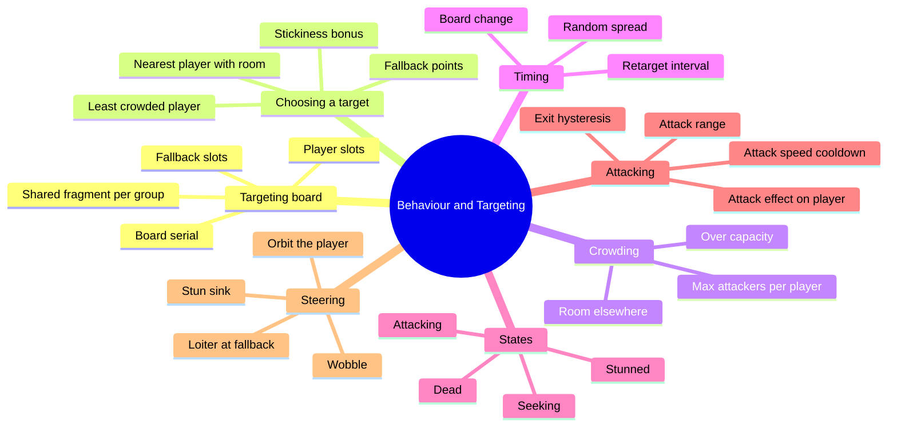
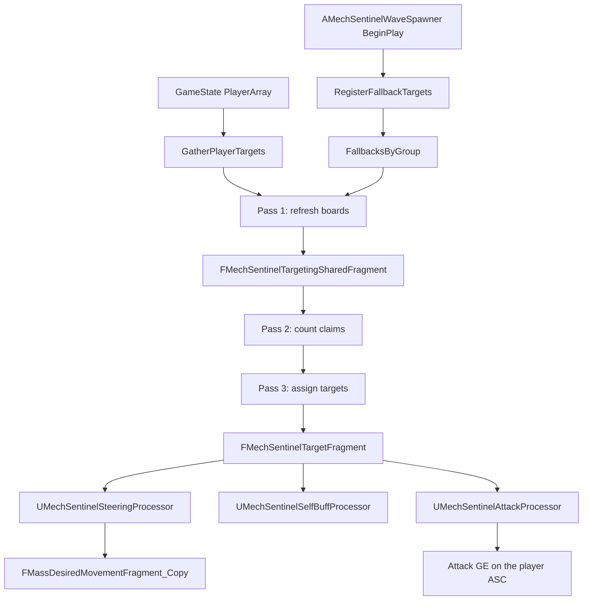
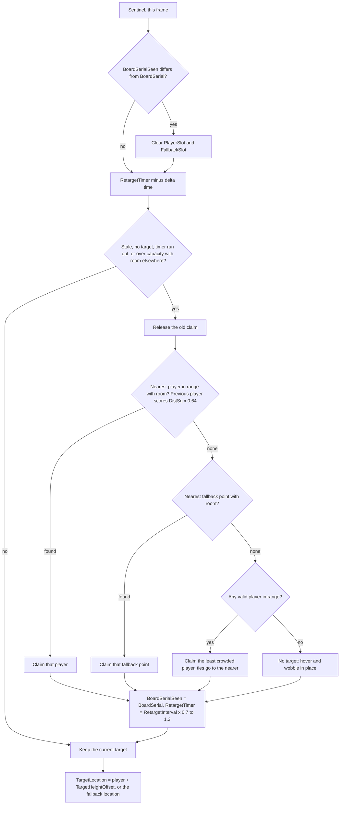
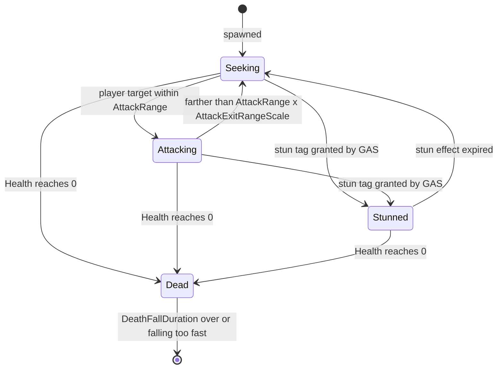
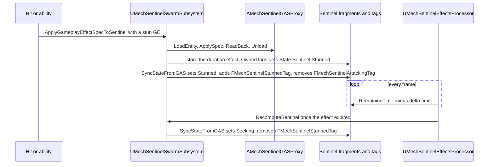

↑ [[MechSentinel Index]]

# MechSentinel Behaviour and Targeting

Every sentinel needs to know whom to chase and what to do once it gets there: on the authority (standalone or server), a shared "targeting board" per swarm group lists the live players and any fallback points, refreshed every frame. Each sentinel re-evaluates its pick from that board every 1.25 s or so (at once when the board changes): the nearest player that still has room, then a fallback point, then the least crowded player. The same processors switch a sentinel between seeking, attacking, stunned and dead. Clients run none of this; they only receive the resulting positions, rotations and the `State` byte (plus health, serials and the buff mask).

## Mind map

## How it flows

### Data path of one frame

1. `UMechSentinelSwarmSubsystem::GatherPlayerTargets` walks `GameState->PlayerArray` and keeps every valid pawn that is not dead (`IMyCombatInterface::Execute_IsDead`), with its location.
2. Wave spawners register fallback points with `RegisterFallbackTargets` at BeginPlay. The subsystem flattens them per swarm group into `FallbacksByGroup`.
3. `UMechSentinelTargetSelectionProcessor` runs three passes. Pass 1 refreshes every board from the players and fallbacks. Pass 2 recounts who is claiming what. Pass 3 (re)assigns sentinels whose turn it is. It writes `FMechSentinelTargetFragment`.
4. Later in the frame the steering, self-buff and attack processors read that target fragment. Steering turns it into a desired velocity (see [[MechSentinel Movement and Avoidance]]). The attack processor turns it into attack state and damage.

### The target decision (pass 3, per sentinel)

1. A sentinel whose `BoardSerialSeen` does not match the board's `BoardSerial` is **stale**: the slot indices it holds no longer mean anything, so they are cleared first. Clearing them also means a stale sentinel gets no stickiness bonus.
2. The retarget timer always counts down.
3. Re-evaluation happens when the sentinel is stale, has no target, its timer ran out, or its player is **over capacity** while some other player in range or fallback point has room (`HasRoomElsewhere`).
4. The sentinel releases its claim first, so it competes fairly with the others.
5. It tries, in order: the nearest player with room (within `MaxTargetDistance`), the nearest fallback point with room, then the least crowded valid player in range. If no player is in range at all, it ends up with no target.
6. It stamps the board serial and draws a new timer.
7. Whether or not it re-evaluated, it copies the target's current location into `TargetLocation`, because players move every frame.

### Behaviour states

1. Spawned entities start as `EMechSentinelState::Seeking`, the default in `FMechSentinelStateFragment`.
2. `UMechSentinelAttackProcessor` owns the Seeking and Attacking transitions, based on distance.
3. `UMechSentinelSwarmSubsystem::SyncStateFromGAS` owns Stunned and Dead. It mirrors the GAS tags and health after every GAS evaluation.
4. `UMechSentinelDeathProcessor` destroys the entity at the end of its fall.
5. "Has a target or not" is separate from these states. A Seeking sentinel can be chasing a player, loitering at a fallback point or hovering with no target.

### Stun lifecycle

1. A stun is any duration GE that grants `State.Sentinel.Stunned`. The demo script makes `/Game/MechSentinel/GAS/GE_SentinelStun`, which lasts 2 s.
2. The GAS bridge stores the effect on the entity (`FMechSentinelGASFragment::ActiveEffects`). `SyncStateFromGAS` sees the tag, sets the state, resets `TimeInState` and changes the Mass tags.
3. `UMechSentinelEffectsProcessor` ticks `RemainingTime` of every stored effect. When an effect expires, it calls `RecomputeSentinel`, which clears the stun.

## Who runs what

All behaviour processors use `ExecutionFlags = Standalone | Server` and run in the PrePhysics phase. The groups come from `UE::Mass::ProcessorGroupNames` plus the project group `MechSwarm.Combat` (`MechSwarmProcessorGroups.h`). The full frame order is on [[MechSentinel Frame Flow]].

| Processor | Group, order | Thread | Reads | Writes |
|---|---|---|---|---|
| `UMechSentinelEffectsProcessor` | Behavior, first | game thread (calls GAS) | `FMechSentinelGASFragment` | `TimeInState`, expired effects, then `RecomputeSentinel` |
| `UMechSentinelTargetSelectionProcessor` | Behavior, after Effects | game thread (reads pawns) | transform, board, `FMechSentinelParameters` | board slots and claims, `FMechSentinelTargetFragment` |
| `UMechSentinelSelfBuffProcessor` | Behavior, after Effects and TargetSelection | game thread | target, state, transform | buff timers, cast queue (see [[MechSentinel Self Buffs]]) |
| `UMechSentinelSteeringProcessor` | Tasks, after Behavior | worker allowed | target, attributes, state, shared speed | `FMassDesiredMovementFragment_Copy`, `OrbitDirection` |
| `UMechSentinelAttackProcessor` | MechSwarm.Combat, after Movement | game thread (applies GEs) | target, attributes, board | attack state, `FMechSentinelAttackFragment`, attack GE |
| `UMechSentinelDeathProcessor` | MechSwarm.Combat, after Attack | game thread (line traces) | dead entities | transform, velocity, destroy |
| `UMechSentinelCollisionHashProcessor` | MechSwarm.Combat, after Death | game thread | transform, capsule size | subsystem hit hash (see [[MechSentinel Combat and GAS]]) |

Each query excludes `FMechSentinelDeadTag`, except the death processor, which requires it. The attack processor also excludes `FMechSentinelStunnedTag`. The steering processor also excludes `FMassCustomMovementTag_Copy`.

## The shared targeting board

The original brief asked for the target location to come from a shared fragment ([[MyMassEntityTest]]). That shared fragment is `FMechSentinelTargetingSharedFragment`, a mutable `FMassSharedFragment`:

| Field | Meaning |
|---|---|
| `SwarmGroup` (`FName`, UPROPERTY) | Part of the shared fragment hash, so there is one board per group |
| `PlayerSlots` | One `FMechSentinelTargetSlot` per alive player pawn |
| `FallbackSlots` | One slot per registered fallback point of this group |
| `BoardSerial` (starts at 1) | Bumped whenever the set of slots changes |

`FMechSentinelTargetSlot` holds `Actor` (weak), `Location`, `Claims`, `Capacity` and `bValid`. `HasRoom()` returns `bValid && (Capacity <= 0 || Claims < Capacity)`, so a capacity of 0 means unlimited.

`UMechSentinelTrait::BuildTemplate` creates the board, with the trait's `SwarmGroup` (default `"Sentinels"`), next to `FMechSentinelSharedAttributesFragment`, the group's shared movement speed. Every sentinel of a group points at the same board in memory.

Each sentinel keeps its own pick in `FMechSentinelTargetFragment`:

| Field | Default | Meaning |
|---|---|---|
| `PlayerSlot` | `INDEX_NONE` | Index into `PlayerSlots` |
| `FallbackSlot` | `INDEX_NONE` | Index into `FallbackSlots` (only used when there is no player slot) |
| `TargetLocation` | zero | Where it heads, before the orbit offset |
| `OrbitDirection` | up | Unit direction of its spot on the orbit sphere |
| `RetargetTimer` | 0 | Countdown to the next re-evaluation |
| `BoardSerialSeen` | 0 | Board serial at the last evaluation |

`HasTarget()` is true when either slot index is set.

At spawn, `AMechSentinelWaveSpawner::SpawnBatch` seeds two of these fields. It sets `OrbitDirection` to a random direction with `Z = Lerp(0.15, 1, |Z|)`, so the spot is always above the target, then normalises it. It sets `RetargetTimer` to `FRandRange(0, 0.5)`, so a fresh wave does not decide all in one frame.

## Where targets come from

### Players

`GatherPlayerTargets` checks only the pawns of `GameState->PlayerArray` entries. Actors without a player state (AI enemies, props) are never targets. A pawn that implements `UMyCombatInterface` and reports `IsDead` is skipped. When a player dies, joins or leaves, the slot list changes. That bumps `BoardSerial`, so every sentinel of the group re-evaluates in the same frame. Slot indices follow `PlayerArray` order, which is why any change to the list invalidates all of them.

### Fallback points

`FMechSentinelFallbackPoint` (Blueprint type) has these fields:

- `Actor`: optional. When it is set, the point follows that actor.
- `Location`: used when there is no actor.
- `Capacity`: 0 = unlimited.

The subsystem stores a runtime copy, `FMechSentinelFallbackTarget`, that holds the actor weakly. A point that follows an actor becomes invalid (`IsValid()` false) once the actor is destroyed. Its slot then gets `bValid = false` and is never chosen. The change also bumps the serial, so the sentinels that claimed it re-target.

The wave spawner registers its points in `BeginPlay` (authority only):

1. It copies `FallbackTargets` (editable array, empty by default).
2. If `bSpawnerIsFallbackTarget` is true (Python `spawner_is_fallback_target`, default true) **and** the spawner is not in `External` advance mode, it appends itself as an unlimited point that follows the spawner actor.
3. If the list is not empty, it calls `RegisterFallbackTargets(GetSwarmGroup(), Points, this)`. The group comes from the entity config's Mech Sentinel trait.
4. `EndPlay` calls `UnregisterFallbackTargets(this)`.

Both functions are also `BlueprintCallable`, so any actor can add its own gathering points. `UnregisterFallbackTargets` also drops registrations whose owner is already gone. After every change, `RebuildFallbackMap` rebuilds the flattened `FallbacksByGroup`.

What the two maps use:

| Map | Advance mode | `spawner_is_fallback_target` | Fallback points |
|---|---|---|---|
| `/Game/MechSentinel/Demo/L_MechSentinelDemo` | `ClearedOrTimer` | true (demo script) | the spawner itself, unlimited |
| `StartupMap` | `External` | false (startup script) | none |

In External mode the spawner stays at the start of an endless level. A fixed point there would pull the overflow back to the start, which is why External mode never adds the spawner itself. See [[MechSentinel Path Segment Waves]].

## Choosing a target, pass by pass

### Pass 1: refresh every board

`EntityManager.ForEachSharedFragment<FMechSentinelTargetingSharedFragment>` visits each board:

- `PlayerSlots` is resized to the player list. Each slot gets the pawn, its location, `Claims = 0`, `Capacity = Rules->MaxAttackersPerPlayer` and `bValid = true`.
- `FallbackSlots` is resized to `GetFallbackTargets(Board.SwarmGroup)`. Each slot gets the point's location, `Claims = 0`, the point's `Capacity` and `bValid` from the point.
- `bChanged` is true when the counts differ, a player slot now holds another actor, or a fallback slot's actor or validity changed. If so, `++BoardSerial`. Player movement alone does not bump the serial.

### Pass 2: count claims from scratch

A sentinel counts toward a slot only when its `BoardSerialSeen` equals the current serial. Dead sentinels are not in the query. Their claims vanish in the next recount without any cleanup code, so counts stay exact when sentinels die, players leave or the board changes.

### Pass 3: (re)assign

Pass 3 implements the decision flowchart above. These rules decide who goes where:

- **Crowding limit.** `MaxAttackersPerPlayer` (rules, default **14**) is the slot capacity of every player. `DA_MechSentinelSwarmRules`, the rules asset used by both the demo and StartupMap, stores **10**.
- **Stickiness.** When the current player competes against the others, its squared distance is multiplied by `StickinessDistanceScale = 0.64`, a code constant in `MechSentinelBehaviorProcessors.cpp`. That makes it count as 20% closer, so a sentinel does not hop between two players at similar distances.
- **Fallback before overflow.** Fallback points ignore `MaxTargetDistance`. The nearest one with room wins.
- **Overflow.** If every player is full and no fallback point has room, the sentinel joins the least crowded valid player in range (fewest claims, then the nearer). Once players are reachable, sentinels never sit idle.
- **Over capacity.** A player is over capacity only when `Claims > Capacity` **and** `HasRoomElsewhere` finds another player in range or any fallback with room. When everything is full, the overflow is permanent, and re-evaluating every frame would only churn the timers. When room does appear, only the surplus moves: each re-evaluating sentinel releases its claim, and once the count drops back to the capacity, the rest of that player's attackers are no longer over capacity.
- **Range.** `MaxTargetDistance` (rules, default 0 = no limit) drops players farther than that from consideration.
- **Freed room.** When a kill frees room on a player, that room is filled at the next retarget of a sentinel elsewhere, within about `RetargetInterval x 1.3`. Surplus sentinels of an over-capacity player fill it at once.

### Worked examples

- **StartupMap, one player, wave 1 (20 sentinels on the lane).** The first 10 claim the player. The other 10 find no room and no fallback point, so they take the least crowded player, which is the same player. All 20 attack. The cap matters only when there is somewhere else to go.
- **StartupMap, two players, wave 2 (23).** 10 + 10 claim the two players. The last 3 spread over both, each joining whichever player has fewer claims at that moment (ties go to the nearer). None of them churns, because nothing has room.
- **Demo map, one player, the demo script's wave 1 (12).** 10 attack. The other 2 take the spawner's unlimited fallback point and loiter around it at `FallbackLoiterRadius`.

## Retarget timing

- `RetargetInterval` (rules, default **1.25 s**, editor clamp 0.05).
- After every evaluation: `RetargetTimer = RetargetInterval x FRandRange(0.7, 1.3)`, about 0.875 to 1.625 s with the default. The spread keeps the swarm from pulsing in step.
- Things that skip the wait: a board change (serial bump), having no target, and the over-capacity rule.
- Between evaluations the sentinel keeps its slot, but `TargetLocation` still follows the slot's live location every frame: the player location plus `TargetHeightOffset` (90 cm), or the fallback location without an offset.

## Following the target (steering)

`UMechSentinelSteeringProcessor` turns the target into a wish. [[MechSentinel Movement and Avoidance]] turns the wish into motion. All values below are C++ defaults of the Mech Sentinel trait and its `FMechSentinelParameters` (`DA_MechSentinelConfig` keeps them).

- **Speed** = `FMechSentinelSharedAttributesFragment::MovementSpeed` (900 cm/s) x the `MoveSpeedMultiplier` attribute.
- **Goal** = `TargetLocation + OrbitDirection x R`. `R` is `OrbitRadius` (320 cm) for a player or `FallbackLoiterRadius` (900 cm) for a fallback point.
- **Orbit.** With a player, `OrbitDirection` turns around the world up axis at `OrbitAngularSpeed` (35 deg/s): the swirling swarm. Each sentinel keeps the height of its spot on the sphere. A fallback point gets no orbit, so the sentinel holds a fixed spot near it.
- **Arrival.** Velocity toward the goal is scaled by `Clamp(Distance / SlowdownRadius, 0, 1)`, with `SlowdownRadius` 600 cm.
- **Wobble.** Each axis gets a sine of time with a per-entity phase (`Entity.Index x 0.618`), scaled by `Speed x WobbleAmount` (0.18), so the swarm never moves in lockstep.
- **No target.** The velocity is the wobble only, so the sentinel drifts in place.
- **Facing.** In the attack state with a player, `DesiredFacing` looks at `TargetLocation`. Otherwise it is identity, which means "face the velocity".
- **Stunned.** Covered under Stun below.

## Attack state and timing

`UMechSentinelAttackProcessor` runs after movement, so it sees this frame's positions.

- Only player slots can be attacked. Fallback points are just gathering places: with one, the distance counts as infinite.
- **Enter.** The sentinel is not in an attacking chunk and `DistSq(Position, TargetLocation) <= AttackRange^2`, with `AttackRange` 450 cm. The processor adds `FMechSentinelAttackingTag` through `Context.Defer()`, sets `State = Attacking` and `TimeInState = 0`, and adds a wind-up: `Cooldown = max(Cooldown, FRandRange(0.15, 0.6) x AttackInterval)`. The wind-up stops a wave that arrives together from firing in the same frame. The orbit sphere (320 cm) lies inside the attack range, so an orbiting sentinel is in range.
- **Travelling.** `Cooldown` counts down but is clamped at 0, so a sentinel never banks more than one attack.
- **Leave.** It is in an attacking chunk and farther than `AttackRange x AttackExitRangeScale` (1.25, so 562.5 cm). This also happens when the target died, moved away or was reassigned. The tag is removed and `State` returns to Seeking. The gap between 450 and 562.5 cm is hysteresis, so a sentinel at the edge does not flicker.
- **Fire.** `AttackInterval = 1 / max(0.05, AttackSpeed)`. When `Cooldown <= 0`, it sets `Cooldown = max(Cooldown + AttackInterval, 0.25 x AttackInterval)`. The rate stays exact at long frame times, but a sentinel never fires twice in one frame. It also sets `AttackGlow = 1` and `++AttackSerial` (the client glow, see [[MechSentinel Representation and Visuals]]) and queues an `FPendingAttack` with `Damage = AttackDamage`, the current value with buffs.
- **Apply.** After the chunk loop (GAS can run any game code), each pending attack runs these steps:
  1. Get the source ASC (the GAS proxy's, `GetSentinelSourceASC`) and the target ASC (`UAbilitySystemGlobals::GetAbilitySystemComponentFromActor`).
  2. Build an effect context with the origin and a blocking `FHitResult`.
  3. Make an outgoing spec of `Rules->SentinelAttackEffect` at level 1, with SetByCaller `MyTags::SetDamageByCaller = Damage`.
  4. Call `ApplyGameplayEffectSpecToTarget`.

  An empty `SentinelAttackEffect` makes attacks visual only. Details are on [[MechSentinel Combat and GAS]].
- **Attack rate numbers.** The default `AttackSpeed` (trait) is 0.8 attacks/s. `DA_MechSentinelConfig` stores 0.6/s (one attack every 1.67 s) and `AttackDamage` 3, before the wave multipliers. At spawn, `Attack.Cooldown = FRandRange(0, 1 / AttackSpeed)`.
- **Tag and state can disagree for a frame.** Tag changes go through the command buffer, so `State` can lead the tag by a frame. The processor forces `State = Attacking` on attacking chunks. It also skips any sentinel whose `State` is already Dead or Stunned from a hit earlier in the phase, before those tags arrive.
- While the sentinel is attacking, the GAS proxy loads it with the loose tag `State.Sentinel.Attacking`, so designer GEs can use it in tag requirements.

## Stun

A stunned sentinel has its "systems offline":

| Processor | While stunned |
|---|---|
| Steering | No goal. `DesiredVelocity = (0, 0, -FallGravity x StunnedGravityScale x SinkAlpha)`, where `SinkAlpha` falls from 1 to 0 over `StunnedSinkDuration` (0.6 s) using `TimeInState`. That asks for 1400 x 0.25 = 350 cm/s down at first, capped by `DesiredMaxSpeedOverride = max(50, Speed x 0.35)`, which is 315 cm/s at the default 900 cm/s speed. Then the desired velocity is zero and it hovers in place (only avoidance pushes still move it): live sentinels have no ground check, so a long stun must not sink them through the floor. |
| Attack | Skipped (`FMechSentinelStunnedTag` excluded, and `State` checked). On entering the stun, `SyncStateFromGAS` removes the attacking tag. |
| Self-buffs | Decisions are skipped, but cooldowns and the decision timer keep running. |
| Target selection | Keeps running. The sentinel keeps its claim on the player. |
| Obstacle avoidance | Uses `MinCushion` and no look-ahead (see [[MechSentinel Movement and Avoidance#Stunned and dead sentinels]]). |

When the stun ends, the state goes back to `Seeking`, never straight to Attacking. Once the stunned tag is gone (it is removed through the command buffer when the expiry happens during a phase), the attack processor puts the sentinel back into the attack state if it is still in range.

## Death

A sentinel dies when its health reaches 0 after a GAS evaluation (`ApplyGameplayEffectSpecToSentinel`) or through `KillSentinel`, which sets `Health = 0` without damage math. `SyncStateFromGAS` then does the following:

1. Sets `State = Dead`, `TimeInState = 0`, `DeathTimeRemaining = DeathFallDuration` (2.5 s; 2 s if the parameters are missing) and `BuffMask = 0`, and adds `State.Sentinel.Dead` to `OwnedTags`.
2. Adds `FMechSentinelDeadTag` and `FMassCustomMovementTag_Copy`, and removes the attacking and stunned tags. Tags go through `SetMassTag`: deferred while a Mass phase may be running, immediate otherwise.
3. Broadcasts `OnSentinelKilled`.

`UMechSentinelDeathProcessor` then owns the position:

- The fall uses a delta time capped at 0.1 s. XY velocity is damped by `exp(-0.8 dt)` and Z velocity loses `FallGravity` (1400 cm/s²) x dt.
- With `bWrecksCollideWithWorld` (default true), a `WorldStatic` line trace runs over the move, extended by `CapsuleRadius` (70 cm). On a hit the wreck rests one capsule radius off the surface and its velocity is zeroed.
- The wreck tumbles at up to `WreckTumbleSpeed` (220 deg/s), scaled by `Clamp(speed / 400 cm/s, 0, 1)`, around a per-entity axis, so a resting wreck stops spinning.
- `Context.Defer().DestroyEntity` runs when `DeathTimeRemaining <= 0`, or early when `Velocity.Z < -6000` (a wreck that fell below every floor).

Dead sentinels drop out of effects, targeting (their claims free up), self-buffs, steering, attacks, the hit hash and obstacle avoidance. `FMassCustomMovementTag_Copy` keeps agent avoidance, movement integration and orientation away from them.

## Key files

| File | Role |
|---|---|
| `Source/Aura/Public/MechSwarm/Sentinel/MechSentinelProcessors.h` | Declares every sentinel processor; the header comment lists the frame order |
| `Source/Aura/Private/MechSwarm/Sentinel/MechSentinelBehaviorProcessors.cpp` | Effects, target selection (3 passes, stickiness), self-buff decisions, steering |
| `Source/Aura/Private/MechSwarm/Sentinel/MechSentinelCombatProcessors.cpp` | Attack state and attacks, death fall, collision hash |
| `Source/Aura/Public/MechSwarm/Sentinel/MechSentinelFragments.h` | `EMechSentinelState`, tags, state, target, attack fragments, `FMechSentinelParameters`, the targeting board |
| `Source/Aura/Private/MechSwarm/Sentinel/MechSentinelTrait.cpp` | Builds the template: fragments, shared board and speed per `SwarmGroup` |
| `Source/Aura/Public/MechSwarm/Core/MechSentinelSwarmRules.h` | `MaxAttackersPerPlayer`, `RetargetInterval`, `MaxTargetDistance`, `SentinelAttackEffect` |
| `Source/Aura/Private/MechSwarm/Core/MechSentinelSwarmSubsystem.cpp` | `GatherPlayerTargets`, fallback registration, `SyncStateFromGAS`, `KillSentinel`, `GetRules` |
| `Source/Aura/Private/MechSwarm/Spawning/MechSentinelWaveSpawner.cpp` | Registers fallback points (`bSpawnerIsFallbackTarget`), seeds orbit and timers in `SpawnBatch` |
| `Source/Aura/Public/MechSwarm/Core/MechSwarmProcessorGroups.h` | The `MechSwarm.Combat` group name |
| `Source/Aura/Public/MechSwarm/GAS/MechSentinelTags.h` | Declares `State.Sentinel.Stunned`, `.Dead`, `.Attacking` (the tag strings are defined in `MechSentinelTags.cpp`) |
| `Source/Aura/Public/MyGameMode.h` | `SentinelSwarmRules`, the rules the server reads at BeginPlay |
| `Content/MechSentinel/Data/DA_MechSentinelSwarmRules.uasset` | The rules asset (stores `MaxAttackersPerPlayer` 10 and the two effect classes) |

## Tuning knobs

| Setting | Where | Default | Effect |
|---|---|---|---|
| `MaxAttackersPerPlayer` | Rules, Targeting | 14 (asset: 10) | Sentinels that may engage one player before newcomers look elsewhere |
| `RetargetInterval` | Rules, Targeting | 1.25 s | Time between re-evaluations, randomised 0.7 to 1.3x |
| `MaxTargetDistance` | Rules, Targeting | 0 (no limit) | Players farther than this are ignored |
| `SentinelAttackEffect` | Rules, Combat | `UMechSentinelAttackEffect` (asset: `GE_SentinelAttack`) | Instant GE applied to the attacked player; empty = visual only |
| `SwarmGroup` | Mech Sentinel trait | `Sentinels` | One board and one movement speed per group |
| `FallbackTargets` | Wave spawner, Targets | empty | Gathering points for the overflow |
| `bSpawnerIsFallbackTarget` | Wave spawner, Targets | true | Spawner as an unlimited fallback point (ignored in External mode) |
| `FMechSentinelFallbackPoint::Capacity` | Each fallback point | 0 (unlimited) | Max sentinels gathering there |
| `AttackRange` | Trait Parameters, Combat | 450 cm | Enter the attack state |
| `AttackExitRangeScale` | Trait Parameters, Combat | 1.25 | Leave it beyond range x this |
| `OrbitRadius` | Trait Parameters, Steering | 320 cm | Sphere attackers spread on around the aim point |
| `TargetHeightOffset` | Trait Parameters, Steering | 90 cm | Aim point above the player actor location |
| `OrbitAngularSpeed` | Trait Parameters, Steering | 35 deg/s | Swirl speed around the player |
| `WobbleAmount` | Trait Parameters, Steering | 0.18 | Organic wobble as a fraction of speed |
| `SlowdownRadius` | Trait Parameters, Steering | 600 cm | Brake distance to the goal |
| `FallbackLoiterRadius` | Trait Parameters, Steering | 900 cm | Hover distance around a fallback point |
| `StunnedGravityScale` | Trait Parameters, Death | 0.25 | Sink speed at stun start, as a fraction of gravity |
| `StunnedSinkDuration` | Trait Parameters, Death | 0.6 s | Sink fades out over this, then hover |
| `FallGravity` | Trait Parameters, Death | 1400 cm/s² | Wreck gravity and stun sink base |
| `DeathFallDuration` | Trait Parameters, Death | 2.5 s | Wreck lifetime |
| `bWrecksCollideWithWorld` | Trait Parameters, Death | true | Wrecks stop on WorldStatic geometry |
| `WreckTumbleSpeed` | Trait Parameters, Death | 220 deg/s | Wreck spin |
| `AttackSpeed`, `AttackDamage` | Trait Attributes | 0.8 /s, 6 (asset: 0.6, 3) | Attack rate and damage before wave scaling |
| `StickinessDistanceScale` | Code constant | 0.64 | Current player's distance discount |

## Related

- [[MechSentinel Movement and Avoidance]]: turns the desired velocity from steering into motion around other sentinels and platforms.
- [[MechSentinel Combat and GAS]]: the GAS proxy, damage on sentinels, the attack GE on players, the hit hash.
- [[MechSentinel Self Buffs]]: the third Behavior processor, which reads the target distance.
- [[MechSentinel Frame Flow]]: where these processors sit in the whole frame.
- [[MechSentinel Spawning and Waves]]: the spawner that registers fallback points and seeds the orbit and timers.
- [[MechSentinel Path Segment Waves]]: External mode, and why it has no fallback point.
- [[MechSentinel Replication and Multiplayer]]: why only the authority runs this, and how `State` reaches clients.
- [[MechSentinel Representation and Visuals]]: `State`, attack glow and hit flash in the ISM custom data.
- [[MyMassEntityTest]]: the original brief (players first, crowding, shared fragment, attack state).

← [[MechSentinel Setup and Debugging]] · [[MechSentinel Index|Index]] · [[MechSentinel Movement and Avoidance]] →
