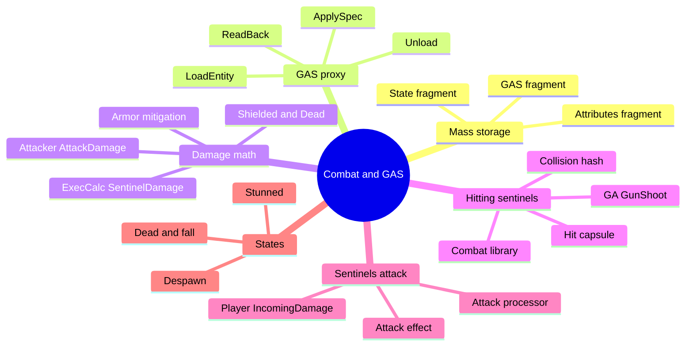
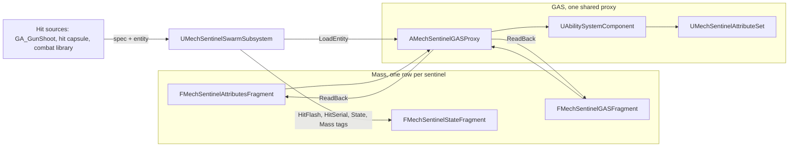
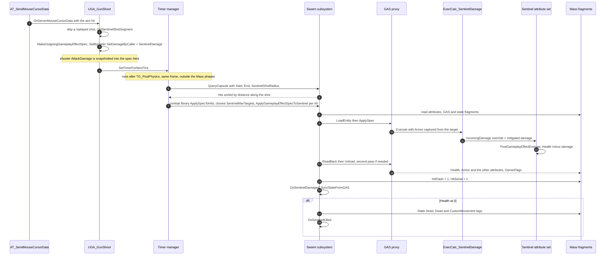
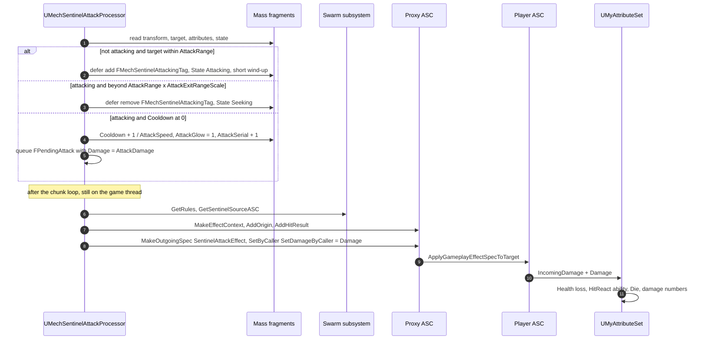
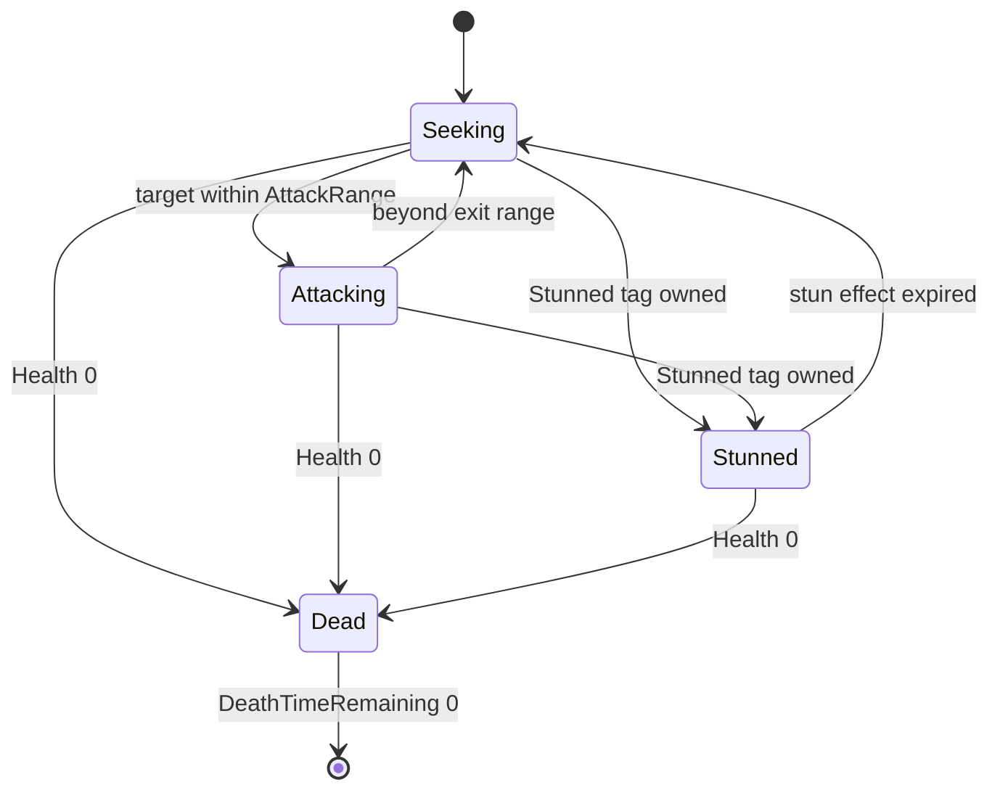

↑ [[MechSentinel Index]]

# MechSentinel Combat and GAS

Every sentinel value that matters in a fight (health, armor, attack damage, active buffs, stun) lives in Mass fragments, one row per entity. GAS never owns a sentinel: one hidden proxy actor with a real AbilitySystemComponent is loaded with a single sentinel's values, runs the gameplay effect (execution calcs, modifiers, tag rules), and the results are written back to Mass. This keeps thousands of sentinels cheap while the damage math stays normal GAS. Hits come in from gun shots, projectiles with a hit capsule, or any Blueprint through the combat library; sentinels hit players back through the player's normal GAS damage pipeline.

## Mind map



## How it flows

### Who owns what



1. A hit source builds a gameplay effect spec and hands it, with the entity handle, to `UMechSentinelSwarmSubsystem`.
2. The subsystem loads that one sentinel into the shared `AMechSentinelGASProxy`: attribute base values from `FMechSentinelAttributesFragment`, active effects re-created from `FMechSentinelGASFragment`.
3. GAS applies the spec on the proxy's ASC; `UMechSentinelAttributeSet` turns the damage meta attribute into health loss.
4. `ReadBack` copies base and current values and owned tags back to the two fragments, then the proxy is wiped (`Unload`).
5. The subsystem updates `FMechSentinelStateFragment` (hit flash, death, stun) and the matching Mass tags.

### A gun shot hits a sentinel



1. `UAT_SendMouseCursorData` hands every shot's target data to `UMyGameplayAbility::OnServerMouseCursorData` on the server (the host's own shot from `Activate`, a remote client's when it arrives), before the Blueprint sees it.
2. `UGA_GunShoot` damages each shot once (`LastSentinelShot` remembers the last one) and builds the shot segment itself (see [[MechSentinel Combat and GAS#Gun shots from GA_GunShoot]]).
3. The spec is made while the ability is active: its level, `SentinelDamage` as the SetByCaller base, and the shooter's ASC as source, so `ExecCalc_SentinelDamage` snapshots the shooter's `AttackDamage` now.
4. The actual hit runs in a next-tick timer, later the same frame, because this can be called in the middle of a Mass phase (the host's own shot comes from input, in `TG_PrePhysics`).
5. `QueryCapsule` tests the swept segment against the sentinel capsules in the cells of the spatial hash it covers; `UMechSentinelCombatLibrary::ApplySpecToHits` damages the closest `SentinelMaxTargets` living ones (1 by default).
6. Per sentinel, `ApplyGameplayEffectSpecToSentinel` runs the two-pass GAS bridge and writes the results to Mass.
7. A damaging hit sets `HitFlash` and bumps `HitSerial` (clients flash when the replicated serial changes), broadcasts `OnSentinelDamaged`, and `SyncStateFromGAS` turns 0 health into the Dead state.

### A sentinel attacks a player



1. `UMechSentinelAttackProcessor` (authority, `MechSwarm.Combat` group, after Movement, game thread) handles every living, non-stunned sentinel.
2. It enters the attack state inside `AttackRange` (450 cm) of the target location and leaves it beyond `AttackRange x AttackExitRangeScale` (562.5 cm); only player slots can be attacked, fallback points are gathering places.
3. When the cooldown runs out it fires: the next cooldown is `max(Cooldown + interval, 0.25 x interval)` with `interval = 1 / max(0.05, AttackSpeed)`, so it never fires twice in a frame.
4. Attacks are only collected in the chunk loop (`FPendingAttack`: target, from, to, damage) and applied afterwards, because GAS can run arbitrary game code.
5. The source ASC is the proxy's. The context carries the sentinel position as origin and a hit result whose impact point is the target location, which the project's damage pipeline expects.
6. The spec of `SentinelAttackEffect` carries the sentinel's current `AttackDamage` (damage buff included) as `SetDamageByCaller`.
7. The player's `UMyAttributeSet` handles it like any other hit: `IncomingDamage` to health, hit react, death and damage numbers.

## Where combat data lives

| Fragment | Kind | Combat fields (defaults) |
|---|---|---|
| `FMechSentinelAttributesFragment` | per entity | `Health` / `MaxHealth` (100 / 100), `BaseArmor` / `Armor` (0), `BaseAttackDamage` / `AttackDamage` (10), `BaseAttackSpeed` / `AttackSpeed` (1, attacks per second), `BaseMoveSpeedMultiplier` / `MoveSpeedMultiplier` (1) |
| `FMechSentinelGASFragment` | per entity | `OwnedTags` (gameplay tags granted by active effects, plus Dead), `ActiveEffects` (array of `FMechSentinelActiveEffect`) |
| `FMechSentinelStateFragment` | per entity | `State` (`EMechSentinelState`), `TimeInState`, `DeathTimeRemaining`, `HitFlash`, `HitSerial`, `BuffMask` |
| `FMechSentinelAttackFragment` | per entity | `Cooldown`, `AttackGlow`, `AttackSerial` |
| `FMechSentinelSharedAttributesFragment` | mutable shared, per `SwarmGroup` | `MovementSpeed` (900 cm/s) |
| `FMechSentinelParameters` | const shared, per config | attack range, capsule, death fall and stun settings (see [[MechSentinel Combat and GAS#Tuning knobs]]) |

* "Base" values are what spawning and instant effects set (permanent). The plain values are the current ones, base plus every active duration effect.
* The fragment defaults above are only the struct defaults. `UMechSentinelTrait` fills the template from `FMechSentinelAttributeDefaults` (`MaxHealth` 120, `Armor` 4, `AttackDamage` 6, `AttackSpeed` 0.8 in C++), and the wave spawner scales them per wave at spawn. `ue_setup_mech_sentinel_demo.py` writes `MaxHealth` 120, `Armor` 4, `AttackDamage` 3, `AttackSpeed` 0.6 into `DA_MechSentinelConfig`.
* `FMechSentinelActiveEffect` stores one duration or infinite effect: `EffectClass`, `Level`, `RemainingTime` (below 0 = infinite), `SetByCallerMagnitudes`, `StackCount`, and a weak `InstigatorASC`. The list is kept in application order on purpose, because the proxy re-creates it in that order (immunity and "remove other effects" components depend on it).
* `FMechSentinelGASFragment` is not trivially copyable (tag container and array), so it opts in with `TMassFragmentTraits<...>::AuthorAcceptsItsNotTriviallyCopyable`.
* `MovementSpeed` is swarm wide; a single sentinel is slowed or hasted through its `MoveSpeedMultiplier` attribute. `UMechSentinelSwarmSubsystem::SetSwarmMovementSpeed(SwarmGroup, NewMovementSpeed)` changes the shared value at runtime (server).

## The GAS proxy

`AMechSentinelGASProxy` (an `AActor`, `NotPlaceable`, `Transient`; the code has no `UMechSentinelGASProxy`) is spawned once per world on the authority by `UMechSentinelSwarmSubsystem::GetOrCreateProxy`, at the origin, hidden, not replicated, no tick.

* Components: `AbilitySystemComponent` (not replicated, `bSuppressGameplayCues = true` because cues would play at the world origin), `AttributeSet` (`UMechSentinelAttributeSet`), and `SourceAttributeSet` (a default `UMyAttributeSet`, never written). The last one exists because the proxy is also the source ASC of sentinel attacks, and the project's `UExecCalc_Damage` captures source attributes such as `CritChance` from `UMyAttributeSet`.
* `PostInitializeComponents` calls `InitAbilityActorInfo(this, this)` and adds the loose tag `Unit.Sentinel`.

| Function | What it does |
|---|---|
| `LoadEntity(Attributes, GAS, bAttacking)` | Unloads first if needed. Sets attribute bases from Mass (`MaxHealth` before `Health`, because health is clamped against it). Adds `State.Sentinel.Attacking` as a loose tag while the sentinel has `FMechSentinelAttackingTag`. Re-creates every stored effect in stored order with its level, SetByCaller magnitudes, remaining time (locked duration) and stack count; an effect with a chance-to-apply component is retried up to 32 times so it never loses a re-roll. Then `StripReapplicationSideEffects` removes anything else the re-creation applied (up to 4 passes) and resets the bases, because those side effects already happened when the effect first landed. |
| `ApplySpec(Spec)` | `ApplyGameplayEffectSpecToSelf`; a valid handle (duration or infinite effect) is remembered as temporary. |
| `ReadBack(OutAttributes, OutGAS)` | Back to Mass: `MaxHealth` and `Health` from their base values (`Health` clamped to `MaxHealth`; the fragment has no current/base pair for them), base and current of `Armor`, `AttackDamage`, `AttackSpeed` and `MoveSpeedMultiplier`, and the owned tags minus `Unit.Sentinel` and `State.Sentinel.Attacking`. Returns the health removed since `LoadEntity` (`ConsumeLastResolvedDamage`). |
| `Unload()` | Removes the temporary handles, then every remaining active effect (empty query, up to 4 passes, because removals can fire on-complete effects), the loose attacking tag, and resets `IncomingDamage`. The proxy is blank for the next sentinel. |
| `GetStoredHandles()` | Handles of the re-created stored effects, index aligned with `ActiveEffects`; used to see which stored effects GAS removed and which effects GAS applied on its own. |

## The GAS bridge step by step

`UMechSentinelSwarmSubsystem::ApplyGameplayEffectSpecToSentinel(Entity, Spec, HitLocation)` is the one entry point for anything that changes a sentinel through GAS (damage, stun, shield, slow, self-buffs). It is server only and returns the health removed.

1. Bail out on clients, without a `Spec.Def`, for inactive entities, missing fragments, or a sentinel already in `EMechSentinelState::Dead`.
2. **Pass 1.** `LoadEntity`, then `ApplySpec`.
3. **Prune.** `PruneRemovedEffects` drops stored effects that the incoming spec removed (cleanse, remove-other-effects, immunity) so they do not come back on the next evaluation.
4. **Store.** A non-instant incoming effect that is now active is stored (`StoreActiveEffect`: the same class refreshes its entry with what GAS resolved, so the GE's stacking rules are respected). Every other effect GAS applied on its own while running the spec (additional on-application effects, overflow effects), even for an instant spec, is stored too, otherwise a stun or slow they grant would stay in Mass with nothing to expire it. Periodic effects are not persisted: a warning tells you to use an instant effect applied repeatedly for damage over time.
5. `ReadBack` into the fragments, `Unload`.
6. **Pass 2**, only when something was pruned or a non-instant effect turned up (stored, or a periodic one that was refused): `LoadEntity`, `ReadBack`, `Unload` again, so the current values come from the updated stored list with no double counting of a refreshed effect.
7. If damage was dealt: `State->HitFlash = 1`, `++State->HitSerial`, `OnSentinelDamaged.Broadcast(handle, damage, location, instigator)` (location = `HitLocation` or the entity transform).
8. `SyncStateFromGAS(EntityManager, Entity, Instigator)` mirrors the GAS view into Mass state and tags (see [[MechSentinel Combat and GAS#Kill flow and despawn]] and [[MechSentinel Combat and GAS#Stun]]).

Two smaller entry points use the same proxy:

* `RecomputeSentinel(Entity)`: re-evaluates current values and tags from the stored effects after one expired (called by `UMechSentinelEffectsProcessor`).
* `KillSentinel(Entity, Instigator)`: sets `Health = 0` and runs `SyncStateFromGAS`, no damage math (used by the wave spawner's `DespawnAll(bKill = true)`).

**Timing rule.** Hits read and write fragments and may change Mass tags, which must not happen while Mass processors run on worker threads (`TG_PrePhysics` to `TG_PostPhysics`, and `TG_LastDemotable`). The safe places are timers (after `TG_PostPhysics`) and `TG_PostUpdateWork`. As a safety net, `SetMassTag` defers tag changes through the command buffer whenever `MayRunNextToMassPhase` says a phase may be running, so a hit during a phase cannot crash; its damage write can still race the workers.

## UMechSentinelAttributeSet

The proxy's attribute set. Its values are never the source of truth; they only hold one sentinel during an evaluation.

| Attribute | Init | Clamp (`PreAttributeChange`) | Notes |
|---|---|---|---|
| `Health` | 100 | 0 to `MaxHealth` (also on base changes) | |
| `MaxHealth` | 100 | at least 1 | |
| `Armor` | 0 | none | negative armor amplifies damage |
| `AttackDamage` | 10 | at least 0 | damage of the sentinel's attacks on players |
| `AttackSpeed` | 1 | at least 0.05 | attacks per second |
| `MoveSpeedMultiplier` | 1 | at least 0 | scales the shared `MovementSpeed` |
| `IncomingDamage` | 0 | | **meta attribute**, written by `ExecCalc_SentinelDamage` |

`PostGameplayEffectExecute`: when `IncomingDamage` was executed, it is read, reset to 0, and if positive subtracted from `Health` (clamped); the health actually removed is added to `LastResolvedDamage`, which `ConsumeLastResolvedDamage` hands to the bridge. A direct `Health` modifier (heal or damage) is clamped to `0..MaxHealth`.

## Damage math

`UExecCalc_SentinelDamage` captures `Armor` from the target (not snapshotted: the proxy holds the live values, buffs included) and `UMyAttributeSet::AttackDamage` from the source (snapshotted when the spec is made). Constants come from the rules (with the same fallbacks hard-coded when no rules are found).

```text
base       = max(0, SetByCaller SetDamageByCaller)
attack     = source UMyAttributeSet AttackDamage (0 when not captured)
raw        = base > 0 ? base + max(0, S) * max(0, attack) : 0      S = SourceAttackDamageScale (1)
mitigation = (k * Armor) / (1 + k * |Armor|)                       k = ArmorMitigationPerPoint (0.06)
damage     = max(0, raw * (1 - mitigation))
Shielded   : damage *= ShieldedDamageMultiplier (0.25)
Dead       : no output at all
output     : IncomingDamage Override = damage (only when damage > 0)
```

* The attacker's stat counts once: callers pass only the weapon's base in `SetDamageByCaller`.
* A base of 0 stays 0, so effect-only specs (stun, shield, slow) never deal damage.
* An ASC without `UMyAttributeSet`: nothing is captured, the hit is flat, no warning. No instigator ASC: the library makes the spec on the proxy, whose own default `UMyAttributeSet` has `AttackDamage` 0, so the hit is flat too.
* `ComputeRawDamage` and `MitigateDamage` are public static helpers, handy for previews.

Armor examples with k = 0.06: armor 4 removes 19.4%, armor 10 removes 37.5%, armor 50 removes 75%, armor -5 adds about 23% (`raw x 1.23`).

Shots per sentinel in `L_MechSentinelDemo` (wave multipliers from `ue_setup_mech_sentinel_demo.py`, `SentinelDamage` 40, the mech's starting `AttackDamage` 0), matching the "4 / 5 / 7 / 9 shots" comment in `GA_GunShoot.h`:

| Demo wave | Health x / Armor x | MaxHealth | Armor | Damage per shot | Shots |
|---|---|---|---|---|---|
| 1 | 1.0 / 1.0 | 120 | 4 | 32.3 | 4 |
| 2 | 1.25 / 1.25 | 150 | 5 | 30.8 | 5 |
| 3 | 1.5 / 1.5 | 180 | 6 | 29.4 | 7 |
| 4 | 2.0 / 2.0 | 240 | 8 | 27.0 | 9 |

## Gameplay tags

Native tags in `MechSentinelTags` (`MechSentinelTags.h/.cpp`):

| C++ name | Tag | Meaning | Mass mirror |
|---|---|---|---|
| `State_Sentinel_Stunned` | `State.Sentinel.Stunned` | granted by stun effects: no steering, no attacks, no buff decisions | `FMechSentinelStunnedTag`, state `Stunned` |
| `State_Sentinel_Shielded` | `State.Sentinel.Shielded` | damage x `ShieldedDamageMultiplier` | none |
| `State_Sentinel_Dead` | `State.Sentinel.Dead` | added by the bridge at 0 health | `FMechSentinelDeadTag`, state `Dead` |
| `State_Sentinel_Attacking` | `State.Sentinel.Attacking` | loose tag on the proxy during an evaluation, for tag requirements | `FMechSentinelAttackingTag` |
| `Unit_Sentinel` | `Unit.Sentinel` | loose tag on the proxy, handy for application requirements | none |
| `State_Sentinel_Buff_Armor` / `_Speed` / `_Damage` | `State.Sentinel.Buff.Armor` / `.Speed` / `.Damage` | a designer GE granting one counts as that self-buff | `BuffMask` bit |
| `SetByCaller_SelfBuffMagnitude` | `SetByCaller.MechSentinel.SelfBuffMagnitude` | magnitude of the built-in self-buffs | none |

The damage SetByCaller tag is the project's own `MyTags::SetDamageByCaller` (`SetDamageByCaller`), the same one the player's abilities use.

## Built-in effects and assets

| Class or asset | Setup | Used as |
|---|---|---|
| `UMechSentinelDamageEffect` | Instant, execution `UExecCalc_SentinelDamage` | default of the rules' `DefaultSentinelDamageEffect` |
| `UMechSentinelAttackEffect` | Instant, `UMyAttributeSet::IncomingDamage` Additive, SetByCaller `SetDamageByCaller` | default of the rules' `SentinelAttackEffect` |
| `UMechSentinelArmorBuffEffect`, `UMechSentinelSpeedBuffEffect`, `UMechSentinelDamageBuffEffect` | Has Duration, one Multiply (Additive) modifier | self-buffs, see [[MechSentinel Self Buffs]] |
| `/Game/MechSentinel/GAS/GE_SentinelDamage` | Instant, `ExecCalc_SentinelDamage` | the same as the built-in damage effect, as an asset |
| `/Game/MechSentinel/GAS/GE_SentinelAttack` | Instant, `MyAttributeSet.IncomingDamage` Add Base, SetByCaller `SetDamageByCaller` | the same as the built-in attack effect |
| `/Game/MechSentinel/GAS/GE_SentinelStun` | Has Duration 2 s, grants `State.Sentinel.Stunned` | example stun |

`ue_setup_mech_sentinel_demo.py` puts `GE_SentinelDamage` and `GE_SentinelAttack` into `/Game/MechSentinel/Data/DA_MechSentinelSwarmRules` (and `MaxAttackersPerPlayer` 10). Neither attack effect runs the project's `UExecCalc_Damage` (no block or crit rolls); assign a GE that executes it to get those. An empty `SentinelAttackEffect` makes attacks visual only.

The rules come from `AMyGameMode::SentinelSwarmRules`, read on the server in `OnWorldBeginPlay`. `GetRules()` never returns null: `SetRulesOverride` beats the GameMode rules, which beat the class defaults.

## Hitting sentinels from actors

Sentinels have no engine collision. Each living sentinel has a simple capsule along its **forward** axis (`CapsuleRadius` 70 cm, `CapsuleHalfHeight` 140 cm in `FMechSentinelParameters`). `UMechSentinelCollisionHashProcessor` (authority, last in `MechSwarm.Combat`) rebuilds a spatial hash of them every frame (`BeginCollisionFrame`, `AddCollisionCapsule`, `EndCollisionFrame`, cell size = rules `CollisionCellSize` 500 cm).

`QueryCapsule(SegmentStart, SegmentEnd, Radius, OutHits)` returns every sentinel whose capsule touches the segment inflated by `Radius` (a sphere sweep is the same query). It is a segment-to-segment distance test (`FMath::SegmentDistToSegmentSafe`), walks only the cells the query covers, and falls back to testing every capsule when the query would cover more than 4096 cells or 4 times the filled cells, or has NaN or huge coordinates (shots come from client data). Hits are `FMechSentinelHit` (`Sentinel`, `ImpactPoint` on the sentinel axis, `Distance` along the sweep), sorted by distance. `GetNumAliveSentinels()` is the hash size, so it is 0 on clients.

`UMechSentinelCombatLibrary` (all server functions are `BlueprintAuthorityOnly`; call them outside the Mass phases):

```cpp
// Queries
static int32 FindSentinelsInCapsule(const UObject* WorldContextObject, FVector Center, FRotator Rotation, float Radius, float HalfHeight, TArray<FMechSentinelHit>& OutHits);
static int32 SweepSentinels(const UObject* WorldContextObject, FVector Start, FVector End, float Radius, TArray<FMechSentinelHit>& OutHits);

// Damage and effects
static int32 ApplyDamageToSentinelsInCapsule(const UObject* WorldContextObject, AActor* Instigator, FVector Center, FRotator Rotation, float Radius, float HalfHeight,
    float Damage, TSubclassOf<UGameplayEffect> DamageEffect, int32 MaxTargets, TArray<FMechSentinelHit>& OutHits, float& OutTotalDamage);
static int32 ApplyDamageToSentinelsInSweep(const UObject* WorldContextObject, AActor* Instigator, FVector Start, FVector End, float Radius,
    float Damage, TSubclassOf<UGameplayEffect> DamageEffect, int32 MaxTargets, TArray<FMechSentinelHit>& OutHits, float& OutTotalDamage);
static int32 ApplyEffectToSentinelsInCapsule(const UObject* WorldContextObject, AActor* Instigator, FVector Center, FRotator Rotation, float Radius, float HalfHeight,
    TSubclassOf<UGameplayEffect> Effect, float Level, int32 MaxTargets);
static float ApplyDamageToSentinel(const UObject* WorldContextObject, AActor* Instigator, FMechSentinelHandle Sentinel, float Damage, FVector HitLocation, TSubclassOf<UGameplayEffect> DamageEffect);
static float ApplyGameplayEffectSpecToSentinel(const UObject* WorldContextObject, const FGameplayEffectSpecHandle& SpecHandle, FMechSentinelHandle Sentinel, FVector HitLocation);

// Info
static bool GetSentinelInfo(const UObject* WorldContextObject, FMechSentinelHandle Sentinel, FMechSentinelInfo& OutInfo);
static bool IsSentinelAlive(const UObject* WorldContextObject, FMechSentinelHandle Sentinel);

// C++ helpers
static FGameplayEffectSpecHandle MakeSentinelDamageSpec(const UObject* WorldContextObject, AActor* Instigator, float Damage, TSubclassOf<UGameplayEffect> Effect, float Level = 1.f);
static int32 ApplySpecToHits(UMechSentinelSwarmSubsystem& Swarm, const FGameplayEffectSpec& Spec, TArray<FMechSentinelHit>& InOutHits, int32 MaxTargets, float* OutTotalDamage = nullptr);
static void GetCapsuleSegment(const FVector& Center, const FRotator& Rotation, float Radius, float HalfHeight, FVector& OutA, FVector& OutB);
```

* Capsules follow the UE convention: axis = `Rotation`'s up vector, `HalfHeight` includes the caps.
* `MakeSentinelDamageSpec` uses the given effect or the rules' `DefaultSentinelDamageEffect`, sets `SetDamageByCaller = Damage`, and uses the instigator's ASC as source when it has one. Otherwise the proxy ASC makes the spec, with the instigator added to the context, and the damage stays flat. Pass the pawn, not its controller.
* `ApplySpecToHits` walks the sorted hits, skips dead ones, stops after `MaxTargets` (0 = all) and removes the unused entries from the list.
* `ApplyEffectToSentinelsInCapsule` builds its spec with a base damage of 0: the effect itself decides what happens.
* `FMechSentinelHandle` is the Blueprint wrapper of `FMassEntityHandle` (`Index`, `SerialNumber`, `ToEntity()`).
* `FMechSentinelInfo` returns `Location`, `State`, `Health`, `MaxHealth`, `Armor`, `AttackDamage`, `AttackSpeed`, `OwnedTags`; on clients only location, state and health fraction mean anything.

## The hit capsule component

`UMechSentinelHitCapsuleComponent` (a `UCapsuleComponent`, Blueprint spawnable, radius 20 cm and half height 20 cm by default) lets a projectile, sword or beam hit sentinels.

* Ticks only on the authority, in `TG_PostUpdateWork` (after the projectile moved, outside the Mass phases). Its own engine collision is off (`NoCollision`, no overlap events).
* Each test: overlap of its capsule plus, with `bSweepFromLastPosition`, a sweep from last frame's position (no tunnelling), sorted by distance to where it came from. Sentinels already hit are skipped.
* The instigator is the owner's instigator pawn, else the owner's owner, else the owner. Its ASC is the effect source, so its `AttackDamage` is read when the hit lands.
* Each hit applies the damage spec and every `ExtraEffects` spec (base 0), fires `OnSentinelHit(Sentinel, ImpactPoint, DamageDealt)`, and counts toward `MaxSentinelsHit`. When spent and `bDestroyOwnerWhenSpent`, the owner is destroyed.
* `ApplyHitsNow()` tests on demand (melee: call it from a next-tick timer), `ResetHitSentinels()` allows hitting the same sentinels again, `SetHitsEnabled(bool)` toggles without sweeping across the gap.

## Gun shots from GA_GunShoot

`UGA_GunShoot::OnServerMouseCursorData` damages sentinels on top of what the ability already does to characters (`MyFunc` and `DamageEffectClass` are unchanged).

* **Aim.** The client's crosshair line (`AimHit.TraceStart` toward `TraceEnd`). The server uses it only if the camera is within 5000 cm of the shooter, the line passes within 300 cm of the shooter (plus 0.25 s of its velocity), and no wall lies between the shooter's capsule centre and the line's nearest point. Otherwise the shot follows the pawn's view (`GetPawnViewLocation`, `GetBaseAimRotation`).
* **Start.** The point of the line nearest the shooter, so nothing between the camera and the character is hit.
* **End.** The first wall the server traces itself (`ECC_Visibility`, complex collision, the shooter and its attachments ignored, objects of the Pawn type ignored). `TraceWall` looks past characters (up to 8 in a row) because their server positions differ from what the client saw: **characters are not walls**. The only character that stops a shot is the crosshair trace's own first hit when it lies ahead of the shooter. Otherwise the shot ends at `SentinelShotRange`.
* **Spec.** `SentinelDamageEffect` or the rules' `DefaultSentinelDamageEffect`, at the ability level, `SetDamageByCaller = SentinelDamage.GetValueAtLevel(Level)`.
* **Hit.** Next-tick timer: `QueryCapsule(Start, End, SentinelShotRadius)` and `ApplySpecToHits(..., SentinelMaxTargets)`. The log line `Shot hit %d sentinel(s) for %.1f damage.` is printed at Verbose on `LogGunShoot`.

## Sentinels attacking players

Details beyond the diagram above:

* The query skips sentinels with `FMechSentinelDeadTag` or `FMechSentinelStunnedTag`, and the loop also skips `State` Dead or Stunned: a kill or stun from a hit made next to the phase sets `State` at once while its tags arrive only when the phase's commands flush.
* While travelling, the cooldown never banks more than one attack (`max(Cooldown, 0)`). Entering the attack state adds a wind-up of `0.15 to 0.6 x interval`, so a wave arriving together does not fire in the same frame.
* Without a source ASC or with an empty `SentinelAttackEffect`, the attack is visual only (`AttackGlow`, `AttackSerial` still change).
* Handlers of the player's damage and death events run inside this processor. If they hit sentinels, they should defer through a next-tick timer (timing rule above).

## Stun

A stun is any duration effect that grants `State.Sentinel.Stunned`, for example `GE_SentinelStun` (2 s) through `ApplyEffectToSentinelsInCapsule` or a hit capsule's `ExtraEffects`.



1. `SyncStateFromGAS` sees the tag in `OwnedTags`: state `Stunned`, `TimeInState = 0`, `FMechSentinelStunnedTag` added, the attacking tag removed.
2. `UMechSentinelSteeringProcessor` stops steering: the sentinel sinks at `FallGravity x StunnedGravityScale` (350 cm/s) fading to 0 over `StunnedSinkDuration` (0.6 s), then hovers (alive sentinels have no ground check). Max speed drops to `max(50, speed x 0.35)`.
3. No attacks (the attack query excludes the tag), no self-buff decisions (timers keep running).
4. `UMechSentinelEffectsProcessor` counts the stored effect down; at expiry `RecomputeSentinel` drops the tag and `SyncStateFromGAS` puts the sentinel back to `Seeking`.
5. Visuals: the eyes flicker in a 9 Hz square wave (custom data 0 = 2), the tentacles go slack, see [[MechSentinel Representation and Visuals]].

## Kill flow and despawn

1. Health reaches 0 in the bridge (or `KillSentinel` sets it).
2. `SyncStateFromGAS`: state `Dead`, `TimeInState = 0`, `DeathTimeRemaining = DeathFallDuration` (2.5 s; 2 s if the parameters are missing), `BuffMask = 0`, `State.Sentinel.Dead` added to `OwnedTags`.
3. Mass tags: `FMechSentinelDeadTag` and `FMassCustomMovementTag_Copy` added (death owns the position now), attacking and stunned tags removed. `OnSentinelKilled(handle, location, instigator)` is broadcast.
4. Further specs are ignored (the bridge returns early for Dead, and `ExecCalc_SentinelDamage` outputs nothing when the target has the Dead tag). The collision hash skips the wreck, so it can no longer be hit.
5. `UMechSentinelDeathProcessor` (authority, after the attack processor, game thread): ballistic fall with horizontal damping `exp(-0.8 dt)` and `FallGravity` (1400 cm/s²), a short line trace against `ECC_WorldStatic` when `bWrecksCollideWithWorld` (the wreck rests on its capsule radius), tumbling at up to `WreckTumbleSpeed` (220 deg/s) while it moves.
6. The entity is destroyed through the command buffer when `DeathTimeRemaining` reaches 0, or early when it falls faster than 6000 cm/s (below every floor). Clients see the destruction through replication.
7. The wave spawner counts a sentinel as alive while its entity is active and its state is not Dead, so its alive counts drop at the kill, not when the wreck disappears.

## Key files

| File | Role |
|---|---|
| `Source/Aura/Public/MechSwarm/GAS/MechSentinelGASProxy.h` | `AMechSentinelGASProxy`: load, apply, read back, unload |
| `Source/Aura/Private/MechSwarm/GAS/MechSentinelGASProxy.cpp` | proxy implementation, re-application side effect stripping |
| `Source/Aura/Public/MechSwarm/GAS/MechSentinelAttributeSet.h` | attributes, `IncomingDamage` meta attribute |
| `Source/Aura/Private/MechSwarm/GAS/MechSentinelAttributeSet.cpp` | clamps, meta attribute to health |
| `Source/Aura/Private/MechSwarm/GAS/ExecCalc_SentinelDamage.cpp` | armor, AttackDamage, shield, dead |
| `Source/Aura/Private/MechSwarm/GAS/MechSentinelDefaultEffects.cpp` | built-in damage, attack and self-buff effects |
| `Source/Aura/Private/MechSwarm/GAS/MechSentinelTags.cpp` | native gameplay tags |
| `Source/Aura/Private/MechSwarm/Core/MechSentinelSwarmSubsystem.cpp` | GAS bridge, `SyncStateFromGAS`, collision hash, `QueryCapsule` |
| `Source/Aura/Public/MechSwarm/Core/MechSentinelSwarmRules.h` | combat constants and default effects |
| `Source/Aura/Public/MechSwarm/Sentinel/MechSentinelFragments.h` | attribute, GAS, state, attack fragments, parameters |
| `Source/Aura/Private/MechSwarm/Sentinel/MechSentinelCombatProcessors.cpp` | attack, death fall, collision hash processors |
| `Source/Aura/Private/MechSwarm/Sentinel/MechSentinelBehaviorProcessors.cpp` | effect expiry (`UMechSentinelEffectsProcessor`), stun steering |
| `Source/Aura/Public/MechSwarm/Combat/MechSentinelCombatLibrary.h` | Blueprint hit functions |
| `Source/Aura/Private/MechSwarm/Combat/MechSentinelHitCapsuleComponent.cpp` | projectile and melee hit capsule |
| `Source/Aura/Private/AbilitySystem/Abilities/GA_GunShoot.cpp` | gun shots against sentinels |
| `Source/Aura/Public/MyGameMode.h` | `SentinelSwarmRules` property |
| `SourceArt/MechSentinel/ue_setup_mech_sentinel_demo.py` | creates the GE assets, rules and config of the demo |

## Tuning knobs

| Setting | Where | Default | Effect |
|---|---|---|---|
| `ArmorMitigationPerPoint` | rules, Combat | 0.06 | k in the armor curve |
| `ShieldedDamageMultiplier` | rules, Combat | 0.25 | damage taken while Shielded |
| `SourceAttackDamageScale` | rules, Combat | 1 | share of the attacker's `AttackDamage` added to each hit (0 = flat) |
| `DefaultSentinelDamageEffect` | rules, Combat | `UMechSentinelDamageEffect` | GE for hits when callers pass none |
| `SentinelAttackEffect` | rules, Combat | `UMechSentinelAttackEffect` | GE sentinels apply to players (empty = visual only) |
| `CollisionCellSize` | rules, Simulation | 500 cm | spatial hash cell for hit queries |
| `MaxHealth`, `Armor`, `AttackDamage`, `AttackSpeed` | `UMechSentinelTrait` > Attributes | 120, 4, 6, 0.8 | starting attributes before wave scaling |
| `AttackRange`, `AttackExitRangeScale` | trait > Parameters | 450 cm, 1.25 | attack state enter and exit range |
| `CapsuleRadius`, `CapsuleHalfHeight` | trait > Parameters | 70 cm, 140 cm | hit capsule along the forward axis |
| `DeathFallDuration` | trait > Parameters | 2.5 s | wreck lifetime |
| `FallGravity`, `WreckTumbleSpeed` | trait > Parameters | 1400 cm/s², 220 deg/s | wreck fall and tumble |
| `bWrecksCollideWithWorld` | trait > Parameters | true | wrecks stop on WorldStatic |
| `StunnedGravityScale`, `StunnedSinkDuration` | trait > Parameters | 0.25, 0.6 s | stun sink |
| `bDamageSentinels` | `UGA_GunShoot` | true | shots ignore sentinels when off |
| `SentinelDamage` | `UGA_GunShoot` | 40 | base damage per sentinel hit |
| `SentinelDamageEffect` | `UGA_GunShoot` | empty | GE for gun hits (empty = rules default) |
| `SentinelShotRadius` | `UGA_GunShoot` | 15 cm | shot thickness |
| `SentinelShotRange` | `UGA_GunShoot` | 20000 cm | range without a wall |
| `SentinelMaxTargets` | `UGA_GunShoot` | 1 | sentinels per shot (0 = piercing) |
| `Damage` | hit capsule | 25 | base damage per hit |
| `MaxSentinelsHit` | hit capsule | 1 | 0 = unlimited piercing |
| `bDestroyOwnerWhenSpent`, `bHitEveryTick`, `bSweepFromLastPosition` | hit capsule | true, true, true | projectile behaviour |

## Related

* [[MechSentinel Architecture]]: where the GAS bridge sits among the subsystems.
* [[MechSentinel Frame Flow]]: when the attack, death and hash processors run, and why hits wait for timers.
* [[MechSentinel Self Buffs]]: the same bridge used for armor, speed and damage buffs.
* [[MechSentinel Behaviour and Targeting]]: how a sentinel picks the player it attacks.
* [[MechSentinel Replication and Multiplayer]]: how `HitSerial`, `AttackSerial`, health and state reach clients.
* [[MechSentinel Spawning and Waves]]: wave scaling of health, armor and damage.
* [[MechSentinel Representation and Visuals]]: hit flash, attack glow and stun flicker in the materials.
* [[MyMassEntityTest]]: the original "GAS logic, Mass storage" request.

← [[MechSentinel Movement and Avoidance]] · [[MechSentinel Index|Index]] · [[MechSentinel Self Buffs]] →
