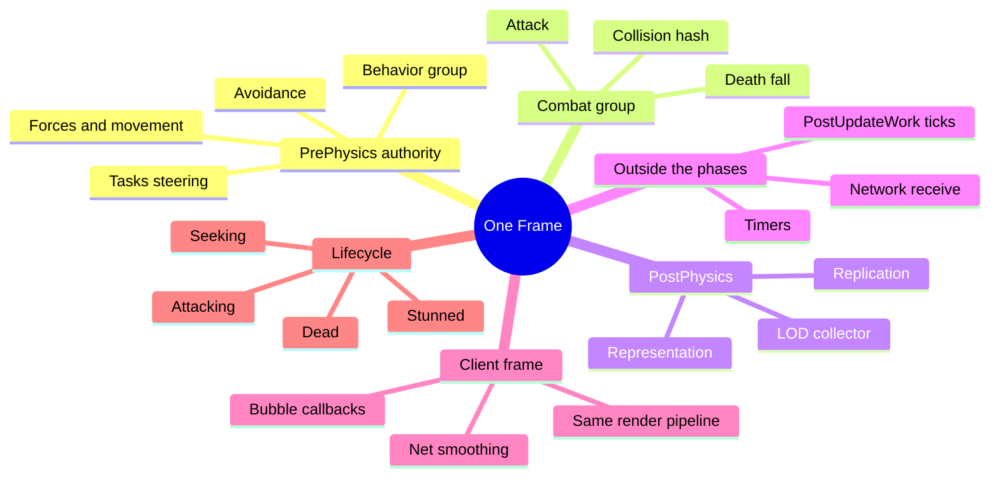
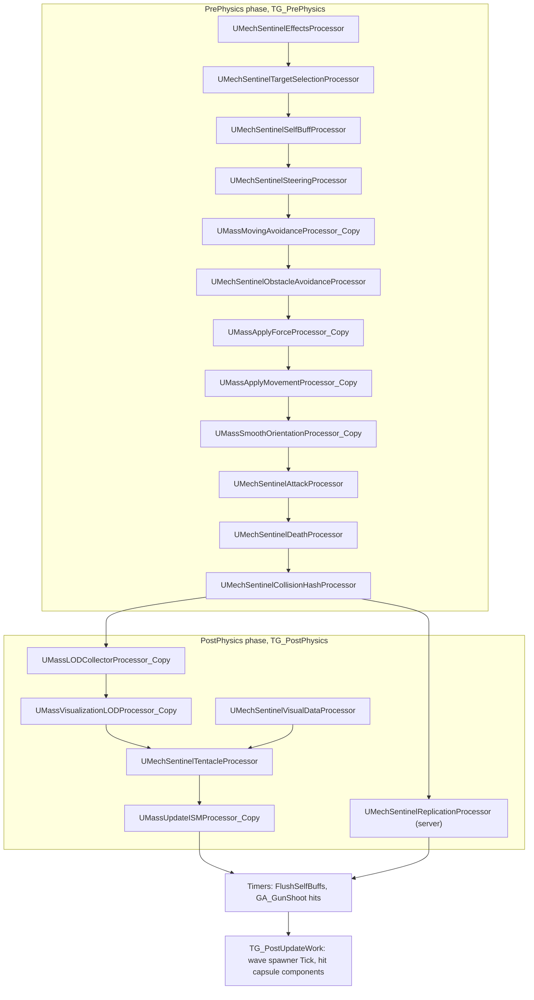
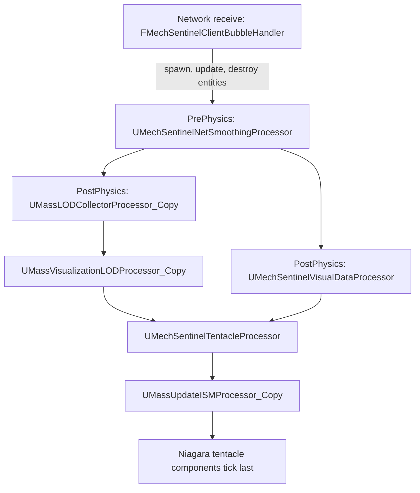
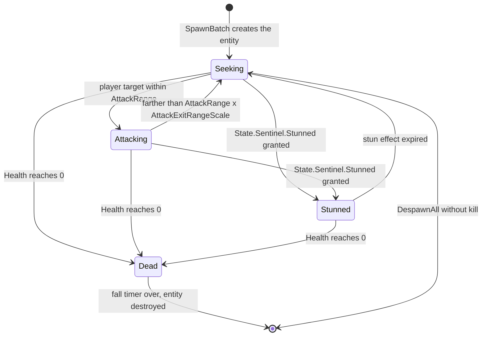

↑ [[MechSentinel Index]]

# MechSentinel Frame Flow

This page follows one frame of the swarm: which processors run, in which Mass phase and order, what each one reads and writes, and what happens outside the phases (timers, the wave spawner, network receive). The server (or a standalone game) simulates everything. A network client simulates nothing: it eases toward replicated samples and draws. The last part follows one sentinel through its life, from spawn through seeking, attacking, stun and death to despawn.

## Mind map

## How it flows

### The processor pipeline on the server or standalone

1. **Behavior group** (`UE::Mass::ProcessorGroupNames::Behavior`). `UMechSentinelEffectsProcessor` ticks stored effect durations and asks the GAS bridge to recompute sentinels whose buff, debuff or stun just expired. `UMechSentinelTargetSelectionProcessor` refreshes the targeting boards and assigns targets. `UMechSentinelSelfBuffProcessor` runs the self-buff timers and queues casts.
2. **Tasks group.** `UMechSentinelSteeringProcessor` turns the target into `FMassDesiredMovementFragment_Copy` (desired velocity, facing, speed cap).
3. **Avoidance group.** `UMassMovingAvoidanceProcessor_Copy` adds a sentinel-vs-sentinel push to `FMassForceFragment_Copy`; `UMechSentinelObstacleAvoidanceProcessor` then handles platforms and boxes (force plus a corrected desired velocity).
4. **ApplyForces, Movement groups.** `UMassApplyForceProcessor_Copy` clamps the desired velocity, `UMassApplyMovementProcessor_Copy` integrates velocity and position, `UMassSmoothOrientationProcessor_Copy` turns the body.
5. **MechSwarm.Combat group.** With positions settled: `UMechSentinelAttackProcessor` (attack state, attacks on players), `UMechSentinelDeathProcessor` (wreck fall, destroy), `UMechSentinelCollisionHashProcessor` (the capsule hash every hit query uses).
6. **PostPhysics.** On a server with clients, `UMechSentinelReplicationProcessor` fills the client bubbles (see [[MechSentinel Replication and Multiplayer]]). Where frames are rendered, the LOD collector, visual LOD, visual data, tentacles and ISM update draw the swarm.
7. **After the phases.** Timers run after `TG_PostPhysics`: the self-buff flush and the gun shot hits. Then `TG_PostUpdateWork`: `AMechSentinelWaveSpawner::Tick` (spawn, despawn) and `UMechSentinelHitCapsuleComponent`.

The arrows show the declared order constraints. Steps 1 to 5 run on the authority only (`Standalone | Server` flags); step 6's render part runs where frames are drawn (`Standalone | Client` flags; a listen server has both).

### One frame on a network client

1. At the start of the frame the network driver applies the bubble's fast array changes. `FMechSentinelClientBubbleHandler` spawns client entities for new agents, writes every replicated snapshot into the entity (`ApplyToEntity`) and destroys entities whose agent was removed.
2. In PrePhysics the only swarm processor that runs on a client is `UMechSentinelNetSmoothingProcessor` (Movement group, `Client` flag only). It eases each transform toward the last sample.
3. PostPhysics runs the same render pipeline as standalone: viewer distance and visual LOD on one side, ISM custom data (with the hit flashes and attack glows that `ApplyToEntity` started on serial changes) on the other; both must finish before the tentacles, then the ISM instances. The visual data processor declares no order against the LOD steps (only "before the ISM update"; the tentacle processor declares itself after it), so Mass may run it next to them.
4. The Niagara components of the tentacle sets use `ENiagaraTickBehavior::ForceTickLast`, so the ribbons are built from this frame's arrays.

Clients run no behaviour, movement, combat or self-buff processor. The wave spawner never enables its tick on a client (`BeginPlay` returns before `SetActorTickEnabled` without authority), and its `Tick` would return at once anyway.

### Sentinel lifecycle

1. A new entity starts in `EMechSentinelState::Seeking` (the fragment default).
2. `UMechSentinelAttackProcessor` switches between Seeking and Attacking by distance to the assigned player, with hysteresis.
3. Stunned is entered and left only through GAS: `SyncStateFromGAS` sees the `State.Sentinel.Stunned` tag appear on the evaluated proxy, or disappear after the effects processor drops the expired effect and recomputes.
4. Dead comes from `SyncStateFromGAS` when health is 0 after a hit, a kill (`KillSentinel`) or a `DespawnAll(true)`.
5. The death processor destroys the wreck after `DeathFallDuration`. `DespawnAll(false)` destroys living sentinels directly.

Details for each step are in [[MechSentinel Frame Flow#Sentinel lifecycle in detail]].

## Phases, groups and flags

Mass runs its processors in phases, each tied to a tick group (`MassProcessingPhaseManager.cpp`):

| `EMassProcessingPhase` | Tick group | Used by the swarm |
|---|---|---|
| `PrePhysics` | `TG_PrePhysics` | yes: simulation (authority), net smoothing (client) |
| `StartPhysics`, `DuringPhysics`, `EndPhysics` | `TG_StartPhysics`, `TG_DuringPhysics`, `TG_EndPhysics` | no |
| `PostPhysics` | `TG_PostPhysics` | yes: replication, representation, tentacles |
| `FrameEnd` | `TG_LastDemotable` | no |

A processor that does not set `ProcessingPhase` runs in `PrePhysics` (the engine default). The groups used:

| Group | Name | Defined in |
|---|---|---|
| Behavior, Tasks, Avoidance, ApplyForces, Movement | `UE::Mass::ProcessorGroupNames::*` | engine (`MassCommonTypes`) |
| Combat | `MechSwarm.Combat` | `MechSwarm::ProcessorGroups::Combat()` |
| LOD collector | `MechSwarm.LODCollector` | `MechSwarm::ProcessorGroups::LODCollector()` |
| Representation | `MechSwarm.Representation` | `MechSwarm::ProcessorGroups::Representation()` |

`ExecutionFlags` decide where a processor exists. The engine maps net modes to flags: standalone = `Standalone`, dedicated server = `Server`, client = `Client`, **listen server = `Client | Server`**. So a listen-server host runs the simulation, the replication and the render pipeline.

## Server and standalone: every processor

All authority processors exclude dead sentinels unless noted, and most run on the game thread (`bRequiresGameThreadExecution = true`) because they call into GAS, read actors, trace the world, write subsystem data or keep member scratch buffers. The exceptions are steering, apply force, apply movement and smooth orientation.

### Behavior group

| Processor | Order | Reads | Writes |
|---|---|---|---|
| `UMechSentinelEffectsProcessor` | first | `FMechSentinelGASFragment` | `ActiveEffects[].RemainingTime`, `FMechSentinelStateFragment::TimeInState`, attributes (through `RecomputeSentinel`) |
| `UMechSentinelTargetSelectionProcessor` | after Effects | `FTransformFragment`, `FMechSentinelParameters`, rules, player pawns, fallback points | `FMechSentinelTargetingSharedFragment` (the board), `FMechSentinelTargetFragment` |
| `UMechSentinelSelfBuffProcessor` | after Effects and TargetSelection | state, target, transform, rules | `FMechSentinelSelfBuffFragment`, the subsystem's cast queue |

- **Effects.** Adds `DeltaTime` to `TimeInState`, counts down every stored effect with `RemainingTime >= 0` (negative means infinite) and removes expired ones with `RemoveAt`, not `RemoveAtSwap`, because the proxy re-creates them in application order. After the chunk loop it calls `UMechSentinelSwarmSubsystem::RecomputeSentinel` for each sentinel that lost an effect.
- **Target selection.** Three passes: refresh every board from `GatherPlayerTargets` and `GetFallbackTargets` (bump `BoardSerial` when the slot set changed); count the claims of still-valid assignments; reassign sentinels whose board changed, who have no target, whose `RetargetTimer` ran out (`RetargetInterval` 1.25 s, randomised x0.7 to x1.3), or whose player is over capacity while there is room elsewhere. Then every sentinel follows its target: `TargetLocation` = player location + `TargetHeightOffset` (90 cm), or the fallback point. See [[MechSentinel Behaviour and Targeting]].
- **Self-buffs.** Only when the rules' `bEnableSelfBuffs` is on. Cooldowns and the decision timer always run; at a decision a sentinel that is not Stunned or Dead rolls `SelfBuffChance x ChanceScale`, picks a ready buff by weight and calls `QueueSelfBuff`. The GE itself is applied later in the frame by a timer. See [[MechSentinel Self Buffs]].

### Tasks, Avoidance, ApplyForces, Movement groups

| Processor | Group, order | Reads | Writes |
|---|---|---|---|
| `UMechSentinelSteeringProcessor` | Tasks, after Behavior | transform, attributes (`MoveSpeedMultiplier`), state (`TimeInState`), `FMechSentinelParameters`, `FMechSentinelSharedAttributesFragment` | `FMassDesiredMovementFragment_Copy`, `FMechSentinelTargetFragment::OrbitDirection` |
| `UMassMovingAvoidanceProcessor_Copy` | Avoidance, after Tasks | transform, velocity, `FMassMovingAvoidanceParameters_Copy` | `FMassForceFragment_Copy` |
| `UMechSentinelObstacleAvoidanceProcessor` | Avoidance, after the moving avoidance | transform, velocity, target, both parameter fragments, `UMechSentinelObstacleSubsystem` | force, desired movement |
| `UMassApplyForceProcessor_Copy` | ApplyForces, after Avoidance | `FMassMovementParameters_Copy` | desired movement (clamped), force (cleared when the entity is not integrated) |
| `UMassApplyMovementProcessor_Copy` | Movement, after ApplyForces | desired movement, movement parameters | `FMassVelocityFragment_Copy`, force (reset), `FTransformFragment` |
| `UMassSmoothOrientationProcessor_Copy` | Movement, after ApplyMovement | velocity, desired facing, `FMassSmoothOrientationParameters_Copy` | transform rotation |

- **Steering.** Speed = shared `MovementSpeed` x `MoveSpeedMultiplier`. A stunned chunk sinks with `-FallGravity x StunnedGravityScale x SinkAlpha`, where `SinkAlpha` fades from 1 to 0 over `StunnedSinkDuration`, then hovers. Without a target the sentinel only wobbles. Otherwise the goal is `TargetLocation + OrbitDirection x OrbitRadius` (players) or `x FallbackLoiterRadius` (fallback points); for a player target `OrbitDirection` rotates around Z at `OrbitAngularSpeed` (the swirl); the speed brakes inside `SlowdownRadius`; a per-entity sine wobble of `WobbleAmount` x speed is added. Facing points at the target only while attacking a player; otherwise the identity quat means "face the velocity". Steering has no game-thread flag, so Mass may run it on a worker thread; it skips entities with `FMassCustomMovementTag_Copy`.
- **Moving avoidance.** 3D predictive separation on a spatial hash; the result is an acceleration in the force fragment. See [[MechSentinel Movement and Avoidance]].
- **Obstacle avoidance.** Does nothing when no obstacle is registered. Otherwise: a push out of the cushion around the hard shell (into the force), a fly-out through the cheapest exit when the centre is inside, and a look-ahead cast that slides or turns the desired velocity round the obstacle.
- **Apply force.** Clamps `DesiredVelocity` to `min(MaxSpeed, DesiredMaxSpeedOverride)`, drops Z when `bAllowVerticalMovement` is false, and clears the force of entities that will not be integrated (not code driven, or with the custom movement tag), so it cannot pile up on wrecks.
- **Apply movement.** Needs `FMassCodeDrivenMovementTag_Copy`, skips `FMassCustomMovementTag_Copy`. Time step clamped to 0.1 s. The velocity moves toward the desired velocity by at most `MaxAcceleration x dt`, then the force is added as an acceleration and reset, the speed is clamped, and the position advances by `velocity x dt`.
- **Smooth orientation.** Slerps toward the desired facing, or toward the velocity above `MinSpeedForVelocityFacing`; pitch clamped to `MaxPitch`; roll from the yaw rate (`BankingAmount`).

### MechSwarm.Combat group

| Processor | Order | Reads | Writes |
|---|---|---|---|
| `UMechSentinelAttackProcessor` | after the Movement group | transform, target, attributes, board, `FMechSentinelParameters` | `FMechSentinelAttackFragment`, `FMechSentinelStateFragment`, Attacking tag (deferred), player ASCs |
| `UMechSentinelDeathProcessor` | after Attack; only entities with `FMechSentinelDeadTag` | `FMechSentinelParameters`, WorldStatic geometry | transform, `FMassVelocityFragment_Copy`, `DeathTimeRemaining`, entity destruction (deferred) |
| `UMechSentinelCollisionHashProcessor` | after Death | transform, `CapsuleRadius`, `CapsuleHalfHeight` | the subsystem's collision hash |

- **Attack.** Skips Stunned and Dead (by tag and by `State`, because a hit made next to the phase changes `State` at once but its tag only arrives when the commands are flushed). Not attacking and within `AttackRange` of a valid player: adds `FMechSentinelAttackingTag` through `Context.Defer()`, sets `State = Attacking` and a short wind-up. Attacking and beyond `AttackRange x AttackExitRangeScale`: removes the tag and goes back to Seeking. While attacking, each time `Cooldown` reaches 0 it fires: `AttackGlow = 1`, `++AttackSerial`, and a pending attack. After the chunk loop the pending attacks apply the rules' `SentinelAttackEffect` from the proxy ASC to each player ASC, with `SetDamageByCaller` = the sentinel's `AttackDamage` and a hit result. Only players are attacked; fallback points are gathering places.
- **Death.** Time step clamped to 0.1 s. Counts `DeathTimeRemaining` down; at 0, or when the wreck falls faster than 6000 cm/s, it calls `Context.Defer().DestroyEntity`. Otherwise XY velocity is damped, gravity `FallGravity` is added, a line trace against WorldStatic (when `bWrecksCollideWithWorld`) stops the wreck on the floor, and it tumbles at `WreckTumbleSpeed` scaled by its speed.
- **Collision hash.** `BeginCollisionFrame(CollisionCellSize)`, one capsule per living sentinel along its forward axis, `EndCollisionFrame`. Every later hit query this frame (gun shots, hit capsules, the combat library) uses this hash, and `GetNumAliveSentinels` is its size.

### PostPhysics

| Processor | Group, order | Flags | Job |
|---|---|---|---|
| `UMassReplicationGridProcessor` (engine) | none | Server | Keeps the replication grid the replication processor queries |
| `UMechSentinelReplicationProcessor` | none, game thread | Server | Per client: LOD, then `UMechSentinelReplicator` adds, updates and removes agents |
| `UMassLODCollectorProcessor_Copy` | `MechSwarm.LODCollector` | Standalone, Client | Distance to the nearest local player view, and "behind every viewer" |
| `UMassVisualizationLODProcessor_Copy` | Representation, after LODCollector | Standalone, Client | High / Medium / Low / Off from the trait's LOD distances |
| `UMechSentinelVisualDataProcessor` | Representation, before UpdateISM | Standalone, Client | ISM custom data [0..6], fades flashes and glows |
| `UMechSentinelTentacleProcessor` | Representation, after VisualizationLOD and VisualData, before UpdateISM | Standalone, Client | Ribbon budget, verlet chains, `bForceLowLODMesh` for sentinels without ribbons |
| `UMassUpdateISMProcessor_Copy` | Representation, after VisualizationLOD | Standalone, Client | One ISM instance per drawn entity, with its custom data |

The custom data layout written by the visual data processor: `[0]` state (0 Seeking, 1 Attacking, 2 Stunned, 3 Dead), `[1]` health fraction, `[2]` hit flash, `[3]` attack glow (plus the buff eye pulse), `[4]` armor, `[5]` speed, `[6]` damage buff fades. See [[MechSentinel Representation and Visuals]].

## Outside the Mass phases

| When | What | Why there |
|---|---|---|
| Start of the frame, network receive | Server RPCs (a gun shot's target data); on clients the bubble callbacks | before any tick group |
| After `TG_PostPhysics`, timers | `UMechSentinelSwarmSubsystem::FlushSelfBuffs` (at most `MaxSelfBuffsPerFrame` casts); the `GA_GunShoot` hit (`SetTimerForNextTick`: capsule sweep, then `ApplySpecToHits`) | GAS writes fragments and may add or remove tags |
| `TG_PostUpdateWork` | `AMechSentinelWaveSpawner::Tick` (spawn batches, despawns, queued `SpawnSentinelsNow` / `DespawnAll`); `UMechSentinelHitCapsuleComponent` hits | creating and destroying entities with the synchronous API asserts while a processor runs |

### The timing rule

A Mass phase runs its processors on worker tasks while the game thread goes on with the other tick functions of the same tick group. Game-thread code that creates or destroys sentinels, or hits them, must therefore run outside `TG_PrePhysics` to `TG_PostPhysics` and outside `TG_LastDemotable`. That is why the spawner and the hit capsule tick in `TG_PostUpdateWork`, and why `GA_GunShoot` and the self-buff casts use a next-tick timer.

`FMassEntityManager::IsProcessing()` alone is not a safe test: it reads false in the gap between two processors of a phase. The subsystem's helper `MayRunNextToMassPhase` therefore also checks the world's current tick group. Its `SetMassTag` uses it: tag changes from a hit made inside that window go through `EntityManager.Defer()`, otherwise they are applied directly. A hit from the wrong place therefore cannot crash, though its fragment write can still race the worker threads.

Spawner-side guards: `SpawnBatch` returns 0 while `IsProcessing()`; `CanBuildTemplateNow` lets the server build a template before play only, so a spawner spawned during play builds it from `Tick`.

## Network client frame in detail

- **Network receive.** `FMechSentinelClientBubbleHandler::PostReplicatedAdd` spawns entities (after making sure the template exists), `PostReplicatedChange` writes snapshots, `PreReplicatedRemove` destroys entities. `ApplyToEntity` stores the sample in `FMechSentinelNetSmoothingFragment` (`NetLocation`, `NetVelocity`, `NetRotation`, `NetReceiveTime`, `bHasSample`), copies velocity, state, health fraction and `BuffMask`, and turns `HitSerial` / `AttackSerial` changes into `HitFlash = 1` / `AttackGlow = 1`.
- **PrePhysics, `UMechSentinelNetSmoothingProcessor`.** Predicted position = `NetLocation + NetVelocity x t`, with `t` = time since the sample, clamped to 0.3 s. Farther than 2000 cm from the prediction: snap. Otherwise lerp with `1 - exp(-10 dt)` and slerp the rotation with `1 - exp(-8 dt)`. It also writes `NetVelocity` into `FMassVelocityFragment_Copy`.
- **PostPhysics.** Same render pipeline as standalone.

The smoothing fragment exists only on `NM_Client`, so on a listen server the smoothing processor never finds an entity: the host renders its own simulation directly.

## Sentinel lifecycle in detail

| State | Entered by | Mass tags | What runs | Left by |
|---|---|---|---|---|
| Seeking (0) | spawn; leaving attack range; stun end | `FMechSentinelTag` | targeting, steering (orbit / loiter / wobble), avoidance, self-buff decisions | attack range, stun, death |
| Attacking (1) | player within `AttackRange` | + `FMechSentinelAttackingTag` | as Seeking, plus attacks at `AttackSpeed`, facing the target | exit range, stun (tag removed), death |
| Stunned (2) | `State.Sentinel.Stunned` granted by an effect | + `FMechSentinelStunnedTag` | short sink then hover; no attacks; self-buff timers run but no decisions | effect expiry, death |
| Dead (3) | health 0 | + `FMechSentinelDeadTag`, `FMassCustomMovementTag_Copy`; Attacking and Stunned removed | only the death processor; no movement, targeting or hash entry | destruction |

**Spawn.** `AMechSentinelWaveSpawner::SpawnBatch` (in `TG_PostUpdateWork`) creates entities from the template and writes: a location inside the spawn ellipsoid around the spawner or the next spawn point (re-rolled up to 4 times when it lands inside a registered obstacle grown by `SpawnObstacleClearance`), a random yaw, the attributes scaled by the wave, jittered self-buff timers (`DecisionTimer` up to one `SelfBuffDecisionInterval`, each cooldown up to half its `Cooldown`), an `OrbitDirection` that points mostly upward, a `RetargetTimer` of 0 to 0.5 s and an attack cooldown of up to one attack interval. See [[MechSentinel Spawning and Waves]].

**Seeking.** Target selection gives the sentinel a player slot or a fallback slot, or none. Steering flies it to its orbit point; with no target it wobbles in place.

**Attacking.** Entered when the distance to `TargetLocation` is at most `AttackRange` (450 cm) and the target is a valid player. The wind-up is `max(Cooldown, random 0.15 to 0.6 x AttackInterval)`, so a wave arriving together does not fire in one frame. Each attack sets `Cooldown = max(Cooldown + AttackInterval, 0.25 x AttackInterval)`: the rate stays exact at long frames but never fires twice in one frame. Left beyond 450 x 1.25 = 562.5 cm.

**Stunned.** A stun effect (for example the demo's `GE_SentinelStun`, 2 s) lands through `ApplyGameplayEffectSpecToSentinel`. `SyncStateFromGAS` sees `State.Sentinel.Stunned` (exact match) on the evaluated tags, sets `State = Stunned`, `TimeInState = 0`, adds the stunned tag and removes the attacking one. When the effect expires, the effects processor drops it and calls `RecomputeSentinel`, whose `SyncStateFromGAS` sets Seeking and removes the tag.

**Dead.** `SyncStateFromGAS` with `Health <= 0`: `State = Dead`, `DeathTimeRemaining = DeathFallDuration` (2.5 s), `BuffMask = 0`, `State.Sentinel.Dead` added to the owned tags, Mass tags changed as in the table, and `OnSentinelKilled` broadcast. The wreck keeps its velocity, falls and tumbles.

**Despawn.** The death processor destroys the wreck. On the server `UMechSentinelReplicationDestroyObserver` removes the entity from every client bubble in the same frame; each client's `PreReplicatedRemove` then destroys its copy. `DespawnAll` is carried out by the spawner's next `Tick` (or a next-tick timer once the spawner has ended play): `DespawnAll(true)` kills through `KillSentinel` (wrecks fall), `DespawnAll(false)` destroys the entities directly (`Defer().DestroyEntity` while processing, else `UMassSpawnerSubsystem::DestroyEntities`).

## Key files

| File | Role |
|---|---|
| `Source/Aura/Public/MechSwarm/Core/MechSwarmProcessorGroups.h` | Project group names and the order summary |
| `Source/Aura/Public/MechSwarm/Sentinel/MechSentinelProcessors.h` | Sentinel processor declarations and order comment |
| `Source/Aura/Private/MechSwarm/Sentinel/MechSentinelBehaviorProcessors.cpp` | Effects, target selection, self-buff decisions, steering |
| `Source/Aura/Private/MechSwarm/Sentinel/MechSentinelObstacleAvoidanceProcessor.cpp` | Obstacle avoidance |
| `Source/Aura/Private/MechSwarm/Sentinel/MechSentinelCombatProcessors.cpp` | Attack, death, collision hash |
| `Source/Aura/Private/MechSwarm/Sentinel/MechSentinelClientProcessors.cpp` | Visual data, net smoothing |
| `Source/Aura/Private/MechSwarm/MassCopies/MassMovementProcessors_Copy.cpp` | Apply force, apply movement |
| `Source/Aura/Private/MechSwarm/MassCopies/MassAvoidanceProcessors_Copy.cpp` | Moving avoidance |
| `Source/Aura/Private/MechSwarm/MassCopies/MassSmoothOrientation_Copy.cpp` | Smooth orientation |
| `Source/Aura/Private/MechSwarm/MassCopies/MassLODFragments_Copy.cpp` | LOD collector |
| `Source/Aura/Private/MechSwarm/MassCopies/MassRepresentationProcessors_Copy.cpp` | Visual LOD, ISM update |
| `Source/Aura/Private/MechSwarm/Tentacles/MechSentinelTentacleProcessor.cpp` | Tentacle budget and chains |
| `Source/Aura/Private/MechSwarm/Core/MechSentinelSwarmSubsystem.cpp` | `SyncStateFromGAS`, `MayRunNextToMassPhase`, self-buff flush |
| `Source/Aura/Private/MechSwarm/Spawning/MechSentinelWaveSpawner.cpp` | `TG_PostUpdateWork` tick, `SpawnBatch`, despawn |

## Tuning knobs

| Setting | Where | Default | Effect |
|---|---|---|---|
| `AttackRange` | `FMechSentinelParameters` | 450 cm | Distance that enters the attack state |
| `AttackExitRangeScale` | `FMechSentinelParameters` | 1.25 | Hysteresis for leaving it |
| `StunnedSinkDuration` | `FMechSentinelParameters` | 0.6 s | How long a stunned sentinel sinks before hovering |
| `StunnedGravityScale` | `FMechSentinelParameters` | 0.25 | Sink speed as a fraction of `FallGravity` |
| `DeathFallDuration` | `FMechSentinelParameters` | 2.5 s | Wreck lifetime |
| `FallGravity` | `FMechSentinelParameters` | 1400 cm/s² | Gravity of wrecks and stunned sentinels |
| `bWrecksCollideWithWorld` | `FMechSentinelParameters` | true | Wrecks stop on WorldStatic (one trace per wreck per frame) |
| `RetargetInterval` | `UMechSentinelSwarmRules` | 1.25 s | Time between target re-evaluations |
| `MaxSpeed` | `FMassMovementParameters_Copy` | 2400 cm/s | Hard speed cap |
| `MaxAcceleration` | `FMassMovementParameters_Copy` | 3000 cm/s² | How fast velocity follows the desired velocity |
| `OrientationSpeed`, `MaxPitch`, `BankingAmount` | `FMassSmoothOrientationParameters_Copy` | 5, 55°, 25° | Turning feel |
| `CollisionCellSize` | `UMechSentinelSwarmRules` | 500 cm | Hit hash cell size |
| `MaxSelfBuffsPerFrame` | `UMechSentinelSwarmRules` | 8 | Self-buff casts applied per frame |
| Smoothing constants | `MechSwarm::ClientPrivate` in `MechSentinelClientProcessors.cpp` (code only) | sharpness 10 / 8, snap 2000 cm, max extrapolation 0.3 s | Client easing |

## Related

- [[MechSentinel Architecture]]: the classes behind each box on this page.
- [[MechSentinel Replication and Multiplayer]]: the PostPhysics replication step and the client side.
- [[MechSentinel Behaviour and Targeting]]: target selection and steering in depth.
- [[MechSentinel Movement and Avoidance]]: avoidance, force and movement integration.
- [[MechSentinel Combat and GAS]]: what a hit does, `SyncStateFromGAS`, attacks on players.
- [[MechSentinel Self Buffs]]: the decision processor and the flush timer.
- [[MechSentinel Representation and Visuals]]: the PostPhysics render pipeline.
- [[MechSentinel Spawning and Waves]]: what happens in the spawner's `TG_PostUpdateWork` tick.

← [[MechSentinel Architecture]] · [[MechSentinel Index|Index]] · [[MechSentinel Replication and Multiplayer]] →
