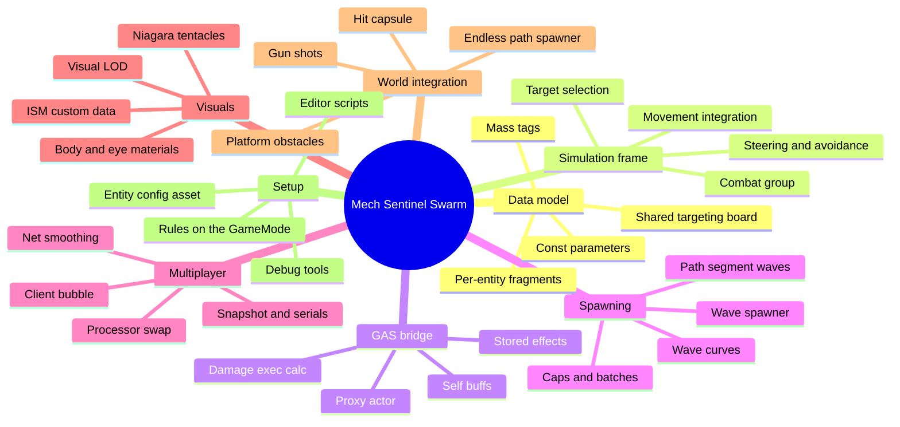
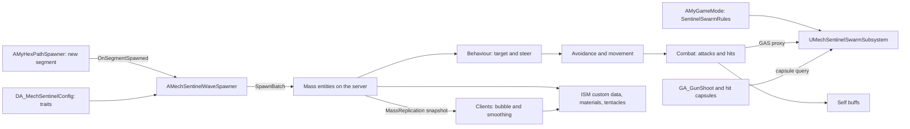

↑ [[Indexing]]

# MechSentinel Index

AuraRedo3 · redo3 · 68dd9e7 (PR #7, merged 2026-11-21)

The Mech Sentinel swarm is a crowd of flying, tentacled robots built on Mass Entity (ECS), with the Gameplay Ability System doing the combat maths: **GAS logic, Mass storage**. A level-placed wave spawner creates the sentinels on the server, wave after wave or one wave per new segment of the endless hex path. Each sentinel picks a player to chase, avoids the others and the platforms, attacks, takes hits, and sometimes buffs itself. MassReplication sends every client a small snapshot of the sentinels near it, and the client draws them with instanced static meshes and Niagara ribbon tentacles.

These notes explain how all of that works and how the data flows, one topic per page. Start with [[MechSentinel Architecture]], or jump straight to a topic from the mind map below. The request this system was built from is in [[MyMassEntityTest]], and general Mass notes are in [[MassEntity]]. The code-side README is `MyMechEntitySystemReadme.md` in the repo root.

## Whole-system mind map

Which page covers each branch:
- **Data model**: [[MechSentinel Architecture]]
- **Simulation frame**: [[MechSentinel Frame Flow]], [[MechSentinel Behaviour and Targeting]], [[MechSentinel Movement and Avoidance]]
- **GAS bridge**: [[MechSentinel Combat and GAS]], [[MechSentinel Self Buffs]]
- **Spawning**: [[MechSentinel Spawning and Waves]], [[MechSentinel Path Segment Waves]]
- **Multiplayer**: [[MechSentinel Replication and Multiplayer]]
- **Visuals**: [[MechSentinel Representation and Visuals]], [[MechSentinel Self Buffs]]
- **World integration**: [[MechSentinel Movement and Avoidance]], [[MechSentinel Combat and GAS]], [[MechSentinel Path Segment Waves]]
- **Setup**: [[MechSentinel Setup and Debugging]]

## How the pieces connect

1. The rules asset on the GameMode and the entity config on the level-placed spawner are the only global data. The swarm subsystem reads the rules and builds the entity template ([[MechSentinel Architecture]], [[MechSentinel Setup and Debugging]]).
2. The wave spawner creates sentinels in batches, either on its own schedule or when the path spawner adds a segment ([[MechSentinel Spawning and Waves]], [[MechSentinel Path Segment Waves]]).
3. Every frame on the server, processors run in a fixed order: choose a target, steer, avoid other sentinels and the platforms, move, then fight ([[MechSentinel Frame Flow]], [[MechSentinel Behaviour and Targeting]], [[MechSentinel Movement and Avoidance]]).
4. Damage, armor, stun and buffs are worked out by GAS on a proxy that is loaded with one sentinel's values, runs the effect, and writes the result back to Mass ([[MechSentinel Combat and GAS]], [[MechSentinel Self Buffs]]).
5. Players hit sentinels through a capsule query on the subsystem's spatial hash, which is how `GA_GunShoot` and the hit capsule component work ([[MechSentinel Combat and GAS]]).
6. Each client receives a small snapshot per sentinel, eases toward it and draws the result. Nothing is simulated on clients ([[MechSentinel Replication and Multiplayer]]).
7. State, health, hit flash, attack glow and the three buff fades go into 7 per-instance custom data floats, which drive the body, the eyes and the tentacles ([[MechSentinel Representation and Visuals]]).

## Pages in reading order

1. [[MechSentinel Architecture]]: the map. "GAS logic, Mass storage", the folder map, the main classes, where global data lives, the seven traits, what one sentinel entity is made of, and why the `_Copy` classes exist.
2. [[MechSentinel Frame Flow]]: one frame step by step on the server and on a client: Mass phases, processor groups and order, what runs outside the phases, and a sentinel's life from spawn to despawn.
3. [[MechSentinel Replication and Multiplayer]]: the replication processor (swapped in because of a UE 5.8 listen-server assert), the per-sentinel snapshot, the client bubble, how clients get the entity template, and multiplayer caveats.
4. [[MechSentinel Spawning and Waves]]: `AMechSentinelWaveSpawner`: advance modes, the wave definition, wave curves, pacing and caps, how an entity is created, kill accounting, the control API and `DespawnAll`.
5. [[MechSentinel Path Segment Waves]]: External mode on the endless hex path: from a new segment to a wave at its top corners, wave numbering per lane, limits, and StartupMap's one-lane setup.
6. [[MechSentinel Setup and Debugging]]: the assets and the four editor scripts, the demo map and StartupMap, setting up a new level, the debug CVar and draws, log categories and known pitfalls.
7. [[MechSentinel Behaviour and Targeting]]: the shared targeting board and its three-pass target choice, retarget timing, steering, the attack state and its timing, stun and death.
8. [[MechSentinel Movement and Avoidance]]: the speed chain, sentinel-to-sentinel avoidance, platform obstacle avoidance and the obstacle registry, movement integration and banking, client smoothing.
9. [[MechSentinel Combat and GAS]]: the GAS proxy cycle, the attribute set, the armor damage formula, tags and effects, hits from actors and the gun, attacks on players, stun and the kill flow.
10. [[MechSentinel Self Buffs]]: the armor, speed and damage self-buffs: when a sentinel casts one, the cast queue, how buffs are stored and replicated, and how they reach the visuals.
11. [[MechSentinel Representation and Visuals]]: the ISM representation and visual LOD, the 7 custom data floats, the body and eye materials, the Blender model and the Niagara ribbon tentacles.

## Start here for...

- **Putting the swarm in a new level**: [[MechSentinel Setup and Debugging]] (section "Setting up a new level"), then [[MechSentinel Spawning and Waves#Advance modes|advance modes]].
- **Making waves harder or easier**: [[MechSentinel Spawning and Waves#Wave curves|wave curves]] and the [[MechSentinel Spawning and Waves#Tuning knobs|spawner's tuning knobs]].
- **How the endless path starts waves**: [[MechSentinel Path Segment Waves]] and [[MechSentinel Path Segment Waves#StartupMap's current setup|StartupMap's current setup]].
- **Why sentinels choose a player, or crowd one**: [[MechSentinel Behaviour and Targeting#Choosing a target, pass by pass|target choice]].
- **Sentinels clipping into platforms**: [[MechSentinel Movement and Avoidance#Obstacle avoidance (sentinel vs platform)|obstacle avoidance]] and [[MechSentinel Movement and Avoidance#Debugging|its debug draw]].
- **Damage numbers and armor**: [[MechSentinel Combat and GAS#Damage math|damage math]].
- **Shooting sentinels from a new weapon or actor**: [[MechSentinel Combat and GAS#Hitting sentinels from actors|hitting sentinels from actors]].
- **Buff colours and the material**: [[MechSentinel Self Buffs#How the buff state reaches the visuals|buff visuals]] and [[MechSentinel Representation and Visuals#Per-instance custom data layout|the custom data layout]].
- **Multiplayer bugs**: [[MechSentinel Replication and Multiplayer#Multiplayer caveats|multiplayer caveats]] and [[MechSentinel Replication and Multiplayer#The listen-server assert and the workaround|the listen-server assert]].
- **Something crashed or looks wrong**: [[MechSentinel Setup and Debugging#Known pitfalls|known pitfalls]].

## The system at a glance

- **StartupMap** has one path lane (`BP_MyHexPathSpawner`) and one `MechSentinelWaveSpawner` in External mode with wave curves. Each new path segment starts the next wave at its top corners after a 2 s countdown, spawned over 8 s. Waves 1 to 4 bring 20, 23, 25 and 28 sentinels per lane, and `MaxAlive` there is 500.
- **Demo map**: `/Game/MechSentinel/Demo/L_MechSentinelDemo` runs waves on their own, without a path.
- **Targeting**: up to `MaxAttackersPerPlayer` sentinels engage one player (C++ default 14, the rules asset stores 10). Each sentinel re-evaluates about every 1.25 s (`RetargetInterval`) and attacks inside 450 cm (`AttackRange`).
- **Self-buffs** show as a coloured rim on the body (armor steel blue, speed cyan-white, damage orange), with the eyes tinted toward that colour, driven by custom data 4, 5 and 6.
- **Code** lives in `Source/Aura/{Public,Private}/MechSwarm/` (Core, Spawning, Sentinel, Combat, GAS, Replication, MassCopies, Tentacles), and the assets in `/Game/MechSentinel`.

## Words used in these notes

- **Fragment**: a struct of data stored per entity (position, health, state). **Shared fragment**: one value shared by a group of entities, like the targeting board. **Tag**: an empty marker that puts an entity into a different chunk (Attacking, Stunned, Dead).
- **Trait**: a building block of the entity config that adds fragments, tags and processors. **Processor**: code that runs every frame over all entities with the right fragments and tags.
- **`_Copy` classes**: engine Mass classes copied into the project and renamed so they can be changed. See [[MechSentinel Architecture#The _Copy classes]].
- **GAS proxy**: one hidden actor with an ability system component. It is loaded with a sentinel's attributes, runs an effect, and the result is written back to Mass. See [[MechSentinel Combat and GAS#The GAS proxy]].
- **External mode**: the wave spawner's mode where waves are started from outside (by the path spawner) instead of by its own timer.
- **Custom data**: 7 floats per ISM instance that the materials read. See [[MechSentinel Representation and Visuals#Per-instance custom data layout]].

## Related

- [[Indexing]]: the vault's main index.
- [[MassEntity]]: Talal's general Mass Entity notes.
- [[MyMassEntityTest]]: the original prompt this system was built from.

[[MechSentinel Architecture]] →
