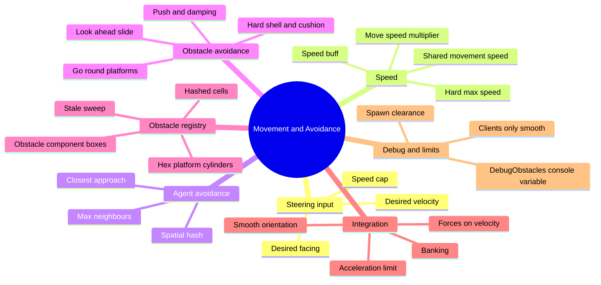
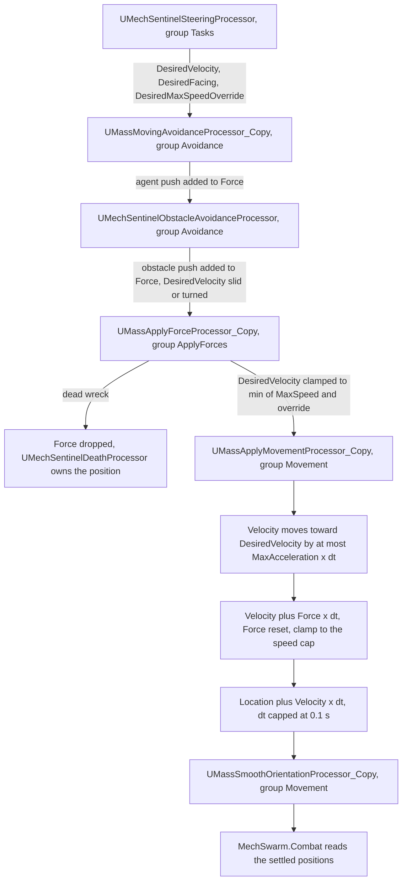
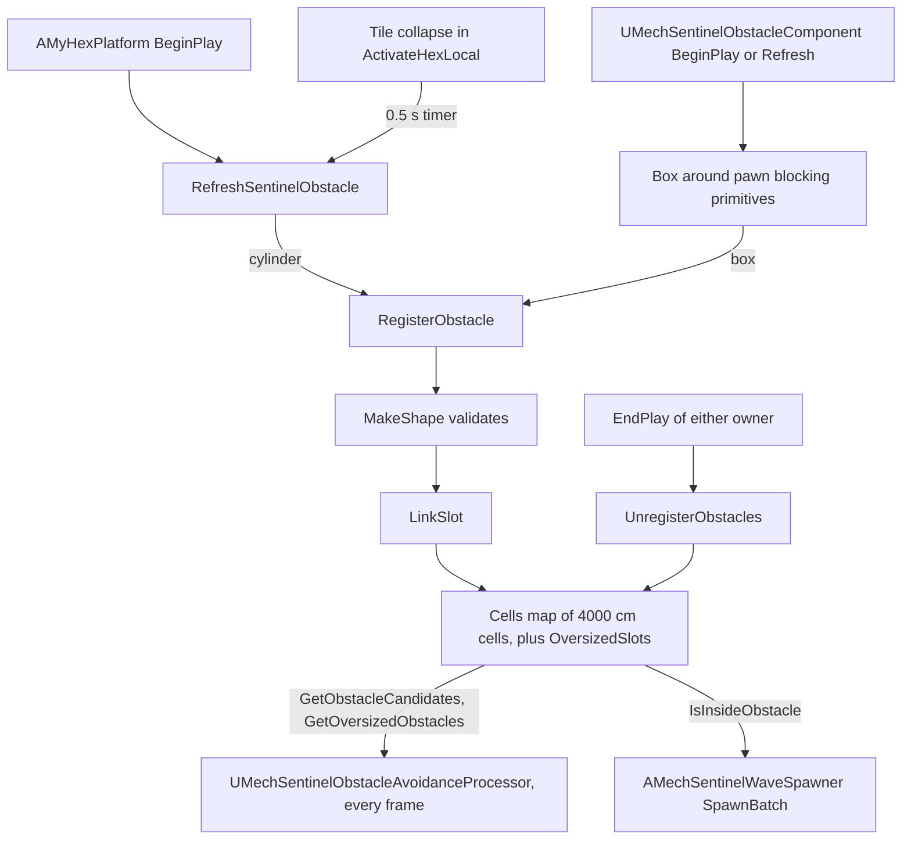
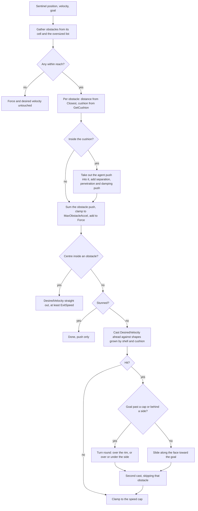
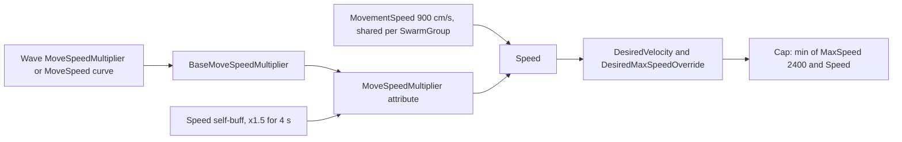

↑ [[MechSentinel Index]]

# MechSentinel Movement and Avoidance

Steering decides where a sentinel wants to go; this part decides how it actually gets there: it keeps sentinels from flying into each other and out of the hex platforms, moves the transform with a capped speed and acceleration, and turns the body smoothly with pitch and banking. The pipeline uses project-owned `_Copy` versions of the Mass movement, avoidance and orientation pieces, rebuilt for flying 3D agents, plus a sentinel-only obstacle registry that the platforms register into. All of it runs on the authority (standalone or server); network clients only ease toward the replicated positions.

## Mind map

## How it flows

### One movement update (authority, PrePhysics)

1. **Steering** (see [[MechSentinel Behaviour and Targeting]]) writes `FMassDesiredMovementFragment_Copy` from scratch every frame. It writes the velocity it wants, the facing (identity = face the velocity) and a per-entity speed cap.
2. **Agent avoidance** adds a predictive separation acceleration from nearby sentinels to `FMassForceFragment_Copy`.
3. **Obstacle avoidance** runs right after it and does three things. It adds the platform push to the force. It removes the part of the agent push that points into a platform. It rewrites `DesiredVelocity` so the sentinel slides along a platform or goes round it.
4. **ApplyForce** clamps the desired velocity to `min(MaxSpeed, DesiredMaxSpeedOverride)`, and removes Z if vertical movement is off. For entities that the movement step will not integrate (they carry `FMassCustomMovementTag_Copy`, which death adds), it also drops the force.
5. **ApplyMovement** moves the velocity toward the desired velocity within the acceleration limit, then adds the forces as accelerations, clamps the speed and moves the location.
6. **Smooth orientation** slerps the rotation toward the facing or the velocity, with clamped pitch and banking.
7. Then the combat group runs (attack range, wreck fall, hit hash) on the final positions. See [[MechSentinel Frame Flow]] for the full frame.

### Obstacle registration and queries

1. Each hex platform registers itself on the server in `BeginPlay`, as a vertical capped cylinder around its standing tiles. It registers again 0.5 s after tiles start collapsing, and unregisters in `EndPlay`.
2. Any other actor can carry a `UMechSentinelObstacleComponent`, which registers a box around the owner's pawn-blocking collision. Blueprint can also call `RegisterObstacle` directly.
3. `RegisterObstacle` validates the shape (`MakeShape`). `LinkSlot` then lists the obstacle in every hash cell within reach of it, or puts it on the oversized list when that would take too many cells.
4. Two readers use the registry. Every frame the avoidance processor reads the obstacles listed in the sentinel's own cell plus the oversized ones. When it spawns sentinels, the wave spawner asks `IsInsideObstacle`.

### Obstacle avoidance for one sentinel

1. The broad phase keeps obstacles whose bounds are within shell + max cushion + look-ahead of the sentinel. For a stunned sentinel the look-ahead is left out.
2. For each near obstacle, a sentinel inside the cushion gets a push out plus damping of its velocity into the obstacle.
3. If the sentinel's centre is inside an obstacle, it simply flies out through the cheapest exit.
4. Otherwise the desired velocity is cast ahead. On a hit it is slid along the face, or turned round the obstacle when the goal is behind it. One more cast handles the next obstacle.

## Fragments and traits

Three traits in the entity config (`DA_MechSentinelConfig`) set movement up. The Mech Sentinel trait adds the transform. For the overall structure, see [[MechSentinel Architecture]].

| Trait | Adds | Requires |
|---|---|---|
| `UMassMovementTrait_Copy` ("Movement (Copy)") | `FMassVelocityFragment_Copy`, `FMassForceFragment_Copy`, `FMassDesiredMovementFragment_Copy`, tag `FMassCodeDrivenMovementTag_Copy`, const shared `FMassMovementParameters_Copy` | `FTransformFragment` |
| `UMassObstacleAvoidanceTrait_Copy` ("Avoidance (Copy)") | const shared `FMassMovingAvoidanceParameters_Copy` and `FMechSentinelObstacleAvoidanceParameters` | transform, velocity, force |
| `UMassSmoothOrientationTrait_Copy` ("Smooth Orientation (Copy)") | const shared `FMassSmoothOrientationParameters_Copy` | transform, velocity, desired movement |

`DA_MechSentinelConfig` saves no values for the `Movement`, `Avoidance`, `Obstacles` or `Orientation` structs, nor for the sentinel `Parameters`. They are all at the C++ defaults listed in the tuning table. The sentinel trait's `MovementSpeed` and `SwarmGroup` are not saved either, so they are also at their defaults.

`FMassCustomMovementTag_Copy` is a project helper (it is not in the header's list of mirrored engine types). It means "some other processor owns this position". Only `SyncStateFromGAS` adds it, when a sentinel dies. With it, steering, agent and obstacle avoidance, movement and orientation all skip the wreck, and ApplyForce drops its force.

## What the _Copy classes changed

The `_Copy` classes mirror the engine's roles, not its code (the header comments say "by role, not by code"). These are the deviations the code calls out:

| `_Copy` class | Engine counterpart | Deviation |
|---|---|---|
| `FMassForceFragment_Copy` + `UMassApplyMovementProcessor_Copy` | `FMassForceFragment`, `UMassApplyMovementProcessor` | Forces are accelerations on the **real velocity**, applied after the acceleration-limited approach. The engine's `ApplyForce` folds them into the desired velocity, which only works with force-based steering. Sentinel steering assigns `DesiredVelocity` from scratch every frame, so folded forces would be lost. Here the velocity carries over between frames and the forces integrate over time. |
| `FMassMovementParameters_Copy` | `FMassMovementParameters` | `MaxAcceleration` (3000 cm/s²) limits how fast the velocity turns toward the desired one; 0 snaps it, which the comment calls the engine default. `bAllowVerticalMovement` is true because sentinels fly. |
| `UMassApplyMovementProcessor_Copy` | `UMassApplyMovementProcessor` | The integration step is capped at 0.1 s (`MaxIntegrationStep`), so a hitch cannot teleport the swarm. |
| `UMassMovingAvoidanceProcessor_Copy` | `UMassMovingAvoidanceProcessor` | Full 3D predictive separation on a 3D spatial hash, with no navmesh or lane data. The engine's is 2D and navigation based. |
| `FMechSentinelObstacleAvoidanceParameters` + `UMechSentinelObstacleAvoidanceProcessor` | none (project only) | Replaces the engine's `FMassNavigationEdgesFragment`, whose obstacle edges are infinitely tall 2D walls: a sentinel above or below a platform would still be pushed sideways. |
| `UMassSmoothOrientationProcessor_Copy` | smooth orientation processor | Full 3D: yaw, clamped pitch and banking roll. |

The velocity, desired movement and code-driven tag copies keep their engine roles (velocity in cm/s; desired velocity, facing and per-entity speed cap; "velocity is driven by code").

## Speed

1. `Speed = FMechSentinelSharedAttributesFragment::MovementSpeed x FMechSentinelAttributesFragment::MoveSpeedMultiplier`.
2. `MovementSpeed` is one value per swarm group: it comes from the Mech Sentinel trait (900 cm/s). `UMechSentinelSwarmSubsystem::SetSwarmMovementSpeed(SwarmGroup, NewMovementSpeed)` changes it at runtime. It is server only and should be called outside the Mass phases (from a timer such as Set Timer for Next Tick, or a tick in Post Update Work), because steering reads it on worker threads; called from input, a few sentinels may move at the old speed for one frame.
3. `MoveSpeedMultiplier` is per sentinel and goes through GAS. `SpawnBatch` sets its base to the wave's `MoveSpeedMultiplier`. In curve mode that value is the base wave times the `MoveSpeed` curve. The speed self-buff (`UMechSentinelSpeedBuffEffect`, a MultiplyAdditive modifier) raises the current value: Magnitude 1.5 for 4 s, cooldown 12 s, only while the target is at least 15 m away (see [[MechSentinel Self Buffs]]). Slows and hastes from any GE act on the same attribute, which `UMechSentinelAttributeSet` clamps at 0 or more.
4. Steering uses `Speed` as the length of the approach velocity, scaled by the arrival factor, and as `DesiredMaxSpeedOverride`. ApplyForce and ApplyMovement cap the result at `min(MaxSpeed, override)`. Avoidance pushes therefore never make a sentinel faster than its own speed, and nothing goes past 2400 cm/s.

## Flying height

There is no altitude controller and no ground check for live sentinels. Height comes from the goal:

- **Around a player,** the goal is the aim point (player location + `TargetHeightOffset` 90 cm) + `OrbitDirection x OrbitRadius` (320 cm). The spawner gives each sentinel an orbit direction with `Z = Lerp(0.15, 1, |Z|)` before normalising. The orbit spot is therefore always above the aim point, about 47 to 320 cm higher, at an elevation of about 8.5 to 90 degrees. The orbit turns around the world up axis, so each sentinel keeps its own height while circling.
- **Around a fallback point,** the same direction times `FallbackLoiterRadius` (900 cm) sets the hover spot. That spot does not orbit.
- **The wobble** adds a vertical sine term too, so a hovering swarm bobs.
- **Vertical movement** is allowed (`bAllowVerticalMovement = true`), so the approach is a straight 3D line, bent by the obstacle avoidance: over a platform's rim, or over or under a side.
- **Spawn height** comes from the spawner: `SpawnExtent` (1500, 1500, 400 cm) around the spawner, or `CornerSpawnExtent` (800, 800, 300 cm) around the path segment corners (see [[MechSentinel Spawning and Waves]]).

## Agent avoidance (sentinel vs sentinel)

`UMassMovingAvoidanceProcessor_Copy` runs in the Avoidance group, after Tasks. It is game-thread only because it uses member scratch buffers and gathers in two passes. Its query covers every entity with the avoidance parameters except custom-movement (dead) ones, so stunned sentinels still push and get pushed.

1. **Gather.** It collects every agent's position and velocity in query order. The hash cell size is `SeparationDistance + PredictionTime x fastest speed`, clamped to between 1x and 4x `SeparationDistance`. A 3x3x3 block of cells then covers the prediction reach, without a few very fast agents blowing the cells up. Cells left empty are removed, so the map does not grow as the swarm travels.
2. **Per agent.** It scans the 27 cells around the agent, up to `MaxNeighbors` (10) neighbours. For each neighbour:
   - Skip it when it is farther than `SeparationDistance + PredictionTime x relative speed`.
   - Find the time of closest approach, clamped to `[0, PredictionTime]` (0.6 s).
   - If the closest distance is below `SeparationDistance` (260 cm), push along the closest-approach offset. The strength is `SeparationStrength (3500) x (1 - d / SeparationDistance)^2 x Urgency`, where `Urgency = 1 - 0.5 x t / PredictionTime`, so an imminent contact weighs up to twice as much as one at the edge of the horizon.
   - Two agents in exactly the same place get a deterministic direction derived from the sample index.
3. The summed push is clamped to `MaxAvoidanceForce` (7000 cm/s²) and **added** to `FMassForceFragment_Copy`.

## Obstacle avoidance (sentinel vs platform)

`UMechSentinelObstacleAvoidanceProcessor` runs in the Avoidance group after `UMassMovingAvoidanceProcessor_Copy`, because it reads this frame's agent push. It is game-thread only because actors change the registry on the game thread. Its query requires the sentinel tag and excludes dead and custom-movement entities. It does nothing when no obstacles are registered or the chunk's `bEnabled` is false. It shows up in Unreal Insights as `MechSentinelObstacleAvoidance`.

### Shell, cushion and reach

- **Hard shell** `R` = `HardRadius`, which is 0 by default and then falls back to the trait's `CapsuleHalfHeight` (140 cm), plus the obstacle's `Margin`. The sentinel counts as a sphere of that radius.
- **Cushion** `Z`, per obstacle, from `GetCushion`:
  - stunned: `MinCushion` (40 cm);
  - no goal: `SoftMargin` (250 cm);
  - otherwise `max(MinCushion, clamp(SignedDistance(goal) - R - GoalClearance, 0, SoftMargin))`, with `GoalClearance` 25 cm.

  The cushion therefore shrinks so the goal stays just outside it, and a sentinel can reach a player standing next to or on a platform.
- **Look-ahead** = `min(desired speed, MaxLookAheadSpeed 2000) x LookAheadTime 0.8 s` (at most 1600 cm with the defaults), but never more than `ObstacleReach (2000) - shell radius (without Margin) - max cushion` = 2000 - 140 - 250 = 1610 cm. The registry only lists obstacles within `ObstacleReach` of a cell, so hits must stay inside that distance.

### Push (all obstacles near the sentinel)

The shape's `Closest` gives the signed distance `d` (negative inside) and the outward normal. Let `clearance = d - R` and `eta = (Z - clearance) / Z`. When `eta > 0` (inside the cushion), with `w = min(eta, 1)`:

- The part of the agent push that points **into** the obstacle is cancelled, scaled by `w`, so neighbours cannot shove a sentinel into a platform.
- The push along the normal is the sum of three terms:
  - `SeparationAccel (6000) x w²`: soft, rising through the cushion;
  - `PenetrationAccel (9000) x clamp(-clearance / R, 0, 1)`: full once the shell overlaps by `R`;
  - `w x max(0, -velocity · normal) / DampingTime (0.2 s)`: cancels the speed into the obstacle in about 0.2 s.
- The pushes of all near obstacles are summed, clamped to `MaxObstacleAccel` (15000), and added to the force. The defaults keep this clamp above agent push + `MaxAcceleration` (7000 + 3000), so a platform always wins.

### Inside an obstacle

If the sentinel's centre is inside a shape (`d < 0`), the processor sets `DesiredVelocity = exit normal x max(|DesiredVelocity|, ExitSpeed 600)`, using the deepest obstacle and clamped to the speed cap. The exit is the cheapest way out: through the rim, top or bottom of a cylinder, or one of a box's six faces. The exit facing the goal has its depth scaled by `ExitFaceBias` (0.7), so the sentinel prefers to leave on its goal's side.

### Look-ahead: slide or go round

Stunned sentinels stop after the push. For all others, `DesiredVelocity` is raycast against each near shape, grown sharply by `R + Z` (`FMechSentinelObstacleShape::Raycast`). The closest hit wins. If the sentinel already starts inside the grown shape, the normal comes from the real surface below it. `Slide` then bends the velocity `U` with weight `(1 - hitDistance / lookAhead)²`, so the closer the hit, the stronger the bend:

- **Slide.** The part of `U` that points into the face is taken out and the same amount is turned along the face toward the goal: `U + (normal + tangent) x weight x into`. Speed is kept instead of stopping.
- **Go round over a cap** (top or bottom face, `|normal.Z| > CapNormalZ 0.7`): used when the goal lies beyond the plane of the hit cap (above the bottom face, or below the top face) and over the footprint, or the hit is head-on. A head-on hit means the goal is behind the face and less than `TangentMin` (0.2) of the way to it runs along the face. The escape direction is radially outward over the rim the short way for a cylinder (a sentinel right on the axis goes horizontally away from the goal, or, with the goal on the axis too, along a fixed per-entity golden-angle direction), or out through the nearest of the four sides for a box.
- **Go round a side:** used for a head-on hit, or a box side with the goal right behind it. The sentinel goes **over or under**:
  - A box with the goal above it goes up; with the goal below, down.
  - A sentinel already climbing or sinking faster than `EscapeKeepVz` (150 cm/s) keeps that way.
  - Otherwise it takes the shorter way, with the way up weighted by `UpBias` (0.7), which favours going over.
- An escape blends `U` toward the escape tangent at full speed: `U x (1 - weight) + tangent x weight x |U|`.
- A **second cast** with the bent velocity checks for the next obstacle (skipping the first) and slides again. The result is clamped to `DesiredMaxSpeedOverride`.

The processor recomputes the goal exactly as steering does (`TargetLocation + OrbitDirection x OrbitRadius` or `x FallbackLoiterRadius`), after steering already turned the orbit this frame.

## Stunned and dead sentinels

| Case | Movement behaviour |
|---|---|
| Stunned | Steering asks for a short sink (see [[MechSentinel Behaviour and Targeting]]) with speed cap `max(50, Speed x 0.35)`. Agent avoidance still applies. Obstacle avoidance uses `MinCushion` (40 cm), has no look-ahead and no slide, but still pushes and still flies the sentinel out of an obstacle it is inside. |
| Dead | `FMassCustomMovementTag_Copy` takes the wreck out of steering, both avoidance passes, ApplyMovement and orientation. ApplyForce drops its force. `UMechSentinelDeathProcessor` moves it: gravity, a WorldStatic trace and tumble. Wrecks ignore the obstacle registry and stop wherever their line trace hits WorldStatic collision. |

## Movement integration and orientation

`UMassApplyMovementProcessor_Copy` (group Movement, after ApplyForces) handles entities with `FMassCodeDrivenMovementTag_Copy` and without `FMassCustomMovementTag_Copy`. Per entity:

1. `Velocity += clamp(DesiredVelocity - Velocity, MaxAcceleration x dt)`. With `MaxAcceleration` 0 the velocity snaps to the desired one.
2. `Velocity += Force x dt`, then `Force = 0`. Without vertical movement, Z is removed. The velocity is clamped to `min(MaxSpeed, DesiredMaxSpeedOverride)`.
3. `Location += Velocity x dt`, with `dt = min(0.1, frame dt)`.

`UMassSmoothOrientationProcessor_Copy` runs in the same group after ApplyMovement:

- **Direction to face:** `DesiredFacing` when it is not identity (a sentinel attacking a player looks at it). Otherwise the velocity, if the sentinel is faster than `MinSpeedForVelocityFacing` (40 cm/s). Otherwise it keeps its rotation.
- **Pitch** is clamped to `±MaxPitch` (55 deg).
- **Roll (banking):** `clamp(-yawRate / 90 x BankingAmount, ±BankingAmount)`, with `BankingAmount` 25 deg and `yawRate = yaw error x OrientationSpeed`. This gives the swarm its leaning turns.
- **Slerp** alpha is `1 - exp(-OrientationSpeed x dt)`, with `OrientationSpeed` 5 and dt capped at 0.1 s.

The replicated rotation includes this roll, so clients see the banking too.

## The obstacle registry

`UMechSentinelObstacleSubsystem` is a world subsystem for Game and PIE worlds. It only works where `NetMode != NM_Client`: on clients, registering is a no-op. It runs on the game thread only (each register and unregister call `ensure`s that).

- **Shapes** (`FMechSentinelObstacle` in, `FMechSentinelObstacleShape` stored):
  - `FootprintRadius > 0` gives a vertical capped cylinder around `FootprintCenter`, from `Bounds.Min.Z` to `Bounds.Max.Z`. `MakeShape` grows its XY bounds to hold the whole circle.
  - Otherwise the `Bounds` box is the shape.
  - `Margin` adds clearance for that obstacle only.
  - `MakeShape` rejects invalid, inverted or non-finite bounds and coordinates beyond 1e9 cm. A rejection is logged once per owner (`LogMechSentinelObstacles`), and the obstacle it would replace is removed.
- **Identity.** A slot is keyed by `(Owner, Key)`, and registering the same pair again replaces it. Owners are held weakly. `UnregisterObstacle(Owner, Key)` removes one slot, `UnregisterObstacles(Owner)` every slot of that owner. Freed slots are reused.
- **Blueprint API.** `RegisterObstacle(Owner, Obstacle, Key = 0)`, `UnregisterObstacle`, `UnregisterObstacles` (all `BlueprintCallable`, Owner defaults to self) and `GetNumObstacles()` (`BlueprintPure`). The static `UMechSentinelObstacleSubsystem::Get(WorldContextObject)` returns null outside Game and PIE worlds.
- **Hash.**
  - `ObstacleCellSize` = 4000 cm. Each obstacle is listed in every cell that overlaps its bounds grown by `ObstacleReach` (2000 cm) + its margin. A query then only reads its own cell: `GetObstacleCandidates(Location)`.
  - An obstacle that would touch more than `MaxCellsPerObstacle` (512) cells goes to `OversizedSlots`, which every query tests (`GetOversizedObstacles`).
  - Cells that become empty are removed as the path moves on.
- **Housekeeping.** Every registration change removes slots whose owner is gone and bumps `GetObstacleRevision()`. The avoidance also calls `SweepStaleOwners()` every frame, which does the same at most once per second.
- **Queries.**
  - `IsInsideObstacle(Location, Inflate)` is true when `SignedDistance < Inflate + Margin` for any obstacle. It uses the hash while `Inflate <= ObstacleReach` and checks every slot beyond that.
  - `GetObstacleShapes` copies every shape, for the debug draw.

### Hex platforms register themselves

`AMyHexPlatform::RefreshSentinelObstacle` (server only) builds the shape:

1. For every standing tile in `HexMap`, it takes the pillar ISM instance's world transform times the tile mesh bounds. The union of those boxes is the obstacle's `Bounds`, from the lowest pillar bottom to the highest top.
2. Each tile's centre (world XY) and reach (the mesh's larger XY half extent x scale, the hex corner radius) are collected.
3. `FootprintCenter` = the centroid of the tile centres. `FootprintRadius` = the largest `distance to centroid + reach` over all tiles.
4. A cylinder is used rather than the box: around a disc, a box sticks out 41% of the radius past the rim on the diagonals, which would close the gaps to the neighbouring platforms.
5. With no tile left, the platform unregisters.

It runs in `BeginPlay` (after `ComputeFootprintRadius`), so every platform the endless path spawns registers as it appears. When tiles collapse, `ActivateHexLocal` arms a one-shot 0.5 s `SentinelObstacleTimer` unless one is already running. The shape is thus refreshed once per burst of collapsing tiles: up to 0.5 s late, and too large until then, never too small. `EndPlay` unregisters the platform, for example when a left-behind platform is destroyed. See [[MechSentinel Path Segment Waves]] for the path side.

### UMechSentinelObstacleComponent

The component is for any other geometry: a floor, the airship, a bridge. On the server, `BeginPlay` calls `Refresh`:

1. Unregister this component's old boxes.
2. Take every registered primitive of the owner whose collision is on and **blocks `ECC_Pawn`**. Triggers are skipped.
3. Register either one box around all of them, or one box per component with increasing keys (`bOneBoxPerComponent`).

`RefreshInterval` > 0 re-measures on a looping timer, for owners that move. `Refresh` is `BlueprintCallable` and `BlueprintAuthorityOnly`. `EndPlay` unregisters.

As of 2026-11-21, no Blueprint or map under `Content` uses this component (a search of the asset files finds no reference). Only hex platforms are obstacles in practice, so bridges, props on platforms and falling pillars are flown through.

### Spawn obstacle clearance

`AMechSentinelWaveSpawner::SpawnBatch` rolls each spawn location uniformly inside the spawn ellipsoid. If `SpawnObstacleClearance` > 0 (default 200 cm; the StartupMap script also sets 200) and obstacles exist, a location where `IsInsideObstacle(location, SpawnObstacleClearance)` holds is rolled again, up to 4 times. If the last roll is still inside, it is kept, and the "inside" rule above flies that sentinel out at `ExitSpeed` or faster.

## Clients

None of the processors on this page run on network clients (`ExecutionFlags = Standalone | Server`). On `NM_Client`, the Mech Sentinel trait adds `FMechSentinelNetSmoothingFragment`, and `UMechSentinelNetSmoothingProcessor` (Client flag, Movement group) moves the transform:

- It eases toward the last replicated sample extrapolated by its velocity, for at most 0.3 s.
- Sharpness is 10/s for position and 8/s for rotation.
- It snaps instead when the error is over 2000 cm.
- It copies the replicated velocity into `FMassVelocityFragment_Copy`.

A listen server has no smoothing fragment and renders its own simulation. See [[MechSentinel Replication and Multiplayer]].

## Debugging

- `mech.Sentinel.DebugObstacles` is a cheat console variable in non-shipping builds and works in server or standalone worlds:
  - `1` draws every registered shape (orange; magenta = oversized, not hashed) and prints `Sentinel obstacles: N registered | sentinels near one N, sliding N, centre inside N` on screen.
  - `2` also draws, for each sentinel near an obstacle that was not "clear", a line along its new desired velocity (0.3 s worth): red = centre inside, yellow = sliding, cyan = pushed.
- Insights CPU scope: `MechSentinelObstacleAvoidance`.
- See also [[MechSentinel Setup and Debugging]].

## Limits worth knowing

- **Gaps.** Gaps narrower than about 2 x (shell + cushion), roughly 780 cm with the defaults, are filled by the two cushions. Sentinels get pushed from both sides there and tend to go round rather than through.
- **Unreachable goals.** A goal closer than shell + `MinCushion` (180 cm) to an obstacle cannot be reached. The sentinel hovers about that far out (for example, a player grappling under a platform).
- **Shape fit.** The cylinder is conservative: it can be wider than a trimmed tile outline, and its bottom is flat at the deepest pillar.
- **Unregistered geometry.** Only registered geometry is avoided.
- **Server only.** Obstacle avoidance and the registry run on the server only; clients just follow the replicated positions.

## Key files

| File | Role |
|---|---|
| `Source/Aura/Public/MechSwarm/MassCopies/MassMovementFragments_Copy.h` | Velocity, force, desired movement fragments, movement tags, `FMassMovementParameters_Copy` |
| `Source/Aura/Private/MechSwarm/MassCopies/MassMovementProcessors_Copy.cpp` | `UMassApplyForceProcessor_Copy`, `UMassApplyMovementProcessor_Copy` |
| `Source/Aura/Private/MechSwarm/MassCopies/MassMovementTrait_Copy.cpp` | Movement (Copy) trait |
| `Source/Aura/Public/MechSwarm/MassCopies/MassAvoidanceFragments_Copy.h` | Agent avoidance and obstacle avoidance parameters with defaults |
| `Source/Aura/Private/MechSwarm/MassCopies/MassAvoidanceProcessors_Copy.cpp` | 3D predictive agent avoidance |
| `Source/Aura/Private/MechSwarm/MassCopies/MassAvoidanceTrait_Copy.cpp` | Avoidance (Copy) trait, both parameter sets |
| `Source/Aura/Private/MechSwarm/MassCopies/MassSmoothOrientation_Copy.cpp` | Orientation parameters, processor and trait |
| `Source/Aura/Private/MechSwarm/Sentinel/MechSentinelObstacleAvoidanceProcessor.cpp` | Cushion push, inside exit, look-ahead slide, go round, debug CVar |
| `Source/Aura/Private/MechSwarm/Core/MechSentinelObstacleSubsystem.cpp` | Obstacle registry: shapes, hash, queries, stale sweep |
| `Source/Aura/Private/MechSwarm/Core/MechSentinelObstacleComponent.cpp` | Box obstacles from an actor's pawn-blocking collision |
| `Source/Aura/Private/Actors/MyHexPlatform.cpp` | `RefreshSentinelObstacle`, registration in BeginPlay, `ActivateHexLocal` and EndPlay |
| `Source/Aura/Private/MechSwarm/Sentinel/MechSentinelBehaviorProcessors.cpp` | `UMechSentinelSteeringProcessor`, the input of this page |
| `Source/Aura/Private/MechSwarm/Sentinel/MechSentinelClientProcessors.cpp` | `UMechSentinelNetSmoothingProcessor` on clients |
| `Source/Aura/Private/MechSwarm/Spawning/MechSentinelWaveSpawner.cpp` | `SpawnBatch`: spawn obstacle clearance, orbit direction |
| `Source/Aura/Private/MechSwarm/Core/MechSentinelSwarmSubsystem.cpp` | `SetSwarmMovementSpeed`, death adds the custom movement tag |

## Tuning knobs

| Setting | Where | Default | Effect |
|---|---|---|---|
| `MovementSpeed` | Mech Sentinel trait | 900 cm/s | Shared base speed of a swarm group |
| `MoveSpeedMultiplier` | Wave definition / `MoveSpeed` curve | 1 | Per-sentinel speed factor (GAS attribute base) |
| `MaxSpeed` | Movement (Copy), `Movement` | 2400 cm/s | Hard speed cap |
| `MaxAcceleration` | Movement (Copy) | 3000 cm/s² | How fast velocity turns toward the desired one; 0 = snap |
| `bAllowVerticalMovement` | Movement (Copy) | true | Flyers keep Z |
| `SeparationDistance` | Avoidance (Copy), `Avoidance` | 260 cm | Agent separation radius |
| `SeparationStrength` | Avoidance (Copy) | 3500 | Push at full overlap |
| `PredictionTime` | Avoidance (Copy) | 0.6 s | How far ahead contacts are predicted |
| `MaxNeighbors` | Avoidance (Copy) | 10 | Neighbours considered per agent |
| `MaxAvoidanceForce` | Avoidance (Copy) | 7000 | Clamp of the agent push |
| `bEnabled` | Avoidance (Copy), `Obstacles` | true | Obstacle avoidance on or off |
| `HardRadius` | Obstacles | 0 (= `CapsuleHalfHeight` 140) | Sentinel shell radius |
| `SoftMargin` | Obstacles | 250 cm | Cushion when the goal is far |
| `MinCushion` | Obstacles | 40 cm | Smallest cushion; stunned cushion |
| `GoalClearance` | Obstacles | 25 cm | Goal stays this far outside the cushion |
| `SeparationAccel` | Obstacles | 6000 | Push at the shell |
| `PenetrationAccel` | Obstacles | 9000 | Extra push once the shell overlaps |
| `DampingTime` | Obstacles | 0.2 s | Cancels velocity into the obstacle |
| `MaxObstacleAccel` | Obstacles | 15000 | Clamp of the summed obstacle push |
| `LookAheadTime` | Obstacles | 0.8 s | Look-ahead length in time |
| `MaxLookAheadSpeed` | Obstacles | 2000 cm/s | Look-ahead stops growing above this speed |
| `ExitSpeed` | Obstacles | 600 cm/s | Minimum speed out of an obstacle |
| `UpBias` | Obstacles | 0.7 | Below 1 favours going over a side |
| `ExitFaceBias` | Obstacles | 0.7 | Prefer the exit on the goal's side |
| `CapNormalZ` | Obstacles | 0.7 | Normal Z above this = top or bottom face |
| `TangentMin` | Obstacles | 0.2 | Head-on threshold: go round instead of sliding |
| `EscapeKeepVz` | Obstacles | 150 cm/s | Keep an ongoing climb or dive when going round |
| `OrientationSpeed` | Smooth Orientation (Copy) | 5 | Turn sharpness |
| `MinSpeedForVelocityFacing` | Smooth Orientation (Copy) | 40 cm/s | Below this, keep the rotation |
| `MaxPitch` | Smooth Orientation (Copy) | 55 deg | Nose up / down limit |
| `BankingAmount` | Smooth Orientation (Copy) | 25 deg | Roll per 90 deg/s of yaw rate |
| `SpawnObstacleClearance` | Wave spawner, Spawning | 200 cm | Re-roll spawns inside platforms grown by this; 0 = off |
| `Margin` | `UMechSentinelObstacleComponent` | 0 cm | Extra clearance for that actor |
| `bOneBoxPerComponent` | `UMechSentinelObstacleComponent` | false | One box per colliding component |
| `RefreshInterval` | `UMechSentinelObstacleComponent` | 0 s | Re-measure a moving owner; 0 = only BeginPlay / `Refresh` |
| `ObstacleCellSize`, `ObstacleReach`, `MaxCellsPerObstacle` | `UMechSentinelObstacleSubsystem` constants | 4000 cm, 2000 cm, 512 | Registry hash size, query reach, oversized threshold |

## Related

- [[MechSentinel Behaviour and Targeting]]: steering, the producer of the desired velocity and goal used here.
- [[MechSentinel Frame Flow]]: the order of the Avoidance, ApplyForces and Movement groups in the whole frame.
- [[MechSentinel Self Buffs]]: the speed buff that raises `MoveSpeedMultiplier`.
- [[MechSentinel Spawning and Waves]]: spawn extents, spawn obstacle clearance and wave speed multipliers.
- [[MechSentinel Path Segment Waves]]: the endless path whose platforms register as obstacles.
- [[MechSentinel Replication and Multiplayer]]: what clients receive instead of running this.
- [[MechSentinel Architecture]]: where the movement traits sit in the entity config and the whole system.
- [[MassEntity]]: general Mass notes (traits, fragments, processors).

← [[MechSentinel Behaviour and Targeting]] · [[MechSentinel Index|Index]] · [[MechSentinel Combat and GAS]] →
