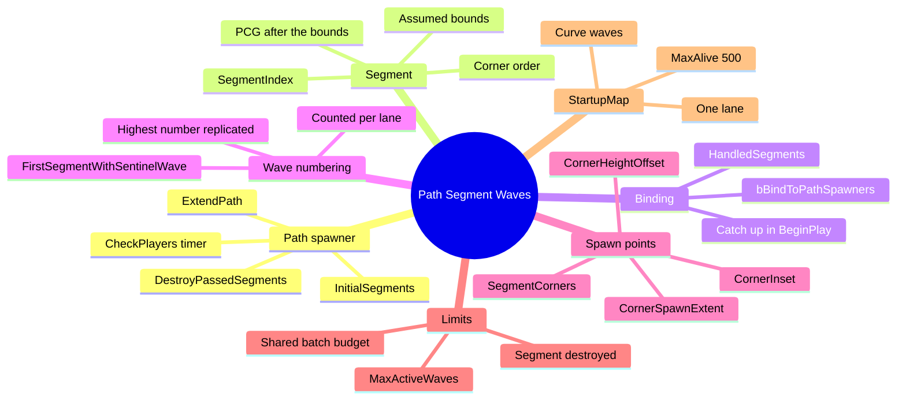
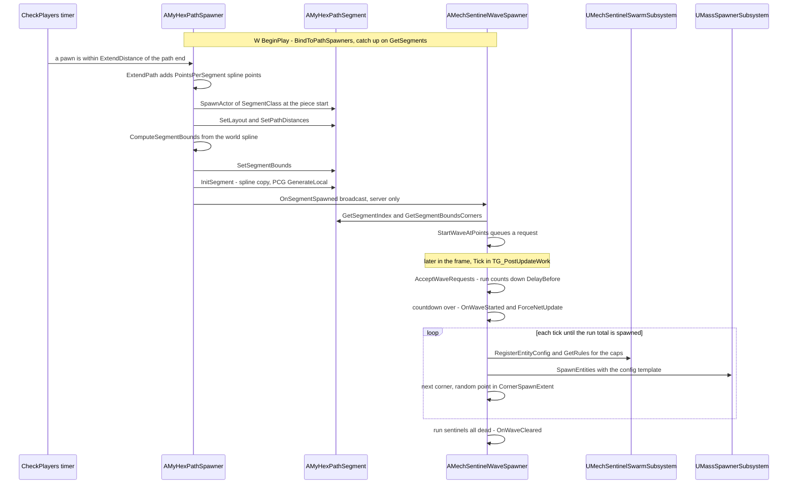
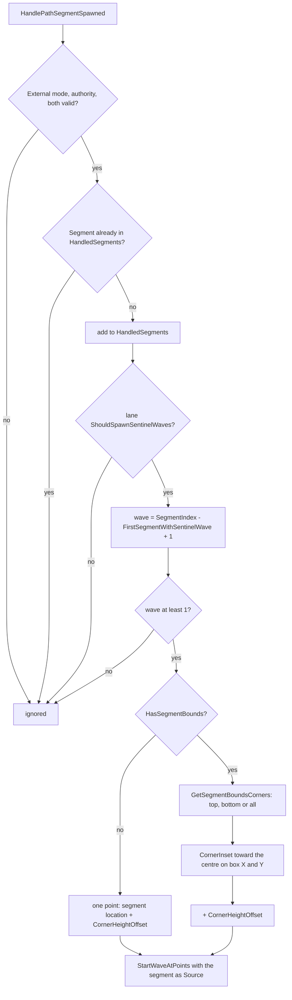

↑ [[MechSentinel Index]]

# MechSentinel Path Segment Waves

On the endless hex path the players never meet a fixed spawner: the level keeps growing. `AMyHexPathSpawner` adds a new `AMyHexPathSegment` whenever a player gets close to the end of the path, and each new segment starts its own sentinel wave at the corners of the box its platforms will fill. A wave spawner in `External` mode listens for those segments, numbers the waves by segment index and runs them side by side, so the swarm always arrives where the players are heading.

## Mind map

## How it flows

### From a new segment to sentinels in the air

1. The path spawner's `CheckPlayers` timer runs every `CheckInterval` (default 0.25 s). It first destroys segments far behind the lead, then calls `ExtendPath` once if any player pawn is within `ExtendDistance x GetLayoutScale()` (horizontal) of the last spline point. One segment per check: if the player is still close, the next check adds another.
2. `ExtendPath` walks forward with Perlin noise, spawns the segment actor, gives it its layout scale and path distances, computes the assumed bounds and stores them with `SetSegmentBounds`, then `InitSegment` copies the spline piece and starts PCG. Only after all that it broadcasts `OnSegmentSpawned(this, Segment)`, and only when the net mode is not `NM_Client`.
3. `AMechSentinelWaveSpawner::HandlePathSegmentSpawned` turns the segment into a wave number and a list of corner points, then calls `StartWaveAtPoints(Points, WaveNumber, Segment)`. That only queues, because `ExtendPath` may run from anywhere (BeginPlay, the timer).
4. The spawner's own tick (`TG_PostUpdateWork`, outside the Mass phases) creates the run. The countdown, pacing and clearing are those of every run ([[MechSentinel Spawning and Waves#Overlapping wave runs]]).
5. Sentinels are dealt round robin over the corners: sentinel 1 at corner 1, sentinel 2 at corner 2 and so on, each at a random point in the `CornerSpawnExtent` ellipsoid around its corner.

### From a segment to its spawn points

1. Every check that fails returns quietly; a segment is marked handled before the lane check, so a lane with `bSpawnSentinelWaves` off never starts a wave for it later.
2. `HandledSegments` holds weak pointers. Once it reaches 64 entries, the ones whose segment was destroyed are removed.
3. The inset is clamped so a corner never moves past the centre of the box.

## The endless path in short (AMyHexPathSpawner)

- Meant for the server (the class comment says "Server only"): not replicated (`bReplicates = false`), no tick; it works from `BeginPlay` and a looping timer, behind `HasAuthority()`. A non-replicated actor can also pass `HasAuthority()` on a client, so `ExtendPath` additionally fires `OnSegmentSpawned` only when the net mode is not `NM_Client` (and the wave spawner's handler checks its own authority).
- `BeginPlay` (authority): resets the spline to one point at the actor, registers the spline with `UMyHexBridgeSubsystem`, builds `InitialSegments` (default 2) segments right away, places the path-end fog, starts the `CheckPlayers` timer.
- Every horizontal length scales with `HexRadius / 100` (`GetLayoutScale()`): `SegmentLength` (10000), `ExtendDistance` (15000), `DestroySegmentsBehindDistance` (30000), the noise frequencies and the bounds' half width, back reach and sample spacing. Heights are not scaled.
- `SegmentClass` must be a Blueprint child of `AMyHexPathSegment` with its PCG graph set; without it the path grows but nothing spawns and `LogHexPath` warns.
- Segment indices come from `NextSegmentIndex++`, starting at 0, and are never reused (they also seed each segment's PCG).
- `DestroyPassedSegments` destroys, in path order, segments whose `GetPathEndDistance()` is more than `DestroySegmentsBehindDistance x scale` behind the lead player's path distance (`UMyHexBridgeSubsystem::GetLeadPathDistance`). Their platforms stay and cull themselves.

## Segment bounds: where the platforms will be

The wave must start before PCG has spawned any platform, so the path spawner estimates the segment's box from the world spline (`ComputeSegmentBounds`):

1. `P0`, `P1` = path locations at the segment's start and end distances. Box X runs horizontally from `P0` to `P1` (with fallbacks to the spline tangent, the actor's forward vector, world X); box Y is across it.
2. The path is sampled every `SegmentBoundsSampleSpacing x scale` (the spacing is raised to at least 50 before scaling, and the step grows so there are never more than 512 steps), plus the end. At each sample the points `SegmentBoundsHalfWidth x scale` to both sides (perpendicular to the local tangent) widen the box. The first sample can also reach back by `SegmentBoundsBackReach x scale`.
3. Vertically: from the lowest sampled path Z minus `SegmentBoundsBelow` to the highest plus `SegmentBoundsAbove`.
4. The result is a yaw-only rotated box: `SetSegmentBounds(Center, Extent, Rotation)` (extent = half size along the box axes).

The defaults mirror `PCG_SplineIHexPlatformsFromSpline` (platforms within 9975 layout cm of the path, tile tops from -1620 to +4620 around it), so they must be updated when that graph changes.

`GetSegmentBoundsCorners(bTop, bBottom)` returns the corners in a fixed order: the 4 top ones, then the 4 bottom ones, each layer as box space (-X,-Y), (+X,-Y), (+X,+Y), (-X,+Y). Along the path that is start, end, end, start (one side, then the other), so every 4 consecutive sentinels of a run cover both ends and both sides of the segment.

## Spawn points and spawn area

| Setting | Default | What it does |
|---|---|---|
| `SegmentCorners` | `Top` | `Top` = 4 top corners, `Bottom` = 4 bottom, `All` = 8 |
| `CornerInset` | 0 cm | moves each corner toward the box centre along both horizontal box axes |
| `CornerHeightOffset` | 0 cm | raises (negative: lowers) every point |
| `CornerSpawnExtent` | 800, 800, 300 cm | ellipsoid around each point inside which the sentinels appear |
| `SpawnObstacleClearance` | 200 cm | a spawn inside a registered obstacle grown by this much is rolled again, up to 4 times |

- A segment without bounds (a spawner that never set them) gives one point: the segment actor's location plus `CornerHeightOffset`.
- Top corners sit `SegmentBoundsAbove` (4620 cm) over the highest path point, so the swarm drops in from above the platforms.
- The obstacle check only knows what is registered when the sentinel is created. Hex platforms register themselves in their `BeginPlay` on the server (`AMyHexPlatform::RefreshSentinelObstacle`, a vertical cylinder around the standing tiles), so the new segment's platforms count once PCG has spawned them and they have begun play.

## Binding to the path spawners

- `bBindToPathSpawners` (default true) and External mode: in `BeginPlay` the wave spawner iterates every `AMyHexPathSpawner` in the world, binds `OnSegmentSpawned` with `AddUniqueDynamic`, and immediately calls `HandlePathSegmentSpawned` for every segment already in `GetSegments()`.
- That catch-up makes the BeginPlay order irrelevant: if the path spawner began play first, its initial segments are picked up from `GetSegments()`; if the wave spawner was first, the event delivers them.
- `HandledSegments` makes sure the catch-up and the event never start two waves for one segment.
- `EndPlay` unbinds from every bound path spawner.
- Without binding (or in another mode), the path does nothing for the swarm; `StartWaveAtPoints` can still be called from Blueprint.

## Wave numbering

`WaveNumber = Segment->GetSegmentIndex() - PathSpawner->GetFirstSegmentWithSentinelWave() + 1`. Segments that come out below 1 get no wave.

| Segment index | Wave with `FirstSegmentWithSentinelWave` = 1 (default) |
|---|---|
| 0 | none (the start of the path) |
| 1 | 1 |
| 2 | 2 |
| k | k |

- With the C++ default `InitialSegments` = 2 (StartupMap does not override it), segments 0 and 1 are built in the path spawner's `BeginPlay`, so wave 1 starts counting down on the wave spawner's first tick, as soon as play begins. Every later extension starts the next wave number.
- The wave number is explicit, so the spawner's own counter (`HighestRunWaveNumber`) only matters for calls with `WaveNumber <= 0` (`StartNextWave`, or a Blueprint `StartWaveAtPoints` with 0).
- The replicated `CurrentWaveNumber` is the highest wave number whose countdown has ended (its spawning starts on the next tick), not the newest segment.

## Overlap, limits and clean up

- **Overlap**: each segment's run counts down, spawns and clears on its own. The runs share the one per-frame `SpawnBatchSize` budget (oldest run first) and the caps (`MaxAlive`, the rules' `MaxAliveSentinels`).
- **Segment left behind**: the segment is the run's `Source`. When `DestroyPassedSegments` destroys it, the run drops what it has not spawned yet; its spawned sentinels fight on.
- **`MaxActiveWaves`** (default 0 = unlimited): when more runs than this still have sentinels to spawn, the oldest ones drop their remainder (newest waves are the ones near the players). It is applied whenever requests are accepted and on every re-plan.
- **Stop and resume**: `StopWaves` pauses every countdown and spawn (queued `SpawnSentinelsNow` requests still run); `StartWaves` resumes. With `bAutoStart` off the spawner is armed only by `StartWaves` (or `StartNextWave`); segments that spawn meanwhile still queue their waves, which wait.
- **`StartNextWave`** in External mode clears the stop and queues the next wave number around the spawner itself (`SpawnExtent`), without a countdown.
- **No fallback point**: in External mode the spawner never registers itself as a fallback target (`bSpawnerIsFallbackTarget` is ignored): a fixed point at the start of an endless level would pull the overflow back there.
- **`DespawnAll`** cancels every queued request and every run's remainder.

## Several lanes

A level may have more than one `AMyHexPathSpawner` (lane). One External wave spawner binds to all of them, and every lane with `bSpawnSentinelWaves` counts from its own first segment, so segment k of every lane starts wave k. Each lane's wave is its own run.

What the replicated values mean then:

| Value | External mode meaning |
|---|---|
| `CurrentWaveNumber` | highest wave number started over all lanes |
| `CurrentWaveTotal` | sum of the totals of every started run with that number (all lanes) |
| `RemainingToSpawn` | sum over all started runs |
| `WaveState` | `Spawning` if any started run still spawns, else `Fighting` if any sentinel is alive, else `Countdown` if a run is still counting down, else `Idle`; never `Finished` |

Clients get `OnWaveStarted` from `OnRep_CurrentWaveNumber`: one event for the waves that start within the same net update, none for a wave numbered below the current one. `OnWaveCleared` is server only and fires once per run, so once per lane.

## StartupMap's current setup

`SourceArt/MechSentinel/ue_setup_mech_sentinel_startup.py` configures `/Game/Maps/StartupMap` (details on [[MechSentinel Setup and Debugging]]). As of 2026-11-21 the map has one lane:

| Actor | Settings |
|---|---|
| `BP_MyHexPathSpawner` (the only `AMyHexPathSpawner`) | set by the script: `bSpawnSentinelWaves` on, `FirstSegmentWithSentinelWave` 1. Saved in the map (read from the `.umap`): `HexRadius` 200, `SegmentLength` 10000, `ExtendDistance` 10000; `InitialSegments`, `CheckInterval`, `DestroySegmentsBehindDistance` and the segment-bounds settings stay at the C++ defaults |
| `MechSentinelWaveSpawner` (label, tag `SentinelWaveSpawner`) | `EntityConfig` `DA_MechSentinelConfig`, `AdvanceMode` External, `bAutoStart`, `bBindToPathSpawners`, `bUseWaveCurves` with the C++ default curves, `bSpawnerIsFallbackTarget` off, `MaxAlive` 500, `SpawnBatchSize` 25, `MaxActiveWaves` 0, `SegmentCorners` Top, `CornerSpawnExtent` 800 x 800 x 300, `SpawnObstacleClearance` 200 |

With `HexRadius` 200 the layout scale is 2: each segment is 200 m of path, a new one is added when a player is within 200 m (horizontal) of the path end, segments are destroyed 600 m behind the lead, and each segment box reaches 200 m to both sides of the path. Heights are not scaled, so the top corners stay 4620 cm above the highest path point.

What that does in play (tested 2026-11-21):

- Each new segment starts the next wave at its 4 top corners after the 2 s countdown of `CurveBaseWave`, spawned over 8 s.
- Wave 1 = 20 sentinels, wave 2 = 23, wave 3 = 25, wave 4 = 28 (one lane). Wave 1 spawns at 2.5 per second, 5 per corner.
- The waves get tougher and buff more often following the curves ([[MechSentinel Spawning and Waves#Wave curves]]); waves 1 and 2 never self-buff.

## Debugging this flow

- `bDrawSegmentBounds` on the path spawner draws each new segment's box in orange for about 15 s (server, not in shipping builds). The top corners of that box are the spawn points with the default settings.
- `bDrawDebug` on the path spawner draws the path in cyan as it grows.
- `GetNumActiveWaves()` (server) counts runs queued, counting down, spawning or not cleared yet.
- A lane that starts no waves: check External mode, `bBindToPathSpawners`, the lane's `bSpawnSentinelWaves`, its `FirstSegmentWithSentinelWave`, and that the wave spawner has an `EntityConfig`.

## Key files

| File | Role |
|---|---|
| `Source/Aura/Public/Actors/MyHexPathSpawner.h` | `OnSegmentSpawned`, segment bounds settings, `bSpawnSentinelWaves`, `FirstSegmentWithSentinelWave` |
| `Source/Aura/Private/Actors/MyHexPathSpawner.cpp` | `CheckPlayers`, `ExtendPath`, `ComputeSegmentBounds`, `DestroyPassedSegments` |
| `Source/Aura/Public/Actors/MyHexPathSegment.h` | `GetSegmentIndex`, `SetSegmentBounds`, `GetSegmentBoundsCorners` |
| `Source/Aura/Private/Actors/MyHexPathSegment.cpp` | corner order, `InitSegment` (spline in layout space, PCG) |
| `Source/Aura/Public/MechSwarm/Spawning/MechSentinelWaveSpawner.h` | External mode, `EMechSentinelSegmentCorners`, corner settings, `MaxActiveWaves` |
| `Source/Aura/Private/MechSwarm/Spawning/MechSentinelWaveSpawner.cpp` | `BindToPathSpawners`, `HandlePathSegmentSpawned`, `GetSegmentSpawnPoints`, `TickExternal`, `UpdateExternalAggregates` |
| `Source/Aura/Private/Actors/MyHexPlatform.cpp` | `RefreshSentinelObstacle`, the platforms in the obstacle registry |
| `SourceArt/MechSentinel/ue_setup_mech_sentinel_startup.py` | StartupMap setup script |

## Tuning knobs

| Setting | Where | Default | Effect |
|---|---|---|---|
| `AdvanceMode` | wave spawner | `WhenCleared` | must be `External` for path waves |
| `bBindToPathSpawners` | wave spawner | true | listen to every path spawner in BeginPlay |
| `SegmentCorners` | wave spawner | `Top` | which box corners get points |
| `CornerInset` | wave spawner | 0 cm | corners toward the centre |
| `CornerHeightOffset` | wave spawner | 0 cm | corners up or down |
| `CornerSpawnExtent` | wave spawner | 800, 800, 300 cm | spawn ellipsoid per corner |
| `MaxActiveWaves` | wave spawner | 0 | oldest waves stop spawning past this many |
| `SpawnObstacleClearance` | wave spawner | 200 cm | spawn reroll near platforms |
| `bSpawnSentinelWaves` | path spawner | true | this lane starts waves |
| `FirstSegmentWithSentinelWave` | path spawner | 1 | segment index that gets wave 1 |
| `InitialSegments` | path spawner | 2 | segments built at BeginPlay |
| `ExtendDistance` | path spawner | 15000 cm (x scale) | how close a player must get to the end |
| `CheckInterval` | path spawner | 0.25 s | how often players are checked |
| `SegmentLength` | path spawner | 10000 cm (x scale) | length of one segment |
| `DestroySegmentsBehindDistance` | path spawner | 30000 cm (x scale) | segment destroyed behind the lead, its wave's rest dropped |
| `SegmentBoundsHalfWidth` | path spawner | 10000 cm (x scale) | box reach across the path |
| `SegmentBoundsBackReach` | path spawner | 0 cm (x scale) | box reach behind the segment start |
| `SegmentBoundsBelow` | path spawner | 1620 cm | box bottom under the lowest path point |
| `SegmentBoundsAbove` | path spawner | 4620 cm | box top over the highest path point |
| `SegmentBoundsSampleSpacing` | path spawner | 500 cm (x scale) | path sampling for the box |
| `bDrawSegmentBounds` | path spawner | false | draw each new box for about 15 s |

"x scale" = multiplied by `HexRadius / 100` at runtime. The values a level uses may differ from these C++ defaults: check the placed path spawner's Details panel (StartupMap: `HexRadius` 200, `SegmentLength` 10000, `ExtendDistance` 10000, see above; the `BP_MyHexPathSpawner` Blueprint itself has `SegmentLength` 30000 and `ExtendDistance` 20000, which the placed instance overrides).

## Related

- [[MechSentinel Spawning and Waves]]: runs, pacing, caps and the curves the path waves use.
- [[MechSentinel Setup and Debugging]]: the StartupMap script and how to set up another path level.
- [[MechSentinel Movement and Avoidance]]: the platform cylinders that the spawn reroll and the flight avoid.
- [[MechSentinel Replication and Multiplayer]]: why the path spawner and segments are server only while the wave spawner replicates.
- [[MechSentinel Behaviour and Targeting]]: where freshly spawned sentinels fly once they exist.

← [[MechSentinel Spawning and Waves]] · [[MechSentinel Index|Index]] · [[MechSentinel Setup and Debugging]] →
