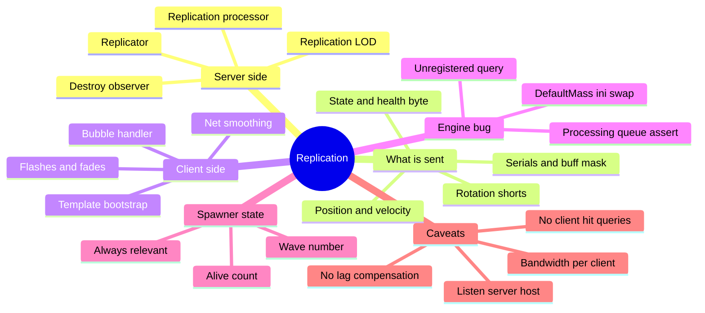
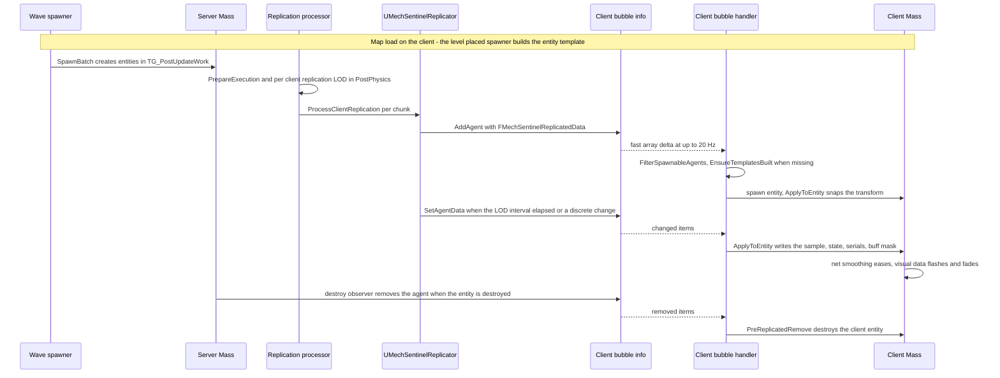
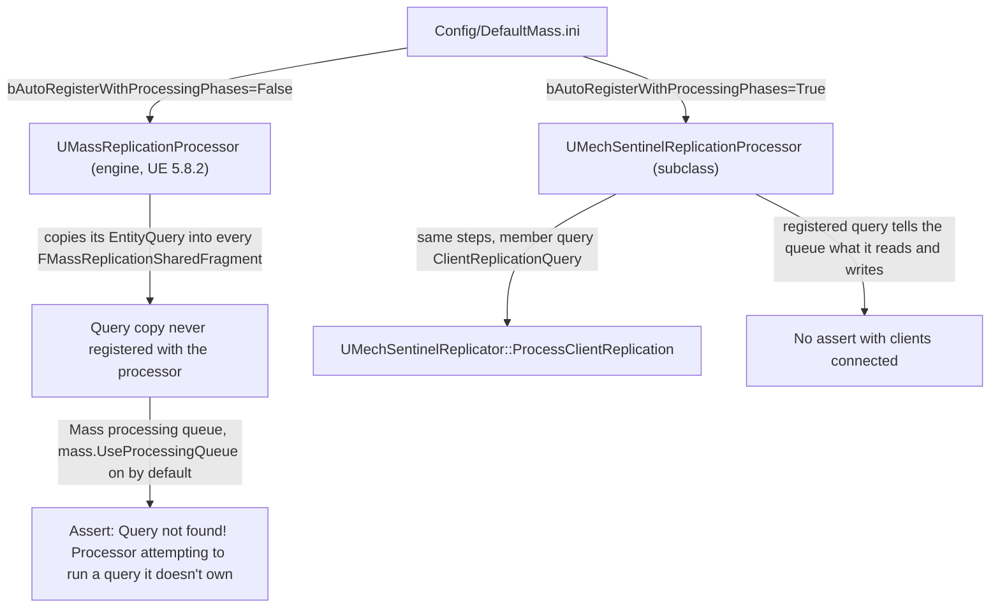

↑ [[MechSentinel Index]]

# MechSentinel Replication and Multiplayer

The swarm is server authoritative: only the server (or a standalone game) runs targeting, movement, combat and self-buffs. Clients receive a compact snapshot per relevant sentinel through the engine's MassReplication framework, with project classes for the snapshot, the per-client bubble and the replicator, and they only ease toward those snapshots and draw them. Because UE 5.8.2's own `UMassReplicationProcessor` crashes a server as soon as a client is connected, the project switches it off in `Config/DefaultMass.ini` and runs its own subclass instead. This page covers what is sent, when, how clients build sentinels from it, and what to keep in mind in multiplayer.

## Mind map

## How it flows

### Server to client, one sentinel's life

1. Before any agent can arrive, the client must know the entity template. The wave spawner is placed in the level, so the client loads it with the map, and its `PostInitializeComponents` registers `EntityConfig` with `UMechSentinelSwarmSubsystem`, which builds the template.
2. On the server, `AMechSentinelWaveSpawner::SpawnBatch` creates entities in `TG_PostUpdateWork`.
3. In PostPhysics, `UMechSentinelReplicationProcessor` synchronises clients and viewers, computes a replication LOD per client viewer, and runs `UMechSentinelReplicator::ProcessClientReplication` for each chunk of relevant entities.
4. A sentinel that became relevant (LOD below `Off`) and has no agent yet is added to that client's `AMechSentinelClientBubbleInfo` with a snapshot built by `FMechSentinelReplicatedData::FromEntity`.
5. The bubble's fast array (`FMechSentinelClientBubbleSerializer`) replicates to its client; the bubble actor's net update frequency is 20.
6. On the client, `FMechSentinelClientBubbleHandler::PostReplicatedAdd` keeps only agents whose template exists (building missing templates first) and spawns a client entity for each, snapping it to the server position.
7. Later frames: the replicator updates an agent when its replication LOD interval has passed, or at once when something discrete changed (state, health byte, hit or attack serial, buff mask). The handler writes the new sample into the entity.
8. The client's `UMechSentinelNetSmoothingProcessor` eases toward the samples. The serial changes were already turned into `HitFlash = 1` / `AttackGlow = 1` by `ApplyToEntity`; `UMechSentinelVisualDataProcessor` writes them into the ISM custom data, fades them back down and fades the buff looks toward `BuffMask`.
9. A killed sentinel stays replicated as a falling wreck (`State = Dead`). When the server destroys the entity after the fall, `UMechSentinelReplicationDestroyObserver` removes its agent from every client bubble in the same frame; the client handler destroys its copy in `PreReplicatedRemove`. A sentinel that only became irrelevant (LOD `Off`) is removed by the replicator's remove callback instead.

### The UE 5.8.2 bug and the swap

1. The engine processor runs each replicator through a copy of its query that is stored in every `FMassReplicationSharedFragment`. A processor only owns queries that are its own member variables (`UMassProcessor::RegisterQuery` checks the address), so the copy can never be registered.
2. UE 5.8's Mass processing queue (`mass.UseProcessingQueue`, on by default) looks every executed query up in the processor's registered queries and asserts when it is missing: `MassProcessingQueueTypes.cpp`, called from `MassReplicationProcessor.cpp:323`. It only happens with a client connected, so standalone was fine and Play As Listen Server crashed as soon as sentinels spawned.
3. `Config/DefaultMass.ini` switches the engine processor off and the project processor on, with `bAutoRegisterWithProcessingPhases`.
4. `UMechSentinelReplicationProcessor` repeats the engine's `Execute` step for step, but runs the replicator through `ClientReplicationQuery`, a member query that is registered.

## The pieces

| Class / struct | Side | Job |
|---|---|---|
| `UMassReplicationTrait` (engine) in `DA_MechSentinelConfig` | both | Adds the replication fragments and parameters; its `Params` name the bubble and replicator classes |
| `UMechSentinelReplicationProcessor` | server | Replaces `UMassReplicationProcessor`: client sync, LOD, replicator, sync back |
| `UMechSentinelReplicator` (`UMassReplicatorBase`) | server | Adds, updates and removes agents in each client's bubble |
| `UMechSentinelReplicationDestroyObserver` (`UMassObserverProcessor`) | server | On `DestroyEntity`, removes the agent from every client bubble at once |
| `FMechSentinelReplicatedData` | both | The snapshot of one sentinel |
| `FReplicatedMechSentinelAgent` (`FReplicatedAgentBase`) | both | NetID and template ID from the base, plus `Data` |
| `FMechSentinelFastArrayItem` (`FMassFastArrayItemBase`) | both | One fast array entry |
| `FMechSentinelClientBubbleSerializer` | both | The replicated fast array `Sentinels` (`NetDeltaSerialize`) |
| `FMechSentinelClientBubbleHandler` | both | Server: `SetAgentData`. Client: add, change, remove callbacks into Mass |
| `AMechSentinelClientBubbleInfo` (`AMassClientBubbleInfoBase`) | both | One actor per connected client, owned by its PlayerController, carrying the serializer |
| `UMechSentinelNetSmoothingProcessor` | client | Eases transforms toward the samples |
| `FMechSentinelNetSmoothingFragment` | client | Last sample: `NetLocation`, `NetVelocity`, `NetRotation`, `NetReceiveTime`, `bHasSample` |

Engine pieces that also run on the server: `UMassReplicationGridProcessor` (keeps the grid used for "who is in range"), `UMassNetworkIDFragmentInitializer` (assigns network IDs), `UMassReplicationEntityDestructionObserver`.

## What is sent per sentinel

`FMechSentinelReplicatedData` (all `UPROPERTY(Transient)`), about 23 bytes before delta compression according to its header:

| Field | Type | Content |
|---|---|---|
| `Position` | `FVector_NetQuantize10` | World position, 0.1 cm precision |
| `Velocity` | `FVector_NetQuantize` | cm/s, whole numbers; used for client extrapolation |
| `Yaw`, `Pitch`, `Roll` | `uint16` each | `FRotator::CompressAxisToShort`; roll carries the banking |
| `State` | `uint8` | `EMechSentinelState` (0 Seeking, 1 Attacking, 2 Stunned, 3 Dead) |
| `HealthByte` | `uint8` | Health fraction x 255, rounded; a living sentinel never sends 0 (it sends 1) |
| `HitSerial` | `uint8` | Incremented by the server on each damaging hit |
| `AttackSerial` | `uint8` | Incremented by the server on each attack |
| `BuffMask` | `uint8` | Active self-buffs, bit 0 armor, 1 speed, 2 damage |

Not sent: armor, attack damage, attack speed, absolute health, targets, active effects, gameplay tags, Mass tags, self-buff timers. Clients do not need them to draw.

**Events become serials.** A hit or an attack is an event, but replication sends state. The server increments a `uint8` serial; the client compares the new value with the one it has and flashes when they differ. Several hits between two updates give one flash.

**BuffMask is a level, not an event.** The client copies it on every update (masked with `MechSentinelSelfBuff::AllBits`) and the visuals fade toward it.

## Server: when an agent is added, updated or removed

`UMechSentinelReplicator::ProcessClientReplication` hands four callbacks to the engine helper `CalculateClientReplication<FMechSentinelFastArrayItem>`. For each entity of the chunk, with the current client's replication LOD:

| Situation | Callback | What it does |
|---|---|---|
| LOD below `Off`, no agent yet | `AddEntityCallback` | `FromEntity` snapshot, `Bubble.AddAgent` |
| LOD below `Off`, agent exists | `ModifyEntityCallback` | See below |
| LOD `Off`, agent exists | `RemoveEntityCallback` | `Bubble.RemoveAgentChecked` |

The modify rule:

1. Build the new snapshot.
2. If less than `UpdateInterval[LOD]` seconds passed since `AgentData.LastUpdateTime` **and** `HasDiscreteChange` is false (state, health byte, either serial, buff mask all the same), do nothing. Continuous movement is throttled by LOD; discrete changes go out at once.
3. Otherwise `FMechSentinelClientBubbleHandler::SetAgentData` compares it with the stored snapshot. Only if `DiffersFrom` says a client would notice (a discrete change, a position or velocity component off by more than 1 cm or 5 cm/s, or any changed rotation short) does it store the new snapshot, mark the item dirty and return true; then `LastUpdateTime` is updated. Otherwise nothing is stored or sent.

The replication LOD comes from the Replication trait's `Params`. `ue_setup_mech_sentinel_demo.py` sets them on `DA_MechSentinelConfig` (arrays are per `EMassLOD`: High, Medium, Low, Off):

| Param | Value set by the script | Meaning |
|---|---|---|
| `LODDistance` | 0, 2500, 7000, 20000 cm | Distance bands per client viewer |
| `LODMaxCountPerViewer` | 150, 300, 1000, 0 | Max sentinels per LOD per viewer |
| `UpdateInterval` | 0.1, 0.2, 0.4, 0.5 s | Minimum time between movement updates per LOD |
| `BubbleInfoClass` | `MechSentinelClientBubbleInfo` | Must be exactly this class |
| `ReplicatorClass` | `MechSentinelReplicator` | Must be exactly this class |

### Destroyed sentinels

The engine only removes destroyed agents from inside the per-chunk replicator callback. When every sentinel a client had in range is destroyed in the same frame (the end of a wave), no chunk is processed for that client, the agent is never removed, and the processor's cleanup asserts on the still-valid agent handle (in Shipping the client would keep a frozen ghost sentinel). `UMechSentinelReplicationDestroyObserver` (server, game thread, observes `DestroyEntity` of entities with `FMassReplicatedAgentFragment` and `FMechSentinelTag`) removes the agent from every client's bubble right away and invalidates its agent data, which makes the engine's later bookkeeping a no-op.

### Config checks

`UMechSentinelSwarmSubsystem::ValidateEntityConfig` runs once per config, outside standalone:

- No Replication trait: a warning, and the config's sentinels exist only on the server.
- `BubbleInfoClass` is not `AMechSentinelClientBubbleInfo` or `ReplicatorClass` is not exactly `UMechSentinelReplicator`: an error, and the config is ignored. The exact class matters because the replacement processor's query only has `UMechSentinelReplicator`'s requirements; a subclass could need more.

The bubble class itself is registered in `UMechSentinelSwarmSubsystem::Initialize` with `UMassReplicationSubsystem::RegisterBubbleInfoClass`. It must happen before any template with the Replication trait is built and before the first client joins, otherwise the engine asserts on `FMassReplicationSharedFragment`.

## Client: from fast array to Mass entity

| Callback | What the handler does |
|---|---|
| `PostReplicatedAdd` | `FilterSpawnableAgents`, then the engine's `PostReplicatedAddHelper` spawns entities and calls `ApplyToEntity(bJustSpawned = true)` |
| `PostReplicatedChange` | For known NetIDs, `ApplyToEntity(bJustSpawned = false)`; unknown NetIDs (an add that was postponed) are added now as late adds |
| `PreReplicatedRemove` | Passes only agents the replication subsystem knows to the base class, which destroys their entities |

`ApplyToEntity` writes:

- the sample into `FMechSentinelNetSmoothingFragment` with the local receive time;
- the transform directly only when the entity was just spawned (or has no smoothing fragment): new sentinels appear where the server has them;
- `FMassVelocityFragment_Copy::Value`;
- `FMechSentinelStateFragment::State` (resetting `TimeInState` on change), `HitFlash = 1` when `HitSerial` changed (not on spawn), `HitSerial`, `BuffMask`;
- `FMechSentinelAttackFragment::AttackGlow = 1` when `AttackSerial` changed (not on spawn), `AttackSerial`;
- `Health = MaxHealth x HealthByte / 255`. Only the fraction is meaningful on a client: `MaxHealth` there is the trait default, without the wave scaling.

What clients compute locally, every frame: transform easing and extrapolation, visual LOD, ISM custom data (state, health, flashes, glows, buff fades and eye pulses), tentacle selection and verlet chains, ISM instances. See [[MechSentinel Frame Flow]] and [[MechSentinel Representation and Visuals]].

### How clients get the entity template

The `EntityConfig` property of `AMechSentinelWaveSpawner` is a plain `EditAnywhere` `UPROPERTY`. It is **not replicated**. Clients get the config because the spawner is placed in the level and loads with the map on every machine (`ue_setup_mech_sentinel_startup.py` notes it on purpose: "It stays level-placed: EntityConfig is not replicated, clients build the template from it").

1. `AMechSentinelWaveSpawner::PostInitializeComponents` calls `EnsureTemplateBuilt` when `CanBuildTemplateNow()` is true, which is always the case on clients. `BeginPlay` tries again.
2. `EnsureTemplateBuilt` calls `UMechSentinelSwarmSubsystem::RegisterEntityConfig`, which validates the config and calls `GetOrCreateEntityTemplate`.
3. The template ID only depends on the config asset, so the server and every client agree on it, even though the archetype differs per net mode (a client has `FMechSentinelNetSmoothingFragment` and no `FMechSentinelSelfBuffFragment`).
4. `UMechSentinelSwarmSubsystem::OnWorldBeginPlay` calls `EnsureTemplatesBuilt`, which also walks every wave spawner in the world.
5. If an agent still arrives first, `FilterSpawnableAgents` calls `EnsureTemplatesBuilt`. An agent whose template is still unknown is skipped with a warning and spawned on its next update (through the late-add path of `PostReplicatedChange`).

The consequence: a wave spawner spawned at runtime whose `EntityConfig` is set only on the server instance (the property is not replicated) would leave clients without the template. Either keep a level-placed spawner with the same config, or call `RegisterEntityConfig` on clients. The warning text says the same.

## The listen-server assert and the workaround

| Item | Value |
|---|---|
| Symptom | Play As Listen Server with sentinels: the editor asserts as soon as a client is connected and sentinels are spawned |
| Assert | `Query not found! Processor attempting to run a query it doesn't own.` in `MassProcessingQueueTypes.cpp` (line 558 in this engine), from `UMassReplicationProcessor::Execute` |
| Cause | The engine processor runs unregistered per-fragment query copies; the processing queue only accepts registered queries |
| Engine CVar involved | `mass.UseProcessingQueue` (defined in `MassProcessingPhaseManager.cpp`, default true) |
| Project fix | `Config/DefaultMass.ini` turns `[/Script/MassReplication.MassReplicationProcessor]` off and `[/Script/Aura.MechSentinelReplicationProcessor]` on |
| Cost of the fix | Only `UMechSentinelReplicator` itself is run (other replicators, subclasses included, are logged once and not replicated); the debug LOD display `mass.debug.ClientReplicationLOD` draws nothing |
| When to remove | Once the engine registers its replication query: delete the class and both ini sections |

The project does **not** set `mass.UseProcessingQueue`. Setting it to 0 would also avoid this assert, because the query check only exists inside the processing queue, but it changes how every Mass phase in the game executes. The processor swap keeps the queue on and is the fix that is in the repository. A registered query has a second benefit: it tells the queue which fragments the processor reads and writes, so the queue does not run it alongside processors that write them.

The replacement constructor sets nothing itself: the engine constructor already made it server only, PostPhysics and game thread (it may spawn the bubble actors).

## The wave spawner's replicated state

`AMechSentinelWaveSpawner` replicates (always relevant, net update frequency 4, minimum 1):

| Property | Notes |
|---|---|
| `CurrentWaveNumber` | `ReplicatedUsing = OnRep_CurrentWaveNumber`, which broadcasts `OnWaveStarted` on clients |
| `WaveState` | `EMechSentinelWaveState`: Idle, Countdown, Spawning, Fighting, Finished |
| `AliveCount` | Alive (not dead) sentinels of this spawner |
| `RemainingToSpawn` | Not spawned yet (External mode: of every started wave) |
| `CurrentWaveTotal` | Planned size of the current wave; sent in the same bunch as the wave number, so `OnWaveStarted` reports the same count as on the server |

Clients should read these for HUDs: `UMechSentinelSwarmSubsystem::GetNumAliveSentinels` is 0 on clients. In External mode, clients get one `OnWaveStarted` for waves that start within the same net update, and none for a wave numbered below the current one. `OnWaveCleared` is server only.

## Multiplayer caveats

- **Clients have no hit queries.** The capsule hash is built by a server-only processor. Gun shots are resolved on the server (`GA_GunShoot` queues the hit on a timer). See [[MechSentinel Combat and GAS]].
- **No lag compensation.** The server sweeps a shot against where the sentinels are when the shot arrives; what the shooting client saw is about one round trip (plus smoothing) older. `SentinelShotRadius` on `GA_GunShoot` gives some slack.
- **Server-only data.** The swarm rules (the GameMode exists only on the server), `OnSentinelDamaged`, `OnSentinelKilled`, `OnWaveCleared`, targets, active effects and gameplay tags. Client code that needs the state must read `FMechSentinelStateFragment::State`; the Mass tags `FMechSentinelDeadTag`, `FMechSentinelStunnedTag`, `FMechSentinelAttackingTag` are never added on clients.
- **Bandwidth.** It grows with the number of relevant sentinels per client. The knobs are the Replication trait's `LODMaxCountPerViewer`, `LODDistance` and `UpdateInterval`, the spawner's `MaxAlive` and the rules' `MaxAliveSentinels`. The bubble actor updates at most 20 times per second.
- **Listen server.** The host counts as both Client and Server for processor flags: it simulates, replicates and renders. It has no smoothing fragment (that is `NM_Client` only), so it draws its own simulation directly.
- **Dedicated server.** The visualization and tentacle traits add nothing there (no ISM, no Niagara), and the render processors (flags `Standalone | Client`) do not run there at all.
- **Wrecks.** The death fall is simulated on the server only; clients see it as replicated movement with `State = Dead`.
- **Seen in testing (2026-11-21), not swarm code.** In a StartupMap listen-server test the second player got no pawn (a single PlayerStart rejected once the PCG platforms exist); it was reported as a level / GameMode issue.

## Debugging

| Log category | Message means |
|---|---|
| `LogMechSentinel` | A config's Replication trait has the wrong bubble or replicator class (error), or no Replication trait (warning) |
| `LogMechSentinelReplication` | A replicated sentinel uses an entity template unknown on this client (it spawns once the template exists) |
| `LogMechSentinelReplicationProcessor` | An entity type replicates through another replicator, which the replacement processor cannot run |

Whether the processing queue (the part that asserts) is on shows in the engine's start-up log line `FMassProcessingPhaseManager::Initialize complete. bUseProcessingQueue=...`; the processor swap itself is not logged.

## Key files

| File | Role |
|---|---|
| `Source/Aura/Public/MechSwarm/Replication/MechSentinelReplicatedAgent.h` | Snapshot, agent and fast array item |
| `Source/Aura/Private/MechSwarm/Replication/MechSentinelReplicatedAgent.cpp` | `FromEntity`, `DiffersFrom`, `HasDiscreteChange`, tolerances |
| `Source/Aura/Public/MechSwarm/Replication/MechSentinelClientBubble.h` | Handler, serializer, bubble info actor |
| `Source/Aura/Private/MechSwarm/Replication/MechSentinelClientBubble.cpp` | `SetAgentData`, client callbacks, `ApplyToEntity`, 20 Hz |
| `Source/Aura/Private/MechSwarm/Replication/MechSentinelReplicator.cpp` | Add / modify / remove callbacks, destroy observer |
| `Source/Aura/Public/MechSwarm/Replication/MechSentinelReplicationProcessor.h` | Why the engine processor is replaced |
| `Source/Aura/Private/MechSwarm/Replication/MechSentinelReplicationProcessor.cpp` | The replacement `Execute` with `ClientReplicationQuery` |
| `Config/DefaultMass.ini` | Engine processor off, project processor on |
| `Source/Aura/Private/MechSwarm/Core/MechSentinelSwarmSubsystem.cpp` | Bubble class registration, config validation, template building |
| `Source/Aura/Private/MechSwarm/Sentinel/MechSentinelTrait.cpp` | Smoothing fragment on clients, self-buff fragment elsewhere |
| `Source/Aura/Private/MechSwarm/Sentinel/MechSentinelClientProcessors.cpp` | Net smoothing, visual data |
| `Source/Aura/Private/MechSwarm/Spawning/MechSentinelWaveSpawner.cpp` | Template bootstrap, replicated wave state |
| `SourceArt/MechSentinel/ue_setup_mech_sentinel_demo.py` | Sets the Replication trait parameters on `DA_MechSentinelConfig` |

## Tuning knobs

| Setting | Where | Default | Effect |
|---|---|---|---|
| `LODDistance` | Replication trait `Params` on `DA_MechSentinelConfig` | 0, 2500, 7000, 20000 cm (demo script) | Replication LOD bands |
| `LODMaxCountPerViewer` | same | 150, 300, 1000, 0 (demo script) | Cap of replicated sentinels per LOD and viewer |
| `UpdateInterval` | same | 0.1, 0.2, 0.4, 0.5 s (demo script) | Movement update throttle per LOD |
| Bubble net update frequency | `AMechSentinelClientBubbleInfo` constructor | 20 | Max bubble updates per second |
| Spawner net update frequency | `AMechSentinelWaveSpawner` constructor | 4 (min 1) | Wave state updates |
| `PositionTolerance`, `VelocityTolerance` | `MechSwarm::ReplicationPrivate` (code only) | 1 cm, 5 cm/s | Smallest movement change worth sending |
| `PositionSharpness`, `RotationSharpness` | `MechSwarm::ClientPrivate` (code only) | 10, 8 per s | Client easing speed |
| `SnapDistance` | `MechSwarm::ClientPrivate` (code only) | 2000 cm | Teleport instead of easing |
| `MaxExtrapolationTime` | `MechSwarm::ClientPrivate` (code only) | 0.3 s | Longest prediction past a sample |
| `MaxAliveSentinels` | `UMechSentinelSwarmRules` | 1500 | Global cap, indirectly bandwidth |
| `MaxAlive` | `AMechSentinelWaveSpawner` | 0 = only the global cap (StartupMap script 500, demo 400) | Per-spawner cap |

## Related

- [[MechSentinel Frame Flow]]: where the replication processor and net smoothing sit in the frame.
- [[MechSentinel Architecture]]: the full class graph and the per-net-mode fragment list.
- [[MechSentinel Spawning and Waves]]: the spawner whose level placement makes client templates work.
- [[MechSentinel Combat and GAS]]: server-side hits, `HitSerial`, attacks.
- [[MechSentinel Self Buffs]]: where `BuffMask` comes from.
- [[MechSentinel Representation and Visuals]]: what clients do with the replicated values.
- [[MechSentinel Setup and Debugging]]: the setup scripts and test notes.

← [[MechSentinel Frame Flow]] · [[MechSentinel Index|Index]] · [[MechSentinel Spawning and Waves]] →
