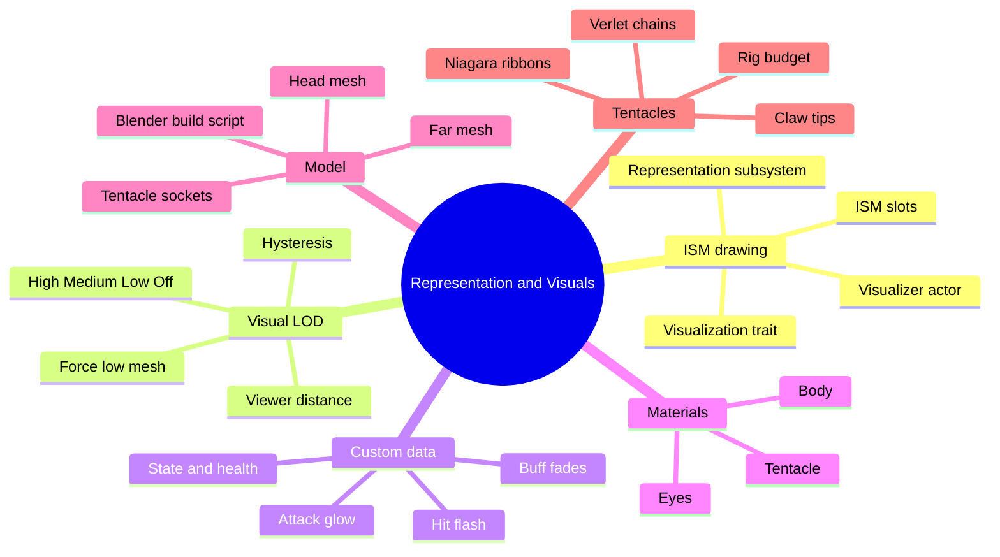
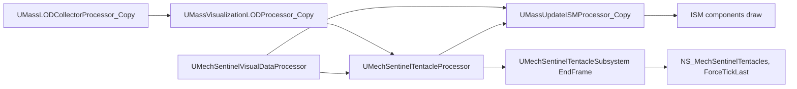
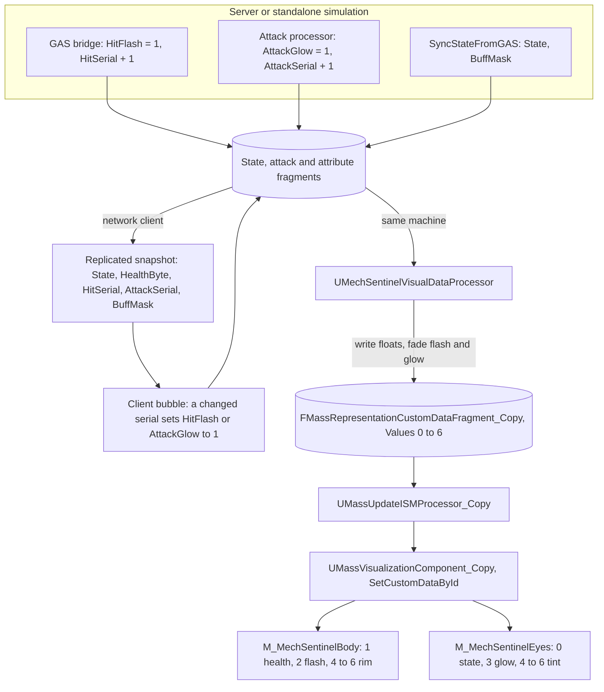
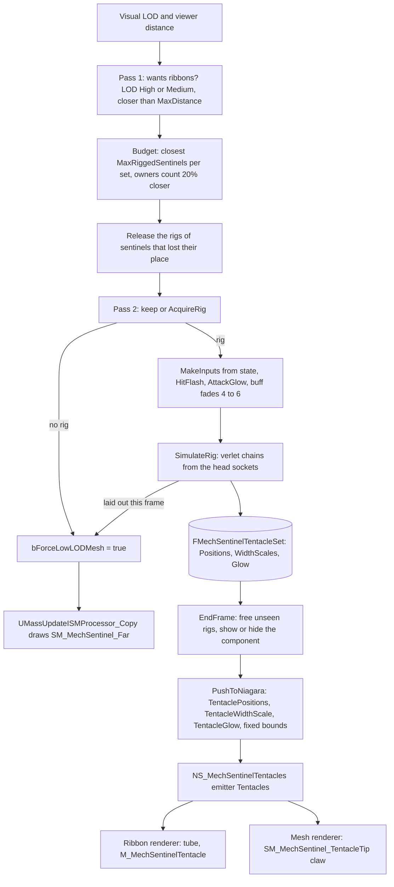

↑ [[MechSentinel Index]]

# MechSentinel Representation and Visuals

Sentinels have no actors and no skeletal meshes: every sentinel is one instance in an instanced static mesh, moved each frame from its Mass transform, and seven floats of per-instance custom data tell the materials its state, health, hit flash, attack glow and self-buffs. Near the camera, a budget of sentinels also gets eight Niagara ribbon tentacles simulated on the CPU; everyone else is drawn with a far mesh that has the tentacles baked in. All of this runs only where frames are rendered (standalone, listen server, clients); a dedicated server adds none of these fragments.

## Mind map



## How it flows

### One rendered frame



1. Everything here runs in the `PostPhysics` phase with the execution flags `Standalone | Client` (a listen server carries the Client flag), after the simulation has moved the sentinels.
2. `UMassLODCollectorProcessor_Copy` (group `MechSwarm.LODCollector`) measures each sentinel's distance to this machine's cameras.
3. In group `MechSwarm.Representation`: `UMassVisualizationLODProcessor_Copy` picks High, Medium, Low or Off; `UMechSentinelVisualDataProcessor` writes the custom data floats; `UMechSentinelTentacleProcessor` (after both) hands out tentacle rigs, simulates them and decides which sentinels need the far mesh; `UMassUpdateISMProcessor_Copy` (last) submits transforms and custom data to the ISMs.
4. The tentacle processor ends with `UMechSentinelTentacleSubsystem::EndFrame`, which pushes the chain arrays to Niagara; the Niagara component ticks last in the frame, so the ribbons use this frame's points.

### Entity data to ISM custom data to material



1. On the authority, hits, attacks and GAS state changes write `FMechSentinelStateFragment`, `FMechSentinelAttackFragment` and `FMechSentinelAttributesFragment`.
2. A network client gets a compact snapshot per sentinel. Its client bubble writes the same fragments: the state, health from `HealthByte` (`Health = MaxHealth x byte / 255`), `BuffMask` as a level, and it sets `HitFlash` or `AttackGlow` to 1 when `HitSerial` or `AttackSerial` changed (not on the spawn update).
3. `UMechSentinelVisualDataProcessor` converts the fragments into the seven custom data floats and fades `HitFlash` and `AttackGlow` back down.
4. `UMassUpdateISMProcessor_Copy` submits each visible entity's transform and floats; `UMassVisualizationComponent_Copy` writes them into the instance with `SetCustomDataById`.
5. The materials read the floats with `PerInstanceCustomData`.

### Tentacle data flow



1. Pass 1 lists every sentinel with the tentacle trait and marks who wants ribbons. A sentinel that already owns a rig keeps wanting it up to 1.1 x `MaxDistance` (squared distance x 1.21), so it does not flicker at the edge.
2. If more sentinels want ribbons than the set has rigs, the closest `MaxRiggedSentinels` win; current owners are scored at 0.64 x their squared distance (20% closer) so rigs do not flip between neighbours.
3. Losers release their rigs before anyone acquires one.
4. Pass 2 walks the entities in the same order. Every sentinel starts with `bForceLowLODMesh = true`; only a rigged sentinel that was simulated normally this frame clears it, so the ISM draws the head mesh for it and the ribbons supply the tentacles.
5. `SimulateRig` steps the chains and writes them into the set's flat arrays.
6. `EndFrame` frees rigs whose owner was not processed (destroyed entities), makes sure the Niagara component exists, shows and unpauses it only while rigs are active, and uploads the arrays.

## The ISM representation (_Copy classes)

The representation is a project-owned, ISM-only re-implementation of the engine's MassRepresentation (named `<Engine name>_Copy`, see [[MechSentinel Architecture]]). There is no actor or skeletal-mesh representation.

| Class | Role | Engine counterpart |
|---|---|---|
| `UMassVisualizationTrait_Copy` ("Visualization ISM (Copy)") | adds `FMassViewerInfoFragment_Copy`, `FMassRepresentationLODFragment_Copy`, `FMassRepresentationCustomDataFragment_Copy`, `FMassVisualizationTag_Copy`, and the const shared `FMassVisualizationLODParameters_Copy` and `FMassRepresentationParameters_Copy`. Adds nothing on a dedicated server | `UMassVisualizationTrait` |
| `FStaticMeshInstanceVisualizationDesc_Copy` | `Mesh`, `LowLODMesh`, `MaterialOverrides`, `MeshRelativeTransform` (identity), `bCastShadows` (true), `NumCustomDataFloats` (7, 0 to 7) | `FStaticMeshInstanceVisualizationDesc` |
| `UMassRepresentationSubsystem_Copy` | table of visual descriptions (`FindOrAddVisualDesc` gives a stable `DescIndex`), spawns the visualizer lazily, returns null on a dedicated server | `UMassRepresentationSubsystem` |
| `AMassVisualizer_Copy` | transient, non-replicated actor at the world origin hosting the ISMs | `AMassVisualizer` |
| `UMassVisualizationComponent_Copy` | one `UInstancedStaticMeshComponent` per (description, LOD mesh) slot, entity to instance id map | `UMassVisualizationComponent` |
| `UMassLODCollectorProcessor_Copy` | local camera distance and "behind every camera" per entity | `UMassLODCollectorProcessor` |
| `UMassVisualizationLODProcessor_Copy` | distance to `EMassLOD` with hysteresis | `UMassVisualizationLODProcessor` |
| `UMassUpdateISMProcessor_Copy` | submits instances (game thread) | `UMassUpdateISMProcessor` |

How `UMassVisualizationComponent_Copy` keeps instances stable:

* `GetOrCreateSlot(DescIndex, Desc, bLowLOD)`: slot key `DescIndex x 2 + (low ? 1 : 0)`. Without a `LowLODMesh`, Low LOD shares the main ISM.
* Each ISM is created `RF_Transient`, `Movable`, `NoCollision` (hits use the capsule queries), no navigation, shadow from `bCastShadows`, `SetNumCustomDataFloats(NumCustomDataFloats)`, and material overrides per slot index.
* Per frame: `BeginVisualFrame()`, `AddFrameInstance(Slot, Entity, Transform, CustomData)` for every drawn entity, `EndVisualFrame()`. The flush updates known entities with `UpdateInstanceTransformById` and `SetCustomDataById`, adds new ones with `AddInstanceById`, and removes every instance whose entity was not submitted this frame (`RemoveInstancesById`): destroyed, culled (LOD Off) or moved to the other LOD slot.
* Floats beyond what the entity provides are filled with 0. The visualizer sits at the origin with an identity transform, so local space is world space.
* `GetNumDrawnInstances()` counts the drawn instances over all slots (debugging).

`UMassUpdateISMProcessor_Copy` skips LOD Off, uses the low slot for Low LOD or when `bForceLowLODMesh` is set (a project addition on `FMassRepresentationLODFragment_Copy`), and places the instance at `MeshRelativeTransform x entity transform`.

## Visual LOD

* The collector walks this machine's local player controllers (`GetPlayerViewPoint`) and stores `ClosestViewerDistanceSq` and `bBehindAllViewers` in `FMassViewerInfoFragment_Copy`. This LOD only drives visuals; network relevancy is the engine's MassReplication LOD per client (see [[MechSentinel Replication and Multiplayer]]).
* `UMassVisualizationLODProcessor_Copy`: below `HighDistance` High, below `MediumDistance` Medium, below `LowDistance` Low, else Off. Behind every camera the distance counts x `BehindViewerDistanceScale`.
* Hysteresis: moving away, the LOD drops only once the distance passes a boundary x (1 + `Hysteresis`), 10% farther with the default; moving closer flips at the boundary itself. The very first evaluation uses the plain boundaries.
* High and Medium draw `Mesh` (the head), Low draws `LowLODMesh` (the far mesh), Off draws nothing.

## Per-instance custom data layout

`FMassRepresentationCustomDataFragment_Copy::Values` holds `MechSwarm::Representation::MaxCustomDataFloats` (7) floats, initialised to `{0, 1, 0, 0, 0, 0, 0}`. `UMechSentinelVisualDataProcessor` (PostPhysics, before the ISM update) writes them every frame:

| Index | Value | Written as | Read by |
|---|---|---|---|
| 0 | state | `float(uint8(State))`: 0 Seeking, 1 Attacking, 2 Stunned, 3 Dead | eyes: brighter attacking, flicker stunned, off dead |
| 1 | health fraction | `Health / MaxHealth` clamped 0..1 | body: darker and rougher when damaged |
| 2 | hit flash | `HitFlash`, then faded at 4 per second (about 0.25 s) | body: white emissive flash |
| 3 | attack glow | `AttackGlow`, faded at 2.5 per second (about 0.4 s), raised to the self-buff eye floor | eyes: glow pulse |
| 4 | armor buff | fade toward `BuffMask` bit 0 at 3 per second (about 0.33 s), 0 when dead | body rim, eye tint |
| 5 | speed buff | fade toward bit 1 | body rim, eye tint |
| 6 | damage buff | fade toward bit 2 | body rim, eye tint |

* Indices 4 to 6 start at `MechSentinelSelfBuff::FirstFadeCustomDataIndex` (4); a `static_assert` checks they fit in `MaxCustomDataFloats`.
* The buff fades live in the custom data itself, so the fragment keeps them between frames.
* The eye floor in index 3 while a buff is on: armor breathes 0.06 to 0.26 at 0.8 Hz, speed flicks 0.05 to 0.3 at 6 Hz, damage holds 0.22. Each is scaled by its fade, the highest wins, and a per-entity phase offset (`EntityPulseOffset`) keeps a buffed swarm from blinking in step. Details in [[MechSentinel Self Buffs]].
* An ISM with fewer floats reads the `PerInstanceCustomData` node default instead (0 for 4 to 6), so the materials look exactly as without buffs. `ue_setup_mech_sentinel_demo.py` sets `NumCustomDataFloats` 7 on `DA_MechSentinelConfig`.

## Materials

`SourceArt/MechSentinel/ue_import_mech_sentinel.py` builds three materials in `/Game/MechSentinel/Materials` with `unreal.MaterialEditingLibrary`. Body and eyes are flagged "Used with Instanced Static Meshes" and read `PerInstanceCustomData` nodes (with defaults for previews outside an ISM).

### M_MechSentinelBody

Built by `build_body_graph`:

```text
health     = PICD[1] (default 1)        flash = PICD[2] (default 0)
BaseColor  = (0.045, 0.05, 0.058) x lerp(0.45, 1, health)
Metallic   = 0.85
Roughness  = lerp(0.7, 0.42, health)
rim        = sum(PICD[4..6] x buff colour) x lerp(0.12, 1, Fresnel(exponent 3, base reflect 0)) x 3
Emissive   = flash x 4 + rim
```

Buff colours: armor steel blue `(0.25, 0.45, 1.0)`, speed cyan-white `(0.55, 1.0, 1.0)`, damage orange `(1.0, 0.35, 0.04)`. The rim floor 0.12 is the share of the colour on surfaces facing the camera; the silhouette gets all of it.

### M_MechSentinelEyes

Built by `build_eyes_graph`:

```text
state      = PICD[0]                    glow = PICD[3]
attacking  = 1 - saturate(|state - 1|)  stunned = 1 - saturate(|state - 2|)   dead = saturate(state - 2)
level      = 1 + 1.5 x attacking + 4 x glow
flicker    = round(frac(Time x 9))      a 9 Hz square wave
brightness = level x lerp(1, flicker, stunned) x (1 - dead)
eye colour = lerp(red (6, 0.18, 0.06), fade-weighted average of the buff colours, saturate(sum of fades) x 0.85)
Emissive   = eye colour x brightness
BaseColor  = (0.3, 0.01, 0.005)   Roughness = 0.2
```

Eye buff colours: armor `(0.6, 1.5, 6.0)`, speed `(2.2, 5.0, 6.0)`, damage `(6.0, 1.9, 0.08)`. The average divides by `max(sum of fades, 0.0001)`, so there is no 0 / 0 while no buff is on.

### M_MechSentinelTentacle

The ribbon tube material (flags: used with Niagara ribbons and Niagara mesh particles, for the claws):

* Sleeve bands: U along the ribbon x 11, `frac`, `|x - 0.5| x 2`, power 8, giving a sharp groove mask.
* Base colour from gunmetal `(0.045, 0.05, 0.058)` to dark `(0.01, 0.011, 0.013)` in the grooves; roughness 0.42 to 0.75; metallic 0.85.
* Emissive = `Particle Color.rgb x Particle Color.a`, so Niagara drives the glow.

### Assignment and updates

* `assign_mesh_materials` puts the body material on the slot named `MI_MechSentinel_Body` (slot 0 if missing) and the eye material on `MI_MechSentinel_Eyes` of all four meshes.
* Re-running the import script re-imports the four meshes (replace existing), leaves existing materials alone and redoes the slot assignment. `ue_update_mech_sentinel_buff_visuals.py` rebuilds the existing body and eye assets in place (deletes every expression, runs the same graph builders, recompiles, saves). It refuses to run during PIE or over a Git LFS pointer file, dry-runs the builders on a scratch material first, and warns when `DA_MechSentinelConfig` sends fewer than 7 custom data floats.

## The sentinel model

`SourceArt/MechSentinel/build_mech_sentinel.py` builds every mesh procedurally with `bpy` and `bmesh` (deterministic, no hand edits), exports one FBX per asset to `Export/`, re-imports and checks them, saves `MechSentinel.blend` and renders `Previews/` (`hero.png`, `swarm.png`, `head_threequarter.png`, `far_lod.png`, `tentacle.png`).

```text
<python with bpy> SourceArt/MechSentinel/build_mech_sentinel.py --out SourceArt/MechSentinel [--no-render] [--no-verify] [--quick] [--only names]
blender -b -P SourceArt/MechSentinel/build_mech_sentinel.py -- --out SourceArt/MechSentinel
```

| Asset | Checked triangles | What it is |
|---|---|---|
| `SM_MechSentinel_Head` | 900 to 1600, length 2.0 to 2.45 m, 8 sockets | armoured squid-like head: carapace plates, 8 eye lenses (eye slot), two hooked mandibles, ribbed rear collar with 8 hex tentacle ports and sockets `SOCKET_Tentacle_00..07`. No tentacles. Must stay within 0.65 m of the X axis (the 70 cm hit capsule) |
| `SM_MechSentinel_Far` | 700 to 1400 | simplified head plus 8 baked trailing tentacles (1.9 m, 8 points, 5 sides): Low LOD and the "no ribbons" fallback |
| `SM_MechSentinel_Tentacle` | 300 to 700, length 2.0 to 2.12 m | one straight tentacle: 11 armoured 18 cm sleeves (1.98 m) plus a 13 cm three-prong claw, the look reference for the ribbon material |
| `SM_MechSentinel_TentacleTip` | 1 to 160 | the claw alone, for the Niagara mesh renderer at the ribbon tips |

* Modules: `mech_sentinel_common.py` (scene, materials, export, verification), `mech_sentinel_head.py` (head and far LOD), `mech_sentinel_tentacle.py` (tentacle and claw).
* Units are metres in Blender and arrive as centimetres; the nose points +X, up is +Z, the origin is the head centre (the entity location).
* Material slots: `[0] MI_MechSentinel_Body`, `[1] MI_MechSentinel_Eyes`.
* Socket ring (`get_socket_frames`): x = -1.0 m on the rear collar, half-width 0.31 m, half-height 0.27 m, centre 0.05 m low, angles 22.5 + 45 x i degrees (none exactly at the top or bottom), rest direction fanned 20 degrees outward with a 0.08 droop.
* `TENTACLE_SEGMENTS` 11 and `TENTACLE_SEGMENT_LENGTH` 0.18 m match the game's default chain (12 points, 18 cm apart).
* `ue_import_mech_sentinel.py` imports the four FBX files into `/Game/MechSentinel/Meshes` (static meshes, no collision, no lightmap UVs, imported normals). The `SOCKET_Tentacle_XX` children become static mesh sockets `Tentacle_XX` on the head; the script warns when fewer than 8 are found.
* The C++ built-in ring in `UMechSentinelTentacleSubsystem::ResolveLayout` (`RingX` -100, `RingRadiusY` 31, `RingRadiusZ` 27, `RingCenterZ` -5, `RestDroop` 0.08, in cm) is the same layout, used when the sockets are missing.

## Niagara ribbon tentacles

### The pieces

| Piece | Role |
|---|---|
| `UMechSentinelTentacleTrait` ("Mech Sentinel Tentacles (Niagara)") | requires the visualization fragments, adds `FMechSentinelTentacleFragment` (`RigIndex`) and the const shared `FMechSentinelTentacleParams` (`SetIndex`). Nothing on a dedicated server. Without a Niagara system it logs a warning and the sentinels use the far mesh at every LOD |
| `FMechSentinelTentacleDesc` | the trait's settings (see [[MechSentinel Representation and Visuals#Tuning knobs]]) |
| `UMechSentinelTentacleSubsystem` | one `FMechSentinelTentacleSet` per distinct description: rig pool, flat arrays, one Niagara component |
| `UMechSentinelTentacleProcessor` | budget, rig assignment, chain simulation, `bForceLowLODMesh` |
| `/Game/MechSentinel/FX/NS_MechSentinelTentacles` | draws every rigged sentinel of a set as ribbons |

A set's arrays are laid out `[rig][tentacle][point]`: `RibbonIndex = Rig x NumTentacles + Tentacle`, `PointIndex = RibbonIndex x PointsPerTentacle + Point`, so a ribbon is a contiguous run of points. With the defaults that is 48 rigs x 8 tentacles = 384 ribbons and 4608 points, all in one CPU emitter.

Rigs: `AcquireRig` pops a free rig and gives it a golden-angle sway phase from the entity index (`Index x 2.39996` radians), `ReleaseRig` zeroes its ribbons' width and glow, `IsRigOwnedBy` checks ownership. `BeginFrame` clears the "seen" bits; `EndFrame` frees rigs nobody touched.

### Per-sentinel inputs

`MakeInputs` turns the sentinel's state into multipliers for its rig:

| Condition | Stiffness | Gravity | Sway | Sway speed | Width | Glow |
|---|---|---|---|---|---|---|
| Seeking | 1 | 1 | 1 | 1 | 1 | max of `HitFlash`, `AttackGlow` (every state) |
| Attacking | 1.2 | 1 | 1.3 | `AttackSwayMultiplier` (2.2) | 1 | same |
| Stunned | 0.35 | 1.6 | 0.25 | 1 | 1 | same |
| Dead | `DeadStiffnessScale` (0.03) | 3 | 0 | 1 | 1 | same |
| armor buff fade | | | | | lerp to 1.2 | |
| speed buff fade (not stunned) | x lerp to 1.4 | | x lerp to 0.6 | | | |
| damage buff fade | | | | | | at least 0.45 x fade |

Buff fades are read from custom data 4 to 6 (wrecks show none), so the tentacles follow the same fades as the materials. The sway speed is never changed by buffs, because it multiplies the absolute time and would make the wave jump.

### The chain simulation

`SimulateRig` steps one rig. The frame time is clamped to 1/15 s, and last frame's motion is carried on at the speed it was made at (`VelocityScale = dt / previous dt`, at most 4), so a hitch does not fling the chains. For every tentacle:

1. The root is the head socket transformed by `MeshRelativeTransform x entity transform`. The rest direction comes from the root position (not the socket rotation) with `FanAngle`; the trailing direction is `-Forward + Radial x TrailSpread - Up x TrailDroop`.
2. A rest point per chain point blends from the socket direction to the trailing direction along the chain; a swimming wave (`SwayAmplitude`, `SwayFrequency`, `SwayPhasePerPoint`, growing toward the tip) offsets it sideways.
3. Verlet step: inertia with water drag (`Damping` per 1/60 s), `Gravity`, and a swirling current (`FlowStrength`, `FlowScale`, `FlowSpeed`: a divergence-free ABC flow in world space, sampled at the root, middle and tip and interpolated, 0 at the root).
4. A weak spring toward the trailing pose: `Stiffness` at the root, `Stiffness x TipStiffnessScale` at the tip.
5. Straightening toward the continuation of the previous segment (`Straightening`), moving the previous position too so it adds no speed.
6. Tie to the previous point: bend limited to `MaxBendAngle`, length between `SegmentLength` and `SegmentLength x StretchRatio`, a stretched segment springing back at `CatchUpRate` (an XPBD fraction) with critical damping of its stretch speed.

When a rig is new or its first root moved more than `TeleportDistance` in one frame, the whole rig is laid out in its rest pose instead, its ribbons get width 0 for that frame and the sentinel keeps the far mesh, so a jump never shows a stretched ribbon or a motion-vector streak.

### Feeding Niagara

`EnsureComponent` spawns the system once per set with `UNiagaraFunctionLibrary::SpawnSystemAtLocation` at the origin (no auto destroy, no auto activate, no pooling, no pre-cull check), sets `ENiagaraTickBehavior::ForceTickLast`, shadow casting from `bCastShadows`, the user ints `PointsPerTentacle` and `TentacleCount` (`MaxRiggedSentinels x NumTentacles`) and the user floats `RootWidth` and `TipWidth`, then activates it. It is created as soon as the set is in use, not with the first rig, so the ribbon PSOs precache while the swarm is still far away; it stays hidden and paused while no rig is active.

`PushToNiagara`, every frame with active rigs:

| User parameter | Type | Filled with |
|---|---|---|
| `TentaclePositions` | Niagara Position Array | every chain point, world space (`SetNiagaraArrayPosition`) |
| `TentacleWidthScale` | Niagara Float Array | per ribbon width multiplier, 0 hides the ribbon and its claw (`SetNiagaraArrayFloat`) |
| `TentacleGlow` | Niagara Float Array | per ribbon glow 0..1 |
| fixed bounds | | this frame's points, padded by `max(RootWidth, 10) + 15` cm for the tube and the claw (`SetSystemFixedBounds`) |

The names are defined once in `MechSwarm::Tentacles::NiagaraParams`.

### Inside NS_MechSentinelTentacles

One CPU emitter named `Tentacles` with fixed bounds. `Spawn Burst Instantaneous` spawns `Multiply_Int(TentacleCount, PointsPerTentacle)` particles that never die. Particle Update derives, per particle (from the expressions stored in the asset):

```text
TentacleRibbon       = UniqueID / max(PointsPerTentacle, 1)
TentacleLink         = UniqueID - TentacleRibbon x max(PointsPerTentacle, 1)
TentacleT            = float(TentacleLink) / float(max(PointsPerTentacle - 1, 1))
Position             = TentaclePositions[UniqueID]                       (SelectPositionFromArray)
TentaclePrevPosition = TentaclePositions[max(UniqueID - 1, UniqueID - TentacleLink)]
Velocity             = Position - TentaclePrevPosition                   (chain direction for the claw)
RibbonID             = TentacleRibbon      RibbonLinkOrder = float(TentacleLink)
RibbonWidth          = lerp(RootWidth, TipWidth, TentacleT) x TentacleWidthScale
Color                = (1, 0.06, 0.02, TentacleGlow x TentacleT^4 x 30)
Scale                = (1, 1, 1) x TentacleWidthScale
```

`TentacleWidthScale` and `TentacleGlow` are read per ribbon with `SelectFloatFromArray`. A ribbon renderer in tube shape uses `M_MechSentinelTentacle`; a mesh renderer draws `SM_MechSentinel_TentacleTip` as the claw, shown only on the last point through `Particles.VisibilityTag`. The step-by-step build recipe is in `MyMechEntitySystemReadme.md`, section 15.

## Key files

| File | Role |
|---|---|
| `Source/Aura/Private/MechSwarm/Sentinel/MechSentinelClientProcessors.cpp` | `UMechSentinelVisualDataProcessor`: custom data, fades, eye pulse |
| `Source/Aura/Public/MechSwarm/MassCopies/MassRepresentationFragments_Copy.h` | visual description, LOD fragment and parameters, custom data fragment |
| `Source/Aura/Private/MechSwarm/MassCopies/MassVisualizationTrait_Copy.cpp` | "Visualization ISM (Copy)" trait |
| `Source/Aura/Private/MechSwarm/MassCopies/MassRepresentationProcessors_Copy.cpp` | visual LOD and ISM update processors |
| `Source/Aura/Private/MechSwarm/MassCopies/MassLODFragments_Copy.cpp` | local viewer collector |
| `Source/Aura/Private/MechSwarm/MassCopies/MassVisualizationComponent_Copy.cpp` | ISM slots, stable instance ids |
| `Source/Aura/Private/MechSwarm/MassCopies/MassRepresentationSubsystem_Copy.cpp` | description table, visualizer spawn |
| `Source/Aura/Public/MechSwarm/Tentacles/MechSentinelTentacleTypes.h` | `FMechSentinelTentacleDesc`, Niagara parameter names |
| `Source/Aura/Private/MechSwarm/Tentacles/MechSentinelTentacleTrait.cpp` | tentacle trait |
| `Source/Aura/Private/MechSwarm/Tentacles/MechSentinelTentacleProcessor.cpp` | budget, inputs, chain simulation |
| `Source/Aura/Private/MechSwarm/Tentacles/MechSentinelTentacleSubsystem.cpp` | rig pool, socket layout, Niagara output |
| `Source/Aura/Private/MechSwarm/Replication/MechSentinelClientBubble.cpp` | client side flash, glow, buff mask and health from the snapshot |
| `SourceArt/MechSentinel/build_mech_sentinel.py` | Blender build of the four meshes |
| `SourceArt/MechSentinel/mech_sentinel_head.py` | head, far LOD, socket ring |
| `SourceArt/MechSentinel/mech_sentinel_tentacle.py` | tentacle and claw |
| `SourceArt/MechSentinel/ue_import_mech_sentinel.py` | mesh import, the three materials |
| `SourceArt/MechSentinel/ue_update_mech_sentinel_buff_visuals.py` | rebuilds the body and eye materials in place |
| `SourceArt/MechSentinel/ue_setup_mech_sentinel_demo.py` | entity config: meshes, LOD distances, 7 floats, tentacle system |

## Tuning knobs

| Setting | Where | Default | Effect |
|---|---|---|---|
| `Mesh` / `LowLODMesh` | Visualization ISM (Copy) | none (demo: `SM_MechSentinel_Head` / `SM_MechSentinel_Far`) | near and far meshes |
| `MaterialOverrides` | Visualization ISM (Copy) | empty | per-slot material overrides |
| `MeshRelativeTransform` | Visualization ISM (Copy) | identity | mesh offset or scale from the entity |
| `bCastShadows` | Visualization ISM (Copy) | true | ISM shadows |
| `NumCustomDataFloats` | Visualization ISM (Copy) | 7 | floats sent to the materials (7 for buffs) |
| `HighDistance`, `MediumDistance`, `LowDistance` | Visualization ISM (Copy) > LODParams | 4000, 9000, 25000 cm | LOD bands, Off beyond Low |
| `BehindViewerDistanceScale` | LODParams | 1.5 | distance scale behind every camera |
| `Hysteresis` | LODParams | 0.1 | moving away, a boundary counts as boundary x (1 + this) before the LOD drops |
| `NiagaraSystem` | Mech Sentinel Tentacles (Niagara) | none (demo: `NS_MechSentinelTentacles`) | ribbon system, empty = far mesh everywhere |
| `NumTentacles`, `PointsPerTentacle`, `SegmentLength` | tentacle trait | 8, 12, 18 cm | chain shape |
| `RootWidth`, `TipWidth` | tentacle trait | 18 cm, 3.5 cm | ribbon width |
| `MaxRiggedSentinels` | tentacle trait > Budget | 48 | sentinels with ribbons at once |
| `MaxDistance` | tentacle trait > Budget | 9000 cm | ribbons only closer than this (keep near the Medium distance) |
| `FanAngle`, `TrailSpread`, `TrailDroop` | tentacle trait > Rest pose | 20 deg, 0.22, 0.42 | rest and trailing pose |
| `Gravity`, `Damping` | tentacle trait > Simulation | 200 cm/s², 0.05 | weight and water drag |
| `Stiffness`, `TipStiffnessScale` | tentacle trait > Simulation | 90, 0.2 | pull toward the trailing pose |
| `CatchUpRate`, `StretchRatio` | tentacle trait > Flow | 20 rad/s, 1.3 | how far they stream and how fast they catch up |
| `Straightening`, `MaxBendAngle` | tentacle trait > Flow | 10 per s, 30 deg | smoothness, sharpest bend |
| `FlowStrength`, `FlowScale`, `FlowSpeed` | tentacle trait > Flow | 300 cm/s², 220 cm, 0.6 | swirling current |
| `SwayAmplitude`, `SwayFrequency`, `SwayPhasePerPoint` | tentacle trait > Simulation | 14 cm, 0.7 Hz, 0.55 | swimming wave |
| `AttackSwayMultiplier`, `DeadStiffnessScale` | tentacle trait > Simulation | 2.2, 0.03 | thrash when attacking, limp when dead |
| `TeleportDistance` | tentacle trait > Simulation | 400 cm | root jump that re-lays the chain |
| `bCastShadows` | tentacle trait > Rendering | true | ribbon and claw shadows |

## Related

* [[MechSentinel Architecture]]: where the representation and tentacle subsystems sit.
* [[MechSentinel Frame Flow]]: the full frame, with the PostPhysics representation group at the end.
* [[MechSentinel Replication and Multiplayer]]: the snapshot that feeds client visuals.
* [[MechSentinel Combat and GAS]]: what sets the hit flash, attack glow and states.
* [[MechSentinel Self Buffs]]: what sets the buff fades.
* [[MechSentinel Setup and Debugging]]: building the entity config and the demo map.
* [[MassEntity]]: Talal's notes on Mass in general.

← [[MechSentinel Self Buffs]] · [[MechSentinel Index|Index]]
