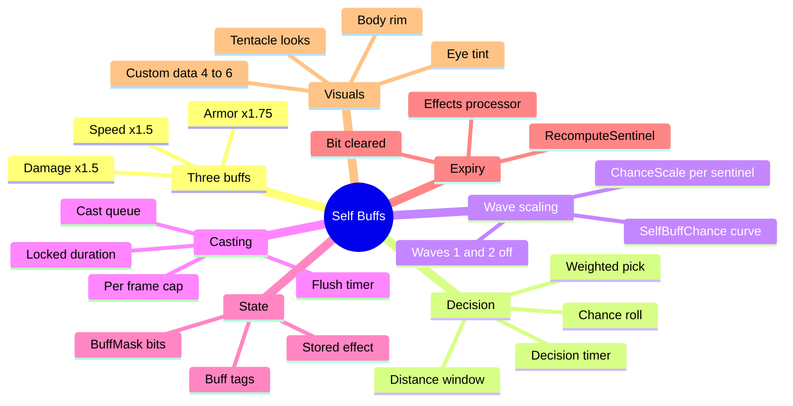
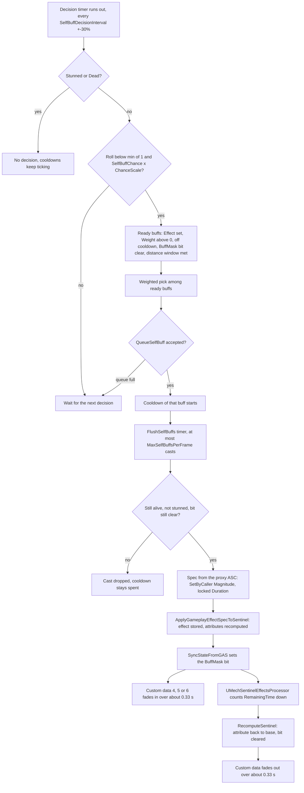
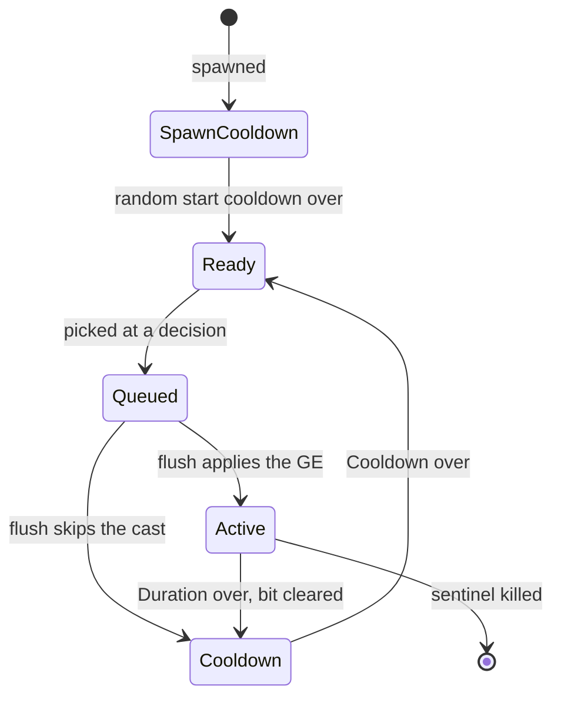
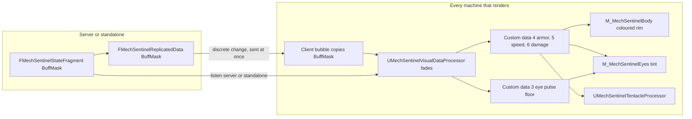

↑ [[MechSentinel Index]]

# MechSentinel Self Buffs

Sentinels can cast one of three short buffs on themselves: **armor** (tougher), **speed** (closes in on a far target) and **damage** (hits harder up close). The server rolls for it every second and a half or so, the chance is scaled per wave (in curve mode it grows with the wave number), and the buff is a normal gameplay effect stored on the sentinel through the same GAS bridge that resolves hits. Only one bit per buff travels to clients, where it fades a coloured rim onto the body, tints the eyes and changes how the tentacles move, so players can read which sentinels are buffed.

## Mind map

## How it flows

### Roll, apply, fade, expire

1. Each sentinel has its own decision timer in `FMechSentinelSelfBuffFragment`. When it runs out it is reset to `SelfBuffDecisionInterval x random(0.7, 1.3)`, so the swarm does not buff in step.
2. Stunned and dead sentinels skip the decision; their cooldowns keep counting down anyway.
3. The roll uses the rules' `SelfBuffChance` (0.25) times the sentinel's `ChanceScale` (the wave's `SelfBuffChanceMultiplier`), clamped to 1.
4. A buff is ready when its effect class is set, its `Weight` is above 0, its cooldown is 0, its `BuffMask` bit is clear (the same GE again would only refresh it), and the target distance window is met. A window needs a target.
5. One ready buff is picked by weight and queued with `UMechSentinelSwarmSubsystem::QueueSelfBuff`. Only when the queue accepts it does the buff's cooldown start (counted from the cast, so it includes the duration).
6. The flush runs from a next-tick timer, outside the Mass phases, oldest casts first, at most `MaxSelfBuffsPerFrame` per frame.
7. The flush re-checks the sentinel (a hit or an expiry may have run in between), then applies the buff's GE through the GAS bridge, which stores it as an active effect and recomputes the attributes.
8. `SyncStateFromGAS` sets the buff's bit in `FMechSentinelStateFragment::BuffMask`. That bit replicates and drives the visuals.
9. When the stored effect's time is up, `UMechSentinelEffectsProcessor` removes it and calls `RecomputeSentinel`: the attribute goes back to its base and the bit clears, so the colour fades out.

### Life of one buff slot

1. At spawn the wave spawner gives every slot a random start cooldown of up to half its `Cooldown`, so a fresh wave does not buff all at once.
2. `Queued` lasts at most a few frames (the flush runs the same frame when the queue is short).
3. `Active` lasts `Duration`; the cooldown was set at the decision and keeps running meanwhile, so the gap between the end of a buff and the next cast of the same buff is `Cooldown - Duration` at least (12 s for armor with the defaults).
4. A killed sentinel loses its `BuffMask` at once, and its wreck shows no buff colour.

### From the BuffMask to the screen

1. The server computes `BuffMask`. It is a byte in the replicated snapshot; a change counts as a discrete change (`HasDiscreteChange`) and is sent right away, not throttled by the replication LOD interval.
2. A client stores it as a level, not an event: `State->BuffMask = Data.BuffMask & MechSentinelSelfBuff::AllBits` on every update. A listen server or standalone game reads its own fragment.
3. `UMechSentinelVisualDataProcessor` fades each buff's custom data float toward its bit and raises the eye glow float to a per-buff pulse floor.
4. The materials and the tentacle processor read those floats. Details in [[MechSentinel Representation and Visuals]].

## The three buffs

Defaults from the `UMechSentinelSwarmRules` constructor (`ArmorBuff`, `SpeedBuff`, `DamageBuff`, each an `FMechSentinelSelfBuffDef`):

| Slot | Built-in effect | Attribute | Magnitude | Duration | Cooldown | Weight | Only when the target is |
|---|---|---|---|---|---|---|---|
| 0 Armor | `UMechSentinelArmorBuffEffect` | `Armor` | x1.75 | 6 s | 18 s | 1 | anywhere (no window) |
| 1 Speed | `UMechSentinelSpeedBuffEffect` | `MoveSpeedMultiplier` | x1.5 | 4 s | 12 s | 1 | at least 1500 cm away |
| 2 Damage | `UMechSentinelDamageBuffEffect` | `AttackDamage` | x1.5 | 5 s | 15 s | 1 | within 2500 cm |

* The slot order is `EMechSentinelSelfBuff` (`Armor = 0`, `Speed = 1`, `Damage = 2`); it is also the bit index in `BuffMask` and the custom data index minus 4 (`MechSentinelSelfBuff::FirstFadeCustomDataIndex`).
* `UMechSentinelSwarmRules::GetSelfBuffDef(BuffIndex)` returns the definition of a slot (out of range returns `ArmorBuff`).
* An `FMechSentinelSelfBuffDef` with `Effect` empty or `Weight` 0 is never cast. `MinTargetDistance` / `MaxTargetDistance` of 0 mean no limit.
* The struct defaults (used by a new definition, not by the three above) are `Magnitude` 1.5, `Duration` 5 s, `Cooldown` 15 s, `Weight` 1.

### What each buff changes

The built-in effects are made by `InitSelfBuff` in `MechSentinelDefaultEffects.cpp`: `HasDuration` (a 5 s placeholder that the swarm overrides), one modifier with `EGameplayModOp::MultiplyAdditive` on the attribute, magnitude SetByCaller `SetByCaller.MechSentinel.SelfBuffMagnitude`. Nothing else on purpose: no granted tags (the swarm recognises the class), no chance, stacking, period or cues, which the bridge would re-run or drop on every evaluation.

* Multiply (Additive) means current = base x Magnitude on the wave-scaled base. Several multipliers on one attribute add up as `1 + sum(m - 1)`; a Magnitude of 0 sets the attribute to 0.
* Only the current value changes. `ReadBack` writes `Armor`, `MoveSpeedMultiplier` or `AttackDamage`, while `BaseArmor`, `BaseMoveSpeedMultiplier` and `BaseAttackDamage` keep the spawn values, so expiry restores them exactly.

| Buff | Read by | Example (demo config, wave 1) |
|---|---|---|
| Armor | `ExecCalc_SentinelDamage` captures the target's current `Armor` | `Armor` 4 to 7: mitigation 19.4% to 29.6%, a 40 damage gun shot deals 28.2 instead of 32.3, 5 shots instead of 4 for 120 health |
| Speed | `UMechSentinelSteeringProcessor`: speed = shared `MovementSpeed` x `MoveSpeedMultiplier` | 900 to 1350 cm/s, still capped by `FMassMovementParameters_Copy::MaxSpeed` (2400 cm/s) |
| Damage | `UMechSentinelAttackProcessor` puts the current `AttackDamage` into the attack spec | `AttackDamage` 3 to 4.5 per attack, at `AttackSpeed` 0.6 that is 2.7 instead of 1.8 damage per second |

The example uses the values `ue_setup_mech_sentinel_demo.py` writes into `DA_MechSentinelConfig` (`Armor` 4, `AttackDamage` 3, `AttackSpeed` 0.6) and the trait's `MovementSpeed` 900. With `Armor` 0 in a config the armor buff only shows its colour.

## When a sentinel buffs itself

`UMechSentinelSelfBuffProcessor` runs on the authority (standalone or server), in the `Behavior` group after `UMechSentinelEffectsProcessor` (it sees this frame's expiries) and `UMechSentinelTargetSelectionProcessor` (it sees this frame's targets), on the game thread because it writes the subsystem's queue and arms its timer.

* Query: `FMechSentinelSelfBuffFragment` (read write), `FMechSentinelStateFragment`, `FMechSentinelTargetFragment`, `FTransformFragment`; `FMechSentinelTag` required, `FMechSentinelDeadTag` excluded.
* `FMechSentinelSelfBuffFragment` is server only: `UMechSentinelTrait` adds it only where the swarm is simulated (not on `NM_Client`). It holds `Cooldown[3]`, `DecisionTimer` and `ChanceScale`.
* Per frame, every cooldown goes down by the frame time (clamped at 0), stun or not.
* The target distance is measured from the sentinel to `FMechSentinelTargetFragment::TargetLocation`, which for a player includes the `TargetHeightOffset`.
* The weighted pick walks the ready buffs with a roll in `[0, total weight)`; float rounding at the very end falls back to the last ready buff.
* With all defaults a sentinel decides about every 1.5 s, and a decision casts with probability 0.25 x `ChanceScale` when at least one buff is ready.
* `bEnableSelfBuffs` off: the processor does nothing and the flush drops anything still queued.

### Wave scaling of the chance

The wave spawner writes `ChanceScale = max(0, Def.SelfBuffChanceMultiplier)` into every sentinel it spawns, together with the random start timers (`DecisionTimer = random(0, 1) x SelfBuffDecisionInterval`, `Cooldown[i] = random(0, 1) x 0.5 x Cooldown of buff i`).

* Hand-made waves (`L_MechSentinelDemo`): each `FMechSentinelWave` has `SelfBuffChanceMultiplier` (default 1).
* Curve mode (`bUseWaveCurves`, StartupMap): `CurveBaseWave.SelfBuffChanceMultiplier` (1) x `WaveCurves.SelfBuffChance` evaluated at the wave number. The default keys are linear, flat before wave 1, and keep growing past the last key at its slope:

| Wave | Curve factor | Chance per decision (0.25 x factor) |
|---|---|---|
| 1 | 0 | 0 |
| 2 | 0 | 0 |
| 3 | 0.5 | 0.125 |
| 4 | 0.667 | 0.167 |
| 5 | 0.833 | 0.208 |
| 6 | 1.0 | 0.25 |
| 10 | 1.143 | 0.286 |
| 20 | 1.5 | 0.375 |
| 40 | 2.214 | 0.554 |
| 90 | 4.0 | 1.0 (clamped) |

The keys are `(1, 0)`, `(2, 0)`, `(3, 0.5)`, `(6, 1.0)`, `(20, 1.5)` (`FMechSentinelWaveCurves` constructor): no self-buffs in waves 1 and 2, then more and more often. A float curve asset in the curve's External Curve slot replaces them; `ue_setup_mech_sentinel_startup.py` can set keys or an asset through `WAVE_CURVES["self_buff_chance"]` and leaves the C++ defaults alone when that dict is empty, which is the StartupMap setup. See [[MechSentinel Spawning and Waves]].

## The cast queue

`QueueSelfBuff(Entity, BuffIndex)` (game thread, server only):

* Refuses (returns false) on clients, for an unset entity or a bad index, and when the queue already holds `max(1, MaxSelfBuffsPerFrame) x 30` casts (240 with the defaults, a second at 30 fps). A refused cast leaves the buff ready for the next decision, because the processor sets the cooldown only on success.
* Appends an `FPendingSelfBuff { Entity, BuffIndex }` and arms the flush with `SetTimerForNextTick` once (`bSelfBuffFlushScheduled`). Timers run after `TG_PostPhysics`, so when armed from the decision processor (PrePhysics) the flush runs later the same frame.

`FlushSelfBuffs()` (stat scope `MechSentinelSwarm_FlushSelfBuffs`):

1. Takes the oldest `min(queue size, MaxSelfBuffsPerFrame)` casts out of the queue before applying them, because GAS and the events it fires run game code.
2. Calls `ApplySelfBuff` for each, then re-arms the timer if casts are left (they go next frame).

`ApplySelfBuff` skips the cast when:

* the definition has no `Effect`, or the entity is no longer active;
* the effect is `Instant` (it would change the base value for good and is not stored): a warning is logged once, `Self-buff effect %s is Instant and is never cast`;
* the sentinel is Dead or Stunned, or already has that `BuffMask` bit.

Otherwise it makes a spec of the buff's GE from the **proxy ASC** (like sentinel attacks), level 1, sets `SetByCaller.MechSentinel.SelfBuffMagnitude = max(0, Magnitude)` and `SetDuration(max(0.1, Duration), bLockDuration = true)`, and runs it through `ApplyGameplayEffectSpecToSentinel`. Because the duration is locked on the spec, the rules are the only knob for how long a buff lasts, whatever the GE asset says.

Things to know:

* The cooldown is spent at decision time, even when the flush then skips the cast.
* A queued cast does not re-check the target distance window.
* Cost: each cast is two proxy evaluations (the stored list changed, so the bridge runs its second pass), each expiry one, and every hit on a buffed sentinel re-creates its buffs on the proxy. See [[MechSentinel Combat and GAS#The GAS bridge step by step]].

## How a buff is stored and recognised

* **Stored.** The bridge stores the active buff in `FMechSentinelGASFragment::ActiveEffects` like any duration effect: class, level, `RemainingTime`, the SetByCaller map (so the magnitude survives re-evaluations), stack count, instigator ASC. The same class again refreshes the entry.
* **Recognised.** `SyncStateFromGAS` rebuilds `BuffMask` with `ComputeBuffMask`: bit i is set while a stored effect's class is (a child of) the rules' buff i class, or the owned tags contain that slot's tag.
* **Designer effects.** A GE that grants `State.Sentinel.Buff.Armor`, `.Speed` or `.Damage` counts as that buff: its bit lights the visuals and the sentinel does not cast that self-buff meanwhile. The built-in effects grant no tags.
* **Expiry.** `UMechSentinelEffectsProcessor` (Behavior group, first) subtracts the frame time from every stored effect's `RemainingTime`, removes the expired ones with `RemoveAt` (the list must stay in application order) and calls `RecomputeSentinel` for those sentinels after the chunk loop.
* **Death.** `SyncStateFromGAS` sets `BuffMask = 0` when the sentinel dies.

## How the buff state reaches the visuals

`UMechSentinelVisualDataProcessor` (PostPhysics, where frames are rendered) keeps the fades in the custom data floats themselves, so they carry over between frames:

| Custom data | Meaning | Fade |
|---|---|---|
| 4 | armor buff 0..1 | toward bit 0 at 3 per second (about 0.33 s), forced to 0 when dead |
| 5 | speed buff 0..1 | toward bit 1, same rate |
| 6 | damage buff 0..1 | toward bit 2, same rate |
| 3 | attack glow, raised to a buff pulse floor | armor: slow breathing 0.06 to 0.26 at 0.8 Hz; speed: sharp flick 0.05 to 0.3 at 6 Hz; damage: steady 0.22. Each floor is scaled by its fade, the highest wins, and an attack (glow 1) still stands out |

Each sentinel has a fixed pulse offset (`EntityPulseOffset`, from its entity index), so a buffed swarm does not blink in step.

What the player sees (graphs built by `SourceArt/MechSentinel/ue_import_mech_sentinel.py`):

| Buff | Body rim (`M_MechSentinelBody`) | Eye tint (`M_MechSentinelEyes`) | Tentacles |
|---|---|---|---|
| Armor | steel blue `(0.25, 0.45, 1.0)` | toward `(0.6, 1.5, 6.0)` | ribbons and claws up to 20% wider |
| Speed | cyan-white `(0.55, 1.0, 1.0)` | toward `(2.2, 5.0, 6.0)` | up to 1.4x stiffer, sway down to 0.6x (not while stunned) |
| Damage | orange `(1.0, 0.35, 0.04)` | toward `(6.0, 1.9, 0.08)` | glow up to 0.45 |

* Rim: `sum(fade x colour) x lerp(0.12, 1, Fresnel) x 3`, added to the hit flash. Facing surfaces keep 12% of the colour, the silhouette gets all of it (Fresnel exponent 3).
* Eyes: the red `(6, 0.18, 0.06)` lerps toward the fade-weighted average of the active buff colours by `saturate(sum of fades) x 0.85`.
* With all three fades at 0, both materials compute exactly what they did before the buffs existed. The visualization trait must send 7 custom data floats (`NumCustomDataFloats` 7); `ue_update_mech_sentinel_buff_visuals.py` warns when `DA_MechSentinelConfig` sends fewer, and rebuilds the two existing materials in place with the same graph builders.

## Key files

| File | Role |
|---|---|
| `Source/Aura/Public/MechSwarm/Core/MechSentinelSwarmRules.h` | `FMechSentinelSelfBuffDef`, the Self Buffs rules |
| `Source/Aura/Private/MechSwarm/Core/MechSentinelSwarmRules.cpp` | default buff definitions, `GetSelfBuffDef` |
| `Source/Aura/Private/MechSwarm/Sentinel/MechSentinelBehaviorProcessors.cpp` | `UMechSentinelSelfBuffProcessor` decisions, `UMechSentinelEffectsProcessor` expiry |
| `Source/Aura/Private/MechSwarm/Core/MechSentinelSwarmSubsystem.cpp` | `QueueSelfBuff`, `FlushSelfBuffs`, `ApplySelfBuff`, `ComputeBuffMask` |
| `Source/Aura/Private/MechSwarm/GAS/MechSentinelDefaultEffects.cpp` | built-in armor, speed and damage buff effects |
| `Source/Aura/Public/MechSwarm/GAS/MechSentinelTags.h` | `State.Sentinel.Buff.*`, `SetByCaller.MechSentinel.SelfBuffMagnitude` |
| `Source/Aura/Public/MechSwarm/Sentinel/MechSentinelFragments.h` | `EMechSentinelSelfBuff`, `FMechSentinelSelfBuffFragment`, `BuffMask` |
| `Source/Aura/Private/MechSwarm/Spawning/MechSentinelWaveSpawner.cpp` | `SelfBuffChance` curve, `ChanceScale` and start timers at spawn |
| `Source/Aura/Private/MechSwarm/Replication/MechSentinelReplicatedAgent.cpp` | `BuffMask` in the replicated snapshot, `HasDiscreteChange` |
| `Source/Aura/Private/MechSwarm/Replication/MechSentinelClientBubble.cpp` | clients copy the replicated `BuffMask` into the state fragment |
| `Source/Aura/Private/MechSwarm/Sentinel/MechSentinelClientProcessors.cpp` | buff fades and eye pulse floors |
| `Source/Aura/Private/MechSwarm/Tentacles/MechSentinelTentacleProcessor.cpp` | tentacle looks per buff |
| `SourceArt/MechSentinel/ue_import_mech_sentinel.py` | body rim and eye tint graphs |
| `SourceArt/MechSentinel/ue_update_mech_sentinel_buff_visuals.py` | rebuilds the existing body and eye materials |

## Tuning knobs

| Setting | Where | Default | Effect |
|---|---|---|---|
| `bEnableSelfBuffs` | rules, Self Buffs | true | off: no buff is ever cast |
| `ArmorBuff` | rules, Self Buffs | built-in, x1.75, 6 s, 18 s | armor buff definition |
| `SpeedBuff` | rules, Self Buffs | built-in, x1.5, 4 s, 12 s, `MinTargetDistance` 1500 cm | speed buff definition |
| `DamageBuff` | rules, Self Buffs | built-in, x1.5, 5 s, 15 s, `MaxTargetDistance` 2500 cm | damage buff definition |
| `Effect`, `Magnitude`, `Duration`, `Cooldown`, `Weight` | each buff definition | see the table above | what, how strong, how long, how often, how likely |
| `MinTargetDistance`, `MaxTargetDistance` | each buff definition | 0 (no limit) unless set above | target distance window |
| `SelfBuffDecisionInterval` | rules, Self Buffs | 1.5 s (+-30%) | time between decisions |
| `SelfBuffChance` | rules, Self Buffs | 0.25 | chance per decision before wave scaling |
| `MaxSelfBuffsPerFrame` | rules, Self Buffs | 8 | casts applied per frame; queue cap is 30x this |
| `SelfBuffChanceMultiplier` | `FMechSentinelWave` | 1 | per-wave scale of the chance |
| `WaveCurves.SelfBuffChance` | wave spawner, curve mode | keys (1,0) (2,0) (3,0.5) (6,1) (20,1.5) | chance scale over the wave number |
| `NumCustomDataFloats` | Visualization ISM (Copy) trait | 7 | must be 7 for the buff colours |

## Related

* [[MechSentinel Combat and GAS]]: the GAS bridge, proxy and stored effects the buffs ride on.
* [[MechSentinel Spawning and Waves]]: wave curves and how `ChanceScale` is set at spawn.
* [[MechSentinel Behaviour and Targeting]]: the target whose distance gates the speed and damage buffs.
* [[MechSentinel Movement and Avoidance]]: where the speed buff turns into velocity.
* [[MechSentinel Replication and Multiplayer]]: how `BuffMask` reaches clients.
* [[MechSentinel Representation and Visuals]]: custom data, materials and tentacles in detail.

← [[MechSentinel Combat and GAS]] · [[MechSentinel Index|Index]] · [[MechSentinel Representation and Visuals]] →
