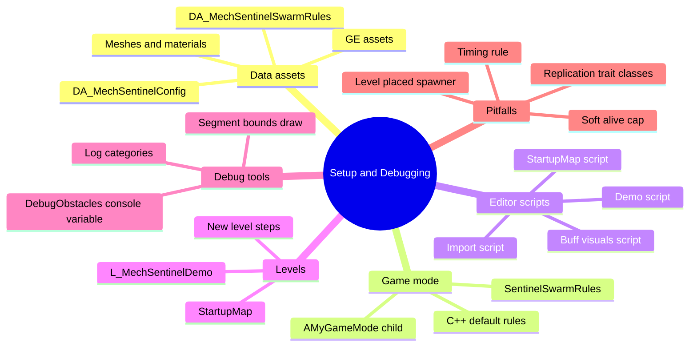
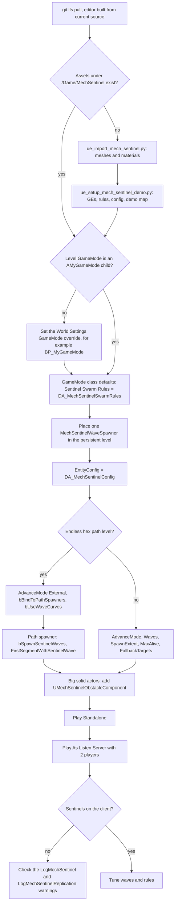
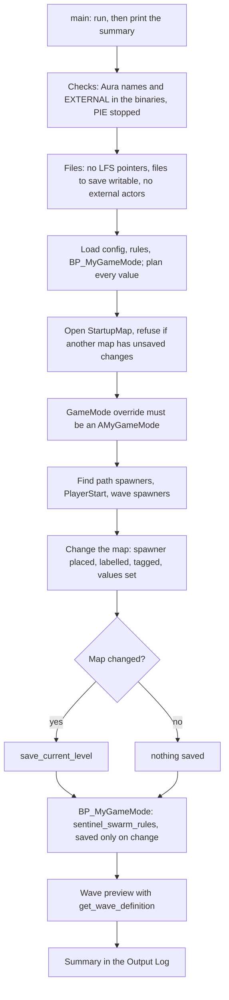

↑ [[MechSentinel Index]]

# MechSentinel Setup and Debugging

This page is the practical side of the swarm: which assets it needs, which editor scripts build them, how the demo map and StartupMap are set up, how to put sentinels in a new level step by step, and what to look at when something does not show up. The code needs very little from a level (one level-placed wave spawner with an entity config, and the swarm rules on an `AMyGameMode`), but each of those pieces has a reason, and getting one wrong usually fails quietly.

## Mind map

## How it flows

### Setting up a new level

1. The assets are Git LFS files (`.uasset` and `.umap` are LFS-tracked); the StartupMap and buff-visuals scripts check for LFS pointer files and stop, and the C++ must match the properties the scripts set.
2. The import script makes the meshes and materials; the demo script makes the GE assets, the rules, the entity config, the demo GameMode and the demo map. `NS_MechSentinelTentacles` is built by hand from the README recipe. Both scripts only need to run once per project (their results are already committed).
3. The rules are read only from an `AMyGameMode` (or child), only on the server, at world BeginPlay. Without them the C++ defaults apply, which still work.
4. The spawner must be in the level file (not spawned at runtime) so clients build the same entity template before replicated sentinels arrive ([[MechSentinel Replication and Multiplayer]]).
5. Endless path levels use External mode ([[MechSentinel Path Segment Waves]]); other levels use a regular wave list or curves ([[MechSentinel Spawning and Waves]]).
6. Only registered obstacles are avoided: hex platforms register themselves, other geometry needs the component ([[MechSentinel Movement and Avoidance]]).

### What the StartupMap script does

1. Every check runs before the first change, so most failures change nothing; the few that can still stop the run while the map is being edited (spawning the spawner, a wrong level, a knob of the wrong type) stop before anything is saved. A failure raises `SetupAborted`, prints the summary as `ABORTED` and logs the reason.
2. The map is changed and saved before `BP_MyGameMode`, so the GameMode is never saved alone when a map step stops the run.
3. Re-running is safe: the spawner is found again by its tag, every value is compared before it is set, and files are saved only when something changed.

## The assets

Everything lives under `/Game/MechSentinel` (`Content/MechSentinel`):

| Asset | What it is | Built by |
|---|---|---|
| `Meshes/SM_MechSentinel_Head` | the head mesh, with `Tentacle_00` to `Tentacle_07` sockets | import script |
| `Meshes/SM_MechSentinel_Far` | low LOD with the tentacles baked in | import script |
| `Meshes/SM_MechSentinel_Tentacle`, `SM_MechSentinel_TentacleTip` | tentacle and claw tip | import script |
| `Materials/M_MechSentinelBody`, `M_MechSentinelEyes` | between them read per-instance custom data 0 to 6 (body 1, 2, 4 to 6; eyes 0, 3, 4 to 6) | import script, rebuilt by the buff visuals script |
| `Materials/M_MechSentinelTentacle` | ribbon tube material of the Niagara tentacles | import script |
| `FX/NS_MechSentinelTentacles` | the ribbon tentacle Niagara system | built by hand from the README recipe, committed |
| `GAS/GE_SentinelDamage` | Instant, Executions = `ExecCalc_SentinelDamage` | demo script |
| `GAS/GE_SentinelAttack` | Instant, `MyAttributeSet.IncomingDamage` Add (Base), Set by Caller `SetDamageByCaller` | demo script |
| `GAS/GE_SentinelStun` | Has Duration 2 s, grants `State.Sentinel.Stunned` | demo script |
| `Data/DA_MechSentinelSwarmRules` | `UMechSentinelSwarmRules` data asset | demo script |
| `Data/DA_MechSentinelConfig` | `MassEntityConfigAsset` with the traits below | demo script |
| `Demo/BP_MechSentinelDemoGameMode` | child of `/Game/Level/BP_MyGameMode` with the rules assigned | demo script |
| `Demo/L_MechSentinelDemo` | the demo map | demo script |

### DA_MechSentinelConfig

The demo script writes these traits, in this order (the saved asset holds the same non-default values, checked by reading the `.uasset`):

| Trait (editor name) | Class | Values set by the script |
|---|---|---|
| Mech Sentinel | `UMechSentinelTrait` | `SwarmGroup` "Sentinels", `Attributes` MaxHealth 120, Armor 4, AttackDamage 3, AttackSpeed 0.6, `MovementSpeed` 900 |
| Movement (Copy) | `UMassMovementTrait_Copy` | defaults |
| Avoidance (Copy) | `UMassObstacleAvoidanceTrait_Copy` | defaults (they fit the hex platforms) |
| Smooth Orientation (Copy) | `UMassSmoothOrientationTrait_Copy` | defaults |
| Visualization ISM (Copy) | `UMassVisualizationTrait_Copy` | Mesh `SM_MechSentinel_Head`, LowLODMesh `SM_MechSentinel_Far`, `NumCustomDataFloats` 7, cast shadows, LOD distances 4000 / 9000 / 25000 (everything but the two meshes is also the C++ default) |
| Mech Sentinel Tentacles (Niagara) | `UMechSentinelTentacleTrait` | Niagara system `NS_MechSentinelTentacles` |
| Replication | `UMassReplicationTrait` (engine) | LOD distances 0 / 2500 / 7000 / 20000, max count per viewer 150 / 300 / 1000 / 0, update interval 0.1 / 0.2 / 0.4 / 0.5, Bubble Info Class `MechSentinelClientBubbleInfo`, Replicator Class `MechSentinelReplicator` |

- The C++ defaults of the sentinel trait differ: `AttackDamage` 6 and `AttackSpeed` 0.8. The asset's values (3 and 0.6) are what the waves scale.
- `NumCustomDataFloats` (C++ default 7, clamped to 0..7) is the length of the per-instance data list the materials read: [0] state (0 seek, 1 attack, 2 stunned, 3 dead), [1] health 0..1, [2] hit flash, [3] attack glow, [4] armor buff, [5] speed buff, [6] damage buff fades. With fewer floats the list is cut and the materials read each custom data node's default for the missing ones (0 for the buff fades), so the buff colours never show. See [[MechSentinel Representation and Visuals]].
- Without a Niagara system the tentacle trait logs a warning and sentinels use the baked-tentacle low mesh at every LOD.

### DA_MechSentinelSwarmRules

The demo script sets three values; everything else stays at the C++ defaults (the saved asset stores only these three properties).

| Rule | In the asset | C++ default |
|---|---|---|
| `DefaultSentinelDamageEffect` | `GE_SentinelDamage` | built-in `UMechSentinelDamageEffect` |
| `SentinelAttackEffect` | `GE_SentinelAttack` | built-in `UMechSentinelAttackEffect` |
| `MaxAttackersPerPlayer` | 10 | 14 |
| `MaxAliveSentinels` | default | 1500 |
| `RetargetInterval` | default | 1.25 s |
| `ArmorMitigationPerPoint` | default | 0.06 |
| `ShieldedDamageMultiplier` | default | 0.25 |
| `SourceAttackDamageScale` | default | 1 |
| `CollisionCellSize` | default | 500 cm |
| `bEnableSelfBuffs`, `SelfBuffChance`, `SelfBuffDecisionInterval`, `MaxSelfBuffsPerFrame` | default | true, 0.25, 1.5 s, 8 |

Each rule is explained on its own page: targeting on [[MechSentinel Behaviour and Targeting]], combat on [[MechSentinel Combat and GAS]], buffs on [[MechSentinel Self Buffs]].

## The GameMode and the rules

- `AMyGameMode::SentinelSwarmRules` (category Mech Sentinels; Python name `sentinel_swarm_rules`) holds the rules asset. The GameMode exists only on the server, which is exactly where targeting, combat and spawning run. Clients only need visuals, which come from the entity config on the wave spawner.
- `UMechSentinelSwarmSubsystem::OnWorldBeginPlay` (authority) reads it from `GetAuthGameMode<AMyGameMode>()`. A GameMode that is not an `AMyGameMode` is silently ignored.
- `GetRules()` never returns null: `RulesOverride` (set at runtime with `SetRulesOverride`, for example on a difficulty change) wins, then the GameMode's rules, then the class defaults.
- StartupMap uses `/Game/Level/BP_MyGameMode` (its rules are set by the StartupMap script); the demo map uses `BP_MechSentinelDemoGameMode`.

## The editor scripts

All four live in `SourceArt/MechSentinel/` and run inside the editor (Tools > Execute Python Script..., the Python console, or `-ExecutePythonScript=<file>`). Importing one as a module runs nothing; call its `main()`.

### ue_import_mech_sentinel.py

1. Imports the four FBX files from `SourceArt/MechSentinel/Export` into `/Game/MechSentinel/Meshes` (static meshes, no materials, no collision) and checks the 8 tentacle sockets.
2. Creates `M_MechSentinelTentacle`, `M_MechSentinelBody` and `M_MechSentinelEyes` if they do not exist, then assigns the body and eye materials to the mesh slots.
3. Existing materials are left alone on a re-run. The graph builders (`build_body_graph`, `build_eyes_graph`) hold the buff colours: body rim armor (0.25, 0.45, 1.0) steel blue, speed (0.55, 1.0, 1.0) cyan-white, damage (1.0, 0.35, 0.04) orange; eye tint toward the buff colour by 0.85 at full fade.

### ue_setup_mech_sentinel_demo.py

Builds the GE assets, `DA_MechSentinelSwarmRules`, `DA_MechSentinelConfig`, `BP_MechSentinelDemoGameMode` and `L_MechSentinelDemo` from `/Engine/Maps/Templates/Template_Default`. Re-running is safe but not gentle:

- the config's trait list is rebuilt from scratch, so hand edits to `DA_MechSentinelConfig` are overwritten;
- the rules' three values above are set again;
- in the demo map every `MechSentinelWaveSpawner` is deleted and a new one is placed.

### ue_setup_mech_sentinel_startup.py

Configures `/Game/Maps/StartupMap` for the endless path (the result is on [[MechSentinel Path Segment Waves#StartupMap's current setup]]). Every value is a constant at the top:

| Knob | Value | Meaning |
|---|---|---|
| `MAP_PATH`, `GAME_MODE_PATH` | `/Game/Maps/StartupMap`, `/Game/Level/BP_MyGameMode` | the map and its GameMode |
| `ENTITY_CONFIG_PATH`, `SWARM_RULES_PATH` | the two `Data/` assets | |
| `SET_GAME_MODE_RULES` | True | rules on the GameMode class defaults |
| `SET_GAME_MODE_OVERRIDE_IF_EMPTY` | True | an empty World Settings override becomes `GAME_MODE_PATH` |
| `REQUIRE_MY_GAME_MODE` | True | stop when the override is not an `AMyGameMode` |
| `SPAWNER_TAG`, `SPAWNER_LABEL` | `SentinelWaveSpawner`, `MechSentinelWaveSpawner` | how the spawner is found and named |
| `SPAWNER_OFFSET` | (0, 0, 3000) | a new spawner goes 30 m above the PlayerStart |
| `MOVE_EXISTING_SPAWNER`, `DESTROY_EXTRA_SPAWNERS` | False, True | reuse in place; delete other spawners of the map |
| `ADVANCE_MODE`, `AUTO_START`, `USE_WAVE_CURVES`, `BIND_TO_PATH_SPAWNERS` | `EXTERNAL`, True, True, True | |
| `SPAWNER_IS_FALLBACK_TARGET` | False | |
| `MAX_ALIVE`, `SPAWN_BATCH_SIZE`, `MAX_ACTIVE_WAVES` | 500, 25, 0 | |
| `SEGMENT_CORNERS`, `CORNER_SPAWN_EXTENT`, `SPAWN_OBSTACLE_CLEARANCE` | `TOP`, (800, 800, 300), 200 | |
| `COUNT_MULTIPLIER`, `CORNER_INSET`, `CORNER_HEIGHT_OFFSET` | None | None = leave the property as it is |
| `SPAWNER_EXTRA`, `PATH_SPAWNER_EXTRA` | empty | any other property by Python name |
| `CURVE_BASE_WAVE`, `WAVE_CURVES` | empty | empty = leave them as they are (the C++ defaults on a new spawner); keys or a `CurveFloat` path replace a curve |
| `EXPECTED_PATH_SPAWNERS` | 1 | another count only warns, none stops the run |
| `PATH_SPAWN_SENTINEL_WAVES`, `PATH_FIRST_SEGMENT_WITH_SENTINEL_WAVE` | True, 1 | set on every path spawner |
| `SAVE`, `SAVE_UNCHANGED` | True, False | save only what changed |
| `ALLOW_EXTERNAL_ACTORS` | False | stop if the map uses `__ExternalActors__` files |
| `WAVE_PREVIEW` | 1, 2, 3, 5, 10, 20, 40, 60 | wave numbers resolved in the summary |

It stops, before changing anything, when: the binaries lack the Aura classes, `EXTERNAL` or `use_wave_curves`; Play In Editor runs; a needed file is a Git LFS pointer, missing, or read-only when it would be saved; the map stores external actors; another map is open with unsaved changes; the map does not open (it never creates one); the GameMode is not an `AMyGameMode`; or the map has no `AMyHexPathSpawner`. A `StartupMap_BuiltData` LFS pointer only warns. A spawner with `net_load_on_client` off also warns.

The summary lines all start with `MechSentinel startup: `: every value (a `*` marks the ones this run set, with the old value), notes (spawner reused or spawned, extra spawners deleted), the wave preview (`wave N: count per lane, health x, armor x, ... countdown, spawned over`), the saved files (`Content/Maps/StartupMap.umap`, `Content/Level/BP_MyGameMode.uasset`, "and nothing else" in `git status`) or "Nothing was saved", then the warnings.

### ue_update_mech_sentinel_buff_visuals.py

For materials made before the self-buffs. It checks the editor and that PIE is stopped, refuses LFS pointers, loads the import script fresh as a module, does a dry run of both graph builders on a throwaway material, then rebuilds `M_MechSentinelBody` and `M_MechSentinelEyes` in place (closes their editors, deletes every expression, builds, recompiles, saves). The assets are not recreated, so the mesh slots keep their references. Last it warns if `DA_MechSentinelConfig`'s Visualization trait sends fewer than 7 custom data floats. Afterwards only those two `.uasset` files should be modified.

## The demo map

`/Game/MechSentinel/Demo/L_MechSentinelDemo`: open it and press Play.

- A floor scaled to about 200 x 200 m, a `NavMeshBoundsVolume` over it, a PlayerStart at (0, -2500, 100) facing the spawner, GameMode override `BP_MechSentinelDemoGameMode`.
- One `MechSentinelWaveSpawner` at (0, 0, 800) (the saved map holds these values): `ClearedOrTimer`, `bAutoStart`, `bRepeatLastWave` with +25 sentinels and x1.1 stats per repeat, `MaxAlive` 400, `SpawnBatchSize` 25, `SpawnExtent` 1500 x 1500 x 400, the spawner as fallback target.

| Wave | Count | Delay | Spawn time | Time limit | Health | Armor | Damage | Attack speed | Move speed |
|---|---|---|---|---|---|---|---|---|---|
| 1 | 12 | 3 s | 4 s | 45 s | x1 | x1 | x1 | x1 | x1 |
| 2 | 30 | 5 s | 6 s | 50 s | x1.25 | x1.25 | x1 | x1 | x1 |
| 3 | 60 | 6 s | 8 s | 60 s | x1.5 | x1.5 | x1.2 | x1.1 | x1.05 |
| 4 | 120 | 8 s | 10 s | 75 s | x2 | x2 | x1.5 | x1.2 | x1.1 |

Self-buffs are on there too (rules default), so the coloured rims are easy to see from wave 1 on: the demo uses hand-made waves, whose `SelfBuffChanceMultiplier` is 1.

## Setting up a new level: worked example

**A level with a fixed spawner** (an arena):

1. Pick the GameMode: the World Settings override must be `BP_MyGameMode` or another `AMyGameMode` child. Open its class defaults, Mech Sentinels > Sentinel Swarm Rules = `DA_MechSentinelSwarmRules`.
2. Place Actors, search "Mech Sentinel Wave Spawner", drop it where the swarm should appear, about 8 m above the ground, in the persistent level.
3. Details > Mech Sentinels > `EntityConfig` = `DA_MechSentinelConfig`.
4. Waves: either edit `Waves` (and `AdvanceMode`, `TimeLimit`), or tick `bUseWaveCurves` and edit `CurveBaseWave`. Set `MaxAlive` if this spawner should hold back, and `SpawnExtent` to the space available.
5. Optional: `FallbackTargets` (points where the overflow circles when every player already has `MaxAttackersPerPlayer` attackers).
6. Give large solid actors (floor, walls, airship) a `MechSentinelObstacleComponent` on their Blueprint, otherwise live sentinels fly through them.
7. Play standalone, then Play As Listen Server with two players to check that the client sees the swarm and the HUD wave events.

**An endless path level**:

1. Steps 1 to 3 above.
2. On the spawner: `AdvanceMode` External, `bBindToPathSpawners` on, `bUseWaveCurves` on, `bSpawnerIsFallbackTarget` off, `SegmentCorners`, `CornerSpawnExtent`, `MaxAlive` as needed.
3. On each `AMyHexPathSpawner` lane: `bSpawnSentinelWaves` on and `FirstSegmentWithSentinelWave` (1 skips the start segment).
4. To script it, the StartupMap script is driven by its constants: point `MAP_PATH` (and `GAME_MODE_PATH`) at the new level and set `EXPECTED_PATH_SPAWNERS` to its lane count.
5. Turn on `bDrawSegmentBounds` on the path spawner for a first run to see where the waves will appear.

## Console variables and debug draws

| What | How | Shows |
|---|---|---|
| `mech.Sentinel.DebugObstacles` | console, cheat, non-shipping, default 0 | 1: the registered obstacle shapes (orange; magenta = too big to be hashed, checked by every sentinel) and, while at least one obstacle is registered, an on-screen line with the number of registered obstacles and how many sentinels are near one, sliding along one, or with their centre inside one. 2: also one line per sentinel near an obstacle along its new desired velocity (red centre inside, yellow sliding, cyan pushed) |
| `bDrawSegmentBounds` | path spawner property | each new segment's bounds box, orange, about 15 s (server, not shipping) |
| `bDrawDebug` | path spawner property | the path in cyan as it grows (persistent lines) |
| `mass.debug.ClientReplicationLOD` | engine console variable | draws nothing here: the project's replication processor leaves that debug display out |

The `mech.Sentinel.DebugObstacles` draws only exist where the avoidance runs (server or standalone), because obstacles are registered only on the authority.

Useful runtime reads without a debugger: the wave spawner's `GetAliveCount`, `GetRemainingToSpawn`, `GetCurrentWaveNumber`, `GetWaveState` (replicated, fine on clients), `GetNumActiveWaves` (server), and `UMechSentinelSwarmSubsystem::GetNumAliveSentinels` (server only: 0 on clients).

## Log categories

All are file-local (`DEFINE_LOG_CATEGORY_STATIC`), so filter the Output Log by name.

| Category | Source | Typical messages |
|---|---|---|
| `LogMechSentinel` | `MechSentinelSwarmSubsystem.cpp` | config without a Replication trait (server-only sentinels); Error: Replication trait must use `MechSentinelClientBubbleInfo` and `MechSentinelReplicator`, config ignored; periodic effect not persisted; self-buff effect is Instant and never cast |
| `LogMechSentinelReplication` | `MechSentinelClientBubble.cpp` | client: replicated sentinel with an unknown entity template (spawner not level-placed) |
| `LogMechSentinelReplicationProcessor` | `MechSentinelReplicationProcessor.cpp` | Error: a replicator other than `UMechSentinelReplicator` is not run |
| `LogMechSentinelObstacles` | `MechSentinelObstacleSubsystem.cpp` | `RegisterObstacle` ignored (no owner, bad bounds), once per owner |
| `LogMechSentinelCombat` | `MechSentinelCombatLibrary.cpp` | no damage effect passed and none in the rules |
| `LogMechSentinelTentacleTrait` | `MechSentinelTentacleTrait.cpp` | no Niagara system set, low mesh at every LOD |
| `LogMechSentinelTentacles` | `MechSentinelTentacleSubsystem.cpp` | could not spawn the tentacle system |
| `LogGunShoot` | `GA_GunShoot.cpp` | no sentinel damage effect; Verbose: sentinels hit per shot and damage |
| `LogHexPath` | `MyHexPathSpawner.cpp` | `SegmentClass` not set, nothing spawns along the path |

## Known pitfalls

These come from the design notes of the long README and still hold in the code:

- **Timing rule.** Creating, destroying and hitting sentinels must happen outside the Mass phases (`TG_PrePhysics` to `TG_PostPhysics`, and `TG_LastDemotable`). The wave spawner and `UMechSentinelHitCapsuleComponent` tick in `TG_PostUpdateWork`, `GA_GunShoot` defers its hit with `SetTimerForNextTick`, and `SpawnSentinelsNow` / `DespawnAll` / `StartWaveAtPoints` only queue. Blueprint callers of the combat library functions must follow the same rule (a timer or a Post Update Work tick). See [[MechSentinel Frame Flow]].
- **The spawner must be level-placed.** `EntityConfig` is not replicated; clients build the sentinel template from the copy in the map file. A spawner spawned at runtime has its `EntityConfig` only on the server (unless its class defaults set it), so clients cannot build the template and its sentinels do not appear there (the `LogMechSentinelReplication` warning).
- **A server-spawned spawner builds its template late**, on its first spawn from its tick, never during a phase.
- **Exact replication classes.** The Replication trait must name `MechSentinelClientBubbleInfo` and `MechSentinelReplicator` exactly (no subclasses), or the config is rejected with an error instead of an engine assert.
- **`Config/DefaultMass.ini` must stay.** It turns off the engine's `UMassReplicationProcessor` (UE 5.8.2 asserts with clients connected) and turns on `UMechSentinelReplicationProcessor`. Remove both sections only once the engine is fixed.
- **The global alive cap is soft**: it uses the alive count of this frame's collision hash (rebuilt in the Mass phase, before the spawner ticks) plus what that one spawner created since then, so several spawners can overshoot by a batch.
- **Clients have no hit queries**: the collision hash is built on the server only, so `GetNumAliveSentinels` is 0 on clients. Use the wave spawner's replicated counts in a HUD.
- **Periodic effects are not persisted** on sentinels (a warning is logged): use an instant effect applied repeatedly for damage over time.
- **Self-buff effects must be Has Duration**; an Instant one is never cast (warning once).
- **Unregistered geometry is flown through**: props on platforms, actors without `UMechSentinelObstacleComponent`, falling pillars.
- **Gun hits are not lag compensated**: the server sweeps the shot against the sentinels' current positions; `SentinelShotRadius` (15 cm) gives some slack.
- **External mode is chosen before play**: switching `AdvanceMode` between External and the others during play is not supported.
- **Segment bounds follow the PCG graph by hand**: the path spawner's bounds defaults mirror `PCG_SplineIHexPlatformsFromSpline` and must be updated with it.
- **Destroying a spawner from another Blueprint**: call `DespawnAll` before Destroy Actor; on an already destroyed spawner the call may be skipped.
- **Running the demo script again** resets `DA_MechSentinelConfig` and replaces the demo map's spawner.

## Key files

| File | Role |
|---|---|
| `SourceArt/MechSentinel/ue_import_mech_sentinel.py` | meshes, materials, mesh slots, the material graph builders |
| `SourceArt/MechSentinel/ue_setup_mech_sentinel_demo.py` | GE assets, rules, entity config, demo GameMode and map |
| `SourceArt/MechSentinel/ue_setup_mech_sentinel_startup.py` | StartupMap: wave spawner, path lanes, GameMode rules, summary |
| `SourceArt/MechSentinel/ue_update_mech_sentinel_buff_visuals.py` | rebuilds the body and eye materials in place |
| `Source/Aura/Public/MyGameMode.h` | `SentinelSwarmRules` |
| `Source/Aura/Public/MechSwarm/Core/MechSentinelSwarmRules.h` | every rule and its default |
| `Source/Aura/Private/MechSwarm/Core/MechSentinelSwarmSubsystem.cpp` | rules lookup, config validation, template building |
| `Source/Aura/Public/MechSwarm/Sentinel/MechSentinelTrait.h` | sentinel trait and attribute defaults |
| `Source/Aura/Public/MechSwarm/MassCopies/MassRepresentationFragments_Copy.h` | `NumCustomDataFloats` and the custom data layout |
| `Source/Aura/Private/MechSwarm/Sentinel/MechSentinelObstacleAvoidanceProcessor.cpp` | `mech.Sentinel.DebugObstacles` |
| `Source/Aura/Public/MechSwarm/Core/MechSentinelObstacleComponent.h` | obstacle component for non-platform geometry |
| `Config/DefaultMass.ini` | replication processor swap |

## Tuning knobs

| Setting | Where | Default | Effect |
|---|---|---|---|
| `SentinelSwarmRules` | GameMode class defaults | none | the rules asset; none = C++ defaults |
| `EntityConfig` | wave spawner | none | which sentinels it builds |
| `NumCustomDataFloats` | config, Visualization ISM (Copy) | 7 | per-instance data sent to the materials |
| `Margin` | `UMechSentinelObstacleComponent` | 0 cm | extra clearance around that obstacle |
| `bOneBoxPerComponent` | `UMechSentinelObstacleComponent` | false | one box per colliding component |
| `RefreshInterval` | `UMechSentinelObstacleComponent` | 0 s | re-measure a moving owner |
| `mech.Sentinel.DebugObstacles` | console | 0 | obstacle debug draw, 1 or 2 |
| `bDrawSegmentBounds` | path spawner | false | draw the segment boxes |
| Script constants | top of `ue_setup_mech_sentinel_startup.py` | see the table above | what the StartupMap script sets |

## Related

- [[MechSentinel Spawning and Waves]]: what every wave spawner setting does.
- [[MechSentinel Path Segment Waves]]: External mode and StartupMap's current setup.
- [[MechSentinel Replication and Multiplayer]]: why the spawner is level-placed and what the replication trait does.
- [[MechSentinel Representation and Visuals]]: the custom data floats and the materials the scripts build.
- [[MechSentinel Movement and Avoidance]]: the obstacle registry behind the debug draw.
- [[MechSentinel Combat and GAS]]: the GE assets and the damage rules.
- [[MyMassEntityTest]]: the original prompt this system was built from.

← [[MechSentinel Path Segment Waves]] · [[MechSentinel Index|Index]] · [[MechSentinel Behaviour and Targeting]] →
