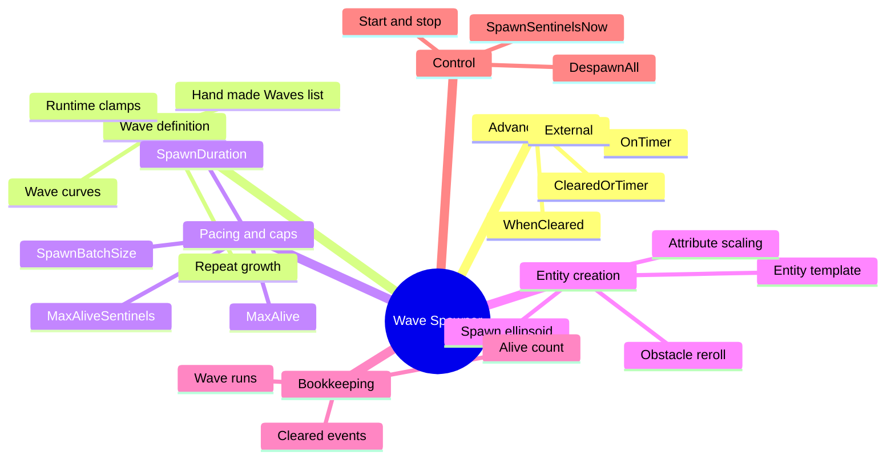
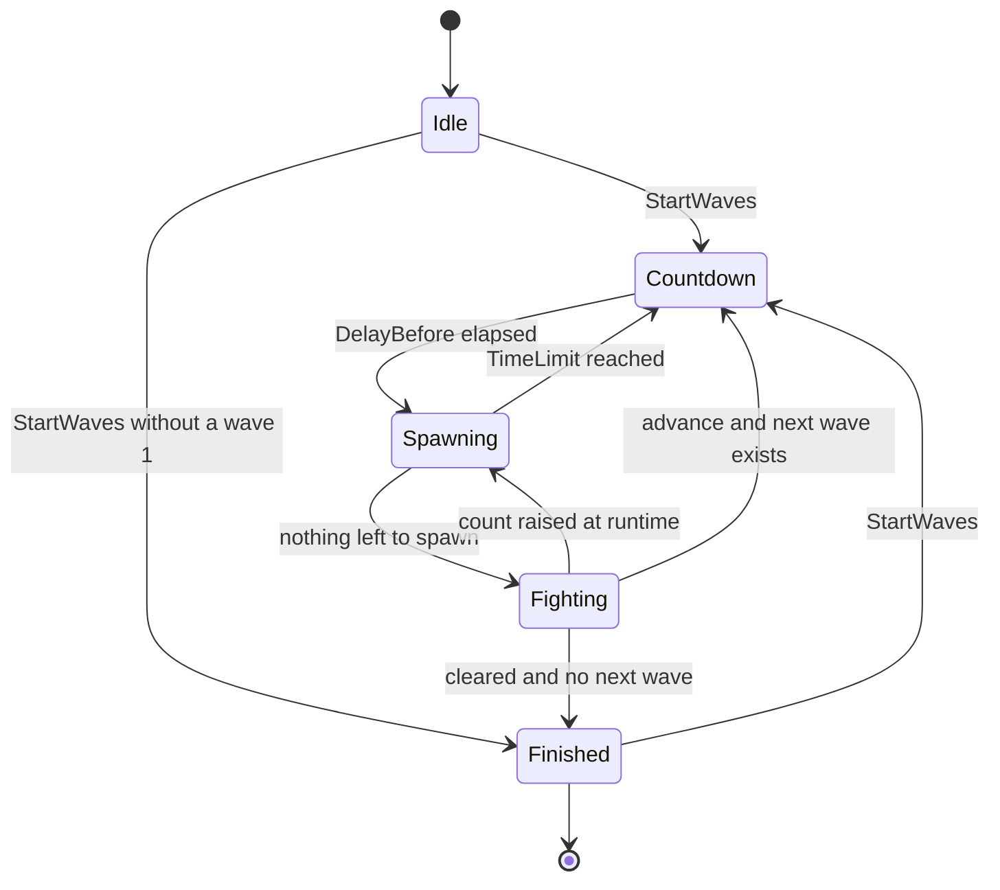
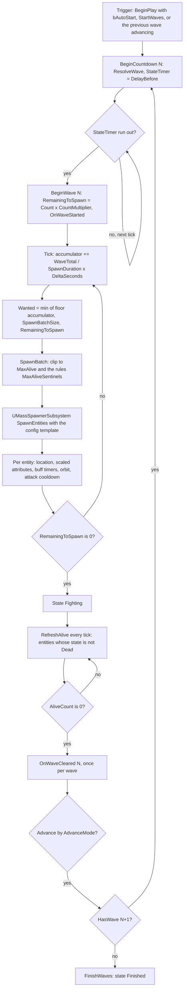
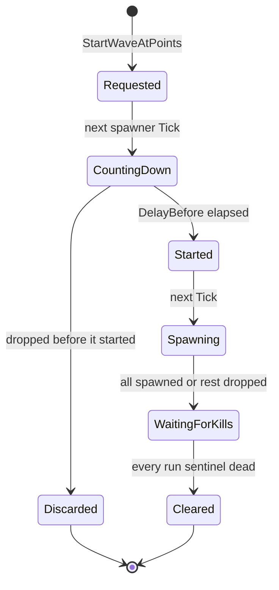

↑ [[MechSentinel Index]]

# MechSentinel Spawning and Waves

`AMechSentinelWaveSpawner` is the only thing that creates sentinel entities on the server (clients only create the replicated copies). It is a level-placed, replicated actor that plans waves (how many sentinels, how tough, how fast they appear), creates the Mass entities in small batches from its own tick in `TG_PostUpdateWork`, when no Mass processor runs, scales every new sentinel's attributes for its wave, counts the survivors and decides when the next wave starts. Three of its advance modes run one wave at a time; the fourth, `External`, runs many overlapping waves that something else starts, which is how the endless hex path drives the swarm (see [[MechSentinel Path Segment Waves]]).

## Mind map



## How it flows

### The wave state machine (WhenCleared, OnTimer, ClearedOrTimer)

`EMechSentinelWaveState` is replicated, so clients can show it in a HUD. In the three regular modes it follows this machine; External mode derives it from its runs instead (see [[MechSentinel Spawning and Waves#Overlapping wave runs|Overlapping wave runs]]).



1. A spawner starts in `Idle`. `BeginPlay` calls `StartWaves(true)` when `bAutoStart` is on (default), otherwise it waits for a Blueprint call.
2. `StartWaves` calls `BeginCountdown(1)`: the wave is resolved, `StateTimer = DelayBefore`, state `Countdown`. If there is no wave 1 at all (`HasWave(1)` false: empty `Waves`, no curves) it goes straight to `Finished`.
3. When `StateTimer` runs out, `BeginWave(N)` sets `CurrentWaveNumber`, plans `RemainingToSpawn` and broadcasts `OnWaveStarted(N, total)`: state `Spawning`.
4. Each tick spawns its share; once `RemainingToSpawn` reaches 0 the state is `Fighting`. `SetCountMultiplier` / `SetWaveCount` can raise the plan again, which puts the state back to `Spawning`.
5. The advance check runs in both `Spawning` and `Fighting`. A timer advance can therefore happen while the wave is still spawning: `BeginCountdown` resets `RemainingToSpawn` to 0, so the unspawned rest of that wave is dropped.
6. On advance, `HasWave(N + 1)` decides between the next countdown and `Finished` (the latter only once the wave is cleared). `StartNextWave` is a shortcut from any state: it calls `BeginWave` directly, with no countdown.

### One wave from trigger to cleared



1. Apart from the trigger, every step happens on the server inside `AMechSentinelWaveSpawner::Tick`, which runs in `TG_PostUpdateWork`: after the `PostPhysics` phase and before the `FrameEnd` phase (`TG_LastDemotable`), so no Mass processor runs next to it ([[MechSentinel Frame Flow]] explains why).
2. Spawning is paced by an accumulator, so a wave of 20 over 8 s produces 2.5 sentinels per second, never more than `SpawnBatchSize` in one frame.
3. When a cap blocks the batch, `SpawnBatch` returns 0 and the accumulator is not reduced (it keeps filling up, at most to what is left), so wave spawning waits until sentinels die and then catches up in batches.
4. A sentinel counts as dead as soon as its `FMechSentinelStateFragment::State` is `Dead`, even though its wreck entity still falls for a while.
5. For simplicity the chart shows `WhenCleared`. With a `TimeLimit` the advance can also come from the timer (see the table below).

### Overlapping wave runs

`StartWaveAtPoints` (and every path segment in External mode) creates an `FWaveRun`, a private struct that lives next to the regular flow. Each run has its own countdown, pacing, entities and cleared event.



1. `StartWaveAtPoints(Points, WaveNumber, Source)` only queues an `FWaveRequest` and enables the tick. It returns the wave number: a `WaveNumber <= 0` becomes `max(HighestRunWaveNumber, CurrentWaveNumber) + 1`, the next number after the highest one started or queued so far. It returns 0 without authority and after the spawner ended play.
2. The next `Tick` calls `AcceptWaveRequests`: the wave is resolved with `ResolveWaveFolded`, `DelayRemaining = DelayBefore` (0 for `StartNextWave` in External mode), `Total = Count x CountMultiplier`. Then `EnforceMaxActiveWaves` runs.
3. `TickRuns` handles the runs oldest first. When a run's countdown ends it is marked started and `OnWaveStarted` is queued; its spawning starts on the following tick.
4. A run that is dropped before it starts (`DespawnAll`, `MaxActiveWaves`, its `Source` destroyed) is removed silently. One dropped after it started keeps its spawned sentinels and still clears normally.
5. A run is cleared when `Remaining <= 0` and none of its own entities is alive. Events are broadcast at the end of `TickRuns`, so their handlers may start, stop or despawn waves, or even destroy the spawner.

## Advance modes

`EMechSentinelWaveAdvance`, property `AdvanceMode` (default `WhenCleared`). Set it before play: switching between External and the other modes during play is not supported.

| Value | Next wave when | Notes |
|---|---|---|
| `WhenCleared` | every sentinel of the spawner is dead | `TimeLimit` ignored |
| `OnTimer` | `TimeLimit` seconds after the wave started | falls back to "cleared" when the wave's `TimeLimit` is 0 |
| `ClearedOrTimer` | whichever comes first | a `TimeLimit` of 0 means only "cleared" |
| `External` (shown as "External (path segments)") | never by itself | waves come from path segments and `StartWaveAtPoints`; they overlap; state never reaches `Finished` |

"Cleared" in the regular modes means the spawner's whole `AliveCount` is 0. That count includes sentinels from `SpawnSentinelsNow` and from runs started with `StartWaveAtPoints`, so such extras hold the regular wave open until they die too.

## The wave definition: FMechSentinelWave

One element of `Waves`, also the type of `CurveBaseWave` and of what `GetWaveDefinition` returns.

| Field | Struct default | Meaning | Runtime clamp |
|---|---|---|---|
| `Count` | 40 | sentinels in the wave, before `CountMultiplier` | >= 1 in the regular modes, >= 0 in External |
| `SpawnDuration` | 6 s | the wave is spread over this time (0 = as fast as `SpawnBatchSize` allows) | >= 0 |
| `DelayBefore` | 4 s | countdown before the wave starts | >= 0 |
| `TimeLimit` | 0 s | for `OnTimer` / `ClearedOrTimer`, 0 = never by timer | >= 0 |
| `HealthMultiplier` | 1 | x the trait's `MaxHealth` | >= 0.01 |
| `ArmorMultiplier` | 1 | x `Armor` | >= 0 |
| `DamageMultiplier` | 1 | x `AttackDamage` | >= 0 |
| `AttackSpeedMultiplier` | 1 | x `AttackSpeed` | >= 0.05 |
| `MoveSpeedMultiplier` | 1 | x the per-sentinel `MoveSpeedMultiplier` attribute (the shared swarm `MovementSpeed` is untouched) | >= 0 |
| `SelfBuffChanceMultiplier` | 1 | x the rules' `SelfBuffChance` for this wave | >= 0 |

`ClampWave` applies the clamps at runtime because the `ClampMin` metadata only binds the editor; curves and Blueprint writes can go past it.

A new spawner's constructor fills `Waves` with a small ramp, used only without curves:

| Wave | Count | Other fields changed from the struct defaults |
|---|---|---|
| 1 | 30 | none |
| 2 | 60 | Health x1.25, Damage x1.15 |
| 3 | 100 | SpawnDuration 10 s, Health x1.5, Armor x1.5, Damage x1.3, AttackSpeed x1.1 |

## Where a wave's numbers come from

`ResolveWave(WaveNumber, OutStatScale)` is the single source of truth:

```text
if bUseWaveCurves:
    wave = CurveBaseWave
    wave.Count = round(CurveBaseWave.Count x Curve.Count(N))
    every multiplier x its curve at N            (curve without keys = 1)
else if Waves not empty and N >= 1:
    N <= Waves.Num():  wave = Waves[N-1]
    else (repeats):    wave = Waves.Last()
                       Count += ExtraCountPerRepeat x repeats
                       StatScale = StatScalePerRepeat ^ repeats
else:
    wave = FMechSentinelWave defaults (Count 40 ...)
ClampWave(wave)
```

- `repeats = (N - 1) - (Waves.Num() - 1)`. Defaults: `ExtraCountPerRepeat` 10, `StatScalePerRepeat` 1.1 (compounding, health, armor and damage only).
- `ResolveWave` itself always extends past the list; only `HasWave` (used by the regular flow and `StartNextWave` to decide whether a next wave exists) reads `bRepeatLastWave` (default true). So every run started at points (External mode, or `StartWaveAtPoints` in any mode) gets the repeat growth whatever `bRepeatLastWave` says.
- `ResolveWaveFolded` multiplies the stat scale into the health, armor and damage multipliers and clamps again. `GetWaveDefinition(N)` (BlueprintPure) returns exactly that, handy for a HUD or for tuning.
- `ResolveCount` applies `CountMultiplier`: `max(0, round(Count x CountMultiplier))`.
- The regular flow keeps the stat scale separate (`ActiveStatScale`) and passes it to `SpawnBatch`; runs use the folded definition with a stat scale of 1. The result is the same.

## Wave curves

With `bUseWaveCurves` on, every wave is `CurveBaseWave` with `Count` and the six multipliers scaled by their curves in `WaveCurves` (`FMechSentinelWaveCurves`); `SpawnDuration`, `DelayBefore` and `TimeLimit` are taken from `CurveBaseWave` unchanged. The hand-made `Waves` and the repeat growth are ignored, and `HasWave` is always true, so the waves never run out.

- X = wave number (1 based), Y = factor on the matching `CurveBaseWave` field.
- `EvalWaveCurve` returns 1 for a curve without keys.
- Each curve is an `FRuntimeFloatCurve`: a `UCurveFloat` asset in its External Curve slot replaces the inline keys (the engine's `GetRichCurveConst` prefers it), and one asset can be shared by several spawners.
- The constructor's defaults (`SetGrowthCurve`) are linear keys, constant before the first key and extrapolated linearly past the last one at its slope.

`CurveBaseWave` defaults: `Count` 20, `SpawnDuration` 8 s, `DelayBefore` 2 s, `TimeLimit` 0, every multiplier 1.

| Curve | Default keys (wave, factor) | Scales |
|---|---|---|
| `Count` | (1, 1) (5, 1.5) (10, 2.2) (20, 3.5) (40, 5.5) | `Count`, rounded |
| `Health` | (1, 1) (5, 1.4) (10, 2) (20, 3.5) (40, 7) | `HealthMultiplier` |
| `Armor` | (1, 1) (10, 1.5) (20, 2.25) (40, 3.5) | `ArmorMultiplier` |
| `Damage` | (1, 1) (10, 1.5) (20, 2.3) (40, 4) | `DamageMultiplier` |
| `AttackSpeed` | (1, 1) (20, 1.3) (40, 1.5) | `AttackSpeedMultiplier` |
| `MoveSpeed` | (1, 1) (20, 1.2) (40, 1.35) | `MoveSpeedMultiplier` |
| `SelfBuffChance` | (1, 0) (2, 0) (3, 0.5) (6, 1) (20, 1.5) | `SelfBuffChanceMultiplier` |

What the defaults give per lane (the self-buff column is the chance per buff decision with the default rules' `SelfBuffChance` 0.25, `min(1, 0.25 x factor)`):

| Wave | Count | Health | Armor | Damage | Attack speed | Move speed | Self-buff chance |
|---|---|---|---|---|---|---|---|
| 1 | 20 | x1.00 | x1.00 | x1.00 | x1.00 | x1.00 | 0 |
| 2 | 23 | x1.10 | x1.06 | x1.06 | x1.02 | x1.01 | 0 |
| 3 | 25 | x1.20 | x1.11 | x1.11 | x1.03 | x1.02 | 0.125 |
| 4 | 28 | x1.30 | x1.17 | x1.17 | x1.05 | x1.03 | 0.167 |
| 5 | 30 | x1.40 | x1.22 | x1.22 | x1.06 | x1.04 | 0.208 |
| 10 | 44 | x2.00 | x1.50 | x1.50 | x1.14 | x1.09 | 0.286 |
| 20 | 70 | x3.50 | x2.25 | x2.30 | x1.30 | x1.20 | 0.375 |
| 40 | 110 | x7.00 | x3.50 | x4.00 | x1.50 | x1.35 | 0.554 |

The first four rows match what StartupMap spawned in the 2026-11-21 test (20, 23, 25, 28 per lane). How the chance turns into buffs is on [[MechSentinel Self Buffs]].

## Pacing and caps

- **Rate**: `WaveTotal / SpawnDuration` per second, added to an accumulator that is clamped to what is left. With `SpawnDuration` near 0 the accumulator jumps to the whole remainder.
- **Per frame**: `Wanted = min(floor(accumulator), SpawnBatchSize, Remaining)`. `SpawnBatchSize` (default 25, min 1) smooths the cost of big waves.
- **Budget split**:
  - External mode: one budget of `SpawnBatchSize` per frame, shared by the manual spawns first and then the runs, oldest run first.
  - Regular modes: the manual spawns and the regular wave can each take up to `SpawnBatchSize`. The runs get what is left of `SpawnBatchSize` after both.
- **`MaxAlive`** (default 0 = no own cap): `Allowed = min(Count, MaxAlive - AliveCount)`.
- **`MaxAliveSentinels`** (rules, default 1500): `Allowed = min(Allowed, MaxAliveSentinels - Swarm.GetNumAliveSentinels() - SpawnedSinceHashRefresh())`. `GetNumAliveSentinels` is the number of living sentinels in the collision hash that `UMechSentinelCollisionHashProcessor` rebuilt earlier this frame (in the Mass phase), and `SpawnedSinceHashRefresh` adds what this spawner created since then (its spawns of the current frame). Other spawners' spawns of the same frame are not counted, so several spawners can overshoot by a batch: the global cap is soft.
- **Waiting versus dropping**: wave spawns that a cap blocks wait (the accumulator stays). `SpawnSentinelsNow` requests that the caps cut are dropped, not retried.

## How an entity is created: SpawnBatch

`SpawnBatch(Count, Def, StatScale, SpawnPoints, PointCursor, Extent, RunEntities)` does the actual Mass work:

1. Bails out (returns 0) without `EntityConfig`, entity manager, `UMassSpawnerSubsystem` or swarm subsystem, while `EntityManager.IsProcessing()`, or when `UMechSentinelSwarmSubsystem::RegisterEntityConfig` rejects the config (for example a Replication trait with the wrong classes; that check is skipped in standalone).
2. Applies the caps above.
3. Gets the template with `EntityConfig->GetOrCreateEntityTemplate(World)`.
4. Calls `UMassSpawnerSubsystem::SpawnEntities(Template, Allowed, NewEntities)` and keeps the returned `FEntityCreationContext` alive while it initialises the fragments: Mass runs the observers when that context is released, so they see the final values.
5. Writes each new entity's fragments (table below), appends the handles to `SpawnedEntities` (and the run's `Entities`), adds them to `AliveCount`.

| Fragment | What the spawner writes |
|---|---|
| `FTransformFragment` | location = origin + a uniform random point in the `Extent` ellipsoid (`VRand x FRand^(1/3) x Extent`); random yaw |
| `FMechSentinelAttributesFragment` | `MaxHealth` and `Health` = trait value x `HealthMultiplier` x stat scale (min 1); `Armor`, `AttackDamage` = trait value x their multiplier x stat scale (no minimum); `AttackSpeed` x `AttackSpeedMultiplier` (min 0.05, no stat scale); `MoveSpeedMultiplier` (1 from the trait) x the wave value; `BaseArmor`, `BaseAttackDamage`, `BaseAttackSpeed`, `BaseMoveSpeedMultiplier` get the same numbers |
| `FMechSentinelSelfBuffFragment` (server only) | `ChanceScale` = `SelfBuffChanceMultiplier`; `DecisionTimer` random in 0 .. `SelfBuffDecisionInterval`; each `Cooldown[i]` random in 0 .. half the buff's cooldown, so a wave does not buff in step |
| `FMechSentinelTargetFragment` | `OrbitDirection` = random direction biased upward (always above the horizontal), `RetargetTimer` random 0 .. 0.5 s |
| `FMechSentinelAttackFragment` | `Cooldown` random 0 .. one attack interval |

- **Origin**: around the spawner (`SpawnExtent`, default 1500 x 1500 x 400 cm) for the regular wave and manual spawns; around the run's points in turn (round robin through `PointCursor`, `CornerSpawnExtent`) for runs with points.
- **Obstacle reroll**: with `SpawnObstacleClearance > 0` (default 200 cm) and at least one obstacle registered in `UMechSentinelObstacleSubsystem`, a location for which `IsInsideObstacle(location, SpawnObstacleClearance)` is true is rolled again up to 4 times. After 4 failed attempts the last roll is used. See [[MechSentinel Movement and Avoidance]].
- **Template timing**: building a template creates a Mass archetype, which must not happen during a phase. `CanBuildTemplateNow()` is true on clients, before play, or without a world. Then `PostInitializeComponents` and `BeginPlay` build it early (`EnsureTemplateBuilt`, which calls `RegisterEntityConfig`); a level-placed spawner's `BeginPlay` still counts as before play, because the world sets its begun-play flag only after every actor's `BeginPlay`. `UMechSentinelSwarmSubsystem::OnWorldBeginPlay` also calls `EnsureTemplateBuilt` on every spawner in the world. A spawner spawned on the server during play builds it on its first `SpawnBatch`, from its tick.

The trait values that get scaled come from the entity config ([[MechSentinel Setup and Debugging#The assets]]).

## Kill accounting

- `RefreshAlive()` runs at the start of every authority tick (right after a pending `DespawnAll`): it drops handles the entity manager no longer knows (`IsEntityActive` false, for example wrecks that finished falling) and counts the rest whose state is not `Dead`. The result is the replicated `AliveCount`.
- `RefreshRunsAlive()` does the same per run, into `FWaveRun::Alive`.
- Kills are not reported to the spawner by events. It reads the Mass state every tick, so it does not matter what killed the sentinel (gun, hit capsule, `KillSentinel`, `DespawnAll`).
- `OnWaveCleared` fires once per regular wave (`bClearedThisWave`) and once per run.

## The control API (server, Blueprint callable)

| Function | What it does |
|---|---|
| `StartWaves(bRestartFromFirstWave = false)` | clears `bStopped`, enables the tick. Regular modes: countdown to wave 1 when restarting, at wave 0, `Idle` or `Finished`, otherwise resumes. External: only resumes |
| `StopWaves()` | sets `bStopped`: no countdowns, no wave spawning. Alive sentinels fight on, and `SpawnSentinelsNow` requests are still carried out |
| `StartNextWave()` | regular: `BeginWave` of the pending or next wave now. External: queues a run of the next number around the spawner (`SpawnExtent`), without a countdown |
| `SetCountMultiplier(x)` | new `CountMultiplier` (min 0); re-plans what the current wave and the runs have not spawned yet |
| `SetWaveCount(index, n)` | changes `Waves[index].Count` (0 based) and re-plans; curve mode ignores the list |
| `SpawnSentinelsNow(n)` | queues `n` extra sentinels with the current wave's scaling around the spawner; returns `n`, or 0 after end play |
| `StartWaveAtPoints(points, wave, source)` | queues an overlapping run (see above); works in every mode |
| `DespawnAll(bKill = true)` | removes every sentinel this spawner created (see below) |

Read side (`BlueprintPure`): `GetCurrentWaveNumber`, `GetWaveState`, `GetAliveCount`, `GetRemainingToSpawn`, `GetCurrentWaveTotal`, `GetSwarmGroup`, `GetWaveDefinition`, and `GetNumActiveWaves` (server only, runs queued, counting down, spawning or not cleared). Events: `OnWaveStarted(WaveNumber, SentinelCount)` on server and clients, `OnWaveCleared(WaveNumber)` on the server only.

Every queueing call (`SpawnSentinelsNow`, `StartWaveAtPoints`, `DespawnAll`) exists because the caller may be running next to a Mass phase: the spawner's own next tick does the work (later the same frame when the call comes before `TG_PostUpdateWork`, for example from input, a timer or `BeginPlay`).

## DespawnAll

1. Cancels what was queued before it: `PendingManualSpawns = 0`, and `CancelRuns()` drops the pending run requests and what every run has not spawned yet.
2. Normally it sets `bPendingDespawn`; the next tick calls `DespawnAllNow`, which refreshes the alive list and calls `DespawnEntities`.
3. After the spawner ended play (`Destroyed` or `RemovedFromWorld`, flag `bSpawnerEndedPlay`) its tick never runs again, so `QueueDespawnOnTimer` moves the handles into a next-tick timer instead. That also makes `DespawnAll` work from the spawner's own End Play and Destroyed events.
4. `DespawnEntities`: with `bKill` each sentinel goes through `UMechSentinelSwarmSubsystem::KillSentinel` (health 0, the death fall plays and the wreck destroys itself). Without it the entities are destroyed outright (deferred through the command buffer if Mass is processing, otherwise `UMassSpawnerSubsystem::DestroyEntities`).

From another Blueprint, call `DespawnAll` before Destroy Actor: on an already destroyed spawner the call may be skipped.

## Lifecycle: constructor, BeginPlay, EndPlay

- **Constructor**: tick can run but starts disabled, tick group `TG_PostUpdateWork`; `bReplicates`, `bAlwaysRelevant`, net update frequency 4 (min 1); a root scene component; the default `Waves` and `CurveBaseWave`.
- **PostInitializeComponents**: clears `bSpawnerEndedPlay` (a streamed level shown again) and builds the template when allowed. This is the earliest point on clients.
- **BeginPlay**: forces the tick group again (instances saved with another one), builds the template when allowed. Then authority only:
  - registers `FallbackTargets` for the swarm group, plus the spawner itself as an unlimited point when `bSpawnerIsFallbackTarget` is on and the mode is not External;
  - enables the tick;
  - External: `bStopped = !bAutoStart`, then `BindToPathSpawners()` if `bBindToPathSpawners`;
  - otherwise `StartWaves(true)` if `bAutoStart`.
- **EndPlay**: on `Destroyed` / `RemovedFromWorld` (authority) sets `bSpawnerEndedPlay`, drops queued manual spawns and hands a pending despawn to the timer. Always drops requests and runs (their sentinels stay in `SpawnedEntities`), unbinds from the path spawners and unregisters the fallback points.

## Replicated state

| Property | Meaning |
|---|---|
| `CurrentWaveNumber` (`OnRep_CurrentWaveNumber`) | current or last wave, 0 before the first; External: the highest one started. The OnRep broadcasts `OnWaveStarted` on clients |
| `WaveState` | the state above |
| `AliveCount` | alive sentinels of this spawner |
| `RemainingToSpawn` | not spawned yet (External: summed over all started runs) |
| `CurrentWaveTotal` | planned size of the current wave, replicated in the same bunch as the wave number so both sides report the same count |

Clients never run the wave logic (`Tick` returns without authority). Why the spawner must stay level-placed is on [[MechSentinel Replication and Multiplayer]].

## Key files

| File | Role |
|---|---|
| `Source/Aura/Public/MechSwarm/Spawning/MechSentinelWaveSpawner.h` | enums, `FMechSentinelWave`, `FMechSentinelWaveCurves`, the spawner's properties and API |
| `Source/Aura/Private/MechSwarm/Spawning/MechSentinelWaveSpawner.cpp` | curve defaults, wave resolution, state machine, runs, `SpawnBatch`, despawning |
| `Source/Aura/Public/MechSwarm/Core/MechSentinelSwarmRules.h` | `MaxAliveSentinels`, `SelfBuffChance`, `SelfBuffDecisionInterval` read at spawn |
| `Source/Aura/Private/MechSwarm/Core/MechSentinelSwarmSubsystem.cpp` | `RegisterEntityConfig`, `GetNumAliveSentinels`, `RegisterFallbackTargets`, `KillSentinel` |
| `Source/Aura/Public/MechSwarm/Sentinel/MechSentinelTrait.h` | the attribute defaults the waves scale, `SwarmGroup` |
| `Source/Aura/Public/MechSwarm/Sentinel/MechSentinelFragments.h` | the fragments the spawner initialises |
| `Source/Aura/Public/MechSwarm/Core/MechSentinelObstacleSubsystem.h` | `IsInsideObstacle` for the spawn reroll |

## Tuning knobs

| Setting | Where | Default | Effect |
|---|---|---|---|
| `EntityConfig` | spawner | none | the Mass config every sentinel is built from; nothing spawns without it |
| `AdvanceMode` | spawner | `WhenCleared` | how the next wave starts |
| `bAutoStart` | spawner | true | start (or arm, in External) on BeginPlay |
| `Waves` | spawner | 3 waves: 30, 60, 100 | hand-made wave list |
| `bRepeatLastWave` | spawner | true | regular flow keeps going after the list |
| `ExtraCountPerRepeat` | spawner | 10 | sentinels added per repeat |
| `StatScalePerRepeat` | spawner | 1.1 | health, armor, damage factor per repeat (compounding) |
| `CountMultiplier` | spawner | 1 | global amount knob |
| `bUseWaveCurves` | spawner | false | curve mode instead of the list |
| `CurveBaseWave` | spawner | 20 over 8 s after 2 s | wave the curves scale |
| `WaveCurves` | spawner | see table | factors over the wave number |
| `MaxAlive` | spawner | 0 | own alive cap, 0 = only the rules' cap |
| `SpawnBatchSize` | spawner | 25 | entities created per frame at most |
| `SpawnExtent` | spawner | 1500, 1500, 400 cm | spawn ellipsoid around the spawner |
| `SpawnObstacleClearance` | spawner | 200 cm | reroll spawns inside grown obstacles, 0 = off |
| `FallbackTargets` | spawner | empty | where the overflow goes when all players are crowded |
| `bSpawnerIsFallbackTarget` | spawner | true | spawner itself as an unlimited fallback (ignored in External) |
| `MaxAliveSentinels` | rules | 1500 | soft global cap over all spawners |
| External-only knobs | spawner | | see [[MechSentinel Path Segment Waves#Tuning knobs]] |

## Related

- [[MechSentinel Path Segment Waves]]: External mode, one wave per new path segment.
- [[MechSentinel Setup and Debugging]]: placing a spawner, the demo and StartupMap scripts.
- [[MechSentinel Frame Flow]]: why spawning waits for `TG_PostUpdateWork`.
- [[MechSentinel Replication and Multiplayer]]: the template on clients and the replicated wave state.
- [[MechSentinel Combat and GAS]]: the attributes the waves scale and how sentinels die.
- [[MechSentinel Self Buffs]]: what `SelfBuffChanceMultiplier` and the staggered timers feed.
- [[MechSentinel Behaviour and Targeting]]: fallback targets, orbit direction and retarget timer.
- [[MechSentinel Movement and Avoidance]]: the obstacle registry behind the spawn reroll.

← [[MechSentinel Replication and Multiplayer]] · [[MechSentinel Index|Index]] · [[MechSentinel Path Segment Waves]] →
