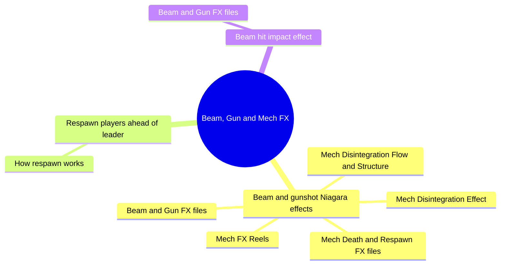

↑ [[Redo3 Artifacts Index]]

# Artifacts: Beam, Gun and Mech FX

4 artifacts · 2 shared-folder notes (38 files)

Niagara work on the mech: beam and gun shot cues, damage numbers, muzzle smoke, the death disintegration and the respawn effect.

## Mind map

## Artifacts

### From Beam and gunshot Niagara effects

Thread: [[Redo3 Threads#Beam and gunshot Niagara effects|Beam and gunshot Niagara effects]]

- [[Redo3 Artifact - Mech FX Reels]]: A video gallery of the mech's Niagara effects, recorded in PIE or rendered frame by frame in UE 5.8, newest first, each with a short spec grid.
- [[Redo3 Artifact - Mech Disintegration Effect]]: A Claude Docs reference document dated 2026-10-21 for the mech death effect: when the mech dies it holds still for 2 s, darkens, breaks into small glowing cubes that collapse into a pile, and the pile rises away as a thin column, about 4.5 s after the effect starts (verified in PIE on 2026-10-21).
- [[Redo3 Artifact - Mech Disintegration - Flow and Structure]]: A Claude Docs document dated 2026-10-23 describing the reworked (v3, cube kick) mech death effect.

### From Respawn players ahead of leader

Thread: [[Redo3 Threads#Respawn players ahead of leader|Respawn players ahead of leader]]

- [[Redo3 Artifact - How respawn works]]: A Claude Docs explainer for the server-side respawn system from PR #4, merged into redo3 on Nov 15 (main commit b3b02ac; f84c282 rebuilt NS_Claude_RespawnFX).

## Shared-folder files

- [[Redo3 Files - Beam and Gun FX]]: 19 files
- [[Redo3 Files - Mech Death and Respawn FX]]: 19 files

## Topic pages

- [[Redo3 Beam and Gun FX]]
- [[Redo3 Mech Character]]
- [[Redo3 Hex Path and Ranking]]

[[Redo3 Artifacts - Grapple Swing]] ← → [[Redo3 Artifacts - Menus]]
