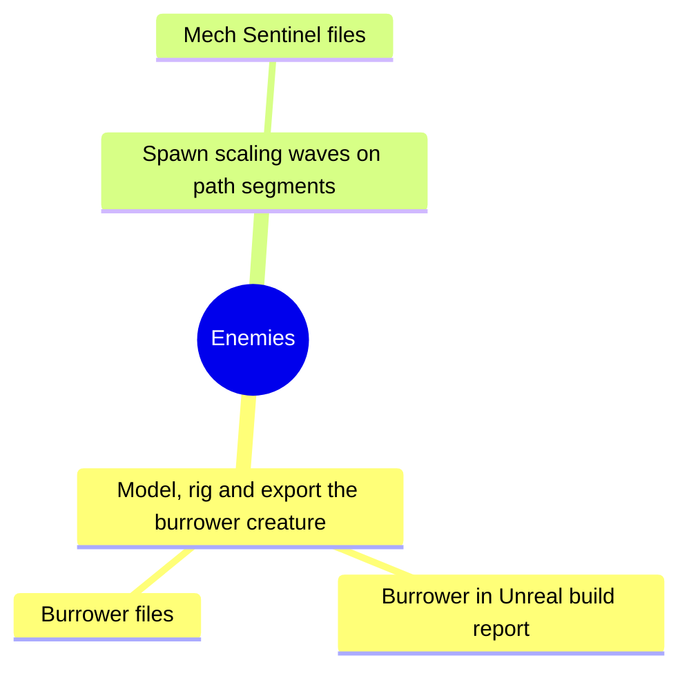

↑ [[Redo3 Artifacts Index]]

# Artifacts: Enemies

1 artifact · 2 shared-folder notes (97 files)

The Burrower creature (model, rig, Unreal build) and the Mech Sentinel swarm previews.

## Mind map

## Artifacts

### From Model, rig and export the burrower creature

Thread: [[Redo3 Threads#Model, rig and export the burrower creature|Model, rig and export the burrower creature]]

- [[Redo3 Artifact - Burrower in Unreal - build report]]: A Claude Docs report on importing, rigging and play-testing the Burrower enemy in UE 5.8.

## Shared-folder files

- [[Redo3 Files - Burrower]]: 1 file
	- [[Redo3 Files - Burrower Model and Renders]]: 34 files
	- [[Redo3 Files - Burrower Brief and Segmentation]]: 17 files
	- [[Redo3 Files - Burrower Rig v1]]: 21 files
	- [[Redo3 Files - Burrower Rig v2 and UE Export]]: 13 files
	- [[Redo3 Files - Burrower USD and Source Backups]]: 8 files
- [[Redo3 Files - Mech Sentinel]]: 3 files

## Topic pages

- [[Redo3 Burrower]]
- [[Redo3 Engine Tools and Assets]]

[[Redo3 Artifacts - Menus]] ← → [[Redo3 Artifacts - Models and Uploads]]
