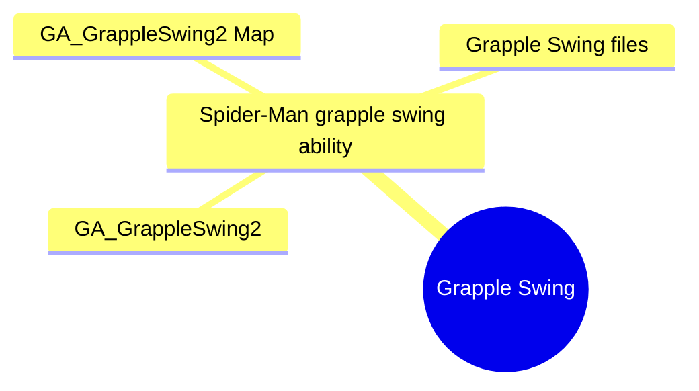

↑ [[Redo3 Artifacts Index]]

# Artifacts: Grapple Swing

2 artifacts · 1 shared-folder note (9 files)

The Spider-Man style grapple swing ability GA_GrappleSwing2 and its map.

## Mind map

## Artifacts

### From Spider-Man grapple swing ability

Thread: [[Redo3 Threads#Spider-Man grapple swing ability|Spider-Man grapple swing ability]]

- [[Redo3 Artifact - GA_GrappleSwing2]]: A reference page, with a sticky contents rail, for GA_GrappleSwing2: a Local Predicted Spider-Man style grapple swing.
- [[Redo3 Artifact - GA_GrappleSwing2 Map]]: A second page on GA_GrappleSwing2, published at the same time as the 'GA_GrappleSwing2' page and with the same reference text.

## Shared-folder files

- [[Redo3 Files - Grapple Swing]]: 9 files

## Topic pages

- [[Redo3 Grapple Swing]]
- [[Redo3 Mech Swing Animation]]

[[Redo3 Artifacts - Hex Look, Fog and Ice]] ← → [[Redo3 Artifacts - Beam, Gun and Mech FX]]
