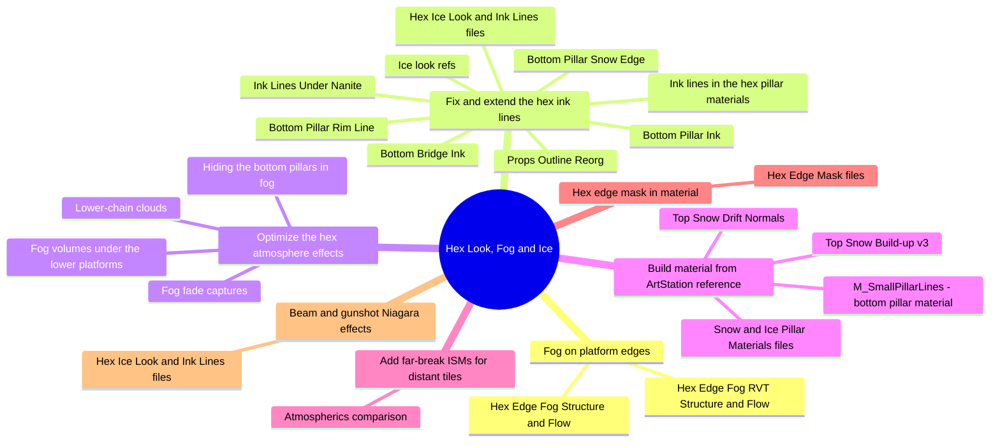

↑ [[Redo3 Artifacts Index]]

# Artifacts: Hex Look, Fog and Ice

18 artifacts · 3 shared-folder notes (71 files) · part of the Hex world groups

The look of the hex world: edge fog, fog under the platforms, the ice look, ink lines, snow build-up and the glacier pillar materials.

## Mind map

## Artifacts

### From Fog on platform edges

Thread: [[Redo3 Threads#Fog on platform edges|Fog on platform edges]]

- [[Redo3 Artifact - Hex Edge Fog - Structure and Flow]]: A Claude Docs page explaining how volumetric fog gathers on the open edges of both hex platform chains, only inside a fog cube that follows the local player's mech.
- [[Redo3 Artifact - Hex Edge Fog - earlier draft]]: A Claude Docs document dated 2026-10-20 describing the hex edge fog system.

### From Fix and extend the hex ink lines

Thread: [[Redo3 Threads#Fix and extend the hex ink lines|Fix and extend the hex ink lines]]

- [[Redo3 Artifact - Ink lines in the hex pillar materials]]: A long Claude Docs walkthrough of the in-material ink outlines: the Outline comment box at the end of M_Pillar2, with the same HLSL in M_Pillar2_GC, MM_Ice_Hex and MM_SnowAssets_Hex.
- [[Redo3 Artifact - Bottom bridge ink shots]]: A shot page for step D of the hex ink pass (2026-11-06 03:40 UTC): ink outlines were added to the bottom (stone) bridge materials MM_Cliffs_HexBridge and MM_SnowAssets_HexBridge and their 7 instances.
- [[Redo3 Artifact - Bottom pillar ink first pass shots]]: A shot page for step C of the hex ink pass (2026-11-06 03:40 UTC): M_SmallPillarLines, the bottom-pillar material, got the V2.1 Outline section with the same boxes and named reroutes as the top pillars.
- [[Redo3 Artifact - Bottom pillar rim line shots]]: A follow-up to step C (2026-11-06 04:40 UTC) for M_SmallPillarLines and MI_SmallPillar_HexRock.
- [[Redo3 Artifact - Bottom pillar snow-edge line shots]]: The result of Talal's pick 'Under the snow edge' (2026-11-06 05:05 UTC) for the bottom pillars in M_SmallPillarLines and MI_SmallPillar_HexRock.
- [[Redo3 Artifact - Ice look comparison page]]: Reference set and progress log for the hex-platform ice restyle in UE 5.8, dated 2026-10-25 (prep) and 2026-10-26 (iterations).
- [[Redo3 Artifact - Ink lines under Nanite]]: A short report on step A of the hex ink pass (StartupMap PIE, 2026-11-05): the ink lines were lost under Nanite and are now back.
- [[Redo3 Artifact - Props outline section layout shots]]: A before-and-after page for step B of the hex ink pass (2026-11-06 03:04 UTC): the Outline section of MM_Ice_Hex and MM_SnowAssets_Hex was laid out like the pillar material M_Pillar2.

### From Optimize the hex atmosphere effects

Thread: [[Redo3 Threads#Optimize the hex atmosphere effects|Optimize the hex atmosphere effects]]

- [[Redo3 Artifact - Hiding the bottom pillars in fog]]: A Claude Docs answer to the user's question about the cheapest way to hide the bottom of the lower-chain pillars in fog.
- [[Redo3 Artifact - Fog volumes under the lower platforms]]: A Claude Docs design proposal, not built, for giving each lower-chain hex platform its own Local Fog Volume.
- [[Redo3 Artifact - Fog fade captures]]: A capture report (StartupMap lower chain, PIE 1920x1080, 30 and 31 October 2026) on making the lower chain's pillars and the stone bridges between lower platforms dissolve into the void below them.
- [[Redo3 Artifact - Lower-chain clouds]]: A capture and cost report (StartupMap lower chain, PIE 1920x1080, 2026-10-31) on PS_Clouds_Wind clouds drifting around the lower platforms, in the void beside them and along the bottom bridges, scattered per platform by the live atmosphere graph.

### From Build material from ArtStation reference

Thread: [[Redo3 Threads#Build material from ArtStation reference|Build material from ArtStation reference]]

- [[Redo3 Artifact - Top Snow Build-up v3]]: A screenshot page from PIE on 2026-11-05 showing the rebuilt snow on the top platforms' material M_Pillar2.
- [[Redo3 Artifact - Top Snow Drift Normals]]: Before and after PIE screenshots for an earlier 2026-11-05 fix to the snow drifts on the top platforms in M_Pillar2.
- [[Redo3 Artifact - M_SmallPillarLines document]]: A Claude Docs document (dated 2026-11-05) that explains M_SmallPillarLines in /Game/Assets/MyPlatform/geo/SmallPillars, the material of every bottom-platform pillar (mesh SM_HexRockPillar, instance MI_SmallPillar_HexRock).

### From Add far-break ISMs for distant tiles

Thread: [[Redo3 Threads#Add far-break ISMs for distant tiles|Add far-break ISMs for distant tiles]]

- [[Redo3 Artifact - Atmospherics comparison]]: A comparison page of hex-platform atmosphere layouts shot from the same five cameras in StartupMap PIE (74 platforms, HexRadius 200) on 24 Oct 2026.

## Shared-folder files

- [[Redo3 Files - Hex Edge Mask]]: 1 file
- [[Redo3 Files - Hex Ice Look and Ink Lines]]: 38 files
- [[Redo3 Files - Snow and Ice Pillar Materials]]: 32 files

## Topic pages

- [[Redo3 Hex Look and Atmosphere]]
- [[Redo3 Hex Pillars and Breaking]]

[[Redo3 Artifacts - Hex Performance and Breaking]] ← → [[Redo3 Artifacts - Grapple Swing]]
