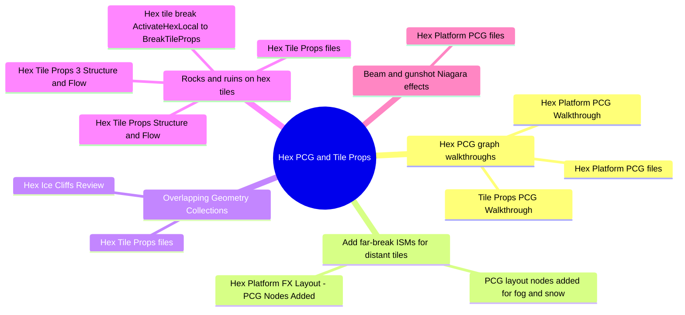

↑ [[Redo3 Artifacts Index]]

# Artifacts: Hex PCG and Tile Props

8 artifacts · 2 shared-folder notes (6 files) · part of the Hex world groups

Walkthroughs of the hex platform PCG graphs, the rocks, ruins and ice props on the tiles, and the PCG nodes added for fog and snow.

## Mind map

## Artifacts

### From Hex PCG graph walkthroughs

Thread: [[Redo3 Threads#Hex PCG graph walkthroughs|Hex PCG graph walkthroughs]]

- [[Redo3 Artifact - Hex Platform PCG Walkthrough]]: A walkthrough, one node group at a time, of PCG_SplineIHexPlatformsFromSpline, the graph on BP_MyHexPathSegment that places every BP_MyHexPlatform.
- [[Redo3 Artifact - Tile Props PCG Walkthrough]]: A node-by-node walkthrough of PCG_HexTileProps3, the graph on BP_MyHexPlatform's HexTileProps2 component that places ice clusters, snow mounds and the walkway floor on every platform.

### From Add far-break ISMs for distant tiles

Thread: [[Redo3 Threads#Add far-break ISMs for distant tiles|Add far-break ISMs for distant tiles]]

- [[Redo3 Artifact - PCG layout - nodes added for fog and snow]]: A Claude Docs page dated 2026-10-24 that holds no technical content of its own.
- [[Redo3 Artifact - Hex Platform FX Layout - PCG Nodes Added]]: A Claude Docs document (dated 2026-10-24) listing the six new PCG node chains that place fog, mist, snow and dust around the hex platforms: five in PCG_HexTileProps3 and one (mist banks) in PCG_SplineIHexPlatformsFromSpline.

### From Overlapping Geometry Collections

Thread: [[Redo3 Threads#Overlapping Geometry Collections|Overlapping Geometry Collections]]

- [[Redo3 Artifact - Ice formations review]]: A review page (eyebrow 'MechMania · hex platform props, layer 2') showing ice cliff and frozen rock formations rebuilt from pieces of the FrozenNorse L_Showcase level that Talal circled, each merged into one mesh with a matching Geometry Collection.

### From Rocks and ruins on hex tiles

Thread: [[Redo3 Threads#Rocks and ruins on hex tiles|Rocks and ruins on hex tiles]]

- [[Redo3 Artifact - Hex Tile Props 3 - Structure and Flow]]: A Claude Docs document dated 2026-10-18 describing PCG_HexTileProps3, the third hex tile props graph.
- [[Redo3 Artifact - Hex Tile Props - Structure and Flow]]: A Claude Docs document dated 2026-10-17 describing the first hex tile props system, merged on redo3 as e71e986.
- [[Redo3 Artifact - Hex tile break - ActivateHexLocal to BreakTileProps]]: A Claude Docs document dated 2026-10-20 explaining how a hex tile's rocks and ice props break when the tile collapses.

## Shared-folder files

- [[Redo3 Files - Hex Platform PCG]]: 3 files
- [[Redo3 Files - Hex Tile Props]]: 3 files

## Topic pages

- [[Redo3 Hex Platform PCG]]
- [[Redo3 Hex Path and Ranking]]
- [[Redo3 Hex Tile Props]]
- [[Redo3 Hex Look and Atmosphere]]

[[Redo3 Artifacts - Hex Path, Bridges and Paving]] ← → [[Redo3 Artifacts - Hex Performance and Breaking]]
