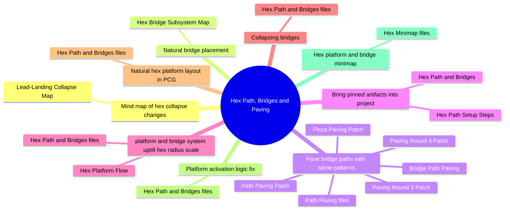

↑ [[Redo3 Artifacts Index]]

# Artifacts: Hex Path, Bridges and Paving

10 artifacts · 3 shared-folder notes (13 files) · part of the Hex world groups

The hex platform path, the collapse and ranking logic, the bridge subsystem, the minimap and the stone paving on bridge paths.

## Mind map

## Artifacts

### From Mind map of hex collapse changes

Thread: [[Redo3 Threads#Mind map of hex collapse changes|Mind map of hex collapse changes]]

- [[Redo3 Artifact - Lead-Landing Collapse Map]]: An interactive page mapping the changes that stop hex platforms from collapsing the moment they spawn.

### From Natural bridge placement

Thread: [[Redo3 Threads#Natural bridge placement|Natural bridge placement]]

- [[Redo3 Artifact - Hex Bridge Subsystem Map]]: This page explains UMyHexBridgeSubsystem, the server-only world subsystem that collects hex platforms as PCG spawns them one path segment at a time.

### From Pave bridge paths with stone patterns

Thread: [[Redo3 Threads#Pave bridge paths with stone patterns|Pave bridge paths with stone patterns]]

- [[Redo3 Artifact - Path Paving Patch]]: The first bridge-path paving patch (the page heading reads 'Bridge path paving: C++ patch'): a unified diff against redo3 8d98fd7 for MyHexPlatform.h/.cpp and PCGHexPlatformTiles.h/.cpp, to be applied hunk by hunk.
- [[Redo3 Artifact - Plaza Paving Patch]]: An incremental patch for the AuraRedo3 working copy (branch redo3 at HEAD 8d98fd7 plus the uncommitted paving work): four files, 1177 lines added and 207 removed, with sha256 hashes before and after, applied with patch -p1.
- [[Redo3 Artifact - Paving Round 3 Patch]]: A four-file C++ patch (MyHexPlatform.h/.cpp and PCGHexPlatformTiles.h/.cpp; 425 lines added, 42 removed) with sha256 hashes before and after, applied with patch -p1.
- [[Redo3 Artifact - Paving Round 4 Patch]]: A one-file C++ patch to Source/Aura/Private/Actors/MyHexPlatform.cpp (21 lines added, 3 removed), applied with patch -p1 on top of round 3.
- [[Redo3 Artifact - Bridge Path Paving in-game shots]]: An in-game shot page for the stone paving on the hex bridge paths, taken in PIE on StartupMap and organised newest round first.

### From Bring pinned artifacts into project

Thread: [[Redo3 Threads#Bring pinned artifacts into project|Bring pinned artifacts into project]]

- [[Redo3 Artifact - Hex Path Setup Steps]]: A nine-step setup checklist (tagged 'AuraRedo3 · steps.md') for wiring the growing hex path and bridge system into a level, in the order to do it.
- [[Redo3 Artifact - Hex Path and Bridges]]: A page (tagged 'AuraRedo3 · redo3 · uncommitted') explaining how the growing path spline spawns hex platforms through PCG, how the bridge subsystem connects them before they start collapsing, and how each bridge hears about its end tiles collapsing.

### From platform and bridge system uptill hex radius scale

Thread: [[Redo3 Threads#platform and bridge system uptill hex radius scale|platform and bridge system uptill hex radius scale]]

- [[Redo3 Artifact - Hex Platform Flow]]: An interactive mind map (subtitle 'AuraRedo3 · hex path, platforms and bridges') of every function from BeginPlay on the path spawner to a bridge standing between two platforms, and on to collapse, culling and player ranking.

## Shared-folder files

- [[Redo3 Files - Path Paving]]: 4 files
- [[Redo3 Files - Hex Path and Bridges]]: 8 files
- [[Redo3 Files - Hex Minimap]]: 1 file

## Topic pages

- [[Redo3 Hex Path and Ranking]]
- [[Redo3 Hex Bridges]]
- [[Redo3 Path Paving]]
- [[Redo3 Hex Tile Props]]
- [[Redo3 Hex Platform PCG]]
- [[Redo3 Hex Minimap]]

[[Redo3 Artifacts Index]] ← → [[Redo3 Artifacts - Hex PCG and Tile Props]]
