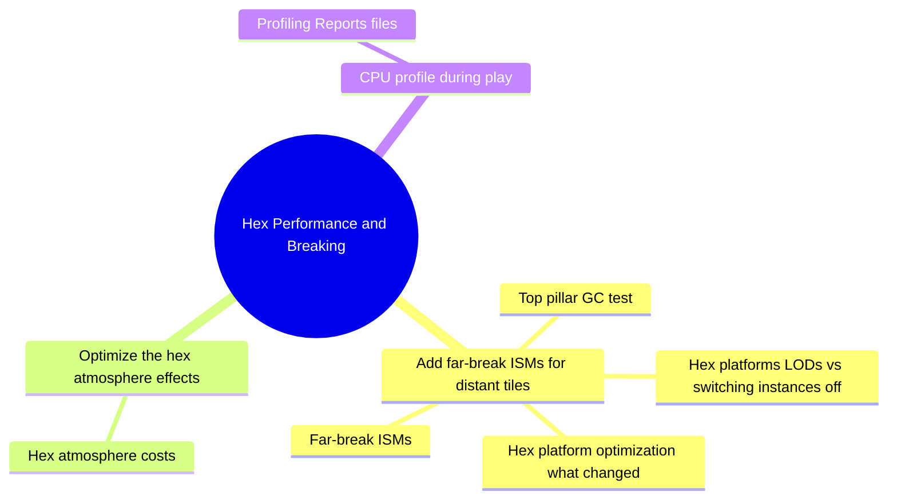

↑ [[Redo3 Artifacts Index]]

# Artifacts: Hex Performance and Breaking

5 artifacts · 1 shared-folder note (3 files) · part of the Hex world groups

Optimising the hex platforms: far-break ISMs, LODs against switching instances off, Geometry Collection tests, atmosphere costs and the PIE CPU profiles.

## Mind map

## Artifacts

### From Add far-break ISMs for distant tiles

Thread: [[Redo3 Threads#Add far-break ISMs for distant tiles|Add far-break ISMs for distant tiles]]

- [[Redo3 Artifact - Hex platform optimization - what changed]]: A Claude Docs page listing what was changed on 24 Oct 2026 to speed up the hex platforms, and the measured result.
- [[Redo3 Artifact - Hex platforms - LODs vs switching instances off]]: A Claude Docs analysis answering whether the hex platforms should get LODs or have far instances switched off while Nanite is disabled (r.Nanite.ProjectEnabled=False, which in 5.8 also turns Virtual Shadow Maps off).
- [[Redo3 Artifact - Far-break ISMs]]: Test report from PIE in StartupMap on 25 Oct 2026.
- [[Redo3 Artifact - Top pillar GC test]]: A test report (AuraRedo3, UE 5.8, StartupMap PIE, 25 Oct 2026) on breaking each collapsing top-platform tile into a Chaos Geometry Collection where the instance was, instead of spawning the skeletal mesh with baked RBD animation; bottom platforms keep the skeletal mesh.

### From Optimize the hex atmosphere effects

Thread: [[Redo3 Threads#Optimize the hex atmosphere effects|Optimize the hex atmosphere effects]]

- [[Redo3 Artifact - Hex atmosphere costs]]: A cost analysis of the live hex atmosphere graph PCG_HexAtmo_C (variant C) in StartupMap editor PIE at 1920x1080, dated 2026-11-01.

## Shared-folder files

- [[Redo3 Files - Profiling Reports]]: 3 files

## Topic pages

- [[Redo3 Hex Pillars and Breaking]]
- [[Redo3 Hex Platform PCG]]
- [[Redo3 Hex Look and Atmosphere]]
- [[Redo3 Hex Bridges]]
- [[Redo3 Hex Tile Props]]
- [[Redo3 Engine Tools and Assets]]

[[Redo3 Artifacts - Hex PCG and Tile Props]] ← → [[Redo3 Artifacts - Hex Look, Fog and Ice]]
