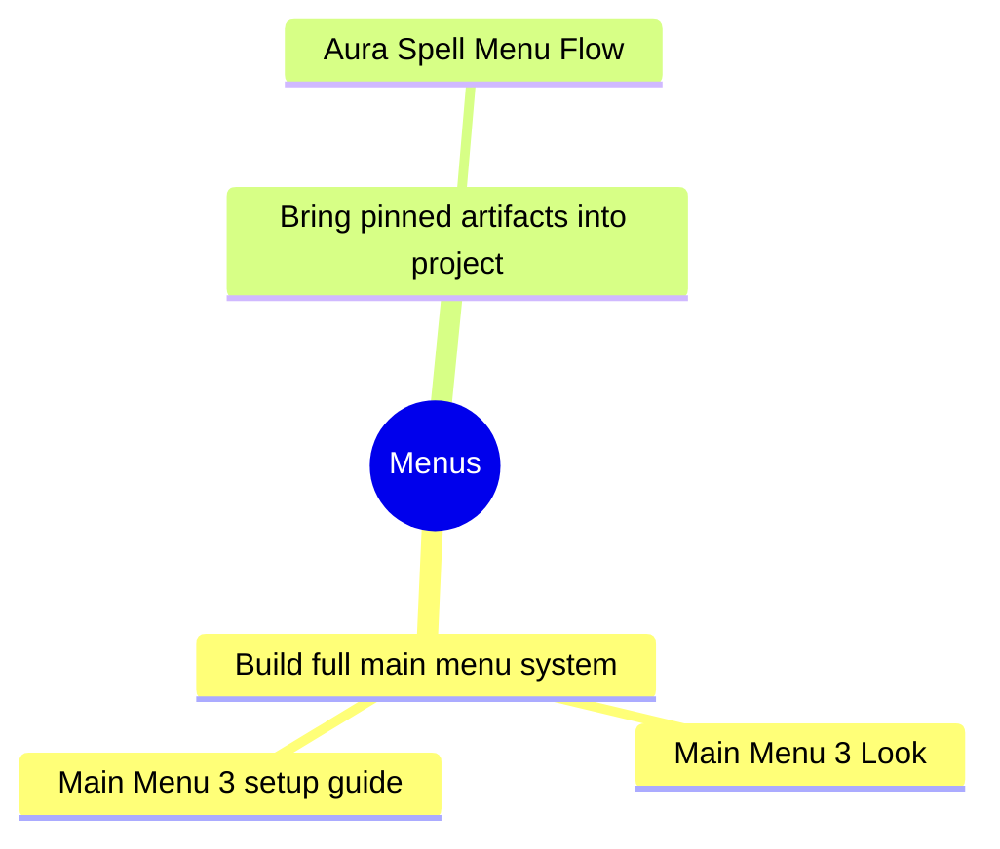

↑ [[Redo3 Artifacts Index]]

# Artifacts: Menus

3 artifacts · 0 shared-folder notes (0 files)

The MainMenu3 front end and the spell menu flow.

## Mind map

## Artifacts

### From Build full main menu system

Thread: [[Redo3 Threads#Build full main menu system|Build full main menu system]]

- [[Redo3 Artifact - Main Menu 3 Look]]: An interactive HTML mock-up of the MainMenu3 visual style.
- [[Redo3 Artifact - Main Menu 3 setup guide]]: A Claude Docs setup guide for the MainMenu3 front end, built to match Far Far West's menu options where the project has a backing system.

### From Bring pinned artifacts into project

Thread: [[Redo3 Threads#Bring pinned artifacts into project|Bring pinned artifacts into project]]

- [[Redo3 Artifact - Aura Spell Menu Flow]]: A page (tagged 'AuraRedo3 · redo3') explaining how the spell menu widget, its controller, the ability system component and the player state work together, from opening the menu to equipping a spell into an input slot.

## Topic pages

- [[Redo3 Menus and Settings]]
- [[Redo3 Spell Menu Fixes]]

[[Redo3 Artifacts - Beam, Gun and Mech FX]] ← → [[Redo3 Artifacts - Enemies]]
