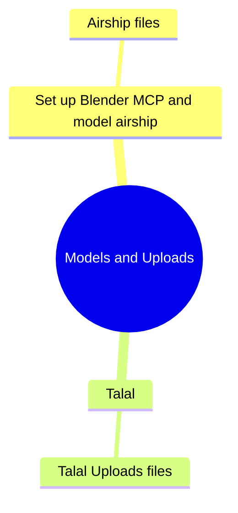

↑ [[Redo3 Artifacts Index]]

# Artifacts: Models and Uploads

0 artifacts · 2 shared-folder notes (45 files)

The airship modelled in Blender through Blender MCP, and the images Talal attached to his messages.

## Mind map

## Shared-folder files

- [[Redo3 Files - Airship]]: 44 files
- [[Redo3 Files - Talal Uploads]]: 1 file

## Topic pages

- [[Redo3 Engine Tools and Assets]]

[[Redo3 Artifacts - Enemies]] ← → [[Redo3 Artifacts Index]]
