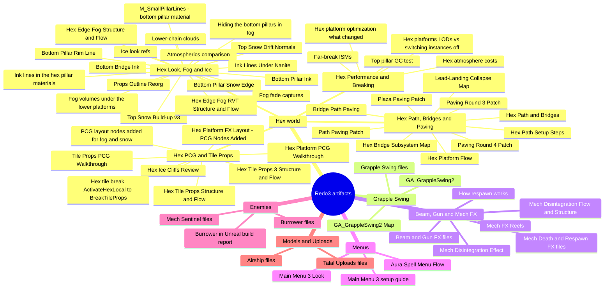

↑ [[Redo3 Changes Index]]

# Artifacts Index

AuraRedo3 · 51 artifacts (25 in the project's Artifacts list, 26 linked from threads) · 21 shared-folder notes · 54 threads

Everything the project's threads published or saved while working on AuraRedo3. Each artifact (a claude.ai page: a report, a flow map, a comparison or a patch) has its own note with a summary and a link to open it. The files the threads saved to the project's shared folder (renders, sheets, reports, Blender and USD files) are grouped into file notes. Both are sorted into nine groups by game system, and every note links back to the thread that made it on [[Redo3 Threads]] and to the topic page that explains the system.

## Mind map

## All entries

Groups, then the artifact notes and file notes inside each group.

- Hex world
	- [[Redo3 Artifacts - Hex Path, Bridges and Paving]]
		- [[Redo3 Artifact - Lead-Landing Collapse Map]]
		- [[Redo3 Artifact - Hex Bridge Subsystem Map]]
		- [[Redo3 Artifact - Path Paving Patch]]
		- [[Redo3 Artifact - Plaza Paving Patch]]
		- [[Redo3 Artifact - Paving Round 3 Patch]]
		- [[Redo3 Artifact - Paving Round 4 Patch]]
		- [[Redo3 Artifact - Bridge Path Paving in-game shots]]
		- [[Redo3 Artifact - Hex Path Setup Steps]]
		- [[Redo3 Artifact - Hex Path and Bridges]]
		- [[Redo3 Artifact - Hex Platform Flow]]
		- [[Redo3 Files - Path Paving]]
		- [[Redo3 Files - Hex Path and Bridges]]
		- [[Redo3 Files - Hex Minimap]]
	- [[Redo3 Artifacts - Hex PCG and Tile Props]]
		- [[Redo3 Artifact - Hex Platform PCG Walkthrough]]
		- [[Redo3 Artifact - Tile Props PCG Walkthrough]]
		- [[Redo3 Artifact - PCG layout - nodes added for fog and snow]]
		- [[Redo3 Artifact - Ice formations review]]
		- [[Redo3 Artifact - Hex Platform FX Layout - PCG Nodes Added]]
		- [[Redo3 Artifact - Hex Tile Props 3 - Structure and Flow]]
		- [[Redo3 Artifact - Hex Tile Props - Structure and Flow]]
		- [[Redo3 Artifact - Hex tile break - ActivateHexLocal to BreakTileProps]]
		- [[Redo3 Files - Hex Platform PCG]]
		- [[Redo3 Files - Hex Tile Props]]
	- [[Redo3 Artifacts - Hex Performance and Breaking]]
		- [[Redo3 Artifact - Hex platform optimization - what changed]]
		- [[Redo3 Artifact - Hex platforms - LODs vs switching instances off]]
		- [[Redo3 Artifact - Far-break ISMs]]
		- [[Redo3 Artifact - Hex atmosphere costs]]
		- [[Redo3 Artifact - Top pillar GC test]]
		- [[Redo3 Files - Profiling Reports]]
	- [[Redo3 Artifacts - Hex Look, Fog and Ice]]
		- [[Redo3 Artifact - Hex Edge Fog - Structure and Flow]]
		- [[Redo3 Artifact - Ink lines in the hex pillar materials]]
		- [[Redo3 Artifact - Hiding the bottom pillars in fog]]
		- [[Redo3 Artifact - Fog volumes under the lower platforms]]
		- [[Redo3 Artifact - Top Snow Build-up v3]]
		- [[Redo3 Artifact - Top Snow Drift Normals]]
		- [[Redo3 Artifact - Atmospherics comparison]]
		- [[Redo3 Artifact - Bottom bridge ink shots]]
		- [[Redo3 Artifact - Bottom pillar ink first pass shots]]
		- [[Redo3 Artifact - Bottom pillar rim line shots]]
		- [[Redo3 Artifact - Bottom pillar snow-edge line shots]]
		- [[Redo3 Artifact - Fog fade captures]]
		- [[Redo3 Artifact - Hex Edge Fog - earlier draft]]
		- [[Redo3 Artifact - Ice look comparison page]]
		- [[Redo3 Artifact - Ink lines under Nanite]]
		- [[Redo3 Artifact - Lower-chain clouds]]
		- [[Redo3 Artifact - M_SmallPillarLines document]]
		- [[Redo3 Artifact - Props outline section layout shots]]
		- [[Redo3 Files - Hex Edge Mask]]
		- [[Redo3 Files - Hex Ice Look and Ink Lines]]
		- [[Redo3 Files - Snow and Ice Pillar Materials]]
- [[Redo3 Artifacts - Grapple Swing]]
	- [[Redo3 Artifact - GA_GrappleSwing2]]
	- [[Redo3 Artifact - GA_GrappleSwing2 Map]]
	- [[Redo3 Files - Grapple Swing]]
- [[Redo3 Artifacts - Beam, Gun and Mech FX]]
	- [[Redo3 Artifact - Mech FX Reels]]
	- [[Redo3 Artifact - How respawn works]]
	- [[Redo3 Artifact - Mech Disintegration Effect]]
	- [[Redo3 Artifact - Mech Disintegration - Flow and Structure]]
	- [[Redo3 Files - Beam and Gun FX]]
	- [[Redo3 Files - Mech Death and Respawn FX]]
- [[Redo3 Artifacts - Menus]]
	- [[Redo3 Artifact - Main Menu 3 Look]]
	- [[Redo3 Artifact - Main Menu 3 setup guide]]
	- [[Redo3 Artifact - Aura Spell Menu Flow]]
- [[Redo3 Artifacts - Enemies]]
	- [[Redo3 Artifact - Burrower in Unreal - build report]]
	- [[Redo3 Files - Burrower]]
		- [[Redo3 Files - Burrower Model and Renders]]
		- [[Redo3 Files - Burrower Brief and Segmentation]]
		- [[Redo3 Files - Burrower Rig v1]]
		- [[Redo3 Files - Burrower Rig v2 and UE Export]]
		- [[Redo3 Files - Burrower USD and Source Backups]]
	- [[Redo3 Files - Mech Sentinel]]
- [[Redo3 Artifacts - Models and Uploads]]
	- [[Redo3 Files - Airship]]
	- [[Redo3 Files - Talal Uploads]]

## By thread

Which thread made which artifacts and files. Threads that made neither are left out.

| Thread | Started | Artifacts | Shared-folder files |
|---|---|---|---|
| [[Redo3 Threads#Mind map of hex collapse changes\|Mind map of hex collapse changes]] | 2026-10-04 | [[Redo3 Artifact - Lead-Landing Collapse Map\|Lead-Landing Collapse Map]] |  |
| [[Redo3 Threads#Bring pinned artifacts into project\|Bring pinned artifacts into project]] | 2026-10-04 | [[Redo3 Artifact - Hex Path and Bridges\|Hex Path and Bridges]] [[Redo3 Artifact - Hex Path Setup Steps\|Hex Path Setup Steps]] [[Redo3 Artifact - Aura Spell Menu Flow\|Aura Spell Menu Flow]] |  |
| [[Redo3 Threads#Natural hex platform layout in PCG\|Natural hex platform layout in PCG]] | 2026-10-04 |  | [[Redo3 Files - Hex Path and Bridges\|Hex Path and Bridges]] (1) |
| [[Redo3 Threads#Natural bridge placement\|Natural bridge placement]] | 2026-10-05 | [[Redo3 Artifact - Hex Bridge Subsystem Map\|Hex Bridge Subsystem Map]] |  |
| [[Redo3 Threads#Spider-Man grapple swing ability\|Spider-Man grapple swing ability]] | 2026-10-07 | [[Redo3 Artifact - GA_GrappleSwing2\|GA_GrappleSwing2]] [[Redo3 Artifact - GA_GrappleSwing2 Map\|GA_GrappleSwing2 Map]] | [[Redo3 Files - Grapple Swing\|Grapple Swing]] (9) |
| [[Redo3 Threads#platform and bridge system uptill hex radius scale\|platform and bridge system uptill hex radius scale]] | 2026-10-07 | [[Redo3 Artifact - Hex Platform Flow\|Hex Platform Flow]] | [[Redo3 Files - Hex Path and Bridges\|Hex Path and Bridges]] (2) |
| [[Redo3 Threads#Platform activation logic fix\|Platform activation logic fix]] | 2026-10-07 |  | [[Redo3 Files - Hex Path and Bridges\|Hex Path and Bridges]] (1) |
| [[Redo3 Threads#Hex platform and bridge minimap\|Hex platform and bridge minimap]] | 2026-10-09 |  | [[Redo3 Files - Hex Minimap\|Hex Minimap]] (1) |
| [[Redo3 Threads#Beam hit impact effect\|Beam hit impact effect]] | 2026-10-10 |  | [[Redo3 Files - Beam and Gun FX\|Beam and Gun FX]] (2) |
| [[Redo3 Threads#Beam and gunshot Niagara effects\|Beam and gunshot Niagara effects]] | 2026-10-13 | [[Redo3 Artifact - Mech FX Reels\|Mech FX Reels]] [[Redo3 Artifact - Mech Disintegration Effect\|Mech Disintegration Effect]] [[Redo3 Artifact - Mech Disintegration - Flow and Structure\|Mech Disintegration: Flow and Structure]] | [[Redo3 Files - Beam and Gun FX\|Beam and Gun FX]] (17) [[Redo3 Files - Hex Ice Look and Ink Lines\|Hex Ice Look and Ink Lines]] (2) [[Redo3 Files - Hex Platform PCG\|Hex Platform PCG]] (2) [[Redo3 Files - Mech Death and Respawn FX\|Mech Death and Respawn FX]] (19) |
| [[Redo3 Threads#Hex edge mask in material\|Hex edge mask in material]] | 2026-10-14 |  | [[Redo3 Files - Hex Edge Mask\|Hex Edge Mask]] (1) |
| [[Redo3 Threads#Rocks and ruins on hex tiles\|Rocks and ruins on hex tiles]] | 2026-10-16 | [[Redo3 Artifact - Hex tile break - ActivateHexLocal to BreakTileProps\|Hex tile break: ActivateHexLocal to BreakTileProps]] [[Redo3 Artifact - Hex Tile Props - Structure and Flow\|Hex Tile Props: Structure and Flow]] [[Redo3 Artifact - Hex Tile Props 3 - Structure and Flow\|Hex Tile Props 3: Structure and Flow]] | [[Redo3 Files - Hex Tile Props\|Hex Tile Props]] (2) |
| [[Redo3 Threads#Overlapping Geometry Collections\|Overlapping Geometry Collections]] | 2026-10-17 | [[Redo3 Artifact - Ice formations review\|Hex Ice Cliffs Review]] | [[Redo3 Files - Hex Tile Props\|Hex Tile Props]] (1) |
| [[Redo3 Threads#CPU profile during play\|CPU profile during play]] | 2026-10-19 |  | [[Redo3 Files - Profiling Reports\|Profiling Reports]] (3) |
| [[Redo3 Threads#Fog on platform edges\|Fog on platform edges]] | 2026-10-20 | [[Redo3 Artifact - Hex Edge Fog - Structure and Flow\|Hex Edge Fog: Structure and Flow]] [[Redo3 Artifact - Hex Edge Fog - earlier draft\|Hex Edge Fog (RVT): Structure and Flow]] |  |
| [[Redo3 Threads#Collapsing bridges\|Collapsing bridges]] | 2026-10-22 |  | [[Redo3 Files - Hex Path and Bridges\|Hex Path and Bridges]] (4) |
| [[Redo3 Threads#Hex PCG graph walkthroughs\|Hex PCG graph walkthroughs]] | 2026-10-22 | [[Redo3 Artifact - Tile Props PCG Walkthrough\|Tile Props PCG Walkthrough]] [[Redo3 Artifact - Hex Platform PCG Walkthrough\|Hex Platform PCG Walkthrough]] | [[Redo3 Files - Hex Platform PCG\|Hex Platform PCG]] (1) |
| [[Redo3 Threads#Add far-break ISMs for distant tiles\|Add far-break ISMs for distant tiles]] | 2026-10-24 | [[Redo3 Artifact - Far-break ISMs\|Far-break ISMs]] [[Redo3 Artifact - PCG layout - nodes added for fog and snow\|PCG layout: nodes added for fog and snow]] [[Redo3 Artifact - Hex platform optimization - what changed\|Hex platform optimization: what changed]] [[Redo3 Artifact - Hex platforms - LODs vs switching instances off\|Hex platforms: LODs vs switching instances off]] [[Redo3 Artifact - Hex Platform FX Layout - PCG Nodes Added\|Hex Platform FX Layout - PCG Nodes Added]] [[Redo3 Artifact - Atmospherics comparison\|Atmospherics comparison]] [[Redo3 Artifact - Top pillar GC test\|Top pillar GC test]] |  |
| [[Redo3 Threads#Fix and extend the hex ink lines\|Fix and extend the hex ink lines]] | 2026-10-25 | [[Redo3 Artifact - Ink lines in the hex pillar materials\|Ink lines in the hex pillar materials]] [[Redo3 Artifact - Ice look comparison page\|Ice look refs]] [[Redo3 Artifact - Ink lines under Nanite\|Ink Lines Under Nanite]] [[Redo3 Artifact - Props outline section layout shots\|Props Outline Reorg]] [[Redo3 Artifact - Bottom pillar ink first pass shots\|Bottom Pillar Ink]] [[Redo3 Artifact - Bottom pillar rim line shots\|Bottom Pillar Rim Line]] [[Redo3 Artifact - Bottom bridge ink shots\|Bottom Bridge Ink]] [[Redo3 Artifact - Bottom pillar snow-edge line shots\|Bottom Pillar Snow Edge]] | [[Redo3 Files - Hex Ice Look and Ink Lines\|Hex Ice Look and Ink Lines]] (36) |
| [[Redo3 Threads#Pave bridge paths with stone patterns\|Pave bridge paths with stone patterns]] | 2026-10-25 | [[Redo3 Artifact - Paving Round 4 Patch\|Paving Round 4 Patch]] [[Redo3 Artifact - Paving Round 3 Patch\|Paving Round 3 Patch]] [[Redo3 Artifact - Plaza Paving Patch\|Plaza Paving Patch]] [[Redo3 Artifact - Path Paving Patch\|Path Paving Patch]] [[Redo3 Artifact - Bridge Path Paving in-game shots\|Bridge Path Paving]] | [[Redo3 Files - Path Paving\|Path Paving]] (4) |
| [[Redo3 Threads#Build full main menu system\|Build full main menu system]] | 2026-10-30 | [[Redo3 Artifact - Main Menu 3 Look\|Main Menu 3 Look]] [[Redo3 Artifact - Main Menu 3 setup guide\|Main Menu 3 setup guide]] |  |
| [[Redo3 Threads#Optimize the hex atmosphere effects\|Optimize the hex atmosphere effects]] | 2026-10-30 | [[Redo3 Artifact - Fog volumes under the lower platforms\|Fog volumes under the lower platforms]] [[Redo3 Artifact - Hiding the bottom pillars in fog\|Hiding the bottom pillars in fog]] [[Redo3 Artifact - Fog fade captures\|Fog fade captures]] [[Redo3 Artifact - Lower-chain clouds\|Lower-chain clouds]] [[Redo3 Artifact - Hex atmosphere costs\|Hex atmosphere costs]] |  |
| [[Redo3 Threads#Set up Blender MCP and model airship\|Set up Blender MCP and model airship]] | 2026-10-30 |  | [[Redo3 Files - Airship\|Airship]] (44) |
| [[Redo3 Threads#Build material from ArtStation reference\|Build material from ArtStation reference]] | 2026-10-31 | [[Redo3 Artifact - Top Snow Build-up v3\|Top Snow Build-up v3]] [[Redo3 Artifact - Top Snow Drift Normals\|Top Snow Drift Normals]] [[Redo3 Artifact - M_SmallPillarLines document\|M_SmallPillarLines - bottom pillar material]] | [[Redo3 Files - Snow and Ice Pillar Materials\|Snow and Ice Pillar Materials]] (32) |
| [[Redo3 Threads#Model, rig and export the burrower creature\|Model, rig and export the burrower creature]] | 2026-11-05 | [[Redo3 Artifact - Burrower in Unreal - build report\|Burrower in Unreal: build report]] | [[Redo3 Files - Burrower\|Burrower]] (1) [[Redo3 Files - Burrower Model and Renders\|Burrower Model and Renders]] (34) [[Redo3 Files - Burrower Brief and Segmentation\|Burrower Brief and Segmentation]] (17) [[Redo3 Files - Burrower Rig v1\|Burrower Rig v1]] (21) [[Redo3 Files - Burrower Rig v2 and UE Export\|Burrower Rig v2 and UE Export]] (13) [[Redo3 Files - Burrower USD and Source Backups\|Burrower USD and Source Backups]] (8) |
| [[Redo3 Threads#Spawn scaling waves on path segments\|Spawn scaling waves on path segments]] | 2026-11-15 |  | [[Redo3 Files - Mech Sentinel\|Mech Sentinel]] (3) |
| [[Redo3 Threads#Respawn players ahead of leader\|Respawn players ahead of leader]] | 2026-11-15 | [[Redo3 Artifact - How respawn works\|How respawn works]] |  |

## Artifacts by date

| Updated | Artifact | Kind | Group |
|---|---|---|---|
| 2026-10-04 | [[Redo3 Artifact - Lead-Landing Collapse Map\|Lead-Landing Collapse Map]] | diagram/map | [[Redo3 Artifacts - Hex Path, Bridges and Paving\|Hex Path, Bridges and Paving]] |
| 2026-10-06 | [[Redo3 Artifact - Hex Bridge Subsystem Map\|Hex Bridge Subsystem Map]] | diagram/map | [[Redo3 Artifacts - Hex Path, Bridges and Paving\|Hex Path, Bridges and Paving]] |
| 2026-10-10 | [[Redo3 Artifact - GA_GrappleSwing2\|GA_GrappleSwing2]] | guide | [[Redo3 Artifacts - Grapple Swing\|Grapple Swing]] |
| 2026-10-10 | [[Redo3 Artifact - GA_GrappleSwing2 Map\|GA_GrappleSwing2 Map]] | diagram/map | [[Redo3 Artifacts - Grapple Swing\|Grapple Swing]] |
| 2026-10-20 | [[Redo3 Artifact - Hex Edge Fog - Structure and Flow\|Hex Edge Fog: Structure and Flow]] | diagram/map | [[Redo3 Artifacts - Hex Look, Fog and Ice\|Hex Look, Fog and Ice]] |
| 2026-10-22 | [[Redo3 Artifact - Hex Platform PCG Walkthrough\|Hex Platform PCG Walkthrough]] | walkthrough | [[Redo3 Artifacts - Hex PCG and Tile Props\|Hex PCG and Tile Props]] |
| 2026-10-22 | [[Redo3 Artifact - Tile Props PCG Walkthrough\|Tile Props PCG Walkthrough]] | walkthrough | [[Redo3 Artifacts - Hex PCG and Tile Props\|Hex PCG and Tile Props]] |
| 2026-10-23 | [[Redo3 Artifact - Mech FX Reels\|Mech FX Reels]] | gallery | [[Redo3 Artifacts - Beam, Gun and Mech FX\|Beam, Gun and Mech FX]] |
| 2026-10-24 | [[Redo3 Artifact - Hex platform optimization - what changed\|Hex platform optimization: what changed]] | patch notes | [[Redo3 Artifacts - Hex Performance and Breaking\|Hex Performance and Breaking]] |
| 2026-10-24 | [[Redo3 Artifact - Hex platforms - LODs vs switching instances off\|Hex platforms: LODs vs switching instances off]] | comparison | [[Redo3 Artifacts - Hex Performance and Breaking\|Hex Performance and Breaking]] |
| 2026-10-24 | [[Redo3 Artifact - PCG layout - nodes added for fog and snow\|PCG layout: nodes added for fog and snow]] | other | [[Redo3 Artifacts - Hex PCG and Tile Props\|Hex PCG and Tile Props]] |
| 2026-10-25 | [[Redo3 Artifact - Far-break ISMs\|Far-break ISMs]] | report | [[Redo3 Artifacts - Hex Performance and Breaking\|Hex Performance and Breaking]] |
| 2026-10-25 | [[Redo3 Artifact - Path Paving Patch\|Path Paving Patch]] | patch notes | [[Redo3 Artifacts - Hex Path, Bridges and Paving\|Hex Path, Bridges and Paving]] |
| 2026-10-27 | [[Redo3 Artifact - Ink lines in the hex pillar materials\|Ink lines in the hex pillar materials]] | walkthrough | [[Redo3 Artifacts - Hex Look, Fog and Ice\|Hex Look, Fog and Ice]] |
| 2026-10-29 | [[Redo3 Artifact - Plaza Paving Patch\|Plaza Paving Patch]] | patch notes | [[Redo3 Artifacts - Hex Path, Bridges and Paving\|Hex Path, Bridges and Paving]] |
| 2026-10-30 | [[Redo3 Artifact - Hiding the bottom pillars in fog\|Hiding the bottom pillars in fog]] | comparison | [[Redo3 Artifacts - Hex Look, Fog and Ice\|Hex Look, Fog and Ice]] |
| 2026-10-30 | [[Redo3 Artifact - Main Menu 3 Look\|Main Menu 3 Look]] | other | [[Redo3 Artifacts - Menus\|Menus]] |
| 2026-10-30 | [[Redo3 Artifact - Main Menu 3 setup guide\|Main Menu 3 setup guide]] | guide | [[Redo3 Artifacts - Menus\|Menus]] |
| 2026-10-30 | [[Redo3 Artifact - Paving Round 3 Patch\|Paving Round 3 Patch]] | patch notes | [[Redo3 Artifacts - Hex Path, Bridges and Paving\|Hex Path, Bridges and Paving]] |
| 2026-10-30 | [[Redo3 Artifact - Paving Round 4 Patch\|Paving Round 4 Patch]] | patch notes | [[Redo3 Artifacts - Hex Path, Bridges and Paving\|Hex Path, Bridges and Paving]] |
| 2026-10-31 | [[Redo3 Artifact - Fog volumes under the lower platforms\|Fog volumes under the lower platforms]] | report | [[Redo3 Artifacts - Hex Look, Fog and Ice\|Hex Look, Fog and Ice]] |
| 2026-11-05 | [[Redo3 Artifact - Top Snow Build-up v3\|Top Snow Build-up v3]] | comparison | [[Redo3 Artifacts - Hex Look, Fog and Ice\|Hex Look, Fog and Ice]] |
| 2026-11-05 | [[Redo3 Artifact - Top Snow Drift Normals\|Top Snow Drift Normals]] | comparison | [[Redo3 Artifacts - Hex Look, Fog and Ice\|Hex Look, Fog and Ice]] |
| 2026-11-15 | [[Redo3 Artifact - How respawn works\|How respawn works]] | walkthrough | [[Redo3 Artifacts - Beam, Gun and Mech FX\|Beam, Gun and Mech FX]] |
| 2026-11-21 | [[Redo3 Artifact - Burrower in Unreal - build report\|Burrower in Unreal: build report]] | report | [[Redo3 Artifacts - Enemies\|Enemies]] |
|  | [[Redo3 Artifact - Atmospherics comparison\|Atmospherics comparison]] | comparison | [[Redo3 Artifacts - Hex Look, Fog and Ice\|Hex Look, Fog and Ice]] |
|  | [[Redo3 Artifact - Aura Spell Menu Flow\|Aura Spell Menu Flow]] | walkthrough | [[Redo3 Artifacts - Menus\|Menus]] |
|  | [[Redo3 Artifact - Bottom bridge ink shots\|Bottom Bridge Ink]] | gallery | [[Redo3 Artifacts - Hex Look, Fog and Ice\|Hex Look, Fog and Ice]] |
|  | [[Redo3 Artifact - Bottom pillar ink first pass shots\|Bottom Pillar Ink]] | gallery | [[Redo3 Artifacts - Hex Look, Fog and Ice\|Hex Look, Fog and Ice]] |
|  | [[Redo3 Artifact - Bottom pillar rim line shots\|Bottom Pillar Rim Line]] | gallery | [[Redo3 Artifacts - Hex Look, Fog and Ice\|Hex Look, Fog and Ice]] |
|  | [[Redo3 Artifact - Bottom pillar snow-edge line shots\|Bottom Pillar Snow Edge]] | gallery | [[Redo3 Artifacts - Hex Look, Fog and Ice\|Hex Look, Fog and Ice]] |
|  | [[Redo3 Artifact - Bridge Path Paving in-game shots\|Bridge Path Paving]] | gallery | [[Redo3 Artifacts - Hex Path, Bridges and Paving\|Hex Path, Bridges and Paving]] |
|  | [[Redo3 Artifact - Fog fade captures\|Fog fade captures]] | report | [[Redo3 Artifacts - Hex Look, Fog and Ice\|Hex Look, Fog and Ice]] |
|  | [[Redo3 Artifact - Hex Edge Fog - earlier draft\|Hex Edge Fog (RVT): Structure and Flow]] | walkthrough | [[Redo3 Artifacts - Hex Look, Fog and Ice\|Hex Look, Fog and Ice]] |
|  | [[Redo3 Artifact - Ice formations review\|Hex Ice Cliffs Review]] | report | [[Redo3 Artifacts - Hex PCG and Tile Props\|Hex PCG and Tile Props]] |
|  | [[Redo3 Artifact - Hex Path Setup Steps\|Hex Path Setup Steps]] | guide | [[Redo3 Artifacts - Hex Path, Bridges and Paving\|Hex Path, Bridges and Paving]] |
|  | [[Redo3 Artifact - Hex Path and Bridges\|Hex Path and Bridges]] | walkthrough | [[Redo3 Artifacts - Hex Path, Bridges and Paving\|Hex Path, Bridges and Paving]] |
|  | [[Redo3 Artifact - Hex Platform FX Layout - PCG Nodes Added\|Hex Platform FX Layout - PCG Nodes Added]] | walkthrough | [[Redo3 Artifacts - Hex PCG and Tile Props\|Hex PCG and Tile Props]] |
|  | [[Redo3 Artifact - Hex Platform Flow\|Hex Platform Flow]] | diagram/map | [[Redo3 Artifacts - Hex Path, Bridges and Paving\|Hex Path, Bridges and Paving]] |
|  | [[Redo3 Artifact - Hex Tile Props 3 - Structure and Flow\|Hex Tile Props 3: Structure and Flow]] | walkthrough | [[Redo3 Artifacts - Hex PCG and Tile Props\|Hex PCG and Tile Props]] |
|  | [[Redo3 Artifact - Hex Tile Props - Structure and Flow\|Hex Tile Props: Structure and Flow]] | walkthrough | [[Redo3 Artifacts - Hex PCG and Tile Props\|Hex PCG and Tile Props]] |
|  | [[Redo3 Artifact - Hex atmosphere costs\|Hex atmosphere costs]] | report | [[Redo3 Artifacts - Hex Performance and Breaking\|Hex Performance and Breaking]] |
|  | [[Redo3 Artifact - Hex tile break - ActivateHexLocal to BreakTileProps\|Hex tile break: ActivateHexLocal to BreakTileProps]] | walkthrough | [[Redo3 Artifacts - Hex PCG and Tile Props\|Hex PCG and Tile Props]] |
|  | [[Redo3 Artifact - Ice look comparison page\|Ice look refs]] | comparison | [[Redo3 Artifacts - Hex Look, Fog and Ice\|Hex Look, Fog and Ice]] |
|  | [[Redo3 Artifact - Ink lines under Nanite\|Ink Lines Under Nanite]] | report | [[Redo3 Artifacts - Hex Look, Fog and Ice\|Hex Look, Fog and Ice]] |
|  | [[Redo3 Artifact - Lower-chain clouds\|Lower-chain clouds]] | report | [[Redo3 Artifacts - Hex Look, Fog and Ice\|Hex Look, Fog and Ice]] |
|  | [[Redo3 Artifact - M_SmallPillarLines document\|M_SmallPillarLines - bottom pillar material]] | guide | [[Redo3 Artifacts - Hex Look, Fog and Ice\|Hex Look, Fog and Ice]] |
|  | [[Redo3 Artifact - Mech Disintegration Effect\|Mech Disintegration Effect]] | guide | [[Redo3 Artifacts - Beam, Gun and Mech FX\|Beam, Gun and Mech FX]] |
|  | [[Redo3 Artifact - Mech Disintegration - Flow and Structure\|Mech Disintegration: Flow and Structure]] | walkthrough | [[Redo3 Artifacts - Beam, Gun and Mech FX\|Beam, Gun and Mech FX]] |
|  | [[Redo3 Artifact - Props outline section layout shots\|Props Outline Reorg]] | report | [[Redo3 Artifacts - Hex Look, Fog and Ice\|Hex Look, Fog and Ice]] |
|  | [[Redo3 Artifact - Top pillar GC test\|Top pillar GC test]] | report | [[Redo3 Artifacts - Hex Performance and Breaking\|Hex Performance and Breaking]] |

## Related

- [[Redo3 Changes Index]]: the start page.
- [[Redo3 Threads]]: what each thread asked for and did.
- [[MechSentinel Index]]: the Mech Sentinel swarm docs, which were written before this set and keep their own pages.

[[Redo3 Engine Tools and Assets]] ← → [[Redo3 Changes Index]]
