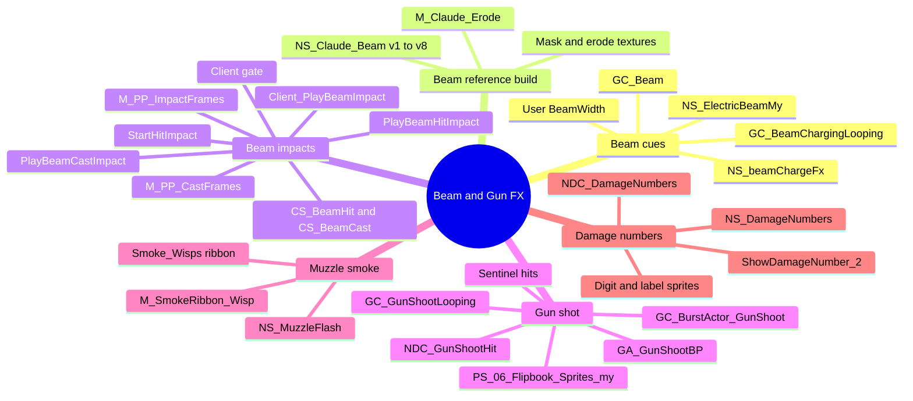
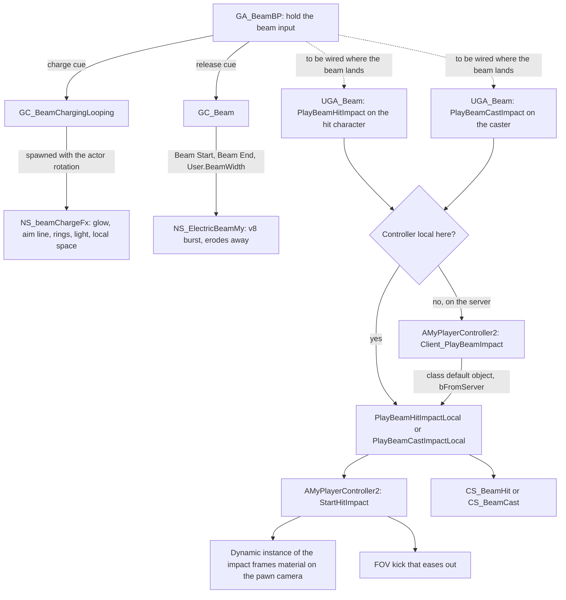
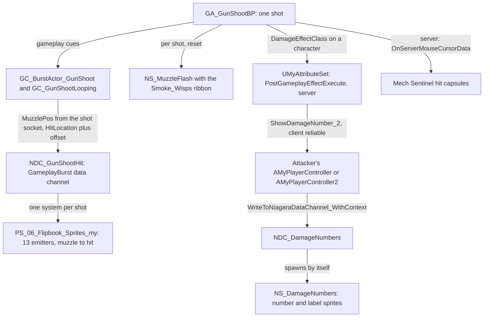
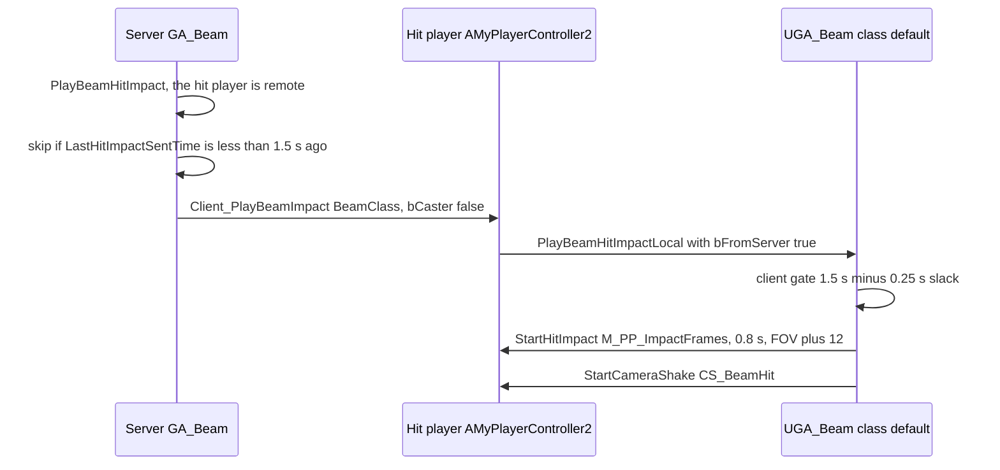

↑ [[Redo3 Changes Index]]

# Beam and Gun FX

AuraRedo3 · redo3 · 9c04634..57d2288 · 2026-10-04 to 2026-11-15

The mech fights with two abilities, `GA_Beam` (hold to charge an electric beam, release to fire it) and `GA_GunShoot` (a gun). This page is about how they look and feel: the beam's charge and release Niagara effects and their gameplay cues, the comic-style "impact frames" that play on the screen of the player the beam hits and on the caster's screen, the gun shot's muzzle, tracer and impact effect played once per shot through a Niagara Data Channel, the wispy muzzle smoke, and the damage numbers drawn by Niagara instead of widgets.

Talal asked for each piece separately: a wispy smoke ribbon on the muzzle flash (2026-10-04), damage numbers "using niagara and data channels" from `MyAttributeSet` (2026-10-05), a function on `GA_Beam` that adds a post process "with time and duration", an FOV change and a camera shake to the hit player, then the same for the caster (2026-10-10 and 10-11), and on 2026-10-13 a beam and a gunshot matching a reference video (YouTube `HTPbHeqstT0`, the beam from 3 s, the gunshot from 7 s). The beam was rebuilt eight times against that video and ended as texture erosion inside the real gameplay cues.

State now (origin/redo3): everything is committed. The v8 beam plays in `GC_BeamChargingLooping` and `GC_Beam` at 4x width, the gun shot plays per shot from `NDC_GunShootHit`, and `UGA_Beam` has two Blueprint callable impact functions with their materials, camera shakes and `GA_BeamBP` defaults. Not done: as of the impact thread `GA_BeamBP` did not call the two impact functions yet, and nothing here was play-tested in multiplayer. Since PR #6 (2026-11-16) `GA_GunShoot` also damages Mech Sentinels (see [[MechSentinel Combat and GAS]]).

## Mind map

## How it works

### Beam

1. While the player holds the beam, `GA_BeamBP` runs the looping cue `GC_BeamChargingLooping`, which spawns `NS_beamChargeFx` with the actor's rotation wired in. Its emitters `BeamCharge_Glow`, `BeamCharge_AimLine` (`User.AimLength` 2500), `BeamCharge_Rings` and `BeamCharge_Light` build up and hold at full charge until release. They run in local space so they ride with the mech, like Talal's own `Orb` and `Inner_Fuzzball` emitters in the same system.
2. On release `GC_Beam` spawns `NS_ElectricBeamMy` with `Beam Start` (relative to the component), `Beam End` (absolute) and `User.BeamWidth`. Its v8 burst emitters dissolve the beam by texture erosion (see [[#The NS_Claude_Beam reference build]]).
3. Where the beam lands, the ability is meant to call `PlayBeamHitImpact(HitCharacter)` and `PlayBeamCastImpact(Caster)`. Both are `BlueprintCallable` and work from the server or from the player's own machine. As of the impact thread (2026-10-11) the `GA_BeamBP` graph did not call them yet.
4. If the target player's controller is local on this machine (the listen-server host, or a client calling it for itself), the effect plays at once. Otherwise only the server can reach that player: it sends the reliable client RPC `AMyPlayerController2::Client_PlayBeamImpact(BeamClass, bCaster)`, which runs the `...Local` function on the beam class's default object, so the settings come from the class defaults of `GA_BeamBP`. This is the same route the damage numbers use.
5. `StartHitImpact` puts a dynamic instance of the impact frames material on the pawn's camera with `ImpactTime` = now and `Duration`, turns on custom depth for the characters so the material can draw them, and kicks the FOV. The material plays its whole panel sequence from its own `Time` node.
6. The camera shake (`CS_BeamHit` or `CS_BeamCast`) starts on the same machine through the player camera manager.

### Gun shot and damage numbers

1. Each gun shot fires gameplay cues. Per `57d2288`, `GC_BurstActor_GunShoot` casts the cue target to `AMyCharPlayer` and finds the shot start socket on its skeletal mesh, and `GC_GunShootLooping` breaks the cue parameters and offsets the location before it writes one entry (`MuzzlePos`, `HitLocation`) to `NDC_GunShootHit`. Which cue writes the channel was read from asset names in the thread and is not confirmed in the editor.
2. `NDC_GunShootHit` is a GameplayBurst data channel. It spawns `PS_06_Flipbook_Sprites_my` once per shot, and the 13 emitters aim from the muzzle to the hit.
3. `NS_MuzzleFlash` is reset on every shot (Talal's description); its `Smoke_Wisps` emitter adds two smoke ribbons per shot.
4. On the server, the damage effect on a character goes through `UMyAttributeSet::PostGameplayEffectExecute`, which calls `ShowDamageNumber_2` on the attacker's controller. The client writes one entry to `NDC_DamageNumbers`, which spawns `NS_DamageNumbers` on its own.
5. Also on the server, `UGA_GunShoot::OnServerMouseCursorData` sweeps the shot against the Mech Sentinels' hit capsules (see [[#GA_GunShoot and the Mech Sentinels]]).

## Beam charge and release cues

The cue split was built on 2026-10-21 and 10-22 in the "Beam and gunshot Niagara effects" thread and committed in `450006c` on 2026-11-15.

| Asset | Path | Role |
|---|---|---|
| `GC_BeamChargingLooping` | `/Game/Level/GAS/GameplayCues/` | Looping cue while charging; spawns `NS_beamChargeFx` with `GetActorRotation` wired in |
| `NS_beamChargeFx` | `/Game/2dFxVfxAppreientice/VFX/BeamCharging/NS_BeamCharge/` | Talal's charge system (from `9c04634`) plus the four v8 charge emitters, local space |
| `GC_Beam` | `/Game/Level/GAS/GameplayCues/` | Release cue; spawns `NS_ElectricBeamMy` |
| `NS_ElectricBeamMy` | `/Game/Level/GAS/GameplayAbilities/GA_Beam/Niagara/` | The release burst: Talal's emitters plus the v8 burst emitters |
| `M_ElectricRibbon_AddMy` | `/Game/Level/GAS/GameplayAbilities/GA_Beam/Niagara/` | Ribbon material, only resaved in `450006c` |

What the cue work changed, per the thread:

- **Parameters.** `NS_ElectricBeamMy` reads `Beam Start` (component relative) and `Beam End` (absolute). `GlobalScale` was added as `User.GlobalScale` but is unused.
- **v8 burst.** The v8 burst emitters replace the earlier v7 copies and keep Talal's `SecondarySpawnTime`, the `Age 1.5` start, and `Sparkles` and `Muzzle` switched off.
- **Length.** The beam front used to grow at 40 m/s and was cut 0.6 s after the blast, so it stopped at about 29 m. Growth now scales with the beam length and reaches `Beam End` within 0.1 s. `BlackElectricBeam`, `BlackElectricBeam001`, `WhiteElectricBeam` and `BlueElectricBeam` repeat their texture every 10 m (Tiling Length under UV0).
- **Width.** `User.BeamWidth` (default 1) in `NS_ElectricBeamMy` (10 emitters), `NS_beamChargeFx` (4) and `NS_Claude_Beam` (12) scales ribbon widths, sprite sizes, light radii and offsets from the axis. In a later pass at width 4 (compared with the reference video), the bead and noise tiling is x4, bolts and wisps scale with the beam, and the flash, white-out and light grow by sqrt(4). The Mech FX Reels page shows `GC_Beam` at `BeamWidth` 4 with `BlueElectricBeam` off.
- **Reverted by Talal.** On 2026-10-17 Talal removed the `User.SecondarySize` and `User.SecondaryColor` variables (and their 18 modules) from `NS_ElectricBeamMy`.

The cues were rendered with a 2 s charge and a target 20 m ahead (`BeamCues_v8.mp4`).

![[redo3_beam_v8_compare.jpg]]
*NS_Claude_Beam v8 against the reference video at eight moments (`beam_v8_compare.png`)*

## The NS_Claude_Beam reference build

`NS_Claude_Beam` (`/Game/Level/GAS/GameplayAbilities/GA_Beam/Niagara/NS_BeamClaude/`) is where the thread rebuilt the reference beam, version by version, before its parts went into the real cues.

- **v1 to v6 (2026-10-13 to 10-15).** Early builds compared with the video (`beam_preview.jpg`, `beam_v2_preview.jpg`, `beam_v3_preview.jpg`, `beam_v5_first_compare.png`, `beam_v6_compare.png`, `beam_start_end_test.jpg`). Their assets reached the repo in Talal's `808d60c` (2026-10-16): `NS_Claude_Beam`, `NS_Claude_Beam2`, `NS_Claude_BeamBackyp`, the materials `M_Claude_BeamRibbon`, `M_Claude_Glow`, `M_Claude_Ring`, `M_Claude_Wisp` and the instances `MI_Claude_AimLine`, `BeamCore`, `BeamCoreHot`, `BeamGlow`, `BeamHaze`, `BeamWisp`, `Bolt`, `GlowHot`, `GlowSoft`, `GlowTrail`, `RingLine`, `WispLine`, `WispSoft`.
- **2026-10-18.** `3f71d59` committed the current `NS_Claude_Beam` and `NS_ElectricBeamMy`.
- **v8 (2026-10-21).** The beam dissipates through texture erosion instead of 420 bead sprites. `M_Claude_Erode` removes the dim glow first, then the strands, then the brightest beads; the solid rod breaks into beaded strands, then sparse beads, then is gone. Its instances `MI_Claude_BeamErode`, `MI_Claude_BoltErode` and `MI_Claude_ThreadErode` use the generated textures `T_Claude_BeamMask` / `T_Claude_BeamErode`, `T_Claude_BoltMask` / `T_Claude_BoltErode` and `T_Claude_ThreadMask` / `T_Claude_ThreadErode` (in `NS_BeamClaude/Textures/`). The charge part then went into `NS_beamChargeFx` and the burst into `NS_ElectricBeamMy`.

The same folder also holds the mech death and respawn effects (`NS_Claude_Disintegrate`, `NS_Claude_RespawnFX`, `M_Claude_Disintegrate`, `M_Claude_DisCube`, `M_Claude_GlassCube`, the `M_RS_*` materials); those are on [[Redo3 Mech Character]].

Three of Talal's own emitters in `NS_ElectricBeamMy` were flagged as the biggest differences from the reference and left for him to decide: `Spikes` and `Flash` (black ink spikes), `BlackElectricBeam` / `BlackElectricBeam001` (black zigzag) and `Muzzle` (off). The reference's rainbow fan and band at the blast were not built.

## Beam hit and cast impacts

Built on 2026-10-10 and 10-11 by the "Beam hit impact effect" thread, from Talal's notes [[BeamImpactOnPlayer]], [[add the postprocess]] and [[PP , CamShake for Beam Casting player]] and his reference panels in [[GettingHitPlayerFrames]] and [[CastingPlayerFrames]]. As he asked, there is no text, no camera-angle change and no "guard break" panel.

### UGA_Beam functions

`UGA_Beam` (`Source/Aura/Public/AbilitySystem/Abilities/GA_Beam.h`) is a `UMyGameplayAbility` whose own activation code is commented out; the ability logic lives in `GA_BeamBP`. The C++ only adds the impacts.

| Function | Where it runs | What it does |
|---|---|---|
| `PlayBeamHitImpact(ACharacter* HitCharacter)` | Server or the hit player's machine (`BlueprintCallable`, category `Beam\|HitImpact`) | Local controller: plays it now. Remote, on the server: throttles, then `Client_PlayBeamImpact(GetClass(), false)`. A controller that is not `AMyPlayerController2` only gets `ClientStartCameraShake(HitCameraShake)` |
| `PlayBeamHitImpactLocal(HitPC, bFromServer)` | The hit player's machine | Client gate, then `StartHitImpact(HitPostProcessMaterial, HitImpactDuration, HitFOVOffset)` and `HitCameraShake` |
| `PlayBeamCastImpact(ACharacter* CasterCharacter)` | Server or the caster's machine (`Beam\|CastImpact`) | The same for the caster; returns if the caster's controller is not an `AMyPlayerController2` |
| `PlayBeamCastImpactLocal(CasterPC, bFromServer)` | The caster's machine | Client gate, then `StartHitImpact(CastPostProcessMaterial, CastImpactDuration, CastFOVOffset)` and `CastCameraShake` |

### Settings on GA_Beam

| Property | Default | Notes |
|---|---|---|
| `HitPostProcessMaterial` | none in C++ (`M_PP_ImpactFrames` set on `GA_BeamBP`) | Gets `ImpactTime` and `Duration` |
| `HitImpactDuration` | 0.8 s (min 0.05) | Length of the frames and of the FOV ease |
| `HitImpactMinInterval` | 1.5 s | A beam that keeps hitting starts a new impact no sooner than this (and never sooner than the duration) |
| `HitFOVOffset` | +12 degrees | Added at impact, eases back; 0 turns it off |
| `HitCameraShake`, `HitCameraShakeScale` | none (`CS_BeamHit` on `GA_BeamBP`), 1 | |
| `CastPostProcessMaterial` | none (`M_PP_CastFrames` on `GA_BeamBP`) | |
| `CastImpactDuration` | 0.9 s (min 0.05) | |
| `CastImpactMinInterval` | 1.5 s | |
| `CastFOVOffset` | -8 degrees | Negative zooms in |
| `CastCameraShake`, `CastCameraShakeScale` | none (`CS_BeamCast` on `GA_BeamBP`), 1 | |

The `GA_BeamBP` values were set by the thread under `Beam|HitImpact` and `Beam|CastImpact` once the C++ compiled on 2026-10-11, and saved in Talal's `808d60c`.

### Throttling and the client gate

A continuous beam calls the impact every frame, so there are two gates:

- **Server.** Before sending the reliable RPC it checks `LastHitImpactSentTime` / `LastCastImpactSentTime` on the target's `AMyPlayerController2` against `Max(MinInterval, Duration)`, so at most one RPC per 1.5 s per player.
- **Client.** `...Local` checks `LastHitImpactStartTime` / `LastCastImpactStartTime` against `ImpactGate(MinInterval, Duration, bFromServer)`: `Max(MinInterval, Duration)`, or that minus `ServerImpactGateSlack` (0.25 s) for an impact the server sent. Without the slack, network jitter and frame rounding dropped some server impacts and left a double gap (`7b77a84`). The shorter window still drops the server's copy of an impact this machine already played itself, which arrives about one round trip later.

All four times start at -1000, so the first impact always plays.

### StartHitImpact in AMyPlayerController2

`StartHitImpact(Material, Duration, FOVOffset)` (`Source/Aura/Private/PlayerInput/MyPlayerController2.cpp`):

1. Finds the pawn's `UCameraComponent`; no camera, no effect.
2. Reads Options > Accessibility from `UMyGameUserSettings`: Screen Flashes off drops the material, Screen Shake off drops the FOV kick (see [[Redo3 Menus and Settings]]). If both are gone it returns.
3. Stops a running impact first (`bHitImpactActive`), so a hit impact and a cast impact on the same player replace each other.
4. Creates `HitImpactMID` from the material, sets `ImpactTime` = world time and `Duration`, and adds it to the camera's `PostProcessSettings` as a blendable with weight 1.
5. Turns on custom depth for every visible body mesh of every `ACharacter` in the world (skeletal meshes, and static meshes that are not spline meshes, so no health-bar widgets and no beam spline mesh), skipping meshes that already render custom depth, and remembers them in `HitImpactCustomDepthMeshes`.

`TickHitImpact` runs every controller tick. Elapsed time is world time minus `HitImpactStartWorldTime`, the same clock as the material's `Time` node, so a pause freezes both. The FOV offset is `FOVOffset x (1 - Elapsed / Duration)^2`; the previous frame's offset is removed before the new one is added, so other FOV changes (such as the Options FOV) are kept. `StopHitImpact` restores the FOV, removes the blendable and turns custom depth back off.

### M_PP_ImpactFrames and M_PP_CastFrames

Both are post process materials in `/Game/Level/GAS/GameplayAbilities/GA_Beam/` (Scene Color After Tonemapping), authored through the Unreal MCP server. Each is one Custom node whose HLSL is kept in the repo: `Docs/Materials/PP_ImpactFrames.hlsl` and `Docs/Materials/PP_CastFrames.hlsl`. Inputs: `Time`, `ImpactTime`, `Duration`, `Center` (where the lines rush out from), `LineCount`, `InkThreshold`, the scene textures PostProcessInput0, SceneDepth and CustomDepth, and `PreviewT` (-1 in game; 0 to 1 freezes the sequence for editor previews). The cast material adds `BandAngle` and the three inks `Navy`, `Blue` and `Pale`.

`t = (Time - ImpactTime) / Duration`; outside 0 to 1 the scene passes through.

| t | M_PP_ImpactFrames (hit, black and white, 0.8 s) | M_PP_CastFrames (caster, blue palette, 0.9 s) |
|---|---|---|
| 0.00 to 0.12 / 0.20 | Zoom blur towards `Center` on the normal scene | Navy page with bright blue diagonal bands; characters navy with white highlights and rim |
| to 0.37 / 0.40 | White page, black speed lines and ink frame; characters white with a black outline | Mid blue page hatched with fine white diagonals |
| to 0.60 | Inverted: black page, dense thin white lines | Inverted: characters white with navy ink, bands behind black radial wedges |
| to 0.78 / 0.80 | White page, sparse thin lines, characters as ink outlines | Blue page with dense navy radial lines; characters navy with a white rim |
| to 1.00 | White flash fading back to the scene | Pale page with thin radial lines, characters as a hatched ink sketch, fading back |

Details that matter when editing them:

- Characters are found through custom depth (a custom depth value that is the nearest thing on screen), which is why `StartHitImpact` turns it on. Ink detail inside characters comes from luminance edges plus depth creases.
- Each panel is redrawn at about 12 drawings a second, with a fresh drawing at every cut (the "boil").
- The ink frame is a superellipse in viewport UV so it reaches all four edges; lines are anti-aliased analytically.
- `PostProcessOutput_ViewportSize` is guarded with `#if POST_PROCESS_MATERIAL`: the material is also compiled for debug view shaders, which have no `PostProcessOutput`, and the first version failed there even though the editor reported it fine (fixed in `eca7bb6`).

The editor viewport capture skips post process, so the phases were rendered headlessly in a separate offscreen editor with a stand-in mech, using `Docs/Materials/render_impact_frames.py`. The results are `Docs/Materials/Previews/ImpactFrames_hit_phases.png` and `ImpactFrames_cast_phases.png`.

![[redo3_final_hit.jpg]]
*Hit player's impact frames, every phase (`final_hit.png`)*

![[redo3_final_cast.jpg]]
*Caster's blue impact frames, every phase (`final_cast.png`)*

### Camera shakes

`CS_BeamHit` (a 0.5 s hard jolt with roll and pitch) and `CS_BeamCast` (a 0.4 s forward and back recoil), both Perlin noise shakes in `/Game/Level/GAS/GameplayAbilities/GA_Beam/`, made by the thread on 2026-10-11 and committed in `808d60c`. Options > Accessibility > Screen Shake turns the camera shake modifier off for every shake (`TickScreenShakeSetting`).

## Gun shot FX

### Per-shot impact through NDC_GunShootHit

The thread first rebuilt the reference gunshot as `NS_Claude_GunShot` (13 emitters, first capture `gun_impact.jpg` on 2026-10-13), then moved the emitters into `/Game/Level/Niagara/NS_GunShoot`. Talal then named the real target, `PS_06_Flipbook_Sprites_my` in `/Game/Assets/Effects/AppreiticeFx/GunShootHit/`, and the emitters were moved again. The editor ran out of memory at 14.6 GB during that, and the build was redone in four smaller batches. Talal confirmed "the effect is fired and seen in gameplay". The state was committed in `2ffcb38` on 2026-10-18.

- `NDC_GunShootHit` is a GameplayBurst Niagara Data Channel. One written entry spawns `PS_06_Flipbook_Sprites_my` with `MuzzlePos` and `HitLocation`.
- The 13 emitters (muzzle, a tracer at 7500 cm/s, impact flash, core, shards, smoke, sparks, embers) aim from the muzzle to the hit, and the impact waits until the tracer arrives.
- "Override spawn group to data channel index" on `System.NDCRead` gives each particle its own shot, so several shots in one frame do not share data.
- The channel's bounds padding went from 250 to 10000.
- A small System Update module after `Read_NDC_GunShootHit` sets `System.CG_DIR` and `System.CG_RT`, which a leftover hidden expression needs.
- Talal's own flipbook emitters in the system still read only the first shot each frame.

### The cues: muzzle socket and hit offset

`57d2288` (2026-11-15 batch) changed the two gun cues and resaved `GA_GunShootBP` (same nodes, pin links changed):

- `GC_BurstActor_GunShoot` casts the cue target to `AMyCharPlayer`, finds the shot start socket on its skeletal mesh, and lost its `PrintString` debug.
- `GC_GunShootLooping` breaks the gameplay cue parameters and offsets the actor location before it writes the `NDC_GunShootHit` entry that `PS_06_Flipbook_Sprites_my` reads.

The beam thread had noted the opposite reading (that `GC_BurstActor_GunShoot`, on tag `GameplayCue.GunShootLooping`, writes the channel) but only from asset names; the commit message above is the later and more specific source.

### Muzzle smoke

Talal asked on 2026-10-04 for a wispy smoke ribbon on `/Game/NiagaraExamples/FX_Weapons/MuzzleFlashes/NS_MuzzleFlash`, which "gets reset everytime the player shoots", with a backup first. The "Wispy smoke ribbon on muzzle flash" thread made `NS_MuzzleFlash_Backup` and added:

- **`Smoke_Wisps`**, a ribbon emitter in `NS_MuzzleFlash`: two ribbons per shot that shoot forward, slow down quickly, then drift upward while curl noise bends them into wisps. They widen and fade with age, their edges break up, and each is gone after about 0.5 to 1 s. Tuning: curl noise strength and frequency under Particle Update, width and alpha in its last Set Parameters module.
- **`M_SmokeRibbon_Wisp`** in the same Materials folder: translucent grey with scrolling noise; `OpacityScale` and `NoiseAmount` set strength and breakup.

The first build was lost when the editor crashed (a GPU readback during the session's own Niagara preview screenshot, while Talal's PIE was shutting down). The session had scripted the build, so it rebuilt and saved everything after the restart, wider and with broader curls but without a visual check. Taking no viewport or Niagara preview screenshots became a rule for every thread sharing the editor. `e7a2588` committed it, together with `NS_GunWispySmoke` (not mentioned by the thread) and a tweak to `PS_Fire_Explosion_Niagara`.

Because the system resets on every shot, fire rates faster than about 0.7 s cut the previous shot's smoke short. A separate fire-and-forget smoke system per shot was offered, not built.

### GA_GunShoot and the Mech Sentinels

Sentinels are Mass entities with no engine collision, so the crosshair trace passes through them. Since PR #6 (2026-11-16), `UGA_GunShoot::OnServerMouseCursorData` damages them on the server by sweeping each shot against their hit capsules, stopping at the first wall it traces itself. Settings on `UGA_GunShoot`: `bDamageSentinels` (true), `SentinelDamage` (40), `SentinelDamageEffect` (empty: the swarm rules' default), `SentinelShotRadius` (15 cm), `SentinelShotRange` (20000 cm), `SentinelMaxTargets` (1; 0 pierces). The full path is on [[MechSentinel Combat and GAS]]. The visual effects above are unchanged by it.

## Niagara damage numbers

Built on 2026-10-05 by the "Niagara damage numbers" thread, from Talal's to-do [[05-10-2026]] ("Damage numbers with NS data channel"). Committed in `e7a2588`.

### Server: MyAttributeSet

`UMyAttributeSet::PostGameplayEffectExecute` handles `IncomingDamage` on the server. When the damage is above 0 and the source is not the target, it looks at `Props.SourceController`:

- `AMyPlayerController` (the Aura game) or `AMyPlayerController2` (the mech game; added because Talal's first listen-server test with `GA_GunShoot` showed nothing).
- With `bUseNiagaraDamageNumbers` (default true) it calls `ShowDamageNumber_2(Damage, TargetCharacter, bIsCrit, bIsBlocked)`; otherwise the old widget `ShowDamageNumber`. The widget call was replaced rather than kept next to the Niagara call, so numbers never show twice.

### Client: writing the data channel

`ShowDamageNumber_2` is a Client Reliable RPC on both controllers, so the number appears only on the attacker's screen.

1. Location: the target's capsule top plus `DamageNumberHeightOffset` (20).
2. Colour: `BlockedDamageColor` (0.3, 0.6, 1), else `CritDamageColor` (1, 0.25, 0.05), else `NormalDamageColor` (white). Its alpha carries the size: `DamageNumberSize` (1), times `CritDamageScale` (1.5) on a crit.
3. UE 5.8 GameplayBurst channels reject the legacy SearchParams write, so it gets an access context with `UNiagaraDataChannelLibrary::GetUsableAccessContextFromNDC`, sets `Location` with `bOverrideLocation`, and writes with `WriteToNiagaraDataChannel_WithContext`.
4. It writes six values by name, which must match `NDC_DamageNumbers`: `Location`, `DamageAmount` (rounded float), `IsCritical`, `IsBlocked`, `Distance` (local camera to the number) and `Color`.

`NDC_DamageNumbers` is loaded in both controllers' constructors with `ConstructorHelpers` from `/Game/Level/UI/FloatingText/NiagaraDamageNumbers/NDC_DamageNumbers`. On `AMyPlayerController2`, Options > Gameplay > Show Damage Numbers can turn both damage number paths off (added later by the menu work).

### NS_DamageNumbers

The data channel spawns `NS_DamageNumbers` by itself; nothing is placed in the level. Both were copied from the footsteps data channel example, because the editor tools could not build a data channel reader from scratch; the `ReadFromNDC` scratch module in Particle Spawn reads the six values.

- `M_DamageNumber` draws the number with a custom HLSL digit lookup into `T_DamageDigits` (up to 6 digits).
- `M_DamageLabel` draws a `CRITICAL!` or `BLOCKED` label from `T_DamageLabels` above it; a hit that is both shows `BLOCKED`.
- Sprites rise, slow down, pop in and fade over 1 s, drawn on top of everything.
- Both sprites scale with `Distance / DistanceScaleReference` (1000), clamped between `DistanceScaleMin` 0.5 and `DistanceScaleMax` 6, so far numbers grow ("the further they are the bigger they get").

What it took: Talal renamed the channel variables himself and fixed the reader; `DamageAmount` went from Vector to Float; an IDE or another thread had reverted `MyPlayerController2.h` and that was undone; adding a parameter to an existing Set Parameters module hit an engine assert and crashed the editor, so a separate module was added instead; and the last fix switched off a leftover footsteps position offset in Initialize Particle that produced NaN positions. `NDC_DamageNumbers_Backup` and `NS_DamageNumbers_Backup` (taken before Talal's reader fix) are committed too.

| Setting (on both controllers, category `DamageNumbers`) | Default |
|---|---|
| `bUseNiagaraDamageNumbers` | true |
| `DamageNumberDataChannel` | `NDC_DamageNumbers` |
| `NormalDamageColor` / `CritDamageColor` / `BlockedDamageColor` | (1, 1, 1) / (1, 0.25, 0.05) / (0.3, 0.6, 1) |
| `DamageNumberSize` | 1 |
| `CritDamageScale` | 1.5 |
| `DamageNumberHeightOffset` | 20 |

## Gotchas

- `NS_MuzzleFlash` resets per shot, so fast fire cuts its smoke short; `Smoke_Wisps` also ignores the system's Use Smoke toggle.
- The beam bead tiling is baked for `BeamWidth` 4 and needs re-baking if that default changes.
- Only one impact plays at a time per controller: a cast impact replaces a running hit impact and the other way round.
- An `ACharacter` that already renders custom depth is left alone by `StartHitImpact` and is not switched off afterwards.
- A hit player on a controller other than `AMyPlayerController2` gets only the camera shake.
- A killing blow on another player shows no number: the fatal branch of `PostGameplayEffectExecute` returns early when the target is not an `AMyEnemyChar`, before the damage number code.
- Data channel variable names are matched by string in C++; renaming one in `NDC_DamageNumbers` silently breaks the write.

## How it changed

- **2026-10-04 19:43 `9c04634`: Talal's beam charge commit.** `NS_beamChargeFx` (with `NS_beamChargeFx_backUp`) in a new `2dFxVfxAppreientice/VFX/BeamCharging/` folder, a copy of the HealingSpell pack whose old folder keeps only an `NS_beamChargeFx` file; `NS_ElectricBeamMy`, `GC_Beam`, `GC_BeamChargingLooping`, `PS_06_Flipbook_Sprites_my` and `M_Flipbook` updated; the GnomonFx_1 ink set (`NS_InkOrb`, `M_InkOrb`, `M_FxGlow`, `M_FxInk` and nine instances) added. `Aura.uproject` enables the AllToolsets and ModelContextProtocol plugins. The graffiti menu half is on [[Redo3 Menus and Settings]].
- **2026-10-04 to 10-05: muzzle smoke.** `Smoke_Wisps` and `M_SmokeRibbon_Wisp`, lost in an editor crash once and rebuilt from the saved scripts.
- **2026-10-05: damage numbers.** `ShowDamageNumber_2`, the data channel, the system and materials, the `AMyPlayerController2` path, the access-context write, the six named variables, distance scaling and the NaN fix.
- **2026-10-07 07:02 `e7a2588`.** The "Commit and push current state" thread committed both, among 54 files: `MyAttributeSet.cpp`, both controllers, the `NiagaraDamageNumbers` folder with backups, `NS_MuzzleFlash`, `NS_MuzzleFlash_Backup`, `M_SmokeRibbon_Wisp`, `NS_GunWispySmoke` and `PS_Fire_Explosion_Niagara`. The bridge, platform and ranking parts are on [[Redo3 Hex Bridges]] and [[Redo3 Hex Path and Ranking]].
- **2026-10-10 15:27 `9bfaf86`: first hit impact.** `PlayBeamHitImpact` was `BlueprintAuthorityOnly` and sent `Client_PlayBeamHitImpact(BeamClass)`; the controller blended a plain post process material with `HitPostProcessWeight`, fading it and the FOV over `HitImpactDuration` 0.4 s, and restarted the shake at most every `HitCameraShakeMinInterval` 0.25 s.
- **15:29 `39fd2f5`: impact frames material.** The controller makes a dynamic instance and only sets `ImpactTime` and `Duration`; the material plays the sequence itself. Characters get custom depth. `HitImpactDuration` became 0.8 s, `HitImpactMinInterval` 1.5 s replaced the shake interval, and the weight was dropped. `PP_ImpactFrames.hlsl` added.
- **15:52 `cc0e80c`: review fixes.** A 12-item review: FOV ease and teardown on world time (pause safe), body meshes only for custom depth, the server throttles the reliable RPC, and shader work (dense thin rays on the inverted panel, sparse lines on the ink panel, superellipse ink frame, analytic line anti-aliasing, per-panel boil, smoother zoom blur, `PreviewT`).
- **16:05 `eca7bb6`: the caster.** `PlayBeamCastImpact`, `M_PP_CastFrames` (blue palette, `PP_CastFrames.hlsl`) and `CastCameraShake`, no FOV change yet. The RPC became `Client_PlayBeamImpact(BeamClass, bCaster)`. The debug-view compile guard, a thinner ink frame and thicker outlines; `render_impact_frames.py` and the two phase previews. This branch, `claude/project-thread-dii6qf`, was built while the grapple swing thread held the shared editor, so the C++ stayed uncompiled until Talal closed the editor.
- **2026-10-11 14:00 `ece19a8`: FOV kick for the caster, hit impact from any machine.** `CastFOVOffset` -8. `PlayBeamHitImpact` lost `BlueprintAuthorityOnly`: a local hit character plays it directly, a remote one gets it from the server. A fresh session on Talal's PC (the first session's Remote Control link had gone stale) merged it into redo3 as `8b23a51`.
- **14:11 `7b77a84`: looser client gate.** `ServerImpactGateSlack` 0.25 s for impacts the server sent; merged as `720c0e4`. The session then compiled AuraEditor, created `CS_BeamHit` and `CS_BeamCast` and set the `GA_BeamBP` defaults.
- **2026-10-13 to 10-15: reference beam and gunshot.** The "Beam and gunshot Niagara effects" thread built `NS_Claude_Beam` v1 to v6 and `NS_Claude_GunShot` against the video.
- **2026-10-16 07:29 `808d60c`: Talal's commit** "swing phase anim, Hex tile edge mask, beam by claude". For this page: `CS_BeamCast`, `CS_BeamHit`, `M_PP_CastFrames`, `M_PP_ImpactFrames`, `GA_BeamBP` with its impact defaults, the whole `NS_BeamClaude` folder of the time (`NS_Claude_Beam`, `NS_Claude_Beam2`, `NS_Claude_BeamBackyp`, `NS_Claude_GunShot`, the first `NS_Claude_Disintegrate` and `NS_Claude_RespawnFX`, the `M_Claude_*` and `MI_Claude_*` materials) and `NS_beamChargeFx` again. The swing and hex parts are on [[Redo3 Mech Swing Animation]] and [[Redo3 Hex Look and Atmosphere]].
- **2026-10-17.** Talal reverted `User.SecondarySize` and `User.SecondaryColor` in `NS_ElectricBeamMy`. Around the same days the gun emitters went to `NS_GunShoot`, then to `PS_06_Flipbook_Sprites_my` with per-shot reads.
- **2026-10-18 11:59 `2ffcb38` and `3f71d59`.** The "Unpushed commits count" thread committed the gun shot state (`NS_GunShoot`, `NDC_GunShootHit`, `PS_06_Flipbook_Sprites_my`) and the beam state (`NS_Claude_Beam`, `NS_ElectricBeamMy`) as separate topic commits.
- **2026-10-21 to 10-22: v8 and the cue split.** Texture erosion, the charge emitters in `NS_beamChargeFx`, the burst in `NS_ElectricBeamMy`, growth by length, 10 m tiling, `User.BeamWidth` and the 4x width pass; published on the Mech FX Reels page.
- **2026-11-15 14:18 `450006c`: Beam FX v8** (the 10-21 to 10-22 work, committed by the "Push local changes to GitHub" thread): `M_Claude_Erode`, the three erode instances, the six `T_Claude_*` textures, `NS_Claude_Beam`, `NS_ElectricBeamMy`, `NS_beamChargeFx`, `GC_BeamChargingLooping`; `GA_BeamBP` and `M_ElectricRibbon_AddMy` only resaved.
- **2026-11-15 14:18 `57d2288`: gun cues.** The shot start socket in `GC_BurstActor_GunShoot`, the hit offset in `GC_GunShootLooping`, `GA_GunShootBP` resaved. Work done on Talal's PC between 2026-10-18 and 11-15; the exact day is not recorded.
- **Later, another page.** PR #6 (merged 2026-11-16 as `21ba7cc`) made `GA_GunShoot` damage Mech Sentinels ([[MechSentinel Combat and GAS]]).

## Threads that worked on it

- [[Redo3 Threads#Beam and gunshot Niagara effects|Beam and gunshot Niagara effects]]: rebuilt the beam (v1 to v8) and the gunshot against the reference video, split the beam into the charge and release cues, added length, tiling and width, and moved the gun emitters into `PS_06_Flipbook_Sprites_my` per shot. Its death and respawn work is on [[Redo3 Mech Character]].
- [[Redo3 Threads#Beam hit impact effect|Beam hit impact effect]]: `PlayBeamHitImpact`, `PlayBeamCastImpact`, `StartHitImpact`, both impact frames materials and their HLSL, the camera shakes, the client gate and the `GA_BeamBP` defaults.
- [[Redo3 Threads#Niagara damage numbers|Niagara damage numbers]]: `ShowDamageNumber_2`, `NDC_DamageNumbers`, `NS_DamageNumbers` and their materials.
- [[Redo3 Threads#Wispy smoke ribbon on muzzle flash|Wispy smoke ribbon on muzzle flash]]: `Smoke_Wisps` and `M_SmokeRibbon_Wisp`.
- [[Redo3 Threads#Commit and push current state|Commit and push current state]]: committed the damage numbers and the muzzle smoke in `e7a2588`.
- [[Redo3 Threads#Unpushed commits count|Unpushed commits count]]: committed the 10-18 gun and beam state as `2ffcb38` and `3f71d59`.
- [[Redo3 Threads#Push local changes to GitHub|Push local changes to GitHub]]: committed beam v8 (`450006c`) and the gun cues (`57d2288`) from Talal's working copy.
- [[Redo3 Threads#Spawn scaling waves on path segments|Spawn scaling waves on path segments]]: made `GA_GunShoot` damage Mech Sentinels (PR #6).

## Artifacts and files

- [[Redo3 Artifact - Mech FX Reels]]: video gallery, first published as "NS_Claude_Beam v8 video": the v8 beam eroding away (10.7 s, real time, 4x slow and close-up), the charge and burst cues, and `GC_Beam` at `BeamWidth` 4 against the reference frames. Its disintegrate and respawn reels belong to [[Redo3 Mech Character]].
- [[Redo3 Files - Beam and Gun FX]]: the working files: early beam captures, the v8 comparison, close-up and texture sheets, the cue sheet, the 50 m and width tests, the v8 and cue videos, `final_hit.png` and `final_cast.png`, and the first gun impact capture.

The images above are `redo3_beam_v8_compare.jpg`, `redo3_final_hit.jpg` and `redo3_final_cast.jpg` from that folder; the first gun impact capture, the cue sheet and the erosion textures are on the files note.

## Where it lives

| What | Path |
|---|---|
| Beam impacts (C++) | `Source/Aura/Public/AbilitySystem/Abilities/GA_Beam.h`, `Source/Aura/Private/AbilitySystem/Abilities/GA_Beam.cpp` |
| Impact playback, damage numbers (mech game) | `Source/Aura/Public/PlayerInput/MyPlayerController2.h`, `Source/Aura/Private/PlayerInput/MyPlayerController2.cpp` (`Client_PlayBeamImpact`, `StartHitImpact`, `TickHitImpact`, `StopHitImpact`, `ShowDamageNumber_2`) |
| Damage numbers (Aura game) | `Source/Aura/Public/PlayerInput/MyPlayerController.h`, `Source/Aura/Private/PlayerInput/MyPlayerController.cpp` |
| Damage number trigger | `Source/Aura/Private/AbilitySystem/MyAttributeSet.cpp` (`PostGameplayEffectExecute`) |
| Gun shot sentinel hits | `Source/Aura/Public/AbilitySystem/Abilities/GA_GunShoot.h`, `Source/Aura/Private/AbilitySystem/Abilities/GA_GunShoot.cpp` |
| Beam ability, impact materials, shakes | `/Game/Level/GAS/GameplayAbilities/GA_Beam/` (`GA_BeamBP`, `M_PP_ImpactFrames`, `M_PP_CastFrames`, `CS_BeamHit`, `CS_BeamCast`) |
| Beam Niagara | `/Game/Level/GAS/GameplayAbilities/GA_Beam/Niagara/` (`NS_ElectricBeamMy`, `M_ElectricRibbon_AddMy`), `.../Niagara/NS_BeamClaude/` (`NS_Claude_Beam`, `M_Claude_Erode`, `MI_Claude_*`, `Textures/T_Claude_*`) |
| Beam charge | `/Game/2dFxVfxAppreientice/VFX/BeamCharging/NS_BeamCharge/NS_beamChargeFx` |
| Cues | `/Game/Level/GAS/GameplayCues/` (`GC_BeamChargingLooping`, `GC_Beam`, `GC_BurstActor_GunShoot`, `GC_GunShootLooping`) |
| Gun shot | `/Game/Level/GAS/GameplayAbilities/GA_GunShoot/GA_GunShootBP`, `/Game/Assets/Effects/AppreiticeFx/GunShootHit/` (`NDC_GunShootHit`, `PS_06_Flipbook_Sprites_my`, `M_Flipbook`), `/Game/Level/Niagara/NS_GunShoot`, `.../NS_BeamClaude/NS_Claude_GunShot` |
| Muzzle smoke | `/Game/NiagaraExamples/FX_Weapons/MuzzleFlashes/` (`NS_MuzzleFlash`, `NS_MuzzleFlash_Backup`, `NS_GunWispySmoke`, `Materials/M_SmokeRibbon_Wisp`) |
| Damage number assets | `/Game/Level/UI/FloatingText/NiagaraDamageNumbers/` (`NDC_DamageNumbers`, `NS_DamageNumbers`, `M_DamageNumber`, `M_DamageLabel`, `T_DamageDigits`, `T_DamageLabels`, two backups) |
| Shader sources and renders | `Docs/Materials/PP_ImpactFrames.hlsl`, `Docs/Materials/PP_CastFrames.hlsl`, `Docs/Materials/render_impact_frames.py`, `Docs/Materials/Previews/` |

## Open items

- As of 2026-10-11 the `GA_BeamBP` graph did not call Play Beam Hit Impact or Play Beam Cast Impact; the calls have to be added where the beam lands. Later saves of `GA_BeamBP` (`808d60c`, `450006c`) do not say they were added.
- The impacts were never play-tested on a real beam hit in PIE.
- No in-play confirmation of the damage numbers after the final NaN fix; Talal's disabled Gnomon mesh renderer is still in `NS_DamageNumbers`.
- A killing blow on another player shows no damage number (asked, not answered).
- Muzzle smoke: no play feedback, cut short at fast fire rates, ignores Use Smoke.
- Talal's `Spikes` and `Flash`, `BlackElectricBeam` / `BlackElectricBeam001` and `Muzzle` emitters in `NS_ElectricBeamMy` await his keep or turn-off choice; the reference's rainbow fan is not built.
- The bead tiling is baked for `BeamWidth` 4.
- Which gun cue writes `NDC_GunShootHit` is known from the commit message only, not checked in the editor.
- Talal's flipbook emitters in `PS_06_Flipbook_Sprites_my` still read only the first shot each frame.

## Related

- [[Redo3 Mech Character]]: the mech's death disintegrate and respawn FX from the same `NS_BeamClaude` folder and thread.
- [[Redo3 Menus and Settings]]: the Screen Flashes, Screen Shake, Field of View and Show Damage Numbers options these effects obey.
- [[Redo3 Mech Swing Animation]]: the other half of `808d60c`, and CR_Mech's beam-hit section.
- [[MechSentinel Combat and GAS]]: how `GA_GunShoot` damages sentinels.
- [[Redo3 Timeline]], [[Redo3 Branches and PRs]], [[Redo3 Threads]], [[Redo3 Artifacts Index]].
- Talal's notes: [[Beam]] and [[BeamAbility]] (his beam to-do lists), [[Spline Mesh Visual/Mat For Beam Visuals]] and [[Spline Mesh Visual/NS For Beam Visuals]] (beam visual notes), [[BeamImpactOnPlayer]], [[add the postprocess]], [[GettingHitPlayerFrames]], [[PP , CamShake for Beam Casting player]] and [[CastingPlayerFrames]] (the impact request and reference panels), [[GunShoot]] (gun to-do list), [[05-10-2026]] (the day's to-do list with the data channel damage numbers).

[[Redo3 Mech Swing Animation]] ← → [[Redo3 Mech Character]]
