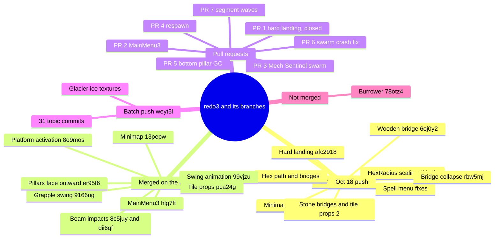
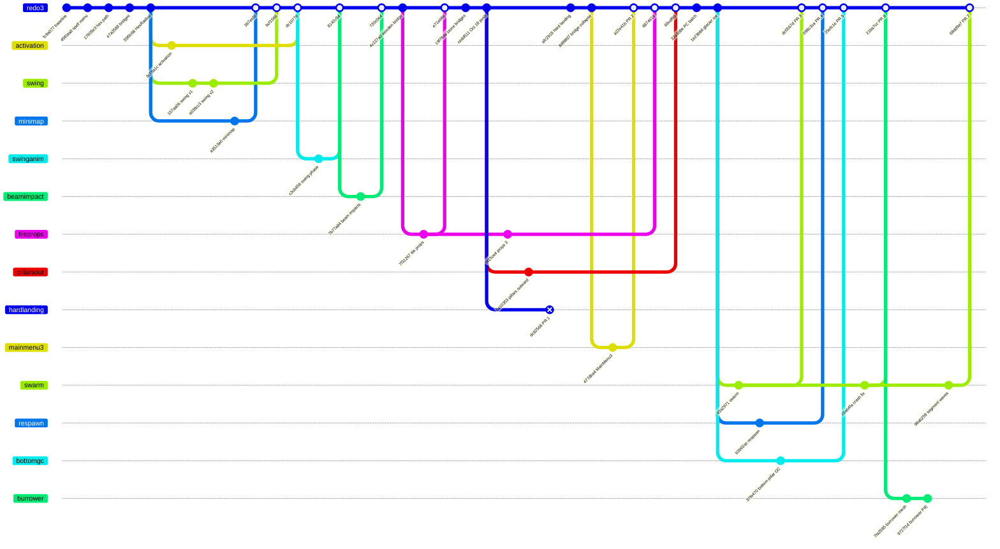

↑ [[Redo3 Changes Index]]

# Branches and PRs

AuraRedo3 · talal-jpg/AuraRedo2 · 19 Claude branches · 7 pull requests · 2026-10-03 to 2026-11-22 (UTC+8)

All the work since the baseline `fc9a077` "before start using claude." lives on the `redo3` branch, except the Burrower. Work reached `redo3` in four ways: commits made straight on `redo3` (by a session on Talal's PC or pushed by a thread), Claude branches merged locally on the PC, pull requests merged on GitHub, and the 2026-11-15 batch that put a month of uncommitted PC work into topic commits. `main` is still at `8136fa2` (2026-04-21), from before this run, and was not touched.

At the end of this run `redo3` is at `68dd9e7` (PR #7, 2026-11-21 20:32). One branch is not merged: the Burrower branch `claude/project-thread-78otz4` (tip `9727f1d`), which starts from `21ba7cc` (after PR #6) and needs a pull request into `redo3`.

## Mind map

## How it fits together

The graph shows the main merges in order. Branch names are shortened; the table below gives the full names.

1. **2026-10-03 to 10-07: straight on `redo3`.** The spell menu fixes, the growing hex path (`17605e3`), the bridge rewrite (`e7a2588`) and the HexRadius scaling (`a7bd059`..`55f9c66`) were committed on `redo3` directly. See [[Redo3 Spell Menu Fixes]], [[Redo3 Hex Path and Ranking]] and [[Redo3 Hex Platform PCG]].
2. **2026-10-10 and 10-11: the first merges.** The minimap, grapple swing, platform activation, swing animation and beam impact branches were merged on Talal's PC, in nine merge commits from `367eef8` to `720c0e4`. Between them, the Blueprint and asset side of that work (GA_BPGrappleSwing2, the PCG graphs, the graffiti menu, StartupMap) was committed together at 11:28 (`ab6e9c4`..`b9a224f`).
3. **2026-10-12 to 10-22: mostly straight on `redo3`.** The PCG reorganisation, the wooden and stone bridges, tile props 2 and the 2026-10-18 push (eleven commits at 11:59 found by the "Unpushed commits count" thread) were committed on `redo3`. Tile props v1 came in through a merge (`e71e986`). The hard landing (`afc2918`) and the bridge collapse (`8d98fd7`) were committed on Talal's PC on 10-22.
4. **2026-11-15 morning: three old branches merged.** The "Push local changes to GitHub" thread first merged MainMenu3 (`a22e41b`, PR #2), tile props 3 (`8874616`) and the outward-facing pillars (`69cdf95`), so their files were not committed twice.
5. **2026-11-15 14:18: the batch.** 31 topic commits (`9dd0d5d`..`32a308e`) put about 440 changed files from the PC on GitHub, then `1e23b9d` added the glacier ice textures once Talal agreed. `redo3` was fast-forwarded to `1e23b9d`, which is why GitHub shows PR #2 as merged at 15:10.
6. **2026-11-15 evening to 11-21: pull requests.** PRs #3, #4 and #5 were merged within ten minutes of each other, then PR #6 the next morning and PR #7 on 11-21. The "Spawn scaling waves on path segments" thread merged all five, including the respawn and bottom pillar PRs from other threads.
7. **2026-11-21 and 11-22: the Burrower branch.** Five commits on top of `21ba7cc`, not merged.

## Branches

All branches are on `origin` under `claude/project-thread-<id>`. Commits are the ones the branch added; merges are the commits that brought it into `redo3`.

| Branch | Thread | Commits | How it reached redo3 |
|---|---|---|---|
| `claude/project-thread-6klx6h` | [[Redo3 Threads#platform and bridge system uptill hex radius scale\|platform and bridge system uptill hex radius scale]] | `a7bd059`, `5bec016`, `55f9c66` | Committed on `redo3` and also pushed to this branch, 10-07 |
| `claude/project-thread-8o9mos` | [[Redo3 Threads#Platform activation logic fix\|Platform activation logic fix]] | `cbd8c04`, `3c75a1c` | Merged as `dc10778`, 10-10 |
| `claude/project-thread-13pepw` | [[Redo3 Threads#Hex platform and bridge minimap\|Hex platform and bridge minimap]] | `a3513e0` | Merged as `367eef8`, 10-10 |
| `claude/project-thread-gbr4lv` | [[Redo3 Threads#Hex platform and bridge minimap\|Hex platform and bridge minimap]] | `0325be0`, `0f9d516` | Same commits are on `redo3` (minimap placement fixes), 10-10 |
| `claude/project-thread-9166ug` | [[Redo3 Threads#Spider-Man grapple swing ability\|Spider-Man grapple swing ability]] | 14, `157aa06`..`e038cc3` | Merged as `bcf1566` and `40bc15c`, 10-10 |
| `claude/project-thread-99vjzu` | [[Redo3 Threads#Spider-Man grapple swing ability\|Spider-Man grapple swing ability]] | `3a3b09f`, `22c482e`, `0fae26e`, `2a8abed`, `c3cb456` | Merged as `146bc6e`, `173a497`, `8142c94`, 10-10 and 10-11 |
| `claude/project-thread-dii6qf` | [[Redo3 Threads#Beam hit impact effect\|Beam hit impact effect]] | `9bfaf86`, `39fd2f5`, `cc0e80c`, `eca7bb6` | Came in with the 8c5juy merge |
| `claude/project-thread-8c5juy` | [[Redo3 Threads#Beam hit impact effect\|Beam hit impact effect]] | dii6qf plus `ece19a8`, `7b77a84` | Merged as `8b23a51` and `720c0e4`, 10-11 |
| `claude/project-thread-6oj0y2` | [[Redo3 Threads#platform and bridge system uptill hex radius scale\|platform and bridge system uptill hex radius scale]] | `4c227a0` | Same commit is on `redo3` (wooden PCG_Bridge), 10-13 |
| `claude/project-thread-pca24g` | [[Redo3 Threads#Rocks and ruins on hex tiles\|Rocks and ruins on hex tiles]] | `379dc3b`, `ab708f7`, `ca33354`, `7f31267`, then `79bed11`, `f415ce4` | Merged as `e71e986` (10-16) and `8874616` (11-15) |
| `claude/project-thread-er95f6` | [[Redo3 Threads#Hex grid instances face outward\|Hex grid instances face outward]] | `6a10353` | Merged as `69cdf95`, 11-15 |
| `claude/project-thread-rbw5mj` | [[Redo3 Threads#Collapsing bridges\|Collapsing bridges]] | `8d98fd7` | Committed on Talal's local `redo3` and pushed to both, 10-22 |
| `claude/project-thread-q3b3hx` | [[Redo3 Threads#Hard landing montage\|Hard landing montage]] | `dc82566` | Not merged. PR #1 was closed; the same change is on `redo3` as `afc2918` |
| `claude/project-thread-hlg7ft` | [[Redo3 Threads#Build full main menu system\|Build full main menu system]] | `c4b51bd`, `14ed4e1`, `f2ddd92`, `477dba4` | PR #2, merged on the PC as `a22e41b`, 11-15 |
| `claude/project-thread-weyt5l` | [[Redo3 Threads#Push local changes to GitHub\|Push local changes to GitHub]] | 31 topic commits `9dd0d5d`..`32a308e`, then `1e23b9d` | `redo3` fast-forwarded to `1e23b9d`, 11-15 |
| `claude/project-thread-mwyd6w` | [[Redo3 Threads#Spawn scaling waves on path segments\|Spawn scaling waves on path segments]] | 32 in three rounds | PR #3 `dc0567d`, PR #6 `21ba7cc`, PR #7 `68dd9e7` |
| `claude/project-thread-dq7p8s` | [[Redo3 Threads#Respawn players ahead of leader\|Respawn players ahead of leader]] | `b3b02ac` | PR #4, merged as `098c3ca`, 11-15 |
| `claude/project-thread-2426yz` | [[Redo3 Threads#Overlapping Geometry Collections\|Overlapping Geometry Collections]] | `005aca9`, `3e4c700`, `37fe470` | PR #5, merged as `25efc1e`, 11-15 |
| `claude/project-thread-78otz4` | [[Redo3 Threads#Model, rig and export the burrower creature\|Model, rig and export the burrower creature]] | `7fa2585`, `a414ca9`, `5d5f2bc`, `a52a516`, `9727f1d` | **Not merged.** Starts at `21ba7cc`, before PR #7 |

## Pull requests

All seven pull requests target `redo3`. Times are UTC+8.

| PR | Title | Branch | Opened | Result | Page |
|---|---|---|---|---|---|
| [#1](https://github.com/talal-jpg/AuraRedo2/pull/1) | MyCharPlayer: play the fall-to-roll montage on a hard landing after flying | q3b3hx | 10-22 12:18 | Closed without merging at 12:56. The change went onto `redo3` as `afc2918` | [[Redo3 Mech Character]] |
| [#2](https://github.com/talal-jpg/AuraRedo2/pull/2) | Add MainMenu3: Far Far West style main menu, options and pause menu | hlg7ft | 10-30 15:18 | Merged 11-15 15:10 (local merge `a22e41b`, shown as merged when `redo3` was pushed) | [[Redo3 Menus and Settings]] |
| [#3](https://github.com/talal-jpg/AuraRedo2/pull/3) | Mech Sentinel swarm: Mass entities with GAS combat, replication, wave spawner and Niagara tentacles | mwyd6w | 11-15 14:21 | Merged 11-15 19:37 as `dc0567d` | [[MechSentinel Index]] |
| [#4](https://github.com/talal-jpg/AuraRedo2/pull/4) | Respawn dead players ahead of the lead after a fixed delay | dq7p8s | 11-15 14:52 | Merged 11-15 19:45 as `098c3ca` | [[Redo3 Mech Character]] |
| [#5](https://github.com/talal-jpg/AuraRedo2/pull/5) | Hex platforms: bottom pillars break into a Geometry Collection | 2426yz | 11-15 15:05 | Merged 11-15 19:45 as `25efc1e` | [[Redo3 Hex Pillars and Breaking]] |
| [#6](https://github.com/talal-jpg/AuraRedo2/pull/6) | Mech Sentinel: listen server crash fix, gun damage on sentinels, flowing tentacles | mwyd6w | 11-16 02:43 | Merged 11-16 07:38 as `21ba7cc` | [[MechSentinel Index]] |
| [#7](https://github.com/talal-jpg/AuraRedo2/pull/7) | Mech Sentinel: a wave per path segment, wave curves, damage link, self-buffs, platform avoidance, StartupMap setup | mwyd6w | 11-21 16:41 | Merged 11-21 20:32 as `68dd9e7` | [[MechSentinel Index]] |

## Merge commits on redo3

| Time | Commit | What it merged |
|---|---|---|
| 10-10 10:51 | `367eef8` | 13pepw, the minimap |
| 10-10 10:51 | `bcf1566` | 9166ug, GA_GrappleSwing and GA_GrappleSwing2 |
| 10-10 10:51 | `dc10778` | 8o9mos, platform activation |
| 10-10 10:53 | `40bc15c` | 9166ug again, the look-direction docs `e038cc3` |
| 10-10 14:36 | `146bc6e` | 99vjzu, Event.Swing and bIsSwinging |
| 10-11 08:08 | `173a497` | 99vjzu, CR_Mech swing notes and GetGrappleSwing2Phase |
| 10-11 08:52 | `8142c94` | 99vjzu, the rescaled GetGrappleSwing2Phase |
| 10-11 14:00 | `8b23a51` | 8c5juy, beam cast and hit impacts |
| 10-11 14:11 | `720c0e4` | 8c5juy, the impact client gate |
| 10-16 09:10 | `e71e986` | pca24g, hex tile rocks and ruins |
| 11-15 10:23 | `a22e41b` | hlg7ft, MainMenu3 (PR #2) |
| 11-15 10:23 | `8874616` | pca24g, tile props 3 ice shard crown |
| 11-15 10:23 | `69cdf95` | er95f6, outward-facing pillars |
| 11-15 18:12 | `9f55fa9` | `redo3` into the respawn branch (on dq7p8s, before PR #4) |
| 11-15 19:32 | `62a3ac2` | `redo3` into the Mech Sentinel branch (on mwyd6w, before PR #3) |
| 11-15 19:37 | `dc0567d` | PR #3 |
| 11-15 19:45 | `098c3ca` | PR #4 |
| 11-15 19:45 | `25efc1e` | PR #5 |
| 11-16 07:38 | `21ba7cc` | PR #6 |
| 11-21 20:32 | `68dd9e7` | PR #7 |

## The burrower branch

`claude/project-thread-78otz4` holds the whole Burrower enemy: the UE skeletal mesh FBX (`7fa2585`), the C++ character, per-player spawner, rotor tile cutting and anim instance (`a414ca9`), then the imported assets (`5d5f2bc`), the Control Rig, Anim Blueprint and Blueprint (`a52a516`) and the PIE-tested setup with the Control Rig ragdoll on (`9727f1d`). It was built in a separate copy of the project so Talal's working copy was not touched. It branches from `21ba7cc`, so it does not have PR #7's swarm changes; a pull request into `redo3` will need a merge. See [[Redo3 Burrower]] and [[Redo3 Artifact - Burrower in Unreal - build report]].

## Open items

- The Burrower branch is not merged into `redo3`.
- `claude/project-thread-q3b3hx` (PR #1) is closed and can be deleted; its change is on `redo3` as `afc2918`.
- The other merged Claude branches are still on `origin`. They are safe to delete, since everything on them is in `redo3`.
- `main` is still at `8136fa2` from 2026-04-21. Nothing in this run touched it.

## Related

- [[Redo3 Timeline]]: every commit by day, with the merges.
- [[Redo3 Threads]]: what each branch's thread asked for and did.
- [[ProjectCreationAndVersionControll]]: Talal's note on project setup and version control with git.

[[Redo3 Timeline]] ← → [[Redo3 Threads]]
