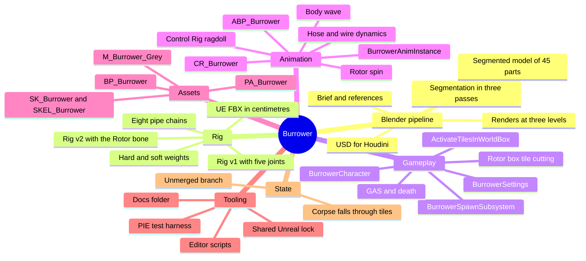
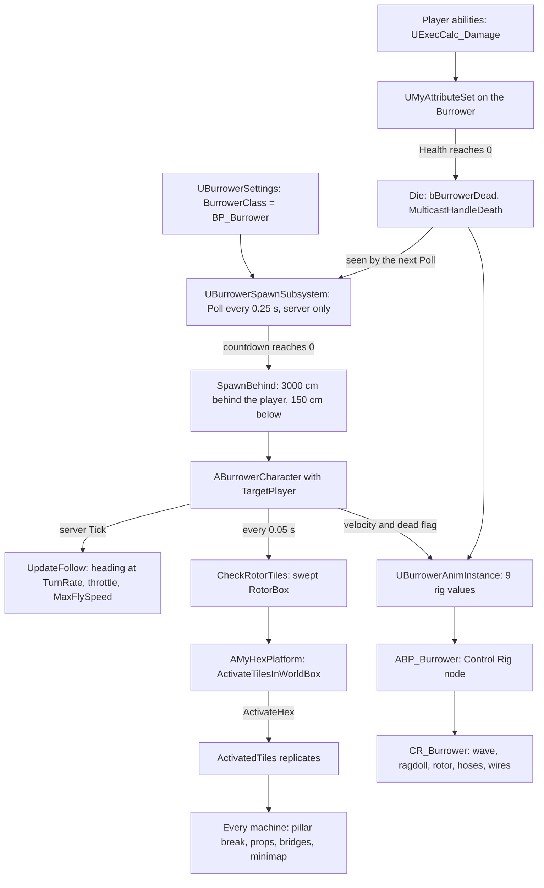
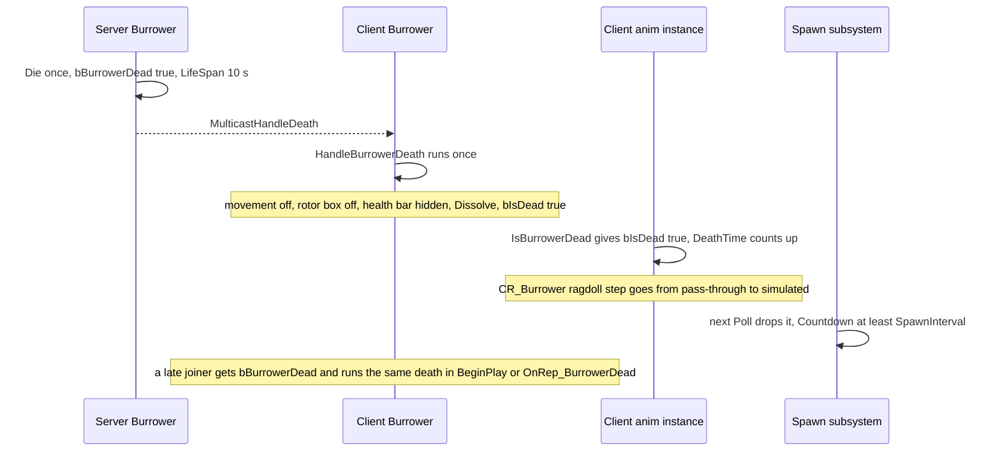

↑ [[Redo3 Changes Index]]

# Burrower

AuraRedo3 · claude/project-thread-78otz4 (not merged) · 7fa2585..9727f1d · 2026-11-21 to 2026-11-22

The Burrower is a 20 m fish-like burrowing machine with a spinning cutter rotor in its mouth. In the game it appears behind each player, flies after them through the hex platforms and eats the tiles under their feet with its rotor, so the player has to keep moving. It takes damage from every player ability like the other enemies, falls into a Control Rig ragdoll when it dies, and a new one comes after an interval. Its body swings in a travelling sine wave and the hoses on its back and flanks swing with physics.

It was built in two halves by one thread, [[Redo3 Threads#Model, rig and export the burrower creature|Model, rig and export the burrower creature]]. From 2026-11-05 to 2026-11-12 the creature was modelled and rigged in Blender in the cloud from Talal's vault note [[horizon fish like burrower]]: segmentation in three passes, a 45-part model, a USD for Houdini and a 5-joint rig. On 2026-11-21 Talal asked for the Unreal side: a rotor bone, an import, and a C++ enemy deriving from `AMyEnemyChar` that spawns behind each player, follows them, uses GAS, ragdolls in the Control Rig, swings its pipes with Control Rig dynamics, waves its body like the third part of the YouTube video `_Fp2nJuU7Q0` at 5:40, and collapses hex tiles with a padded box on the rotor. The C++ and the FBX were written in the cloud (`7fa2585`, `a414ca9`); the import, physics asset, Control Rig, Anim Blueprint, Blueprint and a scripted PIE test were done on Talal's PC in a separate copy of the project (`5d5f2bc`, `a52a516`, `9727f1d`).

State now: everything is on the branch `claude/project-thread-78otz4` (tip `9727f1d`, 5 commits on top of `21ba7cc`) and **not in redo3**. A PIE run with a listen server and one client passed every check. The branch starts before PR #7, so it needs a merge through a pull request, which was offered and not opened. The corpse falls through the tiles, the mesh has one grey material and no UVs, and Nanite is off on it. The `.uasset` files are binary: their detail here comes from the commit messages, the build scripts, the docs in `Docs/Burrower/` and the build report.

## Mind map



## How it works



1. **Settings.** `UBurrowerSettings` (Project Settings > Game > Burrower) names the class to spawn. The branch's `DefaultGame.ini` sets `BurrowerClass=/Game/Assets/Enemies/Burrower/BP_Burrower.BP_Burrower_C` under `[/Script/Aura.BurrowerSettings]` and adds the folder to `DirectoriesToAlwaysCook`, because only the config soft pointer references it.
2. **Spawning.** `UBurrowerSpawnSubsystem` runs on a listen server or standalone only. Every `PollInterval` (0.25 s) it walks `GameState->PlayerArray`. Each player has a countdown that starts at `FirstSpawnDelay` (10 s) and only runs while the player has a living pawn and room for another Burrower (`MaxAlivePerPlayer` 1). At 0, `SpawnBehind` places a Burrower `SpawnDistanceBehind` (3000 cm) behind the player, against their velocity or facing, `SpawnHeightOffset` (-150 cm) below them, facing them.
3. **Following.** On the server `ABurrowerCharacter::UpdateFollow` aims the head at a goal 150 cm below the player (`FollowHeightOffset`), turns yaw and pitch toward it at `TurnRate` (40 deg/s) each, and flies at `FollowSpeed` (1400 cm/s), up to `CatchUpSpeed` (3200 cm/s) when far behind. It has no navmesh and collides with nothing; an `AAIController` possesses it only so the movement component runs.
4. **Cutting.** Every `RotorCheckInterval` (0.05 s) `CheckRotorTiles` takes the `RotorBox` around the rotor, stretches it over the distance moved, and passes it to `AMyHexPlatform::ActivateTilesInWorldBox` on every platform. Touched tiles collapse through `ActivateHex`, the same call the platform's own collapse chains use, so the replicated `ActivatedTiles` carries them to the clients and the pillar break, props, bridges and minimap react as for any collapse ([[Redo3 Hex Pillars and Breaking]]).
5. **Animation.** On every machine `UBurrowerAnimInstance` turns the Burrower's speed and dead flag into nine values (rotor angle, wave phase and amplitudes, death). `ABP_Burrower` is one Control Rig node that passes them to `CR_Burrower`, which waves J1 to J4, spins the rotor, simulates the hoses and cables, and switches on the ragdoll once `bIsDead` is true.
6. **Combat.** The Burrower has the `UMyAbilitySystemComponent` and `UMyAttributeSet` of `AMyEnemyChar`, so every player ability damages it through the normal pipeline. At 0 health the server's `Die` sets the replicated `bBurrowerDead` and multicasts the death; each machine stops the movement and the rotor box and hands the corpse to the Control Rig ragdoll.
7. **Respawn.** The next `Poll` sees the dead Burrower, drops it, and re-arms that player's countdown to at least `SpawnInterval` (30 s). The corpse stays for its `LifeSpan` (10 s).

The death on server and clients, including a client that joins after it:



## From the brief to the segmented model

Talal's note [[horizon fish like burrower]] holds five reference images and the brief: segment the reference first and show an image with each segment in its own colour, leave out the part circled in blue in the last image (the legs), give three iterations with progressively smaller segments, then model the mesh in Blender with each segment as a separate mesh. The thread copied the brief and the five images (`ref1_side_front`, `ref2_side_head`, `ref3_ingame_leap`, `ref4_ingame_desert`, `ref5_exclude_legs`) into the shared folder.

**Segmentation (2026-11-05).** The taxonomy (`segmentation/segment_list.json`, later `usd/taxonomy.json`) has three levels, drawn as colour sheets on the two reference views:

| Level | Parts | Examples |
|---|---|---|
| L1 coarse | 7 | Head, Forequarters, Dorsal Pack, Midbody, Hindbody, Tail, Belly |
| L2 medium | 21 | Drill Maw, Head Armor, Crest, Canisters, Spine Conduit, Vent Block, Quilted Carapace, Tail Blade, Gullet Teeth |
| L3 fine | 45 | Cutter Rotor, Maw Bezel, Brow Plate, Piston Cluster, Canister Near, Vent Housing, Ridge Nubs, Tail Tip |

Legs and claws are in no segment.

**Model (2026-11-06).** `Burrower.blend` (Blender 5.0) is an original creature, 20 m long, on the reference's body plan: drill maw, armoured head and forequarters, twin canisters on the back, a braided muscle midbody, a quilted hindbody and a flat armoured tail blade. It holds:

- `Burrower_Pass3_Fine`: the 45 fine segments, one mesh each (`L3_<id>_<Name>`, about 1.24M triangles), under `L1_` and `L2_` empties so the outliner shows all three levels. Each mesh carries the custom properties `segment_id`, `segment_name`, `L1`, `L2`, `seg_coarse`, `seg_medium`, `seg_fine` and the int face attributes `seg_coarse_id`, `seg_medium_id`, `seg_fine_id`.
- `Burrower_Pass2_Medium` (21 joined meshes, `SEG2_`) and `Burrower_Pass1_Coarse` (7, `SEG1_`), excluded from the view layer by default.
- Each segment's material is its segmentation colour. +X is forward, Z up, metres: the tail tip is at x = -10 and the maw at x = +10.

24 final renders (clay and the coarse, medium and fine colours from several angles) and 5 sheets, including `Burrower_overview.png` and `Burrower_levels_side.png`, are in `renders/final/`. The procedural build code is backed up in `source/`.

**USD for Houdini.** `usd/Burrower_houdini.usdc` is Y-up, in metres, default prim `/Burrower`, head on +X. Every polygon carries `name` (the fine piece, which Houdini RBD uses for pieces), `seg_coarse`, `seg_medium`, `seg_fine`, the three int ids, and `Cd`, `Cd_coarse`, `Cd_medium` colours, written as uniform primvars. There are 73 GeomSubset groups (7 `L1_`, 21 `L2_`, 45 `L3_`) and the prim paths carry the hierarchy, for example `/Burrower/L1_1_Head/L2_1_1_DrillMaw/L3_1_1_1_CutterRotor`. Blender's USD exporter drops string attributes and groups, so `add_hierarchy_attrs.py` writes them after the export and prints `[verify] 45 meshes, 73 distinct groups`; `prepare_blend.py` sets up the names, empties and ints. `README_Houdini.md` gives the import steps for SOPs and Solaris.

## Rig v1: five joints for Houdini

Built 2026-11-11 to 11-12 (`rig/`). The chain runs along the body axis at mid-height, with a joint at the maw and one at each coarse boundary:

| Joint | Where | x (m) |
|---|---|---|
| `J0_Head` | maw front | 10.0 |
| `J1_Forequarters` | head and forequarters | 6.6 |
| `J2_Midbody` | forequarters and midbody | 2.6 |
| `J3_Hindbody` | midbody and hindbody | -2.6 |
| `J4_Tail` | hindbody and tail | -5.6 (tail tip at -10.17) |

- `Burrower_rig.fbx` is the skeleton and all 45 meshes, skinned, in rest pose: FBX 7.4 binary, Y-up, metres, a root Null `Burrower_Rig` and the 5 joints, no leaf bones. `Burrower_rig_testanim.fbx` adds a 5 s wave (frames 1 to 120 at 24 fps). `Burrower_rigged.blend` is the source.
- Weights: each face is hard or soft from a `rig_class` face attribute written by the modelling code. Soft faces follow a smooth field with a 0.6 m blend at each joint. Hard faces are grouped into rigid pieces that never bend, weighted as big, mounted, rider, plate or unit pieces; the back canister pack is one rigid unit on J1. Soft vertices within 3 cm of a hard piece are pinned to it and eased back over 0.4 m, which keeps hoses on their fittings.
- The rig README counts 20 all-hard segments, 9 hard with soft lines, 3 half and half, and 13 soft with hard fittings (the thread summary gives 29 hard, 12 soft and 4 mixed).
- Checks without Houdini: Blender's FBX parser, ufbx and Assimp read the files; a round trip matches within 0.005 mm; an independent re-skin gave the same deformation. The thread reports the soft gap at a 10 degree bend going from 47 cm to 8 cm.
- Limits: rigid armour opens at its seams when bent (the gullet tooth rails open 29 cm at 10 degrees on J1). Bending J2 so the midbody lifts more than about 2 degrees pushes the vent housing (J2) into the canister pack (J1); a sixth joint for the pack was suggested. The comfortable range per joint is 10, 6, 14 and 18 degrees sideways and 4, 1, 4 and 6 degrees up and down for J1 to J4.

## Rig v2 and the UE FBX

For Unreal (2026-11-21, `rig_v2/`, committed in `7fa2585`) the rig got a `root` bone, a `Rotor` bone and bones for the pipes:

```
root                      origin, ground level under the body centre
├─ J0_Head ... J4_Tail     the five joints (J0_Head at (1000, 0, 180) cm)
│     └─ J1_Forequarters -> 8 pipe chains
└─ Rotor                  rotor centre (977.9, 0, 180.5) cm, spins about +X
```

- **Rotor.** Parented to `root` (Talal's ask: "one more bone for the cutter rotor only parented to the root"), so the Control Rig places it on the head every frame. The disc has a radius of 105.8 cm and is 55.8 cm deep. The v2 check spins it 40 degrees and only `L3_1_1_1_CutterRotor` moves, with no change of radius.
- **Pipe chains.** Eight chains under `J1_Forequarters`, each `_01` to `_NN` plus an `_end` bone, described with their anchor, type and geometry in `SourceArt/Burrower/Burrower_rig_info.json` (and `rig_v2/pipes.json`):

| Chain | Segment | Bones | Length | Radius | Solver |
|---|---|---|---|---|---|
| `pipe_upperhose_l` | 3.3.1 | 7 + end | 2.03 m | 11 cm | rigid body |
| `pipe_upperhose_r` | 3.3.1 | 5 + end | 1.64 m | 11 cm | rigid body |
| `pipe_uppercable_l` | 3.3.1 | 7 + end | 2.13 m | 3.2 cm | wire |
| `pipe_uppercable_r` | 3.3.1 | 9 + end | 2.66 m | 3.2 cm | wire |
| `pipe_side_l_a`, `_l_b`, `_r_a`, `_r_b` | 2.3.2 | 7 + end each | 2.01 to 2.11 m | 3.6 cm | wire |

- **`SourceArt/Burrower/Burrower_UE.fbx`**: 45 skinned meshes, 71 bones, centimetres, head on +X, Z up, one material slot per part (`M_SEG_<id>`), at most 3 influences per vertex. It is 33 MB and stored as a plain git blob, not LFS, because the cloud session could not reach the LFS server; `SourceArt/Burrower/.gitattributes` says `*.fbx -filter -diff -merge binary`.

## ABurrowerCharacter

`Source/Aura/Public/Burrower/BurrowerCharacter.h`. Talal decided it derives from `AMyEnemyChar` (BRIEF.md: "This is fixed; do not derive from AMyCharBase"), so whatever does not fit a 20 m flying worm is neutralised in the subclass, and no base class changes.

Set in the constructor:

- `CharacterClass = Warrior`, `CharacterLevel = 1`, `LifeSpan = 10`. The kill reads the XP reward for `CharacterClass` from `DA_CharClassInfo`, so the class needs an entry there.
- `bAlwaysRelevant = true`: a handful exist and they move fast.
- `AutoPossessAI = PlacedInWorldOrSpawned` with a plain `AAIController` (the branch adds `AIModule` to `Aura.Build.cs` for it). No `ABurrowerAIController`: the steering lives in the character.
- Character movement: `DefaultLandMovementMode = MOVE_Flying`, `MaxFlySpeed` = `FollowSpeed`, `MaxAcceleration` 4000, `BrakingDecelerationFlying` 2000, `GravityScale` 0, no orient-to-movement, no controller rotation.
- Capsule: radius 160, half height 190, on the head body (the actor location is the head, at mesh (830, 0, 187)). QueryOnly, Pawn, **ignores every channel**: it flies through the tiles it cuts, the players and the level.
- Mesh: relative location (-830, 0, -187), facing +X. QueryOnly, Pawn, ignores everything except Visibility (Block) and WorldDynamic and PhysicsBody (Overlap), with overlap events on, so aim traces and projectiles hit the physics asset bodies. Players pass through the body.
- The base class's jetpack and beam spline mesh components are hidden with no collision. The health bar sits at (0, 0, 400) in screen space; if `BP_Burrower` set no widget class, `BeginPlay` puts in an empty `UMyUserWidget`, because `AMyEnemyChar::BeginPlay` uses the widget without a check.

Follow settings (category `Burrower|Follow`, server):

| Property | Default | Effect |
|---|---|---|
| `FollowSpeed` | 1400 cm/s | Cruising speed near the target |
| `CatchUpSpeed` | 3200 cm/s | Speed at `CatchUpFullDistance` and beyond |
| `CatchUpStartDistance` / `CatchUpFullDistance` | 3000 / 8000 cm | Speed ramps from Follow to CatchUp between them (head to goal) |
| `TurnRate` | 40 deg/s | Yaw and pitch each turn at most this fast; the body turns about the head, so the tail swings |
| `MaxPitch` | 25 deg | Steepest climb or dive |
| `StopDistance` | 0 cm | No push once the blade front is this close to the goal; 0 means a player who stands still loses their tile |
| `SlowdownDistance` | 1500 cm | Throttle ramps from 0 to 1 up to this distance from the blade front |
| `FollowHeightOffset` | -150 cm | Goal below the player's actor location, so the rotor cuts the tiles they run on |
| `KeepBehindDistance` | 0 cm | Above 0, the goal is this far behind the target instead of on it |
| `bAutoTargetNearestPlayer` | true | A Burrower placed in a level (not spawned by the subsystem) picks the nearest living player once a second |

How `UpdateFollow` steers: yaw and pitch turn toward the goal separately, each clamped to `TurnRate * DeltaTime`, and the pitch goal is clamped to `MaxPitch`. Turning along one arc stalled the yaw for a goal behind and slightly above (the pitch clamp threw the turn away), which was a review finding. `SetActorRotation` sets the heading and `AddMovementInput(heading, throttle)` moves along it. The throttle distance is measured from the front of the blades, about 176 cm ahead of the actor (rotor box centre distance plus `RotorHalfSize.X`). With no living target there is no input and the flying braking stops it. Running players are trailed by a few metres by design, so their tiles fall behind them.

`TargetPlayer` and `bBurrowerDead` replicate. `GetTargetPlayer()` and `IsBurrowerDead()` are BlueprintPure; `BP_OnBurrowerDied` is a Blueprint hook on every machine. `bRefreshBonesOnServer` (default false) makes the server refresh the bones every frame (`AlwaysTickPoseAndRefreshBones`) so the hit bodies follow the wave there too, at the cost of a full rig evaluation.

## Rotor tile cutting

`RotorBox` is a `UBoxComponent` attached to the mesh with **no socket**, at the rotor centre (977.9, 0, 180.5). Two reasons, from `cpp_notes.md`: a server that does not render the Burrower does not refresh its bones, so a box on the `Rotor` bone would cut with a stale pose there; and the bone's local axes come from Blender. While alive the rig keeps the rotor at its rest place and only spins it (J0_Head gets no wave), and the disc is round, so the box covers it. The box has no collision and is hidden; the server queries the tiles with its transform.

| Property (`Burrower|Rotor`) | Default | Effect |
|---|---|---|
| `RotorHalfSize` | (27.9, 105.8, 105.8) cm | Half depth along X and the disc radius |
| `RotorBoxPadding` | 50 cm | Added on every side, so tiles go a little before the blades reach them (box half extent 77.9 x 155.8 x 155.8) |
| `RotorCheckInterval` | 0.05 s | Seconds between tile checks; the timer keeps its remainder |
| `bSweepRotorBox` | true | Stretch the box back over the distance moved since the last check, and forward over the distance it moves before the next one |
| `bCutTopPlatforms` / `bCutBottomPlatforms` | true / true | Which chains it cuts (`IsBottomPlatform()`) |
| `RotorSpinSpeed` / `RotorSpinAcceleration` | 720 deg/s / 720 deg/s per s | Cosmetic spin and how fast it spins up and down |

`CheckRotorTiles` (server):

1. Reads the box's world transform and extent. With the sweep on, it moves the box back by half the distance moved along its X since the last check and grows it by the same amount (moves under 1 cm or over 20 m are not a sweep), then forward by half of `forward speed * max(RotorCheckInterval, DeltaTime)`. At 3200 cm/s one check is 1.6 m.
2. Iterates every `AMyHexPlatform` with `TActorIterator` (no physics query, so the tiles' collision settings do not matter), filters top and bottom, and calls `ActivateTilesInWorldBox(BoxToWorld, Extent)`.
3. With `Aura.Burrower.DebugRotorBox 1` it draws the box on the server: green, red when it cut, and the stretched box in yellow.

`AMyHexPlatform::ActivateTilesInWorldBox` (new on the branch, from `hex_api.md` section 6):

- Server only, and it does nothing until `bBridgesReady`: the bridge subsystem plans bridges from the instance indices `BuildHexGrid` cached, and a removed tile reorders them.
- `HexBoxTest::ToActorSpace` turns the world box into the `HexPillarsISM` component's space (exact for any actor rotation and scale). A first test against `TilesLocalBounds`, a new private `FBox` of every tile's bounds filled in `BuildTileInfos`, rejects platforms the box cannot reach.
- `MakeAxes` builds the separating axes once per platform: a hex pillar is the sum of its height and three horizontal segments, one along each pair of opposite sides, the box the sum of its three half axes, so the cross products of pairs of these seven directions (21 at most) are all the axes needed. `TouchesPillar` runs the exact hex prism against oriented box test per tile, using the tile's `Apothem` and `LocalBounds`.
- Touched tiles are gathered first, then each one that is not `IsTileCollapsed` goes through `ActivateHex`. The return value counts the tiles that really fell. A tile a running chain had reserved goes at once; the chain's own later call then returns early.

`CouldWorldBoxTouchTiles` is the cheap bounds test on its own, for any machine; nothing calls it. What the rotor's cut sets off on each machine is described on [[Redo3 Hex Pillars and Breaking]], [[Redo3 Hex Bridges]] (a cut end tile collapses its bridge) and [[Redo3 Hex Minimap]]. Rotor cuts do not call `StartCollapsing`, so a bitten platform keeps its own collapse gate ([[Redo3 Hex Path and Ranking]]).

## Spawner and settings

`UBurrowerSpawnSubsystem` (`Source/Aura/Public/Burrower/BurrowerSpawnSubsystem.h`) is a `UWorldSubsystem` for Game and PIE worlds.

- `OnWorldBeginPlay` returns on `NM_Client` (clients get Burrowers by replication) and, with a warning, on `NM_DedicatedServer`: there the health bar component creates no widget and `AMyEnemyChar::BeginPlay` would crash. It then async-loads `BurrowerClass` and starts a looping `Poll` timer, which runs even with `bEnabled` off so that console-spawned Burrowers are still retargeted.
- Players are polled, not bound by delegates, and keyed by a weak `APlayerState`, which survives respawns. Each `FPlayerEntry` holds the last living pawn, the living Burrowers (weak pointers), the countdown and a death count.
- A new pawn counts as a respawn: the countdown becomes at least `PlayerRespawnGrace` and the Burrowers are retargeted. A player with no living pawn leaves their Burrower waiting with a null target. A player who leaves takes their living Burrowers with them.
- Auto-spawning needs `bEnabled`, an allowed map, and a GameMode that is an `AMyGameMode` with `DA_MyEnemyCharacterClassInfo` set (`HasEnemyClassInfo`, one warning otherwise), because the attributes and the kill's XP read it.
- `SpawnBehind` uses `SpawnActorDeferred` with `AlwaysSpawn` and calls `MarkSpawnedBySubsystem()` and `SetTargetPlayer()` before `FinishSpawning`. If the class is not loaded yet it retries after 1 s.

`UBurrowerSettings` (`Config = Game`, `DefaultConfig`, Project Settings > Game > Burrower, header only):

| Setting | Default | Effect |
|---|---|---|
| `bEnabled` | true | Off: no automatic spawns (`Aura.Burrower.SpawnNow` still works) |
| `BurrowerClass` | none (the branch's ini: `BP_Burrower`) | Class spawned for every player |
| `AllowedMaps` | empty (every game map) | Map names without path or PIE prefix |
| `FirstSpawnDelay` | 10 s | After a player's first pawn appears |
| `SpawnInterval` | 30 s | Between a player's Burrowers, and after one died or was removed |
| `PlayerRespawnGrace` | 5 s | Minimum wait after the player's pawn respawns |
| `SpawnDistanceBehind` | 3000 cm | Horizontal distance behind the player |
| `SpawnHeightOffset` | -150 cm | Spawn height relative to the player (negative is in the tiles) |
| `MinSpeedForVelocityDirection` | 150 cm/s | Above it "behind" is against the velocity, below it against the facing |
| `MaxAlivePerPlayer` | 1 | Burrowers per player at once |
| `bRespawnAfterDeath` | true | Off: a player whose Burrower died gets no new one |
| `DespawnDistance` | 0 (never) | A Burrower further than this from its player is removed and comes back after `SpawnInterval` |
| `bOnlyCombatPawns` | true | Only pawns with `IMyCombatInterface`, so menu and spectator pawns get none |
| `PollInterval` | 0.25 s (min 0.05) | Seconds between the server's player checks |

Console commands (not in shipping builds, server window only): `Aura.Burrower.SpawnNow [PlayerIndex]` spawns behind every player (or one) ignoring the countdowns, `bEnabled` and `MaxAlivePerPlayer`; `Aura.Burrower.KillAll` runs the normal death on every living Burrower, with no XP; the CVar `Aura.Burrower.DebugRotorBox`. Log categories: `LogBurrowerSpawn` and `LogBurrower`.

## GAS and death

GAS follows `gas_patterns.md` section 9. The ASC and `UMyAttributeSet` come from `AMyEnemyChar`; no new attribute set, because `UExecCalc_Damage` and `UMyAttributeSet::PostGameplayEffectExecute` are what turn every player ability into damage, death, XP and damage numbers.

- `InitializeBurrowerAttributes` (server, after `Super::BeginPlay`) applies Primary, then Secondary, then Vital at `CharacterLevel`. Each comes from the overrides `PrimaryAttributesEffect`, `SecondaryAttributesEffect` and `VitalAttributesEffect` (category `Burrower|GAS`) or, when unset, from the GameMode's `DA_MyEnemyCharacterClassInfo`, the same effects the other enemies get. C++ cannot call `UMyBPFuncLib::InitializeEnemyAttributes` (it is private), and `BP_Burrower` must not call it as well, or the attributes stack.
- `Die` (server) runs once: it sets `bBurrowerDead` for late joiners, then `Super::Die()` sets the life span and multicasts the death.
- `HandleBurrowerDeath` runs once per machine, from the multicast, from `OnRep_BurrowerDead`, or from `BeginPlay` when the first bunch already carried the flag. It stops and disables the movement, turns the rotor box off, hides the health bar (`bHideHealthBarOnDeath`), then:
  - with `bUseMeshRagdollFallback` (C++ default true): sets the mesh to PhysicsOnly and runs the base `AMyCharBase` death, which simulates the physics asset;
  - without it: capsule and mesh to NoCollision, `Dissolve()`, `bIsDead = true`, `OnDeathDelegate`. The mesh stays kinematic, so the Control Rig ragdoll is what you see. Nothing may hit the corpse, because each fatal hit would pay XP again.
- `BP_Burrower` sets `bUseMeshRagdollFallback` to false since `9727f1d`. With both ragdolls on they fight over the bones.

## Animation: anim instance, ABP and Control Rig

`UBurrowerAnimInstance` is the parent of `ABP_Burrower`. `NativeUpdateAnimation` copies the velocity size, the dead flag and the character's rotor and body wave properties into a private struct on the game thread (the class defaults in the editor preview); `NativeThreadSafeUpdateAnimation` integrates from the copies only. Its nine public properties are named exactly like the `CR_Burrower` variables:

| Property | Meaning |
|---|---|
| `RotorAngleDeg` | Rotor angle in degrees, wrapped to [0, 360) |
| `RotorSpinSpeed` | Current spin, easing toward `RotorSpinSpeed` (720) at `RotorSpinAcceleration`, down to 0 after death |
| `WaveTime` | Wave phase in cycles, wrapped to [0, 1). Rate = `BodyWaveIdleFrequency` (0.3) + speed in m/s x `BodyWaveCyclesPerMeter` (0.045), capped at `BodyWaveMaxFrequency` (1.5): about 0.93 waves a second at 1400 cm/s |
| `WaveAmplitudeDeg` | Tail swing, already scaled with speed: from `BodyWaveIdleAmplitudeFraction` (0.35) at rest to `BodyWaveAmplitudeDeg` (10) at `BodyWaveFullAmplitudeSpeed` (800 cm/s), smoothed at `BodyWaveAmplitudeInterpSpeed` (2), 0 after death |
| `WavePitchAmplitudeDeg` | Up and down swing, the same way from `BodyWavePitchAmplitudeDeg` (3) |
| `WavePhasePerJointDeg` | 65: phase lag from joint to joint, so the wave travels head to tail |
| `Speed` | cm/s |
| `bIsDead` | True once the Burrower died on this machine |
| `DeathTime` | Seconds since death, 0 while alive |

`ABP_Burrower` (`a52a516`) has parent `BurrowerAnimInstance`, a Control Rig node running `CR_Burrower` into Output Pose, and the nine variables exposed as pins and bound to the properties of the same names. Ticking the nine "Use Pin" boxes had to be done through the SlateInspector toolset (`bw_05b_use_pin_ui.py`), because `CustomPinProperties.bShowPin` cannot be set from Python. Transfer Input Pose stays on, which resets the pipe bones to the reference pose before the rig runs and keeps the `_end` anchors fixed to J1.

`CR_Burrower` (built by `bw_04_control_rig.py` from `control_rig_recipe.md`, 209 nodes, 124 of 124 numeric checks passing) uses the experimental ControlRigPhysics and ControlRigDynamics plugins; the branch enables `ControlRigPhysics` in `Aura.uproject` next to `ControlRigDynamics`. Its Forwards Solve runs in this order:

1. **Body wave on J1 to J4.** Per joint i, `theta = WaveTime x 2 pi - i x phase`; yaw is `WaveAmplitudeDeg x wy x sin(theta)` and pitch `WavePitchAmplitudeDeg x wp x cos(theta)`, a slight corkscrew, added in the parent's frame on top of the input pose. The yaw weights rise 0.40, 0.60, 0.80, 1.00 toward the tail; the pitch weights are 0.65, 0.15, 0.65, 1.00, low at J2 because of the vent housing limit. J0_Head gets no wave, so the head keeps facing the target and the rotor box stays valid. Keep `WaveAmplitudeDeg` at 14 or less and `WavePitchAmplitudeDeg` at 6 or less.
2. **Ragdoll step.** A ControlRigPhysics solver with bodies instantiated from `PA_Burrower` on J0 to J4, with static world collision. Its Alpha comes from `bIsDead`: 0 is pass-through while alive (near-zero cost, velocities tracked), 1 simulates. J0_Head has no joint to anything, so the whole chain falls.
3. **Rotor spin.** The rotor's rest offset from J0_Head is rebuilt every frame on the current J0_Head and spun about the body's long axis by `RotorAngleDeg`. It runs after the ragdoll, so the rotor stays on a dead head too.
4. **Upper armoured hoses**: a rigid-body solver on J1, both ends kinematic, with joint limits and drives. They are thick, banded and have only 2 to 3% slack, so a particle wire would look rubbery.
5. **Upper cables and side hoses**: a ControlRigDynamics wire solver, both ends pinned, gravity, damping and a flank capsule collider on J1. The side hoses sag 17 to 29%.
6. **End re-pin**: the eight `_end` bones are put back exactly on their anchors after the wire step.

The hoses simulate in component space and the ragdoll in world space. The C++ never touches the rig, so `Aura.Build.cs` needs no ControlRig module.

## Editor assets

All in `/Game/Assets/Enemies/Burrower/` on the branch (binary, Git LFS):

| Asset | From | What it is |
|---|---|---|
| `SK_Burrower`, `SKEL_Burrower` | `5d5f2bc`, `bw_02_import.py` | Imported with the legacy `FbxFactory` route instead of Interchange (whose FBX options come from the user's ini). 71 bones with `root` above `J0_Head` and `Rotor`, all within 0.1 cm of Blender; 2023 cm long; 45 parts in one skinned mesh; 1,232,914 triangles; 217 MB |
| `M_Burrower_Grey` | `5d5f2bc` | A plain grey material on every slot |
| `PA_Burrower` | `5d5f2bc`, `bw_03_physics_asset.py` | Capsules on J0 to J4 only: J0 centre (830, 0, 187) r 160, J1 (460, 0, 195) r 185, J2 (0, 0, 200) r 175, J3 (-410, 0, 210) r 125, J4 (-785, 0, 205) r 85; 4 constraints limited to 20 degrees on all three axes. No body on `Rotor` or the pipes, so the rotor cannot fall off in the mesh ragdoll. Simulate in editor passed (`bw_03b`, `bw_03c`) |
| `CR_Burrower` | `a52a516`, `bw_04_control_rig.py` | The Control Rig above |
| `ABP_Burrower` | `a52a516`, `bw_05_anim_bp.py`, `bw_05b_use_pin_ui` | Control Rig node with the nine pins |
| `BP_Burrower` | `a52a516`, `bw_06_blueprint.py`; `9727f1d` | Parent `BurrowerCharacter`: `SK_Burrower`, `ABP_Burrower`, `WBP_HealthBar` at 100 x 20, no startup abilities, collision inherited from C++, `bUseMeshRagdollFallback` false |

## Scripts, the separate clone and the PIE test

The editor session followed `Docs/Burrower/EDITOR_SESSION.md` on Talal's PC. Its ground rules: never lose Talal's work, never kill an editor that is already running, keep the steps as scripts under `Docs/Burrower/scripts/`, and commit only to the Burrower branch.

- **A separate clone.** Talal's AuraRedo3 had uncommitted `GE_GunShootDamage` and `MyHexPlatform.h` edits, so the work ran in `/mnt/new_partition/UnrealProjects/_BurrowerWork`, whose `.git/lfs/objects` are hard links to AuraRedo3's.
- **One Unreal at a time.** Unreal was shared with the Mech Sentinel thread through a lock directory, `/mnt/new_partition/UnrealProjects/.ue_lock` with an owner file, and a `.ue_lock_log`. The swarm went first; the Burrower session released the lock between steps. `harness/quit_and_release.sh` closes the Burrower asset editors first (an open ABP editor crashed UE 5.8 at shutdown), quits, waits, and releases the lock only when no Unreal process of the clone is left.
- **The harness.** `harness/launch.sh` starts the clone's editor with `ModelContextProtocol.StartServer` and `pt_boot.py`, an inbox that runs each `Saved/ClaudeInbox/*.py` every 0.3 s and writes a `.out`; `inbox.sh` drops a script there and waits. `pt_guard.py` blocks editor calls that had crashed UE 5.8 on this PC. `tools/stub_lint.py` checks scripts against the generated Python stub. `notes_cr_core.md` and `notes_cr_plugins.md` audit the recipe against the 5.8 source.
- **Steps as scripts.** `bw_02_import.py` (and the optional `bw_02_nanite.py`, not run), `bw_03_physics_asset.py`, `bw_03b_sim_test.py`, `bw_03c_sim_result.py`, `bw_04_control_rig.py`, `bw_04b_cr_check.py`, `bw_05_anim_bp.py`, `bw_05b_use_pin_ui.py` and `.sh`, `bw_06_blueprint.py`, `bw_07_settings.py` and `bw_07_settings_ini.py`, and the helpers in `bw_cr_helpers.py`. UE 5.8 resolves `RigVMFunction_MathFloatSin` and `Cos` to their double permutation, so the helpers unresolve them and resolve them back to float.

The PIE test (`pie/bw_pie_test.py`, described in `pie/README.md`) is a frame-by-frame state machine on StartupMap with a listen server and one client, at a fixed 30 fps. It sets `bEnabled` off, `FirstSpawnDelay` 4 and `SpawnInterval` 8 in memory, flies the players along the path, and saves nothing. Its checks: (a) one Burrower per player, behind them, on both machines; (b) follow; (c) body wave; (d) rotor spin; (e) tiles cut by the rotor on the server and gone on the client; (f) pipe anchors within 5 cm and the middles moving; (g) gun damage and the health bar; (h) death ragdoll on both machines; (i) a new Burrower after `SpawnInterval`. It ran as `pie_main`, `pie_gun` (players hover 700 cm up so the crosshair reaches the head instead of the tile pillars) and `pie_cr_ragdoll` (with the Control Rig ragdoll).

Results from the build report: one Burrower per player spawned 30 m behind and closed to about 11 m; the body wave reached 289 cm sideways at the tail; the rotor spun at 720 deg/s; 31 tiles were cut with the same counts on server and client; gunfire took health from 220 to 217; `Aura.Burrower.KillAll` ragdolled it on both machines and a new one came after 8 s. The deviations from the recipe were the legacy importer, the float Sin and Cos fix, the Use Pin boxes ticked through UI automation, and skipping recipe step 5.2 (the rig's speed gate), because the C++ already scales the amplitude with speed.

## What merging would bring

The branch starts at `21ba7cc` (PR #6), before PR #7 (`68dd9e7`). Merging it into redo3 would add:

- `Source/Aura/{Public,Private}/Burrower/` (character, spawn subsystem, settings, anim instance) and the `ActivateTilesInWorldBox` section in `MyHexPlatform`. PR #7 also changed `MyHexPlatform.h` and `.cpp` (the sentinel obstacle), in other functions; the merge has not been tried.
- `AIModule` in `Aura.Build.cs`, `ControlRigPhysics` in `Aura.uproject`, and the `[/Script/Aura.BurrowerSettings]` and `DirectoriesToAlwaysCook` lines in `DefaultGame.ini`.
- The six assets above, `SourceArt/Burrower/` and `Docs/Burrower/`.

With `bEnabled` true and `AllowedMaps` empty, every player on a listen server or standalone game would then get a Burrower 10 s after their first pawn, on any map whose GameMode is an `AMyGameMode` with `DA_MyEnemyCharacterClassInfo` set. Because the cut goes through `ActivateHex`, redo3's sentinel obstacle refresh in `ActivateHexLocal` would also follow tiles the rotor cuts ([[MechSentinel Movement and Avoidance]]).

## How it changed

- **2026-11-05**: the thread starts from [[horizon fish like burrower]]. The brief and five references are copied in, and the segmentation is drawn in three passes (7, 21 and 45 parts) with the legs and claws left out. Talal chose to go on to the modelling.
- **2026-11-06**: `Burrower.blend` with 45 fine meshes (about 1.24M triangles) and the medium and coarse collections, the USD for Houdini with 73 groups and the post-export attribute step, 24 final renders and the level sheets, and a backup of the build code.
- **2026-11-11 to 11-12**: rig v1: five joints, hard and soft weights, `Burrower_rig.fbx` and a test animation for Houdini's FBX Character Import, checked with three FBX readers, a round trip and a bend test. The thread hit its attachment limit while posting the rig files.
- **2026-11-21**: Talal's Unreal request and his decision that the character derives from `AMyEnemyChar`. Rig v2 adds `root`, `Rotor` and the eight pipe chains. Several agents in the cloud wrote the research notes (`gas_patterns.md`, `hex_api.md`, `control_rig_recipe.md`) and the C++ from `Docs/Burrower/BRIEF.md`; a code review found 10 issues (a yaw stall in the follow, spawning without the GameMode's class info, the stop distance measured from the head, the dedicated server crash, the rotor timing, a physics query that depended on Blueprint collision, the skip check for collapsed tiles, a recipe step that contradicted the code, a shadowed `PlayerState`), and 9 led to changes before the commit.
- **2026-11-21 16:45**, `7fa2585`: `SourceArt/Burrower/Burrower_UE.fbx` (45 skinned meshes, 71 bones, centimetres, root to J0_Head and Rotor, 8 pipe chains on J1) with `Burrower_rig_info.json`, as a plain git blob because the cloud session could not reach LFS.
- **2026-11-21 16:45**, `a414ca9`: `ABurrowerCharacter`, `UBurrowerSpawnSubsystem`, `UBurrowerSettings`, `UBurrowerAnimInstance`, `ActivateTilesInWorldBox` and `CouldWorldBoxTouchTiles` on `AMyHexPlatform`, `AIModule`, `ControlRigPhysics`, and the six docs in `Docs/Burrower/`. Not compiled yet when committed; none of the later commits change any C++.
- **2026-11-22 00:45**, `5d5f2bc`: on Talal's PC in the `_BurrowerWork` clone: `SK_Burrower`, `SKEL_Burrower`, `M_Burrower_Grey` and `PA_Burrower` imported and built, the settings in `DefaultGame.ini`, and the editor scripts for steps 2 to 8 with the inbox harness, the stub linter and the Control Rig API notes.
- **2026-11-22 01:02**, `a52a516`: `CR_Burrower`, `ABP_Burrower` and `BP_Burrower` (still with the mesh ragdoll fallback on), the float permutation fix in `bw_cr_helpers`, `bw_05b_use_pin_ui`, and `quit_and_release.sh`.
- **2026-11-22 01:26**, `9727f1d`: the PIE test passed. `BP_Burrower` switches `bUseMeshRagdollFallback` off so the Control Rig ragdoll takes the corpse on both machines; the gun and Control Rig ragdoll test variants; `quit_and_release.sh` matches Unreal processes by name and closes only the Burrower asset editors.
- **2026-11-21** (UTC): the build report was published. The branch was offered as a pull request, which was not opened.

## Threads that worked on it

- [[Redo3 Threads#Model, rig and export the burrower creature|Model, rig and export the burrower creature]]: did all of it, from the segmentation and the Blender model and rigs to the C++, the editor session in the separate clone, the PIE test and the build report.
- [[Redo3 Threads#Spawn scaling waves on path segments|Spawn scaling waves on path segments]]: the Mech Sentinel thread that shared Unreal on Talal's PC through the `.ue_lock` protocol and went first.
- [[Redo3 Threads#Keep PC awake until tasks finish (1st)|Keep PC awake until tasks finish (1st)]]: blocked sleep on Talal's PC while the swarm and Burrower threads worked.

## Artifacts and files

- [[Redo3 Artifact - Burrower in Unreal - build report]]: the Unreal build: every asset in `/Game/Assets/Enemies/Burrower/`, the PIE results with numbers, the deviations from the recipe and what is still open.
- [[Redo3 Files - Burrower]]: the model readme (parts, levels, USD attributes, export notes), with links to the sub-folders below.
- [[Redo3 Files - Burrower Brief and Segmentation]]: Talal's brief and five references, and the three segmentation sheets.
- [[Redo3 Files - Burrower Model and Renders]]: `Burrower.blend`, the 24 final renders, the level sheets and the work-in-progress renders.
- [[Redo3 Files - Burrower USD and Source Backups]]: `Burrower_houdini.usdc`, its readme, `taxonomy.json` and the two scripts, and the build code backups.
- [[Redo3 Files - Burrower Rig v1]]: the 5-joint rig FBX files, the rigged `.blend`, the readme, the checks and the weight renders.
- [[Redo3 Files - Burrower Rig v2 and UE Export]]: the v2 rig with the Rotor and pipe chains, `Burrower_UE.fbx`, `pipes.json` and the bend checks.

![[redo3_Burrower_overview.jpg]]
*The final model's overview sheet (`Burrower_overview.png`).*

![[redo3_segmentation_all_passes.jpg]]
*The three segmentation passes side by side: 7, 21 and 45 parts.*

![[redo3_v2_side_bent.jpg]]
*Rig v2 bend check, side view (`rig_v2/check/v2_side_bent.png`).*

## Where it lives

All on the branch `claude/project-thread-78otz4`; read it with `git show origin/claude/project-thread-78otz4:<path>`.

| What | Path |
|---|---|
| Character | `Source/Aura/Public/Burrower/BurrowerCharacter.h`, `Source/Aura/Private/Burrower/BurrowerCharacter.cpp` |
| Spawner and settings | `Source/Aura/{Public,Private}/Burrower/BurrowerSpawnSubsystem.*`, `Source/Aura/Public/Burrower/BurrowerSettings.h` |
| Anim instance | `Source/Aura/{Public,Private}/Burrower/BurrowerAnimInstance.*` |
| Tile cutting API | `Source/Aura/Public/Actors/MyHexPlatform.h` (`ActivateTilesInWorldBox`, `CouldWorldBoxTouchTiles`, `TilesLocalBounds`), `Source/Aura/Private/Actors/MyHexPlatform.cpp` (namespace `HexBoxTest`, `BuildTileInfos`) |
| Module and plugin | `Source/Aura/Aura.Build.cs` (`AIModule`), `Aura.uproject` (`ControlRigPhysics`) |
| Config | `Config/DefaultGame.ini` `[/Script/Aura.BurrowerSettings] BurrowerClass`, `+DirectoriesToAlwaysCook=(Path="/Game/Assets/Enemies/Burrower")` |
| Assets | `/Game/Assets/Enemies/Burrower/` (`SK_Burrower`, `SKEL_Burrower`, `M_Burrower_Grey`, `PA_Burrower`, `CR_Burrower`, `ABP_Burrower`, `BP_Burrower`) |
| Source art | `SourceArt/Burrower/Burrower_UE.fbx`, `SourceArt/Burrower/Burrower_rig_info.json`, `SourceArt/Burrower/.gitattributes` |
| Docs | `Docs/Burrower/BRIEF.md`, `EDITOR_SESSION.md`, `cpp_notes.md`, `control_rig_recipe.md`, `gas_patterns.md`, `hex_api.md` |
| Editor scripts and PIE test | `Docs/Burrower/scripts/` (`bw_*.py`, `harness/`, `pie/`, `tools/stub_lint.py`, `notes_cr_*.md`) |
| Blender work | the project's shared folder `Burrower/` (`brief/`, `segmentation/`, `blender/`, `usd/`, `rig/`, `rig_v2/`, `renders/`, `source/`) |

## Open items

- The branch is not merged into redo3; the pull request was offered and not opened. A merge must bring the LFS assets along.
- The corpse falls through the tiles after death. The recipe already doubted whether the ragdoll's static world collision sees individual ISM tile instances.
- The FBX has no UVs and every slot uses `M_Burrower_Grey`; there is no final material.
- Nanite is off on the 1.23M-triangle `SK_Burrower`; `bw_02_nanite.py` would turn it on but was not run.
- Four DarkerNodes plugin materials, which the plugin rewrites at every editor start, were left uncommitted on purpose.
- `Burrower_UE.fbx` is a plain git blob, not in LFS.
- Rig limit: J2 cannot lift more than about 2 degrees before the vent housing hits the canister pack; a sixth joint was suggested.
- No Burrowers on a dedicated server: `AMyEnemyChar::BeginPlay` crashes there for every enemy without a widget. `cpp_notes.md` suggests a one-line guard in the base class.
- Damage already in flight can reach a corpse and pay XP again in `UMyAttributeSet::PostGameplayEffectExecute` (shared code, all enemies). The one-line fix in `cpp_notes.md` was left to the lead.
- The PIE test killed the Burrower with `KillAll`, which pays no XP, so a kill through damage (and the `DA_CharClassInfo` XP entry for Warrior) was not part of the checks.
- `CouldWorldBoxTouchTiles` is unused. Players pass through the body (the mesh ignores Pawn).
- When testing, `AMyCharPlayer::DebugDieAfterBeginPlaySeconds` defaults to 3 s in C++; if `BP_MyCharMech` does not set it to 0, players die every 3 s and the spawner keeps pausing.

## Related

- [[Redo3 Changes Index]], [[Redo3 Timeline]], [[Redo3 Branches and PRs]] (the Burrower branch), [[Redo3 Threads]], [[Redo3 Artifacts Index]].
- [[Redo3 Hex Pillars and Breaking]]: what happens to a tile the rotor cuts. [[Redo3 Hex Path and Ranking]]: the platform's own collapse chains and `bBridgesReady`. [[Redo3 Hex Bridges]] and [[Redo3 Hex Minimap]]: the other listeners of a tile collapse.
- [[Redo3 Menus and Settings]]: the previous page. [[Redo3 Engine Tools and Assets]]: the next page, with the Blender MCP and other assets made outside Unreal.
- [[MechSentinel Index]]: the other enemy, which shared Unreal with this work. [[MechSentinel Movement and Avoidance]]: the platform obstacles a merge would update from rotor cuts.
- [[horizon fish like burrower]]: Talal's brief and reference images.
- [[ControlRig]]: Talal's Control Rig notes and debug commands.

[[Redo3 Menus and Settings]] ← → [[Redo3 Engine Tools and Assets]]
