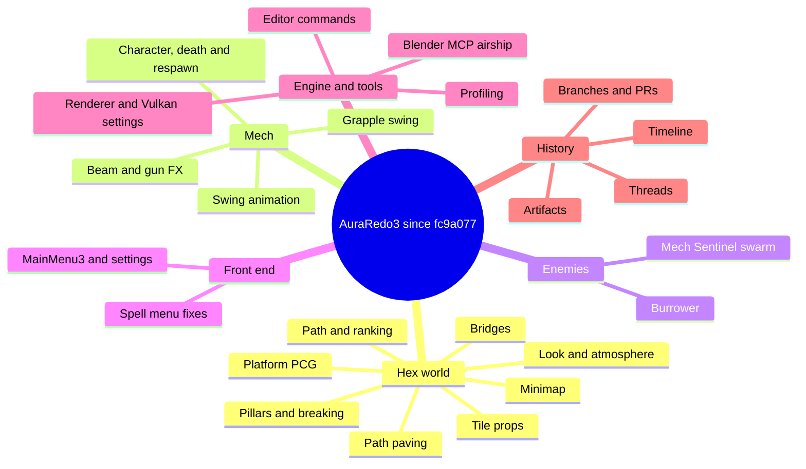
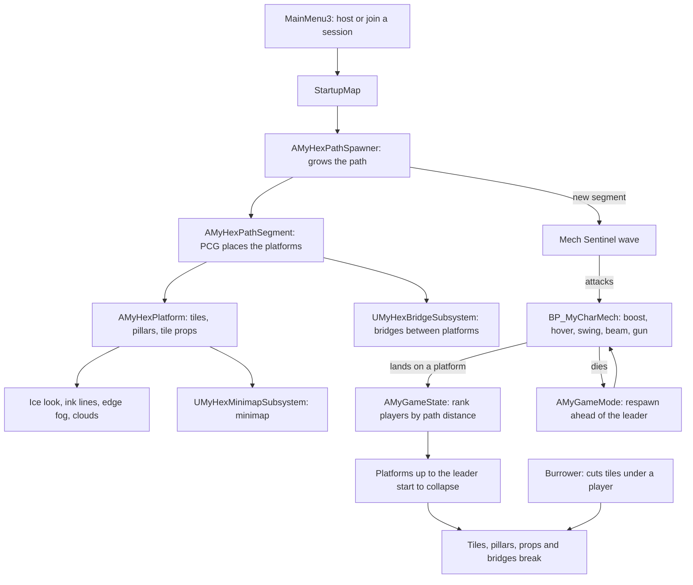

↑ [[Indexing]]

# Changes Index

AuraRedo3 · talal-jpg/AuraRedo2 · `fc9a077`..`68dd9e7` on redo3, plus the Burrower branch to `9727f1d` · 2026-10-03 to 2026-11-22 (UTC+8)

These notes cover every change made to AuraRedo3 since the commit "before start using claude." (`fc9a077`, 2026-10-03 15:46), when Talal started building the game with Claude. In seven weeks that came to 155 commits: 150 on `redo3` plus 5 on the unmerged Burrower branch, made by 54 project threads, together with 51 published artifacts and 281 files in the project's shared folder.

The game it describes: players race mechs along an endless path of floating hex platforms that grows ahead of them and collapses behind them. The platforms are built by PCG, joined by bridges, dressed with ice, rocks and snow, and break apart into Geometry Collections. The mechs boost, hover, grapple-swing and fight with a beam and a gun, while swarms of Mech Sentinels attack in waves and a Burrower cuts tiles from below. The front end, settings and pause menu were rebuilt as MainMenu3.

There is one page per system. Each has a mind map, a flow diagram of how it works at runtime, the classes, assets and settings involved, a dated list of every commit that changed it, the threads that worked on it, and what is still open. Start with [[Redo3 Timeline]] for the order things happened in, or pick a system from the mind map below. The Mech Sentinel swarm already had its own notes before this set was written, so it is linked here rather than repeated.

## Whole-project mind map

Which page covers each branch:
- **Hex world**: [[Redo3 Hex Path and Ranking]], [[Redo3 Hex Platform PCG]], [[Redo3 Hex Bridges]], [[Redo3 Path Paving]], [[Redo3 Hex Tile Props]], [[Redo3 Hex Pillars and Breaking]], [[Redo3 Hex Look and Atmosphere]], [[Redo3 Hex Minimap]]
- **Mech**: [[Redo3 Grapple Swing]], [[Redo3 Mech Swing Animation]], [[Redo3 Beam and Gun FX]], [[Redo3 Mech Character]]
- **Enemies**: [[MechSentinel Index]], [[Redo3 Burrower]]
- **Front end**: [[Redo3 Spell Menu Fixes]], [[Redo3 Menus and Settings]]
- **Engine and tools**: [[Redo3 Engine Tools and Assets]]
- **History**: [[Redo3 Timeline]], [[Redo3 Branches and PRs]], [[Redo3 Threads]], [[Redo3 Artifacts Index]]

## How the pieces connect

1. The player hosts or joins a session from MainMenu3, which loads StartupMap ([[Redo3 Menus and Settings]]).
2. On the server, `AMyHexPathSpawner` grows a spline ahead of the players. Each piece becomes an `AMyHexPathSegment` whose PCG graph places `BP_MyHexPlatform` hex platforms, and `UMyHexBridgeSubsystem` joins neighbouring platforms with bridges. One `HexRadius` scales it all ([[Redo3 Hex Path and Ranking]], [[Redo3 Hex Platform PCG]], [[Redo3 Hex Bridges]]).
3. Each platform builds its tiles and pillars, scatters rocks, ruins and ice on the tiles, and paves the bridge paths with stone ([[Redo3 Hex Tile Props]], [[Redo3 Path Paving]]). The ice look, ink outlines, snow, edge fog and clouds give it its style ([[Redo3 Hex Look and Atmosphere]]), and the minimap draws the platforms and bridges ([[Redo3 Hex Minimap]]).
4. The mechs move with boost, hover and the grapple swing, and fight with the beam and the gun ([[Redo3 Grapple Swing]], [[Redo3 Mech Swing Animation]], [[Redo3 Beam and Gun FX]], [[Redo3 Mech Character]]).
5. When a player lands on a platform, `AMyGameState` ranks everyone by how far along the path they are. Every platform up to the leader's distance starts to collapse, faster the further behind it is ([[Redo3 Hex Path and Ranking]]).
6. Collapsing tiles break into Geometry Collections near the player and into baked far-break instances further away, and the pillars, props and bridges go with them ([[Redo3 Hex Pillars and Breaking]], [[Redo3 Hex Bridges]]).
7. Each new path segment starts a Mech Sentinel wave at its corners ([[MechSentinel Path Segment Waves]]). The Burrower, on its own branch, cuts tiles from under a player ([[Redo3 Burrower]]).
8. A player who dies is respawned by `AMyGameMode` on the platform just ahead of the leader, with the respawn effect ([[Redo3 Mech Character]]).

## Pages in reading order

**History**

1. [[Redo3 Timeline]]: every commit by day since `fc9a077`, with a timeline and a chart of when each area was worked on.
2. [[Redo3 Branches and PRs]]: the 19 Claude branches, the 7 pull requests, the merges and the unmerged Burrower branch.
3. [[Redo3 Threads]]: all 54 threads, oldest first: what each was asked, what it did, its commits, artifacts and open items.

**Systems**

4. [[Redo3 Spell Menu Fixes]]: the first four commits. Spell equipping and spell points made server-authoritative, and the menu crash fixes.
5. [[Redo3 Hex Path and Ranking]]: the endless path, player ranking by path distance, when platforms collapse, and the one `HexRadius` that scales it all.
6. [[Redo3 Hex Platform PCG]]: the PCG graphs that lay out the platforms along the path, the bottom chain and the floating small top platforms.
7. [[Redo3 Hex Bridges]]: the bridge subsystem, the wooden and stone PCG bridges, and how bridges collapse.
8. [[Redo3 Path Paving]]: the stone slab paving on bridge paths and the centre plaza.
9. [[Redo3 Hex Tile Props]]: rocks, ruins, ice cliffs and the ice shard crown scattered on the tiles, and how they break.
10. [[Redo3 Hex Pillars and Breaking]]: the pillars, the pillar break subsystem, top and bottom pillar Geometry Collections and far breaks.
11. [[Redo3 Hex Look and Atmosphere]]: the ice look, ink lines, snow, glacier materials, edge fog, fog fade and clouds.
12. [[Redo3 Hex Minimap]]: the minimap baked into one wrapping texture.
13. [[Redo3 Grapple Swing]]: `GA_GrappleSwing2`, the predicted Spider-Man style swing.
14. [[Redo3 Mech Swing Animation]]: the CR_Mech swing section and the swing phase.
15. [[Redo3 Beam and Gun FX]]: beam and gun shot Niagara effects, cues, hit impacts and damage numbers.
16. [[Redo3 Mech Character]]: the mech's abilities, death, ragdoll, hard landing, jetpack and respawn.
17. [[Redo3 Menus and Settings]]: MainMenu2's graffiti style, then MainMenu3 with its options, key rebinding and pause menu.
18. [[Redo3 Burrower]]: the Burrower creature, from Blender model to rigged, PIE-tested enemy on its own branch.
19. [[Redo3 Engine Tools and Assets]]: renderer and Vulkan settings, project config, editor commands, profiling and the Blender MCP airship.

**Outputs**

20. [[Redo3 Artifacts Index]]: every artifact and shared-folder file the threads produced, in nine groups.

## The Mech Sentinel swarm

The swarm was documented in its own folder before these notes (vault commit `e5766e2`). Its pages are not repeated here:

- [[MechSentinel Index]]
	- [[MechSentinel Architecture]]
	- [[MechSentinel Frame Flow]]
	- [[MechSentinel Replication and Multiplayer]]
	- [[MechSentinel Spawning and Waves]]
	- [[MechSentinel Path Segment Waves]]
	- [[MechSentinel Setup and Debugging]]
	- [[MechSentinel Behaviour and Targeting]]
	- [[MechSentinel Movement and Avoidance]]
	- [[MechSentinel Combat and GAS]]
	- [[MechSentinel Self Buffs]]
	- [[MechSentinel Representation and Visuals]]

It came in through PRs #3, #6 and #7 ([[Redo3 Branches and PRs#Pull requests|pull requests]]) from the thread [[Redo3 Threads#Spawn scaling waves on path segments|Spawn scaling waves on path segments]]. Its 32 commits are listed day by day on [[Redo3 Timeline]].

## Start here for...

- **What happened when**: [[Redo3 Timeline]], then [[Redo3 Branches and PRs]].
- **Why something was built the way it was**: the system page's "How it changed" section, then the thread on [[Redo3 Threads]].
- **Changing the size of the path, platforms and bridges**: [[Redo3 Hex Path and Ranking#One HexRadius scales everything]].
- **Who leads and when platforms collapse**: [[Redo3 Hex Path and Ranking#Player ranking]] and [[Redo3 Hex Path and Ranking#Platform activation and collapse]].
- **The look of the platforms**: [[Redo3 Hex Look and Atmosphere]].
- **Performance of the hex world**: [[Redo3 Hex Pillars and Breaking]] and [[Redo3 Engine Tools and Assets]].
- **Swinging**: [[Redo3 Grapple Swing]], then [[Redo3 Mech Swing Animation]].
- **Respawn and death**: [[Redo3 Mech Character]].
- **Menus, options and key bindings**: [[Redo3 Menus and Settings]].
- **Enemies**: [[MechSentinel Index]] and [[Redo3 Burrower]].
- **Finding an artifact or a render**: [[Redo3 Artifacts Index]].

## The run in numbers

| | |
|---|---|
| Baseline | `fc9a077` "before start using claude.", 2026-10-03 15:46 |
| redo3 now | `68dd9e7`, PR #7 merged 2026-11-21 20:32 |
| Commits | 155: 150 on redo3 (plus 20 merge commits), 5 on the Burrower branch |
| Files changed on redo3 | 1,095 (959 added, 93 changed, 42 removed, 1 renamed) |
| C++ under `Source/` | 123 files added and 44 changed, about 46,000 lines added |
| Content files | 876 assets added or changed under `Content/` |
| Burrower branch | 66 more files, 18,633 lines, on top of `21ba7cc` |
| Branches and PRs | 19 Claude branches, 7 pull requests (6 merged, 1 closed) |
| Threads | 54 |
| Artifacts | 51 (25 in the project's Artifacts list, 26 linked from threads) |
| Shared-folder files | 281, in 21 file notes |

## Artifacts and files

[[Redo3 Artifacts Index]] lists everything the threads published or saved, sorted into nine groups. Each artifact and each set of files has its own note:

- [[Redo3 Artifacts Index]]
	- [[Redo3 Artifacts - Hex Path, Bridges and Paving]]
	- [[Redo3 Artifacts - Hex PCG and Tile Props]]
	- [[Redo3 Artifacts - Hex Performance and Breaking]]
	- [[Redo3 Artifacts - Hex Look, Fog and Ice]]
	- [[Redo3 Artifacts - Grapple Swing]]
	- [[Redo3 Artifacts - Beam, Gun and Mech FX]]
	- [[Redo3 Artifacts - Menus]]
	- [[Redo3 Artifacts - Enemies]]
	- [[Redo3 Artifacts - Models and Uploads]]

## Words used in these notes

- **The batch**: the 31 topic commits stamped 2026-11-15 14:18, which put about a month of uncommitted work from Talal's PC on GitHub. Their commit time is when they were saved to git, not when the work was done. See [[Redo3 Timeline#2026-11-15 (Sun)]].
- **Thread**: one piece of work in the Claude project, with its own conversation. See [[Redo3 Threads]].
- **Artifact**: a page a thread published on claude.ai, such as a report, a flow map or a comparison. See [[Redo3 Artifacts Index]].
- **PCG**: Unreal's Procedural Content Generation graphs, which lay out the platforms, tile props and bridges.
- **GC**: a Geometry Collection, the Chaos fracture asset that tiles, pillars, props and bridges break into.
- **ISM**: an Instanced Static Mesh component, used for tiles, pillars, far breaks and the sentinels.
- **Far break**: a baked break animation played on instances for tiles far from the player, instead of a real GC.
- **PIE**: Play In Editor, how the threads tested in the editor.
- **RVT**: a Runtime Virtual Texture, used for the edge fog.

## Related

- [[Indexing]]: the vault's main index.
- [[HexPlatform]] and [[HexPlatformISMs]]: Talal's notes on the hex platforms from before this run.
- [[SpellMenuFixWithClaude]] and [[Aura Spell Menu Flow]]: Talal's notes on the spell menu fixes.
- [[MultiplayerMenu2]]: Talal's notes on the earlier multiplayer menu.
- [[GameplayAbilitySystem]]: Talal's GAS notes.
- [[MassEntity]]: Talal's Mass Entity notes, the base of the swarm.
- [[ControlRig]]: Talal's Control Rig notes, used by the swing animation and the Burrower.

[[Redo3 Artifacts Index]] ← → [[Redo3 Timeline]]
