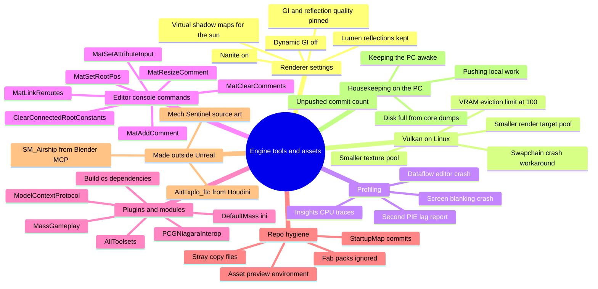
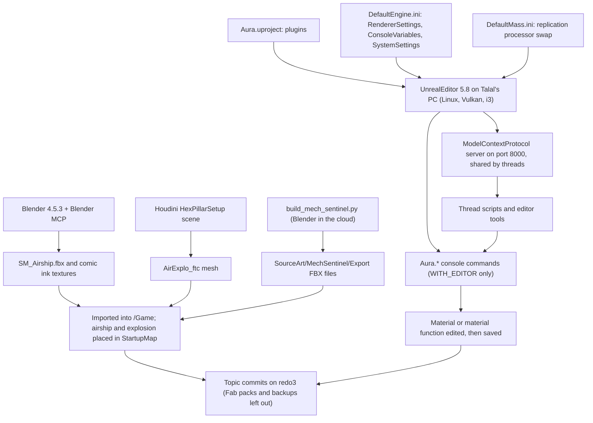
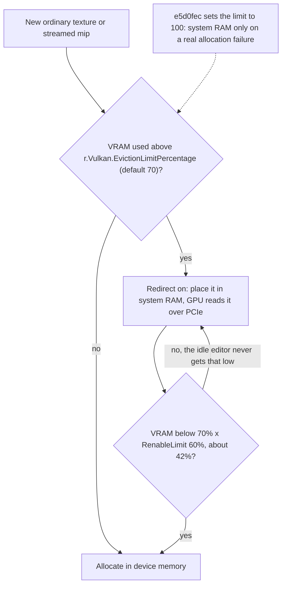

↑ [[Redo3 Changes Index]]

# Engine Tools and Assets

AuraRedo3 · redo3 · b9a224f..cd6db8b · 2026-10-10 to 2026-11-15

This page holds everything in AuraRedo3 that is not one game system: the renderer and Vulkan settings in the project config, the profiling that led to them, the editor-only console commands that scripts use to edit materials, the plugins and modules the project now needs, the repo hygiene (ignored marketplace packs, StartupMap commits, stray copy files), the assets made outside Unreal in Blender and Houdini, and the housekeeping threads that pushed Talal's local work and kept his PC awake.

Most of it came from questions Talal asked while other work was running: "where have I disabled nanite", why a second Play In Editor (PIE) session lags "even if I close and play again without restarting the editor", how many commits are not pushed, and "commit and push with proper comments all the work". The airship came from a direct ask to "set up mcp with blender on my PC" and "model a game ready asset". The editor commands were written by the beam and ink-line threads, because the UE 5.8 Python material API could not do what they needed.

State now (origin/redo3): Nanite is on, dynamic GI is off and GI and reflection quality are pinned at 1; a `[SystemSettings]` block works around a Vulkan swapchain crash and a VRAM eviction slowdown on the 8 GB GPU; seven `Aura.*` material commands are built into the editor; `AllToolsets`, `ModelContextProtocol`, `MassGameplay` and `PCGNiagaraInterop` are enabled; the two Fab packs stay out of git; and `SM_Airship`, `AirExplo_ftc` and the Mech Sentinel source art are in the repo. Six of the nine commits here are part of the 2026-11-15 14:18 batch, which holds work done on Talal's PC from about 2026-10-18 to 2026-11-15. The real work dates are given below where the threads record them.

## Mind map



## How it works



1. **Plugins.** `Aura.uproject` enables `AllToolsets` and `ModelContextProtocol` (Talal's `9c04634`, 2026-10-04). The threads that ran on Talal's PC drove the open editor through its Model Context Protocol (MCP) server. The server listened on port 8000 and was shared between threads, so restarts and PIE runs were scheduled through the coordinator. `MassGameplay` (`8dce75b`) brings the Mass modules for the Mech Sentinel swarm, and `PCGNiagaraInterop` (`cd6db8b`) is the engine's PCG and Niagara data exchange plugin.
2. **Renderer settings.** `[/Script/Engine.RendererSettings]` in `Config/DefaultEngine.ini` turns Nanite on (`r.Nanite.ProjectEnabled=True`, line 52) and dynamic GI off (`r.DynamicGlobalIlluminationMethod=0`, line 47), keeps Lumen reflections (`r.ReflectionMethod=1`) and virtual shadow maps (`r.Shadow.Virtual.Enable=1`), and sets `r.Lumen.FinalGatherMethod=0`. A `[ConsoleVariables]` section pins `sg.GlobalIlluminationQuality` and `sg.ReflectionQuality` at 1 (`82f5399`).
3. **Vulkan.** `[SystemSettings]` (lines 137 to 147) sets `r.Vulkan.KeepSwapChain=0` against the swapchain assert when i3 hides the editor window, `r.Vulkan.EvictionLimitPercentage=100` against the second-PIE slowdown, and smaller pools: `r.Streaming.PoolSize=500` and `r.RenderTargetPoolMin=100` (`e5d0fec`).
4. **Mass.** `Config/DefaultMass.ini` unregisters the engine's `MassReplicationProcessor` and registers `MechSentinelReplicationProcessor` in its place (`6d1bd6b`), because UE 5.8.2 asserts "Query not found" once a client connects.
5. **Editor commands.** Two editor-only files in `Source/Aura/Private/StaticLib/` register seven console commands with `FAutoConsoleCommand` inside `#if WITH_EDITOR`. Scripts call them by name to do what Python cannot: clear stale inline constants, add or resize comment boxes, link named reroutes, add a pin to a Set Material Attributes node and move the root node (`ce1125d`). The asset is then saved.
6. **Assets from outside Unreal.** Blender (driven through Blender MCP on Talal's PC) made `SM_Airship` and its comic ink textures (`b895169`). Talal's Houdini scene `HexPillarSetup` made `AirExplo_ftc` (`02703a2`). A Blender script run in the cloud made the Mech Sentinel meshes in `SourceArt/MechSentinel` (`d1b8b03`). The meshes were imported into `/Game`, and StartupMap places the airship and the explosion.
7. **Git.** The "Push local changes to GitHub" thread sorted Talal's working copy into topic commits. The Fab packs are in `.gitignore` (`cedd511`), and backup and test copies were left untracked.

## Renderer settings: Nanite on, dynamic GI off

`[/Script/Engine.RendererSettings]` and `[ConsoleVariables]` in `Config/DefaultEngine.ini` at origin/redo3:

| Line | Setting | Now | Before `82f5399` | Meaning |
|---|---|---|---|---|
| 46 | `r.GenerateMeshDistanceFields` | True | True | unchanged |
| 47 | `r.DynamicGlobalIlluminationMethod` | 0 (None) | 2 (Screen Space GI) | In UE 5.8: 0 None, 1 Lumen, 2 Screen Space GI (deprecated). Lumen GI was not on at any point since the baseline. |
| 48 | `r.ReflectionMethod` | 1 | 1 | Lumen reflections |
| 49 | `r.Shadow.Virtual.Enable` | 1 | 1 | With Nanite on, the sun now uses virtual shadow maps instead of cascades. With Nanite off, 5.8 also turns them off. |
| 52 | `r.Nanite.ProjectEnabled` | True | False (since `dbd916d`, 2026-07-03, before the baseline) | The project-wide Nanite switch |
| 53 | `r.Lumen.FinalGatherMethod` | 0 | not set | added with the GI change |
| 56 | `sg.GlobalIlluminationQuality` | 1 | not set | pinned in `[ConsoleVariables]` |
| 57 | `sg.ReflectionQuality` | 1 | not set | pinned in `[ConsoleVariables]` |

Lines 90 to 93 are older and unchanged: Linux targets `SF_VULKAN_SM5` and `SF_VULKAN_SM6` (the editor runs SM6, which Nanite needs) and `bGenerateNaniteFallbackMeshes=True`.

**The "Where Nanite is disabled" research (2026-10-17 to 10-18).** Talal asked "where have I disabled nanite, in my settings, tell me all the places", then where he had disabled Lumen. A read-only session on his PC searched every config file, saved override, device profile, plugin config, the `.uproject`, the Target and Build files and the user-level UE 5.8 settings. The only Nanite switch was `DefaultEngine.ini:52` `r.Nanite.ProjectEnabled=False`, present since `dbd916d` (2026-07-03, before the baseline) and confirmed in the editor log. Other lines mention Nanite without disabling it: the SM5 and SM6 targets, `bGenerateNaniteFallbackMeshes=True`, and `bBuildNanite=True` in `EditorPerProjectUserSettings.ini` (new meshes import with Nanite). Config precedence was checked too: `Saved/Config` overrides `Default*.ini`, and `ConsoleVariables.ini` and device profiles override both, but none of them set a Nanite cvar. Per-asset Nanite flags were left out of the list: earlier that day the "Overlapping Geometry Collections" thread had turned Nanite off on its 18 new tile prop GCs, which have no fallback mesh, because collapsing props looked like they vanished (see [[Redo3 Hex Tile Props]]).

For Lumen, the first answer wrongly said GI method 2 is Lumen. The thread struck it through and corrected it: in UE 5.8 (`EngineTypes.h:454`) 2 is Screen Space GI, so line 47 is what kept Lumen GI off, and the log shows the SSGI deprecation warning. The thread also noted that `r.ReflectionMethod=1` gives Lumen reflections, which are meant to be used with Lumen GI.

**When Nanite went on.** The dates come from three sources, and they do not give one clean switch-on:

- After the research, Talal turned Nanite on himself, uncommitted. The lag report dates the change to `DefaultEngine.ini` at 2026-10-22 00:21 UTC, and the worse frame times of 10-22 coincided with it.
- The LOD analysis of 10-24 describes the project with Nanite disabled.
- The ArtStation material thread switched it on for the Nanite snow displacement on the bottom pillars. [[Redo3 Hex Look and Atmosphere]] dates that to 2026-11-01.

`82f5399` commits the final state. Its message gives the reasons: Nanite for the bottom pillars' snow displacement, virtual shadow maps for the sun as a result, and GI from Screen Space (2) to None (0).

Side effects that other pages cover:

- Meshes that already had Nanite on started rendering as Nanite, and the ink lines flooded or vanished until their WorldPosition nodes were made camera-relative without offsets. See [[Redo3 Hex Look and Atmosphere]].
- The pinned `sg.*` values mean the Options menu cannot change GI or reflection quality. See [[Redo3 Menus and Settings]].

## Vulkan: the swapchain crash and the VRAM eviction slowdown

The editor runs on Linux under X11 with the i3 window manager, on an RTX 4060 with 8 GB. `e5d0fec` adds a new `[SystemSettings]` section at the end of `Config/DefaultEngine.ini`, with a comment above each workaround (one comment covers both pool settings):

| Line | Setting | Why |
|---|---|---|
| 141 | `r.Vulkan.KeepSwapChain=0` | Recreating the swapchain while the window is hidden hit `check(RecreateInfo.Surface == nullptr)` in `FVulkanViewport::RecreateSwapchain` (`VulkanViewport.cpp:351`). Destroying the old swapchain and surface, instead of passing them on to the new one, avoids that path. |
| 144 | `r.Vulkan.EvictionLimitPercentage=100` | Past 70% VRAM the Vulkan RHI puts every new texture in system RAM and only stops below 42%, so a second PIE ran 2.5 to 4x slower until an editor restart. At 100 a texture moves only on a real allocation failure. |
| 146 | `r.Streaming.PoolSize=500` | Texture streaming pool down from the 1000 MB that Epic scalability sets |
| 147 | `r.RenderTargetPoolMin=100` | Render target pool cache down from the default 400 MB |

**Swapchain crash (2026-10-18).** The "Rocks and ruins on hex tiles" thread traced editor crashes to that assert. It happened when i3 hid the editor window, for example on a workspace switch. The thread suggested `r.Vulkan.KeepSwapChain=0` in `[SystemSettings]` but did not commit it.

**Second-run lag (2026-10-22 to 10-23).** Talal asked why PIE keeps lagging after the first run. He thought the bottom bridge GCs were too heavy. The "CPU profile during play" thread logged VRAM live over several PIE runs and read the engine source:



- The idle editor uses 3.9 to 4.3 GB. PIE adds about 2.5 GB within 2 to 6 s and reaches 6.7 to 6.9 GB, against a 6,919 MB Vulkan budget for heap 0.
- Stopping PIE gives back only part of it, so the redirect stays on, and the next PIE loads its textures into system RAM. Resources already in system RAM never move back. Only an editor restart resets it.
- The engine code was verified (`VulkanMemory.cpp` lines 2980 to 3008). That the redirect caused the lag was an inference, until Talal ran `r.Vulkan.EvictionLimitPercentage 100` and confirmed it.

The evidence table from `PIE_Second_Run_Lag_2026-10-23.md`, frame time for the same content with nothing changed between runs:

| Editor session | PIE 1 | PIE 2 |
|---|---|---|
| 12.21.55 | 47 ms | 127 ms |
| 14.57.10 | 35 ms | 137 ms |
| 23.21.07 | 35 ms | 163 ms |
| 23.37.45 | 66 ms | 168 ms |
| 23.47.06 (no bridges at all) | 52 ms | 217 ms |

PIE 2 used less VRAM than PIE 1 (6.06 to 6.33 GB against 6.82 to 6.89 GB) and logged no allocation failures. That is what happens when new textures go to system RAM. The bridges were ruled out as the VRAM cause: with both bridge classes set to None, PIE 2 still ran at 217 ms. The stone bridge GCs cost frame time instead: a median 25 m bridge collapse spawns about 87 GC actors and about 8.9M non-Nanite triangles, 72% of them from the depth rocks. That is covered on [[Redo3 Hex Bridges]].

After Talal said "Yes add all the variables to the ini", the thread added the eviction and pool cvars to his `DefaultEngine.ini`, uncommitted. `e5d0fec` commits them together with the swapchain workaround.

## CPU profiling during play

Talal asked to "run cpu profiler when i Next play in editor and list the top events during gameplay taking the most computation". A session on his PC started a CPU trace through the editor's trace control port, with the channels cpu, frame, bookmark, log and region. The traces are stored in `~/UnrealEngine/UnrealTrace/Store/001/`, and the thread analysed them with headless Unreal Insights. The three reports are in the shared folder ([[Redo3 Files - Profiling Reports]]).

**Profile 1, 2026-10-20** (`PIE_CPU_Profile_2026-10-20.md`): one listen-server PIE in StartupMap, 207 s long with 3,445 frames. The game thread averaged 60.8 ms per frame (median 45.7 ms, 248 frames over 100 ms).

| Game thread cost | ms per frame | What it is |
|---|---|---|
| Waiting on Chaos physics (`TG_EndPhysics`) | 17.3 | Tracks the live debris GC count: about 160 live, none settle in their 6 s life |
| Waiting on the render thread | 6.6 | Render-bound |
| `HexPillarRbd` falling pillars | 6.4 | About 82 live, 23 kinematic bodies each |
| `FTimerManager_Tick` | 2.7 | Mostly `AMyHexPlatform` timers (tile activation) |
| `UMassEntityEditorSubsystem::Tick` | 1.7 | Editor only |
| Runtime PCG | 1.6 | Small on average, but the worst hitches (up to 466 ms from Spawn Actor batches) |

PCG Static Mesh Spawners creating collision bodies cost 2.3 s in total, and the wooden bridge cubes alone cost 1.2 s. The report ends with fixes, with file and line references. The main ones are a shorter `BrokenPropLifeSpan` with removal settings for the debris GCs, cheaper falling pillars, no collision on the bridge cubes and snow mounds, and no second `BuildHexGrid` in `OnConstruction`.

**Profile 2, 2026-10-23** (`PIE_CPU_Profile_2026-10-23.md`): 109 s with 595 frames, 184 ms per frame on average and rising to about 450 ms by the end. This run was GPU-memory bound. The render thread was stuck in Vulkan allocation (`CreatePlacedResource` 29.3 s, `vkAllocateMemory` 29.0 s on the foreground workers), and the log has 378 "Failed to allocate Device Memory" warnings. The warnings start in the 12:00 editor session on 2026-10-22. Pillar and debris costs cannot be compared with profile 1, because only 114 tiles collapsed against about 4,000. The report notes that none of the 10-20 fixes were in the code yet.

**The 07:11 crash on 2026-10-23** happened on editor shutdown, while the Dataflow editor tab for `GC_Bridge2_Span_01_W` was closing. The assert is `HostedAssetEditorToolkit.IsValid()` at `SStandaloneAssetEditorToolkitHost.cpp:330`, inside `FDataflowEditorToolkit` teardown. It is an engine bug and nothing was lost. The workaround is to close GC editor tabs before quitting.

**Interim advice from the thread:** restart the editor between test runs or use Standalone Game, close Firefox, use Scalability High, and play in a 1920x1080 window instead of the 5120x1440 viewport.

**The LOD question (2026-10-24).** The far-break thread measured a StartupMap playtest at about 64 ms GPU-bound, with 175 platforms and about 96k instances. Hiding every instanced mesh saved about 40 ms, and HLOD cannot work for runtime PCG platforms ([[Redo3 Artifact - Hex platforms - LODs vs switching instances off]]). Its optimisation pass roughly halved GPU time, from 60-68 ms to 33-36 ms (see [[Redo3 Hex Pillars and Breaking]]). The same thread found that DPMS screen blanking after 10 minutes made the graphics driver drop Unreal's GPU and crash the editor. The fix was `xset s off -dpms` while the editor runs, with the 600 s timeout restored afterwards.

## Editor console commands for scripted material edits

`ce1125d` adds two editor-only source files (all code inside `#if WITH_EDITOR`). The commands fill gaps in the UE 5.8 Python material API. A script runs a command, then saves the asset.

| Command | Arguments | What it does |
|---|---|---|
| `Aura.ClearConnectedRootConstants` | `<MaterialPath>...` | Clears `UseConstant` on every connected root input: BaseColor, Metallic, Specular, Roughness, Normal, EmissiveColor, Opacity, OpacityMask, SubsurfaceColor, AmbientOcclusion, Refraction. Then `PreEditChange`, `PostEditChange` (which recompiles) and `MarkPackageDirty`, and it logs what it cleared. |
| `Aura.MatAddComment` | `<AssetPath> <X> <Y> <SizeX> <SizeY> <RRGGBB> <Text...>` | Adds a real comment box (font size 20) |
| `Aura.MatClearComments` | `<AssetPath>...` | Removes every comment box |
| `Aura.MatResizeComment` | `<AssetPath> <X> <Y> <SizeX> <SizeY> <TextPrefix...>` | Moves and resizes the comment boxes whose text starts with the prefix, for example to grow a section box around new nodes |
| `Aura.MatLinkReroutes` | `<AssetPath>...` | Links each named reroute usage whose Desc is `reroute:<Name>` to the declaration called `<Name>`, then clears the Desc. It logs linked, declarations and missing. |
| `Aura.MatSetAttributeInput` | `<MaterialPath> <SetNodeName> <Attribute> [<Source> [<OutputIndex>]]` | Adds the pin for `<Attribute>` (an `EMaterialProperty` name without `MP_`) to a Set Material Attributes node with `CreateOrGetInputAttribute`, and can connect an expression to it by object name |
| `Aura.MatSetRootPos` | `<MaterialPath> <X> <Y>` | Moves the material's root node (`EditorX`, `EditorY`). It changes layout data only, so there is no `PostEditChange` and nothing recompiles. |

**Why each one exists** (from the file headers and the threads):

- **Stale inline constants.** The material editor stores an inline constant (`UseConstant`) on every unconnected output pin when a material is saved. If that pin is wired later from outside the material editor (MaterialEditingLibrary or the MCP tools), the constant wins over the wire. That is why `M_MasterMechDissolve` (the masked copy of `M_MasterMech` used for the mech's death) ignored its opacity mask and showed no disintegration glow. The fix came from the "Beam and gunshot Niagara effects" thread ([[Redo3 Beam and Gun FX]], [[Redo3 Mech Character]]).
- **Comment boxes.** `MaterialEditingLibrary.create_material_expression` puts a comment into the expression list instead of the comment list, and `SizeX` and `SizeY` are not exposed, so a script cannot make a real comment box.
- **Named reroutes.** `NamedRerouteUsage::Declaration` is not exposed, so a script cannot point a usage at its declaration.
- **Set Material Attributes pins.** The node only adds the pin for a new `AttributeSetTypes` entry while a material editor shows it.
- **Root node position.** `UMaterial::EditorX` and `EditorY` are plain `UPROPERTY()`s that Python cannot read or write, and the editor refuses the console SET command.

The six `Aura.Mat*` commands came from the "Fix and extend the hex ink lines" thread (2026-10-25 to 11-06), whose rules from Talal included using comment boxes and named reroutes. The four comment and reroute commands also run on material functions: a shared loader returns the expression collection of either a `UMaterial` or a `UMaterialFunction`. `MatSetAttributeInput` and `MatSetRootPos` load only a `UMaterial`. A shared finish step calls `PreEditChange`, `PostEditChange` and `MarkPackageDirty` for five of the six; `MatSetRootPos` skips it and only calls `Modify` and `MarkPackageDirty`. That thread also hit two editor crashes from Python calls: a SIGSEGV in `UMaterialEditingLibrary::GetMaterialPropertyInputNode`, and an assert on a PNG export of an EXR. Its script `pt_guard.py` blocks both calls. It lives on Talal's PC, not in the repo. A crash watchdog relaunched the editor and was paused whenever Talal used it.

## Plugins, modules and Mass config

Plugins enabled in `Aura.uproject` since the baseline:

| Plugin | Commit | Why |
|---|---|---|
| `AllToolsets` | `9c04634` (Talal, 2026-10-04) | Added together with `ModelContextProtocol` in a commit named for the beam FX and the graffiti menu |
| `ModelContextProtocol` | `9c04634` | The editor's MCP server, which the threads on Talal's PC used to drive Unreal |
| `MassGameplay` | `8dce75b` (2026-11-15 14:14) | Mass modules for the Mech Sentinel swarm ([[MechSentinel Index]]) |
| `PCGNiagaraInterop` | `cd6db8b` (2026-11-15 batch) | PCG and Niagara data exchange. No thread records a graph that uses it ([[Redo3 Hex Platform PCG]]). |

`ControlRigDynamics` was already on at the baseline. The Burrower added `ControlRigPhysics` (`a414ca9`, merged in PR #8, [[Redo3 Burrower]]).

`Source/Aura/Aura.Build.cs` dependencies added since the baseline:

| Module | Commit | For |
|---|---|---|
| `DeveloperSettings` (private) | `17605e3` (Talal, 2026-10-03) | `UMyHexBridgeSettings`, added in the same commit, and the later settings classes `UMyHexMinimapSettings` and `UMyMenuSettings` |
| `NetCore` (private) | `12423b1` (Talal, 2026-10-08) | `SerializePackedVector` in `GA_GrappleSwing2` |
| `GeometryCollectionEngine`, `Chaos` (private) | `379dc3b` (Talal, 2026-10-16) | Tile props that break into Geometry Collections |
| `Slate`, `SlateCore`, `EngineSettings` (private) | `c4b51bd` (2026-10-30) | MainMenu3 |
| `CoreOnline` (private) | `f2ddd92` (2026-10-30) | The clang build fix for MainMenu3 |
| `MassEntity`, `MassCore`, `MassCommon`, `MassSpawner`, `MassSimulation`, `MassLOD`, `MassReplication` (public) | `8dce75b` | The swarm code in `Source/Aura/*/MechSwarm` |

The Burrower added `AIModule` (private, `a414ca9`, merged in PR #8).

`Config/DefaultMass.ini` is new (`6d1bd6b`, 2026-11-15 21:30). The UE 5.8.2 `UMassReplicationProcessor` runs a query it never registered, and the Mass processing queue (`mass.UseProcessingQueue`, on by default) asserts on that as soon as a client connects. The file sets `bAutoRegisterWithProcessingPhases=False` on `/Script/MassReplication.MassReplicationProcessor` and `True` on `/Script/Aura.MechSentinelReplicationProcessor`, which does the same work with a registered query. Its comment says to remove both sections once the engine is fixed. See [[MechSentinel Replication and Multiplayer]].

## Repo hygiene: ignored packs, StartupMap and the asset preview scene

**Fab packs (`cedd511`, 2026-10-18 12:02).** The "Unpushed commits count" thread found about 4.3 GB of AncientTechCity and FrozenNorseEnvironment content in the working copy, on top of about 6 GB of LFS. The repository is public, and Fab content may not be redistributed. Talal said "just add to gitignore". The new `.gitignore` block:

```text
# Fab/marketplace packs: reimport from Fab, never pushed (public repo)
/Content/Assets/AncientTechCity/
/Content/FrozenNorseEnvironment/
```

The ice cliff and rock props use materials from these packs, so a fresh clone needs both packs reimported from Fab. Earlier, the "Overlapping Geometry Collections" thread had raised the same problem: the new props needed the FrozenNorse materials (about 556 MB), so they had to be copied into Props or the pack pushed. The separate clone the swarm thread used for PR #7 lacked both packs and showed about 323 load errors (see [[MechSentinel Index]]).

**StartupMap commits.** `Content/Maps/StartupMap.umap` is binary and is saved by almost every system. Two of its commits are on this page:

- `b9a224f` (2026-10-10 11:28) is only StartupMap. The "Hex platform and bridge minimap" thread committed it with Talal's other local work, in the 11:28 group `ab6e9c4`..`b9a224f`.
- `7a178e9` (2026-10-18 11:59) is StartupMap plus one change in `Config/DefaultEditor.ini`: `bShowEnvironment` goes from False to True in the Epic Headquarters asset preview profile, so the asset editors' preview scene shows its environment cubemap. It was one of the 8 new topic commits from the "Unpushed commits count" thread.

Later StartupMap saves belong to other pages: `32a308e` (the V2.1 ice look, fog floor and test placements of the airship and air explosion, [[Redo3 Hex Look and Atmosphere]]) and `99ab259` (one path lane for the swarm, [[MechSentinel Index]]).

**Asset preview environment (`cd6db8b`).** The 2026-11-15 batch sets `bShowEnvironment` back to False in the same profile, which undoes `7a178e9`. `DefaultEditor.ini` has no net change since the baseline. The same commit enables `PCGNiagaraInterop`.

**What stayed out of git.** The push thread left 49 backup and test copies untracked: `Content/Backups`, `_ClaudeBackups`, files named `*_Before*` and `_Verify` copies. `SourceArt/MechSentinel/.gitattributes` turns LFS off for its PNG and FBX files, which are about 5 MB in total, because the cloud session that made them could not reach the LFS server. `SourceArt/MechSentinel/.gitignore` ignores `__pycache__/` and `*.blend1`.

## Stray copy files in Source/Aura

Four copies are tracked in the source tree. Their extensions keep them out of the build:

| File | Since | Note |
|---|---|---|
| `Source/Aura/Private/AbilitySystem/Abilities/GA_GrappleSwing2 (copy).cpp.bakup` | Talal's `808d60c` (2026-10-16) | 1,730 lines, against 1,886 in the current `GA_GrappleSwing2.cpp` |
| `Source/Aura/Public/AbilitySystem/Abilities/GA_GrappleSwing2 (copy).h.backup` | `808d60c` | 817 lines, against 842 in the current header |
| `Source/Aura/Private/EOS/MultiplayerSessionsSubsystem (copy).cpp.Disabled` | before the baseline | |
| `Source/Aura/Public/EOS/MultiplayerSessionsSubsystem (copy).h.disabled` | before the baseline | |

On 10-10 the minimap thread's merge into redo3 was blocked by untracked older `GA_GrappleSwing2.cpp/.h` copies, which it moved to `~/premerge`. The tracked copies arrived later, with Talal's own commit `808d60c`.

## Assets made outside Unreal

### SM_Airship from Blender, through Blender MCP

Talal asked to "download everything needed to set up mcp with blender on my PC and set it up", then to "model a game ready asset" from Leo Li's yellow sky-pirate airship on Pinterest. He added "Don't make procedural material in blender, make textures that can be imported in unreal".

**Setup (2026-10-30):**

- Blender 4.5.3, found in OldDownloads.
- uv 0.13.6, installed into `~/.local/bin` (no sudo).
- The blender-mcp addon (now published as mcp-for-blender 2.2.6), installed and enabled after the Blender prefs were backed up.
- The MCP server registered with Claude Code at user scope with `DISABLE_TELEMETRY=true`, and later `blender` added to PATH.

The addon starts its server when Blender opens. Claude Code connects through uv to read the scene and run Python inside the open Blender.

**Modelling (10-30 to 10-31),** in `/mnt/new_partition/BlenderProjects/StylizedAirship`:

- A 12-part blockout (about 31k triangles), a critique round with three reviewers, then Talal's edits: cabin and keel removed, four lift thrusters added.
- Three hull concept sheets (A, B, C), after which Talal edited the mesh himself.
- A balloon cluster that he later removed, a rusted steampunk pass, and comic ink textures.
- A line-art shader, then a UV overlap fix: every face got its own UV space, and coverage of the 4K map fell from about 59% to 46%.
- The final comic ink line set: navy outlines heavier on the shadow side, solid black in deep gaps, tapered hatching.

Before each change the session saved a backup `.blend`.

**Export and import.** `StylizedAirship/export/` holds `SM_Airship.fbx` (69k triangles, 8 UCX collision hulls), the two comic textures and `README_Unreal.txt`. A background Unreal process imported them into `/Game/Assets/MyShip`, so Talal's open editor was not touched. The ship comes in about 52 m long with the bow along +X. `b895169` commits:

- `SM_Airship`
- `M_Airship`: lit, `T_Airship_ComicLines` in Base Color, roughness 0.9
- `T_Airship_ComicLines` and `T_Airship_ComicMask` (mask settings)

StartupMap places the ship as a test placement.

### AirExplo_ftc from Houdini

`02703a2` adds `Content/Assets/Effects/AirExplosion/AirExplo_ftc`, a Nanite static mesh of 2.57M triangles exported from Talal's `HexPillarSetup` Houdini scene. Its material `M_AirExplo` is unlit and masked, on the VFXASandbox texture `TX_Plume_Noise` (`Content/VFXASandbox/VFX/01_FireExplosion/Textures`). `PS_Fire_Explosion_Niagara` in the same pack was only recompiled and resaved. StartupMap places the explosion. No thread records this work. It came in with Talal's local changes.

### Mech Sentinel source art

`SourceArt/MechSentinel/` (from `d1b8b03`, 2026-11-15 14:27, with scripts added up to 2026-11-21) is the only `SourceArt` folder on redo3. It contains:

- `build_mech_sentinel.py` with `mech_sentinel_common.py`, `mech_sentinel_head.py` and `mech_sentinel_tentacle.py`. They build every mesh procedurally in Blender, export one FBX per asset to `Export/`, check them, save `MechSentinel.blend` and render `Previews/`.
- `Export/SM_MechSentinel_Head`, `_Far`, `_Tentacle` and `_TentacleTip` FBX files.
- `Previews/`: `hero.png`, `swarm.png`, `head_threequarter.png`, `far_lod.png`, `tentacle.png`.
- Editor scripts: `ue_import_mech_sentinel.py`, `ue_setup_mech_sentinel_demo.py`, `ue_setup_mech_sentinel_startup.py` and `ue_update_mech_sentinel_buff_visuals.py`.

The model is described on [[MechSentinel Representation and Visuals#The sentinel model]] and the scripts on [[MechSentinel Setup and Debugging]].

## Housekeeping on Talal's PC

**Unpushed commits count (2026-10-18).** "how many commits are there, that have not been pushed yet": 0, because redo3 matched origin/redo3 after a fetch, but there was about 4.8 GB of uncommitted work. Then "commit and push with proper comments all the work, break into parts if necessary". The thread put 17 commits on redo3. 9 came from an earlier thread branch and were kept as they were, and 8 were new topic commits at 11:59, ending with `7a178e9`. `cedd511` followed at 12:02. The working tree was clean at the end.

**Push local changes to GitHub (2026-11-15 to 11-21).** About 440 changed files in `/mnt/new_partition/UnrealProjects/AuraRedo3` were sorted by system.

- **Old branches first.** Three Claude branches that had never been merged locally went in first: `a22e41b` (MainMenu3, PR #2), `8874616` (tile props 3) and `69cdf95` (pillar turn).
- **Topic commits.** Then came 31 commits, all stamped 2026-11-15 14:18 +0800, from `9dd0d5d` to `32a308e`. Six of them are on this page.
- **Code comments.** It added 9 code comments and fixed one that named a function that does not exist.
- **The push.** Binary files went through Git LFS (308 objects, 288 MB). The thread pushed `claude/project-thread-weyt5l` and, after Talal agreed to the licence questions, the glacier textures as `1e23b9d`. redo3 on GitHub was then fast-forwarded to that head.

See [[Redo3 Branches and PRs]].

**Keeping the PC awake (2026-11-21).**

- **First block.** Talal asked to "block sleep until tasks done" while the swarm and Burrower threads worked. One thread started a `systemd-inhibit` block for sleep and idle, listed as "Claude (MechMania)", PID 33142. No permanent power settings were changed.
- **After the reboot.** The PC rebooted at about 11:47 UTC, which ended the block. A second thread started a new one, PID 14859, that blocks suspend, idle sleep and the lid switch. `kill 14859` releases it.
- **The screen still blanks.** It blanks after 10 minutes, which does not stop running work.

**Other fixes on the PC that the threads made or advised:**

- **Disk full (10-17 to 10-18).** The build failure Talal pasted (`ENOSPC`) was a full 98 GB root disk. Two Ubuntu apport core dumps of UnrealEditor (15.3 GB and 8.2 GB) in `/var/lib/apport/coredump` filled it. The thread gave the `sudo rm` command and `sudo systemctl disable --now apport`, plus `systemctl mask apport` and `enabled=0` in `/etc/default/apport` so that upgrades do not turn it back on. The dumps belong to root, so Talal had to delete them himself.
- **Screen blanking.** `xset s off -dpms` while the editor runs (see the profiling section).
- **Blender workspace.** An i3 rule, `assign [class="(?i)^blender"] workspace 1`, keeps Blender off the Unreal capture workspace. It was added by the ArtStation material thread, with a backup at `~/.config/i3/config.bak-before-blender-assign`.
- **Editor memory.** One editor was shared by several threads. An earlier out-of-memory kill happened at 14.6 GB, and the beam thread saw the editor at 13.6 to 14.6 GB with PC freezes on 10-22. The rule after that was small batches with saves, and a restart before every capture.
- **Unreal lock.** On 11-21 the swarm and Burrower threads shared Unreal through a lock directory, `/mnt/new_partition/UnrealProjects/.ue_lock`.

## How it changed

- **2026-10-04** (context): Talal's `9c04634` enables `AllToolsets` and `ModelContextProtocol`, the editor MCP server that later threads use.
- **2026-10-10 11:28** `b9a224f`: Update StartupMap. The minimap thread committed it with Talal's other local work.
- **2026-10-13 to 11-01**: the "Beam and gunshot Niagara effects" thread writes `Aura.ClearConnectedRootConstants` for `M_MasterMechDissolve` on Talal's PC (uncommitted; the exact day is not recorded).
- **2026-10-17 to 10-18**: the "Where Nanite is disabled" research. Nanite was off at `DefaultEngine.ini:52`, and Lumen GI was off at line 47 (method 2 is SSGI, after a wrong first answer that was struck through). The `ENOSPC` build failure was a disk full of apport core dumps. No project files were changed.
- **2026-10-18**: the "Rocks and ruins on hex tiles" thread explains the Vulkan swapchain assert and suggests `r.Vulkan.KeepSwapChain=0` (uncommitted).
- **2026-10-18 11:59** `7a178e9`: Update StartupMap, and show the environment in the asset preview scene (`bShowEnvironment=True`).
- **2026-10-18 12:02** `cedd511`: ignore the AncientTechCity and FrozenNorseEnvironment packs (4.3 GB of Fab content in a public repo).
- **2026-10-20**: first CPU profile, 60.8 ms per frame, physics and debris bound.
- **2026-10-22**: Talal's uncommitted switch to Nanite on. Vulkan allocation failures start in the 12:00 editor session.
- **2026-10-23**: second CPU profile, 184 ms per frame and GPU-memory bound. The second-run lag report explains the VRAM eviction redirect, and Talal confirms it with `r.Vulkan.EvictionLimitPercentage 100`. The 07:11 crash is the Dataflow editor teardown assert. The eviction and pool cvars go into his `DefaultEngine.ini` (uncommitted).
- **2026-10-24 to 10-25**: the LOD analysis (Nanite off at that point) and the optimisation pass, with GPU time roughly halved. The DPMS crash is found and avoided with `xset`.
- **2026-10-25 to 11-06**: the "Fix and extend the hex ink lines" thread writes the six `Aura.Mat*` commands and uses them on its materials (uncommitted).
- **2026-10-30 to 10-31**: Blender MCP is set up and the airship is modelled, then imported into `/Game/Assets/MyShip` on 10-31 (uncommitted).
- **About 2026-11-01**: Nanite on for the bottom pillar snow displacement (dated on [[Redo3 Hex Look and Atmosphere]]).
- **2026-11-15 14:14** `8dce75b` (swarm, context): `MassGameplay` and the public Mass modules.
- **2026-11-15 14:18**, the batch of Talal's local work from about 10-18 to 11-15:
  - `e5d0fec`: the Vulkan `[SystemSettings]`. The swapchain workaround was suggested on 10-18 and the eviction and pool cvars were added on 10-23.
  - `ce1125d`: `AuraMaterialFixCommand.cpp` and `AuraMaterialGraphCommands.cpp`, from the beam and ink-line threads.
  - `02703a2`: `AirExplo_ftc` and `M_AirExplo` from Houdini, with `PS_Fire_Explosion_Niagara` resaved.
  - `b895169`: `SM_Airship`, `M_Airship` and the two comic textures, from the 10-30 to 10-31 airship work.
  - `82f5399`: Nanite on, GI method 2 to 0, `r.Lumen.FinalGatherMethod=0`, and `sg.GlobalIlluminationQuality` and `sg.ReflectionQuality` pinned at 1.
  - `cd6db8b`: `PCGNiagaraInterop` enabled, and `bShowEnvironment` back to False, undoing `7a178e9`.
- **2026-11-15 14:27** `d1b8b03` (swarm, context): the Mech Sentinel source art in `SourceArt/MechSentinel`.
- **2026-11-15 15:09** `1e23b9d` (context): the glacier textures, the push thread's last commit. redo3 on GitHub is fast-forwarded to it.
- **2026-11-15 21:30** `6d1bd6b` (swarm, context): `Config/DefaultMass.ini`.
- **2026-11-21**: the sleep blocks, PID 33142 and then PID 14859 after the reboot.

## Threads that worked on it

- [[Redo3 Threads#Where Nanite is disabled|Where Nanite is disabled]]: found the only Nanite and GI switches, corrected its Lumen answer, and traced the full disk to apport dumps.
- [[Redo3 Threads#Rocks and ruins on hex tiles|Rocks and ruins on hex tiles]]: explained the Vulkan swapchain assert and suggested `r.Vulkan.KeepSwapChain=0`.
- [[Redo3 Threads#CPU profile during play|CPU profile during play]]: the two Insights profiles, the second-run lag report, the 07:11 crash, and the eviction and pool cvars.
- [[Redo3 Threads#Add far-break ISMs for distant tiles|Add far-break ISMs for distant tiles]]: the LOD analysis, the optimisation pass and the DPMS crash fix.
- [[Redo3 Threads#Beam and gunshot Niagara effects|Beam and gunshot Niagara effects]]: `Aura.ClearConnectedRootConstants`, written for `M_MasterMechDissolve`.
- [[Redo3 Threads#Fix and extend the hex ink lines|Fix and extend the hex ink lines]]: the six `Aura.Mat*` commands, and `pt_guard.py` against two crashing Python calls.
- [[Redo3 Threads#Build material from ArtStation reference|Build material from ArtStation reference]]: turned Nanite on for the snow displacement, and added the i3 rule for Blender.
- [[Redo3 Threads#Overlapping Geometry Collections|Overlapping Geometry Collections]]: raised the FrozenNorse materials problem and worked in the shared MCP editor.
- [[Redo3 Threads#Set up Blender MCP and model airship|Set up Blender MCP and model airship]]: Blender MCP setup and `SM_Airship`.
- [[Redo3 Threads#Unpushed commits count|Unpushed commits count]]: the 10-18 commit round, with `7a178e9` and `cedd511`.
- [[Redo3 Threads#Push local changes to GitHub|Push local changes to GitHub]]: the 2026-11-15 batch, which holds six of this page's commits.
- [[Redo3 Threads#Hex platform and bridge minimap|Hex platform and bridge minimap]]: committed `b9a224f` with Talal's local work on 10-10.
- [[Redo3 Threads#Keep PC awake until tasks finish (1st)|Keep PC awake until tasks finish (1st)]] and [[Redo3 Threads#Keep PC awake until tasks finish (2nd)|Keep PC awake until tasks finish (2nd)]]: the two `systemd-inhibit` blocks.
- [[Redo3 Threads#Spawn scaling waves on path segments|Spawn scaling waves on path segments]]: `MassGameplay`, the Mass modules, `DefaultMass.ini` and the Mech Sentinel source art.

## Artifacts and files

- [[Redo3 Artifact - Hex platforms - LODs vs switching instances off]]: the 10-24 analysis of LODs, draw distances and HLOD for the instanced platforms, with the playtest numbers. It records the state with Nanite off.
- [[Redo3 Files - Profiling Reports]]: the two CPU profiles (10-20 and 10-23) and the second-run lag report, with engine source lines.
- [[Redo3 Files - Airship]]: 44 files from the airship work: blockouts, hull sheets, comic ink passes, UV layouts and comparisons with the concept.
- [[Redo3 Files - Mech Sentinel]]: the three preview renders of the sentinel from Blender.

![[redo3_comicfinal_ref.jpg]]
*The first comic ink texture pass on the airship, at the concept angle (`comicfinal_ref.png`)*

![[redo3_compare_sides.jpg]]
*Airship side views against the Leo Li concept (`compare_sides.png`)*

![[redo3_hero.jpg]]
*Mech Sentinel hero render from `build_mech_sentinel.py` (`hero.png`)*

## Where it lives

| What | Where |
|---|---|
| Renderer settings | `Config/DefaultEngine.ini` `[/Script/Engine.RendererSettings]`, lines 45 to 53 |
| Pinned quality | `Config/DefaultEngine.ini` `[ConsoleVariables]`, lines 55 to 57 |
| Vulkan targets, Nanite fallbacks | `Config/DefaultEngine.ini`, lines 90 to 93 |
| Vulkan workarounds and pools | `Config/DefaultEngine.ini` `[SystemSettings]`, lines 137 to 147 |
| Asset preview profile | `Config/DefaultEditor.ini` (Epic Headquarters, `bShowEnvironment`) |
| Mass processor swap | `Config/DefaultMass.ini` |
| Plugins | `Aura.uproject` |
| Module dependencies | `Source/Aura/Aura.Build.cs` |
| Material fix command | `Source/Aura/Private/StaticLib/AuraMaterialFixCommand.cpp` |
| Material graph commands | `Source/Aura/Private/StaticLib/AuraMaterialGraphCommands.cpp` |
| Ignored packs | `.gitignore` (`/Content/Assets/AncientTechCity/`, `/Content/FrozenNorseEnvironment/`) |
| Startup level | `Content/Maps/StartupMap.umap` |
| Airship | `Content/Assets/MyShip/` (`SM_Airship`, `M_Airship`, `T_Airship_ComicLines`, `T_Airship_ComicMask`) |
| Air explosion | `Content/Assets/Effects/AirExplosion/` (`AirExplo_ftc`, `M_AirExplo`), `Content/VFXASandbox/VFX/01_FireExplosion/PS_Fire_Explosion_Niagara` |
| Mech Sentinel source art | `SourceArt/MechSentinel/` |
| Stray copies | `Source/Aura/Private/AbilitySystem/Abilities/`, `Source/Aura/Public/AbilitySystem/Abilities/`, `Source/Aura/Private/EOS/`, `Source/Aura/Public/EOS/` |
| Profiling reports | the project's shared folder, not the repo ([[Redo3 Files - Profiling Reports]]) |
| Insights traces | Talal's PC, `~/UnrealEngine/UnrealTrace/Store/001/` |
| Airship sources | Talal's PC, `/mnt/new_partition/BlenderProjects/StylizedAirship/` (and `export/`) |

## Open items

- A fresh clone must reimport AncientTechCity and FrozenNorseEnvironment from Fab, or the ice cliff and rock props lose their materials.
- `sg.GlobalIlluminationQuality` and `sg.ReflectionQuality` are pinned at 1 in `[ConsoleVariables]`, so the Options menu cannot change GI or reflection quality.
- Lumen reflections stay on (`r.ReflectionMethod=1`) while dynamic GI is None. The Nanite thread noted that Lumen reflections are meant for use with Lumen GI, and no thread revisited it.
- The 10-23 report says none of the 10-20 fixes were in the code then. The 10-24 optimisation pass took up part of them; see [[Redo3 Hex Pillars and Breaking]] for what shipped.
- With the eviction limit at 100, expect more "Failed to allocate" warnings when VRAM is full. The report also listed fixes that are not in the config: Scalability High in the editor, `r.Shadow.Virtual.MaxPhysicalPages=2048`, `r.TSR.History.ScreenPercentage=100` and `r.Streaming.DropMips=2`.
- The Dataflow editor teardown assert is an engine bug: close GC editor tabs before quitting the editor.
- The four `(copy)` source files are still tracked.
- `Saved/tmpcheck.txt`, a scratch file from the Nanite research, was left on Talal's PC for him to delete.
- `PCGNiagaraInterop` is enabled, but no thread records a graph that uses it.
- The two `DefaultMass.ini` sections should go once the engine's Mass replication processor is fixed.
- Airship: the silhouette outlines need an outline post-process in Unreal, the comic lines get ragged up close (about 39 pixels per metre), and only about 46% of the 4K texture is used.
- The comment boxes and named reroutes in `M_HexGroundFog` and `M_Mist_HexFog` still need tidying with `Aura.MatResizeComment` and `Aura.MatLinkReroutes`.
- The sleep block PID 14859 stays until someone runs `kill 14859`.

## Related

- [[Redo3 Hex Look and Atmosphere]]: the ice look that depends on these renderer settings, and the ink lines under Nanite.
- [[Redo3 Hex Pillars and Breaking]]: the snow displacement that needed Nanite, and the optimisation pass after the profiles.
- [[Redo3 Hex Bridges]]: the stone bridge GCs and their frame time cost.
- [[Redo3 Hex Tile Props]]: the props that use the ignored Fab packs, and the GCs that had Nanite turned off.
- [[Redo3 Hex Platform PCG]]: `PCGNiagaraInterop`.
- [[Redo3 Menus and Settings]]: why the Options menu cannot change GI and reflection quality.
- [[Redo3 Beam and Gun FX]] and [[Redo3 Mech Character]]: `M_MasterMechDissolve` and the death FX that needed `Aura.ClearConnectedRootConstants`.
- [[Redo3 Burrower]]: the other tool-heavy page, with its editor scripts, the separate clone and the shared Unreal lock.
- [[MechSentinel Representation and Visuals]], [[MechSentinel Setup and Debugging]] and [[MechSentinel Replication and Multiplayer]]: the swarm side of the source art, scripts and `DefaultMass.ini`.
- [[Redo3 Timeline]], [[Redo3 Branches and PRs]], [[Redo3 Threads]] and [[Redo3 Artifacts Index]].
- Talal's notes: [[houdiniBase]] (Houdini, where `AirExplo_ftc` came from), [[MassEntity]] and [[MyMassEntityTest]] (the Mass plugin and the swarm prompts), [[TODOs6]] (swarm to-dos), [[GitLearning]] (git commands), [[Rider]] and [[HlslInRider]] (IDE setup).

[[Redo3 Burrower]] ← → [[Redo3 Artifacts Index]]
