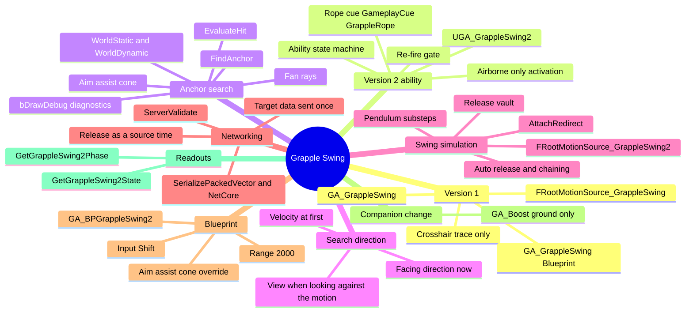
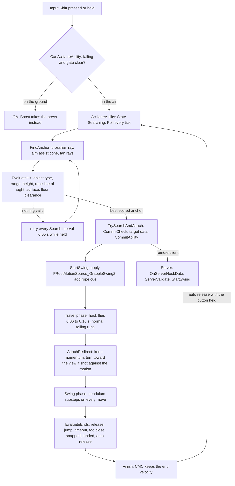
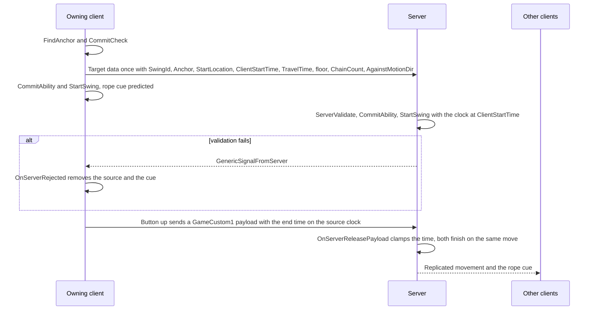

↑ [[Redo3 Changes Index]]

# Grapple Swing

AuraRedo3 · redo3 · 157aa06..d334e10 · 2026-10-07 to 2026-11-15

A Spider-Man style grapple swing for the mech, written as a Gameplay Ability. In the air, the player presses Shift: the ability finds an anchor above and ahead, fires a short hook flight and swings the mech on a rope that keeps its momentum. Letting go gives a vault that depends on where in the arc the player releases, and holding the button lets go at the end of each arc and fires the next web near the top. Talal's ask on 2026-10-07: "make a GameplayAbility similar to spiderman swing, momentum when shooting the grapling hook should be taken into account and swing should be able t control with movement input(not entirely). Largely should be controlled by the dir of the grappling hook pulling character towards itself and centrifugal force being applied. Keep all the logic for the ability inside the gameplayAbility. and account for multiplayer replication."

There are two versions. `GA_GrappleSwing` (v1) was built first and is kept untouched. Talal then asked to "make it better than it already feels, leave this one as it is, make a GA_GrappleSwing2", and `UGA_GrappleSwing2` is the one the mech uses. It is Local Predicted: the swing runs inside the CharacterMovementComponent as a custom root motion source, so it is predicted, replayed and checked by the server like normal movement. The detailed reference is `Docs/GA_GrappleSwing2.md` in the repo (mind map, state machine, flows, full tuning list), also published as [[Redo3 Artifact - GA_GrappleSwing2]] and [[Redo3 Artifact - GA_GrappleSwing2 Map]]. This page summarises it and adds what changed after it was written.

State now (origin/redo3): shipped and in use through the Blueprint child `GA_BPGrappleSwing2` on `Input.Shift`. It only starts while falling, and `GA_Boost` only starts on the ground, so one Shift press starts only one of them. Since `8743374` (2026-10-18) `FindAnchor` uses the mech's facing direction in place of its velocity. In the code that makes the fan of search rays always follow the camera and switches off two velocity-based parts of the search, which the docs still describe the old way (see [[#Search direction]]). The Blueprint now overrides the grapple range to 2000 and the aim assist cone to 339.5 degrees. The swing was never reported as play-tested in a real client and server session. How the mech is animated while swinging is on [[Redo3 Mech Swing Animation]].

## Mind map

## How it works

1. `UGA_GrappleSwing2::CanActivateAbility` refuses while `bBlockUntilRelease` is set (the re-fire gate) and, on the locally controlled machine only, while the `UCharacterMovementComponent` is missing or not `IsFalling()`. Hovering with `GA_JumpHover` is `MOVE_Flying`, so it does not count as falling. The server does not check, because it can still be one move behind the client's jump.
2. `ActivateAbility` copies the `Swing` tuning into a shared read-only `SharedTuning` on the first activation, sets `State = Searching` and starts `Poll` on the next tick. On the server for a remote client it only binds the target data and `GameCustom1` release delegates and waits.
3. On the owning client `TrySearchAndAttach` calls `FindAnchor`. If nothing is found and `bSearchWhileHeld` is true (default), it retries every `SearchInterval` (0.05 s).
4. `FindAnchor` casts a crosshair ray, two rings of `AssistRaysPerRing` (6) aim assist rays and a fan of 3 yaws x 3 elevations on `GrappleTraceChannel` (Visibility), up to `MaxGrappleDistance` (C++ 4000, Blueprint 2000). `EvaluateHit` rejects and scores each hit, and the crosshair hit wins if it is within `CrosshairStickiness` (0.15) of the best score.
5. With an anchor, `CommitCheck` (cost and cooldown), then one `FGameplayAbilityTargetData_GrappleSwing2` goes to the server inside a scoped prediction window, `CommitAbility` runs predicted, and `StartSwing` applies the root motion source and adds the looping `GameplayCue.GrappleRope` cue.
6. The source starts in the Travel phase and outputs nothing while the hook flies (`TravelTime` = distance / `HookSpeed` 15000, clamped to 0.06 to 0.16 s). On the attach move `AttachRedirect` reads the CMC velocity once and turns it into the start of the arc.
7. In the Swing phase the source owns the velocity: gravity (x2 falling, x1.3 rising), drag, input pump, brake and steer, a rope that only pulls, reel-in through the bottom of the arc. `EvaluateEnds` checks once per move whether the swing is over.
8. `Finish` outputs the end velocity on the last move, and the CMC removes the source with `MaintainLastRootMotionVelocity`, so the mech carries that speed into normal falling. After an auto release with Shift still held, the ability ends and the held button fires the next web.

### Client and server

- Both machines build the source only from the target data plus the shared tuning, so the tuning is never sent.
- The release is not "stop now" but "stop at source time T". The server clamps T between its own source time and `MaxReleaseLead` (1 s) after it and ignores a payload for another `SwingId`.
- Simulated proxies do not run the swing simulation; they see replicated movement and the cue. For animation they get the swing phase from the server through `ReplicatedSwingPhase` ([[Redo3 Mech Swing Animation#Other players' swings]]).

## Version 1: GA_GrappleSwing

`UGA_GrappleSwing` (`157aa06`) is the first, simpler swing, kept as it was when v2 was written.

- **Hook.** `TraceForAnchor` traces once from the camera along the crosshair, starting level with the character, up to `MaxGrappleDistance` 4000. `MinAnchorHeight` is 0. No aim assist.
- **Swing.** `FRootMotionSource_GrappleSwing`, an Override source with priority 500 and infinite duration. Each move it starts from the CMC's current velocity, adds gravity, a `PullAcceleration` (900) toward the hook that fades near `MinRopeLength` (300), steering from input across the rope (`SteerAcceleration` 1200) and `AirDrag` 0.05, reels in at `ReelInSpeed` 150, cancels outward velocity when taut and pulls stretch back with `RopeStiffness` 8, capped at `MaxSwingSpeed` 3500.
- **End.** `UAbilityTask_WaitInputRelease`: on release it removes the source and calls `LaunchCharacter` with `ReleaseUpBoost` 350 up. Landing after `LandingGraceTime` (0.3 s) ends it through `MovementModeChangedDelegate`.
- **Network.** The client sends a `FGameplayAbilityTargetData_LocationInfo` with start and hook point; the server accepts it within 250 cm of its own location and 300 cm beyond the range. The source's parameters are net serialized.
- Tags: `Ability.GrappleSwing` and the same cue string `GameplayCue.GrappleRope`. v2 defines its tags under different C++ symbols so both .cpp files can share a unity build.
- `b95b254` (Talal, same evening) put the identical v1 source on redo3 together with a `GA_GrappleSwing` Blueprint and a `BP_MyCharMech` change.

| | v1 `GA_GrappleSwing` | v2 `GA_GrappleSwing2` |
|---|---|---|
| Hook | One crosshair trace | Crosshair, aim assist cone and fan, scored |
| Hook flight | None, attaches at once | Travel phase of 0.06 to 0.16 s |
| Rope | Always pulls, plus a stiffness spring | Only pulls when taut, can go slack and catch |
| Gravity | CMC gravity | x2 descending, x1.3 ascending |
| Release | Upward launch of 350 | Vault by arc position, auto release and chaining |
| Release timing | Each machine on its own input event | One end time on the source clock, same move on both |
| Activation | Any time | Only while falling |

## The v2 pieces

| Type | What it is | Where it runs |
|---|---|---|
| `UGA_GrappleSwing2` | The ability: input, anchor search, network messages, starting and ending the swing, the rope cue. `InstancedPerActor`, `LocalPredicted`, `AbilityTag` `Ability.GrappleSwing2` | Owning client and server |
| `FRootMotionSource_GrappleSwing2` | The swing simulation, run by the CMC each move. Phases `Travel`, `Swing`, `Done` | Inside the CMC on owning client and server |
| `FGameplayAbilityTargetData_GrappleSwing2` | Everything both machines build the swing from, sent once per swing | Client to server |
| `FGrappleSwing2Tuning` | Every number the simulation reads (the `Swing` property, category Grapple, Swing) | Both |
| `EGS2AbilityState` | `Idle`, `Searching`, `Hooked`, `Releasing`, `Spent`, `Rejected` | Ability |
| `EGS2EndReason` | `Released`, `Forced`, `JumpReleased`, `AutoReleased`, `Landed`, `Timeout`, `TooClose`, `Snapped` | Source |

`Spent` and `Rejected` keep the ability alive with no rope, so a held button does not re-fire every frame after a landing, a jump release or a failed commit. The state machine and the per-reason follow-up are drawn in `Docs/GA_GrappleSwing2.md` sections 3 and 4.5.

## Activation: in the air only

`725b68c` (2026-10-09) added the `IsFalling()` check to `CanActivateAbility`, after Talal asked for the swing to work only in the air and not while flying. Because a held input retries activation every frame, holding Shift on the ground and then jumping fires the grapple as soon as the mech leaves the ground.

### GA_Boost on the ground only

`GA_Boost` uses the same `Input.Shift` and could start mid-air. Talal added the opposite check to `UGA_Boost::CanActivateAbility` himself and asked the thread to check it ("ive added myself, just check if good to go"). His first version put the check after the `return`, and it then needed `#include "GameFramework/CharacterMovementComponent.h"`. It shipped as `ab6e9c4` (2026-10-10): on the locally controlled machine Boost refuses when the movement component is missing or `IsFalling()`. So on the ground Shift boosts, in the air it grapples.

## Anchor search

`FindAnchor` (owning client) builds a `FGS2SearchCtx`: the view point from the PlayerController, the character position, up (minus the gravity direction), the capsule half height, and a predicted attach point `AttachPos` where the character will be when the hook arrives (a travel guess of `IdealRopeLength / HookSpeed` = 1300 / 15000, about 0.087 s).

| Ray set | From | Directions |
|---|---|---|
| Crosshair | the view line, level with the character | the view direction |
| Aim assist cone | the same start | two rings at half and full `AimAssistConeDeg` (C++ 14) around the view, pitched up by `AimAssistUpBiasDeg` 6, `AssistRaysPerRing` 6 each |
| Fan | `AttachPos` | yaws of minus 25, 0 and plus 25 degrees (`SwingFanYawDeg`) around the horizontal search direction `MoveDirH`, at elevations 35, 50 and 65 degrees (`SwingFanElevationsDeg`) |

`EvaluateHit` rejects a hit when:

- the hit component's object type is not in `Swing.RopeObjectTypes` (default WorldStatic and WorldDynamic), or it is a Pawn;
- the anchor (hit point pushed out 8 cm, `AnchorSurfaceOffset`) is closer than `MinRopeLength + 100` (500) or further than `MaxGrappleDistance` from `AttachPos`;
- it is less than `MinAnchorHeight` (250) above `AttachPos`;
- the rope line from the capsule to the anchor is blocked;
- there is no simple collision under the anchor along its normal (the same check the server makes, added to the client in `9d4ae99`);
- the floor under the anchor is too close: the anchor must be at least `MinRopeLength + HalfHeight + GroundClearance` above it (400 + 88 + 120 = 608 cm).

Survivors are scored on aim, height (ideal 900, fading out above 2200), how far ahead along `MoveDirH` they are, elevation near 50 degrees, rope length near 1300 and underside surfaces, plus `CrosshairBonus` 0.5 for the crosshair hit. The weights and every default are in the doc's tuning reference.

### WorldDynamic and the hex platforms

The first v2 build hooked nothing ("nothing happens on activate"). The hex platforms keep the default `BlockAllDynamic` collision profile, so they are WorldDynamic, and `RopeObjectTypes` only held WorldStatic. `0a09127` added `ECC_WorldDynamic` to the default. The header warns about the cost: every in-swing rope trace runs on both machines on every move, so anything on those object types that moves can make client and server disagree and cause corrections. A collapsing tile under the anchor is not detected: the anchor is a fixed world point, so the rope stays attached to the empty spot until the swing ends another way (see [[Redo3 Hex Path and Ranking]] for when platforms collapse).

### Diagnostics behind bDrawDebug

`3c35d35` added search diagnostics for that bug. With `bDrawDebug` on (category Grapple, Visuals):

- search rays are drawn green (valid anchor), red (rejected hit) or grey (no hit);
- the first full search of each activation prints every reject reason with its numbers through `GS2DebugMessage`, to the screen (orange, 5 s) and to the log category `LogGrappleSwing2` as warnings; while an auto-chain waits for the apex the message repeats;
- an anchor that failed `CommitCheck` (cost or cooldown) says so on every retry;
- while swinging, the rope line (white taut, yellow slack), the anchor sphere, rope length and speed.

`p.RootMotion.Debug 1` also shows the source through `FRootMotionSource_GrappleSwing2::ToSimpleString`.

## Search direction

The fan rays and the "ahead" score follow `Ctx.MoveDirH`, a horizontal direction. Which direction that is changed four times:

| Commit | Rule | Why |
|---|---|---|
| `09decfd` | Velocity when faster than 400 cm/s, otherwise the camera's horizontal direction | Original design |
| `2dedc85` | Always the camera direction, velocity only when looking straight up or down | Talal: "when you look in a certain direction while the velocity is in the opposite direction the next web goes in the direction of the velocity ... I want the web to go in the direction the character is looking in" |
| `dfeab8d` | Velocity when faster than 400 cm/s and not against the view, otherwise the camera direction | Part of the narrower fix below: search along the view only when looking more than 90 degrees away from the motion |
| `8743374` | `V` is now `Character->GetActorForwardVector()` instead of `MoveComp->Velocity` | "so a grapple from standing still or a sideways drift still aims where the mech faces" |

What `8743374` does in the code as it stands, read from `FindAnchor` (the commit message only states the intent):

- `V` is a unit vector, so `VH.Size() > 400` can never pass and `MoveDirH` is always the camera's horizontal direction, with the actor forward vector only as the fallback when looking straight up or down.
- `AttachPos = Pos + V x TravelGuess - Up x 0.5 x G x TravelGuess^2` no longer leads the character by its speed; it is the current position less a few centimetres of gravity drop.
- The auto-chain apex wait `(V | Up) > ChainAttachMaxRiseSpeed` (250) can no longer trigger, so a held, auto-chained web no longer waits for the top of the rise.
- `TrySearchAndAttach` still uses the real velocity to decide `AgainstMotionDir`, so the look-against-the-motion attach below is unchanged.

`Docs/GA_GrappleSwing2.md` and both artifacts were written before this commit and still describe the velocity-based search.

### Path direction lines (offered, not in the code)

On 2026-10-15 Talal pasted `FindAnchor` into the "Count PCG spline sample points" thread and asked for the path spline's direction at the player, as code lines in chat only. The lines read `UMyHexBridgeSubsystem::GetPathSpline()`, `FindInputKeyClosestToWorldLocation` and `GetDirectionAtDistanceAlongSpline`, flattened against `Ctx.Up`, and set `Ctx.MoveDirH` from it. The catch the thread gave: the path spline only exists on the server (`AMyHexPathSpawner::BeginPlay` returns early on clients), while `FindAnchor` runs on the owning client, so it would only work for the host and in standalone. `FindAnchor` on redo3 has no path spline code; three days later `8743374` changed the search to the facing direction instead. See [[Redo3 Hex Platform PCG#Spline sampling answers]].

## Look-direction attach

Talal's 2026-10-10 ask ("keep everything the same only add this") was that a web shot while looking against the motion should go where the mech looks. `2dedc85` only changed the search, which the thread found to be half a fix: the attach still kept the old momentum, so the swing carried on the old way. The thread put a decision card to Talal, who chose "Fix, narrow search". After five versions and review rounds (an attach-maths simulation, a code and multiplayer review, and a whole-simulation "your ask" check) it shipped as `079e1cc` and `dfeab8d`:

- When the horizontal view points more than 90 degrees away from the horizontal velocity, `TrySearchAndAttach` puts that view direction in the target data as `AgainstMotionDir`. Both machines flatten and normalise it.
- In `AttachRedirect`, the web stops the speed heading away from the view (fully above `AgainstMotionFullStopSpeed` 1000 cm/s, a slow drift only partly).
- A taut start turns `AgainstMotionSpeedScale` (0.4) of that speed along the view, keeps the old start's speed when the old start already went that way, and never goes below `AttachMinSwingSpeed` (900).
- Rising at the anchor with the arc still starting clearly away from the view, the rope starts slack and catches on the way.
- The start is never faster than it would have been without the turn, so the turn cannot be used to gain speed.

In the thread's simulation, held webs fired against the motion that ended up behind the player dropped from 69% to 6%. Weak spots it listed: a short press while rising fast backward at a low hook pulls less than a plain attach, and a tap during a slow backward drift keeps some drift. The turned attach was only checked in simulation.

## The swing simulation

`FRootMotionSource_GrappleSwing2::PrepareRootMotion` runs once per move:

- **Travel**: outputs nothing until `TravelTime`, so normal falling runs. If the ability ended before the hook arrived (cancel, death), the source finishes as `Forced` without attaching and leaves the velocity alone. A tap still asks for the end at `TravelTime + MinSwingTimeAfterAttach` at the earliest, so it gets a short swing.
- **Attach**: switches to `Override`, sets the rope length to the distance (at least `MinRopeLength` 400), keeps the tangential speed plus part of the radial energy (`AttachOutwardRetention` 0.85, `AttachInwardRetention` 0.7), aimed partly toward the anchor (`AttachAimBias` 0.25). Flying up at the anchor faster than `AttachSlackInwardSpeed` (700) starts the rope slack. Chained swings get +5% per stack (`ChainSpeedBonus`), up to `MaxChainStacks` 3. It also stores `AttachArcAngle` for the swing phase.
- **Swing**: substeps of at most 1/120 s (`MaxSubstepDt`, up to `MaxSubsteps` 16). Each one reels in through the bottom of the arc and pays out near the top, applies gravity, linear and quadratic drag (soft cap 3000, hard cap 5000 cm/s), input pump (forward) and brake (back), rotates the swing plane with sideways input, cancels outward velocity while taut, and handles slack and catch (`CatchEnergyRetention` 0.55). A ground probe shortens the rope to clear the ground.
- **Ends** (`EvaluateEnds`, in this order): `Released`/`Forced` (end time reached), `JumpReleased`, `Timeout` (`MaxSwingDuration` 20 s), `TooClose`, `Snapped` (rope blocked for `LOSBreakTime` 0.12 s), `Landed`, `AutoReleased` (past `AutoReleaseAngleDeg` 50 or stalled). A release adds a vault (`ReleaseUpBoostMin` 120 to `ReleaseUpBoostMax` 500 up, `ReleaseForwardBoost` 300), an auto release 0.6 of it.

What the ability does after each end, the chaining rules (`ChainWindow` 0.6 s) and the walk-off-a-ledge refire (`bRefireWhenAirborne`, `RefireAirborneDelay` 0.15) are in `Docs/GA_GrappleSwing2.md` section 4.5.

## Networking

- **Target data.** `FGameplayAbilityTargetData_GrappleSwing2` is net serialized at full precision (`Ar <<` for every field), because both machines build the swing from those exact values.
- **Server checks.** `ServerValidate` rejects a repeated `SwingId` and NaN vectors, a start location further than `ServerStartTolBase` (200) plus speed x `ServerStartTolSpeedTime` (0.25 s) from the server's, an anchor beyond range plus `ServerRangeTolerance` (300) and the longest hook flight, too low, out of line of sight, not on real geometry, or with a floor that disagrees by more than `ServerFloorTolerance` (25). A rejection is sent back with `GenericSignalFromServer`; the predicted cooldown rolls back with its prediction key.
- **Same move on both.** The server starts its source clock at the client's move time stamp `ClientStartTime`, corrected for a time stamp reset and capped at `MaxStartLead` (1 s) ahead.
- **Corrections.** `MatchesAndHasSameState` returns false, so a correction always replays from the server's state, and `UpdateStateFrom` copies the state but keeps the earliest release.
- **SerializePackedVector and NetCore.** The source's `NetSerialize` packs `Anchor`, `SwingVelocity`, `LastStartLocation` and `ExpectedLocation` with `SerializePackedVector<100,30>`. That template calls `UE::Net::WriteQuantizedVector` and `ReadQuantizedVector`, which the modular editor build could not link; the monolithic game target linked without it. `12423b1` added `NetCore` to `PrivateDependencyModuleNames` in `Aura.Build.cs`.
- **Rope cue.** `StartSwing` adds `GameplayCue.GrappleRope` with `Location` = anchor, `Normal` = anchor surface normal, `RawMagnitude` = hook flight time and `EffectCauser`/`Instigator` = the character, predicted on the owner. The cue replicates with the ASC's owner, the PlayerState, which updates rarely by default, so the server calls `ForceNetUpdate` on it when the cue is added and removed (`9d4ae99`).

## GA_BPGrappleSwing2

The Blueprint child at `Content/Level/GAS/GameplayAbilities/GA_GrappleSwing/GA_BPGrappleSwing2`, added in `73aa727` (2026-10-10) together with updates to `DA_MyInputCofig`, `BP_MyCharMech`, `GA_BeamBP`, `GA_BoostBP`, `GA_Launch` and `GC_Beam`. It uses `InputTag` `Input.Shift` and is granted through `BP_MyCharMech` StartupAbilities. Talal's `808d60c` (2026-10-16) saved it again.

`d334e10` (committed 2026-11-15 in the batch push; the edit was made on Talal's PC some time between about 2026-10-18 and 2026-11-15) recorded two overrides of the C++ defaults:

| Property | C++ default | GA_BPGrappleSwing2 |
|---|---|---|
| `MaxGrappleDistance` | 4000 | 2000 |
| `AimAssistConeDeg` (half angle of the cone) | 14 | 339.5 |

The range halves the search and also the server's range check. 339.5 is outside the range a half angle makes sense in. Read against `FindAnchor`, the outer ring at 339.5 degrees behaves like a ring at 20.5 degrees, the inner ring at half of it (169.75 degrees) points almost straight backward from the view, and the aim score `1 - AimAngle / AimAssistConeDeg` barely falls with the angle any more. Whether this is intended is not recorded; the "Push local changes to GitHub" thread listed it as an open item.

Suggested in the class comment and the doc but not done in C++: a "grappling" tag in ActivationOwnedTags to block or cancel `GA_JumpHover` while swinging, because hover changes the movement mode without prediction.

## Readouts for animation and UI

Both are static, `BlueprintPure`, category Grapple, and read the swing source in the character's CMC. The header says they work on the owner and the server:

- `GetGrappleSwing2State(Character, OutAnchor, OutRopeLength, bOutTaut)`: true only once the hook has attached (Swing phase). Talal asked where the rope end is (2026-10-10); the answer was this node for Blueprints and the cue's `Location` for the rope visual. For a rope drawn from the hand socket the advice was to keep the physics on the capsule and only draw the visual from the socket, because animation is not predicted.
- `GetGrappleSwing2Phase(Character, OutPhase)`: where the character is in the arc, -1 where the rope caught, 0 under the anchor, +1 where the auto release lets go. Added in `2a8abed` and rescaled in `c3cb456`; explained on [[Redo3 Mech Swing Animation#GetGrappleSwing2Phase]].

## Key tuning

All in the Class Defaults of `GA_BPGrappleSwing2`. The full list is in the doc's section 6.

| Setting | Default | Effect |
|---|---|---|
| `MaxGrappleDistance` | 4000 (Blueprint 2000) | Search range and server range check |
| `AimAssistConeDeg` | 14 (Blueprint 339.5) | Half angle of the aim assist cone |
| `MinAnchorHeight` / `IdealAnchorHeight` | 250 / 900 | Anchor height above the attach point |
| `IdealRopeLength` | 1300 | Preferred rope length, also the travel guess |
| `HookSpeed` | 15000 | Hook flight speed; flight clamped to 0.06 to 0.16 s |
| `SearchInterval` / `bSearchWhileHeld` | 0.05 / true | Retry while held |
| `ChainAttachMaxRiseSpeed` / `ChainWindow` | 250 / 0.6 | Apex wait for auto-chained webs (cannot trigger since `8743374`), chain window |
| `RootMotionPriority` | 500 | Must beat other override sources |
| `Swing.GravityScaleDescending` / `Ascending` | 2 / 1.3 | Heavy downswing, floaty upswing |
| `Swing.MinRopeLength` | 400 | Shortest rope |
| `Swing.AutoReleaseAngleDeg` | 50 | Where a held swing lets go |
| `Swing.AgainstMotionSpeedScale` | 0.4 | Share of the speed turned along the view |
| `Swing.RopeObjectTypes` | WorldStatic, WorldDynamic | What the rope can hook and collide with |
| `bDrawDebug` | false | Search rays, reject reasons, rope |

The ability copies `Swing` into `SharedTuning` on its first activation and reuses it, so changing the tuning at runtime on a live instance has no effect; Class Defaults edits are fine.

## How it changed

- **2026-10-07 21:29: the request.** The "Spider-Man grapple swing ability" thread started.
- **2026-10-07 21:38 `157aa06`: v1.** `UGA_GrappleSwing` and `FRootMotionSource_GrappleSwing`, a crosshair hook with momentum, gravity, pull, steering and a rope that cancels stretching velocity, Local Predicted with a target data hook point and the rope cue. Pushed to `claude/project-thread-9166ug`.
- **2026-10-07 22:15 to 23:17: v2 designed.** Talal asked for a better `GA_GrappleSwing2` with v1 left as it was. Three proposals (physics, game feel, networking) were merged into `GrappleSwing2_Spec.md`. Talal asked if he could turn the PC off, so a cloud session wrote the code. Its push was refused with 403 because the Claude GitHub App was not installed, so the header, source and a `git am` patch went to the shared folder and were applied on the PC through a worktree with sha256 checks after Talal said "go ahead".
- **2026-10-07 23:15 `b95b254`: v1 on redo3.** Talal's own commit put the same v1 source on redo3 with a `GA_GrappleSwing` Blueprint and a `BP_MyCharMech` change, next to the platform activation work described in [[Redo3 Hex Path and Ranking]].
- **2026-10-08 07:23 `09decfd`: v2 added**, v1 untouched.
- **2026-10-08 07:36 `0060049`: UE 5.8 compile fixes.** `CommitAbilityCheck` does not exist, so `CommitCheck`. The new file shifted the unity files and exposed `MultiplayerSessionsSubsystem.h` holding `TArray<FOnlineSessionSearchResult>` with only a forward declaration, so it now includes `OnlineSessionSettings.h`.
- **2026-10-08 08:11 `12423b1`: NetCore** for `SerializePackedVector`.
- **2026-10-08 08:23 `3c35d35`: search diagnostics** behind `bDrawDebug`, after Talal's "nothing happens on activate".
- **2026-10-08 08:27 `0a09127`: WorldDynamic** in `RopeObjectTypes`, the cause of that bug.
- **2026-10-08 08:27 `9d4ae99`: four review fixes.** Drop the hook without attaching when the ability ends during the hook flight (including late hook data on the server and corrections after an attach); end the ability when a rejection or landing arrives after the button is up; run the server's anchor surface check in the client search too; `ForceNetUpdate` the ASC owner so the rope cue replicates promptly.
- **2026-10-09 08:23 `725b68c`: airborne only.** `IsFalling()` on the owning client. The same change was also left as `airborne_only.patch` in the shared folder.
- **2026-10-10 06:48 `7d3c5b6`: docs.** Talal asked for "a complete mind map of structure and flow of the GA and a documentation file md for it": `Docs/GA_GrappleSwing2.md`. A corrected copy written in the cloud could not be pushed, so Talal said "just pin it in the claude ui" and the GA_GrappleSwing2 Map artifact was pinned; the PC session also published the GA_GrappleSwing2 page, updated to match.
- **2026-10-10 07:19 `2dedc85`: search along the view.** The first answer to the look-direction ask, which turned out to be half a fix.
- **2026-10-10 10:39 `079e1cc` and `dfeab8d`: the look-direction attach.** After Talal chose "Fix, narrow search" and five review rounds: `AgainstMotionDir` in the target data, the turned attach in `AttachRedirect`, and the search back on the velocity unless looking against the motion.
- **2026-10-10 10:41 `6235450`: docs corrected against the code**: a tap during the hook flight still swings, the server clamps the release time, underside scoring and lift-off speed, two missing rejection paths in the state diagram, plus the chaining rules, Forced vs Released ends, lost-source handling, the extra server checks and the look-direction behaviour.
- **2026-10-10 10:52 `e038cc3`: docs for the look-direction attach** in the mind map, activation flow, anchor scoring, networking table and known limits. The branch was merged into redo3 as `bcf1566` (10:51) and `40bc15c` (10:53) by the minimap thread.
- **2026-10-10 11:28 `73aa727` and `ab6e9c4`.** `GA_BPGrappleSwing2` and the updated input, ability and mech Blueprints, and Talal's `GA_Boost` ground-only check.
- **2026-10-11 07:59 `2a8abed` and 08:52 `c3cb456`: `GetGrappleSwing2Phase`**, first as an angle over 90 degrees, then rescaled from the catch to the auto release (see [[Redo3 Mech Swing Animation]]). `c3cb456` also added `AttachArcAngle` to the source, copied in `UpdateStateFrom` and serialized.
- **2026-10-15: path direction lines** given in chat only (not applied, see above).
- **2026-10-16 `808d60c`.** Talal's commit saved `GA_BPGrappleSwing2` again, added the replicated swing phase on `AMyCharPlayer`, and added two backup copies, `GA_GrappleSwing2 (copy).cpp.bakup` and `GA_GrappleSwing2 (copy).h.backup`. Its change to `GA_GrappleSwing2.cpp` is one trailing blank line.
- **2026-10-18 11:59 `8743374`: facing direction.** Talal's local edit, committed by the "Unpushed commits count" thread as one of its topic commits: `FindAnchor` uses the actor forward vector instead of the velocity, with the side effects listed in [[#Search direction]].
- **2026-11-15 14:18 `d334e10`: Blueprint range and cone.** `MaxGrappleDistance` 2000 and `AimAssistConeDeg` 339.5 on `GA_BPGrappleSwing2`, split out of Talal's local changes by the "Push local changes to GitHub" thread.

## Threads that worked on it

- [[Redo3 Threads#Spider-Man grapple swing ability|Spider-Man grapple swing ability]]: built v1 and v2, the fixes, airborne-only activation, the docs and both artifacts, and the look-direction attach; checked Talal's `GA_Boost` change; also the swing animation side.
- [[Redo3 Threads#Count PCG spline sample points|Count PCG spline sample points]]: gave chat-only C++ lines for searching along the hex path spline, and the warning that they would fail on remote clients.
- [[Redo3 Threads#Unpushed commits count|Unpushed commits count]]: committed Talal's facing-direction search change as `8743374`.
- [[Redo3 Threads#Push local changes to GitHub|Push local changes to GitHub]]: committed the `GA_BPGrappleSwing2` range and aim cone overrides as `d334e10` and flagged the 339.5 degree cone.

## Artifacts and files

- [[Redo3 Artifact - GA_GrappleSwing2]]: the reference page with a contents rail: mind map, pieces, state machine, flows, end reasons, networking, tuning, Blueprint setup, debugging and known limits.
- [[Redo3 Artifact - GA_GrappleSwing2 Map]]: the same reference as one long sheet with sideways-scrolling diagram cards, plus file paths and a one-line description of the controls.
- [[Redo3 Files - Grapple Swing]]: the design spec `GrappleSwing2_Spec.md` and the design candidates, the cloud-written header, source and patch, `airborne_only.patch`, `look-direction-fix.patch`, the corrected `GA_GrappleSwing2.md`, and the CR_Mech swing notes.

Both artifacts and the doc predate `8743374` and `d334e10`.

## Where it lives

| What | Path |
|---|---|
| v2 ability, source, target data, tuning | `Source/Aura/Public/AbilitySystem/Abilities/GA_GrappleSwing2.h`, `Source/Aura/Private/AbilitySystem/Abilities/GA_GrappleSwing2.cpp` |
| v1 ability and source | `Source/Aura/Public/AbilitySystem/Abilities/GA_GrappleSwing.h`, `Source/Aura/Private/AbilitySystem/Abilities/GA_GrappleSwing.cpp` |
| Backup copies (not compiled) | `Source/Aura/Private/AbilitySystem/Abilities/GA_GrappleSwing2 (copy).cpp.bakup`, `Source/Aura/Public/AbilitySystem/Abilities/GA_GrappleSwing2 (copy).h.backup` |
| Blueprints | `/Game/Level/GAS/GameplayAbilities/GA_GrappleSwing/GA_BPGrappleSwing2`, `/Game/Level/GAS/GameplayAbilities/GA_GrappleSwing/GA_GrappleSwing` (v1) |
| Granted by | `/Game/Level/MechChar/BP_MyCharMech` (StartupAbilities), input in `/Game/Level/PlayerInput/Data/DA_MyInputCofig` |
| Ground-only boost | `Source/Aura/Public/AbilitySystem/Abilities/GA_Boost.h`, `Source/Aura/Private/AbilitySystem/Abilities/GA_Boost.cpp` |
| NetCore dependency | `Source/Aura/Aura.Build.cs` |
| Compile fix include | `Source/Aura/Public/EOS/MultiplayerSessionsSubsystem.h` |
| Reference doc | `Docs/GA_GrappleSwing2.md` |
| Log category | `LogGrappleSwing2` |

## Open items

- If the tile under the anchor collapses while hooked, the rope stays attached to the empty spot.
- Not play-tested in a real client and server session; the look-against-the-motion attach was only checked in simulation. Known weak spots: a short press while rising fast backward at a low hook pulls less, a tap during a slow backward drift keeps some drift.
- `8743374` turned off the velocity lead of the predicted attach point and the auto-chain apex wait, and makes the fan always follow the camera. Whether that was wanted is not recorded, and `Docs/GA_GrappleSwing2.md` and both artifacts still describe the velocity-based search.
- `AimAssistConeDeg` 339.5 on `GA_BPGrappleSwing2` (C++ 14) puts the inner aim assist ring almost straight behind the view and flattens the aim score.
- `/Game/Level/GAS/GameplayCues`, the project's cue path, has no notify asset for `GameplayCue.GrappleRope`, so outside `bDrawDebug` the rope appears to have no visual yet. Talal's [[12-10-2026]] list has "Grapple NS" on it.
- `GA_JumpHover` is not blocked or cancelled while swinging, as the class comment suggests.
- AI-controlled characters never find an anchor: the search needs a PlayerController.
- The two `GA_GrappleSwing2 (copy)` backup files from `808d60c` are still in the source folders.

## Related

- [[Redo3 Mech Swing Animation]]: `Event.Swing`, the CR_Mech swing section, `GetGrappleSwing2Phase` and the replicated swing phase.
- [[Redo3 Mech Character]]: the mech's other abilities, including `GA_Boost` and `GA_JumpHover`.
- [[Redo3 Hex Path and Ranking]]: the hex platforms the rope hooks onto, and when they collapse.
- [[Redo3 Hex Platform PCG]]: the spline answers from the same thread as the path direction lines.
- [[Redo3 Timeline]], [[Redo3 Branches and PRs]], [[Redo3 Threads]], [[Redo3 Artifacts Index]].
- Talal's notes: [[GameplayAbilities]] (granting abilities and input activation), [[12-10-2026]] (his to-do list with "Grapple NS" and "CR_ add grapple arm move"), [[ControlRig]] (Control Rig notes for the mech).

[[Redo3 Hex Minimap]] ← → [[Redo3 Mech Swing Animation]]
