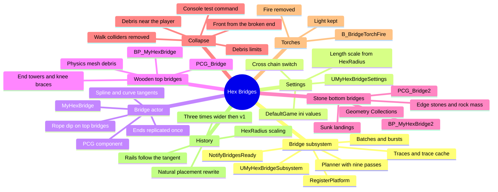
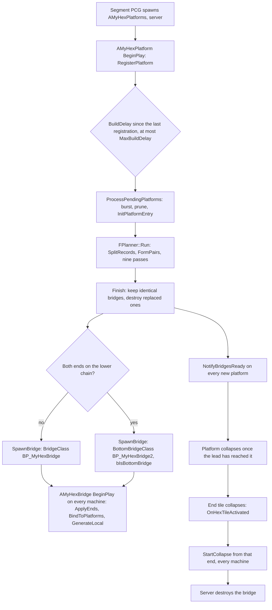
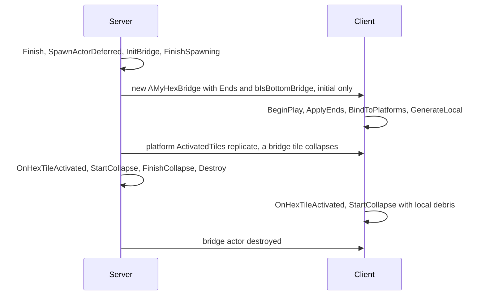
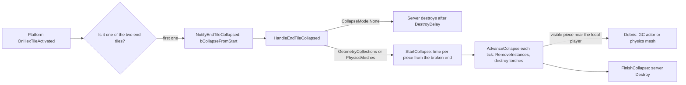

↑ [[Redo3 Changes Index]]

# Hex Bridges

AuraRedo3 · redo3 · 17605e3..08a123a · 2026-10-03 to 2026-11-15

Neighbouring hex platforms on the endless path are joined by bridges. A server-only world subsystem, `UMyHexBridgeSubsystem`, collects the platforms as the segment PCG graph spawns them, plans which open tile sides to join, and spawns one replicated `AMyHexBridge` per bridge. Each bridge is a spline from one edge tile's open side to the other's plus a PCG component, which builds the bridge locally on every machine: a wooden bridge with end towers (`PCG_Bridge`) on the upper chain (and between the chains when cross-chain bridges are on), and a stone bridge (`PCG_Bridge2`) between two lower-chain platforms. A platform may only start collapsing once its bridges exist, and when an end tile breaks the bridge falls apart from that end, stone into Geometry Collections and wood into physics meshes.

Talal's asks, in order: on 2026-10-05 "the placement of bridges does not seem natural at all, please fix it and can revise the logic also by which the platforms are paired" ("do rewriting with ultra effort"); on 2026-10-07 rails that follow the spline and "a scaling factor that scales the whole system of Hexplatform and bridge spawning"; on 2026-10-13 a wooden bridge from two reference images with supports only at the ends; on 2026-10-17 a stone bridge that looks natural, straight on the bottom chain, with the dip kept on top bridges; on 2026-10-22 stone bridges three times as wide that break into Geometry Collections "from the side whose tile broke first", and top bridges that do the same with simulated static meshes; on 2026-10-31 the stone bridge back at its narrow v1 width with torches at both ends; and on 2026-11-01 torches that keep their light but lose the fire.

State now (origin/redo3): all of it shipped. The planner is the path-flow rewrite of `e7a2588` with lengths scaled by `HexRadius`, the stone bridges are back at v1 width with their own GCs and end torches (`0cc1993`), the torches have no Niagara fire (`08a123a`), and the settings in `DefaultGame.ini` are Talal's tuning plus the 2026-11-15 hunk that turned debug drawing and cross-chain bridges off. `PCG_Bridge` and `PCG_Bridge2` are binary assets, so their node detail here comes from the commit messages and the thread notes.

## Mind map

## How it works

### From a new platform to a bridge on every machine

1. The segment graph spawns the platforms on the server ([[Redo3 Hex Platform PCG]]). In `AMyHexPlatform::BeginPlay`, on the authority, each platform measures its `FootprintRadius` from the full grid and calls `UMyHexBridgeSubsystem::RegisterPlatform`. If there is no subsystem, or `bWaitForBridgesBeforeCollapsing` (default true) is off, it calls `NotifyBridgesReady` itself.
2. `RegisterPlatform` adds the platform to `PendingPlatforms` and restarts one timer: `BuildDelay` after the latest registration (0.1 s in C++, 0.01 s in `DefaultGame.ini`), but never later than `MaxBuildDelay` (0.5 s) after the first one, with a 0.01 s floor. Everything PCG spawns for one segment is normally one batch.
3. `ProcessPendingPlatforms` starts a new burst when the last batch is more than `BurstQuietTime` (1 s) old or the burst is longer than `BurstMaxDuration` (8 s), and clears the trace cache with it. It prunes platforms that are gone and bridges that are gone, dying (a life span set), lost an end platform or have a collapsed end tile.
4. `InitPlatformEntry` records each new platform: a registration `Serial` (the only ordering key, never pointer order), its burst, grid size, `bIslet` (GridSize 2 or less), footprint, `SplineDistance`, the six hexagon corners, its kind (`Centre` for GridSize 6 or more within `CentreMaxOffset` 1500 cm x HexRadius / 100 of the path, `Side` further out, `Ring` below GridSize 6) and its chain from the PCG tags `HexLower` (0) or `HexUpper` (1). Its open edges come from the cached `EdgeInstances`, stored by tile coordinate because instance indices move once tiles collapse, and every pillar's top and bottom come from the real mesh bounds. `LengthScale` rises to the largest `HexRadius / 100` seen.
5. `FPlanner::Run` builds the batch's view of all platforms in `Serial` order, splits the existing bridges (this burst's bridges become tentative and are planned again, fixed bridges that a new platform clips are dropped, and a bridge a player is on or near is never touched), forms the pairs and their options without any trace, and runs the nine passes. The passes only plan; nothing is spawned until the plan is final.
6. `Finish` keeps the actor of any tentative bridge whose pair and edges came out the same, destroys the others and the dropped ones, and spawns the rest with `SpawnBridge`. The bridge starts on the platform registered later (a deck planned the other way round has its tangents swapped and negated). It is a bottom bridge when both ends are on chain 0.
7. `SpawnBridge` loads `BottomBridgeClass` for a bottom bridge, otherwise (or when that is unset) `BridgeClass`, otherwise the native `AMyHexBridge`. It spawns deferred at the start edge's midpoint with `AlwaysSpawn`, calls `InitBridge(Start, End, StartTangent, EndTangent, bBottom)` and `FinishSpawning`.
8. Every new platform of the batch then gets `NotifyBridgesReady()`. Bridges are therefore always built from untouched edges; the platform still waits for the lead player before it collapses (see [[Redo3 Hex Path and Ranking#The collapse gate]]).
9. The batch writes one `LogHexBridgeSubsystem` line: platforms, burst, pairs, candidates, bridges planned per pass, kept, spawned, destroyed (re-plan and revalidation), curved, traces and cache hits, route cuts left and the time in ms.
10. On every machine, `AMyHexBridge::BeginPlay` puts the spline on the two ends (`ApplyEnds`), binds to both platforms (`BindToPlatforms`) and runs `PCGComponent->GenerateLocal(true)`. PCG output is not replicated, so each machine builds the same bridge from the same spline.
11. When either end tile collapses, the bridge runs its collapse from that end and the server destroys it once the front is through ([[#The collapse]]).

### Server and client

1. `AMyHexBridge` has `bReplicates = true`, `bAlwaysRelevant = true` (like the platforms, so a client never keeps a bridge without its platforms) and no movement replication. Its tick is off except during a collapse.
2. `Ends` (`FMyHexBridgeEnds`: start and end platform, hex tile coordinate and world location, plus `StartTangent` and `EndTangent`) and `bIsBottomBridge` replicate `COND_InitialOnly`. Both are set before `FinishSpawning`, so a client has them in `BeginPlay`.
3. `OnRep_Ends` runs `ApplyEnds` and `BindToPlatforms` again, because on a client a platform reference can resolve after the bridge arrives.
4. The collapse runs on every machine from the platform's own `OnHexTileActivated`, which `ActivateHexLocal` broadcasts on the server and on clients. Only the server destroys the bridge; that destroys it on every client.
5. A late joiner whose end tile has already collapsed (`IsTileCollapsed` reads `LocalActivatedTiles` and the replicated `ActivatedTiles`) never generates the bridge and spawns no debris.

## UMyHexBridgeSubsystem

A `UWorldSubsystem` for Game and PIE worlds. Everything in it runs on the server; only `OnWorldBeginPlay` does work on clients too: it async-loads `BridgeClass` and `BottomBridgeClass` through the asset manager's streamable manager, so the first stone bridge does not block the game thread to load its Blueprint and graph.

### Pairs and options

- `FormPairs` pairs each planned platform with every platform in nearby grid cells (`SpatialCellSize` 10000 cm, searched as far as the largest pair range seen so far) that is on the same chain (unless `bAllowCrossChain`), not collapsing, and in range: origins within `NeighborRadiusMultiplier` (5) x GridSize x HexRadius of the larger platform, or within both footprints plus `MaxEdgeGap` (3000 cm, scaled).
- `MakeCandidate` picks the live edges of each platform that face the other (`CandidateEdges` 12, `FacingDot` 0.25) and keeps up to `MaxOptions` 10 edge-pair options per pair (`OptionsPerEndTile` 2), cheapest first. Cost is length plus visual terms for bending, meeting a tile side at an angle, net heading change and slope.
- `BuildDeck`: a deck is straight, or one cubic Hermite segment that leaves and arrives square to the two tile sides, with a turn radius of at least 4 m and a bulge of at most 1.5 m. Decks under 5 m stay straight. `MaxEndAngleDegrees` (40) and `MaxStraightEndAngleDegrees` (15) limit how far off square an end may be. The slope is checked along the whole curve against `MaxSlopeDegrees`.

### The rules a bridge must pass

| Check | What it rejects |
|---|---|
| `EndConflict` | Over the platform's cap (`MaxBridgesSmall`, `MaxBridgesMedium`, `MaxBridgesLarge`), the same tile side twice, ends closer than `MinEndSpacingRadii` (3 HexRadius), ends closer than `MinBridgeSpreadDegrees` (40) around the centre, and fans of nearly parallel decks within 8 m. An islet may have two ends 1.4 R apart when the bridges leave at least 100 degrees apart (a stepping stone). |
| `CrossConflict` | Decks that cross or pass within `BridgeSeparation` (300 cm) top-down at heights closer than `MinBridgeVerticalClearance` (500 cm). Same-chain decks never come within `SameChainSeparation` (250 cm). |
| `ClearOfPlatforms` | A deck within `PlatformClearance` (230 cm, exact hexagon distance) of any tile of a third platform while it is inside that pillar's height band (top + 5 m down to bottom - 2.5 m). `OwnClear` keeps the deck, past a short skip at each end, clear of the other tiles of its own two platforms near deck height (a deck grazing the pillar next to its edge looks clipped). |
| `LensBlocked` | Optional links whose "lens" (a disc at its middle whose diameter is 0.9 x the chord) holds a tile of a third same-chain platform: only natural neighbours get extra bridges. |
| `TraceOk` | The line traces, run only after every geometric rule has passed. A straight deck is traced both ways (`TraceReaches`), each from 5 cm outside one side to 10 cm inside the other, 5 cm below the walking surface; a curved deck traces 2 to 8 segments just under the deck. The first hit must be the target platform within 0.6 HexRadius of the target side. All bridge actors are ignored, and results are cached per burst. |

### The nine passes

Lengths are at HexRadius 100 and scale with it.

| Pass | What it plans | Debug colour |
|---|---|---|
| Spine | Consecutive centre platforms of each chain (sorted by `SplineDistance`, up to 75 m apart along the path) get their best route first, at most 4 hops | Blue |
| Tree | Kruskal on cost over every candidate. A failed option queues the pair's next one; one that failed only an end rule is retried once at 1.3x cost with relaxed rules | Green |
| Loop | A pair not linked yet gets a natural link when the walk over the network is longer than 1.5 to 3 times its length (short to long links), up to `LoopMaxLength` 2200 cm | Cyan |
| Leaf | A platform with one bridge gets a short second link that saves a real walk, up to 16 m | Yellow |
| Route | A bridge whose loss would split the main route gets the link across it that removes the most route cuts per cost | Orange |
| Bypass | For consecutive centre platforms around the batch, when the outer two cannot reach each other without the middle one within 2x their distance, the cheapest set of links that gives such a walk | Magenta |
| Branch | A bridge that alone holds a side branch of 2 or more platforms gets the cheapest short link across | Purple |
| Fallback | Pairs still in different components: any option with relaxed rules, then wide options | Red |
| Rescue | A platform still without a bridge tries every platform in reach, nearest first, with wide options and no length cap | White |

With `bDrawDebug` on, each spawned deck is drawn 30 cm above the bridge for 10 s in its pass colour, the straight traces in green (reached) or red, and the curved trace segments in orange (hit) or cyan.

### Other jobs

The subsystem is also the per-world home of the lead pawn (`GetLeadPawn`, `SelectLeadPawn` returns the first living pawn among `AMyGameState::GetLeadingPlayerStates()`), the lead's distance along the registered path spline (`GetLeadPathDistance`, both cached per frame), the path spline itself (`RegisterPathSpline`, last one wins) and a cull budget of 4 platforms per frame (`TryConsumeCullBudget`). These serve collapse and culling and are described on [[Redo3 Hex Path and Ranking#The lead pawn]].

## UMyHexBridgeSettings

A `UDeveloperSettings` class, Config = Game, shown as Project Settings > Game > Hex Bridges and saved to `DefaultGame.ini` under `[/Script/Aura.MyHexBridgeSettings]`. Lengths are for HexRadius 100; the ones marked "scaled" are multiplied by `GetLengthScale()` (largest registered platform HexRadius / 100). Heights, slopes, clearances and separations are not scaled: the deck and the player keep their size.

| Setting | C++ default | DefaultGame.ini now | What it does |
|---|---|---|---|
| `BridgeClass` | unset | `BP_MyHexBridge` | Actor for every bridge |
| `BottomBridgeClass` | unset | `BP_MyHexBridge2` | Actor for bridges with both ends on `HexLower` |
| `BuildDelay` | 0.1 s | 0.01 | Debounce after the latest registration |
| `MaxBuildDelay` | 0.5 s | | A batch is built at most this long after its first registration |
| `NeighborRadiusMultiplier` | 5 | 5 | Pair range in GridSize x HexRadius |
| `MaxEdgeGap` | 3000 cm, scaled | | Or within both footprints plus this |
| `MaxBridgeLength` | 4500 cm, scaled | 9000 | Longest bridge except in Rescue |
| `MaxSlopeDegrees` | 30 | 51.36 | Steepest deck, before any trace |
| `TraceChannel`, `SpatialCellSize` | Visibility, 10000 cm | | Trace channel, neighbour grid cell |
| `bCurvedBridges` | true | | Decks may bend to meet offset tile sides |
| `MaxEndAngleDegrees`, `MaxStraightEndAngleDegrees`, `StraightOnlyMaxEndAngleDegrees` | 40, 15, 30 | | How square an end must be (curved, straight, curves off) |
| `MaxBridgesSmall`, `MaxBridgesMedium`, `MaxBridgesLarge` | 3, 4, 6 | 10, 10, 10 | Caps for GridSize 2 or less, 3 to 5, 6 or more; Large is the hard limit |
| `MinEndSpacingRadii`, `MinBridgeSpreadDegrees` | 3, 40 | | End spacing in HexRadius, spread around the centre |
| `SameChainSeparation`, `BridgeSeparation`, `MinBridgeVerticalClearance`, `PlatformClearance` | 250, 300, 500, 230 cm | | Separation and clearance rules |
| `LoopMaxLength`, `IsletMaxLength`, `RouteMaxLength` | 2200, 1800, 2500 cm, scaled | | Longest loop, islet and route-repair links (an islet that becomes a through stepping stone allows 22 m) |
| `MaxSplineDistanceJump` | 0 (off), scaled | | Optional bridges never join platforms further apart along the path |
| `bAllowCrossChain` | false | False | Bridges between the lower and upper chains |
| `bSkipCollapsingPlatforms` | true | | Collapsing platforms are never paired |
| `ChainSplitHeight` | 860 cm | | Chain fallback for an untagged platform (height above the path), warned once |
| `bReplanBursts`, `BurstQuietTime`, `BurstMaxDuration` | true, 1 s, 8 s | | Re-plan the bridges of a burst with each new batch |
| `bRevalidateBridges`, `RevalidateClearance` | true, 120 cm | | Replace a fixed bridge that a new platform clips |
| `bDrawDebug` | false | False | Draw decks and traces |

The ini history: `17605e3` set `BridgeClass`, `NeighborRadiusMultiplier=5` and `bDrawDebug=True`; `de9336e` added `BottomBridgeClass`; Talal's `c0adc6e` (2026-10-18) added `BuildDelay=0.01`, `MaxSlopeDegrees=51.36`, all three caps at 10 and `bAllowCrossChain=True`; the 2026-11-15 commit `5d2fd5b` (filed under the MainMenu3 hook-up) set `bDrawDebug=False`, `bAllowCrossChain=False` and `MaxBridgeLength=9000`.

## AMyHexBridge

`Blueprintable` actor with a `USplineComponent` root (`BridgeSpline`) and a `UPCGComponent` whose trigger is Generate On Demand. The graph is set in the Blueprint child.

### Ends, spline and the rope dip

- `InitBridge` (server only, between deferred spawn and `FinishSpawning`) stores the ends, the tangents and `bIsBottomBridge`. `BeginPlay` on the server destroys a bridge whose end platform was culled between planning and spawning.
- `ApplyEnds` puts the spline on `Ends.Start.Location` and `Ends.End.Location`, the middle of each tile's open side at walking height. Non-zero tangents are applied verbatim, so every machine gets the same curve.
- A top bridge (`bIsBottomBridge` false) dips like a rope bridge: its middle sits `SagRatio` (0.1143) x the end distance below the planned deck. The planned cubic is split at its middle into two cubics with halved tangents (the same path from above), the middle point drops by the sag and the end tangents' Z move by the same amount. Bottom bridges never dip.
- The planner's slope and clearance checks do not include the dip, and the planner has its own sag constant (`HexBridgePlan::SagRatio`), which is 0.
- `ApplyEnds` also registers the deck with `UMyHexMinimapSubsystem`, which draws it ([[Redo3 Hex Minimap]]).

### Listening to the end platforms

- `BindToPlatforms` binds `OnPlatformTileActivated` to both platforms' `OnHexTileActivated`. On the server it also binds `HandleEndPlatformEndPlay` to their `OnEndPlay` (a culled or streamed-out platform takes its bridges with it), adds itself to the platform's `Bridges` list (`RegisterBridge`, used to keep a platform alive while a player is within `BridgeKeepDistance` 300 cm of one of its bridges) and to `PathBridges` (`RegisterPathBridge`), whose end tiles become the replicated `PathStartTiles` that the tile paths and the paving start from ([[Redo3 Path Paving]]).
- If an end tile has already collapsed when it binds, it treats that like seeing the collapse, with `bEndTileCollapseSeen` false so no debris spawns.
- `NotifyEndTileCollapsed` only counts the first end, records whether it was the start (`bCollapseFromStart`), runs the `HandleEndTileCollapsed` BlueprintNativeEvent and broadcasts `OnEndTileCollapsed(Bridge, Platform, Tile)`.
- `EndPlay` unbinds from both platforms, unregisters from their bridge and path lists and from the minimap.

### The collapse

1. `HandleEndTileCollapsed_Implementation` calls `StartCollapse(bWithDebris)` on every machine when `CollapseMode` is not `None`, with debris only if the collapse was seen and `IsNearLocalPlayer()` (the first local player's pawn, or its camera, within `DebrisMaxDistance` 5000 cm of the spline, horizontally). With `None` the server destroys the bridge (after `DestroyDelay` when `bDestroyWhenEndTileCollapses`).
2. `StartCollapse` cancels a generation still in progress, then makes one piece per instance of every ISM on the actor and one per attached non-replicated actor (the torches). Each piece's time is its distance along the spline from the broken end divided by `CollapseSpeed` (1500 cm/s) plus a random 0 to `CollapseJitter` (0.15 s), from a stream seeded with the two end locations, so the walk colliders go at about the same time everywhere.
3. Invisible ISMs (the walk colliders) never spawn debris. With `GeometryCollections`, each visible mesh looks up its GC in `BreakableMeshes`.
4. `AdvanceCollapse` runs from `Tick`, removes all reached instances of each ISM in one `RemoveInstances` call (high to low, with `SetRemoveSwap` bookkeeping) and destroys reached torches. A player on the deck falls when the colliders under them go.
5. Debris: a Geometry Collection becomes a non-replicated `AGeometryCollectionActor`, `Chaos_Object_Dynamic`, with a user-defined initial velocity of `DebrisVelocity` (0, 0, -100) plus a random sideways spread of up to half the piece size per axis (at most 100 cm/s), ignoring Pawn and Camera, life span `DebrisLifeSpan` (8 s), and `CrumbleActiveClusters` after `CrumbleDelay` (0.25 s). A physics mesh (and a GC-mode mesh without a GC) becomes a `UStaticMeshComponent` on a holder actor that outlives the bridge, `PhysicsActor` profile, ignoring Pawn and Camera, spinning at up to `DebrisMaxSpin` (90 deg/s). A mesh without simple collision just vanishes.
6. `FinishCollapse` stops the tick and, on the server, destroys the bridge (or sets `DestroyDelay` as its life span).

| Property (Hex Bridge, Collapse, Optimization) | Default | Notes |
|---|---|---|
| `bGenerateOnBeginPlay` | true | |
| `SagRatio` | 0.1143 | Top bridges only |
| `bDestroyWhenEndTileCollapses`, `DestroyDelay` | true, 0 s | With a collapse mode, counted from the end of the collapse |
| `CollapseMode` | `PhysicsMeshes` | `BP_MyHexBridge` keeps it; `BP_MyHexBridge2` uses `GeometryCollections` |
| `BreakableMeshes` | empty | Static mesh to GC map, set on `BP_MyHexBridge2` |
| `CollapseSpeed`, `CollapseJitter` | 1500 cm/s, 0.15 s | |
| `DebrisLifeSpan`, `DebrisVelocity`, `DebrisMaxSpin`, `CrumbleDelay` | 8 s, (0, 0, -100), 90, 0.25 s | `CrumbleDelay` below 0 never crumbles |
| `DebrisMaxDistance` | 5000 cm | No debris further from the local player |
| `DebrisMaxDepth`, `DebrisMinRadius` | 0, 0 | Deeper or smaller pieces just vanish (0 = off) |
| `MaxDebrisPieces` | 0 | Evenly spaced subset along the bridge (0 = no limit) |
| `bDebrisCastShadow` | false | |
| `MaxDrawDistance` | 0 | `SetCullDistance` on every ISM once the graph has generated (`OnGraphGenerated`) |

The Blueprint values are not readable from the repo. The 2026-10-24 optimisation notes give the ones that pass set: no debris from stone bridge pieces more than 6 m below the deck or smaller than 60 cm, at most 24 debris pieces per stone bridge and 40 per wooden one, and bridges drawn to 800 m.

### Testing in Simulate

`Aura.CollapseBridges X Y Z Radius` (not in shipping builds) collapses every bridge whose spline passes within Radius of the point, on this machine only, with debris, from the end nearer the point (`DebugCollapse`). It works in Simulate, where no tile ever breaks.

## The bridge PCG graphs

All three build from `BridgeSpline`, and all run locally on every machine. Which graph a bridge uses is set on its Blueprint.

| Graph | Blueprint | Used for |
|---|---|---|
| `PCG_SplineISMs` | `BP_MyHexBridge` until mid-October | Talal's original plank bridge (planks every 38 cm, two rails), already in the project at `fc9a077` |
| `PCG_Bridge` | `BP_MyHexBridge` | Wooden top bridges and cross-chain bridges |
| `PCG_Bridge2` | `BP_MyHexBridge2` | Stone bottom bridges |

No thread records `BP_MyHexBridge` being switched from `PCG_SplineISMs` to `PCG_Bridge`. The thread that built `PCG_Bridge` asked and got no answer; Talal's own `808d60c` (2026-10-16) changed `BP_MyHexBridge` and `PCG_Bridge`, and by 2026-10-20 the CPU profile counted the wooden bridge cubes in play.

### PCG_SplineISMs: rails that follow the spline

On 2026-10-07 Talal pointed out that the rails were pushed right, left and up without taking the spline's direction into account, and asked to "only make changes to the push to right/left/up. not random rotations". Each rail used two Add nodes on `Position.Y` and `Position.Z` in world space, so on a spline running along world Y both rails were shifted along the spline instead of out to the sides. They became one Transform Points node each, `RailOffset_Right` and `RailOffset_Left`, with the offset applied relative to each point's rotation and the same distances (rail 1: 143.6 right and 54.8 up; rail 2: 146.7 left and 54 up). Random rotations and seeds were left alone. The backup is `PCG_SplineISMs_BeforeTangentOffset`; both were committed in `b1f17f2` on 2026-10-10. An unconnected Add node of Talal's (Rotation.Right into an attribute `right`) was saved with it.

### PCG_Bridge: the wooden top bridge

Built on 2026-10-13 (`4c227a0`) in the empty `PCG_Bridge` from two reference images, with "supporting pillars only at the ends that merge into the floating platforms" and every mesh one mesh at different scales except the torch.

- Deck: chunky planks, slightly skewed, about 4% missing; stringers and cross beams underneath.
- Railings: posts about every 3 m, a top and a mid rail, one diagonal per panel.
- At each end a gate tower with X braces. Its posts stop 200 cm below the deck, inside the platform's edge pillar (about 215 cm deep), so they never reach the floor. A diagonal knee brace runs from low on the post to the deck underside.
- A torch on the right post: a cylinder stick plus the `B_BridgeTorchFire` actor. All wood is one cube mesh with `M_BridgeWood`.
- Layout: 10 sections left to right with named reroutes; the final Merge Points (8 wires into one pin) is the one exception.
- Tested on straight, sloped and curved splines, but only between the editor's 3-ring default platforms at HexRadius 300. The editor ran out of memory twice during the work.

![[redo3_curve.jpg]]

The whole wooden bridge on a curved test spline between two temporary platforms (`curve.png`, 2026-10-13).

![[redo3_cap5.jpg]]

One end tower close up: X braces, knee brace and the torch (`cap5.png`, 2026-10-13).

### PCG_Bridge2: the stone bottom bridge

Built on 2026-10-17 by the "Overlapping Geometry Collections" thread from the hall span in FrozenNorse's `L_Showcase` level (`669297e`).

- Deck: stone segments about every 170 cm, fitted to the length (the count grows with length, nothing is stretched), with seeded wobble, from `SM_Bridge2_Span_01` and `SM_Bridge2_Span_02` (the Cliff_01 deck slab and underside, merged from `L_Showcase` pieces).
- Landings: `SM_Bridge2_Landing` (Tilekit Tile_07 paving) on the tile at each end.
- Walking: invisible smooth collision boxes, one every 100 cm along the deck plus one per landing.
- Dressing: broken edge stones, thin snow, and about 17 m of rock mass in four tapering layers under the deck. Seeds are fixed. It passed tests at 13, 22 and 72 m and on curved bridges.
- Talal found the first version "not looking natural" because of repeating blocks; the rework added per-slab variation, edge rocks and the tapering rock mass.
- Edge stones (`2b8f15a`): `SM_Bridge2_Span_02` had its slab turned 180 degrees but kept the other mesh's sideways offset, so every other segment sat about 48 cm off centre and its edge stones floated. The mesh was re-merged so both spans span Y -146 to 146, and the edge stones now come from each wobbled deck segment (`Span_Wobble` to `Edges_Pick`), 105 to 135 cm out and 22 to 45 cm below the deck top.
- Landings (`ccb8ddf`, `19f78da`): first sunk 12 cm and narrowed from about 7.7 x 6.3 m to 4.6 x 3.9 m. Talal was then offered "Narrow" (graph only, recommended) or "Wide, smart" (C++, needs a restart) and Narrow was built: `SM_Bridge2_Landing` re-merged from five full-size slabs in a 2.6 x 3.7 m footprint plus the lip over the deck, `Ends_Landing` at scale 1, sunk 12 cm and shifted 7 cm, `Walk_Landing` box 350 x 260. Overhang past the end tile is 0 cm for bridges up to 30 degrees off square (the most seen in game was 29.5 degrees).
- Materials (2026-10-30, `ac1b069`): copies `MM_Cliffs_HexBridge` and `MM_SnowAssets_HexBridge` with seven MIs fade the bridge into the fog along the deck (`MF_FogFadeDepth_Deck`, from custom primitive data), and on 2026-11-05 to 11-06 they got the ink outline ([[Redo3 Hex Look and Atmosphere]]).

### Width: three times wider, then back to v1

- **3x (2026-10-22, `8d98fd7`).** Talal asked for bottom bridges three times as wide with fractured meshes. The thread made `SM_Bridge2_Span_01_W`, `SM_Bridge2_Span_02_W` and `SM_Bridge2_Landing_W` (Y x3), spread the lateral offsets, walk colliders and depth rocks x3, added denser depth rocks and more snow, and fractured the 11 stone meshes into GCs (`GC_Bridge2_Span_01_W`, `GC_Bridge2_Span_02_W`, `GC_Bridge2_Landing_W`, `GC_Boulder_01`, `GC_Cliff_02` to `GC_Cliff_05`, `GC_Snow_Pile`, `GC_Snow_Pile_03`, `GC_Snow_Pile_04`).
- **The catch.** The planner still spaced bridge ends for the old width (`MinEndSpacingRadii` is 3 HexRadius), so two 8.7 m decks leaving one platform could overlap. The CPU profile of 2026-10-23 also found a stone collapse spawned about 87 debris actors and 8.9 million triangles, 72% of them from the depth rocks.
- **Lighter GCs (2026-10-24, committed in `3d05747`).** The 11 GCs were rebuilt from `*_Lite` render-LOD copies in `Props/Bridge2/GCSource` with box implicits, and the debris limits above were added.
- **Back to v1 (2026-10-31, committed in `0cc1993`).** Talal asked to "fix the bottom bridge to the v1 narrower mode and replace all SMs and GCs spawns". The "Restore narrower v1 bottom bridge" thread found what v1 meant and, at his request, handed the job to the thread that built the wide version. `PCG_Bridge2` went back to `SM_Bridge2_Span_01/02` and `SM_Bridge2_Landing` at v1 spacing, the fog-fade material moved to the slot that renders (the narrow meshes have an extra slot), and `GC_Bridge2_Span_01`, `GC_Bridge2_Span_02` and `GC_Bridge2_Landing` were fractured from light copies of the narrow meshes. `BP_MyHexBridge2` breaks into them and writes the deck spline ends to custom primitive data for the fog fade (its `ApplyDeckFogData`). The `_W` meshes and their GCs are still in the project, unused.

### Torches

- `B_BridgeTorchFire` (`/Game/Assets/MyPlatform/Bridge`) is a point light plus, until November, a fire Niagara system. The top bridges get one per end tower from `PCG_Bridge`.
- On 2026-10-31 the stone bridges got one at each end: the wooden bridge's torch nodes copied into `PCG_Bridge2`, a cylinder stick plus `B_BridgeTorchFire` on the right side of the landing, about 0.5 m back from the deck, with the fire 3 m up. The position is one point each in the "Torch Stick Point" and "Torch Fire Point" nodes. Simulate showed 64 torches on 32 stone bridges.
- The light: pure yellow (255, 241, 0) at 100,000 intensity with a 25.7 m radius. The 2026-10-24 pass made the lights unshadowed with a 60 m draw distance. The ice-look comparisons used a PIE-only peach override that went onto the shared Blueprint with the winning look, and on 2026-10-26 the torches went back to the original light. A warmer, weaker light suggested on 2026-10-24 was not applied.
- `08a123a` (work of 2026-11-01): the 126 bridge torch fires on the measured layout cost 2.9 to 3.9 ms of GPU sim, so the fire was removed and the light kept.
- Collapsing bridges destroy their torches when the front reaches them.

## Natural placement: how the planner was redesigned

The planner of `17605e3` gave a straight bridge to every pair of platforms within 5x the bigger one's grid size (up to 60 m) and picked the closest edges even when a bridge left an edge almost sideways. Talal's ask on 2026-10-05 was handed to the "Natural bridge placement" thread, which left the platform layout alone and rewrote only the pairing and the splines:

- Two short PIE runs captured 308 platforms and the 500 bridges the old logic built. A Python simulator outside the project ported Unreal's Perlin noise, `BuildHexGrid` (307 of 308 platforms identical) and the bridge rules, and rebuilt all 500 bridges to the millimetre.
- Four competing pairing designs were scored by three judges (path flow won 2 of 3, an organic curved design won the visual judge), merged, checked by a critic, ported to C++ and reviewed; three medium logic issues were fixed. The critic's find, a segment bridged in two batches never re-checking its first-batch bridges, became `bRevalidateBridges`.
- Against the old logic on Talal's level: 0 vs 82 crossing bridges, 0 vs 83 bridges passing over another platform, at most 6 vs 17 bridges on one platform, 0 vs 53 bridges between the chains, and both chains fully reachable (the old logic split the upper chain in 3).
- Accepted trade-off: about 30% of platforms, mostly small side ones, end up with one bridge (89 dead ends against 35). The old logic also built about 50 steep ramps between the chains by accident; the new one builds none by default (`bAllowCrossChain` false), and Talal did not say whether he wanted a few.

## HexRadius scaling

On 2026-10-07 Talal reported that bigger platforms overlapped and then got no bridges, and asked for one factor for the whole platform and bridge system ([[Redo3 Hex Path and Ranking#One HexRadius scales everything]]). On the bridge side:

- `a7bd059`: `GetLengthScale()` (largest registered HexRadius / 100). The planner multiplies the scaled settings and its horizontal constants (option length, curve radius and bulge, coarse step, trace segment length, fan distance, shared-end trims, own-tile skips, spine gap, loop, leaf, route, bypass and cut distances) by it. Centre platforms are found within 1500 cm x HexRadius / 100 of the path.
- `5bec016`: Unreal's unity build compiles `MyHexBridgeSubsystem.cpp` together with `MyHexBridgeBuilder.cpp` (the older level-placed `AMyHexBridgeBuilder`), whose anonymous namespace defines the same trace constant names. A `using namespace HexBridgeSubsystemTrace` in the planner made them ambiguous; it was removed and the uses qualified.
- `55f9c66`: the first radius 200 test had no overlaps but only 10 bridges, because the fixed trace offsets missed the doubled pillar side inset and bevelled top. `BridgeTraceStartOffset` (5 cm) and `BridgeTraceOvershoot` (10 cm) now scale; `BridgeTraceDepth` (5 cm) does not. Simulate then gave 194 bridges at radius 100 and 197 at radius 200 for the same 161 platforms.
- With `MaxBridgeLength=9000` in the ini, a map at HexRadius 200 allows straight bridges up to 180 m outside Rescue.

## Gotchas

- Everything in the planner is server only. Clients only see bridges as replicated actors with their ends; the chain tags and the path spline exist on the server only.
- Bottom means both ends on `HexLower`. A cross-chain bridge, when `bAllowCrossChain` is on, uses `BridgeClass` and dips.
- The dip is applied after planning and is not in the slope and clearance checks, and `MaxSlopeDegrees` is 51.36 in the ini.
- `DestroyDelay` defaults to 0: the server destroys the bridge as soon as its own front is through, which can cut a slightly later client collapse short. The code comment suggests a short delay; the Blueprint values are not recorded.
- Debris checks only the first local player controller, and a dedicated server never spawns debris.
- `MaxDrawDistance` uses `SetCullDistance`, which the 2026-10-24 analysis notes is ignored on Nanite components.
- The header comment on `SelectLeadPawn` still says "the first player on the server"; the code has used the `AMyGameState` ranking since Talal's `b95b254` (2026-10-07).
- `World_Bridges` in the platform graph must select the native `MyHexBridge` class, or platforms land on bridges of a sibling Blueprint (fixed in `86539d1`).
- Edit spline points only through the `USplineComponent` API: a mismatched point count crashed the editor while `PCG_Bridge2` was being built.
- The swarm readme says other geometry, bridges included, is only avoided by sentinels when its Blueprint has a `UMechSentinelObstacleComponent`; no thread records adding one to the bridges ([[MechSentinel Movement and Avoidance]]).
- Closing a GC editor tab before quitting avoids an engine assert in the Dataflow editor teardown, which crashed the editor on 2026-10-23 with `GC_Bridge2_Span_01_W` open.

## How it changed

- **2026-10-03** `17605e3`: the bridge subsystem, built in an earlier Claude session with the growing path. Platforms register in `BeginPlay`; batches after `BuildDelay`; a coarse grid; one straight bridge per pair from the `CandidateEdgesPerPlatform` (4) closest facing edges (`MinFacingDot` 0.5), checked against `sin(MaxSlopeDegrees)` and traced both ways like `AMyHexBridgeBuilder`. `AMyHexBridge` with replicated ends and `HandleEndTileCollapsed`; the subsystem called `StartCollapsing` on every platform right after the batch. `BP_MyHexBridge`, `steps.md`, and `bDrawDebug=True`.
- **2026-10-04** (uncommitted then, in `e7a2588`): the earlier session's lead-landing work, rebuilt by "Mind map of hex collapse changes" for the Lead-Landing Collapse Map. `ProcessPendingPlatforms` calls `NotifyBridgesReady()` instead of `StartCollapsing()`, the root cause of platforms collapsing about 0.1 s after spawning. Bridges bind to both platforms' `OnEndPlay`, register in their bridge lists and destroy themselves if an end platform was already culled; a player within 300 cm of a bridge keeps both ends alive.
- **2026-10-05 to 10-06** (committed 2026-10-07 07:02 in `e7a2588`): the natural placement rewrite. `FPlanner` with its nine passes, curved decks (`StartTangent`, `EndTangent`), bursts and revalidation, the new settings, and the lead pawn, path spline and cull budget on the subsystem. "Commit and push current state" committed it with the rest of that week's work and noted it was untested in multiplayer PIE.
- **2026-10-07** `a7bd059`, `5bec016`, `55f9c66`: bridge lengths, then trace offsets, scale with HexRadius; the unity build clash fixed.
- **2026-10-07**: the rail offsets in `PCG_SplineISMs` follow each point's rotation (committed on 2026-10-10 in `b1f17f2`). Later that day Talal's `b95b254` made the lead pawn the top of the ranking.
- **2026-10-13** `4c227a0`: `PCG_Bridge`, `M_BridgeWood` and `B_BridgeTorchFire`. The thread's question whether to point `BP_MyHexBridge` at it got no answer.
- **2026-10-16** `808d60c` (Talal's commit): a rope dip of 0.1143 x the bridge length, added in `BeginPlay` as an inserted middle point, plus changes to `BP_MyHexBridge` and `PCG_Bridge`.
- **2026-10-17** `6444429`, `7a6f01e`: bridges register as path bridges so the platforms lay walkways from their end tiles; `7a6f01e` makes that server only, with the start tiles replicated (`PathStartTiles`) for deterministic paths ([[Redo3 Path Paving]], [[Redo3 Hex Tile Props]]).
- **2026-10-17 17:47** `669297e`: `PCG_Bridge2`, the `Props/Bridge2` meshes and `BP_MyHexBridge2`, at first only selectable as `BridgeClass`.
- **2026-10-17 18:33** `de9336e` (stamped 10:33 UTC): `bIsBottomBridge` and `BottomBridgeClass`, so lower-chain bridges are stone and straight. The dip moved into `ApplyEnds` as `SagRatio` with the split cubic, because the inserted point overshot and gave S-bends, pulling curved decks up to 2.7 m off their path. Both bridge classes are async-loaded at world begin play.
- **2026-10-17 18:54** `86539d1`: `World_Bridges` selects every `MyHexBridge`, so platforms no longer land on stone bridges.
- **2026-10-17 19:46 to 20:03** `2b8f15a`, `ccb8ddf`, `19f78da`: edge stones set into the deck, landings sunk and kept on the tile, then the narrow landing. The thread's branch reached redo3 through "Unpushed commits count" on 2026-10-18.
- **2026-10-18** `c0adc6e`: Talal's settings tuning (build delay 0.01, slope 51.36, caps 10, cross-chain on), committed by "Unpushed commits count".
- **2026-10-20 to 10-23**: CPU profiles. Runtime PCG gave the worst hitches (up to 466 ms) through Spawn Actor batches and per-instance collision, the wooden bridge cubes alone 1.2 s; Talal suspected the bottom bridge GCs of the second-run lag, which turned out to be Vulkan VRAM eviction, while the stone GCs did cost frame time.
- **2026-10-22** `8d98fd7`: the collapse from the broken end, `Aura.CollapseBridges`, GC mode on `BP_MyHexBridge2` and physics meshes on `BP_MyHexBridge`, and the 3x wide stone bridge. Tested in Simulate and PIE; the wooden capture missed its bridge.
- **2026-10-24** (committed 2026-11-15 in `3d05747`): `DebrisMaxDepth`, `DebrisMinRadius`, `MaxDebrisPieces`, `bDebrisCastShadow`, `MaxDrawDistance`; the 11 stone GCs rebuilt from `*_Lite` copies; LODs on the wide bridge meshes. The same pass made the torch lights unshadowed with a 60 m draw distance.
- **2026-10-26**: torch lights restored after the ice-look comparisons (no commit of its own).
- **2026-10-30** (in `ac1b069`): fog fade on the stone bridge materials.
- **2026-10-31** (committed 2026-11-15 in `0cc1993`): stone bridges back at v1 width, their own GCs, torches at both ends.
- **2026-11-01** (committed 2026-11-15 in `08a123a`): `B_BridgeTorchFire` loses its fire Niagara.
- **2026-11-15**: the "Push local changes to GitHub" thread split Talal's working copy into topic commits, among them the three above and `5d2fd5b`, whose ini hunk turned `bDrawDebug` and `bAllowCrossChain` off and set `MaxBridgeLength=9000`.

## Threads that worked on it

- [[Redo3 Threads#Natural bridge placement|Natural bridge placement]]: rewrote the pairing from measured data, added curved decks and published the Hex Bridge Subsystem Map.
- [[Redo3 Threads#Mind map of hex collapse changes|Mind map of hex collapse changes]]: rebuilt the uncommitted lead-landing changes, including `NotifyBridgesReady` and the bridge end-platform bindings, for the Lead-Landing Collapse Map.
- [[Redo3 Threads#Commit and push current state|Commit and push current state]]: committed the planner rewrite in `e7a2588`.
- [[Redo3 Threads#platform and bridge system uptill hex radius scale|platform and bridge system uptill hex radius scale]]: scaled the bridge lengths and traces with HexRadius and built `PCG_Bridge`.
- [[Redo3 Threads#Bridge rails follow spline tangent|Bridge rails follow spline tangent]]: made the rail offsets in `PCG_SplineISMs` follow the spline.
- [[Redo3 Threads#Overlapping Geometry Collections|Overlapping Geometry Collections]]: built `PCG_Bridge2`, the bottom and top bridge split with the fixed dip, `World_Bridges`, and the edge stone and landing fixes.
- [[Redo3 Threads#Unpushed commits count|Unpushed commits count]]: brought the 2026-10-17 bridge commits onto redo3 and committed Talal's settings (`c0adc6e`).
- [[Redo3 Threads#CPU profile during play|CPU profile during play]]: measured the wooden bridge spawn hitch and the stone GC debris cost.
- [[Redo3 Threads#Collapsing bridges|Collapsing bridges]]: wrote the collapse, made the 3x wide stone bridge, then the v1 revert with new GCs and the end torches.
- [[Redo3 Threads#Restore narrower v1 bottom bridge|Restore narrower v1 bottom bridge]]: worked out what "v1" meant and handed the revert to "Collapsing bridges".
- [[Redo3 Threads#Add far-break ISMs for distant tiles|Add far-break ISMs for distant tiles]]: the debris limits, lighter GCs, draw distances and torch light settings.
- [[Redo3 Threads#Fix and extend the hex ink lines|Fix and extend the hex ink lines]]: restored the torch lights after the look comparisons and added the ink to the stone bridge materials.
- [[Redo3 Threads#Optimize the hex atmosphere effects|Optimize the hex atmosphere effects]]: the stone bridge fog fade and the removal of the torch fire.
- [[Redo3 Threads#Pave bridge paths with stone patterns|Pave bridge paths with stone patterns]]: paves the tile paths that start at the bridge ends (see [[Redo3 Path Paving]]).
- [[Redo3 Threads#Bring pinned artifacts into project|Bring pinned artifacts into project]]: added the pinned Hex Path and Bridges and Hex Path Setup Steps artifacts to the project Library.
- [[Redo3 Threads#Push local changes to GitHub|Push local changes to GitHub]]: committed the October and November bridge work as `3d05747`, `0cc1993`, `08a123a` and the ini hunk.

## Artifacts and files

- [[Redo3 Artifact - Hex Bridge Subsystem Map]]: the pinned page of 2026-10-06 with a mind map of the subsystem, a flowchart of one batch in six steps, and line numbers in `MyHexBridgeSubsystem.cpp` from the then uncommitted working copy.
- [[Redo3 Artifact - Lead-Landing Collapse Map]]: the 2026-10-04 map of the changes that made platforms wait for their bridges and the lead, with the bridge's end-platform bindings.
- [[Redo3 Artifact - Hex platforms - LODs vs switching instances off]]: the 2026-10-24 analysis with the triangle shares of the stone bridge kit and the wooden bridge cubes, and the draw-distance advice for `AMyHexBridge`.
- [[Redo3 Artifact - Hex platform optimization - what changed]]: the 2026-10-24 pass, with the stone bridge debris limits, the lighter GCs and the torch and bridge draw distances.
- [[Redo3 Artifact - Hex Path and Bridges]]: pinned from an earlier session; by its name about the path and bridge system of `17605e3`. Its content was not summarised for these notes.
- [[Redo3 Artifact - Hex Path Setup Steps]]: pinned from the same earlier session; not summarised. The repo's `steps.md`, "Hex Path and Bridges: Setup Steps", is that session's setup guide.
- [[Redo3 Files - Hex Path and Bridges]]: the wooden bridge captures `curve.png` and `cap5.png`, and the collapse captures `collapse_bottom.png`, `collapse_bottom2.png`, `collapse_narrow.png` and `collapse_top.png` (the last shows no collapse, because the test command missed the bridge).

## Where it lives

| What | Path |
|---|---|
| Bridge subsystem | `Source/Aura/Public/Actors/MyHexBridgeSubsystem.h`, `Source/Aura/Private/Actors/MyHexBridgeSubsystem.cpp` (`HexBridgePlan` constants, `FPlanner`) |
| Settings | `Source/Aura/Public/Actors/MyHexBridgeSettings.h`; `Config/DefaultGame.ini` `[/Script/Aura.MyHexBridgeSettings]`; Project Settings > Game > Hex Bridges |
| Bridge actor | `Source/Aura/Public/Actors/MyHexBridge.h`, `Source/Aura/Private/Actors/MyHexBridge.cpp` (`Aura.CollapseBridges` at the end) |
| Platform side | `Source/Aura/Public/Actors/MyHexPlatform.h` and `.cpp`: `RegisterPlatform` call in `BeginPlay`, `NotifyBridgesReady`, `RegisterBridge`, `RegisterPathBridge`, `OnHexTileActivated`, `IsTileCollapsed`, `bWaitForBridgesBeforeCollapsing`, `BridgeKeepDistance` |
| Older builder (not used by the path) | `Source/Aura/Public/Actors/MyHexBridgeBuilder.h`, `Source/Aura/Private/Actors/MyHexBridgeBuilder.cpp`, `/Game/Assets/MyPlatform/BP_MyHexBridgeBuilder` |
| Bridge Blueprints | `/Game/Assets/MyPlatform/BP_MyHexBridge` (wooden, top), `/Game/Assets/MyPlatform/BP_MyHexBridge2` (stone, bottom) |
| Bridge graphs | `/Game/Assets/MyPlatform/PCGs/PCG_Bridge`, `PCG_Bridge2`, `PCG_SplineISMs`, `PCG_SplineISMs_BeforeTangentOffset` |
| Wooden bridge assets | `/Game/Assets/MyPlatform/Bridge/M_BridgeWood`, `/Game/Assets/MyPlatform/Bridge/B_BridgeTorchFire` |
| Stone bridge meshes | `/Game/Assets/MyPlatform/Props/Bridge2/SM_Bridge2_Span_01`, `SM_Bridge2_Span_02`, `SM_Bridge2_Landing` and the unused `_W` copies |
| Stone bridge GCs | `/Game/Assets/MyPlatform/Props/Bridge2/GCs/` (14), sources `/Game/Assets/MyPlatform/Props/Bridge2/GCSource/*_Lite` (14) |
| Stone bridge materials | `/Game/Assets/MyPlatform/HexPlatforms/Bridge/MM_Cliffs_HexBridge`, `MM_SnowAssets_HexBridge` and seven MIs; `/Game/Assets/MyPlatform/Mats/MF_FogFadeDepth_Deck` |
| Bridges as platform obstacles | `World_Bridges` in `/Game/Assets/MyPlatform/PCGs/PCG_SplineIHexPlatformsFromSpline` |
| Setup doc | `steps.md` (repo root, the setup of `17605e3`) |
| Log category | `LogHexBridgeSubsystem` |

## Open items

- No clean close-up of the wooden bridge collapse was ever captured.
- The unused 3x wide `SM_Bridge2_*_W` meshes and their GCs could be deleted.
- Talal said he would check the stone bridge torch placement himself; no result is recorded.
- The pure yellow torch light (255, 241, 0 at 100,000) is unchanged; the suggested warmer, weaker light was not applied.
- Collapsing stone bridge pieces fall without the fog fade, which the atmosphere thread says needs a 2-line C++ change.
- At angled bridges a corner of the stone landing can poke about 5 cm past the bevelled tile rim; trimming the width to 2.4 m would clear it.
- `PCG_Bridge` was tested only between 3-ring platforms at HexRadius 300; its tower posts may poke out under small upper-chain platforms with thin edges.
- The planner leaves more dead ends than the old logic (89 vs 35), no in-engine playtest result of the rewrite was reported in its thread, and Talal never said whether he wanted a few ramps between the chains.
- The 2026-10-20 profile's suggestion to turn off collision on the wooden bridge cubes was not made in that thread, and no later thread records it.
- Talal's unconnected Add node is still in `PCG_SplineISMs`, and the backup `PCG_SplineISMs_BeforeTangentOffset` is kept.
- The `SelectLeadPawn` header comment is out of date (see Gotchas).

## Related

- [[Redo3 Hex Platform PCG]]: the segment graph that spawns the platforms this page bridges, the chain tags and `World_Bridges`.
- [[Redo3 Hex Path and Ranking]]: the collapse gate after `NotifyBridgesReady`, culling, the lead pawn and the HexRadius knob.
- [[Redo3 Path Paving]]: the walkways and paving that start at the bridge end tiles.
- [[Redo3 Hex Tile Props]]: the props laid out around the bridge paths.
- [[Redo3 Hex Pillars and Breaking]]: how the end tiles break, which starts a bridge collapse.
- [[Redo3 Hex Look and Atmosphere]]: the fog fade and ink on the stone bridges, and the clouds under them.
- [[Redo3 Hex Minimap]]: draws every bridge deck.
- [[Redo3 Engine Tools and Assets]]: the profiling and Vulkan findings.
- [[MechSentinel Movement and Avoidance]]: what the swarm steers around.
- [[Redo3 Timeline]], [[Redo3 Branches and PRs]], [[Redo3 Threads]], [[Redo3 Artifacts Index]].
- Talal's notes: [[HexPlatform]] (how a platform builds its grid and activates its tiles on the server), [[05-10-2026]] (his to-do "fix bridge building logic, keep optimized", crossed off), [[12-10-2026]] ("bridges pcg", crossed off), [[StoneBridge]] (three pasted bridge reference images, 2026-10-13).

[[Redo3 Hex Platform PCG]] ← → [[Redo3 Path Paving]]
