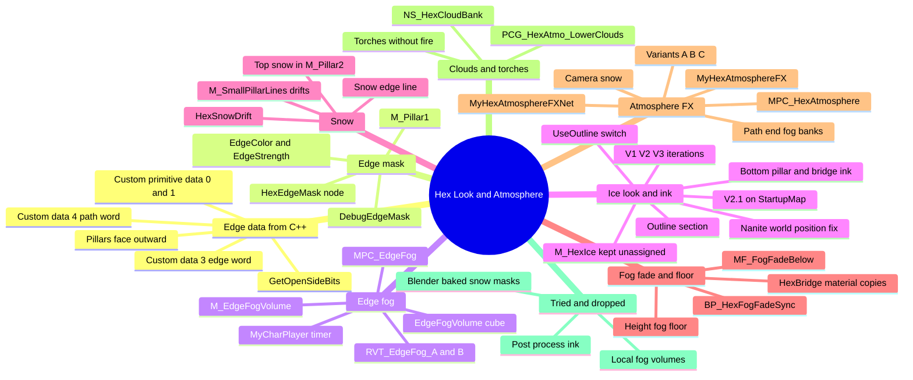
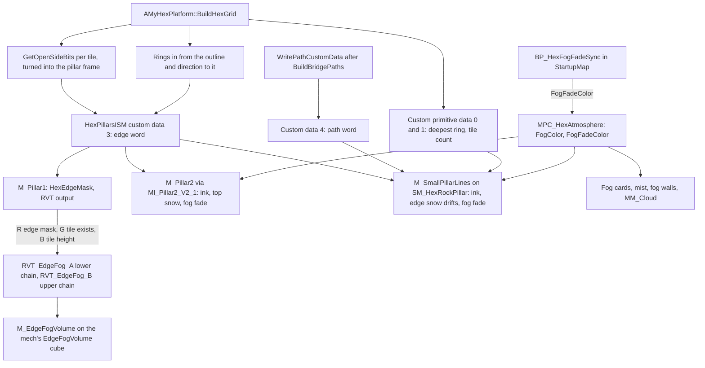
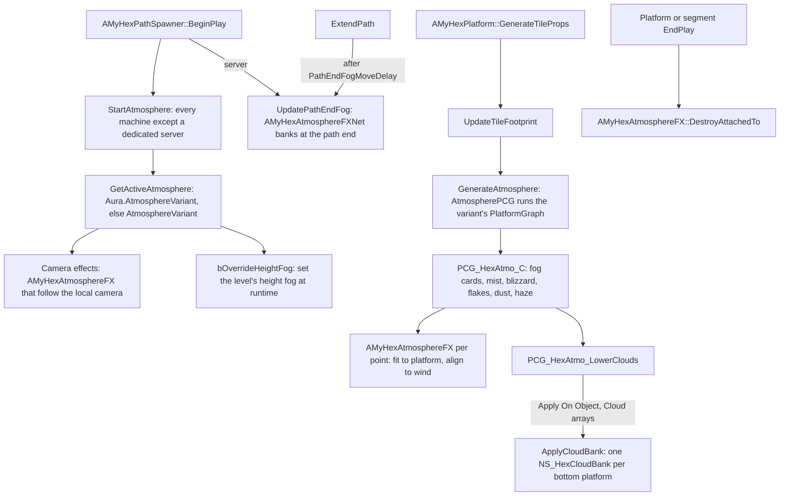
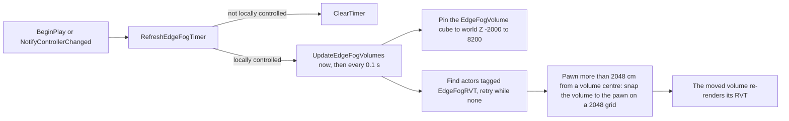

↑ [[Redo3 Changes Index]]

# Hex Look and Atmosphere

AuraRedo3 · redo3 · 808d60c..32a308e · 2026-10-16 to 2026-11-15

This page covers how the hex world looks: the materials on the pillars, props and stone bridges, the fog, mist, snow and clouds around the platforms, and the lighting of StartupMap. Most of it is cosmetic and runs locally on every machine that renders, not on a dedicated server; only the fog banks at the end of the path are spawned by the server and replicated. The C++ side is small but carries the data the materials need: `AMyHexPlatform` packs each tile's open sides, its rings in from the outline and its distance to the bridge path into per-instance custom data, `AMyCharPlayer` moves the edge fog's virtual texture volumes along with the local mech, and `AMyHexAtmosphereFX` is the one-Niagara-system actor that the atmosphere PCG graphs and the path spawner place.

Talal's asks, in order: on 2026-10-14 a mask "from the missing edge to the ones that have neighbors" in `M_Pillar1` ("i dont want the edge to follow collapsing tiles"); on 2026-10-20 fog on the platform edges, by "Writing to a virtual texture in pillars mat and reading that in the fog mat"; on 2026-10-24 Niagara fog and snow laid out by PCG to hide far platforms, in three variants judged against `L_Showcase`; on 2026-10-25 an ice look for `HexPillar` with lighting, sky and outlines toward a Borderlands 4 night clip (video `IHTCnpCLCPs`), in three iterations with one winner, changed on 2026-10-26 to outlines inside the existing materials with lines that stay thick and get "hand-drawn soft edges"; on 2026-10-30 the cheapest way to hide the bottom of the bottom pillars in fog; on 2026-10-31 clouds scattered naturally around the lower chain; on 2026-11-01 a cheaper atmosphere where the bridge torches keep their light but lose their fire; in early November snow drifts on the platform edges driven by custom edge data ("not baked in blender"), moved to the top platforms on 2026-11-05; and on 2026-11-05 ink lines that survive Nanite and also run on the bottom pillars and bridges.

State now (origin/redo3): all of it shipped in Talal's commit `808d60c` and the 2026-11-15 push. StartupMap has the V2.1 look (blue night, navy hand-drawn ink, blue mist), a dense fog floor under the lower chain, bottom pillars and stone bridges that fade into it, atmosphere variant C as the default, and bridge torches that keep their light without the fire. Two things are built but not visible as committed: the lower-chain clouds are saved with `CloudDensity` 0, and the edge fog cube on `BP_MyCharMech` has no mesh. The materials, Niagara systems, PCG graphs and maps are binary, so their node-level detail here comes from the commit messages and the thread and artifact notes.

## Mind map

## How it works

### From tile data to the materials

1. `BuildHexGrid` writes the edge data into every pillar's custom data once, after the grid loop, so every neighbour is already in `HexMap` (slots 0 to 2, falloff and tile XY, are written inside the loop). `GetOpenSideBits(Coord)` sets bit i when there is no tile at `Coord + Directions[i]`. Since `6a10353` each pillar is turned so its +X faces away from the platform centre, so the bits are rotated into the pillar's own frame: `((Bits >> Turn) | (Bits << (6 - Turn))) & 0x3F`.
2. Since `fa0ee5e`, custom data 3 is a packed edge word: bits 0 to 5 the local open sides, bits 6 to 11 the rings in from the outline (capped at 63), bits 12 to 19 the direction to the outline as an 8-bit angle (`PackHexAngle`). Custom data 4 is the path word (`PackHexPathWord`, written as "no path" first and filled in by `WritePathCustomData`, see [[Redo3 Path Paving]]). Custom primitive data 0 is `MaxEdgeRing` and 1 the tile count. The words are integers below 2^24, so they survive the float exactly.
3. `M_Pillar1` turns the open sides into an edge gradient with the `HexEdgeMask` Custom node, and, through a Runtime Virtual Texture Output node, writes it with a tile-exists flag and the encoded tile-top height into one RVT per chain.
4. The top pillars render with `MI_Pillar2_V2_1` on `M_Pillar2`: rock and cracks, then the in-material ink outline, then the top snow, then the fog fade. The bottom pillars (`SM_HexRockPillar`) render with `MI_SmallPillar_HexRock` on `M_SmallPillarLines`: ice top, glacier sides, ink, edge snow drifts and the fog fade. `M_Pillar1` and `M_Pillar2` read only the low open-side bits of the edge word.
5. `M_EdgeFogVolume`, a Volume-domain material on a cube that follows the local mech, samples both RVTs by world position and draws fog only near open edges.
6. `MPC_HexAtmosphere` is the one place the fog colours live: `FogColor` tints the fog cards, mist banks, fog walls and `MM_Cloud`, and `FogFadeColor` (kept in sync by `BP_HexFogFadeSync`) is the colour the pillars and bridges fade to. The Exponential Height Fog cannot read an MPC, so it is the one fog that is not linked.

### The atmosphere at runtime

1. `AMyHexPathSpawner::BeginPlay` calls `StartAtmosphere` before its authority check, so it runs on clients and listen servers too, but returns on a dedicated server. It picks the variant with `GetActiveAtmosphere`: the console variable `Aura.AtmosphereVariant` when it is 0 or more (read when Play starts), otherwise the spawner's `AtmosphereVariant` (C++ default -1, none; `BP_MyHexPathSpawner` uses 2, variant C).
2. For each of the variant's `CameraEffects` and `CameraSystems` it spawns an `AMyHexAtmosphereFX` that stays on the local camera (`SetFollowLocalCamera` with `CameraFXOffset`) with its own `SpawnRate` and gusts. With `bOverrideHeightFog` it also sets density, falloff, inscattering colour and the volumetric fog values on every `AExponentialHeightFog` in the level, at runtime only.
3. On the server, `UpdatePathEndFog` keeps a row of replicated fog banks across the end of the path. Each `ExtendPath` starts a timer of `PathEndFogMoveDelay` (6 s), so the banks stand in front of the new platforms while they spawn, then glide to the new end.
4. Each platform's `GenerateTileProps` (run from the tile props timer, see [[Redo3 Path Paving]]) first measures its footprint with `UpdateTileFootprint` and then calls `GenerateAtmosphere`, which gives `AtmospherePCG` the active variant's `PlatformGraph` (only when it changed, because `SetGraphLocal` does a structural refresh) and generates it locally. With no graph it cleans up what an earlier one spawned.
5. The variant C graph `PCG_HexAtmo_C` spawns `AMyHexAtmosphereFX` actors per point, each with one Niagara system set by a "System" property override, and calls the `PCG_HexAtmo_LowerClouds` subgraph. The clouds go through PCG Apply On Object into `Cloud*` arrays on `BP_MyHexPlatform`, and its `ApplyCloudBank` fills one `NS_HexCloudBank` component per bottom platform.
6. PCG does not destroy the actors it spawned when the spawning actor goes, so `AMyHexPlatform::EndPlay` and `AMyHexPathSegment::EndPlay` call `AMyHexAtmosphereFX::DestroyAttachedTo(this)`. A client never destroys a replicated one; the server's destroy reaches it.

## Hex edge mask

Built on 2026-10-14 and 10-15 in `M_Pillar1` (`/Game/Assets/MyPlatform/Mats/M_Pillar1`, backup `M_Pillar1_BeforeEdgeMask`) and committed by Talal in `808d60c`.

- **C++** (`AMyHexPlatform`): `GetOpenSideBits` returns 0 to 63, exact as a float. `Directions` is the same table as `GetNeighbors` and `GetEdgeInstances`: (1,0,-1), (1,-1,0), (0,-1,1), (-1,0,1), (-1,1,0), (0,1,-1). `NumCustomDataFloats` went from 1 to 4: 0 falloff, 1 and 2 the tile XY (`Loc2d`), 3 the open-side bits. The first write-up used slot 1, but `M_Pillar1` already read 1 and 2.
- **Why after the loop**: inside the grid loop later neighbours are not in `HexMap` yet, so every tile would read as an edge. The thread found Talal's first version inside the loop, plus a duplicate index 2 line and three stray includes, and fixed all three.
- **Material**: `PerInstanceCustomData` 3 as `Bits` and `LocalPosition.xy` as `P` go into the Custom node `HexEdgeMask` with `EdgeApothem` 83.64 (measured from the mesh) and `EdgeWidth` 167.27. Per open side it computes `saturate(1 - (Apothem - dot(P, n_i)) / Width)` with `n_i = (cos(-60 deg * i), sin(-60 deg * i))` and takes the max. A width of twice the apothem gives a gradient across the whole tile; a smaller one gives a rim. The output lerps BaseColor toward `EdgeColor` by `EdgeStrength`, and the `DebugEdgeMask` static switch sends the raw mask to Emissive (group `EdgeMask`). BaseColor was unconnected (black) before, so with mask 0 the look is unchanged.
- The layout is pointy-top and the pillar's flat sides face +-X, so no 30 degree offset was needed.
- **Collapsing tiles**: by Talal's choice the neighbours' bits are not rewritten when a tile falls, so the edge stays where the grid was built.
- **Facing outward** (`6a10353`, merged as `69cdf95` on 2026-11-15): each pillar is turned `FRotator(0, -60 * side, 0)` onto its most outward side, and the bits are turned with it. `M_Pillar1` projects its top crack and rock normal textures in pillar space, so after the turn the top pattern jumps at tile borders. The thread offered Fix, World or Leave, and Talal never chose. Details: [[Redo3 Hex Pillars and Breaking]].

## Edge fog

Built on 2026-10-20 by "Fog on platform edges" and committed in `9b3df08`; the RVT drawing on `HexPillarsISM` went in with `BP_MyHexPlatform` in `7b295de`, and the `EdgeFogVolume` component on `BP_MyCharMech` in `9d6fb14`.

Talal's RVT idea won over a small C++ texture of edge bits: about the same per-frame cost, no C++ texture code, and the gradient lives only in `M_Pillar1`.

- **Two chains, two RVTs.** An RVT is a flat top-down snapshot, and an RVT volume only captures geometry inside its own Z range, so each chain gets its own: `RVT_EdgeFog_A` (lower chain, volume `RVTV_EdgeFog_A` at Z -2500 to 2800) and `RVT_EdgeFog_B` (upper chain, `RVTV_EdgeFog_B` at Z 2800 to 9200). Both are Mask4, uncompressed, 1024 square over a 12288 cm volume (about 12 cm per texel), Movable and tagged `EdgeFogRVT`. Both RVTs are listed on the same `HexPillarsISM` with the main pass kept.
- **What `M_Pillar1` writes**: R the edge mask, G 1 (tile exists), B the tile-top height encoded through `MPC_EdgeFog` (`HeightEncodeMin` -2000, `HeightEncodeRange` 10000, so about 39 cm per 8-bit step). `M_EdgeFogVolume` recovers the height as `HeightEncodeMin + (B / G) * HeightEncodeRange`, which undoes the bilinear blend at outlines. `ChainA_TopZ` -190 and `ChainB_TopZ` 6050 are fallbacks.
- **`M_EdgeFogVolume`** (Volume domain, Additive): per chain, edge mask times a height band (`SpillDepth` 300 below the tile top, `FogHeight` 250 above), times panning 3D noise (`NoiseScale` 600, `NoiseSpeed` 40, `NoiseStrength` 0.6) and a box fade (`BoxFade` 0.25), then the max of the two chains. `FogDensity` is 1.0 because the fog pass divides extinction by 100. An ambient layer samples a volume texture from `/Game/ClossoUnlockingTheMagic_Texture/` (`AmbientFogDensity` 0.04, scale 3000, contrast 1.5, `AmbientFogFollowsMech` switch). Extinction feeds the Exponential Height Fog's volumetric fog. The graph is laid out in 7 named sections, each ending in a named reroute.
- **The cube**: `EdgeFogVolume` on `BP_MyCharMech`, 40 x 40 m across, absolute rotation and Only Owner See, so each player sees fog only around their own mech.
- **`AMyCharPlayer`** ("Edge Fog" category): `EdgeFogVolumeTag` `EdgeFogRVT`, `EdgeFogSnapStep` 2048, `EdgeFogUpdateInterval` 0.1 s (min 0.02), `EdgeFogCubeName` `EdgeFogVolume`, `EdgeFogCubeMinZ` -2000, `EdgeFogCubeMaxZ` 8200, and the callable `UpdateEdgeFogVolumes`. `RefreshEdgeFogTimer` only runs once the actor has begun play; `NotifyControllerChanged` (from `9b3df08`) and `BeginPlay` (the call was added in `2c1d78b`) both call it, and `EndPlay` clears the timer.
- **Snapping**: an RVT volume's location is its min corner and its scale is its size, so the centre is location plus half the scale. Moving a volume re-renders its RVT, so the volumes move in 2048 steps. Each volume is 12288 across, so the 40 m cube stays inside it.
- **History**: the first mover was `UpdateEdgeFogVolumes` on Event Tick in `BP_MyCharMech`; Talal asked for a C++ function on a timer and the Blueprint version was removed (backup `BP_MyCharMech_BeforeCppFog`). Upper-chain fog was missing at first because everything was sized for about 15 m and the upper tile tops sit at Z 5579 to 6967 (lower chain -1036 to 300). Talal then pointed out that platforms only spawn after `BeginPlay`; the PIE re-check found both volumes at the wrong heights because the pivot is the min corner, and they were reset to the ranges above.
- **Gotchas**: the chains are about 6000 apart, the same as the height fog's Volumetric Fog View Distance, so the other chain's fog fades out. The ambient volume texture is sRGB, which bends the density values. A brief flicker can show when a volume step re-renders its RVT.

## Ice look and ink outlines

### The FrozenNorse ice on M_Pillar1

On 2026-10-21 the "Beam and gunshot Niagara effects" thread gave `M_Pillar1` an ice look from `MM_Ice` and `MI_Ice_GlacialsKit` (FrozenNorse): subsurface ice with crack and cloud textures, a fresnel rim, crack glow, snow on tops (`SnowAmount` 0.35) and the glacier detail normal at two scales, keeping the edge glow, the RVT output and the per-tile offset (parameters `IceTile`, `CrackGlow`, `CloudDarkening`, `IceDark`, `IceLight` in the Ice group, backup `M_Pillar1_BeforeIce`). It reached git inside `9b3df08`. A redo from Talal's `pillar_ice_reference.jpg` was studied on 2026-10-22 but not built.

### M_HexIce, built and kept unassigned

On 2026-10-25 the ice-look thread built a separate ice material: `MF_HexIceSurface`, `M_HexIce`, `M_HexIce_GC` and their MIs, prop variants `MM_Ice_HexPlatforms` / `MM_Snow_HexPlatforms`, and the ramps and masks (`T_HexIce_Ramp`, 9 stops from #183f65 to #84f4fc, `T_HexIce_Masks`, `T_HexIce_N`, `T_HexSnow_Ramp`). It scored ice_match 91 (pass 80) at 672 instructions against `M_Pillar2`'s 920. At 01:03 on 2026-10-26 Talal changed course: no ice material on the meshes, outlines inside the existing materials. The assets stayed in the project unassigned and were committed for reference in `bf8dbba`. A planned post-process ink pass (`M_PP_InkOutline`) was dropped at the same time.

### Iterations V1, V2, V3 and V2.1

![[redo3_V1_V2_V3_compare.jpg]]
*V1, V2 and V3 side by side across the five views (`HexIceLook/V1_V2_V3_compare.jpg`).*

- 18 mesh slots went back to `M_Pillar2`, `M_Pillar2_GC`, `MI_Ice_GlacialsKit` and `MI_SnowPiles`, and plain copies `MM_Ice_Hex`, `MI_Ice_GlacialsKit_Hex`, `MM_SnowAssets_Hex` and `MI_SnowPiles_Hex` were made in `/Game/Assets/MyPlatform/HexPlatforms/Props/` for the ice shards and snow mounds ([[Redo3 Hex Tile Props]]).
- Each iteration has its own level copy (`StartupMap_IceV1` to `V3`, `StartupMap_IceV2_1`), its own MIs in `HexPlatforms/Iterations/` and a sky MI in `HexPlatforms/Sky/` (`M_Sky_HexPlatforms`). Presets (`V2.json`, `V3.json`, `V2_1.json`) and an apply script on Talal's PC switched them.
- **V1 "blue hour"** was too bright and pastel (mean luma 156 to 179 against the clip's about 74).
- **V2 "Borderlands night"**: deep-blue night, navy ink (#003e77 near, #025ea4 far), cerulean fog (#0359a5), a flat sky (#026ab5) and motion blur 0. The 37 bridge torches washed it yellow-green, so comparison shots used a PIE-only peach override.
- **V3 "graphic-novel night"**: bold ink.
- Four independent reviews picked V2's environment. A slot-swap error meant the final V2 shots carried V3's ink, so V2 and V3 looked alike; the pick stood, and every shot run now reapplies its own materials first.
- **V2.1** kept V2's lighting, fog and sky with V3-weight ink plus hand-drawn edges, a crisp moon (2.24 lux, skylight 0.70) and blue mist copies. It was applied to StartupMap on 2026-10-26 and costs about 2 fps for the outline (49 to 50 against 51 to 52 fps at view C).
- The same day `MPC_HexAtmosphere`'s `FogColor` was made to drive every fog and mist colour, and the bridge torches went back to their original light. By then Talal had changed the fog and mist colours himself; the torch restore was done in his open editor and StartupMap was left unsaved for him. On 2026-10-27, at his request, his own edits were snapshotted (`TalalEdits_20261027T235453Z`) and `M_Pillar2`, `MI_Pillar2_V2_1` and `MI_Pillar2_Bottom_V2_1` were reverted to V2.1.

![[redo3_V2_1_final_sheet.jpg]]
*The final V2.1 sheet: thick hand-drawn ink, crisp moon, blue mist (`HexIceLook/V2_1/V2_1_final_sheet.jpg`).*

### The Outline section

The ink is drawn inside each material, not in post-process. In `M_Pillar2` the chain is `OL_AttrIn`, the ink (`SetMaterialAttributes_1`), the `UseOutline` static switch, then the `[SNOWTOP]` snow (which covers the ink where snow lies), then `FF_AttrIn` and the `FogFadeBelow` switch: snow over the lines, fog over everything. The same HLSL is in `M_Pillar2_GC`, `MM_Ice_Hex` and `MM_SnowAssets_Hex`.

| Part | Custom node | What it does |
|---|---|---|
| (a) silhouette | `CN_InkSilhouette` | Line from the view angle, width kept in pixels (`SilhouetteWidth` 5 px; `FacetSilhouette` 0.45 on props) |
| (b) crease | `CN_InkCrease` | Facet against vertex normal mismatch plus curvature (`CreaseStrength`, `CreaseThreshold` 0.04, `CreaseRadius` 5 cm) |
| (c) hex edge | `CN_InkHexEdge` | Pillars only: rim and corner lines on open faces in the mesh frame, from the pre-skinned local position so GC pieces match (`EdgeWidthPx` 5, `PillarApothemLocal` 83.64, 87.1 on the old `HexPillarBottom`) |
| (d) distance fade | `CN_InkFade` | Lines widen from 30 m to 2.5x at 150 m (`InkFarStart` 3000, `InkFarEnd` 15000, `FarWidthScale` 2.5), fade from 500 m and are gone at 1 km (`FadeStart` 50000, `FadeEnd` 100000) |
| (e) combine | `CN_InkCombine` | `OutlineAmount x InkOpacity x Fade x max(Sil, Crease, Edge)`, pushes BaseColor toward `InkColor` #003E77; Emissive and Subsurface dimmed under lines |
| (f) hand-drawn | `CN_InkHandDrawn` | Feathered edges and brush wobble (`InkWobbleAmount` 0.28, `InkWobbleScale` 0.03, `InkEdgeSoftness` 0.5); the line never gets thinner; corner verticals taper 1 to 1.5 m below the rim |

- `UseOutline` defaults to off, so the material compiles back to its original cost (920 PS and 352 VS instructions in `M_Pillar2`); the V2.1 instances turn it on. `OutlineAmount` 0 hides the lines but keeps the cost.
- V2.1 uses the V3 ink as its floor (5 px edges and silhouettes, crease 2.5, facet 0.45, local colour 42% darker mixed 70% navy) and takes the max of that and the hand-drawn extension, because Talal asked for lines that are not thinner than V3.
- `M_Pillar2_GC` divides z by `GCHeightRatio` (0.3, 0.7 and 1.6 for the three top pillar GCs) and treats every side as open. Props have no hex-edge part; on 2026-11-06 their section was laid out like the pillar's with an empty "(c) Hex edges: none on props" box, with no functional change.
- Faces that had a neighbour when the grid was built get no rim ink, and distant platform edges get little ink; that would need a screen-space pass.
- The editor console commands that made these graphs editable from scripts (`Aura.MatAddComment`, `Aura.MatResizeComment`, `Aura.MatLinkReroutes`, `Aura.MatSetAttributeInput` and others) are in `ce1125d`; see [[Redo3 Engine Tools and Assets]].

### Ink under Nanite

On 2026-11-01 `r.Nanite.ProjectEnabled` went from False to True (committed in `82f5399`, for the bottom pillars' snow displacement), so meshes that already had Nanite on started rendering as Nanite. Each material's pixel depth offset dither then went into the depth the ink reads, the WorldPosition it rebuilt jittered, and the crease and silhouette lines flooded or vanished. Talal suspected the "Used with Nanite" flag, but it was already on. On 2026-11-05 the WorldPosition nodes feeding `CN_InkFade`, `CN_InkCrease` and `CN_InkSilhouette` in `MM_Ice_Hex`, `MM_SnowAssets_Hex`, `M_Pillar2` and `M_Pillar2_GC` were set to Camera Relative excluding material shader offsets (`WPT_CameraRelativeNoOffsets`), a property change only. `HexPillar`'s Nanite, which Talal had turned off to test, was turned back on.

### Bottom pillars and bottom bridges

- **Bottom pillars** (`M_SmallPillarLines` / `MI_SmallPillar_HexRock` on the Nanite, tessellated `SM_HexRockPillar`): the ink sits after the `[ICE]` / `[GLACIER]` result and before the `[SNOW]` lerps, with a (g) mask that keeps it on the sides. The mesh has hard slab edges, so the first pass gave only scattered facet flecks. Talal turned them off (`FacetSilhouette` 0) and picked a rim line (`RimLineAmount`, about 79 instructions), which the hanging snow hid. He then picked "Under the snow edge": an (h) `CN_InkSnowEdge` line, 8 px navy (`SnowEdgeWidthPx` 8, `SnowEdgeLineAmount` 1), drawn just below the lower edge of the snow spill from the snow's own inputs. With the ink off the material is 1757 PS / 343 VS instructions.
- **Bottom bridges**: `MM_Cliffs_HexBridge` (5 cliff MIs and `MI_Cliffs_Tiles_HexBridge` for the landing) and `MM_SnowAssets_HexBridge` (`MI_SnowPiles_HexBridge`) carry the ink with no hex-edge part, before the snow blend and `FF_AttrIn`, with the prop V2.1 values. The GC debris and the shared torch material `M_BridgeWood` were left out. See [[Redo3 Hex Bridges]].

## Snow build-up

### Packed edge data

Talal turned down snow masks baked in Blender and asked for HLSL driven by custom edge data, like the edge mask. `fa0ee5e` therefore extends `BuildHexGrid`:

- A breadth-first walk from every tile with an open side (ring 0) gives each tile its ring in from the outline.
- The direction to the outline is the normalised sum of unit vectors toward open sides and toward neighbours one ring closer, turned into the pillar's frame by +60 degrees times its outward side.
- Custom data 3 becomes `LocalOpenBits | (min(ring, 63) << 6) | (PackHexAngle(LocalDir) << 12)`. The material extends ring and direction into a distance to the outline that runs on across tiles: `ring * spacing + spacing / 2 - dot(LocalXY, Dir)`.
- Custom data 4 starts as `PackHexPathWord(15, 0)` (no path) until the bridge paths are laid.
- `SetCustomPrimitiveDataFloat(0, MaxEdgeRing)` and `(1, HexMap.Num())`, so the snow can scale its reach by platform size.
- `NumCustomDataFloats` is 5. The ArtStation thread had used 7 floats before packing them into these 5.

### Edge snow drifts on the bottom pillars

`M_SmallPillarLines` (bottom pillars, see [[Redo3 Hex Pillars and Breaking]] for the mesh, the ice top and the glacier sides) builds snow piles along the platform's outer edge with Nanite displacement. The `HexSnowDrift` Custom node reads the edge word and fades the drift per tile with noise (`SnowReachTiles` 3, `SnowRimSoftness` 30, `SnowPileHeight` 25, `SnowReachFraction` 0.3, `SnowRefRings` 5, displacement magnitude 120, path snow `SnowPathHalfWidth` 100 and `SnowPathBankWidth` 130 cm). The masks come from a flat-top test with the exact per-mesh top outline (`SnowShape` 3 is a perfect hex for `SM_HexRockPillar`). Displacement is rebuilt after the fog fade blend, because blending it with the fog factor had shattered the underside. These values come from the M_SmallPillarLines document of 2026-11-05. The same day Talal had the bottom snow reverted to its state before that day's brief: the thread says the revert removed the size scaling and the path snow and kept only the packed data, while the `fa0ee5e` message still says the drifts "stay off the paths". The material is binary, so which of the two shipped is not confirmed.

![[redo3_top_snow_off_on.jpg]]
*Top snow build-up off and on (`top_snow_off_on.png`).*

### Top snow on M_Pillar2

The same day the build-up went onto the top platforms in `M_Pillar2` (`[SNOWTOP]`, built by `build_snow_top.py`), reusing the `HexSnowDrift` code as a height offset. The first version showed the rock normal and a wet-rock tint; it now has its own mound normal (`SnowTopNormalBlend` 1, `SnowTopMoundNormal` 1, `SnowTopNormalMinFeature` 10 cm). The last recorded pass ("Top Snow Build-up v3") caps piles at 50 cm (`SnowTopPileHeight`, they had reached 180 cm with steep walls at tile seams) and uses the bottom's seam fade (`SnowSeamSoftness` 31.15, `SnowRimSoftness` 30, `SnowReachTiles` 4, `SnowTopDriftColor` (0.85, 0.9, 1), `SnowTopRoughness` 0.65). With `SnowTopSmoothAllSnow` 1 every snowy surface drops the rock normal and the depth dither and covers the ink and glow. Gotcha: UE asserts when a script deletes the `[SNOWTOP]` nodes, so restore from the `.bak-before-snowtop` copy instead.

## Fog fade and the fog floor

Talal asked for the cheapest way to hide the bottoms of the lower chain's pillars. The answer was to keep the pillars opaque and blend their lowest metres to the exact fog colour inside the material: with BaseColor, Metallic and Specular at 0 a pixel equals its Emissive F, and height fog turns `pixel * (1 - f) + F * f` back into F at any distance. Opacity masks, fog cards and denser volumetric fog were compared and not used.

- **`MF_FogFadeBelow`** (Material Attributes in and out) measures depth below the pillar top (`MF_FogFadeDepth_Pillar`, `u = -LocalZ / MeshLengthLocal`) and over `FadeStart` and `FadeLength` pushes BaseColor, Metallic and Specular to 0, Roughness to 1 and Emissive to the target colour. Pillars start fading 1.5 m below the tile top and are gone by 5 m (`FogFadeStart` 150, `FogFadeLength` 350).
- **Target colour**: `MF_FogFadeTarget` (with `MF_FogFadeLineIntegral`) rebuilds the colour of the void (the sky abyss at 1.185 times the fog colour plus a cyan volumetric in-scatter within 75 m) from constants in `MPC_HexAtmosphere`, and `BP_HexFogFadeSync`, placed in StartupMap, keeps `FogFadeColor` in sync with the fog. Height fog, the sky below the horizon and the fade have to share one colour for the match to hold.
- In `M_Pillar2` it sits behind a `FogFadeBelow` static switch that only `MI_Pillar2_Bottom_V2_1` turns on; that was built for the `HexPillarBottom` tiles. Since the bottom tiles use `SM_HexRockPillar` (`7b295de`), the fade that matters there is the one `M_SmallPillarLines` runs last, before the displacement.
- **Stone bridges** fade from deck height with `MF_FogFadeDepth_Deck`, reading the deck line that `BP_MyHexBridge2` writes into custom primitive data. They use the copies `MM_Cliffs_HexBridge` and `MM_SnowAssets_HexBridge` and their seven MIs in `HexPlatforms/Bridge/`, applied through overrides in `PCG_Bridge2`, so the FrozenNorse originals are untouched.
- **Result**: pillar ends land within 2 to 8 colour steps of the fog, against 45 to 79 before. Cost: +27 pixel-shader instructions on the pillars, +56 to +132 on the bridges.
- **Fog floor** (StartupMap's Exponential Height Fog, 2026-10-31): start distance 15 m to 0, first layer density 0.02 to 0.01, and the second fog layer as a floor (density 1.0, falloff 2, the engine maximum, height offset -746.48). Talal kept this middle setting: pillar ends went from 19 to 8 colour codes off the void in side view, upper-chain visibility from 391 m to 818 m, and the lowest platforms stay readable at 15 to 20 m, for about 0.1 ms. A full hide is possible with offset -246.48 and the MPC's `FogFadeFog2` z at 17.5; a denser floor that was tested (G24) hid the ends better but lost the neighbours of the lowest platforms at 15 to 35 m. Talal's re-imported 12.4 m bottom pillar (`HexPillarBottom`, `MeshLengthLocal` 618.7) was the mesh this was tuned on.

## Atmosphere effects

### AMyHexAtmosphereFX

One Niagara system (fog, mist, snow, dust) per actor, placed by a PCG graph or by code; the actor's scale scales the effect. The base class does not replicate, because the platform graphs run on every machine. `AMyHexAtmosphereFXNet` replicates (`bAlwaysRelevant`, no movement replication) for effects spawned by the server: the path-end fog and the segment graph's mist banks.

| Setting | Default | What it does |
|---|---|---|
| `System` | none | The effect, set before `BeginPlay` (PCG property override) or with `SetSystem`; replicated initial only |
| `MaxDrawDistance` | 0 | Cull distance of the Niagara component; 0 = never by distance |
| `MoveSpeed` | 4000 | cm/s for `SetMoveTarget`; 0 = jump |
| `bAlignToWind`, `WindYawOffset` | false, 0 | Turn to the path spawner's `WindYaw` (default 30) so every effect blows the same way |
| `bFitToPlatform` | false | Scale XY so `FitBaseRadius` (4000) covers the platform footprint radius plus `FitMargin` (1000), times `FitRadiusScale` (1), clamped to `FitScaleRange` (0.05 to 20); `FitScaleZ` 0 keeps Z |
| `bFitCenter`, `FitZOffset` | true, 0 | Move to the footprint centre, above the highest tile top |
| `SpawnRateParameter`, `SpawnRateAtScale1` | none, 0 | Set this user float to rate x scale X x Y x Z x `DensityScale` (1), capped by `MaxSpawnRate` (0 = none) |
| `GustAmount`, `GustPeriod` | 0, 8 s | Gusts and lulls: two octaves of Perlin noise dip the rate by up to `GustAmount` |
| `FloatParameters`, `VectorParameters` | empty | User parameters set before the effect starts |
| `bFollowLocalCamera`, `FollowOffset` | false, zero | Stay on the local player's camera (falling snow around the player) |

- Tick is off until needed (gusts, camera follow, gliding), in `TG_PostUpdateWork`. The Niagara component has no collision, no navigation and no shadow, and does not auto-activate.
- PCG attaches the actors it spawns after their `BeginPlay`, so with `bFitToPlatform` or `bAlignToWind` the start waits a tick. `FitToPlatform` uses the attach parent (or owner) and calls `UpdateTileFootprint` if the platform has not measured it yet.
- `SetMoveTarget` bumps a replicated counter, so a client can tell the first target (a jump) from later ones (a glide at `MoveSpeed`, turning up to 30 degrees a second).

### Atmosphere variants

`FMyHexAtmosphereVariant` on `AMyHexPathSpawner::AtmosphereVariants` holds one layout: `Name`, `PlatformGraph` (run by every platform's `AtmospherePCG`), `CameraSystems` and `CameraEffects` (`FMyHexCameraEffect`: `System`, `SpawnRate`, `GustAmount`, `GustPeriod` 8), `CameraFXOffset`, and an optional height fog override (`FogDensity` 0.02, `FogHeightFalloff` 0.2, `FogInscatteringColor` black, `bVolumetricFog` true, `VolumetricFogDistance` 6000, `VolumetricFogExtinctionScale` 1, `VolumetricFogScatteringDistribution` 0.74, `VolumetricFogAlbedo` white). Layouts can be swapped without rewiring graphs.

- On 2026-10-24 three layouts were built from the `L_Showcase` ground fog card and five Niagara systems (`NS_SnowGPU`, `NS_SoftSnowing`, `NS_Mist01`, `NS_DustParticles`, `NS_NS1_Fog_01`), as copies in `/Game/Assets/MyPlatform/VFX/` (`NS_HexAtmo_Blizzard`, `NS_HexAtmo_Flakes`, `NS_HexAtmo_Mist`, `NS_HexAtmo_Dust`, `NS_HexAtmo_Clouds`, fog cards `M_HexGroundFog` / `MI_HexGroundFog` / `MI_HexFogSkirt`, effect types `FXT_HexAtmosphereNear`, `FXT_HexAtmosphereFar`, `FXT_HexAtmoVolume` and others).
- Five judges scored them: A "reference match per platform" (`PCG_HexAtmo_A`) 5.63, B "player-local snow plus PCG ground layers" (`PCG_HexAtmo_B`) 5.68, and C "natural clustering", denser in gaps, under bridges and at drop-offs, 6.30. C was tuned to C-final4, the default: a camera-following blizzard (13,500 particles a second) and flakes, fog pools only two or more rings in from a rim, fog cards cut from 702 to 147, and 24.7 ms GPU in the main view against 23.4 ms before.
- The earlier layout of the same morning put fog and snow chains straight into `PCG_HexTileProps3` and the segment graph; see [[Redo3 Hex Platform PCG#Fog banks, atmosphere and PCGNiagaraInterop]]. The platform-level layouts replaced it.
- `PCG_HexAtmo_C` itself first appears in git in `08a123a`; `PCG_HexAtmo_A` and `_B` are in `b5ff0ef`.

### Path-end fog banks

Server-only, in `AMyHexPathSpawner` ("Hex Path|Fog"): `PathEndFogSystem` (none = off), `PathEndFogCount` 3, `PathEndFogSpacing` 5000 (cm at `HexRadius` 100), `PathEndFogBackOff` 0, `PathEndFogZOffset` 0, `PathEndFogScale` 1, `PathEndFogMoveDelay` 6 s and `PathEndFogMoveSpeed` 6000 cm/s. `UpdatePathEndFog` lines the banks up across the last spline point's heading, scaled by `GetLayoutScale()`, spawns any that are missing as `AMyHexAtmosphereFXNet` and sends all of them a move target. `EndPlay` destroys the banks and the camera effects. The 2026-10-24 setup used 4 banks of `NS_HexFogWall` (spacing 5500, Z offset -1000 cm), and since `32a308e` the map's spawner uses `NS_HexFogWall_Cerulean`.

### One fog colour and the blue mist

For V2.1 Talal picked "Tint it blue (copies)": the two mist references in `PCG_HexAtmo_C` were pointed at cerulean copies, and the path spawner's fog walls use `NS_HexFogWall_Cerulean`. The copies (`NS_HexAtmo_Mist_Cerulean`, `NS_HexMistBank_Cerulean`, `NS_HexFogWall_Cerulean`) render through `M_Mist_HexFog` / `MI_Mist_HexFog`; the originals are untouched. The ground fog cards did not move; only those two references changed. `FogColor` in `MPC_HexAtmosphere` feeds the fog cards, the rim mist, the mist banks and the fog walls, each keeping its own tint and alpha on top, and `MM_Cloud` (VFXASandbox) reads it too. `BP_Sky_Sphere` can build its sky from an `MI_Sky_HexPlatforms` instance.

## Lower-chain clouds and torches

- **Clouds** (2026-10-31): Talal asked for `PS_Clouds_Wind` scattered naturally around the lower chain, from his reference images. `NS_HexCloudsWind` is a lighter copy (about a quarter of the sprites, culled at 250 m by `FXT_HexCloudsWind`) on `M_HexCloudWind`, which computes fog per vertex (1,010 to 388 pixel instructions). The 77-node subgraph `PCG_HexAtmo_LowerClouds`, called from one "Lower-chain clouds" node in `PCG_HexAtmo_C`, places side clouds, near clouds, bridge clouds and void banks 25 to 70 m out (knobs `CloudDensity`, `SideDensity`, `NearDensity`, `BridgeDensity`, `VoidDensity` 0.5, `CloudSeed` 7001, `UpperChainClouds` off; Talal chose to remove the top-chain clouds and turned down a 3x count). 8-vertex sprite cutouts and GPU simulation followed; the real GPU-sim saving was about 1 ms, not the 6.5 ms first reported.
- **One cloud bank per platform** (2026-11-01): PCG Apply On Object writes the cloud points into `Cloud*` arrays on `BP_MyHexPlatform`, and `ApplyCloudBank` (on `BeginPlay` and when `AtmospherePCG` finishes) fills the user arrays of one `NS_HexCloudBank` component per bottom platform. 543 systems became 62, cloud sim went from 2.2 to 4.7 ms down to 0.2 to 0.4 ms, and memory from 9.2 to 7.5 MB. To roll back, enable the four `LC_*Spawn` nodes and disable `LC_BankApply`.
- **Stutter and jitter**: clouds slept while on screen and re-ran a 16 s warm-up each time they woke, so turning toward about 90 of them spiked frames to 65 to 108 ms. They now start from a pre-aged burst, occluded clouds do not sleep and off-screen clouds pause instead of resetting (worst frame about 40 ms). The jitter came from the GPU sort order; sprites now sort by spawn order.
- **Saved off**: the "Lower-chain clouds" node overrides `CloudDensity` to 0, so no clouds show until that override is set to 1 or unticked. A Save All on 2026-11-01 had stored a test value of 1, which was set back to 0.
- **Torches**: the 126 bridge torch fires cost 2.9 to 3.9 ms of GPU sim, so `B_BridgeTorchFire` keeps its point light and flicker but loses the fire Niagara (1.7 to 3.4 ms faster frames). See [[Redo3 Hex Bridges#Torches]].
- **The rest of the 2026-11-01 pass** ("Hex atmosphere costs"): a cloud gate (bridge clouds only from bottom platforms, nothing spawned at density 0; atmosphere startup generation 1,064 to 339 ms), pre-aged haze banks and fog walls, blizzard sorting off at half rate, mist visible to 850 m with a 650 to 820 m fade, flake and dust caps from 10 to 5, and unlit fog cards (`M_HexGroundFogUnlit`), together 0.2 to 0.4 ms per view on the 107-platform layout.

## StartupMap lighting

`32a308e` saves StartupMap with the V2.1 look: the sky MI on `BP_Sky_Sphere`, the post-process volume, the moon and skylight, the fog floor described above with start distances 0, `BP_HexFogFadeSync` placed, and the path spawner on `NS_HexFogWall_Cerulean` with the map's `HexRadius` and `ExtendDistance`. It also holds test placements (airship, air explosion, respawn FX, clouds) and a new `StartupMap_BuiltData`. The renderer settings the look depends on (Nanite on, and with it virtual shadow maps for the sun, dynamic GI off, GI and reflection quality pinned at 1) are in `82f5399`; see [[Redo3 Engine Tools and Assets]] and, for the pinned quality settings, [[Redo3 Menus and Settings]].

## Tried and dropped

- **`M_HexIce`**: a separate ice material that passed its score test but was replaced by outlines inside the existing materials (`bf8dbba`, unassigned).
- **Post-process ink** `M_PP_InkOutline` (`CN_InkWidth`, `CN_DepthEdge`, `CN_NormalEdge`, `CN_InkCombine`): planned, dropped with the course change.
- **Local Fog Volumes under the lower platforms**: a per-platform volume 3 m below each lower platform's top was planned (about +0.3 ms typical, +0.4 to 0.8 ms crowded) and never built. The opaque fade and the fog floor took its place.
- **Opacity masks and fog cards** to hide the pillar ends: compared and not used.
- **Blender-baked snow masks**: turned down by Talal in favour of HLSL from the custom data.
- **The bottom pillar rim line**: built, hidden by the snow spill, replaced by the snow-edge line.
- **More clouds**: a 3x count (about 600 clouds, 6 to 8 ms looking down) was turned down, and the top-chain clouds removed.

## How it changed

- **2026-10-14 to 10-15**: "Hex edge mask in material" writes `HexEdgeMask.md` (the C++, the Custom node HLSL and the side table), checks Talal's C++, builds the mask in `M_Pillar1` and moves the bits loop after `GetEdgeInstances()`. Talal decides the edge does not follow collapsing tiles.
- **2026-10-16 07:29** `808d60c` (Talal's commit): `GetOpenSideBits`, `NumCustomDataFloats` 4, custom data 1 to 3 (tile XY and open sides), `M_Pillar1` with the mask and the `M_Pillar1_BeforeEdgeMask` backup. The same commit carries the swing phase animations, the first `NS_Claude_*` beam effects and a scale-based fall speed in `ActivateHexLocal` ([[Redo3 Mech Swing Animation]], [[Redo3 Beam and Gun FX]], [[Redo3 Hex Pillars and Breaking]]).
- **2026-10-20 07:42** `6a10353`: pillars face outward and the bits turn with them (merged into redo3 as `69cdf95` on 2026-11-15). The `M_Pillar1` top seam question stays open.
- **2026-10-20**: the edge fog: RVTs, `MPC_EdgeFog`, `M_EdgeFogVolume`, the fog cube, the Blueprint mover moved to a C++ timer, the upper-chain fix, the height re-check and the ambient layer. Uncommitted.
- **2026-10-21**: the FrozenNorse ice layer on `M_Pillar1`. Uncommitted.
- **2026-10-24**: the optimisation pass adds `AMyHexAtmosphereFX`, the path-end fog banks and the fog and snow PCG nodes; atmosphere variants A, B and C are judged and C-final4 becomes the default. Uncommitted.
- **2026-10-25 to 10-26**: `M_HexIce` is built and then dropped at the 01:03 course change; the Outline section, iterations V1, V2 and V3, then V2.1 applied to StartupMap; blue mist copies; one global `FogColor`; torches back to their original light. Uncommitted.
- **2026-10-27 to 10-28**: Talal's own edits are snapshotted, the three pillar assets are reverted to V2.1 and the ink document is published.
- **2026-10-30**: the fog fade (`MF_FogFadeBelow` and its helpers, `BP_HexFogFadeSync`, the `_HexBridge` material copies). Uncommitted.
- **2026-10-31**: the fog floor on StartupMap (middle setting), the re-imported 12.4 m bottom pillar, the Local Fog Volume plan (not built), and the lower-chain clouds with cutouts and GPU sim. Uncommitted.
- **2026-10-31 to 11-05**: "Build material from ArtStation reference": `SM_HexRockPillar` and `M_SmallPillarLines` with the ice top, glacier sides and Nanite edge snow; the packed custom data; on 11-05 the bottom snow is reverted and top snow is built in `M_Pillar2`. Uncommitted.
- **2026-11-01**: the atmosphere cost pass: torch fire removed, one cloud bank per platform, stutter and jitter fixes, cloud gate and cheaper mist, haze, fog walls and fog cards. `r.Nanite.ProjectEnabled` is switched on. Uncommitted.
- **2026-11-05 to 11-06**: the ink fix under Nanite, the props' Outline section tidied, ink on the bottom pillar sides with the snow-edge line, and ink on the bottom bridges. Uncommitted.
- **2026-11-15 14:18**, the "Push local changes to GitHub" thread splits Talal's working copy into topic commits:
  - `9b3df08`: the edge fog (`RVT_EdgeFog_A/B`, `MPC_EdgeFog`, `M_EdgeFogVolume`, `M_Pillar1` with the RVT output and the 10-21 ice layer) and the `AMyCharPlayer` mover with its 0.1 s timer and 2048 cm snap.
  - `b5ff0ef`: `AMyHexAtmosphereFX` / `AMyHexAtmosphereFXNet`, the spawner's path-end fog banks, camera effects and `AtmosphereVariants`, `PCG_HexAtmo_A/B`, the `NS_HexAtmo_*` and fog and snow copies, fog cards, effect types and `MPC_HexAtmosphere`, platform footprint and `GenerateAtmosphere`, and the segment's `EndPlay` cleanup. The bottom chain, GCs and far breaks in the same commit are on [[Redo3 Hex Pillars and Breaking]]. The `AtmospherePCG` component itself is created, and `GenerateAtmosphere` called, only in `5ccdfef`.
  - `cf4ec00`: the V2.1 look: `MM_Ice_Hex`, `MM_SnowAssets_Hex` and their MIs with ink, the ice shard and snow mound meshes and GCs on them, `HexPillar` on `MI_Pillar2_V2_1` with Nanite, the iteration MIs, sky materials and `StartupMap_IceV*` levels, the cerulean mist copies, `BP_Sky_Sphere` and `MM_Cloud`.
  - `bf8dbba`: the unassigned `M_HexIce` set and its textures.
  - `ac1b069`: the fog fade functions, `BP_HexFogFadeSync` and the `MM_Cliffs_HexBridge` / `MM_SnowAssets_HexBridge` copies with seven MIs (with the 11-06 ink).
  - `08a123a`: `PCG_HexAtmo_LowerClouds`, `PCG_HexAtmo_C`, `NS_HexCloudsWind`, `NS_HexCloudBank` and their materials and effect types, and `B_BridgeTorchFire` without fire.
  - `fa0ee5e`: `SM_HexRockPillar`, the small pillars, `M_SmallPillarLines` and `M_Pillar2` with snow, ink and `FogFadeBelow`, and the packed edge word, path word and custom primitive data in `AMyHexPlatform`. The glacier textures followed in `1e23b9d` (15:09) once the licence question was answered.
  - `32a308e`: StartupMap with the V2.1 lighting, the fog floor, `BP_HexFogFadeSync` and the cerulean fog walls.

## Threads that worked on it

- [[Redo3 Threads#Hex edge mask in material|Hex edge mask in material]]: the open-side bits, the `HexEdgeMask` node in `M_Pillar1` and the fixes to Talal's C++ (`808d60c`).
- [[Redo3 Threads#Hex grid instances face outward|Hex grid instances face outward]]: turned every pillar outward and rotated the open-side bits into its frame (`6a10353`); left the top texture seam question open.
- [[Redo3 Threads#Fog on platform edges|Fog on platform edges]]: the per-chain RVT edge fog, the C++ mover, the height fixes and the ambient layer, plus the structure document.
- [[Redo3 Threads#Beam and gunshot Niagara effects|Beam and gunshot Niagara effects]]: the FrozenNorse ice look on `M_Pillar1` on 2026-10-21.
- [[Redo3 Threads#Add far-break ISMs for distant tiles|Add far-break ISMs for distant tiles]]: `AMyHexAtmosphereFX`, the path-end fog, the fog and snow copies and the A, B and C atmosphere variants.
- [[Redo3 Threads#Fix and extend the hex ink lines|Fix and extend the hex ink lines]]: `M_HexIce`, the iterations and V2.1, the in-material ink, the global fog colour, the Nanite fix and the ink on the bottom pillars and bridges.
- [[Redo3 Threads#Optimize the hex atmosphere effects|Optimize the hex atmosphere effects]]: the fog fade, the fog floor, the lower-chain clouds and cloud banks, the torch fire removal and the atmosphere cost pass.
- [[Redo3 Threads#Build material from ArtStation reference|Build material from ArtStation reference]]: the packed edge data, the Nanite snow drifts on the bottom pillars and the top snow in `M_Pillar2`.
- [[Redo3 Threads#Push local changes to GitHub|Push local changes to GitHub]]: committed all of it on 2026-11-15, from `9b3df08` to `32a308e`, plus `1e23b9d`.

## Artifacts and files

Edge mask and edge fog:
- [[Redo3 Artifact - Hex Edge Fog - Structure and Flow]]: the edge fog system with a mind map, the data flow, the runtime flow and a reference table of every asset and setting.
- [[Redo3 Artifact - Hex Edge Fog - earlier draft]]: the 2026-10-20 draft of the same document, written before the C++ mover was compiled into the editor.
- [[Redo3 Files - Hex Edge Mask]]: `HexEdgeMask.md`, the side table, `GetOpenSideBits` and the Custom node HLSL.

Ice look and ink:
- [[Redo3 Artifact - Ice look comparison page]]: the style target, the baseline, the course change, all iterations in five views, scores and the outline cost.
- [[Redo3 Artifact - Ink lines in the hex pillar materials]]: the Outline section node by node, with the `HexPillar` measurements, the parameter table and 12 diagrams.
- [[Redo3 Artifact - Ink lines under Nanite]]: the cause and the WorldPosition fix of 2026-11-05.
- [[Redo3 Artifact - Props outline section layout shots]]: the props' Outline section laid out like the pillar's.
- [[Redo3 Artifact - Bottom pillar ink first pass shots]]: the first ink pass on `M_SmallPillarLines` and why only flecks drew.
- [[Redo3 Artifact - Bottom pillar rim line shots]]: the hidden rim line and the three options Talal chose from.
- [[Redo3 Artifact - Bottom pillar snow-edge line shots]]: the shipped snow-edge line.
- [[Redo3 Artifact - Bottom bridge ink shots]]: the ink on the stone bridge materials.
- [[Redo3 Files - Hex Ice Look and Ink Lines]]: the iteration sheets and the first ice material's before and after.

Snow:
- [[Redo3 Artifact - M_SmallPillarLines document]]: the bottom pillar material, its packed custom data and its HLSL.
- [[Redo3 Artifact - Top Snow Drift Normals]]: the top drifts' own mound normal.
- [[Redo3 Artifact - Top Snow Build-up v3]]: the capped, smooth top snow and the layer order in `M_Pillar2`.
- [[Redo3 Files - Snow and Ice Pillar Materials]]: renders and captures of the small pillars, the ice top, the glacier sides and the snow.

Fog fade, clouds and atmosphere:
- [[Redo3 Artifact - Hiding the bottom pillars in fog]]: the answer that chose the opaque fade, with six options compared.
- [[Redo3 Artifact - Fog fade captures]]: the fog floor and the material fade, with pixel checks and costs.
- [[Redo3 Artifact - Fog volumes under the lower platforms]]: the Local Fog Volume plan that was not built.
- [[Redo3 Artifact - Lower-chain clouds]]: the cloud subgraph, its knobs, cutouts and GPU sim.
- [[Redo3 Artifact - Hex atmosphere costs]]: the cost inventory of variant C and the 2026-11-01 results.
- [[Redo3 Artifact - Atmospherics comparison]]: variants A, B and C against `L_Showcase`, and the C-final4 tuning.
- [[Redo3 Artifact - Hex platform optimization - what changed]]: the 2026-10-24 pass, including the first fog and snow copies.
- [[Redo3 Artifact - Hex Platform FX Layout - PCG Nodes Added]]: the fog and snow PCG nodes of 2026-10-24 and the path-end fog wall settings.
- [[Redo3 Artifact - PCG layout - nodes added for fog and snow]]: a placeholder that points to the FX layout page.

## Where it lives

| What | Path |
|---|---|
| Edge data, footprint, atmosphere PCG | `Source/Aura/Public/Actors/MyHexPlatform.h`, `Source/Aura/Private/Actors/MyHexPlatform.cpp` (`BuildHexGrid`, `GetOpenSideBits`, `PackHexAngle`, `PackHexPathWord`, `WritePathCustomData`, `UpdateTileFootprint`, `GenerateAtmosphere`, `EndPlay`) |
| Edge fog mover | `Source/Aura/Public/Character/MyCharPlayer.h`, `Source/Aura/Private/Character/MyCharPlayer.cpp` (`RefreshEdgeFogTimer`, `UpdateEdgeFogVolumes`) |
| Atmosphere actor | `Source/Aura/Public/Actors/MyHexAtmosphereFX.h`, `Source/Aura/Private/Actors/MyHexAtmosphereFX.cpp` |
| Variants, camera effects, path-end fog | `Source/Aura/Public/Actors/MyHexPathSpawner.h`, `Source/Aura/Private/Actors/MyHexPathSpawner.cpp` (`StartAtmosphere`, `UpdatePathEndFog`, `Aura.AtmosphereVariant`), `/Game/Assets/MyPlatform/BP_MyHexPathSpawner` |
| Segment cleanup | `Source/Aura/Private/Actors/MyHexPathSegment.cpp` (`EndPlay`) |
| Pillar materials | `/Game/Assets/MyPlatform/Mats/` (`M_Pillar1`, `M_Pillar1_BeforeEdgeMask`, `M_Pillar2`, `M_Pillar2_GC`), `/Game/Assets/MyPlatform/geo/SmallPillars/` (`M_SmallPillarLines`, `MI_SmallPillar_HexRock`) |
| Edge fog assets | `/Game/Assets/MyPlatform/Mats/MPC_EdgeFog`, `/Game/Assets/MyPlatform/Mats/M_EdgeFogVolume`, `/Game/Assets/MyPlatform/RVT/RVT_EdgeFog_A`, `RVT_EdgeFog_B`; cube on `/Game/Level/MechChar/BP_MyCharMech` |
| Ice look iterations | `/Game/Assets/MyPlatform/HexPlatforms/Iterations/`, `HexPlatforms/Sky/`, `HexPlatforms/Levels/StartupMap_IceV*` |
| Prop materials with ink | `/Game/Assets/MyPlatform/HexPlatforms/Props/` (`MM_Ice_Hex`, `MM_SnowAssets_Hex` and MIs) |
| Unused ice material | `/Game/Assets/MyPlatform/HexPlatforms/Materials/` (`MF_HexIceSurface`, `M_HexIce`, `M_HexIce_GC`), `HexPlatforms/Textures/` |
| Fog fade | `/Game/Assets/MyPlatform/Mats/MF_FogFade*`, `/Game/Assets/MyPlatform/HexPlatforms/BP_HexFogFadeSync`, `HexPlatforms/Bridge/` (`MM_Cliffs_HexBridge`, `MM_SnowAssets_HexBridge`, 7 MIs) |
| Atmosphere graphs | `/Game/Assets/MyPlatform/PCGs/PCG_HexAtmo_A`, `_B`, `_C`, `PCG_HexAtmo_LowerClouds` |
| Atmosphere effects | `/Game/Assets/MyPlatform/VFX/` (`NS_HexAtmo_*`, `NS_HexFogWall`, `NS_HexMistBank`, fog cards, `FXT_*`), `/Game/Assets/MyPlatform/HexPlatforms/VFX/` (cerulean copies, `M_Mist_HexFog`, `NS_HexCloudsWind`, `NS_HexCloudBank`) |
| Global colours | `/Game/Assets/MyPlatform/HexPlatforms/MPC_HexAtmosphere` |
| Torch | `/Game/Assets/MyPlatform/Bridge/B_BridgeTorchFire` |
| Sky and clouds | `/Game/VFXASandbox/Environment/Sky/BP_Sky_Sphere`, `/Game/VFXASandbox/Environment/Clouds/00_Common/MM_Cloud` |
| Map | `/Game/Maps/StartupMap` |
| Renderer settings | `Config/DefaultEngine.ini` (`r.Nanite.ProjectEnabled`, `[ConsoleVariables]`) |
| Material edit commands | `Source/Aura/Private/StaticLib/AuraMaterialGraphCommands.cpp` |
| Scripts and backups | `Saved/ClaudeTools/` and `Saved/ClaudeBackups/` on Talal's PC (git-ignored) |

## Open items

- **Edge fog is not visible as committed**: the `EdgeFogVolume` component on `BP_MyCharMech` has no mesh (`9d6fb14`). It is also not recorded which top-pillar material writes the RVTs now: the RVT output was built into `M_Pillar1`, but `HexPillar` uses `MI_Pillar2_V2_1` on `M_Pillar2` since `cf4ec00`, and no thread says `M_Pillar2` got an RVT output. Whether the `RVTV_EdgeFog_A/B` volumes are in the committed StartupMap is not confirmed either.
- The edge fog's Z ranges and `MPC_EdgeFog` heights are fixed and must follow the chains if their heights change. The RVT page keep-alive term for the volumetric fog pass was briefed but not confirmed built.
- The lower-chain clouds stay off until the `CloudDensity` override on the "Lower-chain clouds" node in `PCG_HexAtmo_C` is set to 1 or unticked. Cloud banks were not tested with a server and a client together.
- `M_Pillar1`'s top textures seam at tile borders since the pillars face outward; Fix, World or Leave was never chosen.
- The edge mask and the rim ink do not follow collapsing tiles (by choice).
- Distant platform edges get little ink; that needs a screen-space outline pass.
- A decision card about newer fade edits on the top pillar ink (`topDepthFade`, fading upward faces at 6 to 20 m, and `MI_Pillar2_V2_1` fading at 50 to 100 m with `FarWidthScale` 0.1) was never answered, so the committed MI may not hold the documented V2.1 fade values.
- The Exponential Height Fog is not linked to `FogColor`; a small sync hook was offered.
- `MeshLengthLocal` on `MI_SmallPillar_HexRock` is still 487.69 while the rock pillar is 1000 cm tall, so its fog fade is scaled wrong.
- Collapsing stone bridge pieces fall without the fog fade (a 2-line C++ change).
- A falling `M_Pillar2_GC` piece under Nanite was not checked close up. The snow-edge line is faint by 9 m (raise `SnowEdgeWidthPx` if wanted).
- The top drift look still needs Talal's check, and the ice parallax's GPU cost was never measured.
- Comment boxes and named reroutes in `M_HexGroundFog` and `M_Mist_HexFog`, and the comment boxes in `M_EdgeFogVolume`, still need tidying.
- The unused `M_HexIce` assets can be deleted whenever Talal wants.

## Related

- [[Redo3 Hex Pillars and Breaking]]: the bottom chain, `SM_HexRockPillar` with its ice top and glacier sides, the pillars facing outward, the GCs and far breaks.
- [[Redo3 Hex Platform PCG]]: the segment graph, the first fog and snow nodes and the `BP_MyHexPlatformBottom` lower chain.
- [[Redo3 Hex Tile Props]]: the ice shard and snow mound props that use `MM_Ice_Hex` and `MM_SnowAssets_Hex`.
- [[Redo3 Hex Bridges]]: the stone bridge materials, their deck fog fade and the torches.
- [[Redo3 Path Paving]]: `WritePathCustomData` and the path word the snow reads.
- [[Redo3 Hex Path and Ranking]]: the path spawner that owns the variants and the path-end fog.
- [[Redo3 Mech Character]]: `BP_MyCharMech`, which carries the edge fog cube.
- [[Redo3 Engine Tools and Assets]]: the material edit commands and the renderer settings. [[Redo3 Menus and Settings]]: why the pinned GI and reflection quality cannot be changed from the Options menu.
- [[Redo3 Timeline]], [[Redo3 Threads]], [[Redo3 Artifacts Index]].
- Talal's notes: [[GFXRefs]] (his references, among them the Denis Blinov ice shader, the ArtStation iceberg shader and the Borderlands 4 night clip), [[MoodBoard]] (mood images), [[19-10-2026]] (his to-do "store texture in render target in mat", the day before he suggested the RVT approach), [[21-10-2026]] (Nanite displacement, and Niagara clouds, ground fog and snow on his to-do list), [[HexPlatform]] (how a platform builds its grid).

[[Redo3 Hex Pillars and Breaking]] ← → [[Redo3 Hex Minimap]]
