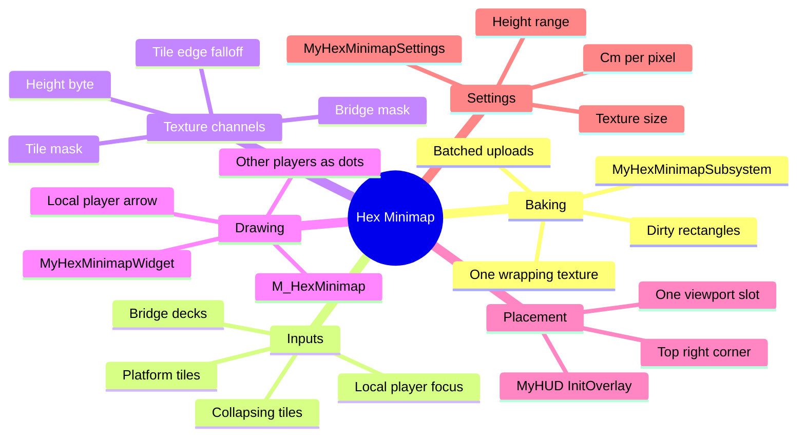
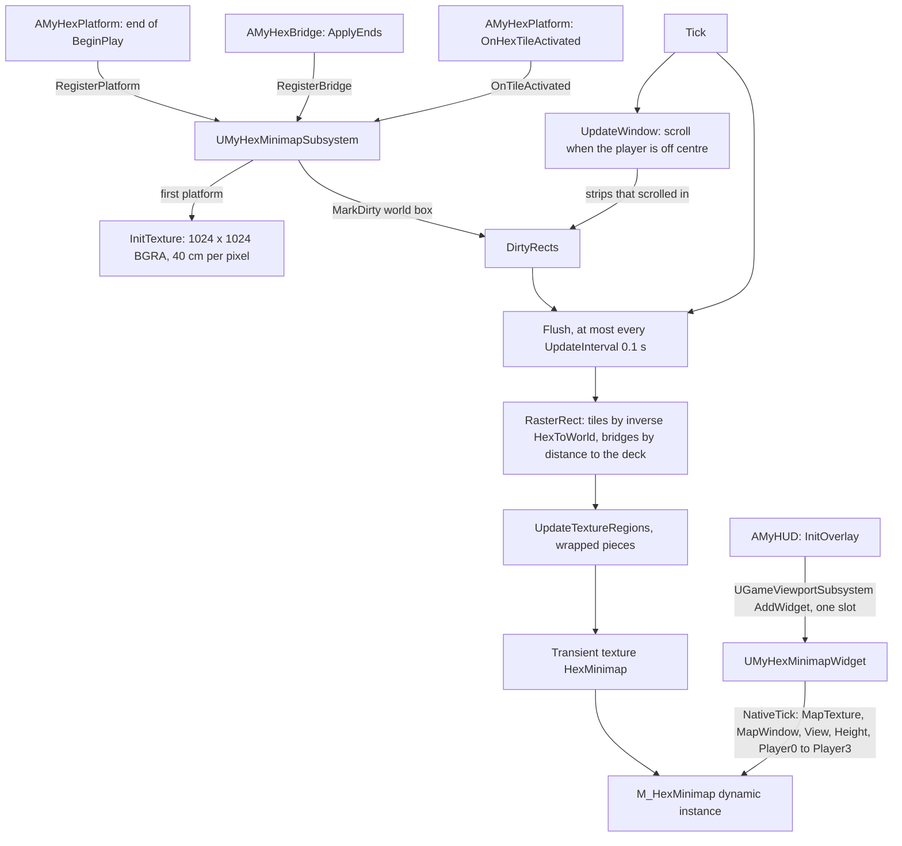

↑ [[Redo3 Changes Index]]

# Hex Minimap

AuraRedo3 · redo3 · a3513e0..0f9d516 · 2026-10-10 to 2026-10-10

A round minimap in the top-right corner of the screen that shows the hex platforms and bridges around the local player, shaded by height, with the other players as dots and the local player as an arrow. Talal asked on 2026-10-09: "we have the positions for all the Hextiles/Hexplatforms and bridges, send them to a material and make a minimap with it in the most efficient way possible."

The answer was not to send positions to the material at all. Looping over every tile and bridge in a material would run per pixel every frame, so the CPU bakes the tiles and bridges into one texture instead, and the material reads one texel per screen pixel. `UMyHexMinimapSubsystem` draws that texture on every machine that renders, from the platforms and bridges each client already receives, so nothing extra is replicated. The texture wraps at its edges: when the player moves only the strip coming into view is redrawn, and a collapsing tile or a new platform or bridge only redraws its own rectangle.

State now (origin/redo3): working. The first build placed the widget off screen; of two fixes the same day, the second (`0f9d516`, after `0325be0` was not enough) made it show in PIE. The thread then made tiles above the player brighter in `M_HexMinimap`, which reached the repo in Talal's `808d60c`. A two-client test was never reported.

## Mind map

## How it works

1. Every `AMyHexPlatform` calls `UMyHexMinimapSubsystem::RegisterPlatform` at the end of its `BeginPlay`, after it has built its grid and (on a late-joining client) removed the tiles that already fell. `EndPlay` calls `UnregisterPlatform`.
2. Every `AMyHexBridge` calls `RegisterBridge` from `ApplyEnds`, which runs in `BeginPlay` and again from `OnRep_Ends`, so a client draws the bridge once its ends have replicated. `EndPlay` calls `UnregisterBridge`.
3. The first platform registered decides the scale (`LengthScale = HexRadius / 100`) and creates the texture (`InitTexture`) around the local player's pawn or camera, or around that platform when there is no local player controller yet.
4. Each registration and each collapsing tile (`OnTileActivated`, bound to the platform's `OnHexTileActivated`) only marks its own world rectangle dirty (`MarkDirty`).
5. Every tick, `UpdateWindow` scrolls the window when the local player has moved `RecenterFraction` of the window away from its centre and marks the strips that scrolled in as dirty.
6. `Flush` runs at most once per `UpdateInterval` (0.1 s, so at most 10 uploads per second). It clips the dirty rectangles to the window, redraws each with `RasterRect` into a CPU copy of the pixels, and uploads only those rectangles with `UTexture2D::UpdateTextureRegions`.
7. `AMyHUD::InitOverlay` adds a `UMyHexMinimapWidget` to the top-right corner of the viewport with one fully built viewport slot.
8. Every frame the widget hands the material the texture, the window, the view centre and rotation, the height range and the player positions. `M_HexMinimap` samples the texture once per pixel.

## UMyHexMinimapSubsystem

A `UTickableWorldSubsystem` (`Source/Aura/Public/Actors/MyHexMinimapSubsystem.h`). `AMyHexPlatform` names it a friend class, so it reads the platform's `HexPillarsISM`, `HexMap`, `GridSize` and `HexRadius` directly.

Where it runs:

- `ShouldCreateSubsystem` is false when running a dedicated server, and `DoesSupportWorldType` allows only Game and PIE worlds.
- `IsActive()` is false in a world whose net mode is `NM_DedicatedServer` (PIE can run a dedicated server world in the same process as the clients). Registrations are ignored there.
- So it runs on clients and on the listen-server host, never on a dedicated server, and it uses only actors those machines already have: platforms and bridges are `bAlwaysRelevant` (see [[Redo3 Hex Path and Ranking]]).

Public API:

| Function | What it does |
|---|---|
| `RegisterPlatform` / `UnregisterPlatform` | Build or remove a platform's entry and mark its box dirty |
| `RegisterBridge` / `UnregisterBridge` | The same for a bridge; registering again (new ends) redraws it |
| `GetMinimapTexture()` | The baked texture, null until the first platform registers |
| `IsMinimapReady()` | Texture exists and the window is valid |
| `GetWindowParam()` | `(MinX, MinY, Size, 0)` in world cm: the area the texture holds. UV = world XY / Size |
| `GetHeightParam()` | `(HeightMin, HeightMax, 0, 0)` to decode the blue channel |
| `GetLengthScale()` | HexRadius / 100 of the first platform registered (1 before any) |

### Platform entries

`RegisterPlatform` stores, per platform (`FPlatformEntry`): the actor origin, its yaw as cosine and sine, its XY scale and inverse scale, `HexRadius`, `GridSize`, and a `Cells` array of `(2 x GridSize + 1)^2` height bytes, one per axial `(Q, R)`, where 0 means no tile. It fills `Cells` from `HexMap`, which only holds live tiles, so a late-joining client never draws tiles that already fell. A tile's height is the top of the pillar mesh (`GetBounds().GetBox().Max.Z`) through that ISM instance's world transform. `Bounds` is a world XY box covering every tile.

`OnTileActivated` sets the tile's cell to 0 and marks a box of one tile's reach around its centre dirty.

### Bridge entries

`RegisterBridge` skips a bridge whose start and end locations are still equal (a client can get there before the ends replicate). It samples the planned deck from the replicated ends: a straight line when both tangents are zero, otherwise one cubic Hermite segment cut into `BridgeSegments` (8) straight pieces. That was the curve `AMyHexBridge::ApplyEnds` built when the minimap was written; since `de9336e` `ApplyEnds` also dips a top bridge's middle by `SagRatio` (0.1143) of its length. Seen from above the deck is the same, so only the height stored for a top bridge ignores the dip. The half width is `0.5 x BridgeWidthInHexRadii (0.8) x HexRadius` of an end platform.

## The texture

`InitTexture` creates a transient `UTexture2D` named `HexMinimap`, `TextureSize` x `TextureSize` (1024, clamped to 64..4096), format `PF_B8G8R8A8`, plus a CPU copy (`Pixels`). It is data, not colour: `SRGB = false`, compression `TC_VectorDisplacementmap`, bilinear filtering, `TA_Wrap` on both axes, `NeverStream`.

| Channel | Meaning |
|---|---|
| R | 255 on a tile |
| G | Bridge: 255 on its centre line, falling to 0 at its edge (at least 1 inside the deck) |
| B | Height of the tile top or bridge deck in `HeightMin..HeightMax` as 1..255; 0 = empty |
| A | On a tile: 255 at its centre, falling to 0 at its hexagon edge (for the tile outlines) |

### The wrapping window

The texture holds a window of `Size` x `Size` texels, `CmPerPixel` each (40 cm times the length scale), around the local player: about 410 m across at the defaults. Every world texel has a fixed place in the texture (its global texel index modulo `Size`), so the material can use world XY / window size as the UV and the texture's wrap addressing does the rest.

- `GetFocus` uses the first local player controller's pawn, or its camera when there is no pawn.
- `UpdateWindow` moves the window, per axis, once the focus is more than `Size x RecenterFraction` (0.125, so 128 texels) from the window centre. If the old and new windows overlap, only the strips that scrolled in are marked dirty; otherwise the whole new window is.
- The settings warn to keep the widget's `ViewRadius` below `(0.5 - RecenterFraction) x` the window so the view never leaves it. With the defaults that is about 154 m, and `ViewRadius` is 60 m.

### Drawing and uploading

`RasterRect` clears one rectangle of global texels and redraws everything that overlaps it. The cost is per pixel, not per tile:

- **Tiles.** For each pixel inside a platform's bounds: world to platform local (rotate by minus the yaw, divide by the scale), then the inverse of `AMyHexPlatform::HexToWorld` gives fractional axial coordinates, and `HexMinimap::RoundAxial` rounds them to the hex that contains the pixel (cube-coordinate rounding). If that cell has a height, the pixel gets R = 255, B = the height (the larger one where things overlap) and A from the distance to the hexagon edge.
- **Bridges.** For each pixel inside a bridge's bounds: the nearest point on the deck polyline within the half width. G falls from 255 on the centre line to the edge; B takes the deck height at that point, interpolated along the piece.

`Flush` turns the dirty rectangles into uploads. More than `MaxRectsPerFlush` (16) rectangles in one flush are drawn as their union. A rectangle that crosses the texture edge is split into up to four pieces, and each piece is copied into its own buffer for the render thread and freed in the `UpdateTextureRegions` callback.

## UMyHexMinimapSettings

Project Settings > Game > Hex Minimap (`UDeveloperSettings`, `Config = Game`, saved to `DefaultGame.ini`). Lengths are for platforms of HexRadius 100 and are multiplied by HexRadius / 100 of the first platform registered, like the bridge settings. `DefaultGame.ini` has no Hex Minimap section yet, so the class defaults apply.

| Setting | Default | Effect |
|---|---|---|
| `TextureSize` | 1024 | Texture width and height in pixels; 1024 = 4 MB |
| `CmPerPixel` | 40 | World cm per texel; a tile is about 5 pixels wide |
| `RecenterFraction` | 0.125 | How far off centre the player may get before the window scrolls |
| `UpdateInterval` | 0.1 s | Time between texture uploads; changes in between are batched |
| `BridgeWidthInHexRadii` | 0.8 | Bridge width on the map, in hex radii of its platforms |
| `BridgeSegments` | 8 | Straight pieces a curved bridge is drawn with |
| `HeightMin` / `HeightMax` | -2000 / 4000 cm | Height range stored in the blue channel |

## UMyHexMinimapWidget and M_HexMinimap

`UMyHexMinimapWidget` (`Source/Aura/Public/UI/UserWidgets/MyHexMinimapWidget.h`, `BlueprintType`, `Blueprintable`) draws one image with `MinimapMaterial`. It works as a plain C++ widget, building its own `UImage` named `MinimapImage` in `NativeOnInitialized`, or as the parent of a Widget Blueprint with an optional bound Image of that name.

| Property | Default | Notes |
|---|---|---|
| `MinimapMaterial` | `/Game/UI/Minimap/M_HexMinimap` | Soft reference, loaded synchronously; a warning is logged if it fails |
| `ViewRadius` | 6000 cm | World radius from the centre to the rim, multiplied by the length scale |
| `bRotateWithCamera` | true | "Up" is where the camera looks; off = world +X is up |
| `MinimapSize` | 256 | On-screen size in slate units of the image it builds for itself |

`NativeTick` keeps the image hidden until `IsMinimapReady()`. Only the image is hidden: a hidden user widget would stop ticking. Then it sets these material parameters on its dynamic material instance every frame:

| Parameter | Value |
|---|---|
| `MapTexture` | The subsystem's texture |
| `MapWindow` | `GetWindowParam()`: `(MinX, MinY, Size, 0)` |
| `View` | `(CentreX, CentreY, ViewRadius x length scale, yaw of "up" in radians)`; the centre is the local pawn, or the camera without one |
| `Height` | `(HeightMin, HeightMax, local player Z, local pawn yaw relative to "up" in radians)` |
| `Player0` to `Player3` | `(X, Y, 1, 0)` for up to four other players' pawns from the GameState's `PlayerArray`; unused slots get zeros |

`M_HexMinimap` (`/Game/UI/Minimap/M_HexMinimap`, UI domain) is a binary asset; from the commit and the thread it samples the texture once per pixel and draws a round map: tiles and bridges shaded by height relative to the player, tile outlines, other players as red dots and an arrow for the local player, turning with the camera. Because the Unreal MCP connection was down, the thread authored it in a headless editor run and checked it against a Python copy of the C++ drawing code (the `combined.png` preview). Talal later asked for higher platforms to be brighter: the first version used `shade = saturate(0.8 + dh / 3000)`, so tiles above could only get 25% brighter. The thread changed it to darken below and lerp towards white above, tuned by a new `HeightShade` vector parameter (R = 2000 cm range, G = 0.7 darkening, B = 0.85 whiteness).

## Placement in MyHUD

`AMyHUD` (`Source/Aura/Public/UI/MyHUD.h`) got:

- A constructor that sets `MinimapWidgetClass = UMyHexMinimapWidget::StaticClass()`. Set it to a Widget Blueprint to change `ViewRadius` or the rotation; None = no minimap.
- `MinimapCornerOffset` (24, 24): gap in slate units from the top-right corner.
- `MinimapWidget`: the one instance, created in `InitOverlay` after the overlay, only if it does not exist yet.

The widget goes in through `UGameViewportSubsystem::Get()->AddWidget(MinimapWidget, Slot)` with one `FGameViewportWidgetSlot`: `Anchors = FAnchors(1, 0)`, `Alignment = (1, 0)`, `Offsets = FMargin(-MinimapCornerOffset.X, MinimapCornerOffset.Y, MinimapSize, MinimapSize)` and `ZOrder = 1`.

Why one slot: in UE 5.8 two of the separate viewport setters reset the anchors. `SetPositionInViewport` resets them to the top-left (the thread found this at `GameViewportSubsystem.cpp:282`) and so does `SetDesiredSizeInViewport` (line 292). With the first code, the top-right anchors were set and then undone, and the 256 x 256 image sat left of the screen at about x = -280.

Since the respawn work, `InitOverlay` returns early when the overlay already exists (every new pawn calls it), so a respawn does not add a second overlay or minimap.

## Gotchas

- The scale is fixed by the first platform that registers: `CmPerPixel` and the window are set up then, and a later platform with a different HexRadius does not change them.
- Heights outside `HeightMin..HeightMax` (-20 m to 40 m) are clamped to the ends of the range.
- The material has four player slots, so with more than five players some are not shown.
- `GetFocus` follows the first local player controller only.
- Viewport placement: going back to `AddToViewport` plus `SetPositionInViewport` / `SetDesiredSizeInViewport` brings the off-screen bug back, because both reset the anchors (see the section above).

## How it changed

- **2026-10-09: the request.** The "Hex platform and bridge minimap" thread chose CPU baking into one wrapping texture over sending positions to a material.
- **2026-10-10 08:00 `a3513e0`: the minimap.** Added `UMyHexMinimapSubsystem`, `UMyHexMinimapSettings`, `UMyHexMinimapWidget` and `M_HexMinimap`, the register and unregister calls in `AMyHexPlatform` and `AMyHexBridge`, the friend declaration on the platform, and the widget in `AMyHUD::InitOverlay`. Built in a git worktree because the grapple swing thread was building in the main checkout (the worktree only had Git LFS placeholders, so it proved compilation but not play), pushed to `claude/project-thread-13pepw`, and merged into redo3 as `367eef8` when the thread merged the open branches after Talal's "go".
- **2026-10-10 12:16 `0325be0`: first placement fix.** Talal reported the minimap was missing. PIE showed the 256 x 256 image off screen to the left. `SetPositionInViewport` resets the anchors to the top-left, so the position is now set first and the anchors and alignment after it. Not enough: the widget stayed off screen.
- **2026-10-10 12:46 `0f9d516`: one viewport slot.** In UE 5.8 `SetDesiredSizeInViewport` resets the anchors too, and it was called last. The whole slot (anchors, alignment, offsets, size, Z order) is now built and added in one `UGameViewportSubsystem::AddWidget` call. After Talal rebuilt, the minimap showed.
- **2026-10-10: brighter above.** The thread edited `M_HexMinimap` so tiles above the player blend towards white, with the `HeightShade` parameter. It was saved in the editor but not committed in the thread; it went into Talal's commit `808d60c` on 2026-10-16.
- **2026-11-15 `b3b02ac`.** The respawn change made `InitOverlay` return early once the overlay exists (see [[Redo3 Mech Character]]).

## Threads that worked on it

- [[Redo3 Threads#Hex platform and bridge minimap|Hex platform and bridge minimap]]: designed and built the minimap, merged the open branches into redo3, fixed the off-screen placement twice and made higher tiles brighter.

## Artifacts and files

- [[Redo3 Files - Hex Minimap]]: `combined.png`, three previews of `M_HexMinimap` on a test texture: blue hex platform clusters, orange bridges, a red dot for another player and the white player arrow.

No artifact was published for the minimap.

## Where it lives

| What | Path |
|---|---|
| Subsystem | `Source/Aura/Public/Actors/MyHexMinimapSubsystem.h`, `Source/Aura/Private/Actors/MyHexMinimapSubsystem.cpp` |
| Settings | `Source/Aura/Public/Actors/MyHexMinimapSettings.h` (Project Settings > Game > Hex Minimap, `DefaultGame.ini` section `[/Script/Aura.MyHexMinimapSettings]` once saved) |
| Widget | `Source/Aura/Public/UI/UserWidgets/MyHexMinimapWidget.h`, `Source/Aura/Private/UI/UserWidgets/MyHexMinimapWidget.cpp` |
| HUD placement | `Source/Aura/Public/UI/MyHUD.h`, `Source/Aura/Private/UI/MyHUD.cpp` (`InitOverlay`) |
| Registration | `Source/Aura/Private/Actors/MyHexPlatform.cpp` (`BeginPlay`, `EndPlay`), `Source/Aura/Private/Actors/MyHexBridge.cpp` (`ApplyEnds`, `EndPlay`) |
| Material | `/Game/UI/Minimap/M_HexMinimap` (`Content/UI/Minimap/M_HexMinimap.uasset`) |

## Open items

- A two-client test of the minimap was never reported.

## Related

- [[Redo3 Hex Path and Ranking]]: the platforms the map draws, and why every client has all of them (`bAlwaysRelevant`, initial-only grid shape).
- [[Redo3 Hex Bridges]]: the bridge ends and tangents the map samples.
- [[Redo3 Hex Pillars and Breaking]]: what happens to a tile when `OnHexTileActivated` fires.
- [[Redo3 Mech Character]]: the respawn change to `InitOverlay`.
- [[Redo3 Timeline]], [[Redo3 Branches and PRs]], [[Redo3 Threads]].
- Talal's notes: [[HexPlatform]] (how a platform builds its grid and activates tiles), [[Hud]] (his HUD to-do list).

[[Redo3 Hex Look and Atmosphere]] ← → [[Redo3 Grapple Swing]]
