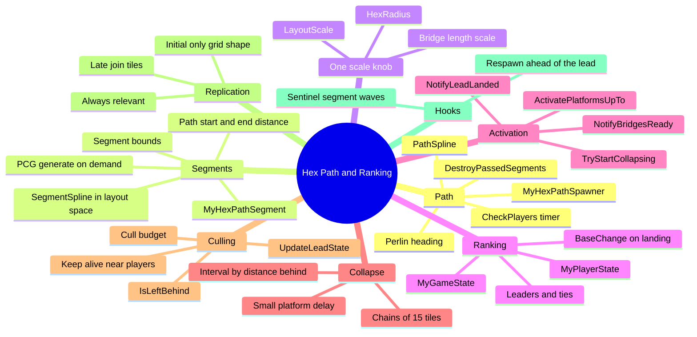
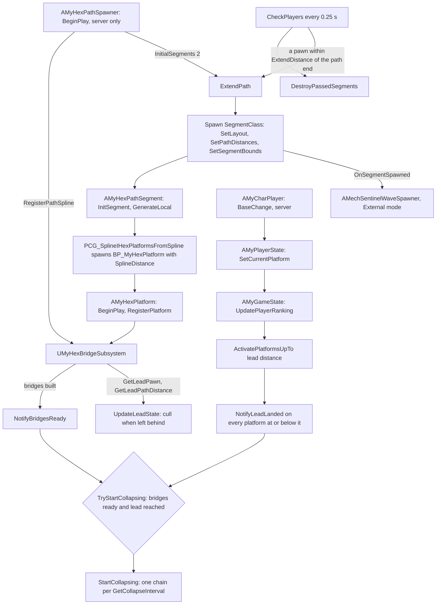
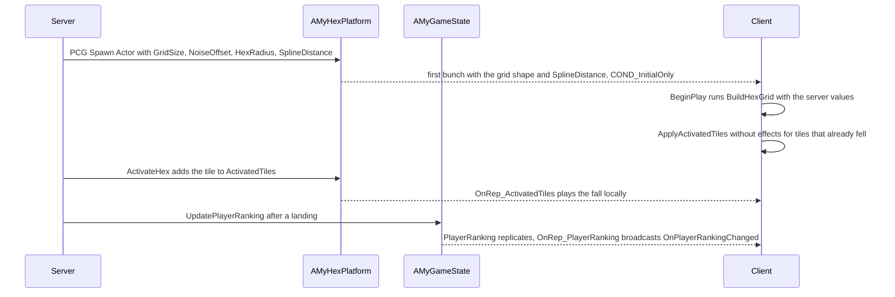
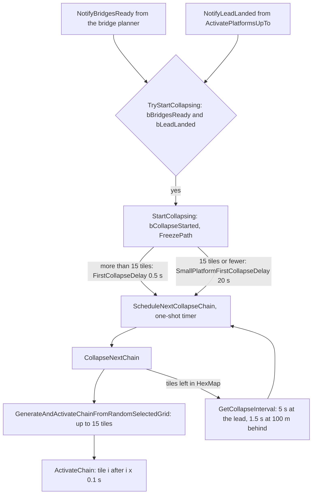

↑ [[Redo3 Changes Index]]

# Hex Path and Ranking

AuraRedo3 · redo3 · 17605e3..b95b254 · 2026-10-03 to 2026-10-07

The endless path is what the game is played on. A server-only actor, `AMyHexPathSpawner`, grows a spline ahead of the players in 100 m pieces. Every piece becomes an `AMyHexPathSegment` whose PCG graph fills it with `BP_MyHexPlatform` hex platforms, and the bridge subsystem joins them. Players run along it; every platform up to the one the leader has reached collapses tile by tile, and platforms left far behind are removed.

This page covers the path itself and the rules around it: how far along the path each player is, who leads, when a platform is allowed to start collapsing, how fast it collapses, when it is culled, and how one `HexRadius` scales the whole thing. Talal's asks, in order: platforms must not collapse the moment they spawn but only once the lead lands; "store distance on spline points" and sort the PlayerStates by the platform they are on, where "multiple PlayerStates can be considered leading"; "give me a scaling factor that scales the whole system"; "activate all platforms with dist <= lead players covered dist"; and let far-behind platforms collapse at a different rate.

State now (origin/redo3): all of it shipped. `AMyGameState` ranks the players by the `SplineDistance` of the platform each last landed on, every platform up to the leader's distance is activated, platforms further behind the lead collapse faster, and `AMyHexPathSpawner::HexRadius` scales path, PCG layout and bridges together. The respawn system and the Mech Sentinel swarm both hook into the path and the ranking. Talal's PIE log in the ranking thread showed both players' landings reaching the ranking code, but no thread reports a two-player playtest of the activation rule or the collapse timing.

## Mind map

## How it works

### From path growth to collapse

1. `AMyHexPathSpawner` is a server-side actor (`bReplicates = false`); growth is guarded by `HasAuthority()`, and because the actor is not replicated the `OnSegmentSpawned` broadcast is also guarded by `GetNetMode() != NM_Client` (the code comment says `HasAuthority()` alone does not rule out a client). On the authority, `BeginPlay` records `StartYaw` and `StartZ`, resets `PathSpline` to one point at the actor, registers `PathSpline` with `UMyHexBridgeSubsystem::RegisterPathSpline` (platforms measure "left behind" along it), calls `ExtendPath` `InitialSegments` (2) times and starts the `CheckPlayers` timer every `CheckInterval` (0.25 s).
2. `CheckPlayers` first calls `DestroyPassedSegments`, then extends the path by one segment when any player pawn is within `ExtendDistance` (15000 cm, times `GetLayoutScale()`) of the path end, measured in 2D. One segment per check: if the player is still close, the next check adds another.
3. `ExtendPath` walks `PointsPerSegment` (4) steps of `SegmentLength * Scale / NumPoints` (10000 cm per segment at radius 100). Each step's yaw is `StartYaw + SampleNoise(...) * MaxYawDeviation` (60 degrees), with Perlin noise over the travelled distance divided by the scale, so the path bends the same relative to the platforms at any radius. Height follows its own noise (`HeightNoiseAmplitude`, default 0, so the path is flat). `SampleNoise` multiplies Perlin noise by 2 and clamps to -1..1, because raw Perlin rarely leaves about +-0.6. `NoiseSeed` 17.31 picks the path.
4. The new points and tangents are copied into a freshly spawned `SegmentClass` actor (`BP_MyHexPathSegment`). Before `InitSegment` the spawner calls `SetLayout(HexRadius, spawner XY)`, `SetPathDistances(start, end)` with the distances along the whole `PathSpline`, and `SetSegmentBounds` (the world box its platforms are assumed to fill). `InitSegment(NextSegmentIndex++, ...)` then writes the spline in layout space, sets `PCGComponent->Seed = SegmentIndex` and calls `GenerateLocal(true)`. Last, `OnSegmentSpawned` fires.
5. `PCG_SplineIHexPlatformsFromSpline` samples the segment spline and spawns the platforms. Each platform gets `SplineDistance` (its distance along the whole path) as a Spawn Actor property override, plus `GridSize`, `NoiseOffset`, `HexRadius` and, on the upper chain, `VerticalScaling`. The graph is described on [[Redo3 Hex Platform PCG]].
6. Every `AMyHexPlatform` builds its grid in `BeginPlay` on every machine. On the server it measures `FootprintRadius`, registers with `UMyHexBridgeSubsystem::RegisterPlatform` and starts `UpdateLeadState` every `LeadCheckInterval` (0.1 s) with a random first delay between 0.01 s and the interval, so platforms do not all check in the same frame.
7. The bridge planner builds the platform's bridges from its untouched edges and then calls `NotifyBridgesReady` (see [[Redo3 Hex Bridges]]).
8. When a player's movement base changes, `AMyCharPlayer::BaseChange` (server) passes a new `AMyHexPlatform` to `AMyPlayerState::SetCurrentPlatform`, which stores its `SplineDistance` and calls `AMyGameState::UpdatePlayerRanking`.
9. `UpdatePlayerRanking` re-sorts the players and calls `ActivatePlatformsUpTo(lead distance)`, which calls `NotifyLeadLanded` on every platform whose `SplineDistance` is at most the leader's.
10. A platform starts collapsing only when both latches are set (`TryStartCollapsing`). It then collapses one random chain of up to 15 tiles at a time, re-arming a one-shot timer whose interval shrinks the further the platform is behind the lead.
11. Meanwhile `UpdateLeadState` checks whether the lead has left the platform far behind and, if nobody is still on it, destroys it. `DestroyPassedSegments` removes segment actors whose end is `DestroySegmentsBehindDistance` (30000 cm, scaled) behind the lead along the path.

### Server and client traffic

1. Platforms spawn only on the server. The hex grid itself is not replicated: every machine builds it in `BeginPlay` from the replicated shape properties (`GridSize`, `HexRadius`, `VerticalScaling`, `NoiseOffset`, `NoiseFrequency`, `NoiseStrength`, `DetailStrength`, `NoiseCurve`, `DeletionThreshold`, `HexPillarStaticMesh`, later also `bIsBottomPlatform`, `HexPillarBottomStaticMesh`, `HexPillarBottomScaleZ`), all `COND_InitialOnly`. The engine applies the first bunch before the client's `BeginPlay`.
2. `SplineDistance` replicates the same way, so clients know each platform's path distance too.
3. `ActivatedTiles` (the server's list of fallen tiles) replicates normally. `OnRep_ActivatedTiles` ignores the first bunch (the grid is not built yet); `BeginPlay` then removes those tiles with `ApplyActivatedTiles(false)`, without replaying the fall.
4. Platforms and bridges are `bAlwaysRelevant`, because the server builds the path hundreds of metres ahead, beyond the default 150 m net cull distance.
5. The ranking (`FMyPlayerRanking`) replicates as one struct; clients get `OnPlayerRankingChanged` from `OnRep_PlayerRanking`.

## The path spawner

`AMyHexPathSpawner` (`Source/Aura/Public/Actors/MyHexPathSpawner.h`), placed in the level as `BP_MyHexPathSpawner`. The path starts at the actor and heads along its forward (X) axis. It cannot loop back over itself: the heading only wanders up to `MaxYawDeviation` either side of the start yaw.

| Setting | Default | Notes |
|---|---|---|
| `SegmentClass` | none | Must be set (`BP_MyHexPathSegment`); without it the path grows but nothing spawns and `LogHexPath` warns |
| `HexRadius` | 100 | The one scale knob (see [[Redo3 Hex Path and Ranking#One HexRadius scales everything]]) |
| `SegmentLength` | 10000 cm | Per extension, at HexRadius 100 |
| `PointsPerSegment` | 4 | More points let the noise bend the path within a segment |
| `InitialSegments` | 2 | Built in `BeginPlay`, before anyone moves |
| `ExtendDistance` | 15000 cm | 2D distance from any pawn to the path end that triggers an extension |
| `CheckInterval` | 0.25 s | Player check timer |
| `MaxYawDeviation` | 60 degrees | Largest turn away from the start heading |
| `YawNoiseFrequency` | 0.0001 | Noise cycles per cm, "a slow bend every ~100 m" |
| `HeightNoiseAmplitude` / `HeightNoiseFrequency` | 0 / 0.0001 | 0 keeps the path flat |
| `NoiseSeed` | 17.31 | Same seed, same path |
| `DestroySegmentsBehindDistance` | 30000 cm | Segment actors this far behind the lead are destroyed; 0 keeps all |
| `bDrawDebug` | false | Draws the path in cyan |

Functions and state:

- `ExtendPath()` (BlueprintCallable, server): adds one segment. `NextSegmentIndex` keeps PCG seeds unique after old segments are removed from `Segments`.
- `GetPathSpline()`, `GetSegments()`, `GetLayoutScale()` (HexRadius / 100).
- `DestroyPassedSegments()`: needs the subsystem's path spline to be this spawner's and a lead path distance (`GetLeadPathDistance`). Segments are in path order, so it stops at the first one that is not far enough behind. Only the segment actor goes: PCG does not delete the actors it spawned when its component is torn down, and the platforms cull themselves on their own schedule.
- `EndPlay` unregisters the path spline.

Later additions on the same actor, documented elsewhere: the `OnSegmentSpawned` delegate, the "Path|Segment Bounds" settings and the "Sentinel Waves" settings (`bSpawnSentinelWaves` true, `FirstSegmentWithSentinelWave` 1) from the swarm work (see [[MechSentinel Path Segment Waves]]), and the path-end fog banks, camera effects and `AtmosphereVariants` (see [[Redo3 Hex Look and Atmosphere]]).

## The path segment

`AMyHexPathSegment` (`Blueprintable`, `bReplicates = false`, server only), used as `BP_MyHexPathSegment` with the PCG graph set on its `PCGComponent`. Each segment holds its own copy of its piece of the path in `SegmentSpline` and generates once. Regenerating one long spline would clean up and respawn every platform spawned before, including their collapse state; separate segments mean an extension never touches earlier platforms.

- `PCGComponent->GenerationTrigger = GenerateOnDemand`: generation starts from `InitSegment` once the spline has its points, never on load.
- `InitSegment(Index, Points, Tangents)`: writes the points and the tangents copied from the full path (so the piece lines up with its neighbours), seeds PCG with the segment index and calls `GenerateLocal(/*bForce=*/true)`, then the Blueprint event `OnSegmentInitialized`.
- `PathStartDistance` / `PathEndDistance` (set by `SetPathDistances`): where the segment starts and ends along the whole `PathSpline`. The PCG graph adds the start distance to its own sample distance to get each platform's `SplineDistance`.
- Scale properties the graph reads with Get Actor Property on Self: `HexRadius`, `LayoutScale`, `LayoutUpScale`, `LayoutUpOffset`, `LayoutDownScale`, `LayoutDownOffset`, `LayoutPathStartDistance`.
- Assumed bounds (`SetSegmentBounds`, `GetSegmentBounds`, `GetSegmentBoundsCorners`), added for the sentinel waves.
- `EndPlay` destroys the fog banks the graph spawned (`AMyHexAtmosphereFX::DestroyAttachedTo`).

## One HexRadius scales everything

Everything was tuned for platforms of hex radius 100 cm. In the "platform and bridge system uptill hex radius scale" thread Talal reported that the PCG graph ignored the hex radius, so bigger platforms overlapped and then got no bridges, and asked for one factor that scales the whole platform and bridge system. `a7bd059` made `AMyHexPathSpawner::HexRadius` that knob; `BP_MyHexPlatform` itself keeps HexRadius 100 as its default and receives the spawner's value from PCG.

How layout space works:

1. `GetLayoutScale()` = `HexRadius / 100` (S).
2. `AMyHexPathSegment::SetLayout(HexRadius, Origin)` sets `LayoutScale = S`, `LayoutDownScale = (1/S, 1/S, 1)`, `LayoutUpScale = (S, S, 1)`, and offsets so the scaling happens around `Origin`, which is the spawner's XY at Z 0 (the start of the path). Heights are never scaled.
3. `InitSegment` stores `Point * LayoutDownScale + LayoutDownOffset` and `Tangent * LayoutDownScale`. A cubic spline scaled this way is exactly the scaled curve, so the graph sees the very path the spawner would grow at radius 100 and makes the same random choices.
4. The graph maps its results back with `LayoutUpScale` / `LayoutUpOffset`, shrinks the platforms and bridges it reads from the world into layout space, and writes `SplineDistance = (distance along SegmentSpline + LayoutPathStartDistance) * LayoutScale`.
5. The thread measured 161 platforms and 194 bridges at radius 100, and at radius 200 an exact 2x copy of the same 161 platforms (within 0.001 cm) with 197 bridges.

| Scaled by HexRadius / 100 | Not scaled |
|---|---|
| `SegmentLength`, `ExtendDistance`, `DestroySegmentsBehindDistance`, the noise frequencies, the segment bounds reach and sample spacing, the path-end fog spacing | Heights: upper chain lift, height noise, pillar heights, `SegmentBoundsBelow` / `SegmentBoundsAbove` |
| Platform: `MaxPathOffset`, `CollapseFalloffDistance` | Platform: `CullBehindDistance`, `LandingTolerance`, `BridgeKeepDistance` |
| Bridges: `MaxEdgeGap`, `MaxBridgeLength`, `LoopMaxLength`, `IsletMaxLength`, `RouteMaxLength`, `MaxSplineDistanceJump` and the planner's horizontal constants, via `UMyHexBridgeSubsystem::GetLengthScale()` (largest registered platform's HexRadius / 100) | Bridges: heights, slope, deck clearances and separations |

`a7bd059` scaled points around the world origin; the follow-up `55f9c66` (same morning, see [[Redo3 Hex Platform PCG]]) added the layout origin at the path start and wired the PCG graph, and `5bec016` fixed a unity build clash in the bridge trace constants (see [[Redo3 Hex Bridges]]).

## Player ranking

### AMyPlayerState

New on the existing PlayerState (`Source/Aura/Public/MyPlayerState.h`):

- `CurrentPlatform` (Replicated): the last `AMyHexPlatform` the pawn landed on. Bridges and jumps have no platform base, so they keep the last one.
- `PlatformSplineDistance` (Replicated, default -1): that platform's `SplineDistance`. `HasPlatformSplineDistance()` is false until the player lands on a platform that has one.
- `SetCurrentPlatform(Platform)` (server): ignores a null or unchanged platform and stores the new one as `CurrentPlatform`. A platform without a `SplineDistance` (a hand-placed one, or before the PCG wiring was in) then only logs "`<platform>` has no SplineDistance, `<player>` keeps its rank"; the distance and the ranking stay as they were. Otherwise it stores the distance and calls `AMyGameState::UpdatePlayerRanking`.

The landing itself is detected by `AMyCharPlayer::BaseChange` (an override of the character's movement-base callback), on the server only.

### AMyGameState

New class (`Source/Aura/Public/MyGameState.h`); `AMyGameMode`'s constructor sets `GameStateClass = AMyGameState::StaticClass()`.

- `UpdatePlayerRanking()` (server): runs after a landing on a new platform and from `AddPlayerState` / `RemovePlayerState`. It collects the `AMyPlayerState`s from `PlayerArray` and stable-sorts them by `PlatformSplineDistance`, furthest first (players at -1 go last, ties keep join order). `NumLeaders` counts the players within `LeadDistanceTolerance` (default 0, so exactly the same distance) of the first. Then it calls `ActivatePlatformsUpTo` before the "nothing changed" early-out, because the leader can move to a further platform without the order changing. If the order or the leader count changed, it stores the result in `PlayerRanking`, prints the leaders with `PrintString` and broadcasts `OnPlayerRankingChanged`.
- `PlayerRanking` (`FMyPlayerRanking`: `PlayerStates` and `NumLeaders`), `ReplicatedUsing = OnRep_PlayerRanking`, so clients get the same event.
- Getters: `GetLeadSplineDistance()` (first player's distance, -1 before anyone ranks), `GetActivatedSplineDistance()`, `GetRankedPlayerStates()`, `GetLeadingPlayerStates()` (everyone tied at the top), `IsLeading(PlayerState)`.
- `MulticastPlayRespawnFX` (NetMulticast, Reliable) was added later by the respawn work.

"Distance covered" is the `SplineDistance` of the platform the player last stepped onto, not the pawn's exact position: a player walking across a big platform does not change rank until they land on the next one.

### The lead pawn

`UMyHexBridgeSubsystem::GetLeadPawn()` returns the pawn whose progress decides what is left behind. It is server only (null on clients) and cached per frame (`GFrameCounter`). `SelectLeadPawn()` takes the first player in `GetLeadingPlayerStates()` whose pawn is valid; nobody ranked, or every leader dead or respawning, means no lead this frame. `GetLeadPathDistance()` projects the lead pawn onto the registered path spline (`FindInputKeyClosestToWorldLocation`), also cached per frame.

Until `cbd8c04` the lead was "the first player on the server", so in multiplayer always the listen-server host.

## Platform activation and collapse

### The collapse gate

Each platform has two server-side latches, and collapsing needs both:

- `bBridgesReady`, set by `NotifyBridgesReady()`. The bridge planner calls it once the platform's bridges exist, so bridges are always built from untouched edges. With `bWaitForBridgesBeforeCollapsing` (default on) off, or without a subsystem, it is set in `BeginPlay`.
- `bLeadLanded`, set by `NotifyLeadLanded()`. It is latched, so it may arrive before the bridges. `NotifyLeadLanded` also calls `FreezePath()`, which stops the tile path and tile props changing (see [[Redo3 Path Paving]]).

`TryStartCollapsing()` first catches late platforms: if the platform has a `SplineDistance` at or below `AMyGameState::GetActivatedSplineDistance()`, the lead already got this far and `bLeadLanded` is set. Then, if `bBridgesReady && (bLeadLanded || !bCollapseOnlyWhenLeadLands)`, it calls `StartCollapsing()`. `bCollapseOnlyWhenLeadLands` defaults to true; off means collapse as soon as the bridges exist.

### Activating up to the leader

`AMyGameState::ActivatePlatformsUpTo(LeadDistance)` does nothing if `LeadDistance <= ActivatedSplineDistance`. Otherwise it raises `ActivatedSplineDistance` (which never goes down, so a leader leaving does not un-activate anything) and iterates every `AMyHexPlatform`, calling `NotifyLeadLanded` on each one with a `SplineDistance <= LeadDistance`. So when the lead lands on a platform, everything behind it, on both chains and on side branches, is released at once; platforms spawned later check the reached distance in `TryStartCollapsing` once their bridges are ready.

Platforms without a `SplineDistance` (hand-placed) keep the older rule as a fallback: `UpdateLeadState` calls `NotifyLeadLanded` when the lead pawn stands on them (`IsPawnOnPlatform`: movement base is this platform, or the pawn is airborne over the footprint and a downward `ECC_Visibility` trace of half height plus `LandingTolerance` (150 cm) hits it).

### Collapse timing

1. `StartCollapsing()` (server, runs once) sets `bCollapseStarted`, freezes the path and picks the first delay: `SmallPlatformFirstCollapseDelay` (20 s) when the platform has `SmallPlatformMaxTiles` (15) tiles or fewer, else `FirstCollapseDelay` (0.5 s). A small platform goes in one chain, so without the long delay it vanished half a second after activation.
2. `ScheduleNextCollapseChain(Delay)` arms the one-shot `CollapseTimerHandle` (at least 0.01 s, because a rate of 0 or less would clear the timer).
3. `CollapseNextChain()` runs one chain and, while `HexMap` still has tiles, schedules the next one with `GetCollapseInterval()`. It keeps ticking until the last chains' tiles are gone.
4. `GetCollapseInterval()` reads `AMyGameState::GetLeadSplineDistance()`. If the platform or the lead has no distance it returns `CollapseIntervalAtLead`. Otherwise `Behind = max(LeadDistance - SplineDistance, 0)` and the interval is `Lerp(CollapseIntervalAtLead, CollapseIntervalFarBehind, min(Behind / (CollapseFalloffDistance * HexRadius / 100), 1))`. With the defaults (5 s, 1.5 s, 10000 cm) a platform at the lead drops a chain every 5 s, one 50 m behind every 3.25 s, and one 100 m or more behind every 1.5 s. A platform ahead of the lead counts as at the lead. It is re-checked before every chain, so a platform speeds up as the lead moves away.
5. `GenerateAndActivateChainFromRandomSelectedGrid()`: `ChainLength` is a `constexpr` 15 (with a TODO to base it on grid size). With 15 or fewer tiles left, all of them are reserved and activated together. Otherwise it drops tiles already reserved by another chain (`PendingActivationTiles`), picks a uniformly random start tile, and `GenerateChain` random-walks up to 15 unvisited, unreserved neighbours (`GetNeighbors` skips reserved tiles, so a dead end gives a shorter chain). The whole chain is reserved at once.
6. `ActivateChain()` activates tile 0 at once and tile i after `i * 0.1` s, each through `ActivateHex` (server: add to `ActivatedTiles`, run `ActivateHexLocal`, unreserve). How a tile then breaks is on [[Redo3 Hex Pillars and Breaking]].

"Less rate" in Talal's request was read literally: platforms further behind collapse faster. Swapping the two interval values gives the opposite without a code change. All collapse values are on the platform under "Hex Platform|Collapse".

## Culling platforms left behind

`UpdateLeadState()` (server, every `LeadCheckInterval`) also removes platforms nobody needs any more. With no lead pawn it does nothing.

1. `Gap` = horizontal distance from the lead to the platform's footprint edge (`FootprintRadius`, measured from the full grid in `BeginPlay`). The lead standing on it, or `Gap <= 0`, sets `bLeadReached`.
2. `IsLeftBehind()`: never while `Gap <= CullBehindDistance` (20000 cm). Without a path in the level: only once the lead has reached it. With a path, `ResolvePathDistance` caches the platform's far edge along the spline (`PathFrontDistance`) once the platform is no longer at the growing end, and `bOnPath` is whether its centre is within `MaxPathOffset` (10000 cm, scaled) of the path. Platforms off the path are culled once the lead has reached them and moved that far away; platforms on it are left behind when `PathFrontDistance < LeadDistance - CullBehindDistance`, so platforms ahead of the lead are never culled.
3. Kept alive while `bKeepWhileAnyPlayerIsOnIt` (default on) and `IsAnyPlayerOnPlatform()`: any player whose movement base is the platform or a bridge ending on it, who is above its footprint, or who is within `BridgeKeepDistance` (300 cm) of one of its bridges. The last rule is the mid-bridge jump fix: a jumping or hovering player has no movement base.
4. `UMyHexBridgeSubsystem::TryConsumeCullBudget()` allows `MaxPlatformCullsPerFrame` (a constant 4) culls per frame.
5. Then the server calls `Destroy()`. `EndPlay` clears all timers on the platform, unregisters it from the bridge, minimap and sentinel obstacle subsystems, and its `OnEndPlay` makes the bridges ending on it destroy themselves.

Turning `bAutoDestroyWhenLeftBehind` (default on) off disables culling; the lead check timer then stops once there is nothing left to watch for (collapse started, no lead gate, or the platform has a `SplineDistance` and is activated by the game state instead).

## Hooks into the path

- **Respawn ahead of the lead** (see [[Redo3 Mech Character]]): `AMyGameMode::FindRespawnSpot` tries the platforms with a `SplineDistance` above `max(GetLeadSplineDistance(), GetActivatedSplineDistance())`, nearest along the path first (ties between the chains go to the one nearest the lead's `CurrentPlatform`), so the first choice is never an activated, collapsing platform; the lead's own platform is the last resort. The FX plays through `AMyGameState::MulticastPlayRespawnFX`. The PlayerState survives the respawn, so the rank does too.
- **Sentinel waves per segment** (see [[MechSentinel Path Segment Waves]]): `AMechSentinelWaveSpawner` in External mode binds `OnSegmentSpawned` on every path spawner at `BeginPlay`, catches up with `GetSegments()`, and starts wave number `SegmentIndex - FirstSegmentWithSentinelWave + 1` at the 4 top corners from `GetSegmentBoundsCorners()`. Listeners must only queue work, because the delegate fires from `BeginPlay` and from the player check timer.

## steps.md: editor setup

`steps.md` in the repo root, "Hex Path and Bridges: Setup Steps", came with `17605e3` and has not changed since. Its nine steps: remove old `MyHexBridgeBuilder` actors (or you get two sets of bridges); set up the platform Blueprint with `bWaitForBridgesBeforeCollapsing` on; build a platform PCG graph (Get Spline Data on Self, Spline Sampler by distance, drop the last point so joints do not get two platforms, Spawn Actor without merging); a segment Blueprint with that graph and Generate On Demand; a bridge PCG graph and Blueprint; Project Settings > Game > Hex Bridges (`NeighborRadiusMultiplier` must exceed spacing / (GridSize x HexRadius), so 5 rather than the default 3 for 4000 cm spacing); place the path spawner; and test as listen server with one client, watching for `LogHexBridgeSubsystem: Bridged N new platforms`.

Read it as the original setup, not the current one: the real assets are `BP_MyHexPathSpawner`, `BP_MyHexPathSegment`, `BP_MyHexBridge` and `PCG_SplineIHexPlatformsFromSpline` (its names are suggestions), its example values (`SegmentLength` 16000, `ExtendDistance` 20000) differ from the code defaults, and it predates the lead gate, the ranking and `HexRadius`.

## Gotchas

- Any new per-platform PCG property override that affects the grid must also be `Replicated` with `COND_InitialOnly`, or clients build a different platform from the server. Actor tags such as `HexLower` / `HexUpper` do not replicate.
- Until someone has landed on a platform with a `SplineDistance` there is no lead pawn, so nothing is lead-landed, culled or destroyed and passed segments stay.
- `UpdatePlayerRanking` still prints every leader with `PrintString` (red, for 2000 s) and `NumLeaders: N` on each change, next to a TODO to show the leaders in the HUD.
- The path spline is never trimmed, so closest-point lookups along it (`GetLeadPathDistance`, `ResolvePathDistance`) cost more as a run goes on.
- `CullBehindDistance` is not multiplied by HexRadius / 100, unlike `MaxPathOffset` and `CollapseFalloffDistance`.

## How it changed

- **Baseline `fc9a077` (2026-10-03).** Hand-placed `AMyHexPlatform`s started a looping 5 s chain timer (1 s first delay) in `BeginPlay`; there was no path.
- **2026-10-03 `17605e3`: growing path, PCG segments and bridge subsystem.** Built in an earlier Claude session, the one the "Continue the AuraProj session" thread later read. Added `AMyHexPathSpawner` (Perlin heading, `CheckPlayers`, one segment per extension), `AMyHexPathSegment` (own spline and on-demand PCG, seeded by segment index), `UMyHexBridgeSubsystem`, `AMyHexBridge` and `UMyHexBridgeSettings`, the Blueprints `BP_MyHexPathSpawner`, `BP_MyHexPathSegment` and `BP_MyHexBridge`, `steps.md`, and `DefaultGame.ini` bridge settings. The platform's collapse timer moved into `StartCollapsing()`, which the bridge subsystem called right after building a batch's bridges; `OnHexTileActivated` and `IsTileCollapsed` were added for the bridges.
- **By 2026-10-04: lead-landing collapse and culling (uncommitted).** In `17605e3`, `ProcessPendingPlatforms` called `StartCollapsing()` about 0.1 s after a platform spawned, the cause of platforms collapsing early. The earlier session's next, uncommitted work replaced that call with `NotifyBridgesReady()` plus the lead gate, added culling of platforms left 200 m behind (kept alive by players on or near them), removal of segments 300 m behind, and the mid-bridge jump fix. That code existed only on Talal's PC: the "Continue the AuraProj session" thread summarised it, the "Playtest the platform collapse fix" thread stopped because the PC was not connected, and the "Mind map of hex collapse changes" thread rebuilt it by replaying 22 edits on `9c04634` to publish the Lead-Landing Collapse Map. Known limitation then: the lead was always the host.
- **2026-10-04 to 10-05: natural layout and path distances.** The "Natural hex platform layout in PCG" thread built the streams, rings and upper chain (see [[Redo3 Hex Platform PCG]]) and wired `SplineDistance` into all four streams for the ranking thread.
- **2026-10-05: ranking and the replication fix (uncommitted).** The "Track leaders by spline distance" thread added `SplineDistance`, `PathStartDistance`, `AMyGameState`, the platform tracking in `AMyPlayerState` and `AMyCharPlayer::BaseChange`. Talal then reported that "the platforms being built on client and server are totally different now": PCG set `GridSize`, `NoiseOffset` and `VerticalScaling` on the server only, and clients kept losing platforms beyond 150 m. Fix: `COND_InitialOnly` shape properties, `bAlwaysRelevant` platforms and bridges, and late joiners removing fallen tiles without the fall.
- **2026-10-06: chain timing question.** "Chain activation frequency in MyHexPlatform" answered from the working tree where the chain start rate, chain choice and per-tile delay were defined (all hard-coded literals then). The committed `e7a2588` has a 5 s looping timer with a 0.5 s first delay.
- **2026-10-07 07:02 `e7a2588`: all of the above committed.** The "Commit and push current state" thread committed 54 files: the bridge planner rewrite, the platform replication fix, `SplineDistance`, collapse only once the lead lands, culling, segment path distances and `DestroySegmentsBehindDistance`, the ranking classes (with `AMyGameMode` using `AMyGameState`), plus Niagara damage numbers and muzzle smoke. The message notes it was untested in multiplayer PIE.
- **2026-10-07 07:19 `a7bd059`: one HexRadius.** `AMyHexPathSpawner::HexRadius` scales segment length, extend and destroy distances and noise; segments hold their spline in layout space with the scale vectors for the graph; the bridge planner scales its horizontal lengths; `MaxPathOffset` scales. Followed the same morning by `5bec016` and `55f9c66` (layout origin at the path start, PCG wiring).
- **2026-10-07 21:38 `cbd8c04`: activate up to the leader's distance.** Talal's ask (also on his 05-10-2026 list): when a player steps onto a new platform, "1. sort PlayerStates by dist covered 2. activate all platforms with dist <= lead players covered dist". The thread found that each platform activated only when the host physically stood on it and the ranking was never used. Added `ActivatePlatformsUpTo`, `ActivatedSplineDistance`, the late-platform check in `TryStartCollapsing`, the stand-on fallback only for platforms without a distance, and `SelectLeadPawn` returning the ranking leader. Pushed to `claude/project-thread-8o9mos`.
- **2026-10-07 23:03 `3c75a1c`: collapse faster behind the lead.** The looping timer became the one-shot `ScheduleNextCollapseChain` / `CollapseNextChain` pair with `GetCollapseInterval` (5 s to 1.5 s over 100 m) and `GetLeadSplineDistance` on the game state; platforms of 15 tiles or fewer wait 20 s. Same branch.
- **2026-10-07 23:15 `b95b254`: Talal's redo3 commit.** "Far platforms activate with faster rate, till lead player platform all platforms activate": Talal applied the same changes to redo3 by hand (the six hex and ranking source files are identical to `3c75a1c`), together with `GA_GrappleSwing` v1 (see [[Redo3 Grapple Swing]]) and changes to the platform PCG graph, `BP_MyCharMech`, `StartupMap` and `NS_GunWispySmoke`. The later merge `dc10778` (2026-10-10) only recorded `claude/project-thread-8o9mos` as merged.
- **Later, other pages.** The respawn work (`b3b02ac`, 2026-11-15) uses the ranking to respawn players ahead of the lead; the 2026-11-15 batch commit (work done on Talal's PC between about 2026-10-18 and 2026-11-15) added the path-end fog and atmosphere settings to the spawner; `235d551` (2026-11-21) added `OnSegmentSpawned`, segment bounds and the sentinel wave settings.

## Threads that worked on it

- [[Redo3 Threads#Continue the AuraProj session|Continue the AuraProj session]]: caught up on the earlier session that built `17605e3` and the uncommitted lead-landing collapse and culling, and listed the open questions.
- [[Redo3 Threads#Playtest the platform collapse fix|Playtest the platform collapse fix]]: meant to playtest the collapse fix on Talal's PC; abandoned before a device session started.
- [[Redo3 Threads#Mind map of hex collapse changes|Mind map of hex collapse changes]]: replayed the uncommitted collapse edits and published the Lead-Landing Collapse Map.
- [[Redo3 Threads#Bring pinned artifacts into project|Bring pinned artifacts into project]]: added the pinned Hex Path and Bridges and Hex Path Setup Steps artifacts to the project Library.
- [[Redo3 Threads#Natural hex platform layout in PCG|Natural hex platform layout in PCG]]: built the natural layout and wired `SplineDistance` into the PCG graph.
- [[Redo3 Threads#Track leaders by spline distance|Track leaders by spline distance]]: `SplineDistance`, `PathStartDistance`, `AMyGameState`, `AMyPlayerState` tracking and the client/server replication fix.
- [[Redo3 Threads#Chain activation frequency in MyHexPlatform|Chain activation frequency in MyHexPlatform]]: explained where chain rate, chain choice and per-tile delay are defined.
- [[Redo3 Threads#Commit and push current state|Commit and push current state]]: committed and pushed `e7a2588`.
- [[Redo3 Threads#platform and bridge system uptill hex radius scale|platform and bridge system uptill hex radius scale]]: explained the system, made HexRadius the one scale knob and published the Hex Platform Flow mind map.
- [[Redo3 Threads#Platform activation logic fix|Platform activation logic fix]]: activation up to the ranking leader's distance, the ranking leader as lead pawn, and the distance-based collapse interval (`cbd8c04`, `3c75a1c`).
- [[Redo3 Threads#Respawn players ahead of leader|Respawn players ahead of leader]]: respawn on the platform just past the lead, using the ranking.
- [[Redo3 Threads#Spawn scaling waves on path segments|Spawn scaling waves on path segments]]: the Mech Sentinel swarm; added `OnSegmentSpawned`, segment bounds and the sentinel wave settings to the path.

## Artifacts and files

- [[Redo3 Artifact - Lead-Landing Collapse Map]]: clickable mind map of the lead-landing collapse and culling changes by class, the life of one platform, the collapse and cull gates, and the new tunables (state of 2026-10-04, before the ranking leader).
- [[Redo3 Artifact - Hex Platform Flow]]: the pinned mind map from 2026-10-07 of the whole platform and bridge system from `BeginPlay`, every function and important variable, 10 branches and 178 nodes.
- [[Redo3 Artifact - Hex Path and Bridges]]: pinned artifact from an earlier session about the `17605e3` system; its content was not summarised for these notes.
- [[Redo3 Artifact - Hex Path Setup Steps]]: pinned artifact from an earlier session; its title matches `steps.md`, and its content was not summarised for these notes.
- [[Redo3 Artifact - Hex Platform PCG Walkthrough]]: the platform graph step by step, including how `SplineDistance` and the layout-space values reach each platform.
- [[Redo3 Artifact - How respawn works]]: the respawn system, including how it picks the platform past the lead's `SplineDistance`.
- [[Redo3 Files - Hex Path and Bridges]]: shared files, among them `platform-activation-changes.diff` (the full diff of the activation fix) and the layout preview below.

![[hex_layout_preview_zigzag.png]]

Top-down preview of the natural platform layout along the path, from the layout thread's offline test (2026-10-05).

## Where it lives

| What | Path |
|---|---|
| Path spawner | `Source/Aura/Public/Actors/MyHexPathSpawner.h`, `Source/Aura/Private/Actors/MyHexPathSpawner.cpp` |
| Path segment | `Source/Aura/Public/Actors/MyHexPathSegment.h`, `Source/Aura/Private/Actors/MyHexPathSegment.cpp` |
| Platform (gate, collapse, culling, replication) | `Source/Aura/Public/Actors/MyHexPlatform.h`, `Source/Aura/Private/Actors/MyHexPlatform.cpp` |
| Lead pawn, path spline registry, cull budget, length scale | `Source/Aura/Private/Actors/MyHexBridgeSubsystem.cpp` (`SelectLeadPawn`, `GetLeadPathDistance`, `RegisterPathSpline`, `TryConsumeCullBudget`) |
| Ranking | `Source/Aura/Public/MyGameState.h`, `Source/Aura/Private/MyGameState.cpp` |
| Per-player platform | `Source/Aura/Public/MyPlayerState.h`, `Source/Aura/Private/MyPlayerState.cpp` |
| Landing detection | `Source/Aura/Private/Character/MyCharPlayer.cpp` (`BaseChange`) |
| GameState class | `Source/Aura/Private/MyGameMode.cpp` (constructor) |
| Blueprints | `/Game/Assets/MyPlatform/BP_MyHexPathSpawner`, `/Game/Assets/MyPlatform/BP_MyHexPathSegment`, `/Game/Assets/MyPlatform/BP_MyHexPlatform` |
| Platform PCG graph | `/Game/Assets/MyPlatform/PCGs/PCG_SplineIHexPlatformsFromSpline` |
| Level | `/Game/Maps/StartupMap` (one path lane since `99ab259`) |
| Setup doc | `steps.md` (repo root) |

## Open items

- No thread reports a multiplayer playtest of the activation up to the leader or the distance-based collapse interval (the ranking thread only saw both players' landings reach the code in Talal's PIE log); `e7a2588` itself says the collapse, culling and ranking were untested in multiplayer PIE.
- `ChainLength` is still a `constexpr` 15 with a TODO to scale it by grid size.
- The leaders are not shown in the HUD yet (TODO in `UpdatePlayerRanking`, and "Show Leading Player/s" on Talal's 12-10-2026 list); the debug `PrintString`s are still on.
- The path spline is never trimmed.
- In a listen server the second player cannot spawn in StartupMap once platforms cover the PlayerStart (found by the swarm thread, predates it).
- `steps.md` describes the original setup and was never updated.

## Related

- [[Redo3 Hex Platform PCG]]: the graph that spawns the platforms and writes `SplineDistance`.
- [[Redo3 Hex Bridges]]: the bridge planner that calls `NotifyBridgesReady` and scales with HexRadius.
- [[Redo3 Hex Pillars and Breaking]]: what happens to a tile once a chain activates it.
- [[Redo3 Path Paving]]: `FreezePath` and the tile paths from the bridge ends.
- [[Redo3 Hex Minimap]]: draws the same platforms and bridges on every client.
- [[Redo3 Mech Character]]: respawn ahead of the lead.
- [[MechSentinel Path Segment Waves]] and [[MechSentinel Spawning and Waves]]: the sentinel waves started from `OnSegmentSpawned`.
- [[Redo3 Timeline]], [[Redo3 Branches and PRs]], [[Redo3 Threads]], [[Redo3 Artifacts Index]].
- Talal's notes: [[HexPlatform]] (how the platform builds its grid and activates chains on the server), [[HexPlatformISMs]] (the platform as one replicated actor with ISMs), [[PlayerState]], [[05-10-2026]] (the lead player and activation to-dos this page implements), [[12-10-2026]] (later to-dos such as showing the leaders), [[SplineActorFromDeveloperSettings]] (keeping a track spline in developer settings; this path registers its spline with the bridge subsystem instead), [[PlatformRefs]] (platform reference images).

[[Redo3 Spell Menu Fixes]] ← → [[Redo3 Hex Platform PCG]]
