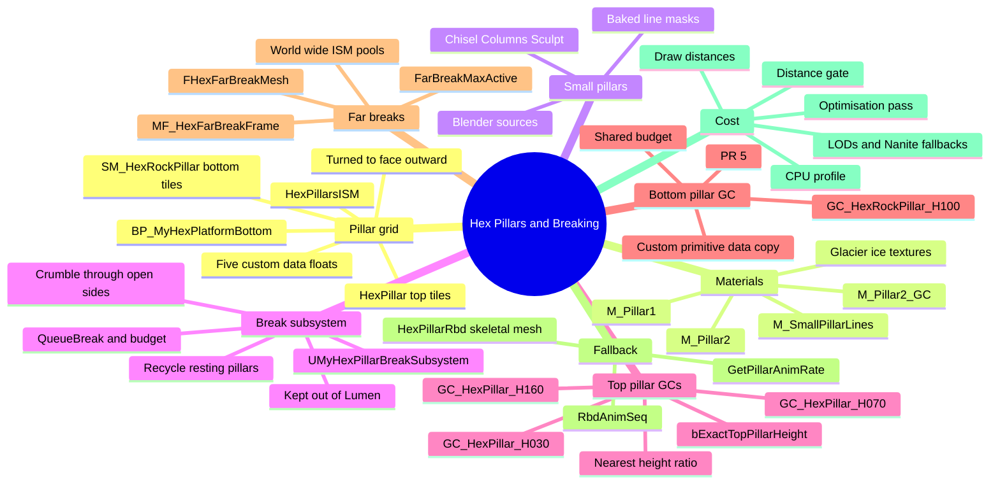
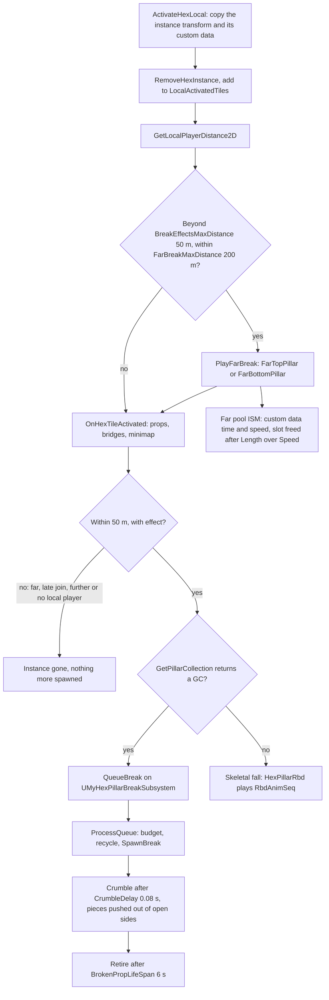
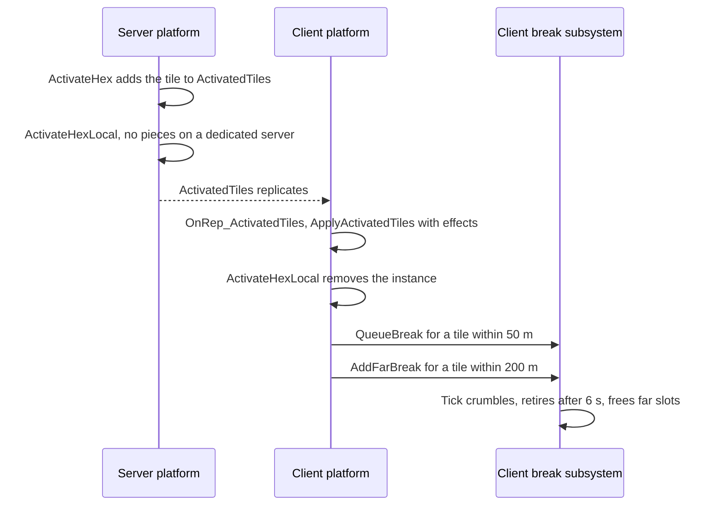

↑ [[Redo3 Changes Index]]

# Hex Pillars and Breaking

AuraRedo3 · redo3 · fa6ad2f..1e23b9d · 2026-10-18 to 2026-11-15

Every hex platform is one instanced static mesh of pillars, `HexPillarsISM` on `AMyHexPlatform`. Top-chain platforms use `HexPillar` with a height per tile; bottom-chain platforms (`BP_MyHexPlatformBottom`) use one tall rock pillar, `SM_HexRockPillar`, at one height for every tile. When a tile collapses, every machine removes its instance. Near the local player (50 m) the pillar is replaced by a Geometry Collection that `UMyHexPillarBreakSubsystem` spawns, crumbles and removes under one world-wide budget: one of three height-matched GCs on top platforms, `GC_HexRockPillar_H100` on bottom ones. Between 50 and 200 m a tile adds a baked far-break instance to a shared ISM instead (once a far-break mesh is set), and further out it just vanishes. Without a GC set, a tile still falls the old way, as a skeletal mesh playing a baked rigid body animation.

In order: on 2026-10-18 Talal's own `M_Pillar1` changes, the pillar meshes and a second pillar material, `M_Pillar2`, were committed from his working copy. On 2026-10-20 he asked to "rotate each instance so that it faces the +X axis out and -X to the center of the platform", and that only tiles near the locally controlled player play their break. On 2026-10-24 he asked whether LODs or switching instances off was better, then for the bottom chain to use `HexPillarBottom`, LODs on all meshes and top pillars that break into Geometry Collections instead of the skeletal animation. On 2026-10-25 he asked for an ISM path for tiles further than 50 m that sends each instance's activation time and speed, so he can play a baked vertex animation. From 2026-10-31 he asked for a stylised cliff pillar from his reference, which became three small pillar meshes and then a 173 x 200 x 1000 hex rock pillar with an ice top, edge snow and glacier sides from an ArtStation material. On 2026-11-15: "make gcs and activate for the bottom pillars as well, for Hexplatforms".

State now (origin/redo3): all of it shipped. Most of the work was done on Talal's PC between 2026-10-20 and 2026-11-05 and reached git in the push thread's 2026-11-15 14:18 batch (`3d05747`, `613707b`, `b5ff0ef`, `fa0ee5e`, `7b295de`), so those commit dates are not the work dates. The bottom pillar GC came the same day as PR #5 (`005aca9`, `3e4c700`, `37fe470`, merged as `25efc1e`), and the glacier textures last (`1e23b9d`). Pillar breaks are local and cosmetic: only the collapse (`ActivatedTiles`) replicates, and a dedicated server spawns nothing. The far breaks still need Talal's baked meshes. Meshes, materials and GCs are binary, so their detail here comes from the commit messages and the thread notes.

## Mind map

## How it works

### One tile breaking

1. The server collapses tiles in chains (`ActivateChain`, one tile every 0.1 s, see [[Redo3 Hex Path and Ranking#Collapse timing]]). `ActivateHex` adds the tile to the replicated `ActivatedTiles` and runs `ActivateHexLocal` itself; clients run it from `OnRep_ActivatedTiles`.
2. `ActivateHexLocal(Coord, bPlayEffect)` reads the instance's world transform and copies its `NumCustomDataFloats` (5) custom data floats before `RemoveHexInstance` removes it. The tile joins `LocalActivatedTiles`.
3. `GetLocalPlayerDistance2D` gives the horizontal distance from the tile to the first local player's pawn, or its camera without a pawn. In range means a local player within `BreakEffectsMaxDistance` (5000 cm); far means out of range but within `FarBreakMaxDistance` (20000 cm, 0 = no limit), with `bPlayEffect` set.
4. A far tile plays `PlayFarBreak` with `FarBottomPillar` or `FarTopPillar` at `GetPillarAnimRate(ScaleZ)`, unless it is already past `PlatformMaxDrawDistance` ([[#Far breaks]]). This goes before the broadcast, so at the `FarBreakMaxActive` cap the pillar gets its slot before its props.
5. `OnHexTileActivated` is broadcast with the range result in `bBreakingTileInEffectsRange` and `bBreakingTileFar`, so the tile's props break ([[Redo3 Hex Tile Props#Breaking props when a tile collapses]]), bridges ending on it start to fall ([[Redo3 Hex Bridges]]) and the minimap updates. On the server, `RefreshSentinelObstacle` is scheduled 0.5 s later, once per burst ([[MechSentinel Movement and Avoidance]]).
6. A far tile, a tile without its effect (late join) or a tile out of range stops here.
7. In range, `GetPillarCollection` picks the GC and the spawn transform: on top platforms the height variant nearest the tile ([[#Top pillar Geometry Collections]]), on bottom platforms `BottomPillarGeometryCollection` at the exact transform ([[#Bottom pillar Geometry Collection]]).
8. With a GC, the open sides of the tile (sides with no standing neighbour, turned into world directions) and the tile's custom data go to `QueueBreak`, with `GetPillarBreakSettings()`, a length scale of `HexRadius / 100` and a removal time of `BrokenPropLifeSpan` (6 s) when `bMatchTilePropLifeSpan` (true), else `LifeSpan` (6.5 s).
9. The subsystem spawns the GC component at once if the budget allows, crumbles it after `CrumbleDelay`, pushes the loose pieces out through the open sides and removes the whole pillar at its time ([[#The pillar break subsystem]]).
10. Without a GC, the tile falls as before: a skeletal mesh component plays the fall animation at `GetPillarAnimRate` and is destroyed when it ends. A bottom tile with no GC and no bottom skeletal assets just disappears ([[#The skeletal fall fallback]]).

### Server and clients

- `UMyHexPillarBreakSubsystem` is a `UTickableWorldSubsystem` that only exists in Game and PIE worlds and never on a dedicated server (`ShouldCreateSubsystem`). A listen server breaks its own tiles like any client.
- Every machine makes its own pieces from its own copy of the collapse, so the pieces differ between machines. They are cosmetic: by default they do not block pawns or traces.
- A client that receives a platform after tiles fell removes them in `BeginPlay` with `ApplyActivatedTiles(false)`: no pieces, no far breaks.

## The pillar grid

- **One ISM.** `HexPillarsISM` (remove-swap on, collision query and physics, blocking all) holds every tile. `BuildHexGrid` picks the mesh with `GetTileMesh()`: `HexPillarBottomStaticMesh` on bottom platforms when set, else `HexPillarStaticMesh`. Clients build the same grid in `BeginPlay` from replicated (initial only) shape properties; the grid itself is not replicated. The grid and the bottom chain are covered on [[Redo3 Hex Platform PCG#The bottom chain class]].
- **Heights.** Top tiles get their own Z scale: 3D Perlin noise times `GridSize * VerticalScaling` at the centre, blending to 0.4 at the rim by ring. Bottom tiles all get `HexRadius / 100` times `HexPillarBottomScaleZ` (1, clamp 0.01), so one GC fits every bottom tile.
- **Meshes.** `HexPillar` (`/Game/Assets/MyPlatform/geo/SM/HexPillar`) has its pivot at the top, hangs to z -200.4 and has an apothem of 83.64 units. `HexPillarBottom` (`geo/SM/HexPillarBottom`, added in `b5ff0ef`) is the constructor's default bottom mesh, 370.5 units tall with apothem 87.1. Since `7b295de` `BP_MyHexPlatform` sets the bottom tiles to `SM_HexRockPillar` ([[#Bottom pillars and the small pillars]]).
- **Turned outward (`6a10353`).** A `GetOutwardSide` lambda takes the integer dot product of the tile's cube coordinate with each of the six hex directions and keeps the largest (ties to the lowest side; the centre tile stays on side 0). The instance gets `FRotator(0, -60 * side, 0)`, so its local +X points out of the platform and -X to the centre. The pillar has flat sides on plus and minus X, so 60 degree steps keep the honeycomb tiling, and the integer maths gives every machine the same result.
- **Custom data.** `BuildHexGrid` sets 5 floats per instance. Since `fa0ee5e` the edge and path data are packed words (integers under 2^24, exact as floats):

| Slot | Content |
|---|---|
| 0 | Falloff |
| 1, 2 | Tile X and Y |
| 3 | Edge word: bits 0 to 5 the open sides turned into the pillar's frame, `((Bits >> Turn) \| (Bits << (6 - Turn))) & 0x3F`; bits 6 to 11 the ring in from the outline (capped at 63); bits 12 to 19 the pillar-local direction to the outline (`PackHexAngle`) |
| 4 | Path word (`PackHexPathWord`): rings from the bridge path, 15 until `WritePathCustomData` runs, and a direction |
| Custom primitive data 0, 1 | `MaxEdgeRing` and the tile count, for the snow |

- The turned open-side bits are for the materials, which read the pillar's local position. `FHexTileInfo` keeps the actor-space bits, and `BuildTileInfos` measures the bounds without the turn so the box does not grow ([[Redo3 Hex Tile Props#Tile infos and the tile index]]).
- The bits are written when the grid is built and not rewritten when a neighbour falls.
- `bWorldPositionOffsetWritesVelocity` is off on `HexPillarsISM`. The constructor comment: `M_Pillar2`'s WPO is a static displacement, and writing velocity for it kept every pillar in the velocity pass each frame (9.8 ms GPU on 2026-10-24).
- `PlatformMaxDrawDistance` (C++ default 0 = always) is set on `HexPillarsISM` as its cull distance in `BeginPlay`; the optimisation pass draws platforms to 1 km, beyond the path-end fog.

## Pillar materials

- **`fa6ad2f` (2026-10-18).** Talal's `M_Pillar1` changes (`M_Pillar1Backup` keeps the earlier version), updates to `HexPillar` and the skeletal `HexPillarRbd`, and `M_Pillar2`, "an alternate rock/crack material for HexPillar". The "Rocks and ruins" thread had left both materials out of its merge on 2026-10-16, and the edge-mask backup `M_Pillar1_BeforeEdgeMask` was already in `808d60c`.
- **`M_Pillar1`.** Its edge mask darkens the open faces from the open-side bits in custom data 3. After `6a10353` its top crack and rock normal textures, projected in the pillar's local space and offset by the tile centre, jump at tile borders; the "Hex grid instances face outward" thread offered Fix, World or Leave and never got an answer. It writes the edge fog RVTs and got the FrozenNorse ice layer from 2026-10-21 (`9b3df08`, [[Redo3 Hex Look and Atmosphere]]).

![[redo3_pillar_ice.jpg]]

`M_Pillar1` with the ice look on the hex pillars, a Simulate capture from 2026-10-21 (`pillar_ice.png`).

- **`M_Pillar2`.** Since `cf4ec00` `HexPillar` uses `MI_Pillar2_V2_1`, an instance of it ("with Nanite", says that commit). `fa0ee5e` gave it the ink outline, the snow and `FogFadeBelow`; on 2026-11-05 the top snow was rebuilt in it as a WPO mound capped at 50 cm ([[Redo3 Artifact - Top Snow Build-up v3]]).
- **`M_Pillar2_GC` (`613707b`).** `M_Pillar2` without the WPO node, with Geometry Collection usage. The WPO pushed vertices up to 14 cm along the normal and tore the cut edges of the GC pieces apart; Talal removed the WPO himself on 2026-10-25 but closed without saving, so the copy was made. Its ink divides z by the GC's height ratio and treats every side as open. The instances are `MI_Pillar2_GC_H030_V2_1`, `_H070_V2_1` and `_H160_V2_1`.
- **`M_SmallPillarLines`** is the bottom pillars' material ([[#Bottom pillars and the small pillars]]).
- The ink and the snow are explained on [[Redo3 Hex Look and Atmosphere]] and in [[Redo3 Artifact - Ink lines in the hex pillar materials]].

## Bottom pillars and the small pillars

### The small pillars

The "Build material from ArtStation reference" thread started on 2026-10-31 from Talal's reference cliff and a flat hexagon top. In Blender (`/mnt/new_partition/BlenderProjects/StylizedCliffPillar`) it made three variants: A Chisel, B Columns (the judged winner at 7.0) and C Sculpt. Talal kept all three and straightened A and C himself.

![[redo3_final_all_v3.jpg]]

The small pillar meshes, Chisel, Sculpt, Columns and HexRock, with their line masks (`final_all_v3.png`).

- Pivot at the top-face centre with the top at Z 0, body 4.2 m down, 3.1k to 4k triangles, 6 UCX collision hulls.
- Line art follows crease edges over 40 degrees (1.6 cm lines with swell and taper), baked into a 2K BaseColor plus a LineMask: `T_SmallPillar_Chisel_BaseColor` and `_LineMask`, and the same for Columns and Sculpt.
- `SM_SmallPillar_Chisel`, `SM_SmallPillar_Columns`, `SM_SmallPillar_Sculpt` with `MI_SmallPillar_*` on `M_SmallPillarLines` (`fa0ee5e`). Chisel rendered black until the material got the Instanced Static Meshes usage flag.
- No commit or thread says a platform uses them; the bottom chain uses `SM_HexRockPillar`.

### SM_HexRockPillar

- A "perfect" hex rock pillar, 173 x 200 x 1000 cm in the commit message (the thread gives 174 x 200 x 1000 with the top rim exactly on the 173 x 200 hex), Nanite on, the carving fading in over the top 35 cm, one perfect-hex collision hull. Source `HexRockPillar_v5.blend`.
- `MI_SmallPillar_HexRock` (`SnowSeamSoftness` 10, `SnowIceFrost` 1) on `M_SmallPillarLines`. `7b295de` made it the bottom tile mesh on `BP_MyHexPlatform`.

### M_SmallPillarLines and the glacier sides

`M_SmallPillarLines` (`fa0ee5e`) layers four looks, documented in [[Redo3 Artifact - M_SmallPillarLines document]]: baked line art or glacier ice on the sides, parallax ice on the flat top (`IcePOM`, `T_PillarIce_*`), snow drifts from the outline (`HexSnowDrift`, Nanite displacement driven by custom data 3 and 4), then `MF_FogFadeBelow` into the fog below, with the displacement set again after the fog blend. It has three lanes (ice, snow, glacier), 12 comment boxes and 16 named reroutes. The look side is on [[Redo3 Hex Look and Atmosphere]].

- **Glacier sides.** `T_GlacierIce_BaseColor`, `_Normal`, `_Roughness`, `_Cavity` and `_Height` (2048, tileable) feed the `[GLACIER]` layer, projected per hex face and varied per tile, with `GlacierSides` 1 and `GlacierTileCm` 400 on `MI_SmallPillar_HexRock`. The ArtStation page returned 403, so Talal pasted the map strips; the normal is quilted from the glacier wall sheet and the other maps are derived from it.
- `fa0ee5e` held the textures back until the licence question was answered, so between it and `1e23b9d` (15:09 the same day) the glacier sides sampled nothing.
- Ink on the pillar sides and an 8 px snow-edge line came on 2026-11-05 and 11-06 from the ink thread.
- Fading the bottom pillars into the fog (`MF_FogFadeBelow`, behind a `FogFadeBelow` switch on in `MI_Pillar2_Bottom_V2_1`, `ac1b069`) is covered in [[Redo3 Artifact - Hiding the bottom pillars in fog]].

![[redo3_glacier1_sheet.jpg]]

Glacier ice on the rock pillar sides (`glacier1_sheet.png`).

## The pillar break subsystem

`UMyHexPillarBreakSubsystem` (`613707b`, bottom pillars from `005aca9`) breaks pillars into Geometry Collections under one budget and owns the far-break pools. It ticks only while it has queued breaks, live pillars or far breaks playing.

### Settings

`FHexPillarBreakSettings`, as `TopPillarBreak` and `BottomPillarBreak` on the platform:

| Group | Setting | Default | What it does |
|---|---|---|---|
| Budget | `MaxActive` | 64 | Live pillars in the world at once |
| Budget | `MaxSpawnsPerFrame` | 2 | New pillars per frame |
| Budget | `MaxQueueTime` | 0.5 s | A break waiting longer is dropped (the tile vanished a while ago) |
| Budget | `MinAgeToRecycle` | 1 s | A pillar this old may be removed early to make room |
| Look | `bMatchTilePropLifeSpan` | true | Remove after the platform's `BrokenPropLifeSpan` (6 s), like the prop debris |
| Look | `LifeSpan` | 6.5 s | Used when the above is off |
| Look | `bAssetRemoval` | false | Let the asset's own removal on break or sleep shrink pieces |
| Look | `CrumbleDelay` | 0.08 s | The pillar drops whole until then |
| Look | `InitialVelocity` | (0, 0, -150) | Applied to the root of the intact pillar |
| Look | `PieceSpreadSpeed` | 120 | Outward push, times the openness and `HexRadius / 100` |
| Look | `PieceVerticalJitter` | 60 | Random up or down speed per piece |
| Look | `PieceMaxSpin` | 90 | Degrees per second, random per piece |
| Look | `bBlocksPawns` | false | Off: pieces only hit WorldStatic, WorldDynamic, PhysicsBody and Destructible |
| Look | `bCastShadow` | true | |
| Look | `bAffectLumen` | false | Keep the pieces out of Lumen's scene |

- The budget is read from each queued break. `GetPillarBreakSettings()` gives bottom breaks `BottomPillarBreak` with `TopPillarBreak`'s four budget fields, so top and bottom pillars share one world-wide cap. The header asks to keep `TopPillarBreak`'s budget the same on every platform class.

### Queue and budget

- `QueueBreak(Platform, Collection, WorldTransform, OpenSides, Settings, LengthScale, RemoveAfter, CustomPrimitiveData)` adds the break and runs `ProcessQueue` at once, so within the budget the pillar replaces the instance in the same frame.
- `ProcessQueue` drops stale breaks from the front (older than `MaxQueueTime` or the platform gone), stops at `MaxSpawnsPerFrame`, and over `MaxActive` retires the oldest pillar that lies still (every piece asleep) once it is at least `MinAgeToRecycle` old. If none rests it retires the oldest one, if that is old enough; otherwise the queue waits.

### Spawning a break

- `SpawnBreak` creates a transient `UGeometryCollectionComponent` owned by the platform, not attached to its ISM and not replicated. Everything the physics proxy reads is set before `RegisterComponent`, because `SetRestCollection` on a registered component builds the proxy at once.
- Settings applied: no navigation, cast shadow, Lumen from `Aura.PillarBreak.Lumen` (-1 = the setting, 0 never, 1 always), `Chaos_Object_Dynamic`, removal on break and sleep only with `bAssetRemoval`, no initial velocity type (a user-defined one would only reach the loose pieces), and the cosmetic collision when `bBlocksPawns` is off.
- The tile's custom data goes on as custom primitive data at the same indices, so the GC material can keep the tile's look (GC components have no per-instance data). Then `SetRestCollection`, `SetWorldTransform`, `RegisterComponent` and `ApplyLinearVelocity` of `InitialVelocity` on the root.

### Crumble, spread and removal

- `Tick` crumbles each pillar once it is `CrumbleDelay` old: `CrumbleActiveClusters`, then for every first-level piece an outward velocity away from the pillar's axis, scaled by how far that direction points out of an open side (the best dot product with `OpenSides`), a random 0.5 to 1 and the length scale, plus vertical jitter and a random spin. Pieces against standing neighbours barely move sideways.
- A pillar is removed whole when it is fully decayed or its `RemoveAfter` time is up. Pillars whose component went with their platform are dropped.
- `PrecacheCollection` makes a throwaway component in `BeginPlay` so the GC's PSOs compile before the first break: the bottom GC on bottom platforms, the top fallback GC and the first height variant on top ones (the variants share their material).
- `Aura.PillarBreakStats` logs live, queued, spawned, dropped and recycled counts and the far-break pool sizes. The log category is `LogHexPillarBreak`.

## Top pillar Geometry Collections

- **Assets (`613707b`).** `GC_HexPillar_H030`, `GC_HexPillar_H070` and `GC_HexPillar_H160` in `geo/GC/Pillar`, fractured from Z-scaled `HexPillar` copies (`geo/GC/GCSource/HexPillar_Src_H030`, `_H070`, `_H160`, simplified to 14k triangles), on `M_Pillar2_GC`. From the test: height ratios (Z over XY) 0.30, 0.70 and 1.60, 11 to 14 pieces and 20k to 26k triangles each, about 12 MB in all instead of 27 MB for an earlier set of 12. The three heights came from k-means over 2,073 top tiles (646, 851 and 576 tiles).
- **`7b295de`** points `TopPillarHeightVariants` on `BP_MyHexPlatform` at the three GCs. `TopPillarGeometryCollection` is the fallback when there are no variants (unset by default).
- **`GetTopPillarCollection`** takes the tile's XY scale as the mean of the absolute X and Y scales, and picks the variant whose `HeightRatio` is nearest the tile's Z over XY in log space, so the steps are a constant factor apart. With `bExactTopPillarHeight` (true) the leftover goes into the Z scale (`|Z| / HeightRatio`, about 0.66 to 1.5 with three variants; the test measured at most 1.53x, mean 1.25x), so the pillar has the tile's exact height and the swap does not pop. Off, the scale is uniform and the height is up to that much off. `bUseTopPillarHeightVariants` off always uses the fallback, for comparison.
- **Why the leftover matters.** A GC applies a non-uniform scale after each piece's own rotation (an `FTransform` cannot shear), so pieces that turn far stretch a little and drift from their collision.
- **The iterations (2026-10-24 to 10-25).** v1 shrank the pieces too fast. v2 shrank them over a random 3 to 5 s; about 90% landed on lower platforms, at +7 to 9 ms on the game thread. For v3 Talal asked for no shrink and only 2 or 3 GCs: the pieces fall at full size and each pillar disappears whole after 6 s. v1 and v2 were cut from an open render LOD1 with 1,424 border edges, which broke their pieces; v3 is cut from the closed source model. In the test, 95 of 95 pillars went at 6.00 to 6.05 s with a peak of 50 of 64 live.
- **Loading.** The GCs are set on the Blueprint, not loaded in the constructor: a load from the constructor comes before the Dataflow node types are registered, and the GCs' embedded Dataflow graphs then lose their nodes.

## Bottom pillar Geometry Collection

Talal asked on 2026-11-15 in "Make hex platform bottom pillars breakable", which handed the work to "Overlapping Geometry Collections". That thread waited until the push thread had pushed his local work (up to `32a308e`, with the top pillar break in `613707b`), then opened PR #5 on `claude/project-thread-2426yz`.

- **`005aca9` (C++).** `GetPillarCollection` returns `BottomPillarGeometryCollection` at the instance's exact transform on bottom platforms (one uniform scale on every bottom tile) and `GetTopPillarCollection` on top ones. `BottomPillarBreak` has its own look and shares the top budget. `BeginPlay` precaches the bottom GC. `ActivateHexLocal` copies the tile's custom data to the GC as custom primitive data at the same indices, so a GC material can keep the tile's snow, rim ink and glacier patch. Without a GC, bottom tiles fall with the bottom skeletal assets, or disappear as before.
- **`3e4c700` (assets).** `GC_HexRockPillar_H100` (`geo/GC/Pillar`), fractured from the closed source model of `SM_HexRockPillar` simplified without attributes to 12k triangles (`geo/GC/GCSource/HexRockPillar_Src_H100`): UniformFracture with 18 to 22 sites and seed 6100 gave 19 pieces and 41,932 triangles, with box implicits at 15%, Nanite off, no removal, and collision set before regenerating. `M_SmallPillarLines_GC` is a copy of `M_SmallPillarLines` with Geometry Collection usage and tessellation off, where every per-instance custom data node defaults from custom primitive data at the same index (`GC_TileCD1`, `2`, `3` = CPD 1, 2, 3, defaults 0, 0, 63). `MI_SmallPillar_HexRock_GC` is `MI_SmallPillar_HexRock` reparented to it. `BP_MyHexPlatform` sets `BottomPillarGeometryCollection` with `BottomPillarBreak` at defaults, and `BP_MyHexPlatformBottom` was resaved.
- **`37fe470`.** The `ActivateHexLocal` header comment now says the instance is removed and replaced by a GC (`GetPillarCollection`: the top variants or `BottomPillarGeometryCollection`), or with none set by a skeletal mesh playing the fall.
- The GC matches the tiles while `HexPillarBottomScaleZ` is 1. Another value stretches it; the header says to bake one at that ratio.
- PR #5 was retargeted to redo3 and merged as `25efc1e` (2026-11-15 19:45). A PIE check of a bottom pillar break was left to Talal.

## Far breaks

Built on 2026-10-25 ([[Redo3 Artifact - Far-break ISMs]]), in git in `613707b` (the pools) and `b5ff0ef` (the platform side and assets). Tiles and props between `BreakEffectsMaxDistance` and `FarBreakMaxDistance` play a baked break instead of vanishing.

- **`FHexFarBreakMesh`**: `Mesh` (every frame of the baked break in one static mesh, frame number in vertex colour; none = the tile just vanishes), `Material` (put on every slot; none = the mesh's own), `Length` (6 s at speed 1), `bCastShadow` (false), `bWPOWritesVelocity` (false).
- **On the platform**: `FarTopPillar`, `FarBottomPillar`, `FarPropMeshes` (prop mesh to baked break), `FarPropSpeedRange` (1, 1), `bFarPropSpeedFromScale` (true), `FarBreakMaxDistance` (20000 cm) and `FarBreakMaxActive` (512, world-wide).
- **Speed.** Pillars play at `GetPillarAnimRate(ScaleZ)`, short pillars faster, like the old fall. Props play at a random speed from the range times `1 / sqrt(Z scale)` clamped to 0.25 to 4, so a fall baked at scale 1 keeps true gravity (ice shards at scale 0.13 at 2.7x, path floor at scale 2 at 0.71x, per the test).
- **Pools.** `AddFarBreak` puts an instance at the removed instance's world transform into one ISM per mesh and material, all owned by one transient, unreplicated actor at the origin. Custom data [0] is the world time of the break (the material Time node's clock) and [1] the speed. Hidden slots are reused before the ISM grows, and a slot is freed `Length / Speed` later, hidden at zero scale. When a pool's last break ends its ISM is emptied, so its bounds do not keep growing along the path. Over `FarBreakMaxActive` the tile or prop just vanishes.
- **Render flags.** No collision, overlaps or navigation; shadow and WPO velocity per mesh; no Lumen, distance field lighting or ray tracing, so new instances do not trigger surface cache captures. `PrewarmFarBreak` creates the empty ISMs in `BeginPlay` (not on a dedicated server) and precaches their PSOs, because in a cooked build a primitive gets no scene proxy until its PSOs are ready.
- **Material.** `MF_HexFarBreakFrame` (`/Game/Assets/MyPlatform/FarBreak`) turns the custom data into a frame: inputs FPS (30), FrameCount (180) and VertexFrame; outputs Age, Frame, FrameAlpha, Visible, Speed and StartTime. `M_HexFarBreakPlaceholder` stands in until Talal's baked mesh exists. The material needs "Used with Instanced Static Meshes" saved on it, or cooked builds draw the default material. The shadow and WPO velocity flags are shared by every break of a mesh: the first one to use the ISM decides.
- **Test (2026-10-25).** Breaking a 63-tile and an 11-tile platform 100 to 135 m away peaked at 223 instances (74 pillars, 149 props on 8 meshes) for +0.44 ms GPU and +0.16 ms on the game thread. The Blueprint slots were still empty then, so in the game far tiles still vanished.
- **Houdini export.** 49 `.usdc` files in `Saved/Exports/TilePropSim` on Talal's PC: the 45 prop GCs, the 3 pillar GCs and a full-height `GC_HexPillar_H100_from_H070`, each a 6 s free fall at 30 fps, Y up in metres (164 MB, 2.04M triangles), from `usdsim/dump_gc.py` and `write_usd.py`.

## The skeletal fall fallback

- The original break: a `USkeletalMeshComponent` at the instance's exact transform, not attached to the ISM, blocking all, plays `RbdAnimSeq` on `HexPillarSkeletalMesh` (the `HexPillarRbd` skeletal mesh and its animation in `geo/SkelM`, by their names) once, and `RemoveAnimatedPillar` destroys it when the animation ends.
- `GetPillarAnimRate(ScaleZ)` maps a Z scale of 1 to 0.4 onto a play rate of 1 to 2.5 (clamped), so short pillars fall faster; the timer divides the length by the rate.
- Bottom platforms use `HexPillarBottomSkeletalMesh` and `BottomRbdAnimSeq` (added on 2026-10-24); until both are set, a bottom tile without a GC just disappears. On 2026-10-24 they were unset, so bottom tiles just vanished then.
- Top platforms with `TopPillarHeightVariants` set never reach this path near the player.

## The optimisation pass

On 2026-10-24 Talal asked whether LODs or switching instances off was better. The answer ([[Redo3 Artifact - Hex platforms - LODs vs switching instances off]]) was both, and fewer platforms alive. A playtest in `StartupMap` had 175 platforms, 230 bridges, 207 torches and about 96k instances, GPU-bound at about 64 ms. Hiding every instanced mesh saved about 37 to 40 ms, culling past 500 m about 17 ms and turning dynamic shadows off about 15 to 18 ms. The pillars were 12,577 instances and 54.5M triangles, about a third.

The same day's pass ([[Redo3 Artifact - Hex platform optimization - what changed]]):

- **Pillar meshes.** `HexPillar` got a 10% Nanite fallback (4,782 triangles) and LODs of 2,390, 1,196 and 478; `HexPillarBottom` a 15% fallback (1,272) and LODs of 636, 318 and 128; screen sizes 1, 0.25, 0.10 and 0.04; both got simple box collision (each `HexPillar` had a 2,081-vertex convex hull before). `HexPillar.uasset` was last saved in `cf4ec00`, and the commit messages do not say which commit carries these LODs.
- **Velocity pass.** WPO no longer writes velocity on `HexPillarsISM`: 10 ms to 0.7 ms.
- **Draw distances.** Platforms 1 km, tile props 600 m, bridges 800 m, small props 200 to 400 m per instance (`PlatformMaxDrawDistance`, `PropMaxDrawDistance`).
- **Elsewhere.** Prop and bridge mesh LODs, lighter stone bridge GCs and debris limits (`3d05747`, see [[Redo3 Hex Tile Props#Draw distances and LODs]] and [[Redo3 Hex Bridges]]), unshadowed torch lights, `ExtendDistance` 20000 so the path is built about 600 m ahead instead of 1.8 km, and the per-tile `PrintString` and double grid build removed.
- **Result.** Like for like, GPU time went from 60 to 68 ms to 33 to 36 ms: shadows 12 to 14 ms down to 3, base pass 11.5 to 13 down to 2.9, velocity 10 down to 0.7, depth prepass 7 down to 1.2, draw calls 4,219 down to about 1,500. On Talal's map (HexRadius 200) it ran at 26 ms, about 37 fps.
- **Bottom chain.** The pass split the platforms: `BP_MyHexPlatformBottom` sets `bIsBottomPlatform` and the lower chain spawns it. Talal corrected it at 13:03: bottom platforms use only `HexPillarBottom`, top ones only `HexPillar`. A PIE check counted 44 bottom and 30 top platforms.

**What the break tests measured.** Removing 45 instances added 14 to 16 ms GPU for about 2 s, almost all in `LumenSceneUpdate`, with or without pieces; the pieces themselves cost about 1.5 to 2 ms. Falling pieces cost 18 ms in Lumen scene updates until they were kept out of Lumen (`bAffectLumen` false). A v3 three-chain break cost +19.9 ms GPU while falling. Breaking a whole 303-tile platform with `Aura.BreakTopPlatform 0` gave a 369 ms game-thread frame, from the uncapped prop GCs, not the pillars.

## CPU profile findings

The "CPU profile during play" thread recorded a 207 s PIE (3,445 frames) on 2026-10-20 with Unreal Insights. The game thread took 61 ms a frame:

| Cost | Per frame | Cause |
|---|---|---|
| Waiting on Chaos physics | 17.3 ms | About 160 live debris GCs that never settle in their 6 s life |
| Waiting on the render thread | 6.6 ms | |
| `HexPillarRbd` falling pillars | 6.4 ms | About 82 live, 23 kinematic bodies each |
| `AMyHexPlatform` timers | 2.7 ms | |
| Runtime PCG | 1.6 ms | Plus the worst hitches, up to 466 ms, from Spawn Actor batches and per-instance collision (the wooden bridge cubes alone 1.2 s) |

- The fixes it suggested (shorter debris life or removal settings, fewer pillar collision bodies, no collision on the bridge cubes) were not made in that thread. Later work changed the same costs: near the player, top pillars break into budgeted GCs (64 live, gone after 6 s) instead of the skeletal fall, and debris only spawns within 50 m.
- A second profile on 2026-10-23 ran at 184 ms a frame, render-bound on Vulkan memory, and is not comparable for pillar costs (114 tiles collapsed against about 4,000). The Vulkan findings are on [[Redo3 Engine Tools and Assets]].

## Debug commands

- `Aura.BreakTopPlatform [Chains=1] [X Y Z] [Bottom=0]` (not in shipping builds, run on the server): collapses `Chains` chains (0 = every tile at once) of the top platform, or with `Bottom` 1 the bottom platform, nearest the point or the local pawn, through the normal replicated path (`DebugBreakTiles`).
- `Aura.PillarBreakStats`: the subsystem's counts.
- `Aura.PillarBreak.Lumen -1, 0 or 1`: the Lumen override for new pieces.

## Other callers

The Burrower (`a414ca9`, merged into redo3 in PR #8) adds `ActivateTilesInWorldBox(BoxToWorld, BoxExtent)` and `CouldWorldBoxTouchTiles`. On the server it collapses every standing tile whose pillar touches the box through `ActivateHex`, so the break, props, bridges and minimap follow; it does nothing until the bridges are built. The Burrower's rotor calls it ([[Redo3 Burrower]]).

## Gotchas

- Never load the pillar GCs from the constructor: the Dataflow graphs lose their nodes. Set them on the Blueprint.
- A GC that should keep the tile's look needs a material that reads custom primitive data, like `M_SmallPillarLines_GC`; GC components have no per-instance data.
- WPO on a GC material tears the pieces apart at the cuts; the GC materials are copies without it.
- Lumen re-captures the ISM when instances are removed, which costs more than the pieces. Keep the pieces out of Lumen.
- `bBreakingTileInEffectsRange` and `bBreakingTileFar` are only valid during the `OnHexTileActivated` broadcast.
- The budget is read from each queued break, so the header asks to keep `TopPillarBreak`'s budget the same on every platform class.
- The GC pieces are cosmetic and differ per machine; nothing may depend on where they land.

## How it changed

- **2026-10-16** `808d60c` (context): the `M_Pillar1` edge mask, with its backup `M_Pillar1_BeforeEdgeMask`.
- **2026-10-18** `fa6ad2f`: Talal's `M_Pillar1` changes with `M_Pillar1Backup`, `HexPillar` and `HexPillarRbd` updates, and `M_Pillar2`. Committed from his working copy by the "Unpushed commits count" thread.
- **2026-10-20** `6a10353`: every pillar turned so +X faces away from the centre, with the open-side bits in custom data 3 turned into the pillar's frame and the tile infos kept in actor space. Compiled and hot reloaded on Talal's PC, committed on `claude/project-thread-er95f6`, merged into redo3 as `69cdf95` on 2026-11-15 10:23. It left the `M_Pillar1` top texture seams open.
- **2026-10-20**: the CPU profile, and the distance gate `BreakEffectsMaxDistance` in `ActivateHexLocal` (in git in `b5ff0ef`).
- **2026-10-23**: the second profile and the Vulkan workaround (in git as `e5d0fec` in the 2026-11-15 batch).
- **2026-10-24**: the LOD question, two playtests and the optimisation pass, and the bottom chain with `HexPillarBottom`, `HexPillarBottomScaleZ` and the bottom skeletal slots. Nothing was committed in the thread.
- **2026-10-24 to 10-25**: top pillar GCs v1 to v3 with the break subsystem, ending with three height variants on `M_Pillar2_GC` cut from the closed source, the GCs moved from the constructor to the Blueprint, the far-break ISMs with `MF_HexFarBreakFrame`, and the USD export.
- **2026-10-26**: the V2.1 ice look with ink in the pillar materials; `HexPillar` on `MI_Pillar2_V2_1` (`cf4ec00`).
- **From 2026-10-30**: the fog fade for the bottom pillars, after the "Hiding the bottom pillars in fog" answer (`ac1b069`).
- **2026-10-31 to 11-05**: the small pillars, the ice top, edge snow and packed custom data, `SM_HexRockPillar` and the glacier textures. On 2026-11-05 the bottom snow was reverted to before that day's brief and the build-up moved to the top pillars in `M_Pillar2`.
- **2026-11-05 to 11-06**: ink on the bottom pillar sides and the snow-edge line.
- **2026-11-15 14:18**, the batch: `3d05747` (prop and bridge LODs, lighter bridge GCs, part of the 2026-10-24 pass), `613707b` (the break subsystem and the three top GCs), `b5ff0ef` (the bottom chain, `HexPillarBottom`, near and far breaks, the FarBreak assets, draw distances, WPO without velocity), `fa0ee5e` (`SM_HexRockPillar`, the small pillars, `M_SmallPillarLines`, the custom data packing, `M_Pillar2` snow, ink and fog fade), `7b295de` (`BP_MyHexPlatform`: rock pillar bottoms, the top GC variants, the slab GCs and the cloud bank).
- **2026-11-15 14:24** `005aca9`: bottom pillars break into `BottomPillarGeometryCollection` through the subsystem.
- **2026-11-15 14:30** `3e4c700`: `GC_HexRockPillar_H100`, its source, `M_SmallPillarLines_GC`, `MI_SmallPillar_HexRock_GC` and the Blueprint setting.
- **2026-11-15 15:05** `37fe470`: the `ActivateHexLocal` comment. PR #5 merged as `25efc1e` at 19:45.
- **2026-11-15 15:09** `1e23b9d`: the `T_GlacierIce_*` textures, once the licence question was answered.

## Threads that worked on it

- [[Redo3 Threads#Unpushed commits count|Unpushed commits count]]: committed `M_Pillar1`, the pillar meshes and `M_Pillar2` (`fa6ad2f`).
- [[Redo3 Threads#Hex grid instances face outward|Hex grid instances face outward]]: turned every pillar outward (`6a10353`) and raised the `M_Pillar1` seam question.
- [[Redo3 Threads#Break effects only near the player|Break effects only near the player]]: added `BreakEffectsMaxDistance` and the local-player distance check.
- [[Redo3 Threads#CPU profile during play|CPU profile during play]]: profiled PIE and measured the falling pillar and debris costs.
- [[Redo3 Threads#Add far-break ISMs for distant tiles|Add far-break ISMs for distant tiles]]: the LOD answer, the optimisation pass, the bottom chain, the top pillar GCs and the break subsystem, and the far breaks.
- [[Redo3 Threads#Fix and extend the hex ink lines|Fix and extend the hex ink lines]]: the ink in `M_Pillar2`, `M_Pillar2_GC` and on the bottom pillar sides.
- [[Redo3 Threads#Optimize the hex atmosphere effects|Optimize the hex atmosphere effects]]: faded the bottom pillars into the fog.
- [[Redo3 Threads#Build material from ArtStation reference|Build material from ArtStation reference]]: the small pillars, `SM_HexRockPillar`, `M_SmallPillarLines`, the packed custom data, the glacier textures and the top snow.
- [[Redo3 Threads#Make hex platform bottom pillars breakable|Make hex platform bottom pillars breakable]]: took Talal's request for bottom pillar GCs and handed it on.
- [[Redo3 Threads#Overlapping Geometry Collections|Overlapping Geometry Collections]]: built the bottom pillar GC as PR #5 (`005aca9`, `3e4c700`, `37fe470`).
- [[Redo3 Threads#Collapsing bridges|Collapsing bridges]]: makes a bridge fall from the end whose tile broke, with its debris near the player only.
- [[Redo3 Threads#Rocks and ruins on hex tiles|Rocks and ruins on hex tiles]]: documented the tile collapse from `ActivateHexLocal` to the props, and left the pillar materials out of its merge.
- [[Redo3 Threads#Model, rig and export the burrower creature|Model, rig and export the burrower creature]]: added `ActivateTilesInWorldBox` for the rotor, merged in PR #8.
- [[Redo3 Threads#Push local changes to GitHub|Push local changes to GitHub]]: merged the outward pillars as `69cdf95` and committed the batch from Talal's PC.

## Artifacts and files

- [[Redo3 Artifact - Hex platforms - LODs vs switching instances off]]: the 2026-10-24 answer with the playtest numbers and triangle shares.
- [[Redo3 Artifact - Hex platform optimization - what changed]]: the pass that halved GPU time, with the pillar LODs and the bottom chain.
- [[Redo3 Artifact - Top pillar GC test]]: v1 to v3 of the top pillar GCs, the three height variants and their costs.
- [[Redo3 Artifact - Far-break ISMs]]: the far-break code, `MF_HexFarBreakFrame`, the cost test and the USD export.
- [[Redo3 Artifact - Ink lines in the hex pillar materials]]: the Outline section of `M_Pillar2` and `M_Pillar2_GC`, node by node, with the `HexPillar` measurements.
- [[Redo3 Artifact - Hiding the bottom pillars in fog]]: why and how the bottom pillars fade into the fog colour.
- [[Redo3 Artifact - M_SmallPillarLines document]]: the bottom pillar material, its custom data decoding and build scripts.
- [[Redo3 Artifact - Top Snow Drift Normals]]: the first 2026-11-05 fix to the top snow drift normal in `M_Pillar2`.
- [[Redo3 Artifact - Top Snow Build-up v3]]: the top snow capped and smoothed like the bottom's.
- [[Redo3 Files - Snow and Ice Pillar Materials]]: the working files and renders of the small pillars, the hex rock pillar and the glacier ice.
- [[Redo3 Files - Hex Ice Look and Ink Lines]]: the ice look and ink captures, including the pillar ice before and after.
- [[Redo3 Files - Profiling Reports]]: the CPU profile and second-run lag reports.

## Where it lives

| What | Path |
|---|---|
| Platform side | `Source/Aura/Public/Actors/MyHexPlatform.h` ("Hex Platform\|Assets", "Hex Platform\|Optimization", "Hex Platform\|Far Break", `BreakEffectsMaxDistance`) and `Source/Aura/Private/Actors/MyHexPlatform.cpp` (`BuildHexGrid`, `ActivateHex`, `ActivateHexLocal`, `GetPillarAnimRate`, `GetTopPillarCollection`, `GetPillarCollection`, `GetPillarBreakSettings`, `GetTileMesh`, `PlayFarBreak`, `DebugBreakTiles`, `Aura.BreakTopPlatform`) |
| Break subsystem | `Source/Aura/Public/Actors/MyHexPillarBreakSubsystem.h` (`FHexFarBreakMesh`, `FHexPillarGCVariant`, `FHexPillarBreakSettings`), `Source/Aura/Private/Actors/MyHexPillarBreakSubsystem.cpp` (`Aura.PillarBreak.Lumen`, `Aura.PillarBreakStats`, `LogHexPillarBreak`) |
| Platform Blueprints | `/Game/Assets/MyPlatform/BP_MyHexPlatform`, `/Game/Assets/MyPlatform/BP_MyHexPlatformBottom` |
| Pillar meshes | `/Game/Assets/MyPlatform/geo/SM/HexPillar`, `geo/SM/HexPillarBottom`, `geo/SmallPillars/SM_HexRockPillar` |
| Skeletal fall | `/Game/Assets/MyPlatform/geo/SkelM/HexPillarRbd`, `HexPillarRbd_Anim`, `HexPillarRbd_PhysicsAsset`, `HexPillarRbd_Skeleton` |
| Pillar GCs | `/Game/Assets/MyPlatform/geo/GC/Pillar/GC_HexPillar_H030`, `_H070`, `_H160`, `GC_HexRockPillar_H100`; sources in `geo/GC/GCSource/` |
| Pillar materials | `/Game/Assets/MyPlatform/Mats/M_Pillar1`, `M_Pillar1Backup`, `M_Pillar1_BeforeEdgeMask`, `M_Pillar2`, `M_Pillar2_GC`; instances in `HexPlatforms/Iterations/` (`MI_Pillar2_V2_1`, `MI_Pillar2_Bottom_V2_1`, `MI_Pillar2_GC_H030_V2_1` and the others) |
| Small and rock pillars | `/Game/Assets/MyPlatform/geo/SmallPillars/` (`SM_SmallPillar_*`, `T_SmallPillar_*`, `M_SmallPillarLines`, `M_SmallPillarLines_GC`, `MI_SmallPillar_*`), `Ice/T_PillarIce_*`, `Glacier/T_GlacierIce_*` |
| Far breaks | `/Game/Assets/MyPlatform/FarBreak/MF_HexFarBreakFrame`, `M_HexFarBreakPlaceholder` |
| Blender sources (Talal's PC) | `/mnt/new_partition/BlenderProjects/StylizedCliffPillar`, `/mnt/new_partition/BlenderProjects/GlacierIce/textures` |
| Exports and scripts (Talal's PC) | `Saved/Exports/TilePropSim/`, `Saved/ClaudeTools/smallpillars/` |

## Open items

- The far breaks need Talal's baked-frame meshes; until then `M_HexFarBreakPlaceholder` is the only far material, and on 2026-10-25 the Blueprint slots were empty. The cooked-build PSO path was not checked.
- A PIE check of a bottom pillar GC break was left to Talal.
- `M_Pillar1`'s top textures jump at tile borders since the pillars were turned; Fix, World or Leave was never chosen.
- `MeshLengthLocal` on `MI_SmallPillar_HexRock` is still 487.69 (from Sculpt) while the pillar is 1000 cm long, so its fog fade is scaled wrong.
- The open-side bits are not rewritten when a neighbour falls, so standing pillars keep the edge look they were built with.
- A `HexPillarBottomScaleZ` other than 1 stretches the bottom GC.
- The profile's suggestions (shorter debris life, fewer collision bodies on the falling pillars) were not taken up as such.
- A falling pillar GC piece under Nanite was not checked in a close-up, the top drift look still needs Talal's check, the GPU cost of the ice parallax was never measured, and the `IceDepth` 0.18 override on `MI_SmallPillar_Sculpt` no longer does anything.

## Related

- [[Redo3 Hex Tile Props]]: the props that break with each tile, the tile infos and the tile to ISM map.
- [[Redo3 Hex Look and Atmosphere]]: the ice look, ink, snow, edge fog and fog fade on the pillar materials.
- [[Redo3 Hex Platform PCG]]: how the lower and upper chains spawn the top and bottom platforms.
- [[Redo3 Hex Path and Ranking]]: when platforms start collapsing and how the chains run.
- [[Redo3 Hex Bridges]]: the bridges that fall when their end tiles break.
- [[Redo3 Burrower]]: the creature whose rotor breaks tiles on its branch.
- [[Redo3 Engine Tools and Assets]]: the profiling setup, the Vulkan workaround and the editor material commands.
- [[MechSentinel Movement and Avoidance]]: the obstacle the platform re-registers as its tiles fall.
- [[Redo3 Timeline]], [[Redo3 Branches and PRs]], [[Redo3 Threads]], [[Redo3 Artifacts Index]].
- Talal's notes: [[HexPlatform]] (how a platform builds its grid and activates tiles on the server), [[HexPlatformISMs]] (his diagram of the one-actor ISM platform across construction, server and client), [[smallIslandsPillarShape]] (a pasted pillar shape reference, 2026-10-30), [[21-10-2026]] (his to-dos "nanite check, displacemnt with nanite" and "bottom chain spawn cliffs").

[[Redo3 Hex Tile Props]] ← → [[Redo3 Hex Look and Atmosphere]]
