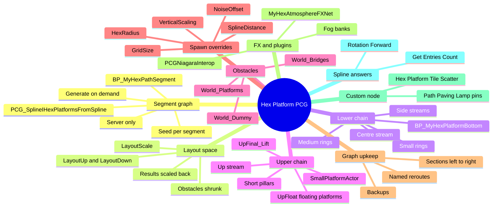
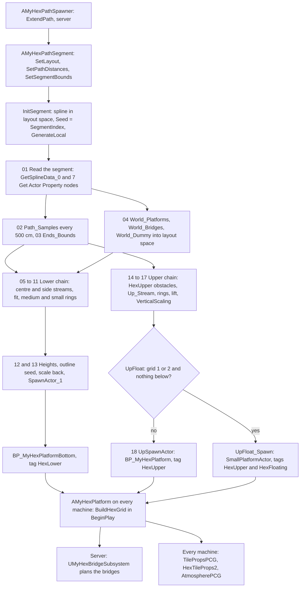
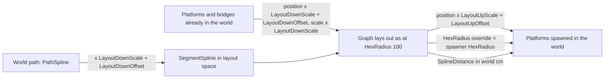

↑ [[Redo3 Changes Index]]

# Hex Platform PCG

AuraRedo3 · redo3 · 17605e3..cd6db8b · 2026-10-03 to 2026-11-15

Every hex platform on the endless path is placed by one PCG graph, `PCG_SplineIHexPlatformsFromSpline`. Each `BP_MyHexPathSegment` that the path spawner adds runs it once, on the server, over its own piece of the path. The graph lays out two chains of platforms: a lower chain of big centre and side platforms ringed by medium and small ones, and an upper chain above it that complements it (15 m up as built; the live graph of 2026-10-22 lifted it 60 m, see [[#The upper chain]]). It keeps clear of platforms and bridges that are already in the world, and spawns each platform with its grid size, outline seed, distance along the path and hex radius as property overrides. Every machine then builds the same tiles from those replicated values.

Talal's asks, in order: on 2026-10-04 the graph "only spawns them in a straight line with only different grid sizes", so he asked for "different streams of the spawner" with a natural layout, offsets in Z and smaller platforms around the big ones, then "the same chain above it which complements the chain below". Next came `SplineDistance` on every platform for the player ranking, then a layout that scales with the hex radius ("right now everything scales right with hex radius of 100"), a tidy graph with sections left to right and named reroutes, and finally a separate actor for the small top platforms that have nothing under them.

State now (origin/redo3): all of it shipped; `ff2437c` holds the last saved graph. The lower chain spawns `BP_MyHexPlatformBottom`, the smallest upper platforms with nothing below them spawn through the `SmallPlatformActor` graph parameter, and the graph lays everything out in "layout space" at radius 100 and scales the result to the spawner's `HexRadius`. The graph is a binary asset: the node-level detail on this page comes from the 2026-10-22 walkthrough (written against the 2026-10-12 layout), the change list made the same day from the live graph, and the thread notes. The project also has one custom PCG node, Hex Platform Tile Scatter (`UPCGHexPlatformTilesSettings`), used by the tile prop graphs, and the `PCGNiagaraInterop` plugin is enabled.

## Mind map



## How it works

### From a new segment to spawned platforms



1. `AMyHexPathSpawner::ExtendPath` (server only) grows the path by one segment and spawns `SegmentClass` (`BP_MyHexPathSegment`). Before anything runs it calls `SetLayout(HexRadius, spawner XY)`, `SetPathDistances(start, end)` and `SetSegmentBounds(...)` on it (see [[Redo3 Hex Path and Ranking]]).
2. `AMyHexPathSegment::InitSegment` writes the new points and tangents into `SegmentSpline` in layout space, sets `PCGComponent->Seed = SegmentIndex` (so neighbouring segments make different random choices) and calls `GenerateLocal(true)`. The component's trigger is `GenerateOnDemand`, so it never runs on load, and the segment has `bReplicates = false`: the graph runs on the server only. Separate segments mean an extension never regenerates, and so never respawns, earlier platforms.
3. Step 01 reads the segment: `GetSplineData_0` (Self) returns `SegmentSpline`, and seven Get Actor Property nodes read `Seg_PathStartDistance`, `Seg_LayoutDownScale`, `Seg_LayoutDownOffset`, `Seg_LayoutUpScale`, `Seg_LayoutUpOffset`, `Seg_LayoutScale` and `Seg_HexRadius` from the segment's properties (`PathStartDistance` is under "Hex Path", the rest under "Hex Path|Scale").
4. Steps 02 and 03: `Path_Samples` drops a point every 500 cm along the path, flattened and bounded; ring platforms are only kept within `PathDist` 9000 (90 m) of the path. `Ends_Bounds` puts boxes beyond both segment ends, and the distance to them (`CapD`) stops platforms from reaching into the next segment's space.
5. Step 04 turns what is already in the world into obstacles: `World_Platforms` (Get Actor Data by tag `HexLower`, Always Requery), `World_Bridges` (every `MyHexBridge` since `86539d1`) and `World_Dummy`, which keeps the set from being empty on the first segment. The points are moved into layout space and flattened into tall columns (bounds Z +-100000), so every overlap test is 2D (`WorldD`).
6. Steps 05 to 11 build the lower chain: the centre stream, the left and right streams, fit-to-space shrinking, then medium rings around every big platform and small rings around every medium one (numbers in [[#The lower chain]]).
7. Steps 12 and 13 restore the heights, seed each platform's outline (`NoiseOffset`), scale positions back to the world and spawn with `SpawnActor_1`: `BP_MyHexPlatformBottom` since `ff2437c` (before that `BP_MyHexPlatform`), tag `HexLower`, overriding `GridSize`, `NoiseOffset`, `SplineDistance` and `HexRadius`.
8. Steps 14 to 18 build the upper chain the same way but against its own `HexUpper` obstacles, lift it with `UpFinal_Lift`, give it short pillars through `VerticalScaling` and spawn it with `UpSpawnActor` (tag `HexUpper`).
9. Since 2026-10-21 the `UpFloat` section takes the smallest upper platforms (grid 1 to 2) that have no lower platform under them and spawns them through `UpFloat_Spawn` from the `SmallPlatformActor` graph parameter, tagged `HexUpper` and `HexFloating` (see [[#Floating small top platforms]]).
10. Every spawned `AMyHexPlatform` builds its own hex grid in `BeginPlay`, on the server and on each client, from the overrides, which replicate `COND_InitialOnly` before `BeginPlay` runs. On the server it registers with `UMyHexBridgeSubsystem`, which reads the `HexLower` / `HexUpper` tags to tell the chains apart ([[Redo3 Hex Bridges]]).
11. Locally, every machine then runs the platform's own PCG components for tile props, paving and atmosphere ([[Redo3 Hex Tile Props]], [[Redo3 Path Paving]], [[Redo3 Hex Look and Atmosphere]]).

### Layout space



1. The graph was tuned for platforms of `HexRadius` 100. `AMyHexPathSegment::SetLayout` sets `LayoutScale = HexRadius / 100` (S), `LayoutUpScale = (S, S, 1)`, `LayoutDownScale = (1/S, 1/S, 1)` and offsets so the scaling happens around the start of the path (the spawner's XY at Z 0). Heights are never scaled.
2. `InitSegment` stores `Point * LayoutDownScale + LayoutDownOffset` and `Tangent * LayoutDownScale`. A cubic spline scaled this way is exactly the scaled curve, so the graph sees the very path the spawner grows at radius 100 and makes the same random choices.
3. About 14 nodes added in `55f9c66` shrink the obstacles read from the world into the same space, scale the results back up, correct `SplineDistance` and pass `HexRadius` to every platform. The segment header gives the distance formula: `(distance along SegmentSpline + LayoutPathStartDistance) * LayoutScale`.
4. At HexRadius 100 all of this is the identity. In the thread's Simulate runs, radius 100 gave 161 platforms and 194 bridges, and radius 200 an exact 2x copy of the same 161 platforms (within 0.001 cm) with 197 bridges.
5. Every distance the walkthrough gives is in layout cm. Multiply by S for world size. StartupMap's spawner runs at HexRadius 200 (from the 2026-10-24 optimisation notes).

The spawner side of the knob (segment length, extend and destroy distances, noise) is on [[Redo3 Hex Path and Ranking#One HexRadius scales everything]].

## Where each PCG graph runs

| Graph | Component | Runs on | Page |
|---|---|---|---|
| `PCG_SplineIHexPlatformsFromSpline` | `PCGComponent` on `BP_MyHexPathSegment` | Server only, once per segment | this page |
| `PCG_HexTileProps2`, `PCG_HexTileProps3` (first layer `PCG_HexTileProps`, its graph later cleared) | `TilePropsPCG` and `HexTileProps2` on `BP_MyHexPlatform` (`PCG_HexTileProps3` sat on `HexTileProps2` on 2026-10-22) | Every machine, locally and deterministically | [[Redo3 Hex Tile Props]], [[Redo3 Path Paving]] |
| `PCG_HexAtmo_A`, `PCG_HexAtmo_B`, `PCG_HexAtmo_C`, `PCG_HexAtmo_LowerClouds` | `AtmospherePCG` on the platform, graph from the active atmosphere variant | Every machine that renders (not a dedicated server) | [[Redo3 Hex Look and Atmosphere]] |
| `PCG_SplineISMs`, `PCG_Bridge` (wooden), `PCG_Bridge2` (stone) | the bridge actors' PCG component | Every machine, locally | [[Redo3 Hex Bridges]] |

Only the segment graph decides where things are; everything downstream rebuilds from replicated values on each machine.

## The segment graph's inputs

The graph reads these with Get Actor Property on Self. All are `VisibleInstanceOnly`, `BlueprintReadOnly` properties of `AMyHexPathSegment`, set by the spawner or in `InitSegment`: `PathStartDistance` is in the category "Hex Path", the others in "Hex Path|Scale".

| Property | Default | What it is |
|---|---|---|
| `PathStartDistance` | 0 | Distance along the spawner's `PathSpline` where this segment starts (world cm) |
| `HexRadius` | 100 | The spawner's `HexRadius`, passed to every platform as the `HexRadius` override |
| `LayoutScale` | 1 | `HexRadius / 100` |
| `LayoutUpScale`, `LayoutUpOffset` | (1,1,1), 0 | Layout to world: `world = layout * LayoutUpScale + LayoutUpOffset` |
| `LayoutDownScale`, `LayoutDownOffset` | (1,1,1), 0 | World to layout: `layout = world * LayoutDownScale + LayoutDownOffset` |
| `LayoutPathStartDistance` | 0 | `PathStartDistance / LayoutScale` (C++ side; the walkthrough's seven nodes read `PathStartDistance`) |

`AMyHexPathSpawner`'s segment bounds (used by the sentinel waves) mirror this graph: "platforms within 9975 layout cm of the path, tile tops -1620..+4620 around it". The header says they must follow the graph when it changes.

## The lower chain

All numbers in layout cm, from the walkthrough of the 2026-10-12 graph.

| Part | Start | Spacing | Placement | Grid size | Kept |
|---|---|---|---|---|---|
| `Stream_Center` | 2500 | 5000 | On the path, Perlin height offset up to +-400 | `floor(U(11, 12.999))`, 11 or 12 | Dropped below 3 after the fit |
| `Stream_Left` | 2000 | 5000 | 42 to 48 m to the side | `floor(U(6, 9.999))`, 6 to 9 | About 15% skipped, +-17 m self-prune, dropped below 4 |
| `Stream_Right` | 3000 | 5000 | 42 to 48 m to the other side | 6 to 9 | Same as left |
| Medium rings | around every big platform | 6 directions | Gap 350 to 800 | 3 to 5 | About 55% |
| Small rings | around every medium platform | 5 directions | Gap 260 to 420 | 1 to 2 | About 60% |

Fit to space, for the big platforms:

```
A   = min(CapD - 150, PeerD / 2 - 150, WorldD - 300)
GAl = floor((A - 100) / 175)
Gf  = min(Gf, GAl)
Radius = 175 G + 100        Rm = 175 G + 250
```

`CapD` is the distance to the end boxes, `WorldD` the 2D distance to the obstacle columns and `PeerD` the distance between the new platforms. Side platforms also have an `OtherD` limit that keeps them at least 3 m from the centre platforms. `Radius = 175 G + 100` is a little more than the platform's half size at radius 100: `AMyHexPlatform::HexToWorld` (pointy-top, R the corner radius) puts tile centres up to `sqrt(3) * R * G` apart from the middle, so a grid of size G spans `sqrt(3) * R * (2G + 1)` in X and `R * (3G + 2)` in Y. Medium and small rings are self-pruned large to small.

Heights: big platforms share one smooth noise of up to +-4 m, and the lower chain's rings mostly step down (-1 to +0.3 times their gap). In the first test, on the four tightest real segments (19 to 22, path seed 17.31), the layout gave 41 platforms with no overlaps and a smallest gap of 2.8 m. Talal later asked for bigger ring height steps but said "don't widen the gaps even if the secondary platforms dont get bridges", so some ring platforms are too steep for a bridge.

## The upper chain

- It reads only `HexUpper` obstacles, so each chain avoids only its own platforms.
- `Up_Stream`: one big platform every 5000 from 0, `Gf = floor(U(10, 11.999))`, so it sits halfway between the lower centre platforms and follows the same height noise, rising and falling with it. Its medium and small rings use different seeds and mostly step up (`U(-0.3, 1.0)` times the gap), so the two levels keep apart.
- `UpFinal_Lift` (titled "UPPER CHAIN HEIGHT", in a red comment box) lifts the chain by +1500 cm. To change it, set Offset Min Z and Offset Max Z on that node to the same value; going much below about 15 m risks collisions.
- Short pillars: normal pillars hang 12 to 33 m below a platform and would block the lower chain's bridges. `AttributeRemap_0` sets `VS = 0.08 + 0.02 * Gf` (0.10 to 0.30) for the `VerticalScaling` override; lower platforms keep the default 0.5 (`AMyHexPlatform::VerticalScaling`). The closest gap between an upper pillar bottom and a lower platform in the test was 8.7 m.
- `UpSpawnActor` spawns `BP_MyHexPlatform` with tag `HexUpper` and the same overrides as the lower chain plus `VerticalScaling`.
- Changes seen in the live graph on 2026-10-22: the lift actually used was `TransformPoints_0` at +6000 cm while `UpFinal_Lift` was unconnected, `VerticalScaling` had become `0.05 * Gf`, `AttributeMathsOp_0` had InB 2.0 on the vertical scaling, and stray AttributeNoise nodes had appeared. Which of these the saved graph in `ff2437c` still has is not recorded.

## Floating small top platforms

Talal's to-do of 2026-10-21 ([[21-10-2026]]) has "small platforms in top chain, check bottom chain if nothing under" crossed off. The "Beam and gunshot Niagara effects" thread, working in the same editor, built it that day as a new section of the graph.

- **Where:** the `UpFloat_` section after `UpFinal_HexRadius`, 12 nodes from `UpFloat_SplitSmall` to `UpFloat_Spawn`. It takes the size 1 to 2 platforms of the upper chain.
- **The test:** a platform counts as floating when its centre is over neither a bottom footprint of the same segment (grown by a small platform's size) nor a bottom platform already in the world. Bridges do not count. In Simulate 20 of 37 small top platforms were floating, and 36 of 37 matched what was really below them.
- **The actor:** Talal wanted "a separate actor, not a different mesh" and said "use the same mesh for now only build the logic". A temporary `BP_MyHexPlatformFloating` copy was deleted again. On 2026-11-01 the thread added the `SmallPlatformActor` graph parameter (default `BP_MyHexPlatform`): `UpFloat_Spawn` reads it with Get Graph Parameter, writes it as an attribute with Add Attribute and spawns by attribute, still passing `GridSize` and `HexRadius`. `ff2437c` exposes the parameter on `BP_MyHexPathSegment`.
- **Tags:** floating platforms get `HexUpper` and `HexFloating`. Actor tags do not replicate, so `HexFloating` exists only on the server, and no C++ reads it.
- **Footprint check** (from the "Spawn separate small platform actor on top" thread, which first asked for an X/Y size of about grid size x hex radius):

| Grid size G | Span X | Span Y | Rough size | GridSize x HexRadius |
|---|---|---|---|---|
| 1 | `sqrt(3) * 3R`, about 5.2 R | `5R` | about 5 R | 1 R |
| 2 | `sqrt(3) * 5R`, about 8.7 R | `8R` | about 8 R | 2 R |

  The graph reserves `(1.75 G + 1) * R` per platform and outline noise trims a platform to about `1.5 * G * R`, so grid size x hex radius would be 2.5 to 5 times too small. Talal chose to pass the size in (GridSize and HexRadius on the spawned actor) instead.
- **Constraint for a new class:** any `SmallPlatformActor` should be a child of `BP_MyHexPlatform`. The bridge subsystem only registers `AMyHexPlatform`s, the ranking reads `SplineDistance` from them, and a plain actor is not destroyed when the path leaves it behind.
- **Backup:** `PCG_SplineIHexPlatformsFromSpline_BeforeFloatingActor`, on Talal's PC only (the push thread left the untracked `*_Before*` copies out of git).

![[redo3_floating_platforms_top.jpg]]

Top view of the path with the floating small top platforms marked orange and supported ones green (`floating_platforms_top.png`, 2026-10-21).

## The bottom chain class

In the 2026-10-24 optimisation pass Talal split top and bottom platforms: "bottom platforms use only HexPillarBottom and top platforms only HexPillar". The C++ came with `b5ff0ef`, the graph change with `ff2437c`:

- `AMyHexPlatform::bIsBottomPlatform` (Replicated `COND_InitialOnly`, `EditDefaultsOnly`, default false) is a class default, so every machine builds the same tiles. `BP_MyHexPlatformBottom` is the child that sets it.
- `SpawnActor_1` (the lower chain) spawns `BP_MyHexPlatformBottom`; the upper chain and the floating platforms stay `BP_MyHexPlatform`.
- Bottom tiles use `HexPillarBottomStaticMesh` with one Z scale for every tile (`HexPillarBottomScaleZ` times the XY scale) and break into their own Geometry Collection. A PIE check on 2026-10-24 counted 44 bottom and 30 top platforms. The tile and break side is on [[Redo3 Hex Pillars and Breaking]].

## Obstacles and World_Bridges

- `World_Platforms` finds earlier platforms by the `HexLower` tag with Always Requery, so each new segment sees the platforms the previous segments spawned. The tag only exists on the server, which is where the graph runs.
- `World_Bridges` collects the bridges so new platforms never land on one. It used to select by class `BP_MyHexBridge_C`, so the stone bridges added on 2026-10-17 (`BP_MyHexBridge2`, a sibling class) stopped counting and platforms could land on them. `86539d1` makes it select the native `/Script/Aura.MyHexBridge`, which matches both.
- `World_Dummy` keeps the obstacle set from being empty on the first segment.

## Spawn overrides and replication

| Override on `AMyHexPlatform` | C++ default | Set by | Notes |
|---|---|---|---|
| `GridSize` | 10 | every spawn node | 11 to 12 centre, 6 to 9 side, 3 to 5 medium, 1 to 2 small, 10 to 11 upper big |
| `NoiseOffset` | (0, 0) | every spawn node | Seeds the outline noise, so each platform has its own shape |
| `SplineDistance` | -1 | every spawn node | Distance along the whole path; read by `AMyGameState` for the ranking |
| `HexRadius` | 100 | every spawn node | The spawner's `HexRadius` |
| `VerticalScaling` | 0.5 | upper chain only | Short pillars on the upper chain |

- All five are `Replicated` with `COND_InitialOnly`, with the rest of the grid shape. Clients build the grid in `BeginPlay`, after the first bunch has arrived, so they match the server. Before the 2026-10-05 fix clients built every grid from the Blueprint defaults and the platforms on client and server were "totally different".
- Rule from that fix: any new grid-affecting property override on the spawn nodes must be replicated the same way.
- `SplineDistance`: the four streams write the sampler's `Distance` (Compute Distance on) plus the segment's start distance; ring platforms take their big platform's distance, and side platforms the distance of the path point they came from. The layout-space correction is described above.
- The tags `HexLower`, `HexUpper` and `HexFloating` are server only. `UMyHexBridgeSubsystem` reads the first two when a platform registers (on the server); a platform with neither falls back to its height above the path (`ChainSplitHeight` 860 cm) and logs a warning once.
- PCG does not delete the actors it spawned when its component goes, so `DestroyPassedSegments` can remove old segments without touching their platforms; the platforms cull themselves.

## Graph layout and backups

On 2026-10-12 Talal asked to reorganise the graph: original node names with the current names in open comment bubbles, named reroutes instead of crossing wires, sections left to right. `620b1fe` shipped it:

- 291 nodes and 395 wires in 16 sections, in two lanes (lower chain above, upper chain below), 92 named reroutes for straight wires, and 13 exceptions where several wires converge on one pin. Wiring and settings were checked to be identical.
- The layout was done by `pcg_reroute_tools.py` in `Saved/ClaudeTools` (git-ignored), which Talal ran with the editor's `py` command.
- By 2026-10-22 the live graph had grown to 561 nodes and 252 reroutes.

Size of the graph asset over time (Git LFS pointer sizes): 789 KB at `fc9a077`, 4.0 MB after the natural layout (`e7a2588`), 4.3 MB after layout space (`55f9c66`), 4.66 MB after the reorganisation (`620b1fe`) and 4.97 MB in `ff2437c`.

| Backup | Made before | In the repo now |
|---|---|---|
| `PCG_SplineIHexPlatformsFromSpline_Backup` | the natural layout (2026-10-04) | No: added in `e7a2588`, removed in `b1f17f2` |
| `PCG_SplineIHexPlatformsFromSpline_BeforeSplineDistance` | the `SplineDistance` wiring (2026-10-05) | No: added in `e7a2588`, removed in Talal's `808d60c` |
| `PCG_SplineIHexPlatformsFromSpline_BeforeRadiusScale`, `_Backup2` | layout space (2026-10-07; Talal: "make a backup2 for the pcg also please") | No: added in `55f9c66`, removed in `808d60c` |
| `PCG_SplineIHexPlatformsFromSpline_BeforeReorg` | the reorganisation (2026-10-12) | Yes |
| `PCG_SplineIHexPlatformsFromSplineBackup` | Talal's own copy, added in `808d60c` (2026-10-16) | Yes; no thread says which state it holds |
| `PCG_SplineIHexPlatformsFromSpline_BeforeFloatingActor` | the `UpFloat` section (2026-10-21) | No, kept on Talal's PC |

## Fog banks, atmosphere and PCGNiagaraInterop

- The 2026-10-24 optimisation pass (Talal's ask: Niagara fog and snow "laid out by PCG to hide far platforms") added fog and snow nodes to this graph and to `PCG_HexTileProps3`. The optimisation notes list `NS_HexMistBank` on about 35% of bottom-chain platforms (culled past 900 m), and `NS_HexGroundFog`, `NS_HexDust`, `NS_HexSoftSnow` and `NS_HexSnowGust` placed by `PCG_HexTileProps3` (culled past 80 m), capped at 6 per system and 24 in all. The node-by-node layout is in [[Redo3 Artifact - Hex Platform FX Layout - PCG Nodes Added]].
- The PCG template for these is `AMyHexAtmosphereFX` (`b5ff0ef`): one Niagara system per actor, set before `BeginPlay` by a "System" property override from a soft object path attribute. Its options include `bFitToPlatform` (scale to the platform's tile footprint), `bAlignToWind` (turn to the spawner's `WindYaw`, default 30), `DensityScale` (settable per point) and `MaxDrawDistance`.
- The segment graph only runs on the server, so it spawns the replicated `AMyHexAtmosphereFXNet` (the class comment says so). PCG leaves these behind too, so `AMyHexPathSegment::EndPlay` calls `AMyHexAtmosphereFX::DestroyAttachedTo(this)` to remove "the fog banks the graph spawned".
- The per-platform atmosphere later moved to the platform's own `AtmospherePCG`, run from `GenerateTileProps` with the `PlatformGraph` of the variant picked by `AMyHexPathSpawner::AtmosphereVariant` (or `Aura.AtmosphereVariant`). See [[Redo3 Hex Look and Atmosphere]].
- `cd6db8b` enables the engine plugin `PCGNiagaraInterop` ("PCG and Niagara data exchange") in `Aura.uproject`. No thread says which graph uses its nodes. The same commit turns the environment cubemap back off in the Epic Headquarters asset preview profile in `DefaultEditor.ini`, undoing `7a178e9`.

## The custom node: Hex Platform Tile Scatter

`UPCGHexPlatformTilesSettings` (`Source/Aura/Public/PCG/PCGHexPlatformTiles.h`, element `FPCGHexPlatformTilesElement`) is the project's only C++ PCG node. Node name `HexPlatformTiles`, title "Hex Platform Tile Scatter", type Spatial, no input pins. It does not run in the segment graph: it reads the `AMyHexPlatform` that owns its PCG component (`GetTileInfos`, the tiles cached by `BuildHexGrid`) and logs a warning on any other owner. It runs on the main thread only and is not cacheable, because the tiles change every time the platform is built.

| Pin | One point per | Attributes |
|---|---|---|
| Out | scatter attempt that passes its chance | `TileIndex`, `EdgeDepth` (0 = tile with an open side), `IsEdge`, `PathDistance` (rings from the bridge path, `MAX_int32` with no path) |
| Path | tile on a bridge path (`PathDistance` 0) | the same; X along the path, bounds = the tile |
| Paving | paving stone on a tile still standing | the same plus `SlabShape`, `SlabSize`, `PavingPattern`, `Mesh`, `SlabBendX`, `SlabBendY` |
| Lamp | plaza centre, while its tile stands | `TileIndex`, `PlazaSides`, `PlazaSideLength` |

- Deterministic: tiles are sorted by `TileIndex` and each gets its own `FRandomStream` from `PCGHelpers::ComputeSeed(BaseSeed, TileIndex)`, so every machine scatters the same props.
- Edge tiles get `EdgeAttemptsPerTile` (2) attempts at `EdgeChance` (0.5), pushed `EdgeInsetRange` (0.35 to 0.75 apothem) towards a free open side with `EdgeSideJitter` 0.45, facing out when `bFaceOutward` (true). Inner tiles get `InnerAttemptsPerTile` (1) at a chance that blends from `EdgeChance` to `InnerChance` (0.08) over `EdgeFalloffRings` (2), within `InnerSpread` 0.55 of the apothem.
- Transform: `YawJitter` 180, `ScaleRange` 0.7 to 1.3 times `HexRadius / 100`, `TiltJitter` 6, `ZOffset` -2, `PointExtent` 30.
- History: added in `379dc3b` (2026-10-16), Path pin and `PathDistance` in `6444429` (2026-10-17), Paving and Lamp pins in `5ccdfef`. `PCG_HexTileProps3` uses it as "one point per tile" with its own settings ([[Redo3 Artifact - Tile Props PCG Walkthrough]]); the Paving and Lamp pins are explained on [[Redo3 Path Paving]].

## Spline sampling answers

Two threads in mid-October were questions about this graph, answered without opening it:

- **How many points does a Spline Sampler "by distance" give?** (2026-10-14) Get Entries Count (shown as Get Element Count in some versions; it reads `NumEntries`) returns one integer. With several splines, merge the points first or sum the counts with Attribute Reduce (Sum).
- **A 0 to 1 value along those points** ("attrib remap gives 0, i am on 5.8"): `$Index` is an integer, so dividing it by the count truncates to 0. Cast `$Index` to Double with Attribute Cast and divide by count minus 1 with Attribute Maths Op, or override Attribute Remap's InRangeMax with count minus 1 (192 for 193 points). Check "Ignore Values Outside Input Range" and the node's yellow warning badge.
- **The spline direction at each platform** (2026-10-14): every Spline Sampler point is rotated to the spline, so Copy Attribute from `$Rotation.Forward` to `SplineDir` gives a unit direction per point (`$Rotation.Right` and `$Rotation.Up` for side offsets). Compute Tangents writes `ArriveTangent` / `LeaveTangent`, which need a Normalize. Compute Direction Delta gives how much the direction turns, not the direction. Spawned platforms inherit the point rotation, so `GetActorForwardVector()` is the spline direction unless the rotation is randomised first.
- **The path direction at the player** (2026-10-15, for `UGA_GrappleSwing2::FindAnchor`, "only give me the code lines in chat"): `UMyHexBridgeSubsystem::GetPathSpline()`, `FindInputKeyClosestToWorldLocation`, `GetDirectionAtDistanceAlongSpline`, flattened against `Ctx.Up`. Catch: the path spline only exists on the server, so this works for the host and in standalone only. See [[Redo3 Grapple Swing]].

## Gotchas

- The graph runs only on the server. Anything a client needs must reach the platform as a replicated property, never as a tag or a PCG attribute.
- Distances inside the graph are layout cm. Tuning a spacing at HexRadius 200 means tuning half the world distance.
- The spawner's segment bounds defaults are copied from the graph by hand and must be updated with it.
- Several threads worked in the same open editor. The ranking thread sent its attribute steps through the coordinator instead of saving over a graph another thread had open, and the walkthrough thread could not see the live graph while Talal's PC was offline.

## How it changed

- **2026-10-03** `17605e3`: the growing path and segments. Each `AMyHexPathSegment` gets its own `SegmentSpline` and a `PCGComponent` set to Generate On Demand, seeded with the segment index, so an extension never respawns earlier platforms. The graph on `BP_MyHexPathSegment` was Talal's existing `PCG_SplineIHexPlatformsFromSpline` (first committed in `25addca`); `steps.md` describes the minimal setup (Get Spline Data on Self, Spline Sampler by distance, drop the last point, Spawn Actor without merging).
- **2026-10-04 to 10-05** (committed in `e7a2588`, 2026-10-07 07:02): the natural layout. The "Natural hex platform layout in PCG" thread rebuilt the graph (156 nodes) in a scratch copy, tested it on a far-away spline and applied it: three lower streams, rings, height noise, then the upper chain with short pillars and the `HexLower` / `HexUpper` tags, then `SplineDistance` for the "Track leaders by spline distance" thread.
- **2026-10-07** `a7bd059`: `AMyHexPathSpawner::HexRadius` becomes the one knob. Segments hold their spline in layout space and expose `HexRadius`, `LayoutScale`, `LayoutUpScale`, `LayoutDownScale` and `LayoutPathStartDistance` for the graph, at first scaled around the world origin.
- **2026-10-07** `55f9c66`: layout space is scaled around the path start (`SetLayout`, `LayoutUpOffset`, `LayoutDownOffset`) and the graph is wired to it with about 14 new nodes. The first radius 200 test had no overlaps but only 10 bridges, because the fixed bridge trace offsets missed the doubled pillar inset and bevel, so the same commit scales those offsets. Backups `_BeforeRadiusScale` and `_Backup2`.
- **2026-10-07** `b95b254` (Talal's own commit) also saved the graph; no thread describes that change.
- **2026-10-10** `b1f17f2`: committed by the minimap thread with Talal's remaining local work. It updates the graph (no thread describes the change), removes the old `_Backup`, and saves `PCG_SplineISMs` with bridge rail offsets that follow each point's rotation (from "Bridge rails follow spline tangent", backup `PCG_SplineISMs_BeforeTangentOffset`).
- **2026-10-12** `620b1fe`: the left-to-right reorganisation with named reroutes; wiring unchanged. Backup `_BeforeReorg`.
- **2026-10-14 to 10-15**: the spline sample count and spline direction questions; no commits.
- **2026-10-16** `808d60c` (Talal's commit): removes `_Backup2`, `_BeforeRadiusScale` and `_BeforeSplineDistance` and adds `PCG_SplineIHexPlatformsFromSplineBackup`.
- **2026-10-17** `86539d1`: `World_Bridges` selects every `MyHexBridge`, so the new stone bridges count as obstacles. Made by the "Overlapping Geometry Collections" thread on its branch; "Unpushed commits count" brought it to redo3 unchanged on 2026-10-18.
- **2026-10-21**: the `UpFloat` section, built in the beam thread and left uncommitted on Talal's PC.
- **2026-10-22**: the node-by-node walkthrough (of the 2026-10-12 graph) and the list of changes in the live graph.
- **2026-10-24**: the optimisation pass: `SpawnActor_1` spawns the new `BP_MyHexPlatformBottom`, fog and snow nodes are added, and `ExtendDistance` on the map's spawner is set to 20000 (Talal's pick). Uncommitted.
- **2026-11-01**: the `SmallPlatformActor` graph parameter for `UpFloat_Spawn`, after "Spawn separate small platform actor on top" traced the floating platforms back to the beam thread and checked the footprint maths.
- **2026-11-15** `b5ff0ef` (batch of work from about 2026-10-24): the C++ behind the bottom chain (`bIsBottomPlatform` and the bottom tile assets), `AMyHexAtmosphereFX` / `AMyHexAtmosphereFXNet` as the PCG spawn template, `AMyHexPathSegment::EndPlay` removing the segment's fog banks, and the atmosphere variants on the spawner.
- **2026-11-15** `ff2437c` (work of 2026-10-21 to 11-01): the saved graph with the `UpFloat` section, the `HexUpper` / `HexFloating` tags, `SmallPlatformActor` exposed on `BP_MyHexPathSegment`, and `BP_MyHexPlatformBottom` for the lower chain.
- **2026-11-15** `cd6db8b`: `PCGNiagaraInterop` enabled; the asset preview environment hidden again.

## Threads that worked on it

- [[Redo3 Threads#Natural hex platform layout in PCG|Natural hex platform layout in PCG]]: rebuilt the graph into streams and rings with height noise, added the upper chain and its tags, and wired `SplineDistance`.
- [[Redo3 Threads#Track leaders by spline distance|Track leaders by spline distance]]: asked for `SplineDistance` on every platform, sent the PCG steps to the layout thread, and found why client and server platforms differed (overrides now replicate `COND_InitialOnly`).
- [[Redo3 Threads#Commit and push current state|Commit and push current state]]: committed the new graph and its backups in `e7a2588`.
- [[Redo3 Threads#platform and bridge system uptill hex radius scale|platform and bridge system uptill hex radius scale]]: layout space and the `HexRadius` knob (`a7bd059`, `55f9c66`), the Hex Platform Flow mind map, and the graph reorganisation (`620b1fe`).
- [[Redo3 Threads#Count PCG spline sample points|Count PCG spline sample points]]: counting and normalising spline samples, and the path-direction lines for the grapple.
- [[Redo3 Threads#Spline direction at hex platforms|Spline direction at hex platforms]]: two ways to read the spline direction in PCG and how spawned actors inherit it.
- [[Redo3 Threads#Overlapping Geometry Collections|Overlapping Geometry Collections]]: found that platforms could land on stone bridges and fixed `World_Bridges` (`86539d1`).
- [[Redo3 Threads#Unpushed commits count|Unpushed commits count]]: brought `86539d1` onto redo3 with the rest of the 2026-10-18 work.
- [[Redo3 Threads#Beam and gunshot Niagara effects|Beam and gunshot Niagara effects]]: built the `UpFloat` section and the `SmallPlatformActor` parameter.
- [[Redo3 Threads#Hex PCG graph walkthroughs|Hex PCG graph walkthroughs]]: the node-by-node walkthroughs of this graph and of `PCG_HexTileProps3`, and the list of live-graph changes since 2026-10-12.
- [[Redo3 Threads#Add far-break ISMs for distant tiles|Add far-break ISMs for distant tiles]]: the bottom chain class, the fog and snow nodes and the `ExtendDistance` change.
- [[Redo3 Threads#Spawn separate small platform actor on top|Spawn separate small platform actor on top]]: traced the floating platforms to the graph, checked the footprint maths and handed the job over.
- [[Redo3 Threads#Push local changes to GitHub|Push local changes to GitHub]]: committed the November batch as `b5ff0ef`, `ff2437c` and `cd6db8b`.

## Artifacts and files

- [[Redo3 Artifact - Hex Platform PCG Walkthrough]]: 18 numbered steps with diagrams through the 2026-10-12 graph, in layout cm, ending with a table of every value a spawned platform receives.
- [[Redo3 Artifact - Hex Platform Flow]]: the pinned mind map of 2026-10-07 of the whole platform and bridge system from `BeginPlay` (178 nodes, 10 branches), including the PCG layout.
- [[Redo3 Artifact - Tile Props PCG Walkthrough]]: the same kind of walkthrough for `PCG_HexTileProps3`, including how it uses the Hex Platform Tile Scatter node.
- [[Redo3 Artifact - Hex platform optimization - what changed]]: the 2026-10-24 pass, with the top and bottom split and the fog and snow systems PCG places.
- [[Redo3 Artifact - Hex Platform FX Layout - PCG Nodes Added]]: the node-by-node layout of the fog and snow nodes, written from the graphs on Talal's PC.
- [[Redo3 Artifact - PCG layout - nodes added for fog and snow]]: a placeholder page that points to the FX layout page above.
- [[Redo3 Files - Hex Platform PCG]]: `graph_changes_since_oct12.md` (the 2026-10-22 change list) and the two floating-platform captures.
- [[Redo3 Files - Hex Path and Bridges]]: among others `hex_layout_preview_zigzag.png`, the first natural layout preview.

![[hex_layout_preview_zigzag.png]]

Top-down preview of the natural platform layout from the layout thread's offline test (2026-10-05).

![[redo3_small_platforms.jpg]]

Small top platforms with snow, in game.

## Where it lives

| What | Path |
|---|---|
| Platform layout graph | `/Game/Assets/MyPlatform/PCGs/PCG_SplineIHexPlatformsFromSpline` |
| Graph backups | `/Game/Assets/MyPlatform/PCGs/PCG_SplineIHexPlatformsFromSpline_BeforeReorg`, `PCG_SplineIHexPlatformsFromSplineBackup` |
| Segment that runs it | `Source/Aura/Public/Actors/MyHexPathSegment.h`, `Source/Aura/Private/Actors/MyHexPathSegment.cpp`, `/Game/Assets/MyPlatform/BP_MyHexPathSegment` (graph and `SmallPlatformActor`) |
| Spawner (`HexRadius`, segment bounds, atmosphere variants) | `Source/Aura/Public/Actors/MyHexPathSpawner.h`, `Source/Aura/Private/Actors/MyHexPathSpawner.cpp`, `/Game/Assets/MyPlatform/BP_MyHexPathSpawner` |
| Spawned platforms | `/Game/Assets/MyPlatform/BP_MyHexPlatform`, `/Game/Assets/MyPlatform/BP_MyHexPlatformBottom`, `Source/Aura/Public/Actors/MyHexPlatform.h` |
| Fog actor for PCG | `Source/Aura/Public/Actors/MyHexAtmosphereFX.h`, `Source/Aura/Private/Actors/MyHexAtmosphereFX.cpp` |
| Fog and snow systems | `/Game/Assets/MyPlatform/VFX/` (`NS_HexMistBank`, `NS_HexGroundFog`, `NS_HexDust`, `NS_HexSoftSnow`, `NS_HexSnowGust`, `NS_HexFogWall`) |
| Custom PCG node | `Source/Aura/Public/PCG/PCGHexPlatformTiles.h`, `Source/Aura/Private/PCG/PCGHexPlatformTiles.cpp` |
| Chain tags on the bridge side | `Source/Aura/Private/Actors/MyHexBridgeSubsystem.cpp` (`HexLower`, `HexUpper`), `ChainSplitHeight` in `Source/Aura/Public/Actors/MyHexBridgeSettings.h` |
| Plugins and modules | `Aura.uproject` (`PCGNiagaraInterop`), `Source/Aura/Aura.Build.cs` (`PCG`) |
| Reroute tool | `Saved/ClaudeTools/pcg_reroute_tools.py` on Talal's PC (git-ignored) |
| Setup doc | `steps.md` (repo root, the original minimal graph) |

## Open items

- The walkthrough describes the 2026-10-12 graph and was never updated for the `UpFloat` section, the bottom chain class or the fog nodes.
- Risks flagged on 2026-10-22 and not confirmed fixed: `AttributeMathsOp_0` with InB 2.0 on the vertical scaling, the +60 m lift on `TransformPoints_0` with `UpFinal_Lift` unconnected, and stray AttributeNoise nodes.
- There is still no separate small platform class: `SmallPlatformActor` defaults to `BP_MyHexPlatform`, and any new class must be a child of it.
- Some ring platforms get no bridges because their height steps make them too steep (accepted by Talal).
- The grapple's path-direction lines would not work on remote clients, because the path spline is server only.
- `PCGNiagaraInterop` is enabled but no thread records a graph that uses it.
- `steps.md` still describes the minimal graph of 2026-10-03.

## Related

- [[Redo3 Hex Path and Ranking]]: the spawner and segments that run this graph, the `HexRadius` knob and the ranking that reads `SplineDistance`.
- [[Redo3 Hex Bridges]]: the bridge planner that joins the spawned platforms and reads the chain tags.
- [[Redo3 Hex Tile Props]] and [[Redo3 Path Paving]]: the platform-local graphs that use the Hex Platform Tile Scatter node.
- [[Redo3 Hex Pillars and Breaking]]: the bottom chain's tiles and how all tiles break.
- [[Redo3 Hex Look and Atmosphere]]: the atmosphere variants and the fog and snow systems.
- [[Redo3 Grapple Swing]]: the path-direction anchor search.
- [[Redo3 Beam and Gun FX]]: the thread that also built the floating platforms.
- [[MechSentinel Path Segment Waves]]: sentinel waves at the corners of each segment's assumed bounds.
- [[Redo3 Timeline]], [[Redo3 Branches and PRs]], [[Redo3 Threads]], [[Redo3 Artifacts Index]].
- Talal's notes: [[HexPlatform]] (how a platform builds its grid and activates chains), [[HexPlatformISMs]] (the platform as one replicated actor with ISMs), [[PlatformRefs]] (platform reference images), [[smallIslandsPillarShape]] (his reference for the small islands' pillar shape, 2026-10-30), [[19-10-2026]] (to-dos, among them "make new pcg node?" and unused PCG invocations in `BeginPlay`), [[21-10-2026]] (the floating small platforms and the fog and snow nodes on his to-do list).

[[Redo3 Hex Path and Ranking]] ← → [[Redo3 Hex Bridges]]
