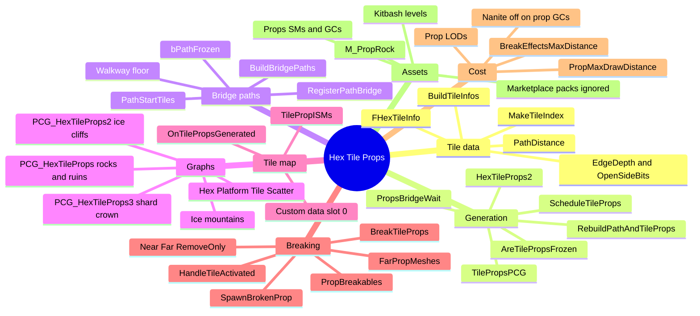
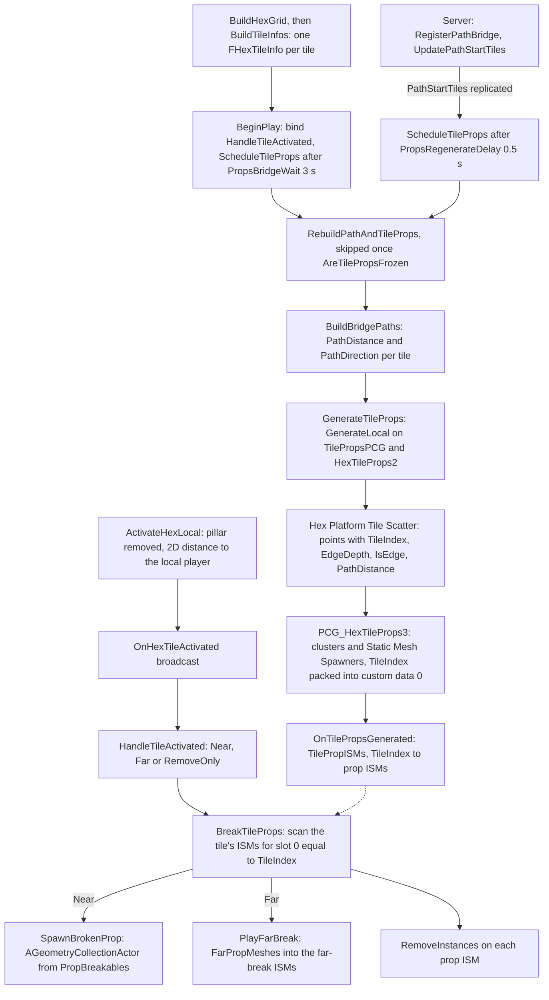

↑ [[Redo3 Changes Index]]

# Hex Tile Props

AuraRedo3 · redo3 · 379dc3b..3d05747 · 2026-10-16 to 2026-11-15

Every hex platform scatters props on its own tiles with PCG: rocks and ruins in the first version, then ice cliffs, frozen rock formations and ice mountains, and now an ice shard crown round the rim, with a walkway floor (and later paving stones) along the paths from the bridges to the centre. Each prop instance carries the `TileIndex` of the tile it stands on in its custom data slot 0. After a graph runs, `AMyHexPlatform` maps every `TileIndex` to the prop ISMs that hold instances on it, and when a tile collapses `BreakTileProps` removes that tile's instances. Near the local player each removed prop is replaced by the Geometry Collection its mesh maps to in `PropBreakables`; further out it plays a baked far break, or just vanishes.

Talal asked for it on 2026-10-16: after `BuildHexGrid`, use a PCG component to spawn instanced meshes "in a Natural way" on top of the platform, rocks and ruins close to the edges and some in the middle; work out each tile's position and bounds once in a struct, keep a `TMap<TileIndex, ISMPointer>`, and when a tile is destroyed remove its props and spawn a Geometry Collection in their place. The same day he asked for the AncientTechCity rocks and cliffs, because "the layout is not looking natural at all". On 2026-10-17 he wanted a second layer of cliffs and frozen rocks from FrozenNorse's `L_Showcase` level, and on 2026-10-18 a third graph from the pointy ice meshes in that level, on the edges and scaled by platform size at HexRadius 300. On 2026-10-20 he asked that the broken props only spawn near the locally controlled player.

State now (origin/redo3): `BP_MyHexPlatform` runs `PCG_HexTileProps3`, the ice shard crown, on its `HexTileProps2` component. `PCG_HexTileProps` and `PCG_HexTileProps2` are kept as assets; the first component, `TilePropsPCG`, was cleared in `6e7c02a`, and no later commit message gives it a graph again. Nothing about the props replicates: every machine scatters the same props from the replicated grid shape and bridge start tiles, and breaks them from the replicated tile collapse. The 2026-10-24 optimisation pass gave the props LODs and a draw distance, and the far-break and distance-gate work of 2026-10-20 to 10-25 reached git in the 2026-11-15 batch. The AncientTechCity and FrozenNorseEnvironment packs the props were built from are git-ignored (`cedd511`), so a fresh clone needs them from Fab. The `.uasset` graphs and meshes are binary, so their detail here comes from the commit messages and the thread notes.

## Mind map

## How it works

1. `BuildHexGrid` ends with `BuildTileInfos`, which fills `TileInfos` with one `FHexTileInfo` per tile: its `TileIndex`, top centre, bounds, apothem, open sides and rings in from the outline. It also snapshots every tile top into `PathLayoutTiles` for the bridge paths ([[#Tile infos and the tile index]]).
2. `BeginPlay` binds `HandleTileActivated` to the platform's own `OnHexTileActivated` and calls `ScheduleTileProps(PropsBridgeWait)` (3 s), so the bridges, and with them the path, are usually known before the first scatter.
3. On the server, each bridge that ends on the platform calls `RegisterPathBridge`. `UpdatePathStartTiles` turns the bridge end tiles into `PathStartTiles`, which replicate; a change on either side calls `ScheduleTileProps(PropsRegenerateDelay)` (0.5 s). A pending run is never brought forward ([[#Bridge paths and when the props generate]]).
4. The timer runs `RebuildPathAndTileProps`. It returns if `AreTilePropsFrozen()` (props generated once and the path frozen or a tile already fallen), waits 0.25 s if a prop component is still generating, and otherwise runs `BuildBridgePaths`, `WritePathCustomData` and `GenerateTileProps`.
5. `GenerateTileProps` first runs `UpdateTileFootprint` and `GenerateAtmosphere`, then (when `bSpawnTileProps`, true) drops the tiles that fell before this machine got the platform from `TileInfos`, sets `bTilePropsGenerated` and calls `GenerateLocal(true)` on `TilePropsPCG` and `HexTileProps2`, each only if it has a graph.
6. In the graph, the C++ node Hex Platform Tile Scatter reads `TileInfos` and emits points with `TileIndex`, `EdgeDepth`, `IsEdge` and `PathDistance`. `PCG_HexTileProps3` builds its rim clusters from them, and its Static Mesh Spawners pack `TileIndex` into custom data float 0 of every instance ([[#Layer 3: the ice shard crown]]).
7. When a component finishes, `OnTilePropsGenerated` reads slot 0 of every instance of its prop ISMs and records, per `TileIndex`, which ISMs hold instances on that tile (`TilePropISMs`). It then removes, without debris, the props of tiles that fell while the graph ran ([[#The tile to ISM map]]).
8. When a tile collapses, `ActivateHexLocal` removes the pillar instance, measures the 2D distance from the tile to the local player and broadcasts `OnHexTileActivated` with that result in `bBreakingTileInEffectsRange` and `bBreakingTileFar`.
9. `HandleTileActivated` removes the tile from `TileInfos`, cancels a pending prop regeneration (once props exist) and picks the break mode. `BreakTileProps` takes the tile's ISMs out of the map, scans each from the last instance to the first for slot 0 equal to the `TileIndex`, spawns a Geometry Collection (Near) or a far break (Far) for each match, and removes the matches in one `RemoveInstances` call ([[#Breaking props when a tile collapses]]).

## Tile infos and the tile index

`FHexTileInfo` (in `MyHexPlatform.h`) is the per-tile cache the PCG node reads. `BuildTileInfos` fills it from `HexMap` at the end of `BuildHexGrid`:

| Field | What it holds |
|---|---|
| `Coord` | Cube coordinate of the tile |
| `TileIndex` | `MakeTileIndex(Coord)`, a stable per-platform index, exact as a float so it fits ISM custom data |
| `LocalTopCenter` | Centre of the pillar's top face, in actor space |
| `LocalBounds` | The pillar instance's box. Built with an identity rotation, so the 60 degree turn from `6a10353` does not grow the box |
| `Apothem` | The mesh's X half size times the instance's X scale (centre to the middle of a flat side) |
| `EdgeDepth` | Rings in from the outline, found breadth first from every tile with an open side (0 = rim tile) |
| `OpenSideBits` | Bit i set = no tile on side i (`GetHexSideDirection`), in actor space |
| `PathDistance` | Rings from the bridge path, 0 on it, `MAX_int32` while the platform has no path |
| `PathDirection` | On path tiles, the actor-space direction along the path towards the centre |

- `MakeTileIndex` is `(Coord.X + GridSize) * (2 * GridSize + 1) + (Coord.Y + GridSize)`. `GridSize` is replicated, so every machine computes the same numbers.
- The link between a tile and its props is that number, written into the prop instances, not a pointer. This is Talal's plan (a `TMap<TileIndex, SMPointer>` in his 12-10-2026 note, `TMap<TileIndex, ISMPointer>` in his request), with the map pointing at whole ISMs and the instances found by value.
- `TileInfos` loses a tile as soon as it falls (`HandleTileActivated`), and on a late joiner `GenerateTileProps` removes every tile in `LocalActivatedTiles` before the scatter, so no props spawn on tiles that are already gone.

## The Hex Platform Tile Scatter node

`UPCGHexPlatformTilesSettings` (`Source/Aura/Public/PCG/PCGHexPlatformTiles.h`) is the project's C++ PCG node, added with the first version in `379dc3b`. It has no input pins and only works on a PCG component owned by an `AMyHexPlatform`, whose `TileInfos` it reads. The full description, pins and settings are on [[Redo3 Hex Platform PCG#The custom node: Hex Platform Tile Scatter]]. What matters here:

- **Out** gives scatter points with `TileIndex`, `EdgeDepth`, `IsEdge` and `PathDistance`. Edge tiles get `EdgeAttemptsPerTile` (2) attempts at `EdgeChance` (0.5), pushed towards an open side and facing away from the platform (`bFaceOutward`, true); inner tiles get fewer. Point scale follows `HexRadius / 100`.
- **Path** (from `6444429`) gives one point per path tile, X along the path, for the walkway floor.
- **Paving** and **Lamp** (from `5ccdfef`) give the paving stones and plaza lamp ([[Redo3 Path Paving]]).
- Seeds come from the PCG seed plus the `TileIndex`, so every machine scatters the same points.
- Stock palette tools could not add or rename it, so the graphs keep the instance name `HexPlatformTiles_0`.

## Two prop components

`AMyHexPlatform` creates two PCG components in its constructor, both `GenerateOnDemand` and not replicated: `TilePropsPCG` (from `379dc3b`) and `HexTileProps2` (from `6e7c02a`). A third, `AtmospherePCG`, runs the atmosphere graph and is covered on [[Redo3 Hex Look and Atmosphere]].

| Component | Graph on `BP_MyHexPlatform` |
|---|---|
| `TilePropsPCG` | `PCG_HexTileProps` from `ab708f7`; cleared in `6e7c02a` (Talal wanted the ice to replace the rocks, not fill their gaps) |
| `HexTileProps2` | `PCG_HexTileProps2` from `6e7c02a`; `PCG_HexTileProps3` from `79bed11` (Props2 kept for rollback) |

- Each component only replaces its own entries in `TilePropISMs` when it regenerates, so both can feed the tile map and break with their tiles (`6e7c02a`).
- `GenerateTileProps` and `RebuildPathAndTileProps` loop over both components; one without a graph is skipped.
- In the editor, `OnConstruction` calls `SetupCallbacks` on both graph instances, because a freshly placed platform's graph instances did not listen to their graph, so editing the graph or toggling Debug did not regenerate it. The manual workaround before that was to set the graph to None and back. The "Rocks and ruins" thread made the fix and left it uncommitted; it shipped in `b5ff0ef`.

## Bridge paths and when the props generate

Added in `6444429` and made deterministic in `7a6f01e`. The walkway lets a player walk from every bridge to the centre without props in the way, and the paving of [[Redo3 Path Paving]] is laid on the same paths.

- **Start tiles.** On the server, `RegisterPathBridge` and `UnregisterPathBridge` keep `PathBridges`, and `UpdatePathStartTiles` turns their end tiles on this platform into `PathStartTiles` (replicated, `OnRep_PathStartTiles`), sorted by `TileIndex` and limited to tiles of the built grid. `PathStartSides` holds the side each bridge leaves through (added for the paving).
- **Kept starts.** A bridge destroyed because one of its end tiles fell keeps its start tile in `RetainedPathStarts`, so the walkway to it stays and nothing regenerates.
- **Frozen.** `FreezePath` sets the replicated `bPathFrozen` when the lead lands (`NotifyLeadLanded`) or collapsing starts (`StartCollapsing`). `UpdatePathStartTiles` then stops changing the starts, and `AreTilePropsFrozen()` is `bTilePropsGenerated && (bPathFrozen || LocalActivatedTiles is not empty)`.
- **Timing.** `ScheduleTileProps` coalesces bursts of bridge changes: if a run is pending it keeps the later of the two times, so the first bridge never cuts `PropsBridgeWait` short. The first fallen tile clears a pending run (`HandleTileActivated`).
- **The walk.** `BuildBridgePaths` works on `PathLayoutTiles`, the tile tops as built (before late-join removals), so every machine lays the same path. The centre is the tile nearest the middle of all tiles (ties to the lower `TileIndex`). Each start tile walks down the step count to the centre, picking the neighbour closest to the straight line to the centre (ties to the lower `TileIndex`), until it reaches the centre or a tile an earlier walk laid. The first walk through a tile sets its `PathDirection`.
- **PathDistance.** Every tile gets the straight hex distance to the nearest path tile, so a notch in the outline does not let big props closer. Paving stones add the tiles they land on to the path set.
- **Bridge landings.** On 2026-10-16 the rocks could spawn on a bridge's landing tile. Since `7a6f01e` bridge end tiles are path tiles and stay clear, and `PCG_HexTileProps3` only puts low skirt clusters on rim tiles at `PathDistance` 1.
- A log line per generation gives the platform, the number of path start tiles and the tiles fallen.

## Layer 1: rocks and ruins

`PCG_HexTileProps` (`ab708f7`, renamed and laid out in `ca33354`, natural layout in `7f31267`). On `TilePropsPCG` until `6e7c02a`.

![[redo3_rocks_natural.jpg]]

The natural rock layout with the AncientTechCity rocks on two platforms in Simulate (`rocks_natural.jpg`, 2026-10-16).

- **First graph (`ab708f7`).** Tile scatter, then self pruning, an edge and inner split, and spawners for ruins, boulders and rubble that pack `TileIndex` into custom data. The meshes were boulders, concrete rubble and `SM_Pillar` copied from their packs into `Props/SMs`, each with a Dataflow-built uniform Voronoi Geometry Collection in `Props/GCs`. `ca33354` renamed them to `SM_`/`GC_` `Boulder_01` to `05`, `Rubble_01` to `03` and `RuinedPillar`, and laid the graph out in sections (`Tiles_`, `Ruins_`, `Rubble_`, `Boulders_`) with comment boxes and named reroutes.
- **Natural layout (`7f31267`).** World-space noise patches plus a rim bonus decide where props go, size classes come from the density (big cores, small fringes), cliffs go on edge tiles, a few ruined pillars, pruning runs large to small across classes, and flat rock patches go under big rocks. The concrete rubble was left out.
- The structure doc of 2026-10-17 gives the sections and numbers: Tiles (4 candidates per tile, Perlin patches about 7 m across, a rim bonus of 0.22 fading over 3 rings, keep `$Density` above 0.62), Classes (large above 0.88, 12% of huge rocks become ruins, medium and small split at 0.74), Size, Prune, Spawn (one Static Mesh Spawner per class).

| Class | Meshes | Scale |
|---|---|---|
| Cliffs | `SM_Cliff_01`, `SM_Cliff_02` | 0.25 to 0.42 |
| Huge rocks | `SM_HugeRock_01`, `SM_HugeRock_02`, `SM_Boulder_01` to `05` | 0.2 to 0.36 |
| Ruins | `SM_RuinedPillar` | 0.3 to 0.42 |
| Medium | `SM_Rock_01`, `02`, `04` | 0.6 to 1.2 |
| Small | `SM_Rock_01` to `04` (no collision) | 0.3 to 0.65 |
| Patches | `SM_RockPatch_01` to `03` | 0.5 to 0.8 |

- **Material.** The AncientTechCity pack ships without materials, so `7f31267` made `M_PropRock` (world-aligned rock texture, dust on upward faces, per-instance brightness) with `MI_PropRock_Boulder`, `MI_PropRock_Cliff` and `MI_PropRock_Patch`, and copied its two textures into `Props/Textures` as `T_PropRock_BC` and `T_PropRock_N`, so the props do not depend on the pack.
- `M_Quixel_Simple` and `M_Beacon` got the instanced static mesh and Geometry Collection usage flags in `ab708f7`; without them the first props rendered default grey.
- A first PIE count was 864 props on 15 platforms (545 boulders, 188 ruined pillars, 131 rubble). Random Choice nodes in fixed-count mode picked only one point each, so they were switched to pick a share of the points.
- `PropBreakables` on `BP_MyHexPlatform` had 20 mesh to GC entries at this point.

## Layer 2: ice cliffs and ice mountains

`PCG_HexTileProps2` on `HexTileProps2`, from `6e7c02a` to `79bed11`.

- **Formations (`6e7c02a`).** `SM_IceCliff_01` to `04`, `SM_IceRocks_01` to `04` and `SM_IceDebris_01` to `04`, kitbashed from FrozenNorseEnvironment `L_Showcase` pieces Talal circled, merged into one Nanite mesh each, with GCs. The ice cliffs are 3.6 to 4.1 m wide and 4.6 to 6.5 m tall at scale 1 (GCs of 12 to 20 pieces); the ice rocks are about 2 m (6 to 11 pieces).
- **Layout.** Noise patches plus a rim bonus: ice cliffs on about 1 in 8 free rim tiles, facing out (6 to 10 m tall in game at `HexRadius / 100` = 2 and scale 0.55 to 0.75), large and medium formations inside, small debris on the fringes where a second noise is high, pruned large to small. The front of each formation is its +X, which the scatter node turns outward on rim tiles. `PropBreakables` went to 32 entries.
- **Ice mountains (`6444429`).** `SM_IceMountain_01` (the `L_Showcase` gate massif, 8.9 x 8.7 x 9.6 m from about 1,160 level pieces), `_02` (the icefall spire, 6.4 x 6.4 x 7.4 m) and `_03` (both, 8 x 12 x 9.8 m), without the statues, gate, stairs and columns. They go on rim cores 3 or more rings from the path, ice cliffs 2 or more. `Saved/ClaudeTools/icecliffs/mountains.py` built them, scaled 0.09 and merged with Merge Actors. Their GCs are fractured from `SM_IceMountain_0X_GCSource` copies (the Nanite fallback, about 100k triangles, split into about 20 chunks and auto-clustered).
- **Walkway floor (`6444429`).** `SM_PathFloor_01` to `03` from the `L_Showcase` walkway kit (`SM_Tilekit_02`, `03`, `01`) on the Path pin, and nothing else on path tiles. Six more `PropBreakables` (38).
- **Visible GCs (`7a6f01e`).** All 18 new prop GCs had Nanite on and no fallback mesh, so they rendered nothing and collapsing tiles looked like the props simply vanished. Nanite was turned off on them and they were regenerated.
- **Kitbash levels.** `7a6f01e` added `Props/Kitbash/L_IceMountain_01` to `03`, editable levels with every piece an actor and the base centre at the origin, and re-merged `SM_IceMountain_02` from its level as a test of `rebuild_prop.py`. `677acf1` re-kitbashed `L_IceMountain_01` and rebuilt `SM_IceMountain_01`, its GC source and `GC_IceMountain_01` from it, with tweaks to `PCG_HexTileProps2`.
- `6e7c02a` says the layer "Needs Content/FrozenNorseEnvironment (not in this commit) for the materials". See [[#Marketplace packs]].

## Layer 3: the ice shard crown

`PCG_HexTileProps3` (`79bed11`, comment boxes cleaned in `f415ce4`), on `HexTileProps2` since 2026-10-18. Three design subagents and a judge picked the "rim crown" layout. It recreates the ice cluster in the `L_Showcase` lake (`SM_Glaciar` spindles, clumps and snow piles) as peak, ridge and skirt clusters stamped on edge tiles, with noise gaps along the rim, a sparse front row one tile in on bigger platforms and the centre left open.

![[redo3_ice_shard_crown.jpg]]

The ice shard crown on a platform rim (`ice_shard_crown.jpg`, 2026-10-18).

The graph has nine sections, left to right: Tiles, Size, Rim, Front, Patterns, Copy, Clusters, Spawn and Path. The walkthrough of 2026-10-22 counted 122 nodes, 53 of them reroutes.

1. **Tiles.** The scatter node gives one point per tile.
2. **Size.** `SizeK = 0.6 + clamp((sqrt(N) - 3) / 15, 0, 1)` for N tiles: 0.6 at 9 tiles or fewer, 1.6 at 324 or more. Every point's scale is `HexRadius / 100` times `SizeK`, so 1.8 to 4.8 at HexRadius 300.
3. **Rim.** Edge tiles (`EdgeDepth` 0) off the path (`PathDistance` 1 or more) get world Perlin noise in `$Density`. Tiles at 0.31 or below are dropped (the gaps); above 0.72 a tile gets a peak, above 0.45 a ridge, otherwise a skirt. Tiles at `PathDistance` 1 always get a skirt, so bridge landings stay low.
4. **Front.** On platforms with `SizeK` 0.82 or more (about 40 tiles), `EdgeDepth` 1 tiles with `PathDistance` 2 or more and a pick below 0.55 get a low cluster.
5. **Patterns.** Five Create Points sets copied from the lake cluster: Peak (7 points), Ridge (6), Skirt (6), FrontHigh (3) and FrontLow (3). Each piece's class sits in `$Density`: 0.9 spire, 0.7 shard, 0.5 clump, 0.3 snow, 0.1 flake.
6. **Copy and Clusters.** Copy Points stamps the patterns on the tiles with TargetFirst inheritance, so every piece keeps its tile's `TileIndex`. Pruning and class sorting follow.
7. **Spawn.** One spawner per class, each packing `TileIndex` into custom data float 0.
8. **Path.** The walkway floor branch kept from Props2. `5ccdfef` later added `Paving_Spawn` for the paving stones ([[Redo3 Path Paving#PCG output and meshes]]).

| Class | Mesh | Collision |
|---|---|---|
| Spire | `SM_IceShard_01` | BlockAll |
| Shard | `SM_IceShard_02` | BlockAll |
| Clump | `SM_IceShardClump_01` | BlockAll |
| Snow | `SM_SnowMound_01` (weight 3), `SM_SnowMound_02` (weight 1) | BlockAll |
| Flake | `SM_IceFlake_01`, `SM_IceFlake_02` | None |
| Walkway | `SM_PathFloor_01` to `03` | BlockAll |

- The seven new meshes are copies of the FrozenNorseEnvironment meshes, each with a fractured GC of 6 to 15 pieces and Nanite off. `PropBreakables` went from 38 to 45.
- Tuning knobs named in the structure doc: `Rim_KeepNoise` 0.31, `Rim_Noise` scale 6, `Rim_Peak` 0.72, `Rim_Ridge` 0.45, `Rim_OffPath` 1, `Rim_TallOK` 2, `Shard_Clear` 2, `Front_SizeGate` 0.82, `Front_Keep` 0.55. The build scripts are in `Saved/ClaudeTools/icecliffs` (git-ignored).
- `f415ce4`: the graph was duplicated from `PCG_HexTileProps2` (itself from `PCG_HexTileProps`), so 9 old section boxes sat on top of the new layout. Only the 9 Props3 boxes remain. An open graph editor writes old comment boxes back when it closes, and assets cannot be saved during PIE.
- Both Props3 commits were made on `claude/project-thread-pca24g`, which reached redo3 in the merge `8874616` on 2026-11-15. Until then the graph was untracked on redo3.
- The 2026-10-24 optimisation pass also placed Niagara ground fog, dust and snow (`NS_HexGroundFog`, `NS_HexDust`, `NS_HexSoftSnow`, `NS_HexSnowGust`) through this graph, as `AMyHexAtmosphereFX` actors. `EndPlay` destroys them with the platform because PCG leaves them behind. The per-platform atmosphere later moved to its own `AtmospherePCG` component; no note says whether the FX nodes are still in `PCG_HexTileProps3`. The atmosphere side is on [[Redo3 Hex Look and Atmosphere]].
- The ice and snow props use the copied materials in `HexPlatforms/Props` (`MM_Ice_Hex`, `MI_Ice_GlacialsKit_Hex`, `MM_SnowAssets_Hex`, `MI_SnowPiles_Hex`) with their ink Outline section, committed in `cf4ec00` ([[Redo3 Hex Look and Atmosphere]]).

## The tile to ISM map

- A Static Mesh Spawner makes one ISM per mesh, not per tile, so one `SM_IceShard_01` ISM holds every spire on the platform. `TilePropISMs` (`TMap<int32, TArray<TWeakObjectPtr<UInstancedStaticMeshComponent>>>`) only says which ISMs have at least one instance on a tile.
- `OnTilePropsGenerated(Component)` collects the component's managed ISMs, skipping `HexPillarsISM` and any ISM with too few custom data floats for `PropTileIndexCustomDataSlot` (0). It puts `PropMaxDrawDistance` on them as their cull distance when it is above 0.
- It removes this component's ISMs (and destroyed ones) from every entry, then reads slot 0 of every instance and calls `TilePropISMs.FindOrAdd(TileIndex).AddUnique(ISM)`.
- It finishes with `BreakTileProps(TileIndex, RemoveOnly)` for every tile in `LocalActivatedTiles`, for tiles that collapsed while the graph was running.
- Why scan again at break time: an instance is a row in the ISM's arrays and is only addressable by its index, which shifts when other instances are removed. Slot 0 moves with the instance, so a scan by value is always right. Storing instance indices per tile was rejected in the "Tile index check" thread because they go stale after the first tile falls; the scan reads a few hundred floats per break.

## Breaking props when a tile collapses

### Who decides the mode

`ActivateHexLocal` runs on every machine for every collapsing tile (the server from `ActivateHex`, clients from the replicated `ActivatedTiles`). After removing the pillar instance it calls `GetLocalPlayerDistance2D` with the tile's location: the first local player controller's pawn location, or its camera location without a pawn, measured with `FVector::Dist2D`; false with no local controller.

- In range: `bHasLocalPlayer && Distance <= BreakEffectsMaxDistance` (5000 cm).
- Far: the tile plays its effect, there is a local player, it is out of range and within `FarBreakMaxDistance` (20000 cm, 0 = no limit).
- `bBreakingTileInEffectsRange`, `bBreakingTileFar` and `BreakingTileDistance` hold the result only during the `OnHexTileActivated` broadcast. `HandleTileActivated` is the only code that reads them; the bridges measure their own distance for their debris ([[Redo3 Hex Bridges]]).
- `HandleTileActivated` picks `EHexPropBreakMode`: `Near` in range, `Far` when far and the props are still drawn there (`PropMaxDrawDistance` 0 or the distance within it), otherwise `RemoveOnly`. A dedicated server has no local player, so it only removes instances. That replaced the first version's `GetNetMode() != NM_DedicatedServer` check.
- Tiles that fell before a client got the platform come through `ApplyActivatedTiles(false)`, which plays no effect, so their props (if any) are only removed.

### BreakTileProps

`BreakTileProps(TileIndex, Mode)` takes the tile's entry out of `TilePropISMs` with `RemoveAndCopyValue`, so a tile breaks its props once. For each ISM it walks the instances from last to first and keeps those whose slot 0 rounds to the `TileIndex`. That gives a list already sorted high to low for `RemoveInstances(ToRemove, true)`.

- **Near.** If `PropBreakables` maps the ISM's mesh to a GC, each matched instance's world transform is used with a uniform scale of the same volume (the cube root of X x Y x Z, from `5ccdfef`, so stretched paving stones do not shear) and passed to `SpawnBrokenProp`.
- **Far.** If `FarPropMeshes` has the mesh, each instance calls `PlayFarBreak` with a speed drawn from `FarPropSpeedRange` (1, 1), times `1 / sqrt(Z scale)` clamped to 0.25 to 4 when `bFarPropSpeedFromScale` (true), so a fall baked at scale 1 plays at true gravity at any scale. The far-break ISMs belong to `UMyHexPillarBreakSubsystem`; see [[Redo3 Hex Pillars and Breaking#Far breaks]]. Over `FarBreakMaxActive` (512, world-wide) a prop just vanishes.
- **RemoveOnly.** The instances are removed.
- Meshes with no entry in the map they need just vanish.

### SpawnBrokenProp

- `SpawnActorDeferred<AGeometryCollectionActor>` at the transform with the platform as owner and `AlwaysSpawn`, then `SetReplicates(false)`: each machine spawns its own debris.
- `SetRestCollection(Collection)`, `ObjectType = Chaos_Object_Dynamic`, and a user-defined initial velocity of `BrokenPropImpulse` (0, 0, 150 cm/s) plus a random XY spread of up to half its length, set before `FinishSpawning`.
- `SetLifeSpan(BrokenPropLifeSpan)` (6 s), then `CrumbleActiveClusters` when `bCrumbleBrokenProps` (true), so the prop breaks at once instead of falling whole.
- The pillar GCs share this life span: their `bMatchTilePropLifeSpan` (true) makes them go after `BrokenPropLifeSpan` too.
- The 2026-10-20 break doc reasoned from engine source that the impulse probably never reaches the debris, because the deferred spawn registers the GC and `SetRestCollection` builds its physics proxy before `InitialLinearVelocity` is set. The code still sets it in that order; nobody confirmed either way in PIE.

### Prop Geometry Collections

- Every prop mesh in `Props/SMs` has a GC of the same name in `Props/GCs` (48 at redo3, including the paving slabs), built with Dataflow (uniform Voronoi for the first ones). Dataflow GCs do not update by themselves when the mesh changes: the graph has to be re-evaluated.
- All prop GCs have Nanite off since `7a6f01e`.
- In PIE on 2026-10-17, collapsing tiles kept 25 to 60 debris actors alive at a time.
- Overlapping GCs that spawn inside each other depenetrate and explode. The answer on 2026-10-17 suggested a self-ignoring PropDebris collision channel set in `SpawnBrokenProp` before `FinishSpawning` (or a collision group, a max depenetration velocity, or spawning asleep). It was never built.

## Draw distances and LODs

From the optimisation pass of 2026-10-24 ([[Redo3 Hex Pillars and Breaking#The optimisation pass]]):

- `PropMaxDrawDistance` (C++ default 0 = always drawn) goes on every prop ISM in `OnTilePropsGenerated`. The pass drew tile props to 600 m, and small props stop drawing per instance at 200 to 400 m.
- The pass gave LODs at 100/50/25/10% to 21 prop and bridge meshes. The 2026-10-24 analysis counted 21,648 ice, snow and path floor instances at 60.4M triangles, with `SM_SnowMound_01` alone at 6,358 instances and 21.8M.
- `3d05747` carries the four LODs of `SM_IceFlake_01`, `SM_IceFlake_02` and `SM_PathFloor_01` to `03` (with the wide stone bridge meshes, see [[Redo3 Hex Bridges]]). The commit messages do not say which commit carries the LODs of the other prop meshes; the ice shard and snow mound meshes were last saved in `cf4ec00`.
- Prop breaks skip far breaks where the props are already culled (`PropMaxDrawDistance`).

## Marketplace packs

- `cedd511` (2026-10-18) added `/Content/Assets/AncientTechCity/` and `/Content/FrozenNorseEnvironment/` to `.gitignore`: both are Fab content (4.3 GB) and the repo is public, so they stay local and are reimported from Fab on a fresh clone.
- The commit says the ice cliff and rock props reference their materials. The rock props use `M_PropRock` and its copied textures; the ice and snow props were built from FrozenNorse meshes and materials.
- The ice formations review asked whether to push 83 FrozenNorse files (about 556 MB) to LFS or copy only the needed materials into `Props`. The ignore rule answered it for the packs themselves.
- The kitbash and build scripts (`mountains.py`, `rebuild_prop.py`, `gc_tools.py`, the Props3 scripts) live in the git-ignored `Saved/ClaudeTools`.

## Multiplayer

- Nothing about the props replicates. Server and clients run the same graphs on the same grid with the same seeds, from replicated inputs: the grid shape, `PathStartTiles`, `PathStartSides`, `bPathFrozen` and `ActivatedTiles`.
- The path is laid on `PathLayoutTiles` (the grid as built), so a late joiner lays the same path even though some tiles have fallen.
- The `TileIndex` map and the debris are local to each machine. Clients spawn their own GCs from their own copy of the collapse.
- A late joiner's `SizeK` in Props3 counts only the tiles still standing, so its clusters can be sized differently from the server's.

## How it changed

- **2026-10-16** `379dc3b`: the system in C++. `FHexTileInfo` per tile after `BuildHexGrid`, the Hex Platform Tile Scatter node with its `TileIndex` attribute, the local `TilePropsPCG`, the `TileIndex` to ISM map, and on `OnHexTileActivated` removal of the tile's instances by their custom data plus the GC mapped to each mesh. `Aura.Build.cs` gained `GeometryCollectionEngine` and `Chaos`. `HandleTileActivated` then skipped debris with a dedicated-server check, and `BreakTileProps` took a bool.
- **2026-10-16** `ab708f7`: boulders, concrete rubble and `SM_Pillar` copied into `Props/SMs`, a Dataflow uniform Voronoi GC each, `PCG_HexTileProps` wired into `BP_MyHexPlatform`, and the usage flags on `M_Quixel_Simple` and `M_Beacon`.
- **2026-10-16** `ca33354`: one naming scheme for meshes and GCs (no redirectors) and the graph laid out by section with comment bubbles, boxes and named reroutes. Same settings and wiring.
- **2026-10-16** `7f31267`: Talal found the layout unnatural, so the AncientTechCity cliffs, huge rocks, rocks and rock patches came in with `M_PropRock`, and the graph got noise patches, a rim bonus, size classes, cross-class pruning and patches under big rocks. Merged into redo3 as `e71e986` (09:10) without `M_Pillar1`, `M_Pillar2`, `StartupMap` and the pack.
- **2026-10-17** `6e7c02a`: the second component `HexTileProps2` with `PCG_HexTileProps2`, the twelve kitbashed ice meshes with GCs, `TilePropsPCG`'s graph cleared and 12 new `PropBreakables`.
- **2026-10-17** `6444429`: bridge paths (`RegisterPathBridge`, `PathDistance`, `PathDirection`), the Path pin, props generated `PropsBridgeWait` after `BeginPlay` and again when bridges change, the three ice mountains and the walkway floor. Six more `PropBreakables`.
- **2026-10-17** `7a6f01e`: a review (`BridgePaths_Review.md`) found 6 bugs in the path logic, all fixed here: the snapshot grid, server-owned replicated `PathStartTiles`, `bPathFrozen`, the first fallen tile cancelling a pending regeneration, retained starts for destroyed bridges, no pending generation brought forward, clear bridge end tiles and straight hex distance. A PIE re-test on 211 platforms passed. Also Nanite off on the prop GCs and the kitbash levels.
- **2026-10-18** `677acf1`: ice mountain 01 re-kitbashed and rebuilt, and `PCG_HexTileProps2` tweaks. Committed with `fa6ad2f` by the "Unpushed commits count" thread.
- **2026-10-18** `cedd511`: the two marketplace packs git-ignored.
- **2026-10-18** `79bed11`: `PCG_HexTileProps3`, the ice shard crown, on `HexTileProps2`, with seven new meshes and GCs (`PropBreakables` 38 to 45).
- **2026-10-18** `f415ce4`: nine stale comment boxes removed from `PCG_HexTileProps3` and its description updated. The same day the thread found the Spire, Shard, Clump, Snow and Flake spawners unwired from their Jitter nodes after a save and asked Talal; there was no answer in that thread. The walkthrough of 2026-10-22 found only `Jitter_Flake` still unwired.
- **2026-10-20**: the "Break effects only near the player" session added `BreakEffectsMaxDistance` (5000 cm) and the distance check on Talal's PC; it compiled, was not tested in PIE, and reached git in `b5ff0ef`. The same day "Tile index check when props break" explained why the map holds ISMs and the scan finds the instances.
- **2026-10-22**: the Props3 walkthrough read the live graph without changing it and listed its defects ([[#Open items]]).
- **2026-10-24**: the optimisation pass gave the props LODs and a 600 m draw distance and placed fog and snow through `PCG_HexTileProps3`. It reached git in `3d05747` (2026-11-15 14:18) and `b5ff0ef`.
- **2026-10-25**: far breaks for props (`FarPropMeshes`, the `Near`, `Far` and `RemoveOnly` modes) and a USD export of all 45 prop GC falls for Houdini; in git in `b5ff0ef` and `613707b`.
- **2026-10-25 to 10-30**: the paving work rewrote `BuildBridgePaths` to record routes and added the uniform-volume scale for broken props ([[Redo3 Path Paving]], `5ccdfef`).
- **2026-10-26**: the ink thread copied the ice and snow prop materials into `HexPlatforms/Props` with an Outline section (`cf4ec00`).
- **2026-11-15**: the push thread merged `claude/project-thread-pca24g` into redo3 as `8874616` (10:23), bringing `79bed11` and `f415ce4`, and committed the October work in the 14:18 batch, including `3d05747`.

## Threads that worked on it

- [[Redo3 Threads#Rocks and ruins on hex tiles|Rocks and ruins on hex tiles]]: built the system end to end (`379dc3b` to `7f31267`), then `PCG_HexTileProps3` (`79bed11`, `f415ce4`), the editor refresh fix and three documentation pages.
- [[Redo3 Threads#Overlapping Geometry Collections|Overlapping Geometry Collections]]: answered the overlapping GC question, then built the second prop layer, the ice mountains, the walkway and the path fixes (`6e7c02a`, `6444429`, `7a6f01e`).
- [[Redo3 Threads#Unpushed commits count|Unpushed commits count]]: committed the ice mountain rebuild (`677acf1`) and made git ignore the marketplace packs (`cedd511`).
- [[Redo3 Threads#Break effects only near the player|Break effects only near the player]]: added `BreakEffectsMaxDistance` and the local-player distance check.
- [[Redo3 Threads#Tile index check when props break|Tile index check when props break]]: explained `TileIndex`, ISMs versus instances, and why instance indices are not stored.
- [[Redo3 Threads#Hex PCG graph walkthroughs|Hex PCG graph walkthroughs]]: the node-by-node walkthrough of `PCG_HexTileProps3` and its defect list.
- [[Redo3 Threads#Pave bridge paths with stone patterns|Pave bridge paths with stone patterns]]: routes in `BuildBridgePaths`, the paving stones on the prop graph and the uniform scale for broken props.
- [[Redo3 Threads#Fix and extend the hex ink lines|Fix and extend the hex ink lines]]: copied the prop materials into `HexPlatforms/Props` and gave them the ink outline.
- [[Redo3 Threads#Push local changes to GitHub|Push local changes to GitHub]]: merged the Props3 branch and committed the optimisation (`3d05747`) and far-break work from Talal's PC.

## Artifacts and files

- [[Redo3 Artifact - Hex Tile Props - Structure and Flow]]: the 2026-10-17 doc of the first version, with the five graph sections, the prop classes and scales, and the tuning knobs.
- [[Redo3 Artifact - Ice formations review]]: the second layer, each ice formation and ice mountain with its size and GC piece count next to Talal's reference shots.
- [[Redo3 Artifact - Hex Tile Props 3 - Structure and Flow]]: the 2026-10-18 doc of the ice shard crown, its nine sections, mesh classes and knobs.
- [[Redo3 Artifact - Tile Props PCG Walkthrough]]: the 2026-10-22 node-by-node walkthrough of `PCG_HexTileProps3` with its "Worth checking" defects.
- [[Redo3 Artifact - Hex tile break - ActivateHexLocal to BreakTileProps]]: the 2026-10-20 doc of the break flow, networking and edge cases, and the `BrokenPropImpulse` doubt.
- [[Redo3 Artifact - Hex platforms - LODs vs switching instances off]]: the 2026-10-24 analysis with the prop triangle shares.
- [[Redo3 Artifact - Hex platform optimization - what changed]]: the pass that gave the props LODs and draw distances.
- [[Redo3 Artifact - Far-break ISMs]]: the far prop breaks, their speed rule and the USD export of the prop GC falls.
- [[Redo3 Artifact - Path Paving Patch]]: the first paving patch, which made `BuildBridgePaths` record each walk as a route.
- [[Redo3 Files - Hex Tile Props]]: the two captures on this page and `BridgePaths_Review.md`, the review of the six path bugs.

## Where it lives

| What | Path |
|---|---|
| Tile infos, components, settings | `Source/Aura/Public/Actors/MyHexPlatform.h` (`FHexTileInfo`, `EHexPropBreakMode`, `TilePropsPCG`, `HexTileProps2`, "Hex Platform\|Tile Props", "Hex Platform\|Far Break", `TilePropISMs`) |
| Generation and breaking | `Source/Aura/Private/Actors/MyHexPlatform.cpp` (`BuildTileInfos`, `MakeTileIndex`, `ScheduleTileProps`, `RebuildPathAndTileProps`, `BuildBridgePaths`, `UpdatePathStartTiles`, `GenerateTileProps`, `OnTilePropsGenerated`, `HandleTileActivated`, `GetLocalPlayerDistance2D`, `BreakTileProps`, `SpawnBrokenProp`) |
| Scatter node | `Source/Aura/Public/PCG/PCGHexPlatformTiles.h`, `Source/Aura/Private/PCG/PCGHexPlatformTiles.cpp` |
| Module dependencies | `Source/Aura/Aura.Build.cs` (`GeometryCollectionEngine`, `Chaos`) |
| Prop graphs | `/Game/Assets/MyPlatform/PCGs/PCG_HexTileProps`, `PCG_HexTileProps2`, `PCG_HexTileProps3` |
| Platform Blueprint | `/Game/Assets/MyPlatform/BP_MyHexPlatform` (graphs on the components, `PropBreakables`, draw distances, far slots) |
| Prop meshes | `/Game/Assets/MyPlatform/Props/SMs/` (48), GC sources `Props/SMs/GCSource/SM_IceMountain_01_GCSource` to `03` |
| Prop Geometry Collections | `/Game/Assets/MyPlatform/Props/GCs/` (48) |
| Rock material | `/Game/Assets/MyPlatform/Props/Mats/M_PropRock`, `MI_PropRock_Boulder`, `MI_PropRock_Cliff`, `MI_PropRock_Patch`; `Props/Textures/T_PropRock_BC`, `T_PropRock_N` |
| Ice and snow prop materials | `/Game/Assets/MyPlatform/HexPlatforms/Props/MM_Ice_Hex`, `MI_Ice_GlacialsKit_Hex`, `MM_SnowAssets_Hex`, `MI_SnowPiles_Hex` |
| Kitbash levels | `/Game/Assets/MyPlatform/Props/Kitbash/L_IceMountain_01` to `03` |
| Ignored packs | `.gitignore`: `/Content/Assets/AncientTechCity/`, `/Content/FrozenNorseEnvironment/` |
| Build scripts (local only) | `Saved/ClaudeTools/icecliffs/`, `Saved/ClaudeTools/rebuild_prop.py`, `gc_tools.py` |

## Open items

- `PCG_HexTileProps3`, as read on 2026-10-22: `Jitter_Flake` is not wired to `Spawn_Flake`, so no flakes spawn; the spire, shard and clump jitter moves pieces up to about 1.6 m sideways and spires sink 0.7 to 1.1 m; `AttributeMathsOp_1` has no second input; nine dead or disconnected nodes remain. No later thread records a fix.
- Big Props3 clusters still overhang the outer edge, and small platforms (under about 20 tiles) only get skirts.
- The self-ignoring PropDebris channel for overlapping debris was an answer only.
- Whether `BrokenPropImpulse` reaches the debris is unconfirmed (see [[#SpawnBrokenProp]]).
- `FarPropMeshes` needs Talal's baked far-break meshes; on 2026-10-25 the Blueprint slots were empty and the far break used the placeholder material `M_HexFarBreakPlaceholder`.
- The distance gate was not tested in PIE in its own thread.
- A fresh clone has no AncientTechCity or FrozenNorseEnvironment content; the ice props need it reimported from Fab.
- The build and kitbash scripts are only on Talal's PC (`Saved/ClaudeTools`).

## Related

- [[Redo3 Path Paving]]: the paving stones that share the bridge paths, the Paving pin and the tile map.
- [[Redo3 Hex Pillars and Breaking]]: how the tile itself breaks, the break subsystem, far breaks and the optimisation pass.
- [[Redo3 Hex Platform PCG]]: the Hex Platform Tile Scatter node and where each PCG graph runs.
- [[Redo3 Hex Bridges]]: the bridges whose end tiles start the paths, and their own collapse debris.
- [[Redo3 Hex Look and Atmosphere]]: the ink on the prop materials, the atmosphere graph and the fog and snow FX.
- [[Redo3 Hex Path and Ranking]]: collapse timing and the lead landing that freezes the path.
- [[Redo3 Engine Tools and Assets]]: the Vulkan swapchain crash seen while building the props, and the editor scripting.
- [[Redo3 Timeline]], [[Redo3 Branches and PRs]], [[Redo3 Threads]], [[Redo3 Artifacts Index]].
- Talal's notes: [[PlatformRefs]] (his reference images for the prop layout on a platform), [[12-10-2026]] (his to-do "using the rocks / ruins", "make GC from the assets" and the `TMap<TileIndex, SMPointer>` plan, all crossed off), [[HexPlatform]] (how a platform builds its grid and activates tiles on the server).

[[Redo3 Path Paving]] ← → [[Redo3 Hex Pillars and Breaking]]
