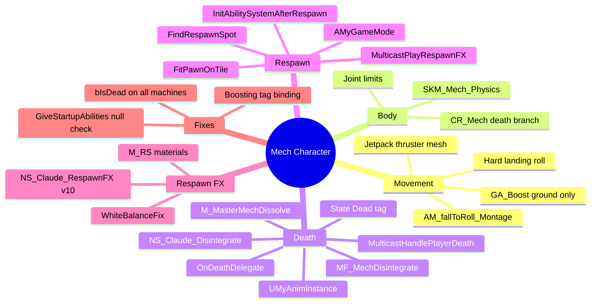
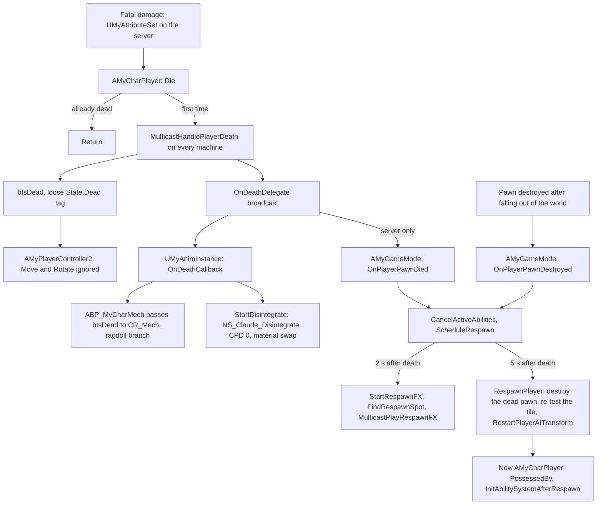
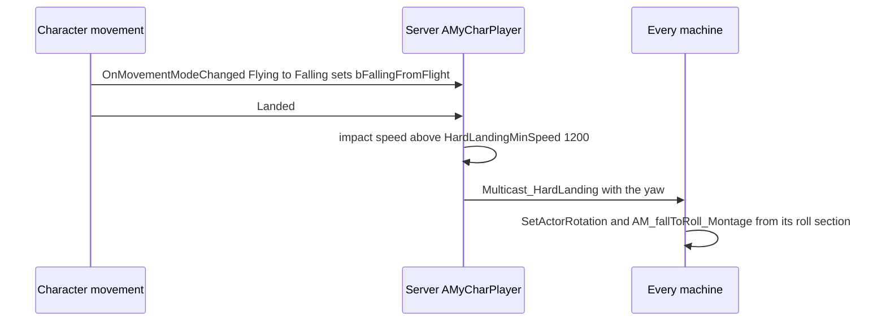

↑ [[Redo3 Changes Index]]

# Mech Character

AuraRedo3 · redo3 · ab6e9c4..b3b02ac · 2026-10-10 to 2026-11-15

This page covers the player mech itself (`AMyCharPlayer`, `BP_MyCharMech`, its anim instance, control rig and physics asset) and what happens to it between a fatal hit and the next life. In order: boosting only from the ground, joint limits on the physics asset, a fall-to-roll montage on a hard landing after flying, two fixes in `AMyCharBase` (null startup abilities and the death flag on every machine), a full death (the mech is eaten away into glowing cubes while the control rig ragdolls it, and its input stops), a server side respawn on the platform just past the lead player, a rebuilt respawn effect, and a Houdini thruster mesh on the jetpack.

Talal asked for these one at a time. His notes ([[CurrentTODOs]] lists "Respawn func" and "GA_Boost , Cd only comit when in air"; [[21-10-2026]] has "On death Assign new mat for all slots?? ... make cpp func to handle death") show the plan. He asked for the hard landing on 2026-10-22 ("Don't hook landing into it, make a new cpp function in parent") and for the respawn on 2026-11-15: dead players should come back on the platform just ahead of the leading player's, with respawn FX, after a fixed time for now. The death and respawn effects came out of the long "Beam and gunshot Niagara effects" thread, which also made the beam on [[Redo3 Beam and Gun FX]].

State now (origin/redo3): everything is merged. A player who dies disintegrates on every machine, and 5 s after the death (or after falling out of the world, which destroys the pawn without a death) gets a fresh pawn on the nearest platform past the lead, with `NS_Claude_RespawnFX` playing there from 2 s. XP, level, spent points and abilities carry over because the ability system lives on the PlayerState. Still open: ability keys can fire while dead, the TEMP death test hook defaults to 3 s in C++, and the hard landing was never tested in PIE.

## Mind map

## How it works

### From death to the next pawn

1. Damage that takes health to 0 reaches `AMyCharPlayer::Die()` on the server. `Die` returns at once if `bIsDead` is set (later fatal hits call it again) and otherwise calls `MulticastHandlePlayerDeath()` (NetMulticast, Reliable). It does not call `Super::Die`, so `AMyCharBase`'s physics ragdoll and dissolve do not run for players.
2. On every machine the multicast sets `bIsDead = true`, adds the loose tag `State.Dead` (`MyTags::State_Dead`) to the ASC and broadcasts `OnDeathDelegate`.
3. `AMyPlayerController2::Move` and `Rotate` return while the ASC has `State.Dead`, so the owning player can no longer move or turn.
4. `UMyAnimInstance::OnDeathCallback` sets its own `bIsDead` (read by `ABP_MyCharMech` and passed to `CR_Mech`, whose death branch ragdolls the mech) and stores `DeathVelocity`. With `DisintegrateDelay` 0 it calls `StartDisintegrate` at once: `NS_Claude_Disintegrate` on the mesh, the death time in custom primitive data slot 0, and the swap to the dissolve materials.
5. On the server `AMyGameMode::OnPlayerPawnDied` is bound to the same delegate. It cancels the pawn's running abilities and calls `ScheduleRespawn`. A pawn that is destroyed without dying (KillZ) reaches the same place through `OnPlayerPawnDestroyed`.
6. `RespawnFXLeadTime` (3 s) before the respawn, so 2 s after death with the default `RespawnDelay` of 5 s, `StartRespawnFX` picks the spot (the nearest platform past the lead, a tile the capsule fits on) and `AMyGameState::MulticastPlayRespawnFX` plays `NS_Claude_RespawnFX` there for everyone.
7. At 5 s `RespawnPlayer` destroys the dead pawn, checks the picked tile again (or picks and plays a new spot) and calls `RestartPlayerAtTransform`. The new pawn finds the PlayerState's ASC already set up, so `InitAbilitySystemAfterRespawn` only clears `State.Dead` and, on the server, refills health and mana.

### Hard landing

1. `OnMovementModeChanged` sets `bFallingFromFlight` when the mode goes from `MOVE_Flying` to `MOVE_Falling` and clears it on any other non-falling mode.
2. `Landed` reads and clears the flag. Only the server goes on, and only with `bHardLandingEnabled` and a `HardLandingMontage`.
3. The velocity is still the impact velocity inside `Landed` (the movement component clears it afterwards). The speed is `-Z` with `bHardLandingVerticalSpeedOnly`, otherwise the full length. It must be above `HardLandingMinSpeed` (1200).
4. With `bHardLandingFaceVelocity` the yaw comes from the flat impact velocity, otherwise the current yaw. `Multicast_HardLanding(Yaw)` (BlueprintCallable, NetMulticast, Reliable) sets the rotation and plays the montage from its `roll` section on every machine.

## Boost only from the ground

`ab6e9c4` (2026-10-10) is Talal's own change. `UGA_Boost::CanActivateAbility` now returns false on the locally controlled machine when the character's `UCharacterMovementComponent` is missing or `IsFalling()`; otherwise it defers to `Super`. The file gained `#include "GameFramework/CharacterMovementComponent.h"`.

The "Spider-Man grapple swing ability" thread checked it, because `GA_Boost` shares `Input.Shift` with the airborne-only grapple (`GA_BPGrappleSwing2`, see [[Redo3 Grapple Swing]]): ground means boost, air means grapple. Talal's first version put the check after the `return`, and then needed the include.

The check runs only where `ActorInfo->IsLocallyControlled()`, so the server does not repeat it for a remote client's activation.

`5d3673b` (2026-11-15 batch) resaved `GE_BoostCost` (`GA_Boost/`) and `GE_HoverCost` (`GA_JumpHover/`). Only the package GUID, the metadata order and the class default object's transactional flag changed; no gameplay effect value is different.

## Physics asset joint limits

`SKM_Mech_Physics` (`/Game/Assets/Characters/Mech/SKM_mech/`) had 17 constraints, all fully free. The "Mech physics joint limits" thread (2026-10-18) worked out each joint's bend axis from the skeleton, set limits on all 17 and read them back. The "Unpushed commits count" thread committed it the same day as `0fb796e`.

- Bones: `root0` > `pelvis` > `LF_point_0..3` and `RF_point_0..3` (legs); `chest` > `LA_point_0..4` and `RA_point_0..4` (arms).
- The limb bones' X axis points sideways, so Twist is the forward and back bend, Swing1 the roll around the bone and Swing2 the side bend. Parent frames were tilted so one-sided ranges lean the right way.
- `LF_point_0`'s constraint frame was rotated 60 degrees compared with `RF_point_0`, and was fixed.
- All limits are soft, stiffness 50, damping 5.
- The save tool could not find the folder while Talal was in PIE, so it was saved as soon as his Play session ended.

| Joint | Twist | Swing1 | Swing2 |
|---|---|---|---|
| Hip `F_point_0` | 25 back, 65 forward | ±15 | ±30 |
| Knee `F_point_1` | 5 straighter, 60 bent | ±5 | ±5 |
| Second knee `F_point_2` | 5, 35 | ±5 | ±5 |
| Ankle `F_point_3` | ±25 | ±5 | ±15 |
| Pelvis to chest | ±20 | ±15 | ±10 |
| Shoulder `A_point_0` | 40 back, 80 forward | ±30 | ±40 |
| Elbow `A_point_2` | 30, 60 | ±10 | ±5 |
| Wrist `A_point_3` | ±30 | ±10 | ±15 |
| Hand and gun `A_point_4` | ±20 | ±10 | ±10 |

## Hard landing

Talal pointed at `GA_BoostBP`, which ends a boost by calling `BP_MyCharMech`'s `Multicast_Roll` with `AM_fallToRoll_Montage`, and asked for the same on a landing that comes out of flying fast, as a new C++ function in the parent class and not hooked into his landing logic. The "Hard landing montage" thread added it to `AMyCharPlayer` (flow above). No Blueprint changes are needed.

| Property (category `HardLanding`) | Default | Notes |
|---|---|---|
| `bHardLandingEnabled` | true | |
| `HardLandingMinSpeed` | 1200 | Impact speed must be above this |
| `bHardLandingVerticalSpeedOnly` | false | true: downward speed only |
| `bHardLandingFaceVelocity` | true | Turn the mech to the landing direction |
| `HardLandingMontage` | `AM_fallToRoll_Montage` | Set in the constructor with `ConstructorHelpers` from `/Game/Assets/Characters/Mech/SKM_mech/Animations/` |
| `bFallingFromFlight` | false | BlueprintReadOnly state flag |

- **PR #1 closed.** The work first went up from the cloud as PR #1 (`claude/project-thread-q3b3hx`, `dc82566` on `cedd511`), opened 2026-10-22 12:18. Talal wanted it done on his PC and pushed from there, so PR #1 was closed at 12:56 as a duplicate.
- **Only the hard-landing lines.** On the PC `afc2918` (12:55) went straight to redo3 with only these lines. Talal's other uncommitted edits in `MyCharPlayer` (edge fog timers, `MulticastHandlePlayerDeath`, `DebugDieAfterBeginPlaySeconds` = 3) were left alone; he chose that option.
- **Roll section.** `afc2918` played the montage from its start. `e3d8c35` (2026-11-15 batch) starts it at the `roll` section, because the mech has already touched down and should skip the falling part.
- **Limit.** A Flying to Walking change with no fall never reaches `Landed` (the comment in the code notes that `GA_BoostBP`'s end already rolls for that case).

## Startup abilities and the death flag

On 2026-10-18 Talal pasted a hot reload error, `MyAnimInstance.cpp(84,37): no member AddUObject in FOnDeathDelegateSignature`, and asked the "Death delegate compile error" thread to find the problems in `MyAnimInstance`, `MyCharBase` and `MyCombatInterface`. It fixed them in his working copy, compiled with single-file UBT and left them uncommitted. They shipped in the 2026-11-15 batch: the `AMyCharBase` part in `9dd0d5d`, the anim instance part with the mech death in `2c1d78b`.

- **The delegate.** `FOnDeathDelegateSignature` (`MyCombatInterface.h`) is a `DECLARE_DYNAMIC_MULTICAST_DELEGATE_OneParam` with `AActor* DeadActor`, so it binds with `AddDynamic` and the callback must be a `UFUNCTION()`. `UMyAnimInstance` now binds `OnDeathCallback` that way and removes it in `NativeUninitializeAnimation`, which also removes the beam and boosting tag callbacks.
- **`GetOnDeathDelegate` is public** on `AMyCharBase`, so the anim instance can bind it through an `AMyCharPlayer` pointer.
- **`GiveStartupAbilities`.** It used to read `InputTag` and `AbilityTag` from the ability's class default object before the null check, so an empty or non-`UMyGameplayAbility` entry crashed. Now a null `AbilityClass` gives a null `MyGA`, the entry is skipped and logged with `GetNameSafe`, and the misleading "Invalid InputTag" branch is gone.
- **`bIsDead` everywhere.** `AMyCharBase::Die` used to set `bIsDead` on the server only, after `MulticastHandleDeath`. Now `MulticastHandleDeath` sets it before `OnDeathDelegate.Broadcast`, so `IsDead()` is true on clients and in death listeners.
- **Player death.** `AMyCharPlayer::Die` was empty. The thread offered options and Talal chose "Anim only": `MulticastHandlePlayerDeath` sets `bIsDead` and broadcasts, and nothing else handles player death. An editor restart was recommended because hot reload handles new `UFUNCTION`s badly.

## Mech death and disintegrate

`2c1d78b` (2026-11-15 batch) ships the death built in the "Beam and gunshot Niagara effects" thread from 2026-10-21 to 10-23. The look comes from a Gnomon livestream (YouTube `br4lhl6UAPk` at 25:39). The first skeletal-mesh disintegrate was made on 2026-10-14 and reached the repo in Talal's `808d60c`; it was wired to the mech's death on 10-21 and reworked twice.

![[redo3_disintegrate_compare.jpg]]
*The first disintegrate on SKM_Mech against the livestream, 2026-10-14 (`disintegrate_compare.jpg`)*

### C++: AMyCharPlayer and AMyPlayerController2

- `Die()` and `MulticastHandlePlayerDeath()` as in the flow above. `State.Dead` is a new native tag. It is a loose tag added on every machine, not replicated.
- `AMyPlayerController2::Move` and `Rotate` return on `State.Dead`.
- **TEMP test hook.** `DebugDieAfterBeginPlaySeconds` (EditDefaultsOnly, category `Debug`, 3 in C++): on the server, `BeginPlay` sets a timer that calls `Die` after that many seconds; 0 turns it off. `BP_MyCharMech` stores 0 (`9d6fb14`).

### C++: UMyAnimInstance

| Property (category `Death`) | Default | What it does |
|---|---|---|
| `DisintegrateSystem` | `NS_Claude_Disintegrate` (soft, `.../GA_Beam/Niagara/NS_BeamClaude/`) | The death system |
| `DisintegrateDelay` | 0 s | Seconds after death before it starts |
| `DisintegrateDataIndex` | 0 | Custom primitive data slot that `MF_MechDisintegrate` reads as `DisintegrateTime` (0 = alive) |
| `DisintegrateDissolveParent` | `M_MasterMechDissolve` (`/Game/Level/MechChar/Mats/`) | Masked copy of `M_MasterMech` |
| `DisintegrateBodyMaterial` | `M_MechDisintegrateBody` (same folder) | For slots with other materials (emissive panels, outline) |
| `DisintegrateSwapDelay` | 0 s | Seconds after the start before the material swap |

- `bIsDead` (BlueprintReadOnly) is set by `OnDeathCallback` on every machine. `DeathVelocity` is the dead actor's velocity at that moment, so the cubes are kicked the way the mech was moving even if the capsule stops a frame later.
- `StartDisintegrate` spawns the system with `SpawnSystemAttached` on the mesh, not auto-activated, sets `DeathVelocity` on it with `SetVariableVec3`, then activates it. It writes the world time with `SetCustomPrimitiveDataFloat` on the body mesh and on attached meshes that use the body's base materials, then calls `SwapToDisintegrateMaterial` (directly, or after `DisintegrateSwapDelay`).
- `SwapToDisintegrateMaterial`: a slot whose material instance is based on `M_MasterMech` gets a dynamic instance of `M_MasterMechDissolve` with `CopyParameterOverrides`, so it keeps its look until each patch is eaten. Any other slot gets `M_MechDisintegrateBody`. Attached meshes are swapped only for slots with the body's base materials.
- Nothing of the disintegrate is replicated: each machine plays its own from the multicast.

### Materials

- **`MF_MechDisintegrate`** samples noise on `PreSkinnedPosition` (not UVs), so every slot shares one pattern. It reads `DisintegrateTime` from custom primitive data 0 and eats the body in noisy holes over `EatDuration` 1.6 s, with a burnt edge and a cyan rim. The maths (from the 2026-10-23 doc): `p = saturate(age / EatDuration)`, `n = saturate((noise - 0.5) * 2.4 + 0.5)`, `mask = n + 0.45 - 1.15 p`, clipped at 0.333, `RimGain` 25.
- **`M_MasterMechDissolve`** is the masked copy. It replaces the Main Directional Light node with a fixed `MainLightDirection` parameter (StartupMap's sun, 0.9842, -0.0344, 0.1736), because a masked shader cannot compile that node.
- **Why copies.** `M_MasterMech` is a legacy asset flagged "masked can be assumed opaque", so it never clipped, and saved inline constants on its unwired outputs overrode the mask and glow wires. The fix was the dissolve copies plus the console command `Aura.ClearConnectedRootConstants` (`ce1125d`, see [[Redo3 Engine Tools and Assets]]). `2c1d78b` also changes `M_MasterMech` and `M_Outline`.

### NS_Claude_Disintegrate v3

Seven emitters in one 5.6 s shot: `Body_Cubes`, `Black_Spray`, `Body_Sparks`, `Arcs`, `Pile_Flicker`, `Pile_Glow` and `Pile_Light`. The four pile emitters run in world space, so the pile stays where it fell.

- Holes open at about 0.16 s and the body is gone by 1.55 s. About 2600 white and blue cubes are born on the surface over the same time, fall, bounce and pile up. The pile darkens from 2.0 to 3.25 s, the cubes rise and shrink away from 2.9 to 5.3 s, and everything is gone at 5.6 s.
- **Kick (10-23).** Cubes no longer take the body's velocity. Vertical speed is clamped to -200..100 cm/s, plus a horizontal kick of `User.KickSpeed` 180 cm/s x (1 + `KickSpeedGain` 0.6 x speed / `KickRefSpeed` 600, capped) x a random 0.55 to 1.45. Standing, the kick goes along the mech's +Y; above `KickDirSpeed` 120 cm/s it turns toward the run, up to 1.6x at 6 m/s. The speed comes from `User.DeathVelocity`.
- Backups `NS_Claude_Disintegrate_BeforeKick` (v2) and `NS_Claude_Disintegrate_V1` were kept by the thread on Talal's PC; they are not in the repo.

![[redo3_mech_disintegrate_stages.jpg]]
*The v1 death disintegrate in stages, 2026-10-21 (`mech_disintegrate_stages.png`)*

### The ragdoll slide

The mech kept sliding after death: `root0` drifted 20 to 70 cm/s (4.1 m in 6 s at worst). Input after death was ruled out by measurement; the slide came from `CR_Mech`'s physics. `CR_Mech` had never read `bIsDead` (Talal chose not to have it rebuilt at first). On 10-23 its death branch was made to keep `root0` Kinematic instead of Simulated, and a new `Death_SpaceMotion` node turns the solver's inertial forces off once dead. Standing deaths now drift 0 cm over 6 s, and a 5 m/s death stops where the capsule stops. These `CR_Mech` and `ABP_MyCharMech` changes are known from the thread and the commit message only.

### Versions

| Version | Date | What changed |
|---|---|---|
| v1 | 2026-10-21 | Death hooked to `UMyAnimInstance`. A 2 s still delay, then darken and break into cubes that pile and rise as a column, about 4.5 s. Six emitters, 4.7 s. `M_MechDisintegrateBody` on every slot after 0.25 s. Verified in PIE |
| v2 | 2026-10-22 | Starts the moment `bIsDead` is set, on the control rig ragdoll. Eaten over 1.6 s through the `M_MasterMechDissolve` copies; cubes with the mesh velocity |
| v3 | 2026-10-23 | The sideways cube kick, the `CR_Mech` slide fix and `State.Dead` blocking move and look; seven emitters, 5.6 s |

The v1 doc also flagged an uncommitted check in `AMyCharPlayer::Tick` that called `Die()` on every machine once world time passed 100 s. It is not on redo3.

## Respawn

`b3b02ac` (2026-11-15 14:51) by the "Respawn players ahead of leader" thread. Talal asked whether respawn belongs in the GameMode; the answer was yes, because the GameMode exists only on the server and owns `RestartPlayer`. The FX goes out through the GameState, which is always relevant, and the platform comes from the GameState's player ranking (see [[Redo3 Hex Path and Ranking]]).

### Settings on AMyGameMode

| Property (category `Respawn`) | Default | Notes |
|---|---|---|
| `bRespawnEnabled` | true | Off: dead players stay dead |
| `RespawnDelay` | 5 s (min 0.1) | Death to new pawn |
| `RespawnFX` | `NS_Claude_RespawnFX` | Loaded with `ConstructorHelpers` so the maps-only cook includes it; none = no FX |
| `RespawnFXLeadTime` | 3 s | The FX starts this long before the pawn appears (its flash is about 3 s in); capped at `RespawnDelay` |
| `RespawnHeightAboveTile` | 10 cm | Gap between the tile top and the capsule bottom |

The constructor also sets `GameStateClass` to `AMyGameState`. `BP_MyGameMode` is a child of `AMyGameMode` and `StartupMap` uses it.

### Death detection

- `SetPlayerDefaults` runs for every started or restarted pawn and calls `WatchPlayerPawn`, which binds `OnDeathDelegate` (`AddUniqueDynamic`) and `OnDestroyed`.
- `OnPlayerPawnDied` cancels the pawn's active abilities and calls `ScheduleRespawn`. `OnPlayerPawnDestroyed` does the same for a watched pawn whose controller is still valid and not on another pawn (falling out of the world destroys the pawn without a death).
- `CancelActiveAbilities` ends what the pawn was doing (boost, beam) while it is still the avatar of the PlayerState's ASC; specs with `RemoveAfterActivation` (passives) keep running for the next pawn.
- `ScheduleRespawn` ignores a second event while one is pending. It starts `RespawnTimer` at `RespawnDelay` and `FXTimer` at `RespawnDelay - RespawnFXLeadTime`.
- `PlayerCanRestart` returns false while a respawn is pending, so a client's `ServerRestartPlayer` cannot skip the wait. `Logout` clears the pending entry.

### Where the player comes back

- **`FindRespawnSpot`.** If the lead has a spline distance (`GetLeadSplineDistance() >= 0`), the candidates are platforms that have tiles and whose own `SplineDistance` is above `max(GetLeadSplineDistance(), GetActivatedSplineDistance())`, so the first choice is never a collapsing platform. They are sorted nearest first; ties between the upper and lower chain go to the platform nearer the lead's. The lead's own platform is the last resort. The new pawn faces away from the lead. If nobody has landed yet, or no platform has room, it uses `FindPlayerStart`.
- **`FindRespawnTile`.** Live tiles in order: bridge path tiles first (`PathDistance` 0, no props), then away from the edge (`EdgeDepth` > 0), then nearest the centre. At most 12 tries (`MaxTileTries`).
- **`FitPawnOnTile`.** Puts the capsule `RespawnHeightAboveTile` above the tile top and calls `UWorld::FindTeleportSpot`. It rejects the spot if the pawn would be pushed off the tile (beyond the tile's `Apothem` times the platform scale) or if it is within two capsule radii of a spot another pending respawn has picked (pawns that have not spawned yet are invisible to `FindTeleportSpot`).
- **`RespawnPlayer`.** Destroys the dead pawn first (cancel, unwatch, unpossess, destroy) so its capsule does not block the fit test. It re-tests the picked tile; if it fell or is blocked, it picks a new spot and plays the FX again. Then `RestartPlayerAtTransform`; if the controller still has no pawn it falls back to `RestartPlayer`, and logs a warning if that fails too.
- **FX.** `AMyGameState::MulticastPlayRespawnFX(System, Location, Rotation)` (NetMulticast, Reliable) plays the system at the ground under the capsule on every machine except a dedicated server.

### Fresh pawn, same PlayerState

- `PossessedBy` (server) and `OnRep_PlayerState` (client) check the PlayerState ASC's `bAbilitiesGiven`. If it is set, this is a respawn and they call `InitAbilitySystemAfterRespawn` instead of the first-spawn setup.
- `InitAbilitySystemAfterRespawn` sets the `State.Dead` count to 0 (the tag stays on the ASC after the dead pawn is gone) and, on the server, applies only `VitalAttributesEffect` again to refill health and mana. It skips the primary effect (its overrides would undo spent points) and the infinite secondary one (it would stack).
- `RegisterToBoostingState` now uses `RemoveAll(this)` and `AddUObject(this, OnBoostingTagChanged)` instead of a lambda that captured the old pawn. `OnBoostingTagChanged` calls the Blueprint events `InitJets` (count above 0) and `StopJets`.
- `AMyHUD::InitOverlay` returns if the overlay already exists: it listens to the PlayerState, ASC and attributes, which outlive the pawn.
- `AMyPlayerController2::Jump` checks for a pawn (there is none between falling out of the world and the respawn).

### Review, merge and the first test

- Two review passes fixed three bugs: two players could get the same tile, a dead pawn could keep beaming, and the FX was missing in packaged builds.
- `b3b02ac` branched from `afc2918`, before the death work, when `AMyCharPlayer::Die()` on redo3 was still empty; it defined the `State.Dead` tag itself. `9f55fa9` (18:12) merged redo3 into the branch, bringing in `MulticastHandlePlayerDeath`, so a kill now starts the respawn timer. PR #4 was merged into redo3 as `098c3ca` (19:45).
- Talal then reported that a `GA_GunShoot` kill did not respawn. His local project did not have PR #4 yet (its `MyGameMode.cpp` only had `PreLogin` and `PostLogin`). A trace of the host and client kill paths through `Die()` found no other fault and confirmed that the Vital effect is instant.

## Respawn FX v10

`f84c282` (2026-11-15 batch; built 2026-10-22). The first respawn effect was built on 2026-10-14 from the Codi VFX cube respawn clip (YouTube `yDVRzh_TDVc` at 57 s), because the RIOT video used for the beam has no respawn and Talal picked option 1. It reached the repo in `808d60c`.

![[redo3_respawn_compare_v2.jpg]]
*The first respawn effect against the reference, 2026-10-14 (`respawn_compare_v2.jpg`)*

v10 rebuilt `NS_Claude_RespawnFX` from scratch:

- Built from a frame by frame spec of the clip (`spec_partA.md` and `spec_partB.md`, 33 elements). A 37-issue critique of an earlier pass became a 12-step fix plan.
- A 4.3 s one-shot with 13 emitters: a glowing cube flies in and bursts, a slab and a wire box build up into a lattice cube, then a white flash with a chromatic hex rim leaves a glass volume that dissolves. The projectile start comes from `User.StartOffset`.
- New materials `M_RS_SpriteAdd`, `M_RS_SpriteAddFlash` (no depth test), `M_RS_SpriteAlpha`, `M_RS_Glass`, `M_RS_CellCube` and `M_RS_Cloud` over `T_RS_Atlas`, `T_RS_CellGrid` and `T_RS_Cloud`, all in `NS_BeamClaude/`.
- Emissive colours go through `WhiteBalanceFix`, an inverse white balance for StartupMap's post process (`WhiteTemp` 2755 K), so they stay pale cyan there. Set it to 0 in other maps.
- `RespawnFXLeadTime` 3 s in the GameMode lines the flash up with the pawn appearing.

## Jetpack thruster

`9d6fb14` (2026-11-15 batch) replaces the `NS_ThursterFlash` Niagara component on `BP_MyCharMech`'s `JetPackSocket` with `Thruster_ftl`, a Nanite mesh exported from the HexPillarSetup Houdini scene, using the unlit masked `M_Thruster` (`Content/Assets/Effects/MyThruster/`). The native `JetPackMeshComponent` (created in the `AMyCharBase` constructor on `JetPackSocket`) uses `JetPackScaled`. The commit also gives `BP_MyCharMech` the `EdgeFogVolume` component that `AMyCharPlayer`'s edge fog timer moves (no mesh yet, see [[Redo3 Hex Look and Atmosphere]]) and stores `DebugDieAfterBeginPlaySeconds` = 0.

This follows Talal's notes [[Improve NS_boost]] ("refer to thruster hip file") and [[boost niagara System, make own]] ("thruster hip file with meshes export from hou"). No thread records the work; the commit message is the only source.

## Listening to ASC tags

The "ASC tag changed delegate" thread (2026-10-10) answered Talal's question "tag changed delegate on ASC in GAS what is it called". No code changed.

- `UAbilitySystemComponent::RegisterGameplayTagEvent(Tag, EGameplayTagEventType::NewOrRemoved)` returns an `FOnGameplayEffectTagCountChanged&`; bind it with `AddUObject` to a callback `OnTagChanged(const FGameplayTag Tag, int32 NewCount)`.
- `NewOrRemoved` fires only when the count goes 0 to 1 or 1 to 0; `AnyCountChange` fires on every change. `RegisterGenericGameplayTagEvent()` gives one delegate for all tags.
- Unbind with `RemoveAll(this)` or `Remove(Handle)` on the same call.
- The project already used it in `MyAnimInstance.cpp` for `State_Shooting` and `MyCharPlayer.cpp` for `State_Boosting`. `RegisterToBoostingState` above is the same pattern; so is `Event.Swing` on [[Redo3 Mech Swing Animation]].

## Gotchas

- `AMyCharPlayer::Die` does not call `Super::Die`, on purpose: no `AMyCharBase` ragdoll or dissolve for players. The ragdoll is `CR_Mech`'s death branch.
- `State.Dead` lives on the PlayerState's ASC and outlives the pawn. Anything that checks it must expect it to be cleared only by `InitAbilitySystemAfterRespawn`.
- Only `Move` and `Rotate` check `State.Dead`. Ability input still works while dead.
- `DebugDieAfterBeginPlaySeconds` is 3 in C++. A Blueprint child of `AMyCharPlayer` that does not store 0 kills its player 3 s after every `BeginPlay`, which with respawn becomes a die and respawn loop.
- `M_MasterMechDissolve`'s sun direction is a fixed parameter. If StartupMap's sun moves, the dissolving body is lit from the old direction.
- `WhiteBalanceFix` in `NS_Claude_RespawnFX` is tuned for StartupMap's 2755 K.
- Wired material pins can stay overridden by saved constants on legacy materials; `Aura.ClearConnectedRootConstants` clears them.
- The hard landing decides on the server only; a client sees the roll when the multicast arrives.

## How it changed

- **2026-10-10 11:28 `ab6e9c4`: boost only from the ground.** Talal's `CanActivateAbility` override in `UGA_Boost`, checked by the grapple thread. The same day the "ASC tag changed delegate" thread answered his tag event question, and the "Recent CR_Mech changes" thread restored `CR_Mech` to its committed copy after a 12:43 save had deleted a getter (details on [[Redo3 Mech Swing Animation]]).
- **2026-10-14: first death and respawn effects.** The beam thread built the first skeletal-mesh disintegrate and the first respawn effect in `NS_BeamClaude`. Talal committed them in `808d60c` on 10-16 (on [[Redo3 Beam and Gun FX]]).
- **2026-10-18 11:59 `0fb796e`: joint limits.** All 17 constraints on `SKM_Mech_Physics`, made by the "Mech physics joint limits" thread and committed by "Unpushed commits count".
- **2026-10-18: death delegate fixes.** `AddDynamic`, the `GiveStartupAbilities` null check, `bIsDead` before the broadcast and the "Anim only" `MulticastHandlePlayerDeath`, left uncommitted on the PC.
- **2026-10-21: disintegrate v1 on death.** `MF_MechDisintegrate`, the C++ hook, the material swap and the 2 s delay, verified in PIE.
- **2026-10-22: disintegrate v2 and respawn v10.** The effect starts at once on the ragdoll with the dissolve copies of `M_MasterMech`; `NS_Claude_RespawnFX` rebuilt with 13 emitters.
- **2026-10-22 12:55 `afc2918`: hard landing.** `Multicast_HardLanding` from `Landed` on the server. PR #1 (opened 12:18) was closed at 12:56 as a duplicate.
- **2026-10-23: cube kick and slide fix.** `User.Kick*`, `User.DeathVelocity` from C++, `CR_Mech`'s kinematic root and `Death_SpaceMotion`, and `State.Dead` blocking move and look.
- **2026-11-15 14:18: the batch commits** from Talal's working copy by the "Push local changes to GitHub" thread:
  - `9dd0d5d`: `GiveStartupAbilities` skips null entries, `bIsDead` set in `MulticastHandleDeath` before the broadcast, `GetOnDeathDelegate` public.
  - `e3d8c35`: the hard landing montage starts at `roll` (work done after 10-22; the day is not recorded).
  - `f84c282`: respawn FX v10 and the `M_RS_*` materials and `T_RS_*` textures (work of 10-22).
  - `9d6fb14`: `Thruster_ftl` and `M_Thruster` on the jetpack, `EdgeFogVolume`, `DebugDieAfterBeginPlaySeconds` 0 on `BP_MyCharMech` (day not recorded).
  - `2c1d78b`: the mech death (work of 10-21 to 10-23): `MulticastHandlePlayerDeath`, `State.Dead`, the anim instance disintegrate code, `MF_MechDisintegrate`, `M_MasterMechDissolve`, `M_MechDisintegrateBody`, `NS_Claude_Disintegrate`, `CR_Mech`, `ABP_MyCharMech`, `M_MasterMech`, `M_Outline` and the input block.
  - `5d3673b`: `GE_BoostCost` and `GE_HoverCost` resaved, no value changed.
- **2026-11-15 14:51 `b3b02ac`: respawn.** `AMyGameMode` respawn, `AMyGameState::MulticastPlayRespawnFX`, `InitAbilitySystemAfterRespawn`, the boosting binding, `InitOverlay` and `Jump` fixes, on `claude/project-thread-dq7p8s`. Then `9f55fa9` (18:12) merged redo3 into it and PR #4 was merged as `098c3ca` (19:45).
- **Later, another page.** The Mech Sentinels attack players and skip dead ones: `GatherPlayerTargets` leaves out pawns whose `IsDead` is true ([[MechSentinel Combat and GAS]]).

## Threads that worked on it

- [[Redo3 Threads#Beam and gunshot Niagara effects|Beam and gunshot Niagara effects]]: the disintegrate (v1 to v3), its materials and the `CR_Mech` slide fix, `State.Dead` on input, and respawn FX v1 and v10.
- [[Redo3 Threads#Respawn players ahead of leader|Respawn players ahead of leader]]: the respawn in `AMyGameMode` and `AMyGameState`, the carried-over ability system, PR #4 and the "How respawn works" doc.
- [[Redo3 Threads#Hard landing montage|Hard landing montage]]: `Multicast_HardLanding`, PR #1 (closed) and `afc2918`.
- [[Redo3 Threads#Death delegate compile error|Death delegate compile error]]: the `AddDynamic` fix, the startup ability null check, `bIsDead` before the broadcast and the "Anim only" player death.
- [[Redo3 Threads#Mech physics joint limits|Mech physics joint limits]]: the 17 joint limits on `SKM_Mech_Physics`.
- [[Redo3 Threads#Unpushed commits count|Unpushed commits count]]: committed the joint limits as `0fb796e`.
- [[Redo3 Threads#Push local changes to GitHub|Push local changes to GitHub]]: split Talal's working copy into the 2026-11-15 topic commits, six of them on this page.
- [[Redo3 Threads#Spider-Man grapple swing ability|Spider-Man grapple swing ability]]: checked Talal's `GA_Boost` ground-only change, which shares `Input.Shift` with the grapple.
- [[Redo3 Threads#Recent CR_Mech changes|Recent CR_Mech changes]]: found and undid an accidental `CR_Mech` save on 2026-10-10.
- [[Redo3 Threads#ASC tag changed delegate|ASC tag changed delegate]]: explained `RegisterGameplayTagEvent`.

## Artifacts and files

- [[Redo3 Artifact - How respawn works]]: the respawn explainer from PR #4, with a timeline of one respawn (0 s death, 2 s spot and FX, 5 s new pawn), the platform and tile choice, the fit test, settings and edge cases.
- [[Redo3 Artifact - Mech FX Reels]]: video gallery. Its disintegrate (v2 and the cube kick) and respawn v10 reels belong here; its beam reels are on [[Redo3 Beam and Gun FX]].
- [[Redo3 Artifact - Mech Disintegration Effect]]: the 2026-10-21 v1 reference doc (2 s delay, six emitters, test recipe, known issues).
- [[Redo3 Artifact - Mech Disintegration - Flow and Structure]]: the 2026-10-23 v3 doc (call chain, eat maths, seven emitters, kick, gotchas, PIE test).
- [[Redo3 Files - Mech Death and Respawn FX]]: the working captures: first disintegrate and respawn comparisons, death stage stills, v2 and kick clips, the ragdoll slide fix and respawn v10 side by side.

The three images above (`redo3_disintegrate_compare.jpg`, `redo3_mech_disintegrate_stages.jpg`, `redo3_respawn_compare_v2.jpg`) come from that files note.

## Where it lives

| What | Path |
|---|---|
| Player mech: hard landing, death, respawn init, boosting binding | `Source/Aura/Public/Character/MyCharPlayer.h`, `Source/Aura/Private/Character/MyCharPlayer.cpp` |
| Base character: startup abilities, `MulticastHandleDeath`, `JetPackMeshComponent` | `Source/Aura/Public/Character/MyCharBase.h`, `Source/Aura/Private/Character/MyCharBase.cpp` |
| Death delegate type | `Source/Aura/Public/Interfaces/MyCombatInterface.h` |
| Disintegrate code | `Source/Aura/Public/MyAnimInstance.h`, `Source/Aura/Private/MyAnimInstance.cpp` (`OnDeathCallback`, `StartDisintegrate`, `SwapToDisintegrateMaterial`) |
| Respawn | `Source/Aura/Public/MyGameMode.h`, `Source/Aura/Private/MyGameMode.cpp`, `Source/Aura/Public/MyGameState.h`, `Source/Aura/Private/MyGameState.cpp` (`MulticastPlayRespawnFX`) |
| `State.Dead` tag | `Source/Aura/Public/AbilitySystem/Data/MyGameplayTags.h`, `Source/Aura/Private/AbilitySystem/Data/MyGameplayTags.cpp` |
| Input block, `Jump` check | `Source/Aura/Private/PlayerInput/MyPlayerController2.cpp` |
| HUD overlay kept | `Source/Aura/Private/UI/MyHUD.cpp` |
| Boost | `Source/Aura/Public/AbilitySystem/Abilities/GA_Boost.h`, `Source/Aura/Private/AbilitySystem/Abilities/GA_Boost.cpp`, `/Game/Level/GAS/GameplayAbilities/GA_Boost/` (`GA_BoostBP`, `GE_BoostCost`), `/Game/Level/GAS/GameplayAbilities/GA_JumpHover/GE_HoverCost` |
| Mech Blueprint and materials | `/Game/Level/MechChar/BP_MyCharMech`, `/Game/Level/MechChar/Mats/` (`M_MasterMech`, `M_MasterMechDissolve`, `M_MechDisintegrateBody`, `MF_MechDisintegrate`, `M_Outline`) |
| Mesh, rig, anim, physics | `/Game/Assets/Characters/Mech/` (`ABP_MyCharMech`, `CR_Mech`, `SKM_mech/SKM_Mech_Physics`, `SKM_mech/Animations/AM_fallToRoll_Montage`, `JetPack/JetPackScaled`) |
| Death and respawn Niagara | `/Game/Level/GAS/GameplayAbilities/GA_Beam/Niagara/NS_BeamClaude/` (`NS_Claude_Disintegrate`, `NS_Claude_RespawnFX`, `M_RS_*`, `Textures/T_RS_*`) |
| Thruster | `/Game/Assets/Effects/MyThruster/` (`Thruster_ftl`, `M_Thruster`) |
| Game mode Blueprint | `/Game/Level/BP_MyGameMode` |

## Open items

- Ability keys still fire while dead; only `Move` and `Rotate` check `State.Dead`.
- `DebugDieAfterBeginPlaySeconds` is still 3 in C++ (the TEMP hook). Only `BP_MyCharMech`'s 0 keeps it off.
- In a listen server, the second player cannot spawn in StartupMap once platforms cover the PlayerStart (found later by the swarm thread).
- The hard landing was compiled but never tested in PIE, and a Flying to Walking change without a fall does not trigger it.
- `LA_point_1`, `RA_point_1` and `root0` have no constraint, so they fall away in a ragdoll; the soft limits can be pushed past.
- The `GA_Boost` ground check runs only on the locally controlled machine.
- `BP_MyCharMech`'s `EdgeFogVolume` component has no mesh assigned yet.
- `M_MasterMechDissolve`'s fixed sun direction and `WhiteBalanceFix` are tuned for StartupMap only.
- [[CurrentTODOs]] still lists "Respawn func" and "GA_Boost , Cd only comit when in air" under InProgress, although respawn has shipped.

## Related

- [[Redo3 Hex Path and Ranking]]: the player ranking and spline distances that `FindRespawnSpot` reads.
- [[Redo3 Mech Swing Animation]]: `CR_Mech`, `ABP_MyCharMech` and the 2026-10-10 `CR_Mech` restore.
- [[Redo3 Grapple Swing]]: the airborne grapple that shares `Input.Shift` with `GA_Boost`.
- [[Redo3 Beam and Gun FX]]: the beam and gun from the same thread and `NS_BeamClaude` folder.
- [[Redo3 Menus and Settings]]: `AMyPlayerController2`'s settings and pause.
- [[Redo3 Hex Minimap]]: the HUD that `InitOverlay` now keeps across respawns.
- [[Redo3 Hex Look and Atmosphere]]: the edge fog that the `EdgeFogVolume` component and the `MyCharPlayer` edge fog timer serve.
- [[Redo3 Engine Tools and Assets]]: `Aura.ClearConnectedRootConstants` and the other material console commands.
- [[MechSentinel Combat and GAS]]: sentinels that attack players and skip dead ones.
- [[Redo3 Timeline]], [[Redo3 Branches and PRs]], [[Redo3 Threads]], [[Redo3 Artifacts Index]].
- Talal's notes: [[Mechs]] (mech references), [[ControlRig]] (control rig notes), [[while BoostFlying Control rig]] (control rig plans while boost flying), [[Improve NS_boost]] and [[boost niagara System, make own]] (the thruster plan), [[21-10-2026]] (the death material note), [[CurrentTODOs]].

[[Redo3 Beam and Gun FX]] ← → [[Redo3 Menus and Settings]]
