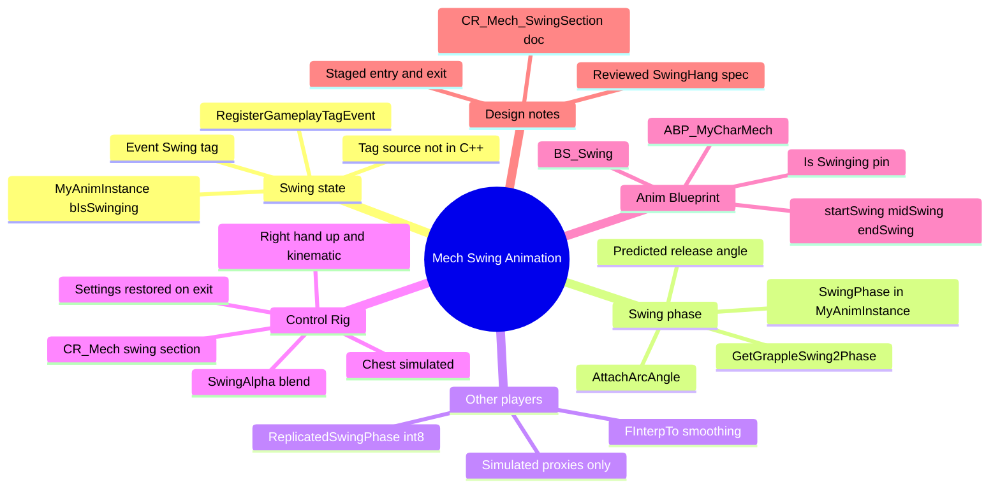
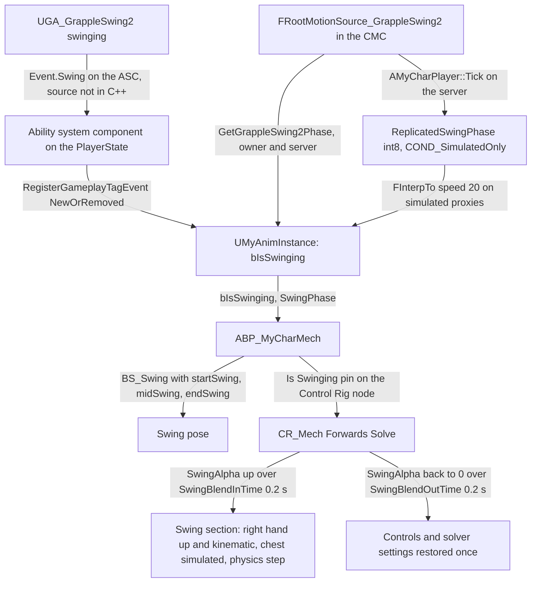

↑ [[Redo3 Changes Index]]

# Mech Swing Animation

AuraRedo3 · redo3 · 3a3b09f..808d60c · 2026-10-10 to 2026-10-16

How the mech looks while it grapple-swings. The swing itself is movement ([[Redo3 Grapple Swing]]); this page is the animation side: a swing state the anim instance can read, a swing section in the mech's Control Rig that raises the right hand and lets the body hang from it on physics, a phase value that says where in the arc the mech is, and swing animations that use it. Talal asked for it on 2026-10-10: define an `Event.Swing` tag in `MyGameplayTags`, subscribe to it in the anim instance to set a `bIsSwinging`, and add a CR_Mech section where the right hand goes up and the body hangs by the right hand, with the chest simulated while swinging. Then he asked for a blend alpha, a swing phase from -1 to 1, and that phase on other players' screens.

The pieces, in the order they were built: `Event.Swing` and `UMyAnimInstance::bIsSwinging` (`3a3b09f`); the CR_Mech swing section bound to `bIsSwinging` in `ABP_MyCharMech` (`ff14587`), with findings and a reviewed design written to `Docs/CR_Mech_SwingSection.md` (`22c482e`, `0fae26e`); the `SwingAlpha` blend (`3deb5fd`); `UGA_GrappleSwing2::GetGrappleSwing2Phase` (`2a8abed`, rescaled in `c3cb456`); and Talal's own commit `808d60c` with `SwingPhase` in the anim instance, the replicated phase for other players and the `BS_Swing` blend space with `startSwing`, `midSwing` and `endSwing`.

State now (origin/redo3): the C++ side is complete. The Control Rig section is the simpler version that was built, not the full reviewed design, and Talal rewired it before the blend was added. No C++ on redo3 adds `Event.Swing` to the ability system component, so where the tag comes from is not visible in code (see [[#Who sets Event.Swing]]). The Control Rig, the anim Blueprint and the swing animations are binary assets; they are described here from the commit messages, the repo doc and the thread.

## Mind map

## How it works

1. While the mech swings, the gameplay tag `Event.Swing` is on its ability system component. `UMyAnimInstance::InitializeASC` (called from `AMyCharPlayer::PossessedBy` on the server and `OnRep_PlayerState` on clients) registers `SwingTagCountChangeCallback` with `RegisterGameplayTagEvent(MyTags::Event_Swing, EGameplayTagEventType::NewOrRemoved)`, which sets `bIsSwinging = TagCount > 0`.
2. Every frame while `bIsSwinging` is true, `NativeUpdateAnimation` asks `UGA_GrappleSwing2::GetGrappleSwing2Phase` for the phase. On the owning client and the server the swing source is in the movement component, so it returns true and `SwingPhase` takes the value.
3. On the server, `AMyCharPlayer::Tick` writes the same phase into `ReplicatedSwingPhase` as an `int8` (phase x 127, rounded). It replicates only to simulated proxies.
4. When `GetGrappleSwing2Phase` returns nothing and the mech is a simulated proxy (another player's mech), the anim instance eases `SwingPhase` toward `ReplicatedSwingPhase / 127` with `FInterpTo` at speed 20.
5. `ABP_MyCharMech` reads `bIsSwinging` and `SwingPhase`. `808d60c` ("swing phase anim") added `BS_Swing` and the `startSwing`, `midSwing` and `endSwing` animations; from the names, the blend space plays the start of the arc, the bottom and the end along `SwingPhase` (the assets are binary and the wiring is not described anywhere).
6. The ABP passes `bIsSwinging` to CR_Mech through the Is Swinging pin of its Control Rig node. In CR_Mech, `SwingAlpha` ramps from 0 to 1 over `SwingBlendInTime` while swinging and back over `SwingBlendOutTime`; it drives the swing's physics step alpha and the weight of the hand-up pose. When `SwingAlpha` reaches 0 the section restores what it changed, once.

## Who sets Event.Swing

`3a3b09f` only declared and defined the tag (`UE_DECLARE_GAMEPLAY_TAG_EXTERN(Event_Swing)` in `MyGameplayTags.h`, `UE_DEFINE_GAMEPLAY_TAG(Event_Swing, "Event.Swing")` in `MyGameplayTags.cpp`) and made the anim instance listen for it. Adding the tag to the ASC was left to the ability, and the advice changed on the way:

- The thread's first advice, in chat while the section was being built: set it in `Poll` while the source's phase is Swing, clear it in `EndAbility`. The reviewed design lists this (from its feasibility review) as rejected, because tagging at hook launch lets the arm raise overlap the hook flight.
- `Docs/CR_Mech_SwingSection.md` section 4.1 ("Talal said he will add the tag"): `SetLooseGameplayTagCount(MyTags::Event_Swing, 1)` in `StartSwing` right after the root motion source is applied, so the 0.2 s arm raise overlaps the hook flight, and back to 0 in `Poll` when the swing is over, in `OnServerRejected` and in `EndAbility`. Use the Set...Count call so the count cannot drift.
- Not `ActivationOwnedTags`: the ability is also active while searching, after a rejection and while Spent with the button held, so the mech would hang from a raised hand on the ground.
- Not a gameplay event: `RegisterGameplayTagEvent` counts owned tags only.
- Loose tags do not replicate, so other players' copies would never see it. To show it on other screens: `ActivationOwnedTags` with replication, or `AddReplicatedLooseGameplayTag`.

None of these calls is in `GA_GrappleSwing2.cpp` or anywhere else in the C++ on redo3. The only place left is a Blueprint, most likely `GA_BPGrappleSwing2`, which `808d60c` and `d334e10` changed; it cannot be read from the repo. `Config/DefaultGame.ini` has `ReplicateActivationOwnedTags=True` (already in the baseline), so if the Blueprint uses `ActivationOwnedTags` the tag would reach other machines, but would also be on while searching, as the doc warned. This is unconfirmed.

The listener pattern is the one the [[Redo3 Threads#ASC tag changed delegate|ASC tag changed delegate]] thread explained about half an hour earlier: `RegisterGameplayTagEvent` returns an `FOnGameplayEffectTagCountChanged&`, bound with `AddUObject`; `NewOrRemoved` fires only when the count goes 0 to 1 or 1 to 0, `AnyCountChange` on every change; unbind with `RemoveAll(this)`. `UMyAnimInstance` already used it for `State.Shooting`, `Ability.Beam` and `State.Boosting`.

Two details of the C++:

- `InitializeASC` also sets `bIsSwinging = ASC->HasMatchingGameplayTag(MyTags::Event_Swing)` right after binding, because the tag may already be on when the ASC arrives (late join, respawn).
- `NativeUninitializeAnimation` removes the binding with `RegisterGameplayTagEvent(MyTags::Event_Swing, ...).RemoveAll(this)`.

## GetGrappleSwing2Phase

A static, `BlueprintPure` function on `UGA_GrappleSwing2` (category Grapple): `GetGrappleSwing2Phase(const ACharacter* Character, float& OutPhase)`. It looks for an `FRootMotionSource_GrappleSwing2` in its movement component's `CurrentRootMotion` and returns where the character is in the arc. The header says it works on the owner and the server, like `GetGrappleSwing2State`.

| Value | Where |
|---|---|
| -1 | where the rope caught, and the whole time the hook is still flying |
| 0 | straight below the anchor |
| +1 | where the auto release lets go: the arc end angle, or earlier when the swing runs out of speed |
| false | no swing source |

Negative while heading toward the bottom, positive once past it. How it is measured since `c3cb456`:

- **Direction.** `ArcForward` takes the horizontal swing velocity plus 50 times the horizontal hook direction (`PreferredSwingDir`), so the angle follows the motion and steering keeps the sign right; with almost no sideways motion it falls back to the hook direction.
- **Angle.** `ArcAngleDeg` is the signed angle from straight below the anchor in the vertical plane along that direction: `atan2(R | Forward, -(R | Up))`, with `R` from the anchor to the capsule.
- **Hook side.** Divided by the angle at the attach move, `AttachArcAngle`, which `PrepareRootMotion` stores at the end of the attach move (so the first read after the catch is -1). An anchor almost straight overhead still gets at least 10 degrees (`MinHookArcAngleDeg`) to reach the bottom.
- **Release side.** Divided by a predicted release arc. `PredictReleaseAngleDeg` returns `AutoReleaseAngleDeg` (50) or, when the tangential speed would fall to the stall speed first (`max(AutoReleaseStallSpeed 350, AutoReleasePeakFraction 0.55 x peak speed)`, climbing at the rising gravity), the angle where it stalls. That angle from straight down is converted to an angle along the motion, allowing for the arc's sideways offset from the anchor.
- **Clamp** to -1..1. `AttachArcAngle` is copied in `UpdateStateFrom` and net serialized, so a correction keeps it.

The first version (`2a8abed`) measured along `PreferredSwingDir` and divided by 90 degrees: -1 was 90 degrees back on the hook side and +1 90 degrees past. Webs catch at 25 to 55 degrees, so a fresh hook read only about -0.3 to -0.6 and the 50 degree auto release about +0.55. Talal asked "please scale", and the rescale made every simulated case start at -1.000 and release at +1.000; side webs that stopped short were fixed on the way.

## SwingPhase in the anim instance

`808d60c` added `float SwingPhase = 0` (`BlueprintReadOnly`) to `UMyAnimInstance` and this to `NativeUpdateAnimation`, inside `if (bIsSwinging)`:

- `GetGrappleSwing2Phase(MyCharPlayer, Phase)` true: `SwingPhase = Phase`, then a `UKismetSystemLibrary::PrintString` of the value (prints every frame while swinging).
- Otherwise, on a `ROLE_SimulatedProxy`: `SwingPhase = FInterpTo(SwingPhase, ReplicatedSwingPhase / 127, DeltaSeconds, 20)`.
- When there is no swing the value is held, "so blending out doesn't pop".

On a listen server the host's copies of other players' characters have the authority role and the real source, so they read the real value directly.

## Other players' swings

The thread noted that on simulated proxies (other players' mechs) the phase froze, since `GetGrappleSwing2Phase` is only meant for the owner and the server. Talal asked to "build directly on my pc and push/commit nothing, so I can see the diff", so this part was left uncommitted and reached the repo in his own `808d60c` on 2026-10-16:

| Piece | Code |
|---|---|
| Property | `UPROPERTY(Replicated) int8 ReplicatedSwingPhase = 0` on `AMyCharPlayer`, -127..127 for -1..1 |
| Replication | `GetLifetimeReplicatedProps`: `DOREPLIFETIME_CONDITION(AMyCharPlayer, ReplicatedSwingPhase, COND_SimulatedOnly)` |
| Writer | `AMyCharPlayer::Tick`, `HasAuthority()` only: `ReplicatedSwingPhase = (int8)FMath::RoundToInt(Phase * 127)` while `GetGrappleSwing2Phase` returns true; the last value stays otherwise |
| Reader | `UMyAnimInstance::NativeUpdateAnimation` on simulated proxies, smoothed with `FInterpTo` at speed 20 |

The thread's answer on cost: it replicates on the character's net updates, only when it changes. On a simulated proxy `SwingPhase` only updates while `bIsSwinging` is true there, so this depends on `Event.Swing` reaching other machines (see above).

## CR_Mech swing section as built

`/Game/Assets/Characters/Mech/CR_Mech` is the mech's Control Rig. Before the swing work its Forwards Solve ran one sequence with five parts: A beam and flying (chest pose and physics steps), B shooting arm IK, C shooting recoil, D the GA_Beam hit (chest simulated, add force, step), and E foot lock traces and full body IK. Its Construction Event spawns a physics solver owned by `root0`, instantiates the bodies from `SKM_Mech_Physics` and sets every body Simulated except `root0` and `chest`, which are Kinematic.

`ff14587` (2026-10-10 15:49, committed on Talal's PC) added the swing section, nodes named `Swing_*` at the bottom of the graph. From the commit, the doc's status note and the thread:

- A `Branch(bIsSwinging)` at the start of Forwards Solve. While swinging, the flying, beam, shooting and foot IK parts are skipped.
- The right hand (`RA_point_4`, and `RA_point_1`, which a review said to keep kinematic) is made Kinematic and placed 105 cm straight above the right shoulder.
- `chest` is set Simulated, so the body hangs from the hand.
- The controls that pull the bodies back to the animation (Sim Space) go to 0 and the limb shape controls (Parent Space) to 0.25.
- The solver's teleport `PositionChangeThreshold` goes from 100 to 600, `InertialForces.LinearEulerAmount` to 0.6 (the ability's gravity is x1.3 rising and x2 falling, so full inertial forces would throw the body sideways), and linear acceleration is clamped at 3500.
- All of it is restored when the swing ends.
- `SKM_Mech_Physics` has no joint between `root0` and `pelvis`.

The commit also carries Talal's earlier, uncommitted CR_Mech edits. Backups named `*_preSwing_*` were kept on the PC. In `ABP_MyCharMech` the new `bIsSwinging` CR variable is bound on the Control Rig node to the anim instance's `bIsSwinging`, like Is Flying; Talal had to tick the Is Swinging pin on that node himself, because the tools could not.

### SwingAlpha

Talal then edited the graph himself (2026-10-10 about 17:06): he put the swing graph right after Forwards Solve, disconnected the rest, and asked for an alpha that goes 0 to 1 when the swing starts and 1 to 0 after it ends. `3deb5fd` (17:29):

- `SwingAlpha` ramps 0 to 1 over `SwingBlendInTime` while `bIsSwinging`, and 1 to 0 over `SwingBlendOutTime` after (0.2 s each).
- It drives the swing's Step Physics Solver alpha and the weight of the hand-up Set Transform (`Swing_SetHandUp`).
- The swing branch now runs while swinging or fading, so the swing-end restore runs once, when `SwingAlpha` reaches 0.
- The commit includes Talal's rewiring. The thread noted that his edit had disconnected the `RA_point_4` and `RA_point_1` kinematic nodes, the teleport node and the space motion node from the swing-start chain. A backup `CR_Mech_preAlpha_*` was kept on the PC.

`808d60c` (2026-10-16) saved CR_Mech and `ABP_MyCharMech` again and added `CR_MechBackup_10-10-2026`; what changed in the graph then is not recorded, so whether those nodes were reconnected is unknown.

## The reviewed design (Docs/CR_Mech_SwingSection.md)

The doc in the repo is a full build spec, "SwingHang", for an editor session with Unreal MCP or for Talal building it by hand. `22c482e` (14:43) first wrote down what the committed graph looks like (the A to E parts above, the skeleton with the right arm `RA_point_0` to `RA_point_5` and `RA_point_4` as the hand about 105 cm from the shoulder, the 16 custom-property pins on the ABP node) and a preliminary design. `0fae26e` (15:56) replaced it with the reviewed design. Its status note says plainly that what is built is "the simpler version" and to use the spec "to fix whatever PIE shows".

What the reviewed design does differently:

| Topic | Built | Reviewed design |
|---|---|---|
| Placement | Branch at the start of Forwards Solve | New last pin F on the sequence, after feet IK and full body IK |
| Arm | `RA_point_4` (and `RA_point_1`) kinematic, hand straight up | Whole right arm `RA_point_0` to `RA_point_5` kinematic, a rigid copy of the reference arm rotated about a fixed shoulder, aimed at the anchor when known |
| Entry | One blend (`SwingAlpha`) | Arm raise first (`ArmAlpha`, 0.2 s via a waypoint out to the right), then the physics hang (`PhysAlpha`, 0.2 s) |
| Exit | Blend out, restore once | A hold of up to 0.45 s to bridge auto-chained arcs, physics fade 0.17 s with the arm up, then the arm lowers 0.2 s |
| Gravity | `LinearEulerAmount` 0.6 | Inertial amount k = 1/s computed from the swing's gravity scale and vertical speed, 0.25 without an anchor |
| Acceleration clamp | 3500 | 4000 |
| Controls | Sim Space 0, Parent Space 0.25 | Sim Space off; Parent Space linear 0, angular 0.25 at the shoulder, 0 at the pelvis, 4 for the head, 1 elsewhere |
| Steps | Other parts skipped | Exactly one solver step per frame: the existing steps get a "not while swinging" gate, chest Set Transforms fade with `1 - ArmAlpha`, beam hit forces still apply through the swing's step |

It also lists checks to make in the editor first (V1 to V12). The critical one, V4, is whether the right shoulder constraint lets the arm go about 170 degrees overhead; changing it affects all CR physics, including flying and the beam hit, so it says to ask Talal first. Besides `bIsSwinging` it recommends a `SwingVelocity` input (from the anim instance's existing `Velocity`) and `bIsOnGround`, and optionally `SwingAnchor` and `bHasSwingAnchor`; the last three need a small anim-instance addition (section 4.2) using `GetGrappleSwing2State` on the locally controlled mech, which was not made. Section 11 is a test checklist for the CR preview and PIE. It also records a gap that was already there: the beam hit section sets `chest` Simulated and never sets it back to Kinematic.

## Gotchas

- The anim instance's `PrintString` of `SwingPhase` runs every frame while the owner swings, so the value scrolls on screen.
- `SwingPhase` keeps its last value after a swing. A Blueprint that uses it outside a swing reads a stale number.
- On simulated proxies the phase arrives at the net update rate and is smoothed, so it lags the owner's slightly.
- The Control Rig section was rewired by Talal after it was built; the commit history of a binary asset does not show the current wiring. Check the live graph before following the doc.
- The swing only starts while falling and `bIsFlying` is true only in `MOVE_Flying`, so swinging and flying normally do not overlap in CR_Mech.

## How it changed

- **2026-10-10 midday: CR_Mech restored first.** In the "Recent CR_Mech changes" thread Talal asked what he had changed in CR_Mech in the last hour. A session on his PC found one save at 12:43, compared the bytes with the committed copy from `e97868b` (2026-09-19) and found one real change: a deleted variable getter that fed `Add_14.B`, inferred to be `PhysicsStateSetDuration`. Once Talal had closed the editor it restored the committed file with git and kept the 12:43 version in `Saved/Backup/ClaudeRestore`. Talal saved CR_Mech again at 13:54, and the swing section was built on that version.
- **2026-10-10 about 13:30: the delegate question.** The "ASC tag changed delegate" thread named `RegisterGameplayTagEvent` and pointed at the existing uses in `MyAnimInstance.cpp` and `MyCharPlayer.cpp`.
- **2026-10-10 13:54: the request** in the grapple swing thread: `Event.Swing`, `bIsSwinging`, the CR_Mech hang.
- **2026-10-10 13:59 `3a3b09f`: `Event.Swing` and `bIsSwinging`**, on `claude/project-thread-99vjzu`, merged on the PC as `146bc6e` at 14:36. The offline PC session was replaced by a fresh one.
- **2026-10-10 14:43 `22c482e`: findings and a preliminary design** in `Docs/CR_Mech_SwingSection.md`: a `Branch(bIsSwinging)` after Forwards Solve, chest Simulated and the hand Kinematic on the rising edge, Sim Space controls lowered, the arm written straight up and one step per frame, everything restored on the falling edge.
- **2026-10-10 15:49 `ff14587`: the swing section in CR_Mech** and `bIsSwinging` bound in `ABP_MyCharMech`, committed locally with Talal's earlier CR_Mech edits.
- **2026-10-10 15:56 `0fae26e`: the reviewed design** replaced the notes, after three reviews; it documents what was accepted, modified and rejected.
- **2026-10-10 17:29 `3deb5fd`: `SwingAlpha`** blend in and out, on top of Talal's rewiring. `0fae26e` and `22c482e` reached redo3 with the merge `173a497` the next morning.
- **2026-10-11 07:59 `2a8abed`: `GetGrappleSwing2Phase`**, after Talal asked at 07:56 for "a swing-period value" from -1 to 1 by angle. Merged on the PC as `173a497` at 08:08.
- **2026-10-11 08:52 `c3cb456`: the rescale.** Talal: "please scale, and I want a variable to be updated On MyAnimInstance in UpdateAnim if bIsSwinging true", then "no need to run the simulation, push and merge". Merged as `8142c94`. The anim-instance variable was built on the PC with the replication below.
- **2026-10-11: the replicated phase**, built uncommitted on the PC at Talal's request.
- **2026-10-16 07:29 `808d60c`: Talal's commit** "swing phase anim, Hex tile edge mask, beam by claude": `SwingPhase` in `UMyAnimInstance`, `ReplicatedSwingPhase` on `AMyCharPlayer`, `BS_Swing`, `startSwing`, `midSwing`, `endSwing`, new saves of `ABP_MyCharMech`, `CR_Mech` and `GA_BPGrappleSwing2`, and `CR_MechBackup_10-10-2026`. The same commit carries the hex tile edge mask and beam work ([[Redo3 Hex Look and Atmosphere]], [[Redo3 Beam and Gun FX]]).

## Threads that worked on it

- [[Redo3 Threads#Spider-Man grapple swing ability|Spider-Man grapple swing ability]]: added `Event.Swing` and `bIsSwinging`, built the CR_Mech swing section and its blend, wrote the findings and the reviewed design, added and rescaled `GetGrappleSwing2Phase`, and built the replicated phase on Talal's PC.
- [[Redo3 Threads#Recent CR_Mech changes|Recent CR_Mech changes]]: found and undid Talal's accidental CR_Mech edit just before the swing work, so the swing section was built on a known graph.
- [[Redo3 Threads#ASC tag changed delegate|ASC tag changed delegate]]: explained `RegisterGameplayTagEvent`, the pattern `bIsSwinging` uses.

## Artifacts and files

- [[Redo3 Files - Grapple Swing]]: `MechSwing/CR_Mech_SwingSection.md`, the CR_Mech findings and reviewed design (the same text as `Docs/CR_Mech_SwingSection.md`), next to the grapple swing files.

No artifact was published for the swing animation.

## Where it lives

| What | Path |
|---|---|
| Tag | `Source/Aura/Public/AbilitySystem/Data/MyGameplayTags.h`, `Source/Aura/Private/AbilitySystem/Data/MyGameplayTags.cpp` (`Event_Swing`) |
| Anim instance | `Source/Aura/Public/MyAnimInstance.h`, `Source/Aura/Private/MyAnimInstance.cpp` (`bIsSwinging`, `SwingPhase`, `SwingTagCountChangeCallback`, `InitializeASC`, `NativeUpdateAnimation`) |
| Phase function | `Source/Aura/Public/AbilitySystem/Abilities/GA_GrappleSwing2.h`, `Source/Aura/Private/AbilitySystem/Abilities/GA_GrappleSwing2.cpp` (`GetGrappleSwing2Phase`, `ArcForward`, `ArcAngleDeg`, `PredictReleaseAngleDeg`, `AttachArcAngle`) |
| Replicated phase | `Source/Aura/Public/Character/MyCharPlayer.h`, `Source/Aura/Private/Character/MyCharPlayer.cpp` (`ReplicatedSwingPhase`, `Tick`, `GetLifetimeReplicatedProps`) |
| Control Rig | `/Game/Assets/Characters/Mech/CR_Mech`, backup `/Game/Assets/Characters/Mech/CR_MechBackup_10-10-2026` |
| Anim Blueprint | `/Game/Assets/Characters/Mech/ABP_MyCharMech` |
| Swing animations | `/Game/Assets/Characters/Mech/SKM_mech/Animations/BS_Swing`, `startSwing`, `midSwing`, `endSwing` |
| Physics asset | `SKM_Mech_Physics` (bodies the CR instantiates) |
| Design doc | `Docs/CR_Mech_SwingSection.md` |

## Open items

- No C++ adds `Event.Swing`; where it is applied (most likely `GA_BPGrappleSwing2`) and whether it reaches other machines is unconfirmed. Loose tags do not replicate.
- The reviewed design is not built: the staged entry and exit, the release hold for chained arcs, the whole-arm kinematic, the gravity-matched inertia and the shoulder joint limit check (V4).
- Talal's rewiring disconnected the hand kinematic, teleport and space motion nodes from the swing-start chain; whether `808d60c` reconnected them is not recorded.
- The per-frame `PrintString` of `SwingPhase` in `NativeUpdateAnimation` is still in.
- On 2026-10-10 the doc noted an older gap: the beam hit section of CR_Mech never sets `chest` back to Kinematic. Whether a later CR_Mech save fixed it is not recorded.
- The optional anchor-aimed arm (`SwingAnchor`, `bHasSwingAnchor` from `GetGrappleSwing2State`) was not added.
- A multiplayer test of the swing pose and phase on other players' screens was not reported.

## Related

- [[Redo3 Grapple Swing]]: the ability and swing simulation this animates, and where `GetGrappleSwing2Phase` lives.
- [[Redo3 Mech Character]]: the rest of the mech: its other abilities, death ragdoll in CR_Mech, hard landing and respawn.
- [[Redo3 Beam and Gun FX]]: the beam work in the same `808d60c` commit.
- [[Redo3 Timeline]], [[Redo3 Branches and PRs]], [[Redo3 Threads]].
- Talal's notes: [[ControlRig]] (Control Rig debugging and the mech rig strategy), [[AnimationBlueprints]] (his anim Blueprint index), [[while BoostFlying Control rig]] (the physics and procedural ideas for the boost-flying section of the same rig).

[[Redo3 Grapple Swing]] ← → [[Redo3 Beam and Gun FX]]
