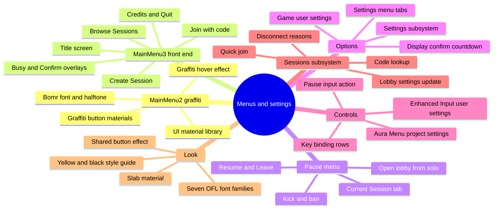
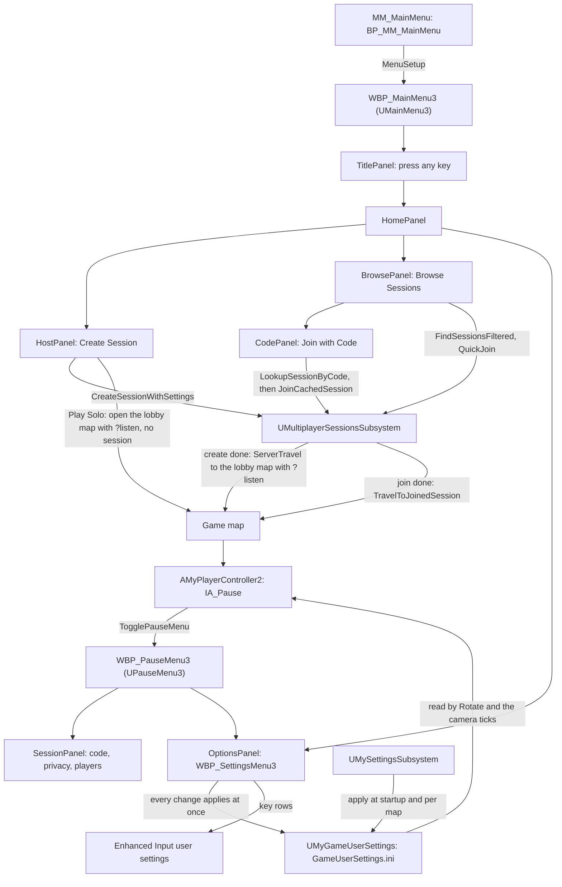
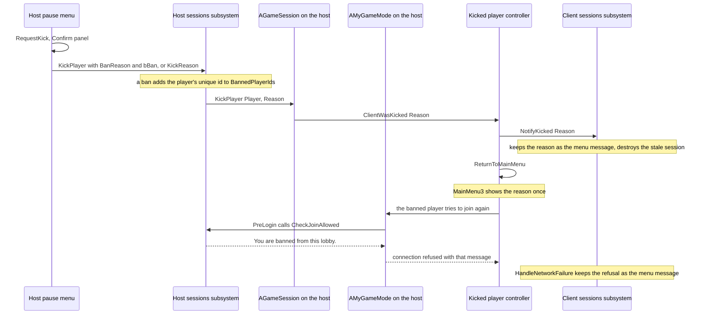

↑ [[Redo3 Changes Index]]

# Menus and Settings

AuraRedo3 · redo3 · 9c04634..d11e55a · 2026-10-04 to 2026-11-15

The front end is everything around the game itself: the main menu map `MM_MainMenu` (the Game Default Map), where `BP_MM_MainMenu` puts a menu widget on screen; the online sessions it hosts, finds and joins through `UMultiplayerSessionsSubsystem` (Steam is the `DefaultPlatformService`; the EOS plugins are enabled too); the Esc menu in game; and the Options screen with its saved settings and rebindable keys.

It changed in two rounds. In October 2026 the existing `UMainMenu2` got a graffiti look: a C++ hover effect on its buttons, graffiti button materials, a UI material library, the Bomr font, a halftone material and a mech splash image. Then on 2026-10-30 Talal asked for a complete menu system like the Far Far West main menu, with all its options, as a new `MainMenu3` class that keeps the widget-switcher convention and may improve the sessions subsystem. He then asked for mock-ups of every screen and finally for all widgets to be built and hooked up in the style of the Persona 5 menus, with yellow in place of red. The C++ came as PR #2 (`c4b51bd` to `477dba4`); the widgets, fonts, sound classes and input hook-up were built on Talal's PC the same day and committed in the 2026-11-15 batch (`5d2fd5b`, `d11e55a`).

State now: `MM_MainMenu` opens `WBP_MainMenu3`, Esc opens `WBP_PauseMenu3` in game, and both share `WBP_SettingsMenu3`. The test pass found every screen working, with four small layout bugs and a Render Scale value showing 0%. The planned style pass (the extra UI materials and the ransom-letter headings) was never built, because Talal paused the thread ("Just wait for now stop testing"). `UMainMenu2` and `WBP_MainMenu2` are still in the project and still work.

## Mind map

## How it works

1. **Main menu map.** `MM_MainMenu` is the Game Default Map in `DefaultEngine.ini`. Since `d11e55a`, `BP_MM_MainMenu` creates `WBP_MainMenu3` and calls `MenuSetup` (per the thread, `MenuSetup(4, "FreeForAll", "/Game/Maps/StartupMap")`). `MenuSetup` has the same signature as `UMainMenu2::MenuSetup`, stores the lobby path with `?listen`, seeds the Create Session settings (new lobbies start Friends Only, difficulty `DefaultDifficulty` 1, the first rule set), switches to UI-only input, binds the subsystem delegates once, and shows a pending disconnect reason if there is one, else the title screen.
2. **Title and Home.** The title panel pulses `PressAnyKeyText` (opacity `0.55 + 0.45 * sin(3t)`) until any key or mouse click. Home holds Create Session, Browse Sessions, Tutorial (hidden while `TutorialMapPath` is empty), Options, Credits and Quit. Without the online service, Browse Sessions and Start Lobby are disabled and `OnlineStatusText` turns red.
3. **Hosting.** Start Lobby reads the Create Session widgets into `PendingHostSettings` and calls `CreateSessionWithSettings`. On success the menu calls `ServerTravel` to the lobby path. Play Solo opens the lobby map as a listen server with no online session; the pause menu can open it to others later.
4. **Finding and joining.** Browse calls the filtered search, quick join picks a lobby for you, and Join with Code looks a 6-character code up first and asks "Join lobby?" before joining. A successful join calls `TravelToJoinedSession`.
5. **In game.** `AMyPlayerController2` binds `IA_Pause` (Escape and Gamepad Special Right) to `TogglePauseMenu`, which creates `PauseMenuClass` once and opens or closes it. The game keeps running underneath.
6. **Options.** `WBP_SettingsMenu3` is the Options panel of both menus. Every control applies the moment it changes; window mode and resolution ask "Keep these display settings?" and revert after a countdown. Closing saves `GameUserSettings.ini` and, if they changed, the key bindings.
7. **Applying settings without a menu.** `UMySettingsSubsystem` applies the rendering and accessibility settings when the game instance starts and the volumes for every map it loads. `AMyPlayerController2` reads look sensitivity, invert, field of view, screen shake, screen flashes and damage numbers from `UMyGameUserSettings` while playing.

## MainMenu2 graffiti restyle

`UMainMenu2` (`Source/Aura/Public/EOS/MainMenu2.h`) is the Host/Join menu that existed at the baseline: privacy modes, join codes, Steam invites and a filtered browse list, on one `UWidgetSwitcher` with `BindWidgetOptional` widgets. Its function flow is in Talal's note [[MultiplayerMenu2]].

`9c04634` (Talal's own commit) gave it the "graffiti hover juice" in C++:

- `NativeConstruct` calls `SetupGraffitiButtons`, which walks the widget tree. Every `UButton` whose parent panel also holds an `Image` named `Graffiti_*` takes part; the last `TextBlock` sibling is its label. Each gets a "hand placed" rest tilt of `sin(Index * 2.3 + 0.7) * GraffitiRestTilt`, alternating left and right.
- `NativeTick` calls `TickGraffitiButtons`. Hover eases with `FInterpTo` at speed 12 and press at speed 30. A damped spring (stiffness 260, damping 14, time step capped at 1/30 s) drives the scale, with an extra kick the moment the cursor arrives. Hovered buttons lean into a sine wobble with a 2.5 px Perlin jitter, move (10, -4) px and shear by -8; pressed buttons squash. The image's `Hovered` material parameter (`M_UI_Button`) follows the hover value, and the label fades to `GraffitiHoverTextColor` with its shadow going from black to white.

The settings sit in the `Aura|Menu|Graffiti` category of the widget's Class Defaults:

| Setting | Default |
|---|---|
| `GraffitiHoverScale` | 1.08 |
| `GraffitiHoverKick` | 2.5 |
| `GraffitiRestTilt` | 3 degrees |
| `GraffitiWobble` | 2.2 degrees |
| `GraffitiHoverTextColor` | linear (0.02, 0.02, 0.03, 1) |

Assets, all binary and known only from their names and the commit messages:

- `9c04634`: `GraffitiUI/MI_GraffitiBtn_Cyan`, `_Lime`, `_Orange`, `_Pink`, `_Yellow` and `MI_GraffitiWall`; a UI material library under `MainMenu/UIMaterialLab/` (material functions for SDF shapes, masks, patterns such as halftone, hexagon tiling and Truchet, distortions, time and utilities; demo pages `1_MaterialLab_Transforms` to `9_MaterialLab_Applications`; component widgets such as `WBP_HalftoneMenu`; `M_UI_Button`; Permanent Marker and Roboto fonts); example UI materials under `MainMenu/Materials/` (transforms, gradients, time, shapes, masks, patterns, UV distortion, utilities); `2_HexagonalTiling/M_UI_HexagonalTiling`; an updated `WBP_MainMenu2` and a `WBP_MainMenu2_Backup`.
- `e7a2588`: the graffiti MIs and `WBP_MainMenu2` updated, and `M_UI_Button` moved into `GraffitiUI/` (the old folder keeps `M_UI_Button_Backup`).
- `8dd75d0`: the Bomr font (`Bomr`, `Bomr_Font`), `M_UI_Halftone` and the splash image `minimalSplashScreenMech_1`, used in `WBP_MainMenu2`.

## MainMenu3 front end

`UMainMenu3` (`Source/Aura/Public/EOS/MainMenu3.h`, a `UMyUserWidget`) keeps MainMenu2's convention: one `UWidgetSwitcher` called `MenuSwitcher` with a panel per screen, every widget bound with `BindWidgetOptional` (57 of them), and a visibility fallback when there is no switcher. Panels: `TitlePanel`, `HomePanel`, `HostPanel`, `BrowsePanel`, `CodePanel`, `BusyPanel`, `ConfirmPanel`, `OptionsPanel` (or the `OptionsMenu` widget itself) and `CreditsPanel`.

- **Back stack.** `ShowPanel` pushes onto `PanelHistory`; Esc, gamepad B or Circle (`AuraMenu::IsBackKey`) go back. Busy and Confirm are overlays and never go on the stack, so closing them returns to the screen that opened them.
- **Waiting flags.** `bAwaitingCodeLookup`, `bAwaitingQuickJoin`, `bAwaitingJoin` and `bAwaitingCreate` make the menu ignore subsystem broadcasts meant for another flow. A search asked for while a browse refresh is still running is queued (`EMainMenu3QueuedSearch`) and starts when the refresh reports back.
- **Browse.** Filters `DistanceComboBox`, `DifficultyFilterComboBox`, `RulesFilterComboBox` and `ShowFullLobbiesCheckBox` build an `FAuraSessionFilter`. Rows are `SessionEntryClass` (`USessionEntry3`). `OnLobbyListUpdated` is a Blueprint hook for re-skinning the list. A code lookup replaces the subsystem's cached results that the rows join by index, so the list is cleared and searched again when Browse is shown (`bBrowseListStale`, a review fix in `14ed4e1`).
- **Join with Code.** The text box is sanitised to upper case, the code alphabet and at most `JoinCodeLength` (6) characters; Confirm only works with a complete code. The lookup result opens a Confirm with lobby name, host, players, difficulty and ping, or a "Lobby not found" or "Lobby full" message.
- **Credits** scroll by themselves at `CreditsScrollSpeed`, rest 3 s at the bottom, then start again. **Quit** asks first.
- **Disconnect reasons.** `MenuSetup` calls `ConsumePendingMenuMessage` and shows the reason once in a "Disconnected" message (lost connection, kicked, banned, host left).

| Setting | Default | Effect |
|---|---|---|
| `bShowTitleScreen` | true | Off, or no `TitlePanel`, goes straight to Home |
| `TutorialMapPath` | empty | Map the Tutorial button opens offline; empty hides the button |
| `DifficultyNames` | Easy, Normal, Hard, Very Hard, Nightmare | Index is the Difficulty stored on the session |
| `DefaultDifficulty` | 1 | Difficulty a new lobby starts on |
| `RuleSets` | Default | Offered when hosting and filtering; the first is the default |
| `MaxPlayerChoices` | 1, 2, 3, 4 | Max Players box; `MenuSetup`'s count is preselected |
| `CreditsScrollSpeed` | 40 px/s | Credits scroll speed |
| `ButtonFX` | `FAuraMenuButtonFXSettings` defaults | Hover effect tuning |

`USessionEntry3` shows `LobbyNameText`, `HostNameText`, `PlayersText`, `PingText`, `DifficultyText`, `RulesText`, a `FullBadge` and `JoinEntryButton`, which calls `UMainMenu3::JoinLobbyByIndex`. Ping is green up to `GoodPingMs` (60), yellow up to `OkPingMs` (120) and red above. `OnSessionInfoSet` is a Blueprint restyle hook.

## Pause menu and Current Session

`UPauseMenu3` (`Source/Aura/Public/EOS/PauseMenu3.h`) is the in-game Esc menu: Resume, Current Session, Options, Leave Session and Quit Game, on a `MenuSwitcher` with `PauseHomePanel`, `SessionPanel`, `OptionsPanel` and `ConfirmPanel`. Nothing pauses: it is co-op. `OpenMenu` adds it to the viewport at Z order 50, flushes held keys and switches to UI input; `CloseMenu` saves open options and gives input back.

The Current Session tab is Far Far West's lobby tab:

- The join code (`SessionCodeText`) with `CopyCodeButton`, and `InviteFriendsButton` (Steam overlay).
- Privacy buttons. Only the host can change privacy, and the running lobby is changed in place through `UpdateHostSettings`, so the code and everyone in it stay.
- `OpenLobbyButton` for a solo game: `CreateSessionWithSettings` with `OpenLobbySettings` and the chosen privacy (`SelectedPrivacy`, default Friends Only), named "<nickname>'s lobby" when no name is set. No travel: the world already listens.
- The player list (`PlayerRowClass`, `USessionPlayerRow3`) with name, ping, host and you badges, and Profile, Kick and Ban buttons. Kick and Ban only show for the host and never on the host's own row. The tab re-reads players, pings and the session every `SessionRefreshSeconds` (1 s).

Leaving as host first kicks every client with `HostLeftReason` ("The host closed the lobby."), then `LeaveSessionAndOpenLevel` opens `MainMenuMapPath` (empty means the Game Default Map). `KickReason` and `BanReason` are the texts a removed player sees.

Kick and ban go through the server and back:

Bans last until this game instance hosts a new lobby (`CreateSessionWithSettings` calls `ClearBans`). `CheckJoinAllowed` also refuses anyone once `NumPublicConnections` players are in ("That lobby is full."), which covers players connecting by address.

## Options and saved settings

`USettingsMenu3` (`Source/Aura/Public/UI/Settings/SettingsMenu3.h`, 71 optional bindings) is placed as the Options panel of both menus. Its tabs follow the same convention: `SettingsSwitcher` with `VideoTab`, `AudioTab`, `ControlsTab`, `GameplayTab` and `AccessibilityTab`, each opened by its `*TabButton`, and LB / RB cycle the tabs. A tab missing from the layout no longer collapses the others (`14ed4e1`).

| Setting | Default | Effect |
|---|---|---|
| `DisplayConfirmSeconds` | 15 (min 3) | Seconds before an unconfirmed window mode or resolution change reverts |
| `FrameRateLimits` | 30, 60, 90, 120, 144, 165, 240, 0 | FPS limit choices; 0 is unlimited |
| `KeyBindingRowClass` | none | Row widget for the Controls tab |
| `ButtonFX` | `FAuraMenuButtonFXSettings` defaults | Hover effect tuning |

- `OpenSettings` fills every control from the saved settings and opens the first tab the layout has. `CloseSettings` reverts an unconfirmed display change, flushes pending applies, saves, and fires `OnClosed`.
- Reset Tab calls `UMyGameUserSettings::ResetGroupToDefaults`. On the Video tab that sets the desktop resolution, so the default mode is really applied and confirmed (`14ed4e1`).
- Video also has quality boxes for every scalability group, render scale, VSync, HDR, motion blur, Lumen, anti-aliasing method, gamma and Auto Detect.

`UMyGameUserSettings` (`Config = GameUserSettings`, set as `GameUserSettingsClassName` in `DefaultEngine.ini`) stores what `UGameUserSettings` does not:

| Group | Values (default, range) | How it is applied |
|---|---|---|
| Audio | Master, Music, Effects, Voice, Interface volume (1, 0 to 1); mute when unfocused (off) | `ApplyAudioSettings`: a class override per sound class in `VolumeSoundMix` (or a runtime mix), then `PushSoundMixModifier`. Master falls back to the default sound class |
| Video extras | Gamma (2.2, 1.4 to 3.2); motion blur (on); anti-aliasing (TSR); Lumen (on) | `GEngine->DisplayGamma`; `r.MotionBlurQuality` by post-process level; `r.Lumen.DiffuseIndirect.Allow` and `r.Lumen.Reflections.Allow` when the quality level is 2 or more; `r.AntiAliasingMethod` 0, 1, 2 or 4 |
| Controls | Look sensitivity (1, 0.1 to 5); invert Y and X (off) | Read in `AMyPlayerController2::Rotate` |
| Gameplay | Field of view (90, 70 to 120); show damage numbers (on) | FOV added to the pawn camera's own FOV as an offset from 90 (`TickFieldOfViewSetting`); damage numbers checked in `ShowDamageNumber` and `ShowDamageNumber_2` |
| Accessibility | Screen shake (on); screen flashes (on); colour blind mode (Off) and strength (10, 0 to 10); UI scale (1, 0.75 to 1.5); subtitles (on) | Shake turns the camera shake modifier off; flashes and shake also gate the hit impact flash and FOV kick; colour blind mode corrects (not simulates) through `SetColorVisionDeficiencyType`; UI scale writes `ApplicationScale` outside the editor only |

The rendering CVars are set with `ECVF_SetByGameSetting`, which outranks the scalability values. `UMySettingsSubsystem` applies the rendering and accessibility values in `Initialize` and the volumes on `FWorldDelegates::OnWorldInitializedActors` for each world of its own game instance, because a sound mix only lives as long as the world's audio state.

## Key rebinding and the pause input

- `DefaultInput.ini` turns on Enhanced Input user settings (`bEnableUserSettings=True`), and `AMyPlayerController2::SetupInputComponent` adds its mapping context with `bNotifyUserSettings`, so saved binds apply in game.
- `UMyMenuSettings` (Project Settings > Game > Aura Menu, saved to `DefaultGame.ini`) names the sound mix, the five sound classes and `RebindableMappingContexts`. Since `5d2fd5b` that is `/Game/Level/PlayerInput/IMC_PlayerMappings`, `SMix_MenuVolume`, and `SC_Master`, `SC_Music`, `SC_Effects`, `SC_Voice`, `SC_Interface` in `/Game/Level/Audio/`.
- `RebuildKeyBindingRows` registers each listed context with the user settings (the main menu has no gameplay controller that would), reads `GetActiveKeyProfile()` (`477dba4`; `GetCurrentKeyProfile` is deprecated), and makes one `UKeyBindingRow3` per mapping row, sorted by category, then by name. A row's name and category come from its first mapping, read with an iterator (`f2ddd92`, the clang fix).
- `UKeyBindingRow3` has two keyboard and mouse selectors and one gamepad selector (default slots First, Second, Third; `Refresh` sorts the row's mappings into keyboard and mouse or gamepad by their default key to find each selector's slot) and a reset button. `USettingsMenu3::RebindKey` calls `MapPlayerKey`, `ResetKeyRow` calls `ResetAllPlayerKeysInRow`, and both call `ApplySettings`. Failure reasons show in the hint text.
- `5d2fd5b` added `IA_Pause` (Escape, Gamepad Special Right) to `IMC_PlayerMappings` and gave the other mappings Player Mappable Key Settings with names and categories. Per the thread, Move was split into forward, back, left and right, and `IA_Pause` is not rebindable. `d11e55a` set `IA_Pause` and `PauseMenuClass = WBP_PauseMenu3` on `BP_MyPlayerController2`.

## Sessions subsystem changes

`c4b51bd` and `14ed4e1` added to `UMultiplayerSessionsSubsystem` without breaking `UMainMenu` and `UMainMenu2`:

| Function | What it does |
|---|---|
| `QuickJoin` | Filtered browse, then joins the open lobby with the most players, lowest ping breaking ties (the header comment says lowest ping; the code fills the fullest lobby first) |
| `CancelFindSessions` | Drops a running search; `MultiplayerOnFindSessionsCancelled` fires instead of the results. A cancelled Steam search that completes during the next search is ignored |
| `LookupSessionByCode` | Finds the lobby for a code without joining, so the menu can ask first |
| `UpdateHostSettings` | Host only: changes privacy, max players, lobby name, difficulty, rules and join in progress of the running session, keeping the code |
| `GetCurrentSessionInfo`, `GetCurrentHostSettings`, `IsInSession`, `IsHostingSession`, `IsSessionOwner` | Session state for the pause menu |
| `TravelToJoinedSession`, `LeaveSessionAndOpenLevel` | Travel after a join; destroy the session, then open a map |
| `KickPlayer`, `IsPlayerBanned`, `ClearBans`, `CheckJoinAllowed`, `NotifyKicked` | Host moderation and the `PreLogin` check |
| `ConsumePendingMenuMessage` | Why the last session ended, shown once by the main menu |
| `IsOnlineServiceAvailable`, `GetOnlineServiceName`, `GetLocalPlayerNickname`, `ShowFriendsUI`, `ShowPlayerProfile` | Online status line, friends and profile overlays |

Other behaviour:

- `JoinSession` now destroys a leftover session before joining instead of failing with AlreadyInSession, and an accepted invite travels by itself, so it also works in game with no menu open.
- `HandleNetworkFailure` and `HandleTravelFailure` destroy the stale session after a dropped connection or failed travel and store a readable reason. A listen server ignores its clients timing out.
- Unchanged from the baseline: join codes are 6 characters from `ABCDEFGHJKLMNPQRSTUVWXYZ23456789` (no I, O, 0 or 1). Code Only lobbies are still advertised but carry `Listed = 0`, so only a code lookup shows them. Friends Only sets `bAllowJoinViaPresenceFriendsOnly`, which the Steam OSS turns into a friends-only lobby.
- Sessions still advertise and filter on `GameName = AuraRedo3`, as at the baseline (see [[MatchType set to AuraRedo3 , will filter on find with this and show that session]]). New keys and fields: `AuraSessionKeys::LobbyName`, `FAuraHostSettings::LobbyName` and `bAllowJoinInProgress`, `FAuraSessionInfo::LobbyName`, `Privacy` and `bAllowJoinInProgress`.
- `AMyGameMode::PreLogin` refuses banned players and joins past the player limit with `CheckJoinAllowed`'s message. `AMyPlayerController2::ClientWasKicked` keeps the reason and returns to the main menu.

## Look: style guide, fonts and the shared button effect

`Docs/MainMenu3_Style.md` (added in `f2ddd92`, revision 2 after a critic pass) is the style spec for the Menu3 widgets: Persona 5's menu rules with yellow in place of red, every asset original. In short:

- **Originality rules**: copy the design rules, not the assets; Aura's motifs (hexagons, the mech silhouette, fog, hazard stripes) replace Persona's; the burst has 16 points.
- **Palette**: Yellow `#FFD400` as the key colour, Ink `#0B0B0B`, Coal `#161616`, Paper `#FFFFFF` as the focus accent, plus hover, press, dim, grey, Error and Good tokens with WCAG contrast checks. Text on yellow is always Ink; Paper never touches Yellow.
- **Type**: Anton for big words, Archivo Black, Alfa Slab One and Abril Fatface for ransom letters, Bebas Neue for tags, Barlow Condensed for everything that changes, Rubik Mono One for join codes, all SIL OFL 1.1 and imported unmodified.
- **Materials**: `MPC_UI`, `M_UI_Slab` (the new material for `Graffiti_*` images; it must keep the `Hovered` scalar), `M_UI_Plate`, `M_UI_Burst`, `M_UI_Dots`, `M_UI_Stripes`, `M_UI_Silhouette`, `M_UI_CodeSlots`.
- **The C++ hover effect**, control archetypes (Word, Tag, Chip), a motion kit, per-screen layouts, accessibility rules, a build order, and a prioritised list of optional small C++ changes. Sections 1 to 11 need no new C++ beyond `14ed4e1`.

`FAuraMenuButtonFX` (`Source/Aura/Public/EOS/MenuButtonFX.h`) is MainMenu2's graffiti hover effect pulled out so every Menu3 widget can share it: `Setup` from `NativeConstruct`, `Tick` from `NativeTick`, same defaults as MainMenu2 (`HoverScale` 1.08, `HoverKick` 2.5, `RestTilt` 3, `Wobble` 2.2). Keyboard and gamepad focus count as hover, so it follows menu navigation. It only touches buttons in the widget's own tree, so spawned rows get no effect. The same file has `AuraMenu::FocusFirstControl` and `AuraMenu::IsBackKey`. The style guide suggests per-widget `ButtonFX` values (for `WBP_MainMenu3` a `HoverScale` of 1.14, `HoverKick` 5.0, `RestTilt` 1.5); whether the built widgets use them is not recorded.

What `d11e55a` built: `M_UI_Slab` with `MI_UI_Slab_Ring`, `MI_UI_Slab_Tag` and `MI_UI_Slab_Word_A`, `_B`, `_C`; the seven font families as Font Faces and `F_*` fonts in `Menu3/Fonts/`; and the TTFs with their `OFL.txt` in `ThirdPartyFonts/` at the repo root.

## How it changed

- **2026-10-04 19:43**, `9c04634`: Talal's commit of `NS_beamChargeFx`, `NS_beam` and the MainMenu2 graffiti UI. Adds the graffiti hover effect to `UMainMenu2`, the graffiti button MIs, the UIMaterialLab library and example UI materials, and updates `WBP_MainMenu2`. The beam half is on [[Redo3 Beam and Gun FX]].
- **2026-10-07 07:02**, `e7a2588`: the big hex commit from the "Commit and push current state" thread. For the menu it updates the graffiti MIs and `WBP_MainMenu2` and moves `M_UI_Button` into `GraffitiUI/`, leaving a backup.
- **2026-10-10 11:28**, `8dd75d0`: "Restyle the main menu with graffiti UI assets": the Bomr font, `M_UI_Halftone` and the `minimalSplashScreenMech_1` splash image in `WBP_MainMenu2`. Committed from Talal's local work by the [[Redo3 Threads#Hex platform and bridge minimap|Hex platform and bridge minimap]] thread.
- **2026-10-30 11:28**, `c4b51bd`: PR #2 on `claude/project-thread-hlg7ft` (base `afc2918`), written in the cloud without a build. Adds `UMainMenu3`, `USessionEntry3`, `UPauseMenu3`, `USessionPlayerRow3`, `USettingsMenu3`, `UKeyBindingRow3`, `UMyGameUserSettings`, `UMySettingsSubsystem`, `UMyMenuSettings` and `FAuraMenuButtonFX`, the subsystem API above, `AMyGameMode::PreLogin`, the player controller settings hooks, `GameUserSettingsClassName`, `bEnableUserSettings`, and the Slate, SlateCore and EngineSettings modules.
- **2026-10-30 15:16**, `14ed4e1`: the review fixes (the thread counts 12: 3 compile, 9 flow). Compile: `Slot` parameters renamed `KeySlot` (they hid `UWidget::Slot`) and `SessionPlayerRow3`'s host flag renamed. Flow: stale browse rows after a code lookup, the pause menu listening to session results for its whole life, missing tabs, Video reset, the colour blind strength slider, PreLogin refusals shown to the player, late cancelled Steam searches, quick-join and code-join flags taken before broadcasting, and no double session destroy.
- **2026-10-30 18:07**, `f2ddd92`: clang build fix on Talal's PC (the one-pass `for` loop tripped `-Wunreachable-code-loop-increment` under `-Werror`), the `CoreOnline` module for `FUniqueNetIdWrapper::ToString`, and `Docs/MainMenu3_Style.md`.
- **2026-10-30 18:13**, `477dba4`: `GetActiveKeyProfile` instead of the deprecated `GetCurrentKeyProfile`.
- **2026-10-30**, on Talal's PC: the widgets were built and hooked up, fonts and sound classes added, and a test pass took 21 screenshots. Every screen worked; four small layout bugs and Render Scale at 0% were found, and the editor crashed on shutdown after a clean quit. Talal then stopped the testing, and the planned style pass never started.
- **2026-11-15 10:23**, `a22e41b`: the "Push local changes to GitHub" thread merges PR #2's branch into the local redo3.
- **2026-11-15 14:18**, `5d2fd5b`: the hook-up from 2026-10-30, committed in the batch: `IA_Pause`, Player Mappable Key Settings on `IMC_PlayerMappings`, the sound classes and `SMix_MenuVolume`, and the `UMyMenuSettings` section of `DefaultGame.ini`. The same ini hunk turns hex bridge debug drawing off, stops bridges between the two chains and sets `MaxBridgeLength` 9000 (see [[Redo3 Hex Bridges]]).
- **2026-11-15 14:18**, `d11e55a`: the widgets from 2026-10-30: `WBP_MainMenu3`, `WBP_PauseMenu3`, `WBP_SettingsMenu3`, `WBP_SessionEntry3`, `WBP_SessionPlayerRow3`, `WBP_KeyBindingRow3`, `WBP_OptionRow`, `M_UI_Slab` and its MIs, the fonts and `ThirdPartyFonts/`; `BP_MM_MainMenu` now opens `WBP_MainMenu3`, and `BP_MyPlayerController2` uses `IA_Pause` and `WBP_PauseMenu3`.
- **2026-11-15 15:09**: redo3 on GitHub fast-forwarded to `1e23b9d`, so PR #2 shows as merged. See [[Redo3 Branches and PRs]].

## Threads that worked on it

- [[Redo3 Threads#Build full main menu system|Build full main menu system]]: the main thread. Wrote the PR #2 C++, the review fixes, 15 screen mock-ups and the style guide, then on Talal's PC built and hooked up every widget and ran the test pass.
- [[Redo3 Threads#Push local changes to GitHub|Push local changes to GitHub]]: merged PR #2 locally as `a22e41b`, split the PC-side hook-up and widgets into `5d2fd5b` and `d11e55a`, and fast-forwarded redo3 so PR #2 shows as merged.
- [[Redo3 Threads#Commit and push current state|Commit and push current state]]: committed `e7a2588`, which carried the graffiti MI and `WBP_MainMenu2` updates and the `M_UI_Button` move.
- [[Redo3 Threads#Hex platform and bridge minimap|Hex platform and bridge minimap]]: committed Talal's local graffiti main menu work as `8dd75d0`.

## Artifacts and files

- [[Redo3 Artifact - Main Menu 3 Look]]: the clickable 1920x1080 mock-up of seven screens (Title, Home, Create Session, Browse Sessions, Join With Code, Options, Pause) with the palette, fonts and design rules. Some of its ranges differ from the code (for example FOV 70 to 110; the code allows 70 to 120).
- [[Redo3 Artifact - Main Menu 3 setup guide]]: what was built and left out against Far Far West, the exact widget names to bind in each WBP, the editor setup steps, how each session flow runs, and known limits.

## Where it lives

| What | Path |
|---|---|
| MainMenu2 and its graffiti effect | `Source/Aura/Public/EOS/MainMenu2.h`, `Source/Aura/Private/EOS/MainMenu2.cpp` |
| Main menu, session row | `Source/Aura/{Public,Private}/EOS/MainMenu3.*`, `.../EOS/SessionEntry3.*` |
| Pause menu, player row | `Source/Aura/{Public,Private}/EOS/PauseMenu3.*`, `.../EOS/SessionPlayerRow3.*` |
| Shared hover effect and focus helpers | `Source/Aura/{Public,Private}/EOS/MenuButtonFX.*` |
| Sessions subsystem and types | `Source/Aura/{Public,Private}/EOS/MultiplayerSessionsSubsystem.*`, `Source/Aura/Public/EOS/MultiplayerSessionTypes.h` |
| Options, key rows, saved settings | `Source/Aura/{Public,Private}/UI/Settings/` (`SettingsMenu3`, `KeyBindingRow3`, `MyGameUserSettings`, `MySettingsSubsystem`, `MyMenuSettings.h`) |
| PreLogin ban and full check | `Source/Aura/{Public,Private}/MyGameMode.*` |
| Pause input, settings hooks, kick handling | `Source/Aura/{Public,Private}/PlayerInput/MyPlayerController2.*` |
| Menu3 widgets, slab material, fonts | `/Game/Level/UI/UserWidgets/MainMenu/Menu3/` (`WBP_*3`, `WBP_OptionRow`, `Materials/`, `Fonts/`) |
| MainMenu2 widget and graffiti assets | `/Game/Level/UI/UserWidgets/MainMenu/WBP_MainMenu2`, `GraffitiUI/`, `UIMaterialLab/`, `Materials/`, `2_HexagonalTiling/` |
| Main menu map and actor | `/Game/Maps/MM_MainMenu`, `/Game/Level/Actors/BP_MM_MainMenu` |
| Input | `/Game/Level/PlayerInput/IA_Pause`, `IMC_PlayerMappings`, `BP_MyPlayerController2` |
| Sound classes and mix | `/Game/Level/Audio/SC_Master`, `SC_Music`, `SC_Effects`, `SC_Voice`, `SC_Interface`, `SMix_MenuVolume` |
| Font files and licences | `ThirdPartyFonts/<Family>/` (TTF and `OFL.txt`) |
| Config | `DefaultEngine.ini` `[/Script/Engine.Engine] GameUserSettingsClassName`; `DefaultInput.ini` `[/Script/EnhancedInput.EnhancedInputDeveloperSettings] bEnableUserSettings`; `DefaultGame.ini` `[/Script/Aura.MyMenuSettings]` |
| Style guide | `Docs/MainMenu3_Style.md` |

## Open items

- The four small layout bugs from the test pass are not fixed, and the Render Scale option shows 0%.
- The style pass was never built: `MPC_UI`, `M_UI_Plate`, `M_UI_Burst`, `M_UI_Dots`, `M_UI_Stripes` and `WBP_RansomWord` / `WBP_RansomLetter` are not in the repo. Talal has not reviewed the font choice.
- `DefaultEngine.ini` pins `sg.GlobalIlluminationQuality` and `sg.ReflectionQuality` at 1 in `[ConsoleVariables]` (from `82f5399`), which probably overrides what the Options boxes for GI and reflection quality set. Not tested in game.
- The style guide asks for the OFL texts to ship with packaged builds (under `Content/Licenses/Fonts/` with a `DirectoriesToAlwaysStageAsNonUFS` entry). On redo3 they sit in `ThirdPartyFonts/` and `DefaultGame.ini` has no staging entry.
- `OnlineStatusText` turns red when the online service is unreachable but is not set back when it returns (noted in the style guide's optional C++ changes, confirmed in `RefreshOnlineStatus`).
- Friends Only lobbies cannot be found by code, and there is no "allow join in progress" checkbox because `AMyGameMode::PostLogin` starts the session as soon as the host arrives (setup guide's known limits).
- The `QuickJoin` header comment says lowest ping wins; the code fills the fullest lobby first.
- UI scale is not applied in the editor on purpose (it would be written into `DefaultEngine.ini`); test it in `-game` or packaged builds.
- The editor crashed on shutdown after a clean quit during the test pass; the cause was not looked into.

## Related

- [[Redo3 Changes Index]], [[Redo3 Timeline]], [[Redo3 Branches and PRs]], [[Redo3 Threads]], [[Redo3 Artifacts Index]].
- [[Redo3 Mech Character]]: `AMyPlayerController2`, which opens the pause menu and reads the gameplay settings.
- [[Redo3 Beam and Gun FX]]: the other half of `9c04634` and `e7a2588`. [[Redo3 Hex Bridges]]: the bridge settings in the `5d2fd5b` ini hunk. [[Redo3 Hex Minimap]]: the minimap work, whose thread also committed `8dd75d0`.
- [[Redo3 Burrower]]: the next page.
- [[MultiplayerMenu2]]: Talal's function flow reference for `UMainMenu2` and the sessions subsystem.
- [[MatchType set to AuraRedo3 , will filter on find with this and show that session]]: Talal's notes on the `GameName` filter and the Steam net driver.
- [[MainMenu]] and [[LoadScreen]]: Talal's main menu and load screen notes.
- [[blackAndYellowAbstractMenu]]: Talal's black and yellow reference images. [[graffiti slashes]]: a graffiti slash video reference.
- [[commonui]]: Talal's CommonUI notes. The Menu3 widgets do not use CommonUI; they are `UMyUserWidget` subclasses with their own back stack.

[[Redo3 Mech Character]] ← → [[Redo3 Burrower]]
