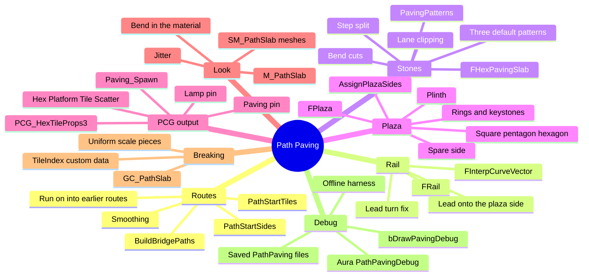

↑ [[Redo3 Changes Index]]

# Path Paving

AuraRedo3 · redo3 · 5ccdfef..5ccdfef · 2026-11-15 to 2026-11-15

Every bridge that lands on a hex platform starts a path of tiles to the platform's centre. Path paving lays stone slabs along those paths and, where the paths meet in the middle, a paved polygon plaza with a lamp point at its centre. `AMyHexPlatform::BuildPathPaving` runs a smoothed spline through each path's tiles, cuts it where it bends, lays copies of three 4 x 4 stone patterns along it and records one `FHexPavingSlab` per stone on the tile under it. The Hex Platform Tile Scatter PCG node turns the stones into points, `PCG_HexTileProps3` spawns the `SM_PathSlab` meshes, and every stone breaks into a `GC_PathSlab` Geometry Collection when its tile collapses.

Talal asked for it on 2026-10-25: take the bridge-path point locations that `BuildBridgePaths` produces, make a spline of them, subdivide it where it bends, copy stones along it in three pattern variations, and have each stone destroyed or broken into a GC with the tile it lands on. On 2026-10-29 he added that the paths should meet in a square, pentagon or hexagon plaza depending on how many paths arrive, with a lamp in the middle ("can put a cube for now").

State now (origin/redo3): the whole feature shipped in one commit, `5ccdfef`. The date on that commit is not when the work was done. The "Pave bridge paths with stone patterns" thread built it between 2026-10-25 and 2026-10-30 as four patch rounds applied to Talal's working copy, and the "Push local changes to GitHub" thread committed it on 2026-11-15 with the rest of his local work. The paving code has not changed since. It runs on every machine from replicated bridge start tiles, so server and clients lay the same stones without sending them. The lamp is still a placeholder.

## Mind map



## How it works

```mermaid
flowchart TD
  REG["Server: RegisterPathBridge for each bridge that ends on the platform"] --> UPD["UpdatePathStartTiles: PathStartTiles and PathStartSides"]
  UPD -- "replicated, OnRep_PathStartTiles" --> SCH["ScheduleTileProps: PropsBridgeWait 3 s after BeginPlay, PropsRegenerateDelay 0.5 s after a change"]
  SCH --> RB["RebuildPathAndTileProps, skipped once AreTilePropsFrozen"]
  RB --> BBP["BuildBridgePaths: walk each start tile to the centre, record Routes"]
  subgraph PAVE["BuildPathPaving, on every machine"]
    PTS["Route points: bridge side, tile centres, run-on, smoothing"] --> PLZ["Plan the plaza: sides, size, spare side"]
    PLZ --> RAIL["BuildRail: spline, lead onto the plaza side, sampled"]
    RAIL --> CUT["Bend cuts and pattern copies"]
    CUT --> CLIP["Lane clipping against the plaza and earlier routes"]
    CLIP --> STEP["Step split"]
    STEP --> LAY["Lay stones over each lane's stretch, bent: AddSlab"]
    LAY --> RING["Plaza rings, keystones and plinth"]
  end
  BBP --> PTS
  RING --> WPC["WritePathCustomData: path word in pillar custom data 4"]
  WPC --> GTP["GenerateTileProps: TilePropsPCG and HexTileProps2"]
  GTP --> NODE["Hex Platform Tile Scatter: Paving and Lamp pins"]
  NODE --> SPAWN["PCG_HexTileProps3: Paving_Spawn ISMs and the lamp cube"]
  SPAWN --> OTP["OnTilePropsGenerated: TileIndex to ISM map"]
  OTP --> BRK["Tile collapses: BreakTileProps, GC_PathSlab pieces"]
```



1. On the server, each bridge that ends on the platform calls `RegisterPathBridge`, which runs `UpdatePathStartTiles`. Every bridge end tile becomes an entry in `PathStartTiles` (sorted by `TileIndex`), and `GetPathStartSide` stores the hex side its bridge leaves through in `PathStartSides` (255 = unknown). Both replicate with `OnRep_PathStartTiles`.
2. `ScheduleTileProps` waits `PropsBridgeWait` (3 s) after `BeginPlay` and `PropsRegenerateDelay` (0.5 s) after a change of start tiles, never bringing a pending run forward. `RebuildPathAndTileProps` then runs `BuildBridgePaths`, `WritePathCustomData` and `GenerateTileProps`, unless `AreTilePropsFrozen()` (props already generated and the path frozen or a tile already fallen).
3. `BuildBridgePaths` walks from each start tile to the centre tile and records each walk as a route. A walk stops where it reaches a tile an earlier walk laid. When `bPaveBridgePaths` (true) is set, it passes the routes to `BuildPathPaving`.
4. `BuildPathPaving` turns each route into points (out at the bridge side, the tile centres, a run-on into a joined route) and smooths out the hex zigzag ([[#Bridge routes]]).
5. If `bPavePlaza` (true), it plans a regular polygon around the centre tile and gives each route into the centre its own side ([[#The plaza]]).
6. For each route, `BuildRail` fits a spline through the points (onto a straight lead square to its plaza side when it has one) and samples it into an `FRail` ([[#The rail]]).
7. The rail is cut into cells, the cells into pattern copies and smaller pieces where it bends, and each copy picks one of the `PavingPatterns` ([[#Cells, patterns and bend cuts]]).
8. Each lane is cut short where it runs into the plaza or an earlier route's strip ([[#Lane clipping]]). Stones over a step in the tile tops are halved, and the rest are laid over their own lane's stretch of the curve, bent to fit ([[#Steps and bends]]).
9. The plaza's own stones go down last: rings of one-cell courses from the outside in, then a plinth in the middle. `PathPlaza` records the result.
10. Every stone lands on the tile under its centre, and that tile joins the path set, so no other props spawn on it. `WritePathCustomData` then writes each pillar's distance and direction to the path into its custom data 4.
11. `GenerateTileProps` runs the platform's prop PCG components. The Hex Platform Tile Scatter node's Paving pin gives one point per stone on a standing tile and its Lamp pin one point at the plaza centre. `PCG_HexTileProps3` spawns them, and `OnTilePropsGenerated` maps every instance's `TileIndex` custom data to its ISM.
12. When the tile collapses, `BreakTileProps` removes its stones and, near the local player, spawns their `GC_PathSlab_*` pieces ([[#Breaking]]).

## Bridge routes

- **Start tiles.** `PathStartTiles` is server owned and sorted by `TileIndex`. Since `5ccdfef`, `UpdatePathStartTiles` also fills `PathStartSides`: the first bridge found on a tile gives its side, and a removed bridge's tile kept in `RetainedPathStarts` (now a `TMap<FIntVector, uint8>`) keeps the side it already had, so nothing changes. `GetPathStartSide` picks the hex side whose direction points most towards the bridge end, in actor space. The property itself was declared and replicated by `b5ff0ef`, from the same batch.
- **Walks.** `BuildBridgePaths` works on `PathLayoutTiles`, the tile tops as the grid was built (before late-join removals), so every machine, late joiners too, lays the same path. Each walk steps down the hex distance to the centre, keeping close to the straight line. The tiles of each walk, in order, are one entry of `Routes`.
- **Route points.** The first point sits out towards the bridge, `PavingEdgeReach` (0.92) of the tile apothem past the start tile's centre, in the direction of `PathStartSides`. When the side is unknown (255, or before `PathStartSides` reaches a client), it uses the start tile's open side that faces most directly away from the centre (near ties go to the lower side on every machine). Then come the tile centres.
- **Run-on.** A route that ended on an earlier route's tile gets one more point, `HalfWidth + CellSize` further on, so its lanes can end flush against the earlier strip.
- **Smoothing.** `PavingSmoothing` (10) passes move each inner point halfway towards the middle of its neighbours, but never more than `PavingSmoothMaxOffset` (0.75) of the tile apothem from its tile centre. Both ends stay.

## The rail

- `BuildRail` puts the points in an `FInterpCurveVector` with `CIM_CurveAuto` and `AutoSetTangents`. A route with a plaza side gets two more points, the start of a straight lead `PavingPlazaLead` (1.5) cells out from the side and the side itself, with `CIM_CurveBreak` from the turn on and tangents scaled to each segment, so the turn onto the lead is one smooth curve. The route meets the side where its own heading would hit it, within the room the side has, so there is no sideways S-bend.
- The curve is sampled at 24 points per segment into an `FRail` (in the `HexPaving` namespace): points, distances and headings, with bounding boxes for chunks of 16 segments. `Eval` and `At(S, Offset)` give a point along the rail and to its side, `Turning` the heading change over a stretch, `TightestRadius` the smallest turn radius, and `InCorridor` whether a point lies within half a path width of the rail (with flat end caps).
- **Lead turn fix.** A turn onto the lead tighter than half the path's width folds the inner lanes. So while the tightest radius over the last `Lead + (PavingPlazaTurn + 2)` cells is under 1.5 times the half width, the route's last own point is dropped (the turn starts one point earlier) and the rail rebuilt, keeping at least two of the route's own points. Once the radius is at least the half width, it stops if the shorter rail would fold further back, at the bridge.
- Sizes: `GetPavingCellSize()` is `PavingCellSize` (40) times `HexRadius / 100`, and the path is `PavingCellsAcross` (4) cells wide. At HexRadius 100 that is a 160 cm path.

## Cells, patterns and bend cuts

`FHexPavingPattern` is a list of `FHexPavingPatternSlab {Cell, Size}` in cells: X along the path, Y across it from its left edge. One copy covers `PavingPatternLength` (4) cells along and `PavingCellsAcross` (4) across. Stones outside the copy's cells are clipped, and a stone over cells already taken is skipped. The constructor builds three defaults, "after the stone path reference". Rows below are lanes across the path, columns cells along it, and each letter is one stone:

```
Pattern 0          Pattern 1          Pattern 2
A A B B            A A F G            A A D D
A A C D            B C H G            B B D D
F H E D            B D I I            B B E E
G H I I            E E I I            C C F G
```

| Pattern | 2x2 | 2x1 along | 1x2 across | 1x1 | Stones |
|---|---|---|---|---|---|
| 0 | 1 | 2 | 2 | 4 | 9 |
| 1 | 1 | 2 | 2 | 4 | 9 |
| 2 | 2 | 3 | 0 | 2 | 7 |

The code comment says "one big 2x2 stone each", but the third default has two.

- **Cells.** The rail's length is split into `NumCells = round(Length / CellSize)` equal cells, so cells are a little longer or shorter than `CellSize`.
- **Bend cuts.** Walking along the cells, each piece is as long as the rest of the current pattern copy and is halved (4, 2, 1 cells) until the rail turns no more than `PavingMaxBend` (14 degrees) over it. Straight runs keep whole copies; bends get 2-cell and 1-cell pieces.
- **Copies.** `RouteSeed = Hash(TileIndex of the start tile, route index)`, and each copy's `CopySeed = Hash(RouteSeed, copy)` picks the pattern (`CopySeed % NumPatterns`) and whether to mirror it across the path (bit 8). A stone that crosses a cut is split there, so the stones follow the bend.
- Working stones are `FStone {S0, S1, V, H, Pattern}`: centimetres along the rail and lanes `V` to `V + H - 1`.

## Lane clipping

Each lane ends where its edges first run into the plaza or into the strip of an earlier route (`InCorridor` of an earlier rail):

- The edges are tested `EdgeInset` (0.0375 cell) in from the stones' sides, in steps of `ClipStep` (an eighth of a cell), then narrowed down by bisection (8 steps).
- The end is halfway between where the two edges enter, at most half a cell past the first, so a slanted meeting leaves as much overlap as gap at the corners.
- A lane that starts inside an earlier strip (a route that leaves right beside another) starts where it comes out, if it then runs clear for a cell; otherwise it is left out.
- Stones are trimmed to their lane's piece between start and end, and a piece shorter than `MinPiece` (0.35 cell) is dropped.
- Debug draws each lane end as a magenta line.

## Steps and bends

- **Steps.** A stone is level when every cell (and its centre) is over a tile and the tile tops under it differ by no more than `PavingStepSplitHeight` (4 cm). Anything else is halved, along the path on whole cells or across it, whichever leaves more halves level, until each piece is level or a single cell.
- **Lane stretches.** Each stone spans its own lane's stretch of the curve, from where its lane crosses its start to where it crosses its end, so on a bend the outer lanes get longer stones and the joints still meet. A stretch at least 1.5 times as long as the stone is laid as that many stones, split evenly along the lane's own curve.
- **Dropped stones.** A stone squeezed to under `MinSqueeze` (0.35) of its length, or folded back against the rail's heading, is left out.
- **Bend.** Each stone gets the lane's curvature over its stretch, `2 sin(dHeading / 2) / chord`, held to `1.6 / (H x CellSize)` (H = the stone's lanes across) so the stone's inner side keeps a fifth of its length. Its pivot moves off the chord's middle by the sagitta `Curvature x Chord^2 / 8`, so the bent stone's ends land on the lane. Plaza stones are not bent.
- **AddSlab.** The stone lands on, and breaks with, the tile under its centre; with no tile there (a notch in the outline) there is no stone. It stores the long side as X (turning `Bend` into its Y component when the stone is turned a quarter), `Scale` as the stretch over whole cells, plus `Tile`, `TileIndex`, `Pattern` and a `Seed`. The tile lookup, `TileAt`, is moved 0.01 cm along X so a point exactly on a hex edge or corner resolves to the same tile on every machine.

| `FHexPavingSlab` field | What it holds |
|---|---|
| `Location` | Stone centre, on the tile top, actor space |
| `Yaw` | Along the stone's long side, degrees |
| `Size` | Whole cells, long side first |
| `Scale` | `FVector2D`: how much longer or shorter than whole cells (bends, plaza courses, trimmed lane ends) |
| `Bend` | `FVector2D`, 1/cm: the curvature the material bends the stone with |
| `Tile`, `TileIndex` | The tile under the centre, which the stone breaks with |
| `Pattern`, `Seed` | Pattern index and the stone's own seed for the PCG jitter |

## The plaza

The routes that reach the centre tile end square on their own side of a regular polygon around it, a square for up to `PavingPlazaMinSides` (4) routes, turned so they bend least into it.

- **Which routes.** Routes ending on the centre tile, plus routes that ran into one of them within `JoinReach` of the centre (the plaza's rough apothem, the lead, `PavingPlazaTurn` (3) cells and two tile apothems). Those get a side of their own instead of joining. There is no plaza when no route reaches the centre or a bridge starts on the centre tile.
- **Sides.** `NumSides = max(clamp(PavingPlazaMinSides, 4, 8), routes) + spare sides`. Each route is cut back to its last point outside the turning zone (the plaza's apothem plus the lead and turn room), and a joiner further back until it is a path width and a bit clear of the route it ran into. That point's angle from the centre picks its side: `AssignPlazaSides` tries every order-keeping assignment of routes to sides and turns the polygon to their circular mean, keeping the one that bends them least.
- **Size.** The side is at least `MinSide = max(PavingPlazaSideCells (6) x CellSize, path width + a cell)`, and on bigger platforms the polygon's apothem grows to `PavingPlazaSizeRatio` (0.15) of the distance to the nearest bridge tile. It shrinks in half-cell steps while its circumradius reaches closer than 1.2 tile apothems to the nearest bridge tile, or (above `MinSide`) while any of 24 points on its circumcircle is off the tiles. It goes below `MinSide` only to keep clear of a bridge tile, and never below the path width plus a cell; if even that does not fit, the plan is invalid.
- **Merging back.** While the plaza does not fit, or a route comes at its side more than 75 degrees off square (`MaxSideAngle`; a route cut back to two points counts 5 times over, `ShortRouteAngleScale`), the joiner whose merging helps most loses its own side and runs into its route again. If none helps, all joiners do.
- **Spare side.** When every side is taken, there are fewer than 8 sides and the worst route is between 40 degrees (`SpareSideAngle`) and 75 degrees off square, a plaza with one more side is tried. It is kept if it turns the worst route in by more than 10 degrees less (`SpareSideGain`). So routes bunched on one side no longer swing round to reach a far side.
- **Stones.** Rings of one-cell-deep courses along the sides, from the outside in, `round((Apothem - CellSize) / CellSize)` rings, leaving an inner polygon of half a cell to a cell and a half. A square's courses each own the corner cell at their start (a pinwheel), so every stone is whole. Other polygons' courses stop at the mitre, stretched to fill their side, and each corner kite gets a small diamond keystone.
- **Plinth.** The biggest square that fits the inner polygon, turned with side 0. A square plaza's fills it; on other polygons it is at most 2 x 2 cells.
- **Result.** `PathPlaza` (`FHexPathPlaza`): `bValid`, `Centre` (on the centre tile's top), `Yaw` (out through side 0), `NumSides`, `SideLength`, `Tile` and `TileIndex`, read with `GetPathPlaza()`.

![[redo3_plaza_preview.jpg]]

The offline preview of the square, pentagon and hexagon plaza layouts (`plaza_preview.png`, 2026-10-29).

## Settings

All in "Hex Platform|Paving" on `AMyHexPlatform`. `PavingCellSize` is for HexRadius 100 and scales with it; `PavingStepSplitHeight` does not.

| Setting | Default | What it does |
|---|---|---|
| `bPaveBridgePaths` | true | Pave the bridge paths (needs `bBuildBridgePaths`) |
| `PavingCellSize` | 40 | Side of one pattern cell |
| `PavingCellsAcross` | 4 | Path width in cells |
| `PavingPatternLength` | 4 | Cells along one pattern copy |
| `PavingPatterns` | three 4 x 4 patterns | The copies laid along the path |
| `PavingMaxBend` | 14 | Most the spline may turn inside one piece (degrees) |
| `PavingSmoothing` | 10 | Smoothing passes over the tile centres |
| `PavingSmoothMaxOffset` | 0.75 | How far smoothing may move a point (fraction of the apothem) |
| `PavingEdgeReach` | 0.92 | How far past the bridge tile's centre the paving runs (fraction of the apothem) |
| `PavingStepSplitHeight` | 4 | Height difference (cm) over which a stone is halved |
| `bPavePlaza` | true | Meet in a plaza at the centre |
| `PavingPlazaSideCells` | 6 | Smallest side in cells before the size ratio grows it |
| `PavingPlazaSizeRatio` | 0.15 | Plaza apothem as a fraction of the distance to the nearest bridge tile (0 to 0.6) |
| `PavingPlazaMinSides` | 4 | Fewest sides (4 to 8) |
| `PavingPlazaLead` | 1.5 | Cells of straight path square onto the side |
| `PavingPlazaTurn` | 3 | Cells a path gets to turn onto the lead |
| `bDrawPavingDebug` | false | Draw the paving for 30 s after it is laid |

## PCG output and meshes

The Hex Platform Tile Scatter node (`UPCGHexPlatformTilesSettings`, see [[Redo3 Hex Platform PCG#The custom node: Hex Platform Tile Scatter]]) gained two output pins in `5ccdfef`:

- **Paving:** one point per stone whose tile still stands. The transform is the stone's, with a random yaw of `PavingYawJitter` (1.5 degrees), tilt `PavingTiltJitter` (0.6 degrees) and height offset `PavingZOffset` (-2) plus `PavingHeightJitter` (0.6), from a stream seeded by the stone. Scale is `GetPavingCellSize() / PavingMeshCellSize` (40) times the stone's own XY `Scale`; the height is not stretched.
- Paving attributes: `TileIndex`, `EdgeDepth`, `IsEdge`, `PathDistance`, `SlabShape` (0 = 1x1, 1 = 2x1, 2 = 2x2, 3 = other), `SlabSize` (cm), `PavingPattern`, `Mesh` (a soft path picked from `SmallSlabMeshes`, `LongSlabMeshes` or `BigSlabMeshes`, for a Static Mesh Spawner "By Attribute"), and `SlabBendX` / `SlabBendY` (the bend in 1/cm, divided by the actor's X scale for world space).
- **Lamp:** one point at the plaza centre while the centre tile stands, X out through side 0, scaled by `LampScale` (1, 1, 1) and lifted `LampZOffset` (0), both times `HexRadius / 100`, bounds `LampExtent` (50). Attributes `TileIndex`, `PlazaSides`, `PlazaSideLength`.
- **In `PCG_HexTileProps3`** (binary; from the thread): a `Paving_Spawn` Static Mesh Spawner spawns the slabs and packs per-instance custom data 0 to 2 as `TileIndex`, `SlabBendX` and `SlabBendY`. The lamp point spawns `/Engine/BasicShapes/Cube` with `LampScale` (0.3, 0.3, 1.8) and `LampZOffset` 90. The commit message calls it "a plaza torch"; the thread's last state is the cube.
- **Meshes** (from the thread): `SM_PathSlab_1x1`, `SM_PathSlab_2x1` and `SM_PathSlab_2x2` are 37 x 37, 77 x 37 and 77 x 77 cm on a 40 cm grid with 3 cm joints, made from FrozenNorse `SM_Tile_08`, `SM_Tile_06` and `SM_Tile_01`, with stitched 1024 textures `T_PathSlab_BC` and `T_PathSlab_N`.
- **Material:** `M_PathSlab` (instance `MI_PathSlab`) bends each slab with World Position Offset. Its Custom node takes `LP`, `AX`, `AY`, `BendX` and `BendY` (PerInstanceCustomData 1 and 2) and bends the slab into a keystone shape of up to about 15 cm, with Max World Position Offset Displacement 40.

![[redo3_paving_layout_preview.jpg]]

The first offline layout preview of the stones along a bridge path (`paving_layout_preview.png`, 2026-10-25).

## Breaking

- Every stone's `TileIndex` is its custom data 0, so `OnTilePropsGenerated` files its ISM under that tile in `TilePropISMs` like any other tile prop ([[Redo3 Hex Tile Props]]).
- When the tile collapses, `BreakTileProps` removes its stones and, near the local player, spawns the Geometry Collection that `PropBreakables` maps the mesh to. `BP_MyHexPlatform` maps the slabs to `GC_PathSlab_1x1`, `GC_PathSlab_2x1` and `GC_PathSlab_2x2` (saved in `7b295de`, same batch).
- New in `5ccdfef`: broken pieces tumble inside the actor's scale, so a stretched stone's pieces would shear. `BreakTileProps` now gives the GC a uniform scale with the same volume (the cube root of X x Y x Z).
- Stones on tiles that fell before a client got the platform are never spawned: the Paving pin only emits stones on tiles still in `TileInfos`, and the Lamp pin only while the centre tile stands.

## Determinism and multiplayer

- Nothing about the stones replicates. Every machine computes them locally from replicated values: `PathStartTiles`, `PathStartSides` and the grid shape.
- The layout uses `PathLayoutTiles` (the grid as built), not the live tiles. Results only go to tiles still standing.
- Every choice in `BuildPathPaving` comes from `HexPaving::Hash` of tile indices and counters. The PCG jitter uses a stream seeded per stone. Near ties go to the lower side, and `TileAt` avoids edge rounding.
- Both properties use `OnRep_PathStartTiles`, so if the sides reach a client after the tiles, the paving it laid with the open-side fallback is laid again (unless props are already frozen).
- Once props have generated and the path is frozen (`bPathFrozen`, when the lead lands or collapsing starts) or a tile has fallen, the paving is not laid again.
- In the thread's PIE test on Talal's PC, 25 of 47 platforms got a plaza and all 5,339 stones matched the offline harness's layouts.

## Debug

- `bDrawPavingDebug` on a platform, or the console variable `Aura.PathPavingDebug` 1 (`ECVF_Cheat`) for every platform, draws for 30 s when the paving is next laid: the rail in red, bend cuts in cyan, lane ends in magenta, stones in orange and the plaza outline in yellow.
- `Aura.PathPavingDebug` 2 also writes each platform's paving input to `Saved/PathPaving/<map>_<Client|Server>_<actor>.txt` (not in shipping builds): `TILES`, `CENTRE`, `STARTS` with their sides, `ROUTES`, `PLAZA`, the `PARAM` values and each `PATTERN`, "in the paving test harness's format".
- A Verbose log line gives the stone count, route count and plaza sides per platform.
- The thread checked each round against an off-engine C++ harness that reads that format.

## Also in this commit

- **Path word for the snow.** `WritePathCustomData`, run after `BuildBridgePaths`, writes pillar custom data 4 with `PackHexPathWord`: bits 0 to 3 the rings from the bridge path (15 = none or far), bits 4 to 11 a pillar-local angle (`PackHexAngle`) along the path on path tiles and towards the nearest path tile elsewhere. The header also declares `MaxEdgeRing` for the snow; the edge-ring writes in `BuildHexGrid` came later, in `fa0ee5e`. See [[Redo3 Hex Look and Atmosphere]].
- **Atmosphere.** The constructor now creates `AtmospherePCG` (Generate On Demand, not replicated), and `GenerateTileProps` calls `UpdateTileFootprint` and `GenerateAtmosphere` before the props, even when `bSpawnTileProps` is off.

## How it changed

- **2026-10-25** Round 1, "Path Paving Patch", a diff against `8d98fd7` applied hunk by hunk on Talal's PC: `BuildBridgePaths` records routes, and `BuildPathPaving` fits a smoothed spline through each route, cuts it by bending, lays the three patterns and halves stones over a step. It added `FHexPavingPatternSlab`, `FHexPavingPattern`, `FHexPavingSlab`, the `HexPaving` namespace with `FRail`, the first paving settings, the Paving pin with its jitter settings and the debug draw.
- **2026-10-25 to 10-30**: alongside the patches, the thread made the slab meshes, textures, `M_PathSlab` and `GC_PathSlab_*` in the editor on Talal's PC and added `Paving_Spawn` to `PCG_HexTileProps3` (the digest does not say which round each came in, apart from the bend, which is round 3).
- **2026-10-25 to 10-26**: Talal paused the work for the ice-look thread, then on 2026-10-26 said "stop for now".
- **2026-10-29** Round 2, "Plaza Paving Patch" (4 files, 1177 lines added, 207 removed): the plaza (`FPlaza`, `AssignPlazaSides`, rings, keystones, plinth, `FHexPathPlaza`, the Lamp pin), the plaza settings, real bridge sides through `PathStartSides` and `GetPathStartSide`, lane clipping with `InCorridor`, `FStone` in place of `FCellRect`, lane stretches on bends, `TileAt` and the yellow plaza outline.
- **2026-10-29**: the first plaza test showed only square plazas, wedge gaps on bends and small plazas on big platforms. Talal: "Yes, fix".
- **2026-10-30** Round 3, "Paving Round 3 Patch" (425 added, 42 removed): stones bend (`FHexPavingSlab::Bend`, `SlabBendX` / `SlabBendY` and the WPO Custom node), the plaza grows with the platform (`PavingPlazaSizeRatio` 0.15 and the 24-point `OverTiles` check), routes that joined another near the plaza get a side of their own (`FPlazaPlan`, merged back past 75 degrees), pentagon and hexagon plazas, `Aura.PathPavingDebug`, and the lead turn fix. The thread's harness numbers for the fix: tight turns down from 214 to 23 of 728, folded stones from 70 to 0, stones stretched over 1.5 times from 363 to 1, enclosed gaps from 1,514 to 302.
- **2026-10-30** Round 4, "Paving Round 4 Patch" (`MyHexPlatform.cpp` only, 21 added, 3 removed): the spare plaza side, Talal's pick for bunched paths. Sharp swings went from 157 to 6 of 5,000 harness layouts, and memory and undefined-behaviour checks were clean on 5,354 layouts. The PIE test at 13:27 built cleanly in 85 s, all 47 platforms matched the offline layouts, and 4 plazas took a spare side (`BP_MyHexPlatform_C_2`, `C_7`, `BP_MyHexPlatformBottom_C_3` as a hexagon and `C_24` as a pentagon).
- **2026-10-30**: two things were left as they were. Stones that look skewed on tight bends were judged not a bug (keystone taper plus the 1.5 degree yaw jitter), and keeping big stones off tight bends was offered and not taken up.
- **2026-11-15** `5ccdfef` "Pave hex bridge paths with stone slabs and a centre plaza": the four rounds as one commit, with the slab meshes, material, textures, GCs and the updated `PCG_HexTileProps3`. It was made by the push thread on its branch `claude/project-thread-weyt5l` and reached redo3 from there. In the same batch, `b5ff0ef` declared and replicated `PathStartSides` and `7b295de` saved `BP_MyHexPlatform` with the slab GCs.

## Threads that worked on it

- [[Redo3 Threads#Pave bridge paths with stone patterns|Pave bridge paths with stone patterns]]: designed and wrote the paving and the plaza in four patch rounds, made the slab meshes, material and GCs, and tested each round offline and in PIE on Talal's PC.
- [[Redo3 Threads#Push local changes to GitHub|Push local changes to GitHub]]: committed the paving from Talal's working copy as `5ccdfef` on 2026-11-15.

## Artifacts and files

- [[Redo3 Artifact - Path Paving Patch]]: the round 1 diff against `8d98fd7` (routes, spline, patterns, Paving pin).
- [[Redo3 Artifact - Plaza Paving Patch]]: the round 2 patch with the plaza, the Lamp pin, bridge sides and lane clipping.
- [[Redo3 Artifact - Paving Round 3 Patch]]: the round 3 patch and the HLSL of the WPO Custom node that bends the stones.
- [[Redo3 Artifact - Paving Round 4 Patch]]: the one-file spare-side patch.
- [[Redo3 Artifact - Bridge Path Paving in-game shots]]: in-game captures of the paved paths from the thread.
- [[Redo3 Files - Path Paving]]: the two previews on this page, `paving_workbench.tar.gz` (2026-10-29) and `spare_side_compare.png`, a before and after of the spare side.

## Where it lives

| What | Path |
|---|---|
| Structs, settings, getters | `Source/Aura/Public/Actors/MyHexPlatform.h` (`FHexPavingPatternSlab`, `FHexPavingPattern`, `FHexPavingSlab`, `FHexPathPlaza`, "Hex Platform\|Paving", `GetPavingSlabs`, `GetPathPlaza`, `GetPavingCellSize`, `PathStartSides`) |
| Paving code | `Source/Aura/Private/Actors/MyHexPlatform.cpp` (`UpdatePathStartTiles`, `GetPathStartSide`, `RebuildPathAndTileProps`, `WritePathCustomData`, `BuildBridgePaths`, `HexPaving`, `BuildPathPaving`, `BreakTileProps`) |
| PCG node | `Source/Aura/Public/PCG/PCGHexPlatformTiles.h`, `Source/Aura/Private/PCG/PCGHexPlatformTiles.cpp` (Paving and Lamp pins) |
| Prop graph | `/Game/Assets/MyPlatform/PCGs/PCG_HexTileProps3` (`Paving_Spawn`, lamp) |
| Slab meshes | `/Game/Assets/MyPlatform/Props/SMs/SM_PathSlab_1x1`, `SM_PathSlab_2x1`, `SM_PathSlab_2x2` |
| Material | `/Game/Assets/MyPlatform/Props/Mats/M_PathSlab`, `MI_PathSlab` |
| Textures | `/Game/Assets/MyPlatform/Props/Textures/T_PathSlab_BC`, `T_PathSlab_N` |
| Geometry Collections | `/Game/Assets/MyPlatform/Props/GCs/GC_PathSlab_1x1`, `GC_PathSlab_2x1`, `GC_PathSlab_2x2` |
| Break mapping | `/Game/Assets/MyPlatform/BP_MyHexPlatform` (`PropBreakables`) |
| Debug | Console variable `Aura.PathPavingDebug`; files in `Saved/PathPaving/` |

## Open items

- On `BP_MyHexPlatform_C_7` and `C_2` the paths bow out before they reach their plaza side.
- Hexagon plazas look busy, with small stones and uneven gaps round the lamp. The thread proposed a clean-ring layout for them that was not built.
- The lamp is still the engine cube.
- The "Paving Layouts" and "Paving Layouts Round 4" pages were announced in the thread but never published.
- Keeping big stones off tight bends was offered and not taken up.
- Sleep was left blocked on Talal's PC when the thread stopped.

## Related

- [[Redo3 Hex Bridges]]: the bridges whose ends become the path start tiles.
- [[Redo3 Hex Tile Props]]: the bridge paths, the other tile props and the tile-to-ISM map the stones share.
- [[Redo3 Hex Platform PCG]]: the Hex Platform Tile Scatter node and the graphs that run on each platform.
- [[Redo3 Hex Path and Ranking]]: `HexRadius`, which scales the cells.
- [[Redo3 Hex Pillars and Breaking]]: how tiles collapse and break.
- [[Redo3 Hex Look and Atmosphere]]: the path snow that reads pillar custom data 4, and the atmosphere graphs.
- [[Redo3 Timeline]], [[Redo3 Branches and PRs]], [[Redo3 Threads]], [[Redo3 Artifacts Index]].
- Talal's notes: [[StoneBridge]] (his stone bridge reference images, 2026-10-13) and [[PlatformRefs]] (platform and prop layout reference images).

[[Redo3 Hex Bridges]] ← → [[Redo3 Hex Tile Props]]
