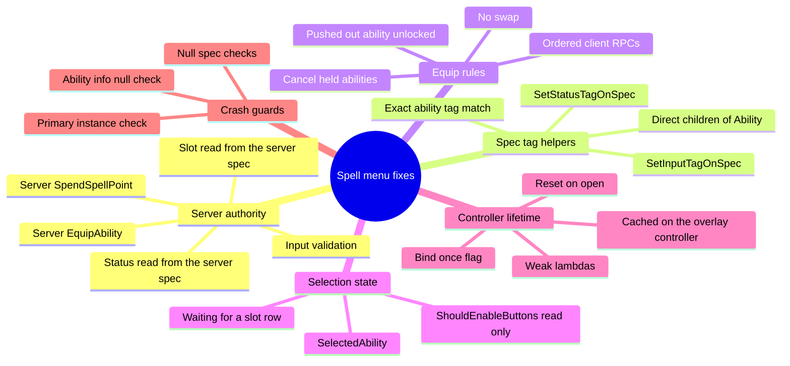
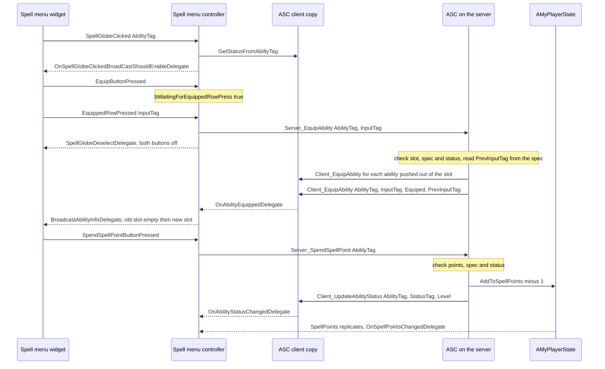
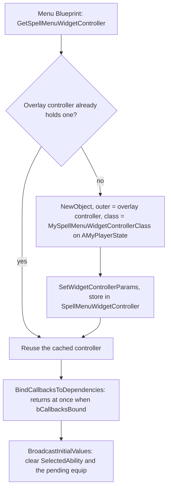

↑ [[Redo3 Changes Index]]

# Spell Menu Fixes

AuraRedo3 · redo3 · aaaf14b..45f0aa8 · 2026-10-03 to 2026-10-03

The spell menu is where a player spends spell points to unlock or level up an ability and equips an unlocked ability into an input slot (an `Input.*` tag such as `Input.LMB` or `Input.Shift`). The menu widget only talks to `UMySpellMenuWidgetController` on the owning client. The controller sends server RPCs through `UMyAbilitySystemComponent`, and hears the results back through client RPCs, ability spec replication and the replicated `SpellPoints` on `AMyPlayerState`.

Four commits on 2026-10-03, made between about 17:48 and 18:07, about two hours after the baseline commit "before start using claude." (`fc9a077`, 15:46), fixed the whole path. They were made in Claude sessions that ran before this project's threads existed (each commit carries a Claude co-author line), and the later threads only describe them. Before the fixes an ability could end up bound to two keys, a Locked ability crashed the server, the Equip button switched itself back on, a closed menu's controller crashed the next equip, and a bad request still cost a spell point. Now the client only says which ability and which slot; the server reads the current slot and status from its own spec, validates everything, and only then changes the spec or takes a point.

Talal's own notes on this work are [[SpellMenuFixWithClaude]] (the commit split) and [[Aura Spell Menu Flow]] (four flow diagrams of the menu). This page summarises them and records what each commit changed in the code. None of the touched files changed again on redo3 up to `68dd9e7`, so what is described here is the current state.

## Mind map

## How it works

1. **Opening.** The menu Blueprint gets its controller from `UMyBPFuncLib::GetSpellMenuWidgetController`. Since `a63041a` the controller is created once, stored on `UMyOverlayWidgetController::SpellMenuWidgetController` and reused. `BindCallbacksToDependencies` binds only the first time (`bCallbacksBound`), and `BroadcastInitialValues` starts every open with `SelectedAbility = FSelectedAbility()` and `bWaitingForEquippedRowPress = false`, then broadcasts the ability infos (if `bAbilitiesGiven`), both buttons off and the current spell points.
2. **Selecting a globe.** `SpellGlobeClicked(AbilityTag)` is the only function that sets the selection (`76625c2`). It cancels a pending equip, reads the status with `GetStatusFromAbiltyTag` (no spec on the client means `Ability.Status.Locked`), stores tag and status in `SelectedAbility`, and broadcasts the button state from `ShouldEnableButtons`: Spend is on for Eligible, Unlocked or Equiped with more than 0 spell points, Equip is on for Unlocked or Equiped.
3. **Equip, client side.** `EquipButtonPressed` arms the equip only for an Unlocked or Equiped selection. The next `EquippedRowPressed(InputTag)` sends `Server_EquipAbility(AbilityTag, InputTag)`, deselects the globe, clears the selection and turns both buttons off. The client no longer sends the slot the ability is in now (`aaaf14b`).
4. **Equip, server side.** `Server_EquipAbility` rejects a slot that is not an `Input.*` tag or is `Input.None`, an ability with no spec, and a status other than Unlocked or Equiped. It reads `PrevInputTag` from its own spec. If the ability is not already in the target slot, every other ability in that slot is cancelled if active, set to `Input.None` and `Ability.Status.Unlocked`, marked dirty and announced with its own `Client_EquipAbility`, and then the ability itself is cancelled if active and moved to the slot. In every case it is then set to `Ability.Status.Equiped`, marked dirty, and announced last.
5. **Equip, client result.** `Client_EquipAbility` broadcasts `OnAbilityEquippedDelegate`. Both the spell menu controller and the overlay controller (the HUD spell slots) listen. If `PrevInputTag` is valid and not `Input.None`, they first broadcast an empty `FAbilityInfo` for the old slot, then the ability's info with the new slot and status. Reliable RPCs to one actor arrive in order, so the cleared slot is drawn before it is refilled.
6. **Spending a point.** `SpendSpellPointButtonPressed` still pre-checks on the client (not `Ability.None`, not Locked, points above 0) and sends `Server_SpendSpellPoint(AbilityTag)`. The server checks the points through `IMyPlayerInterface::Execute_GetSpellPoints`, the spec and its own status, levels up or unlocks, and only then calls `Execute_AddToSpellPoints(-1)` and `Client_UpdateAbilityStatus` (`45f0aa8`).
7. **Spend result.** `OnAbilityStatusChangedDelegate` updates the buttons only when the change is for the selected ability, and keeps `SelectedAbility.StatusTag` in step. The new point count arrives separately: `SpellPoints` is replicated with `REPNOTIFY_Always`, and `OnRep_SpellPoints` broadcasts `OnSpellPointsChangedDelegate`, which the controller forwards to the widget and uses to recompute the buttons.

## Server-authoritative equipping

Commit `aaaf14b`. The old `Server_EquipAbility(AbilityTag, NewInputTag, CurrentInputTag)` trusted the client for the slot the ability was in. The client read that from its own copy of the spec, which was often stale: the `Client_EquipAbility` RPC usually arrives before the spec change replicates. The server then removed the wrong tag and kept the real one, so the ability sat on two slots and fired from both keys. A Locked ability has no spec on the server, so equipping one dereferenced null and crashed the server.

What `Server_EquipAbility(AbilityTag, NewInputTag)` does now (`UFUNCTION(Server, Reliable)` on `UMyAbilitySystemComponent`):

| Step | Code | Why |
|---|---|---|
| Reject bad slots | `NewInputTag` must match the parent of `MyTags::Input_None` ("Input") and must not be `Input.None` | A client can only ask for a real slot |
| Reject missing specs | `GetAbilitySpecFromTag(AbilityTag)` must return a spec | Locked abilities have none; this was the server crash |
| Reject wrong status | Status must be `Ability.Status.Unlocked` or `Ability.Status.Equiped` | Eligible and Locked abilities cannot be equipped |
| Read the current slot | `PrevInputTag = GetInputTagFromSpec(*GASpec)` | Server spec is the source of truth |
| Clear the target slot | For each other spec with `NewInputTag`: cancel if active, `SetInputTagOnSpec(Input.None)`, `SetStatusTagOnSpec(Unlocked)`, `MarkAbilitySpecDirty`, `Client_EquipAbility(other, Input.None, Unlocked, NewInputTag)` | No swap: the pushed-out ability is left without a slot |
| Move the ability | Cancel if active, `SetInputTagOnSpec(NewInputTag)` | Skipped when the ability is already in that slot |
| Mark equipped | `SetStatusTagOnSpec(Equiped)`, `MarkAbilitySpecDirty`, `Client_EquipAbility(AbilityTag, NewInputTag, Equiped, PrevInputTag)` | Sent after the pushed-out abilities' RPCs |

Gotchas and side fixes in the same commit:

- **Held abilities are cancelled on a slot change.** Input releases are looked up by the spec's current slot tag, so a held or channelled ability (the commit names Beam) moved to another slot would wait forever for a release.
- **New spec helpers.** `SetInputTagOnSpec` removes every `Input.*` tag from the spec's dynamic source tags before adding the new one, and `SetStatusTagOnSpec` does the same for `Ability.Status.*`. A spec can no longer hold two slots, and specs already broken by the old bug are cleaned up the next time they are equipped.
- **Exact lookups.** `GetAbilitySpecFromTag` uses `MatchesTagExact`, so a parent tag no longer matches child ability tags. `GetAbilityTagFromSpec` only returns direct children of "Ability" (for example `Ability.FireBolt`), never an `Ability.Status.*` or `Ability.Cooldown.*` tag. `GetInputTagFromSpec` finds the Input parent from `MyTags::Input_None` instead of requesting the tag by the string "Input".
- **Input crash.** `AbilityInputPressed` and `AbilityInputReleased` check `GetPrimaryInstance()` for null before `InvokeReplicatedEvent`. Abilities that are not instanced per actor crashed on the first key press.
- The tag is really spelled `Ability.Status.Equiped` (`MyTags::Ability_Status_Equiped`).

## Selection state

Commit `76625c2`, all in `UMySpellMenuWidgetController` plus one line in the overlay controller.

| Before | After |
|---|---|
| `ShouldEnableButtons` wrote `SelectedAbility` (tag, status, and the input tag from the client spec) | `ShouldEnableButtons` only computes `bEnableEquip` and `bEnableSpendSpellPoints`; `SpellGlobeClicked` sets the selection |
| The equip callback called `ShouldEnableButtons`, which re-selected the ability right after `EquippedRowPressed` deselected it, turned Equip back on, and stored a stale input tag for the next equip | The equip callback leaves the buttons alone and only updates `SelectedAbility.StatusTag` if that ability is the selected one |
| `FSelectedAbility` had `AbilityTag`, `InputTag`, `StatusTag` | `InputTag` removed; defaults are `Ability.None` and `Ability.Status.Unlocked` |
| Pressing Equip, then clicking a Locked globe, let the next slot click equip a Locked ability | `SpellGlobeClicked` resets `bWaitingForEquippedRowPress`; `EquipButtonPressed` refuses anything but Unlocked or Equiped |
| The status callback updated the buttons for any ability | It returns early unless the change is for the selected ability, and syncs `SelectedAbility.StatusTag` |
| Spell menu and overlay cleared a "previous slot" even when it was `Input.None` | Both skip the empty-slot broadcast when `PrevInputTag` is `Input.None` |

## Menu controller lifetime

Commit `a63041a`. `GetSpellMenuWidgetController` and `GetAttributeMenuWidgetController` already checked the overlay controller for a cached controller, but never stored the one they made, and created it with the menu widget (`WorldContextObject`) as its outer. Each controller bound its callbacks with raw `[this]` lambdas. After the menu closed, the controller was garbage-collected while the ASC and the player state still held its bindings, so the next equip or attribute change called into freed memory. The crash showed up in `UDA_MyAbilityInfo::GetAbilityInfoForTag` from the spell menu's equip callback.

- Both getters now `checkf` that an overlay controller was passed in, create the controller with the overlay controller as outer (so it lives as long as the HUD), and store it in `SpellMenuWidgetController` or `AttributeMenuWidgetController`.
- Both controllers bind with `AddWeakLambda(this, ...)` and `BindWeakLambda(this, ...)`, so a deleted controller is skipped instead of called.
- `bCallbacksBound` (default `false`) stops repeat `BindCallbacksToDependencies` calls from the menu Blueprints from binding twice. The menu Blueprints call it on every open (the header comment added with the flag says so; the calls are in Blueprint, not C++).
- The spell menu's equip callback returns early if `MyAbilityInfo` is null.
- The attribute menu (`UMyAttributeMenuWidgetController`) got the same cache, weak lambdas and `bCallbacksBound`.

## Server-validated spell points

Commit `45f0aa8`. The old `Server_SpendSpellPoint(AbilityTag, StatusTag)` took the point first, trusted the client's status, and dereferenced the spec without a null check. A Locked ability crashed the server, and an invalid request still cost a point.

`Server_SpendSpellPoint(AbilityTag)` now:

| Server-side state | Result | Point taken |
|---|---|---|
| Avatar does not implement `IMyPlayerInterface`, or `GetSpellPoints` is 0 or less | Nothing | No |
| No spec for `AbilityTag` | Nothing | No |
| Status `Unlocked` or `Equiped` | `Level += 1`, `MarkAbilitySpecDirty` (new: the level now replicates to the client spec) | Yes |
| Status `Eligible` | `SetStatusTagOnSpec(Unlocked)`, `MarkAbilitySpecDirty` | Yes |
| Status `Locked` or none | Nothing | No |

The point is taken with `IMyPlayerInterface::Execute_AddToSpellPoints(GetAvatarActor(), -1)` (which `AMyCharPlayer` forwards to `AMyPlayerState::AddToSpellPoints`) only after the level-up or unlock succeeded, and `Client_UpdateAbilityStatus(AbilityTag, StatusTag, Level)` follows. The server still prints a `LevelUp:NowLevel = ...` debug string on each level-up.

## How it changed

- **2026-10-03 15:46**, `fc9a077`: baseline "before start using claude.".
- **2026-10-03 17:48**, `aaaf14b`: the server becomes the source of truth for equipping. `Server_EquipAbility` loses its `CurrentInputTag` parameter, validates slot, spec and status, unequips the previous owner of the slot, cancels moved abilities, and sets the Equiped status. Adds `SetInputTagOnSpec` and `SetStatusTagOnSpec`, the `GetPrimaryInstance` null checks and the exact tag lookups.
- **2026-10-03 17:49**, `76625c2`: selection state fixes. `ShouldEnableButtons` stops writing the selection, the equip callback stops re-enabling Equip, `FSelectedAbility::InputTag` is removed, and Equip refuses Locked abilities.
- **2026-10-03 17:50**, `a63041a`: fixes the crashes from deleted Spell and Attribute menu controllers (cached controllers, weak lambdas, bind-once flag, reset on open, null check on `MyAbilityInfo`).
- **At `a63041a`**: Talal's vault copy [[Aura Spell Menu Flow]] of the flow page describes the code as it stood after this commit. Its line numbers match `a63041a`, and its spend-point section still says `Server_SpendSpellPoint` trusts the client's status, which the next commit fixed. The published [[Redo3 Artifact - Aura Spell Menu Flow]] was later brought up to date: its line numbers match the code after `45f0aa8`.
- **2026-10-03 18:07**, `45f0aa8`: validates spell point spending on the server. The RPC loses its `StatusTag` parameter, checks points, spec and status first, takes the point last, and marks the spec dirty on level-up.
- **2026-10-04**: the first project threads describe the four commits as work already on redo3, and the pinned flow artifact is attached to the project Library.

## Threads that worked on it

- [[Redo3 Threads#Explore AuraRedo2 and work in flight|Explore AuraRedo2 and work in flight]]: the project's first repo overview; listed server-authoritative spell equipping and the spell and attribute menu crash fixes as recent work on redo3.
- [[Redo3 Threads#Continue the AuraProj session|Continue the AuraProj session]]: read the earlier session's transcript and reported the spell menu fixes (server-side equipping, selection bugs, no crash when menus reopen, server-validated spell point spending) as done on redo3.
- [[Redo3 Threads#Bring pinned artifacts into project|Bring pinned artifacts into project]]: attached the pinned "Aura Spell Menu Flow" artifact to the project Library, keeping its link.

## Artifacts and files

- [[Redo3 Artifact - Aura Spell Menu Flow]]: the pinned claude.ai page with the menu's structure and four flows (opening, selecting a globe, spending a point, equipping into a slot), with line numbers for the code after `45f0aa8`. Talal's vault copy [[Aura Spell Menu Flow]] is the earlier `a63041a` version, so its spend-point warning is out of date.

## Where it lives

| What | Path |
|---|---|
| Server and client RPCs, spec tag helpers, input press and release | `Source/Aura/Public/AbilitySystem/MyAbilitySystemComponent.h`, `Source/Aura/Private/AbilitySystem/MyAbilitySystemComponent.cpp` |
| Spell menu controller and `FSelectedAbility` | `Source/Aura/Public/UI/WidgetControllers/SpellMenu/MySpellMenuWidgetController.h`, `Source/Aura/Private/UI/WidgetControllers/SpellMenu/MySpellMenuWidgetController.cpp` |
| Attribute menu controller | `Source/Aura/Public/UI/WidgetControllers/AttributeMenu/MyAttributeMenuWidgetController.h`, `.../Private/UI/WidgetControllers/AttributeMenu/MyAttributeMenuWidgetController.cpp` |
| Overlay controller (holds the cached menu controllers, HUD slot updates) | `Source/Aura/Public/UI/WidgetControllers/Overlay/MyOverlayWidgetController.h`, `.../Private/UI/WidgetControllers/Overlay/MyOverlayWidgetController.cpp` |
| Controller getters for Blueprints | `Source/Aura/Private/StaticLib/MyBPFuncLib.cpp` |
| Spell points and their replication | `Source/Aura/Private/MyPlayerState.cpp` (`AddToSpellPoints`, `OnRep_SpellPoints`), `Source/Aura/Private/Character/MyCharPlayer.cpp` (`AddToSpellPoints_Implementation`) |
| Tags (`Input.None`, `Ability.None`, `Ability.Status.*`) | `Source/Aura/Public/AbilitySystem/Data/MyGameplayTags.h`, `.../Private/AbilitySystem/Data/MyGameplayTags.cpp` |
| Blueprint side (not changed by these commits) | `/Game/Level/UI/UserWidgets/Overlay/SpellMenu/WBP_SpellMenu`, `WBP_SpellMenuSpellGlobe`, `WBP_EquipedRow`, `/Game/Level/UI/WidgetControllers/BP_MySpellMenuWidgetController`, `/Game/Level/UI/Data/DA_MyAbilityInfo`, `/Game/Level/UI/UserWidgets/Overlay/AtrribMenu/WBP_AttributeMenu` |

## Open items

- `Server_UpgradeAttribute` (the attribute menu's RPC) still takes an attribute point without checking on the server that one is left; only the client-side `UpgradeAttribute` checks.
- The overlay controller's own `OnAbilityEquippedDelegate` binding is still a raw `[this]` `AddLambda` with no null check on `DA_AbilityInfo`. It lives as long as the HUD, so it was not part of the crash.
- The comment above the weak lambdas in `MySpellMenuWidgetController.cpp` still says a new controller is created every time the menu opens, which is no longer true after `a63041a`.
- `ShouldEnableButtons` has a TODO to fill the description from the ability spec (mana cost and cooldown change with level); `SpellGlobeClicked` passes the ability tag string as the description for now.
- `Server_SpendSpellPoint` prints a debug string on every level-up.
- Equipping into an occupied slot never swaps: the ability that was there loses its slot and goes back to Unlocked. This is the intended behaviour per `aaaf14b`, not a bug.
- The vault note [[Aura Spell Menu Flow]] ends with an unrelated message about the PCG platform layout pasted after its last section.

## Related

- [[Redo3 Changes Index]], [[Redo3 Timeline]], [[Redo3 Threads]], [[Redo3 Artifacts Index]].
- [[Redo3 Hex Path and Ranking]]: the next page; the same early threads also describe the hex path work.
- [[SpellMenuFixWithClaude]]: Talal's table of the first three commits.
- [[Aura Spell Menu Flow]]: the flow diagrams, at `a63041a`.
- [[SpellMenu]], [[Spell menu]], [[Spell menu spend spell points]]: Talal's earlier notes on the menu flow and the spend rules.
- [[AbilityInfo]]: the four ability status tags. [[Broadcast AbilityInfo bug fixes]]: the ability info broadcast on menu open.

[[Redo3 Threads]] ← → [[Redo3 Hex Path and Ranking]]
