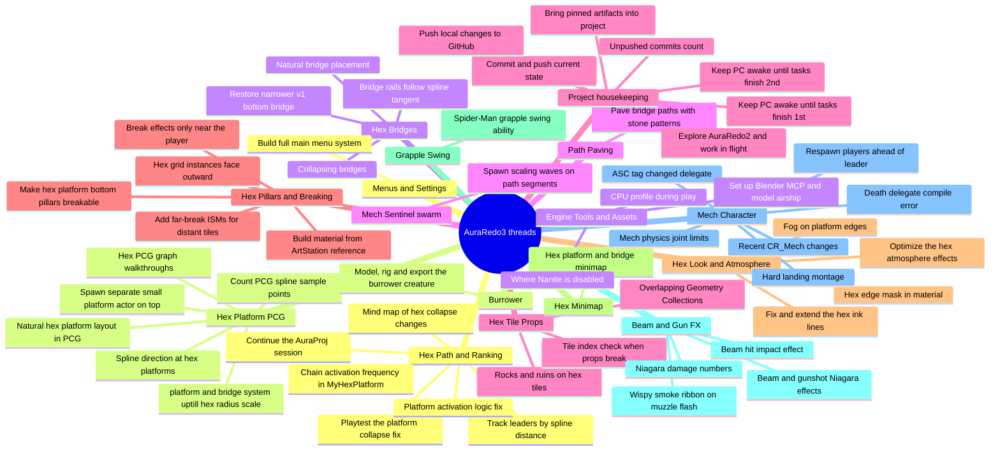

↑ [[Redo3 Changes Index]]

# Threads

AuraRedo3 · 54 project threads · 2026-10-04 to 2026-11-21

Every thread in the AuraRedo3 project, oldest first: what Talal asked for, what the thread did, the commits it made or that carry its work, the artifacts and files it produced, and what was left open. Threads that only answered a question or tested something are here too, because their findings often shaped the code. The topic pages explain the systems; this page is the record of who did what and when.

> [!note] Where the work landed
> Many threads worked in Talal's local working copy and did not commit. Their changes reached GitHub in the 2026-11-15 batch made by [[Redo3 Threads#Push local changes to GitHub|Push local changes to GitHub]], so their commits are stamped 2026-11-15 14:18 even when the work was done weeks earlier. Each thread below says where its work landed.

## Mind map

Each thread sits under the area it mostly worked on.

## All threads

| Started | Thread | Main page | Commits | Artifacts | Files |
|---|---|---|---|---|---|
| 2026-10-04 | [[Redo3 Threads#Bring pinned artifacts into project\|Bring pinned artifacts into project]] | Project housekeeping | 0 | 3 |  |
| 2026-10-04 | [[Redo3 Threads#Continue the AuraProj session\|Continue the AuraProj session]] | [[Redo3 Hex Path and Ranking\|Hex Path and Ranking]] | 7 |  |  |
| 2026-10-04 | [[Redo3 Threads#Explore AuraRedo2 and work in flight\|Explore AuraRedo2 and work in flight]] | Project housekeeping | 6 |  |  |
| 2026-10-04 | [[Redo3 Threads#Mind map of hex collapse changes\|Mind map of hex collapse changes]] | [[Redo3 Hex Path and Ranking\|Hex Path and Ranking]] | 2 | 1 |  |
| 2026-10-04 | [[Redo3 Threads#Playtest the platform collapse fix\|Playtest the platform collapse fix]] | [[Redo3 Hex Path and Ranking\|Hex Path and Ranking]] | 1 |  |  |
| 2026-10-04 | [[Redo3 Threads#Natural hex platform layout in PCG\|Natural hex platform layout in PCG]] | [[Redo3 Hex Platform PCG\|Hex Platform PCG]] | 2 |  | 1 |
| 2026-10-04 | [[Redo3 Threads#Wispy smoke ribbon on muzzle flash\|Wispy smoke ribbon on muzzle flash]] | [[Redo3 Beam and Gun FX\|Beam and Gun FX]] | 1 |  |  |
| 2026-10-05 | [[Redo3 Threads#Niagara damage numbers\|Niagara damage numbers]] | [[Redo3 Beam and Gun FX\|Beam and Gun FX]] | 1 |  |  |
| 2026-10-05 | [[Redo3 Threads#Track leaders by spline distance\|Track leaders by spline distance]] | [[Redo3 Hex Path and Ranking\|Hex Path and Ranking]] | 1 |  |  |
| 2026-10-05 | [[Redo3 Threads#Natural bridge placement\|Natural bridge placement]] | [[Redo3 Hex Bridges\|Hex Bridges]] | 1 | 1 |  |
| 2026-10-06 | [[Redo3 Threads#Chain activation frequency in MyHexPlatform\|Chain activation frequency in MyHexPlatform]] | [[Redo3 Hex Path and Ranking\|Hex Path and Ranking]] | 2 |  |  |
| 2026-10-06 | [[Redo3 Threads#Commit and push current state\|Commit and push current state]] | Project housekeeping | 1 |  |  |
| 2026-10-07 | [[Redo3 Threads#Bridge rails follow spline tangent\|Bridge rails follow spline tangent]] | [[Redo3 Hex Bridges\|Hex Bridges]] | 1 |  |  |
| 2026-10-07 | [[Redo3 Threads#Platform activation logic fix\|Platform activation logic fix]] | [[Redo3 Hex Path and Ranking\|Hex Path and Ranking]] | 4 |  | 1 |
| 2026-10-07 | [[Redo3 Threads#Spider-Man grapple swing ability\|Spider-Man grapple swing ability]] | [[Redo3 Grapple Swing\|Grapple Swing]] | 29 | 2 | 9 |
| 2026-10-07 | [[Redo3 Threads#platform and bridge system uptill hex radius scale\|platform and bridge system uptill hex radius scale]] | [[Redo3 Hex Platform PCG\|Hex Platform PCG]] | 5 | 1 | 2 |
| 2026-10-09 | [[Redo3 Threads#Hex platform and bridge minimap\|Hex platform and bridge minimap]] | [[Redo3 Hex Minimap\|Hex Minimap]] | 13 |  | 1 |
| 2026-10-10 | [[Redo3 Threads#ASC tag changed delegate\|ASC tag changed delegate]] | [[Redo3 Mech Character\|Mech Character]] | 1 |  |  |
| 2026-10-10 | [[Redo3 Threads#Recent CR_Mech changes\|Recent CR_Mech changes]] | [[Redo3 Mech Character\|Mech Character]] | 1 |  |  |
| 2026-10-10 | [[Redo3 Threads#Beam hit impact effect\|Beam hit impact effect]] | [[Redo3 Beam and Gun FX\|Beam and Gun FX]] | 9 |  | 2 |
| 2026-10-13 | [[Redo3 Threads#Beam and gunshot Niagara effects\|Beam and gunshot Niagara effects]] | [[Redo3 Beam and Gun FX\|Beam and Gun FX]] | 10 | 3 | 40 |
| 2026-10-14 | [[Redo3 Threads#Spline direction at hex platforms\|Spline direction at hex platforms]] | [[Redo3 Hex Platform PCG\|Hex Platform PCG]] | 0 |  |  |
| 2026-10-14 | [[Redo3 Threads#Count PCG spline sample points\|Count PCG spline sample points]] | [[Redo3 Hex Platform PCG\|Hex Platform PCG]] | 0 |  |  |
| 2026-10-14 | [[Redo3 Threads#Hex edge mask in material\|Hex edge mask in material]] | [[Redo3 Hex Look and Atmosphere\|Hex Look and Atmosphere]] | 2 |  | 1 |
| 2026-10-16 | [[Redo3 Threads#Rocks and ruins on hex tiles\|Rocks and ruins on hex tiles]] | [[Redo3 Hex Tile Props\|Hex Tile Props]] | 10 | 3 | 2 |
| 2026-10-17 | [[Redo3 Threads#Where Nanite is disabled\|Where Nanite is disabled]] | [[Redo3 Engine Tools and Assets\|Engine Tools and Assets]] | 1 |  |  |
| 2026-10-17 | [[Redo3 Threads#Overlapping Geometry Collections\|Overlapping Geometry Collections]] | [[Redo3 Hex Tile Props\|Hex Tile Props]] | 13 | 1 | 1 |
| 2026-10-18 | [[Redo3 Threads#Death delegate compile error\|Death delegate compile error]] | [[Redo3 Mech Character\|Mech Character]] | 2 |  |  |
| 2026-10-18 | [[Redo3 Threads#Mech physics joint limits\|Mech physics joint limits]] | [[Redo3 Mech Character\|Mech Character]] | 1 |  |  |
| 2026-10-18 | [[Redo3 Threads#Unpushed commits count\|Unpushed commits count]] | Project housekeeping | 18 |  |  |
| 2026-10-19 | [[Redo3 Threads#CPU profile during play\|CPU profile during play]] | [[Redo3 Engine Tools and Assets\|Engine Tools and Assets]] | 1 |  | 3 |
| 2026-10-20 | [[Redo3 Threads#Break effects only near the player\|Break effects only near the player]] | [[Redo3 Hex Pillars and Breaking\|Hex Pillars and Breaking]] | 1 |  |  |
| 2026-10-20 | [[Redo3 Threads#Fog on platform edges\|Fog on platform edges]] | [[Redo3 Hex Look and Atmosphere\|Hex Look and Atmosphere]] | 2 | 2 |  |
| 2026-10-20 | [[Redo3 Threads#Tile index check when props break\|Tile index check when props break]] | [[Redo3 Hex Tile Props\|Hex Tile Props]] | 2 |  |  |
| 2026-10-20 | [[Redo3 Threads#Hex grid instances face outward\|Hex grid instances face outward]] | [[Redo3 Hex Pillars and Breaking\|Hex Pillars and Breaking]] | 2 |  |  |
| 2026-10-22 | [[Redo3 Threads#Hard landing montage\|Hard landing montage]] | [[Redo3 Mech Character\|Mech Character]] | 3 |  |  |
| 2026-10-22 | [[Redo3 Threads#Hex PCG graph walkthroughs\|Hex PCG graph walkthroughs]] | [[Redo3 Hex Platform PCG\|Hex Platform PCG]] | 5 | 2 | 1 |
| 2026-10-22 | [[Redo3 Threads#Collapsing bridges\|Collapsing bridges]] | [[Redo3 Hex Bridges\|Hex Bridges]] | 3 |  | 4 |
| 2026-10-24 | [[Redo3 Threads#Add far-break ISMs for distant tiles\|Add far-break ISMs for distant tiles]] | [[Redo3 Hex Pillars and Breaking\|Hex Pillars and Breaking]] | 4 | 7 |  |
| 2026-10-25 | [[Redo3 Threads#Pave bridge paths with stone patterns\|Pave bridge paths with stone patterns]] | [[Redo3 Path Paving\|Path Paving]] | 1 | 5 | 4 |
| 2026-10-25 | [[Redo3 Threads#Fix and extend the hex ink lines\|Fix and extend the hex ink lines]] | [[Redo3 Hex Look and Atmosphere\|Hex Look and Atmosphere]] | 6 | 8 | 36 |
| 2026-10-30 | [[Redo3 Threads#Build full main menu system\|Build full main menu system]] | [[Redo3 Menus and Settings\|Menus and Settings]] | 6 | 2 |  |
| 2026-10-30 | [[Redo3 Threads#Set up Blender MCP and model airship\|Set up Blender MCP and model airship]] | [[Redo3 Engine Tools and Assets\|Engine Tools and Assets]] | 2 |  | 44 |
| 2026-10-30 | [[Redo3 Threads#Optimize the hex atmosphere effects\|Optimize the hex atmosphere effects]] | [[Redo3 Hex Look and Atmosphere\|Hex Look and Atmosphere]] | 6 | 5 |  |
| 2026-10-31 | [[Redo3 Threads#Restore narrower v1 bottom bridge\|Restore narrower v1 bottom bridge]] | [[Redo3 Hex Bridges\|Hex Bridges]] | 2 |  |  |
| 2026-10-31 | [[Redo3 Threads#Build material from ArtStation reference\|Build material from ArtStation reference]] | [[Redo3 Hex Pillars and Breaking\|Hex Pillars and Breaking]] | 4 | 3 | 32 |
| 2026-11-01 | [[Redo3 Threads#Spawn separate small platform actor on top\|Spawn separate small platform actor on top]] | [[Redo3 Hex Platform PCG\|Hex Platform PCG]] | 1 |  |  |
| 2026-11-05 | [[Redo3 Threads#Model, rig and export the burrower creature\|Model, rig and export the burrower creature]] | [[Redo3 Burrower\|Burrower]] | 5 | 1 | 94 |
| 2026-11-15 | [[Redo3 Threads#Make hex platform bottom pillars breakable\|Make hex platform bottom pillars breakable]] | [[Redo3 Hex Pillars and Breaking\|Hex Pillars and Breaking]] | 0 |  |  |
| 2026-11-15 | [[Redo3 Threads#Respawn players ahead of leader\|Respawn players ahead of leader]] | [[Redo3 Mech Character\|Mech Character]] | 3 | 1 |  |
| 2026-11-15 | [[Redo3 Threads#Push local changes to GitHub\|Push local changes to GitHub]] | Project housekeeping | 35 |  |  |
| 2026-11-15 | [[Redo3 Threads#Spawn scaling waves on path segments\|Spawn scaling waves on path segments]] | [[MechSentinel Index\|Mech Sentinel swarm]] | 38 |  | 3 |
| 2026-11-21 | [[Redo3 Threads#Keep PC awake until tasks finish (1st)\|Keep PC awake until tasks finish (1st)]] | Project housekeeping | 0 |  |  |
| 2026-11-21 | [[Redo3 Threads#Keep PC awake until tasks finish (2nd)\|Keep PC awake until tasks finish (2nd)]] | Project housekeeping | 0 |  |  |

Commits counts the commits the thread made or that carry its work (some carry the work of several threads). Artifacts counts the artifact notes made from the thread; Files counts its files in the shared folder.

## Bring pinned artifacts into project

Started 2026-10-04

Pages: [[Redo3 Hex Path and Ranking]], [[Redo3 Hex Bridges]], [[Redo3 Spell Menu Fixes]]

**Asked for.** Talal said "there are 3 artifacts all of them are pinned, please add them to the artifacts in this project".

**What it did.** The session found the three pinned artifacts from earlier sessions and attached them to its reply so they show in the project's Library: "Hex Path and Bridges", "Hex Path Setup Steps" and "Aura Spell Menu Flow". The links and the pinned state stayed the same; nothing was copied or republished.

**Outcome.** Finished. All three pinned artifacts are listed in the project Library at their original links.

> [!example]- Decisions and problems
> - Attaching the existing links to a project message was enough to list them in the Library, so the artifacts kept their URLs and stayed pinned.

**Artifacts.**

- [[Redo3 Artifact - Hex Path and Bridges]]
- [[Redo3 Artifact - Hex Path Setup Steps]]
- [[Redo3 Artifact - Aura Spell Menu Flow]]

## Continue the AuraProj session

Started 2026-10-04

Pages: [[Redo3 Hex Path and Ranking]], [[Redo3 Spell Menu Fixes]]

**Asked for.** Talal asked to continue the work of an earlier Claude session: read it, "catch up on its full context, then summarize what it was doing, what's done, and what's next", and be ready to pick up where it left off.

**What it did.** The cloud session read the earlier session's full transcript and checked GitHub. It reported what was already on redo3: the spell menu fixes (server-side equipping, selection bugs, no crash when menus reopen, server-validated spell point spending), the growing hex path with PCG platform segments, the bridge subsystem and bridges (17605e3), a duplicate-name build fix, the NS_InkOrb Niagara effect and the graffiti main menu that Talal committed as 9c04634. It described the last work in progress: platforms no longer collapse about 0.1 s after spawn but wait for their bridges and for the lead to land; platforms more than 200 m behind the lead are removed with their bridges and path segments more than 300 m behind are removed; players on a platform, on one of its bridges or near one keep it alive; a mid-bridge jump bug was fixed. That code built but was uncommitted and unplayed, existing only on Talal's PC (it later landed in e7a2588). The session asked five questions and changed nothing.

**Where the work is.** redo3 (read only)

**Outcome.** Answer only. A catch-up summary with five open questions; Talal did not answer in this thread.

> [!example]- Decisions and problems
> - The session left the playtest to the separate "Playtest the platform collapse fix" thread rather than repeating it.
> - The cloud copy could not see the uncommitted files, so any code change would need a session on Talal's PC.
> - Leftover from the earlier session: the editor viewport was left in Lit mode (Alt+2 returns it to Wireframe).

> [!abstract]- Commits (7)
> - `aaaf14b` Make the server the source of truth for spell slot equipping (described) · [[Redo3 Spell Menu Fixes]]
> - `76625c2` Fix spell menu selection state around equipping (described) · [[Redo3 Spell Menu Fixes]]
> - `a63041a` Fix crashes from deleted Spell and Attribute menu controllers (described) · [[Redo3 Spell Menu Fixes]]
> - `45f0aa8` Validate spell point spending on the server (described) · [[Redo3 Spell Menu Fixes]]
> - `17605e3` Add growing hex path, PCG platform segments and bridge subsystem (described) · [[Redo3 Hex Path and Ranking]], [[Redo3 Hex Bridges]], [[Redo3 Hex Platform PCG]]
> - `9c04634` NS_beamChargeFx.uasset, NS_beam and MainMenu2 Graffiti UI. (described) · [[Redo3 Beam and Gun FX]], [[Redo3 Menus and Settings]]
> - `e7a2588` Rewrite hex bridge pairing, replicate platforms reliably, rank players by path distance, add Niagara damage numbers and muzzle smoke (later commit of the uncommitted collapse work) · [[Redo3 Hex Path and Ranking]], [[Redo3 Hex Bridges]], [[Redo3 Beam and Gun FX]], [[Redo3 Menus and Settings]]

**Left open.**

- Commit the collapse work to redo3 once the playtest passes (recommended yes).
- Should a platform stay alive while any player stands on it (currently yes)?
- Should the host's start platform collapse as soon as its bridges are built (currently yes)?
- Is 200 m behind the lead the right cull distance?
- Should hand-placed platforms also wait for the lead to land (currently yes)?

## Explore AuraRedo2 and work in flight

Started 2026-10-04

**Asked for.** No message from Talal. The project setup opened this thread to explore the talal-jpg/AuraRedo2 repository and report what it is and what work is in flight.

**What it did.** The cloud session read the repository layout, branches, PRs, issues and TODOs and posted one summary. It described the game as a C++ project with module "Aura" (opened through Aura.uproject; this reply said UE 5.6, later threads work in UE 5.8), built on the Gameplay Ability System, with FireBolt and Electrocute abilities, goblin enemies on behavior trees, attributes, XP and leveling, a spell menu and a locally predicted crowd swarm kept in sync with the server, and art and maps in Git LFS. It found that redo3 is the active branch (about 2,500 files ahead of main, split in February), with server-authoritative spell equipping, spell and attribute menu crash fixes, the growing hex-platform path with PCG bridges (set-up notes in steps.md), EOS/Steam multiplayer sessions, a main menu and an MVVM load screen. It reported that main has been stale since April 21 and that its last change, the cooldown async task in WaitCooldownChange.cpp, is broken. It saved to project memory that redo3 is the branch to work from.

**Where the work is.** redo3 (read only; no branch created)

**Outcome.** Answer only. A one-message overview of the repo; redo3 recorded in project memory as the working branch.

> [!example]- Decisions and problems
> - No CI, no test suite and no README in the repo, and no open PRs, issues or GitHub Actions at the time.
> - The cloud container has no Unreal Engine, so nothing could be built there; later threads ran on Talal's PC through Remote Control.
> - Bug noted on main (not fixed here): in WaitCooldownChange.cpp the validity check is inverted (InCooldownTag.IsValid() should be !IsValid()), so the task ends at once; it also broadcasts "cooldown ended" whenever the tag changes, including when it is added, and the remaining-time query is a stub.
> - TODOs on redo3 are mostly in the hex platform code (randomise Z offsets, expose values, chain length from grid size), plus a few in gun-shoot damage and the damage exec calc.

> [!abstract] Commits (6)
> - `aaaf14b` Make the server the source of truth for spell slot equipping (described, already on redo3) · [[Redo3 Spell Menu Fixes]]
> - `76625c2` Fix spell menu selection state around equipping (described) · [[Redo3 Spell Menu Fixes]]
> - `a63041a` Fix crashes from deleted Spell and Attribute menu controllers (described) · [[Redo3 Spell Menu Fixes]]
> - `45f0aa8` Validate spell point spending on the server (described) · [[Redo3 Spell Menu Fixes]]
> - `17605e3` Add growing hex path, PCG platform segments and bridge subsystem (described) · [[Redo3 Hex Path and Ranking]], [[Redo3 Hex Bridges]], [[Redo3 Hex Platform PCG]]
> - `9c04634` NS_beamChargeFx.uasset, NS_beam and MainMenu2 Graffiti UI. (described) · [[Redo3 Beam and Gun FX]], [[Redo3 Menus and Settings]]

**Left open.**

- WaitCooldownChange.cpp on main still has the inverted IsValid check, the wrong "ended" broadcast and a stub remaining-time query.
- Hex platform TODOs (random Z offsets, tweakable values, chain length from grid size) listed but not addressed here.

## Mind map of hex collapse changes

Started 2026-10-04

Pages: [[Redo3 Hex Path and Ranking]], [[Redo3 Hex Bridges]]

**Asked for.** Talal asked for "a mind map for the structure and the flow" of the recent changes that make a platform collapse "only when the lead lands on the platform", plus the related changes in HexBridge Settings, Subsystem, PathSegment, PathSpawner and Platform.

**What it did.** The latest collapse changes were still uncommitted on Talal's PC, so the session rebuilt them by replaying the earlier AuraProj session's 22 edits on top of redo3 at 9c04634 (10 files, +727/-15; all applied cleanly and line numbers matched that session's last build). It then published the page "Lead-Landing Collapse Map". The page has a clickable mind map with one branch per class (AMyHexPlatform, UMyHexBridgeSubsystem, AMyHexBridge, AMyHexPathSpawner, AMyHexPathSegment, UMyHexBridgeSettings), each leaf tagged new, changed or fix with the functions involved. A seven-step flow follows one platform from AMyHexPathSpawner::ExtendPath to culling and segment removal. A "two gates" section explains the collapse gate and the cull gate, and a table lists the new settings with defaults. These changes were later committed as part of e7a2588.

**Outcome.** Finished. The mind map page was published; the code it describes was uncommitted at the time and later landed in e7a2588.

> [!info]- How it works
> - AMyHexPathSpawner::CheckPlayers runs every 0.25 s; when a player is within 150 m of the path end, ExtendPath adds a segment, stamps its PathEndDistance and seeds its PCG with NextSegmentIndex++ (Segments.Num() repeated once old segments were removed).
> - AMyHexPlatform::BeginPlay measures FootprintRadius, calls RegisterPlatform and starts a looping UpdateLeadState timer (LeadCheckInterval 0.1 s, random first delay); it no longer starts the collapse.
> - UMyHexBridgeSubsystem::ProcessPendingPlatforms builds the bridges after BuildDelay and now calls NotifyBridgesReady() where it used to call StartCollapsing() about 0.1 s after spawn (the root cause of early collapse).
> - Collapse gate: TryStartCollapsing() calls StartCollapsing() only when bBridgesReady && (bLeadLanded || !bCollapseOnlyWhenLeadLands). NotifyLeadLanded fires when the lead's movement base is the platform, or the lead is airborne over its footprint and a Visibility trace of half-height + LandingTolerance (150 cm) hits it.
> - Cull gate: Destroy() only if bAutoDestroyWhenLeftBehind, the lead is not on it, IsLeftBehind() (more than CullBehindDistance 200 m from the footprint edge and behind the lead along the path, MaxPathOffset 100 m), no player keeps it alive (IsAnyPlayerOnPlatform, BridgeKeepDistance 300 cm) and TryConsumeCullBudget allows it (MaxPlatformCullsPerFrame 4).
> - AMyHexBridge binds to both end platforms' OnEndPlay and destroys itself with either; EndPlay on the platform clears all timers and prunes CheckedPairs.
> - AMyHexPathSpawner::DestroyPassedSegments removes segments whose PathEndDistance is more than DestroySegmentsBehindDistance (30000 cm) behind the lead's path distance; their platforms cull themselves on their own schedule.

> [!example]- Decisions and problems
> - The source changes were not on GitHub, so the page was built from a replay of the earlier session's edits rather than from a commit.
> - Mid-bridge jump fix shown on the map: jumping or JumpHover clears the movement base, so platforms now keep a list of their bridges and a player within 300 cm of a bridge line keeps both ends alive.
> - Known limitation listed on the page: the "lead" is the first player controller's pawn, so in multiplayer it is always the host (later changed to the ranking leader in cbd8c04).
> - Known limitation: the path spline is never trimmed, so closest-point lookups along it get slower as a run goes on.

> [!abstract] Commits (2)
> - `e7a2588` Rewrite hex bridge pairing, replicate platforms reliably, rank players by path distance, add Niagara damage numbers and muzzle smoke (later commit that contains the mapped collapse and cull changes) · [[Redo3 Hex Path and Ranking]], [[Redo3 Hex Bridges]], [[Redo3 Beam and Gun FX]], [[Redo3 Menus and Settings]]
> - `9c04634` NS_beamChargeFx.uasset, NS_beam and MainMenu2 Graffiti UI. (base the edits were replayed on) · [[Redo3 Beam and Gun FX]], [[Redo3 Menus and Settings]]

**Artifacts.**

- [[Redo3 Artifact - Lead-Landing Collapse Map]]

**Left open.**

- Lead was still the host's pawn (fixed later by the platform activation thread).
- Path spline never trimmed.
- Debug PrintString calls left in AMyHexPlatform::BeginPlay.
- Questions on slow-player protection, start-platform behaviour, the 200 m cull distance and hand-placed platforms were left for Talal.

## Playtest the platform collapse fix

Started 2026-10-04

Pages: [[Redo3 Hex Path and Ranking]]

**Asked for.** Started by Talal from the setup card: playtest the hex platform collapse fix (platforms collapse only after the lead player lands; platforms, bridges and path segments far behind the lead are destroyed).

**What it did.** The cloud session checked origin/redo3 (head 9c04634) and found it did not contain the fix: there UMyHexBridgeSubsystem::ProcessPendingPlatforms still calls StartCollapsing() right after bridging and there is no cleanup of far-behind platforms. It wrote instructions for a session on Talal's PC (find the uncommitted edits in MyHexPlatform and MyHexBridgeSubsystem, rebuild AuraEditor, run PIE on the hex path map, check LogHexBridgeSubsystem output, commit nothing) and asked Talal to allow a Remote Control session. Talal asked "what card, where to allow?" and the session explained how to turn on Remote Control in the Claude desktop app or run claude remote-control in the project folder. No device session started and no playtest ran.

**Outcome.** Abandoned. The thread stopped after explaining how to connect the PC; the playtest never ran here.

> [!example]- Decisions and problems
> - The Unreal editor cannot run in the cloud container, so the test needed a session on Talal's PC.
> - The consent card did not appear for Talal because his computer was not connected to Remote Control yet.

> [!abstract] Commits (1)
> - `e7a2588` Rewrite hex bridge pairing, replicate platforms reliably, rank players by path distance, add Niagara damage numbers and muzzle smoke (later commit that holds the collapse fix this thread meant to test) · [[Redo3 Hex Path and Ranking]], [[Redo3 Hex Bridges]], [[Redo3 Beam and Gun FX]], [[Redo3 Menus and Settings]]

**Left open.**

- The lead-landing collapse and far-behind culling were not play-tested in this thread (e7a2588's message also says they were untested in play).

## Natural hex platform layout in PCG

Started 2026-10-04 · last activity 2026-10-05

Pages: [[Redo3 Hex Platform PCG]], [[Redo3 Hex Path and Ranking]]

**Asked for.** Talal said /Game/Assets/MyPlatform/PCGs/PCG_SplineIHexPlatformsFromSpline "only spawns them in a straight line with only different grid sizes" and asked to "make different streams of the spawner and make the layout natural with some offsets in z", with smaller grid sizes on the sides, top and bottom of big platforms and even smaller ones beside those, after a backup. Later he asked for more Z noise on the small platforms and "the same chain above it which complements the chain below" with its own small platforms and a different noise seed.

**What it did.** The session backed up the graph as PCG_SplineIHexPlatformsFromSpline_Backup, built the new layout in a scratch graph, tested it on a temporary spline far from the play area, and applied it to the real graph (156 nodes). Per 100 m path segment it spawns three streams of big platforms: a centre stream (grid 11-12) every 50 m and left and right streams (grid 6-9) 42-48 m out that skip about 15% of their spots, with smooth height variation of up to +-4 m; medium platforms (grid 3-5) ring every big one and small ones (grid 1-2) ring the medium ones. Big platforms shrink to fit tight bends and earlier segments, and each segment checks platforms and bridges already in the world; a test on the four tightest real segments (19-22, path seed 17.31) gave 41 platforms with no overlaps (smallest gap 2.8 m). On Talal's second ask it added bigger height steps for the rings (up to one full gap, gaps kept at their original sizes) and an upper chain 15 m up: big platforms (grid 10-11) every 50 m halfway between the lower centre platforms, their own medium and small rings with different seeds, short pillars (Vertical Scaling 0.08, about 5.7 m), and HexLower or HexUpper actor tags. The upper chain height is set on the node UpFinal_Lift (titled "UPPER CHAIN HEIGHT") in a red comment box. Finally, for the "Track leaders by spline distance" thread, it wired SplineDistance: the four streams write their distance along the segment plus the segment's PathStartDistance, both spawn nodes override AMyHexPlatform::SplineDistance, rings take their big platform's distance and side platforms the distance of the path point they came from (backup PCG_SplineIHexPlatformsFromSpline_BeforeSplineDistance).

**Where the work is.** redo3

**Outcome.** Finished: streams, rings, height noise, the upper chain and SplineDistance are in the saved graph; Talal's follow-up about unnatural bridges was handed to the "Natural bridge placement" thread because this thread's session could no longer reach his PC.

> [!info]- How it works
> - Segment spline -> spline sampler -> three lower streams (centre, left, right) plus the upper chain, each with its own seeds; medium and small rings are spawned around each big platform.
> - Heights: big platforms follow a shared smooth noise of up to +-4 m; lower-chain rings mostly step down (-1 to +0.3 times their gap) and upper-chain rings mostly step up (-0.3 to +1 times their gap) so the two levels keep apart.
> - Fit: big platforms shrink when a neighbour or the segment border is close; each segment reads platforms and bridges already in the world so it never overlaps an earlier segment; each chain only checks against its own platforms.
> - Upper chain: 15 m above the lower chain, same height noise so both rise and fall together; set Offset Min Z and Offset Max Z on UpFinal_Lift to the same value in cm to change it (going much below about 15 m risks collisions).
> - SplineDistance = spline sampler Distance (Compute Distance on) + PathStartDistance read from the owning AMyHexPathSegment, passed to the platform through a Spawn Actor property override.

> [!example]- Decisions and problems
> - The Unreal Editor crashed during the work because the muzzle-flash thread took Niagara preview screenshots (GPU readback during PIE shutdown); the backup was safe and the session waited for the restart. Rule from then on: no viewport or preview screenshots, save each asset at once, keep clear during PIE.
> - An editor Save All at 08:26 (not the session's) wrote 2 test volumes and 35 test platforms into StartupMap.umap, far below the play area (about y 4 km, z -400 m); they were removed from the open level and the session asked whether to save StartupMap.
> - The session asked whether "above" meant higher up or alongside; Talal chose higher up and said "don't widen the gaps even if the secondary platforms dont get bridges", so the widened gaps it had just tried were reverted.
> - Upper platforms got short pillars because normal pillars hang 12-33 m below a platform and would block bridges on the lower chain; the closest gap between an upper pillar bottom and a lower platform in the test was 8.7 m.
> - SplineDistance wiring waited for an editor restart with the new C++ (PathStartDistance on the segment) and for Talal to run ModelContextProtocol.StartServer.
> - Relayed rule from the leaders thread: any new grid-affecting property override on the spawn nodes must also be Replicated with COND_InitialOnly in AMyHexPlatform, and actor tags such as HexLower and HexUpper do not replicate, so clients must not rely on them.

> [!abstract] Commits (2)
> - `e7a2588` Rewrite hex bridge pairing, replicate platforms reliably, rank players by path distance, add Niagara damage numbers and muzzle smoke (PCG_SplineIHexPlatformsFromSpline plus the _Backup and _BeforeSplineDistance copies) · [[Redo3 Hex Path and Ranking]], [[Redo3 Hex Bridges]], [[Redo3 Beam and Gun FX]], [[Redo3 Menus and Settings]]
> - `b1f17f2` Update the hex platform PCG graphs (later graph update; removed the old PCG_SplineIHexPlatformsFromSpline_Backup) · [[Redo3 Hex Platform PCG]]

**Files in the shared folder.**

- [[Redo3 Files - Hex Path and Bridges]]: 1 file

**Left open.**

- Talal never answered whether to save StartupMap to clear the test leftovers.
- Some ring platforms get no bridges because the height steps make them too steep (accepted by Talal).
- The session did not run PIE itself; the SplineDistance wiring and bridge results were left for Talal's playtest.

## Wispy smoke ribbon on muzzle flash

Started 2026-10-04 · last activity 2026-10-05

Pages: [[Redo3 Beam and Gun FX]]

**Asked for.** Talal pointed at /Game/NiagaraExamples/FX_Weapons/MuzzleFlashes/NS_MuzzleFlash, which "gets reset everytime the player shoots", and asked to "make a backup NS copy of it first then add an emitter in it which spawn a ribbon which moves like a wispy smoke and dies after a while".

**What it did.** The session duplicated the system as NS_MuzzleFlash_Backup and saved it, then built a ribbon emitter and a material in the open editor. While checking it with screenshots of the Niagara preview, the editor crashed (a GPU readback crashed while Talal's PIE session was shutting down), and the unsaved emitter and material were lost; the backup survived and NS_MuzzleFlash was unchanged on disk. The session had scripted the build, saved the scripts to Saved/MuzzleWork, and after Talal reopened the editor rebuilt and saved everything: a new emitter Smoke_Wisps inside NS_MuzzleFlash and a new material M_SmokeRibbon_Wisp in the same Materials folder. NS_MuzzleFlash compiles with no errors. It went into e7a2588.

**Where the work is.** redo3

**Outcome.** Finished: Smoke_Wisps and M_SmokeRibbon_Wisp were built, compiled and saved; Talal never reported back on the look.

> [!info]- How it works
> - On every shot (the system is reset per shot) Smoke_Wisps spawns 2 ribbons at the muzzle.
> - The ribbons shoot forward, slow down quickly, then drift upward while curl noise bends them into wisps.
> - They widen and fade with age, their edges break up, and each is gone after roughly 0.5 to 1 second.
> - M_SmokeRibbon_Wisp is translucent grey with scrolling noise; its parameters OpacityScale and NoiseAmount control strength and breakup.
> - Tuning knobs: curl noise strength and frequency under Particle Update in Smoke_Wisps, width and alpha in its last Set Parameters module.

> [!example]- Decisions and problems
> - The crash was traced to the session's own preview screenshot calls; it stopped taking viewport or Niagara preview screenshots, and that became a project-wide rule for all threads sharing the editor.
> - The only glimpse before the crash showed thin, tightly curled wisps, so the rebuild widened the ribbon and broadened the curls without a visual check.
> - Because the system resets on every shot, fire rates faster than about 0.7 s cut the previous shot's smoke short; the session offered to move the smoke into its own fire-and-forget system per shot.

> [!abstract] Commits (1)
> - `e7a2588` Rewrite hex bridge pairing, replicate platforms reliably, rank players by path distance, add Niagara damage numbers and muzzle smoke (NS_MuzzleFlash, NS_MuzzleFlash_Backup, M_SmokeRibbon_Wisp; the same commit also adds NS_GunWispySmoke, which this thread does not mention) · [[Redo3 Hex Path and Ranking]], [[Redo3 Hex Bridges]], [[Redo3 Beam and Gun FX]], [[Redo3 Menus and Settings]]

**Left open.**

- No feedback from play on how the smoke looks.
- Smoke is cut short at fire rates faster than about 0.7 s; the separate fire-and-forget system was offered but not built in this thread.
- Smoke_Wisps ignores the system's Use Smoke toggle.

## Niagara damage numbers

Started 2026-10-05

Pages: [[Redo3 Beam and Gun FX]]

**Asked for.** Talal asked for a new function ShowDamageNumber_2, next to the widget-based ShowDamageNumber on the player controller, that uses "niagara and data channels to show damage numbers during damage in postGEExecute in MyAttributeSet". Later, after renaming the data channel variables himself, he asked for multi-digit numbers, a sprite saying Critical or Blocked, and scaling by distance ("the further they are the bigger they get").

**What it did.** The session added ShowDamageNumber_2 as a Client Reliable RPC with a bUseNiagaraDamageNumbers switch (default true) and "DamageNumbers" settings (DamageNumberDataChannel, NormalDamageColor, CritDamageColor, BlockedDamageColor, DamageNumberSize, CritDamageScale 1.5, DamageNumberHeightOffset 20), and made UMyAttributeSet::PostGameplayEffectExecute call it instead of the widget version. It created NDC_DamageNumbers and NS_DamageNumbers (copies of the footsteps data channel example), M_DamageNumber with a custom HLSL digit lookup and T_DamageDigits, in Level/UI/FloatingText/NiagaraDamageNumbers. Talal's listen-server test with GA_GunShoot / GE_GunShoot showed nothing, which took three fixes: the mech game uses AMyPlayerController2, so ShowDamageNumber_2 was added there too; a header revert of MyPlayerController2.h (by an IDE or another thread) was undone; and UE 5.8 GameplayBurst data channels reject the legacy SearchParams write, so both controllers now write through GetUsableAccessContextFromNDC and WriteToNiagaraDataChannel_WithContext. After Talal renamed the channel variables to Location, IsBlocked, IsCritical, Distance, DamageAmount and Color (and fixed the ReadFromNDC scratch module reader himself), the C++ writes all six with Distance = camera-to-target distance, DamageAmount was switched from Vector to Float, a CRITICAL! / BLOCKED label sprite (T_DamageLabels, M_DamageLabel) was added above the number, and both sprites scale by Distance / 1000 clamped 0.5x to 6x through user parameters DistanceScaleReference, DistanceScaleMin and DistanceScaleMax. The last fix turned off a leftover footsteps position offset in Initialize Particle that produced NaN positions. The work was committed in e7a2588.

**Where the work is.** redo3

**Outcome.** Partly finished: the C++, data channel, Niagara system and materials were built and compile cleanly, and the NaN fix was the last change; Talal did not confirm in the thread that numbers finally appeared.

> [!info]- How it works
> - Server: PostGameplayEffectExecute in UMyAttributeSet finds the attacker's controller (AMyPlayerController or AMyPlayerController2) and calls the client RPC ShowDamageNumber_2(InDamage, TargetCharacter, bIsCrit, bIsBlocked) when bUseNiagaraDamageNumbers is on; otherwise the old widget ShowDamageNumber runs.
> - Client: the location is the target's capsule top plus DamageNumberHeightOffset; the colour is BlockedDamageColor, CritDamageColor or NormalDamageColor, and its alpha carries the size (DamageNumberSize, times CritDamageScale on crits).
> - The RPC writes one entry to NDC_DamageNumbers through an access context with the location override; Location, DamageAmount (rounded), IsCritical, IsBlocked, Distance and Color are written by name.
> - The data channel spawns NS_DamageNumbers by itself, so nothing is placed in the level; the ReadFromNDC scratch module in Particle Spawn reads the six values.
> - NS_DamageNumbers draws the number with M_DamageNumber (up to 6 digits) and a label sprite with M_DamageLabel above it; if a hit is both critical and blocked, BLOCKED shows.
> - Sprites rise, slow down, pop in and fade over 1 second, drawn on top of everything, and scale with Distance / DistanceScaleReference (1000) between DistanceScaleMin 0.5 and DistanceScaleMax 6.

> [!example]- Decisions and problems
> - The widget call was replaced, not kept beside the Niagara call, so numbers would not show twice; the old path stays behind the bUseNiagaraDamageNumbers checkbox.
> - The editor tools could not build a data channel reader from scratch, so the assets were copied from the footsteps example; at first damage travelled as Distance and size in the colour alpha, until Talal renamed the variables.
> - C++ was compile-checked by building the standalone game target so Talal's open editor was not disturbed.
> - Adding a parameter to an existing Niagara Set Parameters module hit an engine assert and crashed the editor at 22:21 local; the wiring was redone by adding a separate new module instead.
> - The NaN came from the footsteps offset along Facing (left or right foot), which was no longer read after the reader rewire; Use Position Offset was switched off.
> - Backups: NDC_DamageNumbers_Backup and NS_DamageNumbers_Backup (taken before Talal's reader fix, so it has the old reader).

> [!abstract] Commits (1)
> - `e7a2588` Rewrite hex bridge pairing, replicate platforms reliably, rank players by path distance, add Niagara damage numbers and muzzle smoke · [[Redo3 Hex Path and Ranking]], [[Redo3 Hex Bridges]], [[Redo3 Beam and Gun FX]], [[Redo3 Menus and Settings]]

**Left open.**

- A killing blow on another player shows no number, because PostGameplayEffectExecute returns early when the target is not an enemy; Talal was asked and did not answer.
- No in-play confirmation after the final NaN fix.
- Talal's disabled Gnomon mesh renderer was left in NS_DamageNumbers.

## Track leaders by spline distance

Started 2026-10-05

Pages: [[Redo3 Hex Path and Ranking]], [[Redo3 Hex Platform PCG]]

**Asked for.** Talal asked to "store distance on spline points", set that distance on each platform when PCG samples and spawns it, and on platform landed sort the PlayerStates by the platform they are on and store the sorted array on MyGameState, where "multiple PlayerStates can be considered leading". He then reported that "the platforms being built on client and server are totally different now" and asked for a fix.

**What it did.** A session on Talal's PC added a replicated SplineDistance to AMyHexPlatform and a PathStartDistance to each AMyHexPathSegment, because PCG samples the segment's own spline, which starts at 0. It added a new AMyGameState that replicates the sorted player states and a count of how many at the top share the greatest distance, with GetLeadingPlayerStates, IsLeading and OnPlayerRankingChanged, and made the game mode use it. AMyCharPlayer::BaseChange now records the platform a player lands on in AMyPlayerState (CurrentPlatform, PlatformSplineDistance) on the server and triggers a re-sort. The PCG side was handed to the "Natural hex platform layout in PCG" thread, which wired SplineDistance into all four streams of PCG_SplineIHexPlatformsFromSpline. For the client/server mismatch, it made GridSize, NoiseOffset and VerticalScaling replicate once before BeginPlay, made platforms and bridges bAlwaysRelevant, and made late joiners remove already-fallen tiles without replaying the fall. The game target built each time; the code went to GitHub later inside e7a2588.

**Where the work is.** uncommitted on redo3 at the time; committed later in e7a2588

**Outcome.** Finished. The ranking and the client/server replication fix were built and handed to Talal for a side-by-side client/server playtest; later entries in the thread are only automatic Remote Control session notices up to 2026-10-26.

> [!info]- How it works
> - PCG writes the segment's sample Distance plus the segment's PathStartDistance into each spawned platform's SplineDistance (distance along the whole path); rings inherit their big platform's distance and side platforms take their source path point's distance.
> - On the server, AMyCharPlayer::BaseChange fires when a player's movement base changes to a different platform; walking on a bridge or jumping keeps the last platform.
> - AMyGameState sorts AMyPlayerState entries by PlatformSplineDistance; every player tied at the greatest distance counts as a leader.
> - Platforms spawn only on the server and replicate, but each client rebuilds the hex grid itself, so every setting the grid is built from must reach the client before BeginPlay (COND_InitialOnly).
> - Platforms and bridges are always relevant, because the server builds the path hundreds of metres ahead, beyond the default 150 m network range.

> [!example]- Decisions and problems
> - The PCG graph was owned by another thread that had it open, so this thread sent the exact attribute steps through the coordinator instead of saving over it; the layout thread kept a backup PCG_SplineIHexPlatformsFromSpline_BeforeSplineDistance.
> - Until the PCG wiring was in, landing logged a "has no SplineDistance" warning and nobody's rank changed.
> - Root cause of different client and server layouts: PCG set GridSize, NoiseOffset and VerticalScaling per platform on the server only, so clients built every grid from the Blueprint defaults.
> - A review against the engine source found the second cause: clients only kept platforms within 150 m and kept losing and re-receiving them.
> - MyPlayerController2.h was reverted to its committed version at 13:44 UTC by some process, wiping the damage-number thread's ShowDamageNumber_2 block; the coordinator asked all threads never to run git checkout/restore/stash on shared files.
> - The editor module was not built by this thread; Talal's own rebuild at 21:32 local loaded the code, and his PIE log showed both players' landings reaching it.

> [!abstract] Commits (1)
> - `e7a2588` Rewrite hex bridge pairing, replicate platforms reliably, rank players by path distance, add Niagara damage numbers and muzzle smoke (contains this thread's SplineDistance, MyGameState ranking and replication fixes) · [[Redo3 Hex Path and Ranking]], [[Redo3 Hex Bridges]], [[Redo3 Beam and Gun FX]], [[Redo3 Menus and Settings]]

**Left open.**

- Talal's client and server playtest of the replication fix was never reported in the thread.
- Any new per-platform PCG setting must be replicated the same way (COND_InitialOnly), or clients will diverge again.

## Natural bridge placement

Started 2026-10-05 · last activity 2026-10-06

Pages: [[Redo3 Hex Bridges]]

**Asked for.** This thread took over Talal's ask from the layout thread: "now the placement of bridges does not seem natural at all, please fix it and can revise the logic also by which the platforms are paired and splines spawned for the bridges, the layout of platforms is good for now." Here he added "do rewriting with ultra effort", and at the end asked to "make a mind map , explaining the structure and the flow of the whole subsystem and pin to claude".

**What it did.** The session found the pairing lives in C++ (Source/Aura/Private/Actors/MyHexBridgeSubsystem.cpp), not in PCG_SplineIHexPlatformsFromSpline: the old code gave a straight bridge to every pair of platforms within 5x the bigger one's grid size (up to 60 m) and picked the closest edges even when the bridge left an edge almost sideways. A quick first rewrite (head-on exits, no skipping over a platform, spanning shortest bridges first, capped extras, no crossings) compiled, but after Talal asked for full effort it was redone from measured data. Two short PIE runs captured 308 platforms and the 500 bridges the old logic built; a Python offline simulator ported Unreal's Perlin noise and BuildHexGrid (307 of 308 platforms identical) and the bridge rules, and rebuilt all 500 bridges to the millimetre. Four competing pairing designs were scored by three judges (path-flow won 2 of 3, an organic curved design won the visual judge), merged, and checked by a critic. The final design was ported to C++ in UMyHexBridgeSubsystem, UMyHexBridgeSettings and AMyHexBridge (curved bridge tangents), compiled cleanly, and a separate code review found and fixed three medium logic issues. Against the old logic on Talal's level it gave 0 vs 82 crossing bridges, 0 vs 83 bridges passing over another platform, at most 6 vs 17 bridges on one platform, 0 vs 53 lower-to-upper chain bridges, and both chains fully reachable (the old logic split the upper chain into 3 parts). It then published the pinned artifact "Hex Bridge Subsystem Map" (mind map, flow diagram of one batch with a six-step walkthrough, and code locations with line numbers). The work went into e7a2588.

**Where the work is.** redo3

**Outcome.** Partly finished: the new planner was written, compiled, reviewed and committed in e7a2588, and the mind map was published and pinned; the in-engine playtest Talal was asked to do was never reported in the thread.

> [!info]- How it works
> - PCG spawns platforms per path segment; each AMyHexPlatform registers with UMyHexBridgeSubsystem (RegisterPlatform); ProcessPendingPlatforms plans a batch, and bursts of platforms arriving close together are planned as one batch (bReplanBursts, BurstQuietTime 1 s, BurstMaxDuration 8 s).
> - The planner runs nine passes that only plan: SpinePass (consecutive centre platforms along the path, sorted by SplineDistance, get their best route first), TreePass, LoopPass, LeafPass, RoutePass, BypassPass, BranchPass, FallbackPass (still-disconnected pairs with relaxed rules) and RescuePass (a platform with no bridge tries every platform in reach, nearest first).
> - Bridges must leave both edges near square-on (MaxEndAngleDegrees 40, MaxStraightEndAngleDegrees 15) and stay under MaxSlopeDegrees 30; per-platform caps are MaxBridgesSmall 3, MaxBridgesMedium 4, MaxBridgesLarge 6, with MinBridgeSpreadDegrees 40 between bridges on one platform.
> - No crossings or near-passes: BridgeSeparation 300, MinBridgeVerticalClearance 500, PlatformClearance 230; bAllowCrossChain false keeps lower and upper chains apart (ChainSplitHeight 860).
> - Curved bridges (bCurvedBridges true): AMyHexBridge carries start and end spline tangents (straight when both are zero); the bridge mesh graph samples the spline every 38 cm, which makes curves possible.
> - bRevalidateBridges re-checks bridges from earlier batches when a later batch adds platforms to the same segment.
> - All settings are in UMyHexBridgeSettings (Project Settings > Game > Hex Bridges); each batch writes one LogHexBridgeSubsystem line with bridge and trace counts and time taken.

> [!example]- Decisions and problems
> - The platform layout and the PCG graph were left unchanged; only pairing and bridge spline placement changed.
> - The offline simulator is scratch Python on Talal's PC outside the project and never ships; it scored crossings, bridges over platforms, length, exit angle, bunched ends, dead ends and detours, with top-down renders.
> - Trade-off accepted in the design: about 30% of platforms (mostly small side ones) end up with a single bridge, 89 dead ends against 35 before.
> - The critic found that a segment bridged in two batches never re-checked first-batch bridges, so one could run through a second-batch platform; fixed with revalidation.
> - Ramps question: the old logic built about 50 steep ramps (median 34 m) between lower and upper chains by accident; the new design builds none by default (setting), and Talal did not answer whether he wanted a few.
> - Work was paused several times by the account usage limit on 2026-10-06.

> [!abstract] Commits (1)
> - `e7a2588` Rewrite hex bridge pairing, replicate platforms reliably, rank players by path distance, add Niagara damage numbers and muzzle smoke · [[Redo3 Hex Path and Ranking]], [[Redo3 Hex Bridges]], [[Redo3 Beam and Gun FX]], [[Redo3 Menus and Settings]]

**Artifacts.**

- [[Redo3 Artifact - Hex Bridge Subsystem Map]]

**Left open.**

- No playtest result in the thread; the new planner had not run in the engine at the last message.
- Talal never answered whether he wanted a few ramps up to the upper chain (none by default).
- bDrawDebug was still on in DefaultGame.ini for testing.
- More dead-end platforms than before (89 vs 35).

## Chain activation frequency in MyHexPlatform

Started 2026-10-06

Pages: [[Redo3 Hex Path and Ranking]]

**Asked for.** Talal asked: "where in MyHexPlatform.cpp does the activation frequency of a chain and how frequently a chain is choosen defined?"

**What it did.** Answer only, read from Source/Aura/Private/Actors/MyHexPlatform.cpp as it was on disk (uncommitted at the time; the same code went into e7a2588 that night). All values were hardcoded literals, not UPROPERTYs or settings. How often a chain starts: the looping timer in StartCollapsing() (lines 204-211) with rate .1f and first delay .1f calls GenerateAndActivateChainFromRandomSelectedGrid() every 0.1 s and stops itself at line 1050 once HexMap is empty. How a chain is chosen: in GenerateAndActivateChainFromRandomSelectedGrid() (line 1037), ChainLength = 15 is a constexpr (line 1040); tiles reserved by another chain are filtered out (1081-1086) and the start tile is a uniform FMath::RandRange over the rest (1100-1106); GenerateChain() (971-1029) random-walks among unvisited, unreserved neighbours, so a dead end gives a shorter chain; with 15 or fewer tiles left all are activated at once (1067-1076). How fast tiles collapse inside a chain: ActivateChain() activates tile 0 at once and tile i at i * .1f seconds (line 1166). Together a new 15-tile chain starts every 0.1 s and each takes about 1.4 s, so roughly 14 chains collapse at once. LeadCheckInterval (MyHexPlatform.h:202, 0.1 s) only sets how often the platform checks whether the lead player has landed, which triggers StartCollapsing().

**Outcome.** Answer only: gave file and line references for the chain start rate, chain choice and per-tile delay.

> [!info]- How it works
> - Lead lands on the platform (checked every LeadCheckInterval = 0.1 s) -> StartCollapsing() starts a looping 0.1 s timer.
> - Each tick: GenerateAndActivateChainFromRandomSelectedGrid() picks a uniformly random free start tile, GenerateChain() random-walks up to ChainLength = 15 unreserved neighbours, ActivateChain() collapses them 0.1 s apart.
> - When 15 or fewer tiles are left they are all activated together; the timer stops when HexMap is empty.
> - No weighting by grid size: a TODO at line 126 (and "//TODO Set variable ChainLength based on grid size" above ChainLength) marks where it was planned.

> [!example]- Decisions and problems
> - The answer was read from the working tree, including other threads' uncommitted edits, without changing anything.
> - The next day commit 3c75a1c (another thread) replaced the 0.1 s looping timer with a one-shot timer re-armed after every chain, whose interval goes from CollapseIntervalAtLead (5 s) at the lead's SplineDistance down to CollapseIntervalFarBehind (1.5 s) at CollapseFalloffDistance behind it, with FirstCollapseDelay 0.5 s and SmallPlatformFirstCollapseDelay 20 s for platforms of SmallPlatformMaxTiles (15) tiles or fewer.

> [!abstract] Commits (2)
> - `e7a2588` Rewrite hex bridge pairing, replicate platforms reliably, rank players by path distance, add Niagara damage numbers and muzzle smoke (contains the code described) · [[Redo3 Hex Path and Ranking]], [[Redo3 Hex Bridges]], [[Redo3 Beam and Gun FX]], [[Redo3 Menus and Settings]]
> - `3c75a1c` Collapse platforms faster the further behind the lead they are (later change by another thread to the same timing) · [[Redo3 Hex Path and Ranking]]

**Left open.**

- ChainLength is still a constexpr 15 with the TODO to scale it by grid size (still present at origin/redo3).

## Commit and push current state

Started 2026-10-06

Pages: [[Redo3 Hex Bridges]], [[Redo3 Hex Path and Ranking]], [[Redo3 Hex Platform PCG]], [[Redo3 Beam and Gun FX]], [[Redo3 Menus and Settings]]

**Asked for.** Talal asked: "commit and push current state with detailed commit message".

**What it did.** A session on Talal's PC confirmed the branch was redo3 on talal-jpg/AuraRedo2, staged 54 files (30 of them assets, through Git LFS), committed them as e7a2588 and pushed to origin/redo3; nothing was left uncommitted. The commit message groups the work by area: hex bridges (the rewritten path-flow pairing in MyHexBridgeSubsystem, curved bridges, burst replanning, settings in Project Settings > Game > Hex Bridges), hex platforms (grid properties replicated COND_InitialOnly, bAlwaysRelevant, replicated SplineDistance, collapse only once the lead lands, culling of platforms left behind), hex path (segments record their distances along the path, passed segments destroyed, PCG graph and BPs updated), player ranking (new AMyGameState, platform tracking in AMyPlayerState and AMyCharPlayer), Niagara damage numbers (ShowDamageNumber_2 through the data channel in both player controllers) and assets (muzzle smoke ribbon, Graffiti UI and the M_UI_Button move, BP_MyCharMech, StartupMap). It noted that bDrawDebug=True in DefaultGame.ini was committed earlier in 17605e3 and is still on, and that the bridge planner, collapse and culling, and ranking had not been tested in multiplayer PIE.

**Where the work is.** redo3 (pushed to origin/redo3)

**Outcome.** Finished: e7a2588 (54 files) pushed to origin/redo3 on 2026-10-07 07:02 local time.

> [!info]- How it works
> - The coordinator told the session never to checkout, restore, stash or reset, because several threads had uncommitted work in the same working tree; files mid-edit by another thread were committed as they were on disk.
> - Only real project changes from git status were staged: no Binaries, Intermediate, Saved, DerivedDataCache or editor temp files; .uasset and .umap files went through Git LFS.
> - Each workstream named by the coordinator was checked against the actual diff before it went into the message.

> [!example]- Decisions and problems
> - The _Backup assets on disk (for example PCG_SplineIHexPlatformsFromSpline_Backup, NS_MuzzleFlash_Backup, NDC_DamageNumbers_Backup, NS_DamageNumbers_Backup, M_UI_Button_Backup) were included on purpose, and the message says they can be deleted later.
> - bDrawDebug was not part of this commit because DefaultGame.ini had not changed since 17605e3; the message mentions it is still on.

> [!abstract] Commits (1)
> - `e7a2588` Rewrite hex bridge pairing, replicate platforms reliably, rank players by path distance, add Niagara damage numbers and muzzle smoke · [[Redo3 Hex Path and Ranking]], [[Redo3 Hex Bridges]], [[Redo3 Beam and Gun FX]], [[Redo3 Menus and Settings]]

**Left open.**

- At commit time the bridge planner, collapse-when-lead-lands, culling and ranking were untested in multiplayer PIE.
- bDrawDebug=True was still on in DefaultGame.ini.
- Backup assets were committed and left for later cleanup.

## Bridge rails follow spline tangent

Started 2026-10-07

Pages: [[Redo3 Hex Bridges]]

**Asked for.** Talal pointed at /Game/Assets/MyPlatform/PCGs/PCG_SplineISMs, the PCG graph that builds bridges along splines, and said it only moves the rails left/right and up "with taking into account the tangent of the spline". He asked to fix it in UE and to "only make changes to the push to right/left/up. not random rotations".

**What it did.** Working in the open editor, the session backed up the graph as PCG_SplineISMs_BeforeTangentOffset and found that each rail used two Add nodes that moved Position.Y and Position.Z in world space. It saw the graph changing while it worked (Talal was adding an Add node off the first rail's spline sampler), paused, and continued after Talal wrote "finished ,you can continue". On a temporary test volume it read the current offsets: rail 1 at +143.6 right and +54.8 up, rail 2 at -146.7 and +54. It replaced each pair of Add nodes with one Transform Points node, RailOffset_Right and RailOffset_Left, set to apply the offset relative to each point's rotation, with the same distances as before. The random rotation nodes and the point seeds were left alone, so the noise rolls the same. It checked the result on a temporary spline running along world Y, removed the test volume, did not save the level, and saved the graph.

**Where the work is.** redo3

**Outcome.** Finished: rail offsets in PCG_SplineISMs now follow the spline's right and up at each point; graph saved and later committed in b1f17f2.

> [!info]- How it works
> - The spline sampler gives each point the spline's rotation at that point.
> - Before: Add nodes on Position.Y and Position.Z pushed the rails along world axes, so on a spline running along world Y both rails were shifted along the spline itself instead of out to the sides.
> - After: RailOffset_Right and RailOffset_Left (Transform Points, offset relative to point rotation) push each rail along the point's own right and up axes: 143.6 right and 54.8 up for rail 1, 146.7 left and 54 up for rail 2.

> [!example]- Decisions and problems
> - The coordinator read "with taking into account" as "without": today the push ignores the spline's direction and should follow it.
> - The session stopped and asked before editing while Talal was editing the same graph, to avoid two people changing it at once.
> - Saving the graph also saved Talal's own new Add node (writes Rotation.Right into an attribute named right); it is not connected downstream, so it was left in place.

> [!abstract] Commits (1)
> - `b1f17f2` Update the hex platform PCG graphs (2026-10-10: PCG_SplineISMs plus the PCG_SplineISMs_BeforeTangentOffset backup) · [[Redo3 Hex Platform PCG]]

**Left open.**

- Talal's unconnected Add node (Rotation.Right into right) remains in PCG_SplineISMs.
- The backup PCG_SplineISMs_BeforeTangentOffset is kept in the project.

## Platform activation logic fix

Started 2026-10-07

Pages: [[Redo3 Hex Path and Ranking]]

**Asked for.** Talal asked that when a player steps onto a new platform, the server should "1. sort PlayerStates by dist covered 2. activate all platforms with dist <= lead players covered dist". He then asked for the rate of the collapse timer in AMyHexPlatform::StartCollapsing to depend on distance from the lead, and for platforms of 15 tiles or fewer to get a first delay of 20 s.

**What it did.** A session on Talal's PC rewrote the activation: AMyGameState::UpdatePlayerRanking sorts the PlayerStates by the SplineDistance of the platform each last landed on and then calls the new ActivatePlatformsUpTo, which activates every platform whose SplineDistance is at most the leader's. UMyHexBridgeSubsystem::SelectLeadPawn now returns the ranking leader's pawn (the first alive one among tied leaders) instead of the listen-server host, so culling follows the real leader. With the editor closed it built AuraEditor and listed the changed lines; the full diff went to platform-activation-changes.diff. For the second request the collapse timer became one-shot and re-armed after every chain (ScheduleNextCollapseChain, CollapseNextChain, GetCollapseInterval), with the interval shrinking from 5 s at the lead to 1.5 s at 100 m behind; small platforms wait 20 s before the first chain. Both changes were pushed to claude/project-thread-8o9mos as cbd8c04 and 3c75a1c.

**Where the work is.** claude/project-thread-8o9mos

**Outcome.** Finished. Both changes built (AuraEditor for the first, the game target for the second) and are on redo3 via b95b254; later entries are only device online/offline notices.

> [!info]- How it works
> - Server only: landing on a new platform -> UpdatePlayerRanking sorts -> ActivatePlatformsUpTo(leader distance) runs before the ranking's "nothing changed" early-out, so it still runs when the leader moves forward without the order changing.
> - ActivatedSplineDistance stores the furthest distance reached and never decreases; a platform spawned after the leader passed it activates in TryStartCollapsing as soon as its bridges are built.
> - AMyHexPlatform::UpdateLeadState keeps the old stand-on check only as a fallback for platforms with no SplineDistance.
> - GetCollapseInterval reads AMyGameState::GetLeadSplineDistance and lerps from CollapseIntervalAtLead (5 s) to CollapseIntervalFarBehind (1.5 s) at CollapseFalloffDistance (10000 cm, scaled with HexRadius like the other path distances); each chain runs GenerateAndActivateChainFromRandomSelectedGrid.
> - All collapse values are editable on the platform under Hex Platform | Collapse.

> [!example]- Decisions and problems
> - Bug found: each platform activated only when the listen-server host physically stood on it, and the AMyGameState ranking was never used.
> - Distance covered was taken as the SplineDistance of the platform the player last stepped onto, and the lead as the top of AMyGameState's ranking (defaults chosen where the request was open).
> - "Less rate" was read literally: platforms further behind the lead collapse faster; swapping the two interval values gives the opposite with no code change.
> - Small platforms (15 tiles or fewer) vanished half a second after activation because one chain takes every tile, hence the 20 s first delay.
> - The first AuraEditor link was blocked by the grapple swing thread's unfinished files in the same checkout; a retry succeeded.
> - Talal applied the same changes to redo3 by hand in b95b254 (together with GA_GrappleSwing v1), so the later merge dc10778 only recorded claude/project-thread-8o9mos as merged.

> [!abstract] Commits (4)
> - `cbd8c04` Activate hex platforms up to the ranking leader's distance · [[Redo3 Hex Path and Ranking]]
> - `3c75a1c` Collapse platforms faster the further behind the lead they are · [[Redo3 Hex Path and Ranking]]
> - `b95b254` Far platforms activate with faster rate , till lead player platform all platforms activate, GA_GrappleSwing_v1 (Talal's redo3 commit with the same changes) · [[Redo3 Hex Path and Ranking]], [[Redo3 Grapple Swing]]
> - `dc10778` Merge origin/claude/project-thread-8o9mos into redo3 (records the branch as merged)

**Files in the shared folder.**

- [[Redo3 Files - Hex Path and Bridges]]: 1 file

**Left open.**

- Not tested in a two-player PIE run in this thread.
- The second change needed an AuraEditor rebuild with the editor closed before it showed in the editor.

## Spider-Man grapple swing ability

Started 2026-10-07 · last activity 2026-10-11

Pages: [[Redo3 Grapple Swing]], [[Redo3 Mech Swing Animation]], [[Redo3 Mech Character]]

**Asked for.** "make a GameplayAbility similar to spiderman swing, momentum when shooting the grapling hook should be taken into account and swing should be able t control with movement input(not entirely). Largely should be controlled by the dir of the grappling hook pulling character towards itself and centrifugal force being applied. Keep all the logic for the ability inside the gameplayAbility. and account for multiplayer replication." Then: "make it better than it already feels, leave this one as it is, make a GA_GrappleSwing2". Follow-ups asked for airborne-only activation, docs with mind maps, webs that follow the look direction, an Event.Swing tag with bIsSwinging, a CR_Mech swing section, a blend alpha, a swing phase value from -1 to 1, and replication of that phase.

**What it did.** Built UGA_GrappleSwing (v1, 157aa06) and then UGA_GrappleSwing2 (v2), a predicted grapple swing that runs on a custom root motion source. v2 was designed from three proposals (physics, game feel, networking) merged into GrappleSwing2_Spec.md, written by a cloud session while Talal's PC was off, and moved onto the PC through a worktree (/tmp/gs2-wt) with sha256 checks after Talal said "go ahead". Fixes followed for UE 5.8 compile errors (0060049), a NetCore link error (12423b1), hex platforms being WorldDynamic (0a09127), diagnostics (3c35d35) and four review findings (9d4ae99). Airborne-only activation shipped in 725b68c, and Talal's own GA_Boost ground-only check in ab6e9c4. Docs: Docs/GA_GrappleSwing2.md (7d3c5b6, 6235450, e038cc3) and two pinned artifacts. The look-direction fix went through a decision and 5 review rounds and shipped as 079e1cc and dfeab8d. On the animation side it added Event.Swing and bIsSwinging (3a3b09f), a CR_Mech swing section bound in ABP_MyCharMech (ff14587) with notes in Docs/CR_Mech_SwingSection.md (22c482e, 0fae26e), SwingAlpha blending (3deb5fd), and GetGrappleSwing2Phase (2a8abed, rescaled in c3cb456). A replicated swing phase for simulated proxies was built uncommitted on Talal's PC at his request and shipped in his own commit 808d60c.

**Where the work is.** claude/project-thread-9166ug (the ability, docs and look-direction fix; merged into redo3 on 2026-10-10 via bcf1566 and 40bc15c) and claude/project-thread-99vjzu (Event.Swing, CR_Mech swing, swing phase; merged on the PC as 146bc6e, 173a497 and 8142c94).

**Outcome.** Shipped. GA_GrappleSwing2 with airborne-only activation, look-direction webs, docs and the GA_BPGrappleSwing2 Blueprint is on redo3. The Event.Swing tag, CR_Mech swing section, SwingAlpha, GetGrappleSwing2Phase and the replicated swing phase are on redo3 too.

> [!info]- How it works
> - Movement: the ability applies a custom root motion source each simulated move, so the swing is client predicted through the CharacterMovementComponent. The client sends its hook point and the server checks range and surface.
> - Physics (v2): a real pendulum where the rope only pulls when taut; momentum carries over when the web is shot; a heavy downswing and floaty upswing; reel-in through the bottom of the arc; sideways input turns, forward input pumps and back input brakes; a ground clearance check of MinRopeLength + HalfHeight + GroundClearance (608 by default).
> - Release and chaining: releasing while rising vaults, jump lets go, and holding the button auto-releases at the end of the arc and fires the next web near the top. Aim assist picks anchors above and ahead.
> - Rope trace: RopeObjectTypes defaults to ECC_WorldStatic and ECC_WorldDynamic, because hex platforms use BlockAllDynamic and are WorldDynamic.
> - Activation: CanActivateAbility only passes while the character IsFalling, checked on the owning client only because the server can be one move behind. GA_JumpHover hovers in MOVE_Flying, so hovering does not count.
> - Look direction: the anchor search follows the camera only when the player looks against the motion. A web shot against the motion turns the swing towards the hook at about 40% of the speed (AgainstMotionSpeedScale) with a 900 cm/s floor, and keeps full speed if the swing already went that way.
> - Rope visual: GameplayCue.GrappleRope carries Location = anchor, Normal, RawMagnitude = hook flight time and EffectCauser = character. Blueprints can read Out Anchor, Out Rope Length and Out Taut from the pure node Get Grapple Swing 2 State (category Grapple).
> - Animation: Event.Swing in MyGameplayTags sets bIsSwinging in UMyAnimInstance. The CR_Mech swing section runs after the forward solve: chest Simulated, RA_point_4 Kinematic, the hand held 105 cm straight above the right shoulder, and flying, beam, shooting and foot IK skipped while swinging. SwingAlpha blends it in and out over SwingBlendInTime and SwingBlendOutTime (0.2 s each).
> - Swing phase: GetGrappleSwing2Phase (static, Blueprint pure) returns -1 where the rope caught, 0 under the anchor and +1 where the auto release lets go, using AttachArcAngle and the predicted release angle; it is -1 while the hook is flying. UMyAnimInstance fills SwingPhase in NativeUpdateAnimation.
> - Phase replication: ReplicatedSwingPhase is an int8 (-127 to 127) on AMyCharPlayer with COND_SimulatedOnly, written by the server in Tick, and smoothed on simulated proxies with FInterpTo at speed 20. On a listen server the host reads the real value directly.

> [!example]- Decisions and problems
> - v1 was kept untouched and v2 was written as a separate class, as Talal asked.
> - The cloud session's push was refused with 403 because the Claude GitHub App was not installed, so v2 went to project files (GrappleSwing2/) and a patch for git am, then was applied on the PC.
> - UE 5.8 compile fixes: CommitAbilityCheck renamed to CommitCheck, and a missing OnlineSessionSettings.h include in MultiplayerSessionsSubsystem.h exposed by the unity build.
> - Editor link error on UE::Net::WriteQuantizedVector and ReadQuantizedVector from SerializePackedVector<100,30>: NetCore was added to PrivateDependencyModuleNames in Aura.Build.cs.
> - "nothing happens on activate": the rope trace only hit WorldStatic while hex platforms are WorldDynamic. Fixed in 0a09127, with search diagnostics behind bDrawDebug in 3c35d35.
> - Review fixes in 9d4ae99: drop the hook cleanly if the ability ends during hook flight, end the ability when a rejection or landing arrives after button up, run the server's anchor surface check in the client search too, and ForceNetUpdate the ASC owner (PlayerState) so the rope cue replicates promptly.
> - GA_Boost shares Input.Shift. Talal added the ground-only check himself. His first version put the check after the return, and then needed #include GameFramework/CharacterMovementComponent.h. It shipped as ab6e9c4.
> - Docs: a corrected GA_GrappleSwing2.md could not be pushed from the cloud, so Talal said "just pin it in the claude ui" and the Map page was pinned.
> - Look direction: 2dedc85 searched along the view but was only half a fix. Talal chose "Fix, narrow search" on a decision card. After 5 review rounds 079e1cc and dfeab8d shipped; held webs fired against the motion that ended up behind the player dropped from 69% to 6%.
> - Hand socket: keep the rope physics on the capsule and only draw the rope visual from the hand socket, because animation is not predicted.
> - Event.Swing advice: do not use ActivationOwnedTags; set it with SetLooseGameplayTagCount in Poll while Phase is Swing and clear it in EndAbility. Loose tags do not replicate.
> - CR_Mech review notes: keep RA_point_1 kinematic, raise the teleport PositionChangeThreshold from 100 to about 600 while swinging, set InertialForces.LinearEulerAmount to about 0.6 because the ability uses GravityScaleAscending 1.3 and Descending 2.0, and clamp linear acceleration at 3000 to 4000. Talal had to tick the Is Swinging pin on the ABP Control Rig node himself.
> - Talal's own CR_Mech edit disconnected the hand RA_point_4, RA_point_1, teleport and space-motion nodes from the swing-start chain.
> - Talal asked to "build directly on my pc and push/commit nothing, so I can see the diff" for the phase replication, so it was left uncommitted.

> [!abstract]- Commits (29)
> - `157aa06` Add GA_GrappleSwing, a predicted Spider-Man style grapple swing ability · [[Redo3 Grapple Swing]]
> - `09decfd` Add GA_GrappleSwing2, a rewritten grapple swing (v1 untouched) · [[Redo3 Grapple Swing]]
> - `0060049` Fix GA_GrappleSwing2 compile errors on UE 5.8 · [[Redo3 Grapple Swing]]
> - `12423b1` Add NetCore dependency for GA_GrappleSwing2's SerializePackedVector · [[Redo3 Grapple Swing]]
> - `3c35d35` Add GA_GrappleSwing2 search diagnostics behind bDrawDebug · [[Redo3 Grapple Swing]]
> - `9d4ae99` Fix GA_GrappleSwing2 review findings · [[Redo3 Grapple Swing]]
> - `0a09127` Let GA_GrappleSwing2 hook WorldDynamic geometry · [[Redo3 Grapple Swing]]
> - `725b68c` Only activate GA_GrappleSwing2 while falling · [[Redo3 Grapple Swing]]
> - `7d3c5b6` Add GA_GrappleSwing2 documentation with mind map and flow diagrams · [[Redo3 Grapple Swing]]
> - `2dedc85` Search for GA_GrappleSwing2 anchors along the view direction · [[Redo3 Grapple Swing]]
> - `079e1cc` Turn GA_GrappleSwing2 momentum towards the view when shot against it · [[Redo3 Grapple Swing]]
> - `dfeab8d` Search along the view only when looking against the motion · [[Redo3 Grapple Swing]]
> - `6235450` Correct GA_GrappleSwing2 docs against the code · [[Redo3 Grapple Swing]]
> - `e038cc3` Update GA_GrappleSwing2 docs for the look-direction attach · [[Redo3 Grapple Swing]]
> - `bcf1566` Merge claude/project-thread-9166ug into redo3 (merge into redo3 on 2026-10-10, brings in 157aa06 to 6235450)
> - `40bc15c` Merge origin/claude/project-thread-9166ug into redo3 (merge into redo3 on 2026-10-10, brings in e038cc3)
> - `ab6e9c4` Only allow GA_Boost on the ground (Talal's GA_Boost change, committed on redo3 right after the merges) · [[Redo3 Mech Character]]
> - `73aa727` Add GA_BPGrappleSwing2 and update ability, input and mech blueprints (committed on redo3 right after the merges) · [[Redo3 Grapple Swing]]
> - `3a3b09f` Add Event.Swing and set bIsSwinging in MyAnimInstance from it · [[Redo3 Mech Swing Animation]]
> - `146bc6e` Merge origin/claude/project-thread-99vjzu into redo3 (Event.Swing, bIsSwinging) (local merge on the PC)
> - `22c482e` Add CR_Mech swing section findings and preliminary design · [[Redo3 Mech Swing Animation]]
> - `0fae26e` Replace the CR_Mech swing notes with the reviewed design · [[Redo3 Mech Swing Animation]]
> - `ff14587` Add swing section to CR_Mech and bind bIsSwinging in ABP_MyCharMech · [[Redo3 Mech Swing Animation]]
> - `3deb5fd` Blend the CR_Mech swing in and out with SwingAlpha · [[Redo3 Mech Swing Animation]]
> - `2a8abed` Add GetGrappleSwing2Phase: where the character is in the arc, -1 to 1 · [[Redo3 Grapple Swing]], [[Redo3 Mech Swing Animation]]
> - `173a497` Merge origin/claude/project-thread-99vjzu into redo3 (GetGrappleSwing2Phase) (local merge on the PC)
> - `c3cb456` Rescale GetGrappleSwing2Phase: -1 where the rope caught, +1 where the auto release lets go · [[Redo3 Grapple Swing]], [[Redo3 Mech Swing Animation]]
> - `8142c94` Merge origin/claude/project-thread-99vjzu into redo3 (rescaled GetGrappleSwing2Phase) (local merge on the PC)
> - `808d60c` swing phase anim , Hex tile edge mask , beam by claude (Talal's commit that contains the replicated swing phase built here) · [[Redo3 Mech Swing Animation]], [[Redo3 Hex Look and Atmosphere]], [[Redo3 Beam and Gun FX]]

**Artifacts.**

- [[Redo3 Artifact - GA_GrappleSwing2 Map]]
- [[Redo3 Artifact - GA_GrappleSwing2]]

**Files in the shared folder.**

- [[Redo3 Files - Grapple Swing]]: 9 files

**Left open.**

- If the tile under the anchor collapses while hooked, the rope stays attached to the empty spot.
- A short press while rising fast backward at a low hook pulls less; a tap during a slow backward drift keeps some drift; the turned attach was only checked in simulation.
- Loose gameplay tags do not replicate, so Event.Swing needs ActivationOwnedTags with replication or AddReplicatedLooseGameplayTag to show on other machines.
- Commit 8743374 (2026-10-18, another thread) later changed the anchor search to the facing direction instead of velocity.

## platform and bridge system uptill hex radius scale

Started 2026-10-07 · last activity 2026-10-13

Pages: [[Redo3 Hex Platform PCG]], [[Redo3 Hex Bridges]], [[Redo3 Hex Path and Ranking]]

**Asked for.** With MyHexPlatform.cpp, MyHexPathSpawner.cpp, MyHexPathSegment.cpp and MyHexBridgeSubsystem.cpp: "first give me the whole system structure and flow from segment, hex platform, bridge spawning. then hex radius is not taken into account when spawning hex platforms in the pcg and then bridges dont get made if the platforms spawned overlap ... give me a scaling factor that scales the whole system of Hexplatform and bridge spawning, right now everything scales right with hex radius of 100." Later requests: a mind map of the whole system from BeginPlay with every function and important variable ("pin it also"); on 2026-10-12 a reorganization of PCG_SplineIHexPlatformsFromSpline (original node names, open comment bubbles, named reroutes, sections left to right); on 2026-10-13 a wooden bridge graph in the empty PCG_Bridge following two reference images, with supporting pillars only at the ends that merge into the floating platforms, all meshes one mesh at different scales except the torch, and the same node organization.

**What it did.** Explained the path, platform and bridge flow, then made HexRadius on BP_MyHexPathSpawner the one knob that scales the whole system (a7bd059, 5bec016, 55f9c66). The PCG graph now works in a layout space shrunk by HexRadius/100 and about 14 new nodes scale results back; bridge lengths and trace offsets scale too. Simulate gave 161 platforms and 194 bridges at radius 100, and at 200 an exact 2x layout with 197 bridges. Published and pinned the Hex Platform Flow mind map (178 nodes, 10 branches). Reorganized PCG_SplineIHexPlatformsFromSpline (291 nodes, 395 wires, 16 sections in two lanes, 92 named reroutes) with wiring verified identical (620b1fe). Built PCG_Bridge, a wooden bridge with end towers, knee braces and torches, plus M_BridgeWood and B_BridgeTorchFire, tested on straight, sloped and curved splines (4c227a0). The bridge work was interrupted twice when the editor ran out of memory.

**Where the work is.** All on redo3. a7bd059..55f9c66 were also pushed to claude/project-thread-6klx6h; 620b1fe and 4c227a0 to claude/project-thread-6oj0y2.

**Outcome.** Shipped on redo3: HexRadius scaling, the reorganized platform graph and the PCG_Bridge wooden bridge. The agent's last question, whether to point BP_MyHexBridge at PCG_Bridge (it still used PCG_SplineISMs), got no answer in this thread. Later threads built PCG_Bridge2, a stone bridge (669297e and following).

> [!info]- How it works
> - Path: AMyHexPathSpawner runs on the server only. It grows PathSpline ahead of the lead player in 100 m extensions of 4 points with a Perlin heading, and spawns BP_MyHexPathSegment actors holding a copy of their spline piece and PathStartDistance, which call GenerateLocal on their PCG component.
> - Platforms (PCG): a centre stream of big platforms (GridSize 11 to 12, every 50 m), side streams 42 to 48 m out, rings of medium and small platforms, and an upper chain 15 m up. A platform is about 175 x GridSize + 100 cm across at radius 100. Overrides for GridSize, NoiseOffset, VerticalScaling and SplineDistance replicate with COND_InitialOnly.
> - Bridges: platforms register with UMyHexBridgeSubsystem at BeginPlay. After a debounce it plans per segment batch in passes (spine, spanning tree, loops, leaves, route repair, rescue), and spawns BP_MyHexBridge actors whose PCG builds the deck on every machine.
> - HexRadius scaling: the segment hands PCG a path shrunk horizontally by HexRadius/100 (layout space, centred on the path start), so the graph lays out exactly as at radius 100. About 14 new nodes scale positions back up, earlier platforms and bridges are shrunk into the same space for overlap checks, SplineDistance is corrected and HexRadius is passed to each platform. BP_MyHexPlatform keeps HexRadius 100; the spawner's segment length, extend and destroy distances and bendiness scale.
> - Bridge settings scaled with HexRadius: MaxEdgeGap, MaxBridgeLength, LoopMaxLength, IsletMaxLength, RouteMaxLength and MaxSplineDistanceJump, plus the planner's spine gap, loop, leaf, route, bypass and cut distances, curve radius, bulge, minimum option length, fan distance, shared-end trims, own-tile skips and centre-platform offset. Heights, slope, deck clearances and separations are not scaled.
> - Bridge traces: they start 5 cm outside one tile and end 10 cm inside the other; these offsets now scale with HexRadius, while the 5 cm depth does not.
> - Graph layout (620b1fe): original node names with the current names in open comment bubbles, 16 sections left to right in two lanes, 92 named reroutes for straight wires, and 13 exceptions where several wires converge on one pin. pcg_reroute_tools.py in Saved/ClaudeTools was run by Talal with the editor's py command.
> - PCG_Bridge: chunky planks, slightly skewed, with about 4% missing; stringers and cross beams underneath; railings with posts about every 3 m, a top and a mid rail and one diagonal per panel. At each end a gate tower with X braces whose posts go only 200 cm below the deck, so they end inside the platform's edge pillar (about 215 cm deep) and never reach the floor; a diagonal knee brace from low on the post to the deck underside; a torch on the right post. All wood is one cube mesh at different scales with M_BridgeWood; only the torch stick is a cylinder, and its fire is the B_BridgeTorchFire actor. The graph has 10 sections left to right; the final Merge Points, where 8 wires join one pin, is the one layout exception.

> [!example]- Decisions and problems
> - One knob: HexRadius lives on BP_MyHexPathSpawner, not on each platform.
> - Unity build error: BridgeTraceDepth, BridgeTraceStartOffset and BridgeTraceOvershoot were ambiguous between the HexBridgeSubsystemTrace namespace plus a using directive in MyHexBridgeSubsystem.cpp and an anonymous namespace in MyHexBridgeBuilder.cpp. The using was removed and the 4 uses qualified (5bec016).
> - At radius 200 the first test had no overlaps but only 10 bridges, because the fixed trace offsets missed the doubled pillar side inset and bevelled top. Scaling the offsets and centring layout space on the path start fixed it: the same 161 platforms in an exact 2x copy (within 0.001 cm) and 197 bridges with no fallback or rescue.
> - Backups: PCG_SplineIHexPlatformsFromSpline_BeforeRadiusScale and _Backup2 (Talal: "make a backup2 for the pcg also please"), and _BeforeReorg before the 2026-10-12 reorganization.
> - StartupMap changes from Talal's Save All were left out of the commits.
> - Mind map findings: the "lead" pawn that triggers collapse and culling is the host's pawn, not the ranking leader in AMyGameState; bDrawDebug=True in DefaultGame.ini draws every bridge trace and deck; OnConstruction prints a debug line per hex and the grid is built twice per platform.
> - PCG_Bridge: the PC crashed from low memory and the editor closed out of memory again at 09:05 local time (Rider about 6 GB and the editor about 12 GB of 23 GB). Talal asked the agent to "keep a check on memory and wait if memory is low". The saved assets survived; only the unsaved test platforms were lost.
> - Another thread (Beam and gunshot Niagara effects) was working in the same editor at the same time, which the coordinator flagged.
> - The bridge was only tested on the editor's 3-ring default platforms at HexRadius 300. Small upper-chain platforms (grid 1 to 2) have thinner edges, so the tower posts could poke out underneath.

> [!abstract] Commits (5)
> - `a7bd059` Scale hex path, PCG layout space and bridge lengths with one HexRadius · [[Redo3 Hex Path and Ranking]], [[Redo3 Hex Platform PCG]], [[Redo3 Hex Bridges]]
> - `5bec016` Qualify bridge trace constants so the unity build finds one definition · [[Redo3 Hex Bridges]]
> - `55f9c66` Wire the hex PCG graph to layout space and scale bridge trace offsets · [[Redo3 Hex Platform PCG]], [[Redo3 Hex Bridges]]
> - `620b1fe` Reorganize hex platform PCG graph: sections left to right, named reroutes, straight wires · [[Redo3 Hex Platform PCG]]
> - `4c227a0` PCG_Bridge: wooden bridge with end towers, knee braces and torches · [[Redo3 Hex Bridges]]

**Artifacts.**

- [[Redo3 Artifact - Hex Platform Flow]]

**Files in the shared folder.**

- [[Redo3 Files - Hex Path and Bridges]]: 2 files

**Left open.**

- BP_MyHexBridge was still using PCG_SplineISMs; switching it to PCG_Bridge was asked but not answered here.
- PCG_Bridge tower posts may poke out under small upper-chain platforms with thin edges.
- Mind map findings left as they were: the collapse and culling lead is the host pawn, bDrawDebug=True in DefaultGame.ini, and the grid is built twice per platform with a debug print per hex.

## Hex platform and bridge minimap

Started 2026-10-09 · last activity 2026-10-10

Pages: [[Redo3 Hex Minimap]]

**Asked for.** Talal wrote "we have the positions for all the Hextiles/Hexplatforms and bridges, send them to a material and make a minimap with it in the most efficient way possible." Later in the thread he asked to "merge all the branches into redo 3", to "comit and push with proper comments", to find why the minimap was not showing, and to make higher platforms brighter.

**What it did.** The session added UMyHexMinimapSubsystem, UMyHexMinimapSettings, UMyHexMinimapWidget, a hook in AMyHUD and the material M_HexMinimap in Content/UI/Minimap (a3513e0), built in a separate git worktree and pushed to claude/project-thread-13pepw. It then merged the minimap, GA_GrappleSwing2 (claude/project-thread-9166ug, fetched up to e038cc3) and claude/project-thread-8o9mos into redo3 on a merge-into-redo3 branch and moved Talal's redo3 onto it after his "go". It committed his remaining local work as five commits (GA_Boost ground-only, GA_BPGrappleSwing2 and blueprints, hex PCG graphs, graffiti main menu, StartupMap) and pushed redo3. When Talal reported the minimap was missing, PIE over MCP showed a 256x256 image at x = -278: the viewport anchors were being reset. The first fix (0325be0) was not enough, and the second (0f9d516) builds the whole viewport slot in one call; after Talal rebuilt, the minimap showed. Finally the session edited M_HexMinimap so tiles above the player blend towards white, with a new HeightShade vector parameter.

**Where the work is.** claude/project-thread-13pepw (minimap), merge-into-redo3 (local merge branch), claude/project-thread-gbr4lv (placement fixes); all merged into redo3

**Outcome.** Finished. The minimap shows in PIE after the one-slot placement fix, and redo3 was merged and pushed; the brighter-above shading was saved in the editor at the end.

> [!info]- How it works
> - The CPU, not the material, draws the map: looping over every tile and bridge in a material would run per pixel every frame, so tiles and bridges are baked into one texture and the material reads one texel per screen pixel.
> - UMyHexMinimapSubsystem runs on clients and the listen server (never on a dedicated server) and builds the map from the platforms and bridges each client already receives, so nothing extra is replicated.
> - The texture is 1024x1024 BGRA around the local player and wraps at its edges: moving only redraws the strip coming into view, and a collapsing tile, new platform or new bridge only redraws its own rectangle. Uploads are batched to at most 10 per second.
> - Tiles are found per pixel by inverting HexToWorld and rounding to the nearest hex; each texel stores tile/bridge presence, height and tile edges.
> - M_HexMinimap (UI domain) draws a round map: tiles and bridges shaded by height relative to the player, tile outlines, other players as red dots and an arrow for the local player; the map turns with the camera.
> - UMyHexMinimapWidget feeds the material; AMyHUD adds it top-right at 256 px and keeps it hidden until the first platform spawns. Texture size and HeightMin/HeightMax (-20 m to 40 m) are in Project Settings > Game > Hex Minimap; ViewRadius and rotation are set on a Widget Blueprint chosen as MinimapWidgetClass.

> [!example]- Decisions and problems
> - The code was compiled in a git worktree (AuraRedo3/.claude/worktrees/bridge-cse_01QCQg1VHtWEbhumwaMzdEX2) because the grapple swing thread was building in the main checkout; the worktree only had Git LFS placeholders, so it could prove compilation but not play.
> - The Unreal MCP connection was down, so M_HexMinimap was authored in a headless editor run and checked with a Python copy of the C++ drawing code (the combined.png preview).
> - Off-screen bug: AMyHUD::InitOverlay set the top-right anchors and then called SetPositionInViewport, which resets anchors to top-left (GameViewportSubsystem.cpp:282). 0325be0 reordered the calls, but in UE 5.8 SetDesiredSizeInViewport also resets them (line 292), so 0f9d516 adds the widget with one fully built viewport slot.
> - Height clamp: the material used shade = saturate(0.8 + dh / 3000), so tiles above could only get 25% brighter. It now darkens below and lerps towards white above, tuned by HeightShade (R = 2000 cm range, G = 0.7 darkening, B = 0.85 whiteness).
> - The merge into redo3 was blocked by untracked older GA_GrappleSwing2.cpp/.h copies, an old Docs/GA_GrappleSwing2.md draft and uncommitted Aura.Build.cs and MultiplayerSessionsSubsystem.h; the copies were moved to ~/premerge and redo3 was fast-forwarded with git merge --ff-only.
> - claude/project-thread-8o9mos was already applied by hand in Talal's b95b254, so its merge (dc10778) only records it; claude/project-thread-6klx6h was already in redo3.
> - Every code-writing thread commits to its own claude/project-thread-* branch, never straight to redo3; leftover branches lucid-merkle, modest-wu and worktree-bridge-* were noted as empty and deletable.

> [!abstract]- Commits (13)
> - `a3513e0` Add a hex platform minimap baked into one wrapping texture · [[Redo3 Hex Minimap]]
> - `367eef8` Merge claude/project-thread-13pepw into redo3
> - `bcf1566` Merge claude/project-thread-9166ug into redo3
> - `dc10778` Merge origin/claude/project-thread-8o9mos into redo3
> - `40bc15c` Merge origin/claude/project-thread-9166ug into redo3
> - `ab6e9c4` Only allow GA_Boost on the ground · [[Redo3 Mech Character]]
> - `73aa727` Add GA_BPGrappleSwing2 and update ability, input and mech blueprints · [[Redo3 Grapple Swing]]
> - `b1f17f2` Update the hex platform PCG graphs · [[Redo3 Hex Platform PCG]]
> - `8dd75d0` Restyle the main menu with graffiti UI assets · [[Redo3 Menus and Settings]]
> - `b9a224f` Update StartupMap · [[Redo3 Engine Tools and Assets]]
> - `0325be0` Fix the minimap being placed off screen · [[Redo3 Hex Minimap]]
> - `0f9d516` Place the minimap with one viewport slot · [[Redo3 Hex Minimap]]
> - `808d60c` swing phase anim , Hex tile edge mask , beam by claude (Talal's later commit that includes the HeightShade change to M_HexMinimap) · [[Redo3 Mech Swing Animation]], [[Redo3 Hex Look and Atmosphere]], [[Redo3 Beam and Gun FX]]

**Files in the shared folder.**

- [[Redo3 Files - Hex Minimap]]: 1 file

**Left open.**

- The HeightShade edit to M_HexMinimap was saved but not committed in this thread (it went into Talal's 808d60c on 2026-10-16).
- A two-client test of the minimap was never reported.
- The two GA_GrappleSwing2 (copy) backup files were left untracked on Talal's PC.
- Stale branches lucid-merkle, modest-wu and worktree-bridge-* were not deleted.

## ASC tag changed delegate

Started 2026-10-10

Pages: [[Redo3 Mech Character]], [[Redo3 Mech Swing Animation]]

**Asked for.** Talal asked: "tag changed delegate on ASC in GAS what is it called".

**What it did.** Answer only. The reply named UAbilitySystemComponent::RegisterGameplayTagEvent, which returns an FOnGameplayEffectTagCountChanged& to bind with AddUObject to a callback of the form OnTagChanged(const FGameplayTag Tag, int32 NewCount). It explained the two event types, how to listen to every tag at once with RegisterGenericGameplayTagEvent(), and how to unbind. It pointed to places on the redo3 branch that already use the pattern: MyAnimInstance.cpp:150 for State_Shooting and MyCharPlayer.cpp:51 for State_Boosting.

**Outcome.** Answer only: named RegisterGameplayTagEvent and showed how it is used in the project.

> [!info]- How it works
> - ASC->RegisterGameplayTagEvent(Tag, EGameplayTagEventType::NewOrRemoved).AddUObject(this, &ThisClass::OnTagChanged).
> - EGameplayTagEventType::NewOrRemoved fires only when the tag count goes 0 to 1 or 1 to 0; AnyCountChange fires on every change of the count.
> - RegisterGenericGameplayTagEvent() gives one delegate for all tags.
> - Unbind with .RemoveAll(this) or .Remove(Handle) on the same RegisterGameplayTagEvent(...) call.

> [!example]- Decisions and problems
> - About 27 minutes later another thread's commit 3a3b09f used the same pattern for Event.Swing: UMyAnimInstance::InitializeASC binds SwingTagCountChangeCallback (sets bIsSwinging = TagCount > 0) and NativeUninitializeAnimation removes it with RemoveAll(this).

> [!abstract] Commits (1)
> - `3a3b09f` Add Event.Swing and set bIsSwinging in MyAnimInstance from it (related only: same API, made by another thread shortly after; this thread made no commit) · [[Redo3 Mech Swing Animation]]

## Recent CR_Mech changes

Started 2026-10-10

Pages: [[Redo3 Mech Character]], [[Redo3 Mech Swing Animation]]

**Asked for.** Talal asked "can you check what did i change in this asset in last hour" for the mech Control Rig /Game/Assets/Characters/Mech/CR_Mech. After the answer he closed the editor and asked "please restore the file".

**What it did.** A session on Talal's PC (folder AuraRedo3, branch redo3) found one save of Content/Assets/Characters/Mech/CR_Mech.uasset in that hour, at 12:43 local time (UTC+8), and compared the saved file bytes with the committed copy from the 2026-09-19 commit e97868b "ManyChanges"; the 03:28 UTC commit batch that morning had not touched CR_Mech. The only real graph change it found was a deleted variable getter that fed Add_14.B (Add_14 was VariableNode_13 + VariableNode_20, and its result goes into Subtract_1.A and Multiply_10.A), so B fell back to its default, probably 0. From the bytes it inferred that the deleted getter read PhysicsStateSetDuration, the only variable reference that disappeared; the variable is still declared but nothing reads it. A Print node's text ControlRig_VM[0173] flipping from False to True was judged to be cached debug output, and the rest of the diff was regenerated IDs; the file was about 2 KB smaller. The editor logs showed CR_Mech opened at 12:11, 12:39 and 13:00 with no save after 12:43. Once Talal had closed the editor, the session restored the file to the committed version with git (checksum matched the committed copy) and kept the 12:43 version as Saved/Backup/ClaudeRestore/CR_Mech_2026-10-10_1243.uasset.

**Where the work is.** redo3

**Outcome.** Finished: CR_Mech was restored to the committed version, with the PhysicsStateSetDuration getter back on Add_14.B; later messages in the thread are only automatic session-start notices up to 2026-10-26.

> [!info]- How it works
> - Saves were found from the file timestamp and the editor logs; Talal's PC clock is UTC+8, worked out from an editor restart seen by the minimap thread.
> - The baseline was the last committed copy of CR_Mech.uasset in git (e97868b, 2026-09-19), since no later commit had touched it.
> - The .uasset is binary, so the comparison was done on node and variable names in the file bytes, not by opening the asset in the editor.
> - Restore: git checkout -- Content/Assets/Characters/Mech/CR_Mech.uasset, run only while CR_Mech was closed in the editor.

> [!example]- Decisions and problems
> - The PhysicsStateSetDuration identification is an inference from the bytes; the thread said so.
> - Anything changed in the 13:00 editor session was unsaved and could not be seen.
> - The restore waited until Talal closed the editor so the editor could not write its open copy back over it.
> - A backup of the 12:43 version was kept outside the content folder (Saved/Backup/ClaudeRestore) in case the change was wanted after all.

> [!abstract] Commits (1)
> - `e97868b` ManyChanges (2026-09-19, the committed CR_Mech the file was restored to; this thread made no new commit)

**Left open.**

- The 12:43 copy stays in Saved/Backup/ClaudeRestore on Talal's PC, outside git.

## Beam hit impact effect

Started 2026-10-10 · last activity 2026-10-11

Pages: [[Redo3 Beam and Gun FX]]

**Asked for.** Talal asked for a function on GA_Beam that takes the player character hit by the beam and adds a post process, a camera FOV change and a camera shake. The post process should be a material "with time and duration" that blends the impact on screen like his comic-style reference, with no text, camera-angle change or "guard break". He then asked for the same for the casting player, and on 2026-10-11 for "two blueprint callable functions on the cpp class GA_Beam" (caster and hit), plus the camera shakes and any other assets in the materials' folder.

**What it did.** A session on Talal's PC added GA_Beam::PlayBeamHitImpact (9bfaf86), then changed it to drive a post process material by ImpactTime and Duration (39fd2f5) and applied a 12-item review (cc0e80c). It built M_PP_ImpactFrames (hit, black and white: zoom blur, white panel with black speed lines, inverted panel, ink-outline panel, white flash; 0.8 s) in GA_Beam's folder through the Unreal MCP server, with the shader source in Docs/Materials/PP_ImpactFrames.hlsl. It added PlayBeamCastImpact and M_PP_CastFrames (caster, blue palette, 0.9 s, source PP_CastFrames.hlsl) and rendered every phase with Docs/Materials/render_impact_frames.py (eca7bb6). On 2026-10-11 a fresh session made both functions BlueprintCallable, gave the caster an FOV kick (CastFOVOffset -8) and made the hit impact callable from any machine (ece19a8). It created CS_BeamHit (0.5 s hard jolt with roll and pitch) and CS_BeamCast (0.4 s forward/back recoil), both Perlin noise, and fixed a dropped-impact network bug (7b77a84). After Talal closed the editor it compiled AuraEditor cleanly, reopened the editor and set the GA_BeamBP defaults under Beam|HitImpact and Beam|CastImpact.

**Where the work is.** claude/project-thread-dii6qf (2026-10-10 work), claude/project-thread-8c5juy (2026-10-11 work, merged into redo3)

**Outcome.** Finished. Both BlueprintCallable functions compile, the two materials and two camera shakes exist in GA_Beam's folder, and GA_BeamBP has its defaults set.

> [!info]- How it works
> - PlayBeamHitImpact(HitCharacter) and PlayBeamCastImpact(Caster) on GA_Beam: a locally controlled character plays the effect directly; for a remote one the server sends Client_PlayBeamImpact(BeamClass, bCaster) to that player's MyPlayerController2, so the effect only shows on that player's screen (the same route as the damage numbers).
> - The controller makes a dynamic instance of the post process material and sets ImpactTime (world time of the hit) and Duration; the material plays the whole panel sequence from its own Time node.
> - Characters get custom depth only while the effect plays, and only body meshes (not health bar widgets or the beam spline mesh), so the material can draw them white with ink outlines.
> - FOV is applied as an offset on the current camera FOV (HitFOVOffset +12, CastFOVOffset -8; 0 turns it off) and eases out over the duration; the ease and teardown use world time, so a pause holds them.
> - A continuous beam starts a new impact only after HitImpactMinInterval; the server throttles the reliable RPC by Max(MinInterval, Duration), and server-sent impacts use a client window 0.25 s shorter so jitter does not drop them.
> - A hit player still on the old MyPlayerController only gets the camera shake.

> [!example]- Decisions and problems
> - The grapple swing thread held the shared editor (editing CR_Mech and ABP_MyCharMech over MCP) and asked other threads not to build or commit; the C++ stayed uncompiled until Talal closed the editor on 2026-10-11.
> - The editor viewport capture skips post process, so phases were rendered headlessly in a separate offscreen editor from the saved materials with a stand-in mech.
> - The first M_PP_ImpactFrames would have failed to compile in game for debug view shaders even though the editor reported it fine; guarding PostProcessOutput fixed it (eca7bb6).
> - Review fixes in cc0e80c: dense thin rays on the inverted panel, sparse lines on the ink panel, superellipse ink frame, analytic line anti-aliasing, pause-safe timing, no RPC every frame.
> - Text overlays and the camera-angle change from Talal's reference were left out, as he asked.
> - The first session's Remote Control registration went stale, so a new session in the same AuraRedo3 folder picked up the work on 2026-10-11 without touching other threads' uncommitted files.

> [!abstract]- Commits (9)
> - `9bfaf86` Add beam hit impact (post process, FOV kick, camera shake) on the hit player's screen · [[Redo3 Beam and Gun FX]]
> - `39fd2f5` Beam hit impact: drive an impact frames material by ImpactTime and Duration · [[Redo3 Beam and Gun FX]]
> - `cc0e80c` Beam hit impact: review fixes for the impact frames · [[Redo3 Beam and Gun FX]]
> - `eca7bb6` Beam impact frames: caster post process + shake, and headless phase renders · [[Redo3 Beam and Gun FX]]
> - `ece19a8` Beam impacts: caster gets an FOV kick too, hit impact callable from any machine · [[Redo3 Beam and Gun FX]]
> - `7b77a84` Beam impacts: looser client gate for impacts the server sent · [[Redo3 Beam and Gun FX]]
> - `8b23a51` Merge claude/project-thread-8c5juy into redo3 (beam cast and hit impacts)
> - `720c0e4` Merge claude/project-thread-8c5juy into redo3 (beam impact client gate)
> - `808d60c` swing phase anim , Hex tile edge mask , beam by claude (Talal's later commit that adds CS_BeamHit, CS_BeamCast, M_PP_ImpactFrames, M_PP_CastFrames and the GA_BeamBP defaults) · [[Redo3 Mech Swing Animation]], [[Redo3 Hex Look and Atmosphere]], [[Redo3 Beam and Gun FX]]

**Files in the shared folder.**

- [[Redo3 Files - Beam and Gun FX]]: 2 files

**Left open.**

- GA_BeamBP's graph does not call Play Beam Hit Impact or Play Beam Cast Impact yet; the calls have to be added where the beam lands.
- The effects were not play-tested on a real beam hit in PIE in this thread.

## Beam and gunshot Niagara effects

Started 2026-10-13 · last activity 2026-11-01

Pages: [[Redo3 Beam and Gun FX]], [[Redo3 Mech Character]], [[Redo3 Hex Platform PCG]], [[Redo3 Hex Look and Atmosphere]], [[Redo3 Engine Tools and Assets]]

**Asked for.** It started with two Niagara effects matching https://www.youtube.com/watch?v=HTPbHeqstT0, a beam (from 3 s) and a gunshot (from 7 s), saved in /Game/Level/GAS/GameplayAbilities/GA_Beam/Niagara/NS_BeamClaude. The thread then took on many related requests:
- a skeletal-mesh disintegrate effect from https://www.youtube.com/live/br4lhl6UAPk (25:39), later wired to the mech's death and reworked twice
- a respawn effect from https://www.youtube.com/watch?v=yDVRzh_TDVc (57 s), later redone
- moving the beam into NS_ElectricBeamMy and NS_beamChargeFx for the gameplay cues
- moving the gun-shot emitters into PS_06_Flipbook_Sprites_my
- finding and fixing why the CR_Mech ragdoll slides
- spawning a separate actor for small top-chain platforms with nothing under them
- an ice look on M_Pillar1
- a SmallPlatformActor variable for those floating platforms (relayed from the "Spawn separate small platform actor on top" thread)

**What it did.** Beam: NS_Claude_Beam was rebuilt several times against the video. v8 (10-21) dissipates through texture erosion (M_Claude_Erode and six T_Claude_* mask and erode textures) instead of 420 bead sprites. Its charge part went into NS_beamChargeFx (4 emitters, local space) and its burst into NS_ElectricBeamMy, read by GC_BeamChargingLooping and GC_Beam. Later changes: growth scaled by beam length, 10 m UV tiling, User.BeamWidth, and a 4x-width pass compared with the original video. Gun: the 13 NS_Claude_GunShot emitters were rebuilt per shot from the NDC_GunShootHit data channel in PS_06_Flipbook_Sprites_my (after a wrong first target, NS_GunShoot), with per-shot reads and wider bounds. Disintegrate: UMyAnimInstance spawns NS_Claude_Disintegrate on death, and MF_MechDisintegrate, M_MasterMechDissolve and M_MechDisintegrateBody eat the body away over 1.6 s while GPU cubes inherit a controlled kick. The CR_Mech ragdoll slide was fixed (root0 kinematic, Death_SpaceMotion), and a State.Dead tag blocks input. Respawn: NS_Claude_RespawnFX v10 was built on new M_RS_* materials. Platforms: an UpFloat section in PCG_SplineIHexPlatformsFromSpline and a SmallPlatformActor graph parameter. M_Pillar1 got the FrozenNorse ice look. It produced two documents and a video page. Most of the work was saved uncommitted on Talal's PC and committed on 2026-11-15.

**Where the work is.** None of its own. 808d60c, 3f71d59 and 2ffcb38 are on redo3 from October. The rest stayed uncommitted on Talal's PC and was committed to redo3 on 2026-11-15 through the push thread (claude/project-thread-weyt5l).

**Outcome.** Done for each request, and committed to redo3 on 2026-11-15. The beam v8 runs in the charge and release cues at 4x width, the gun shot plays per shot from NDC_GunShootHit, the mech disintegrates on death with a fixed ragdoll, respawn v10 matches the reference timing, and floating small platforms spawn through SmallPlatformActor. The ice-pillar redo from Talal's reference was studied but not started.

> [!info]- How it works
> - Beam v8: the core stays a solid rod until about 5.93 s, breaks into beaded strands around 6.0 s and is gone by about 6.27 s, matching the video's blast at 5.4 s. M_Claude_Erode removes the dim glow first, then the strands, then the brightest beads. MI_Claude_BeamErode, BoltErode and ThreadErode use the T_Claude_BeamMask/Erode, BoltMask/Erode and ThreadMask/Erode textures.
> - Cue split: GC_BeamChargingLooping spawns NS_beamChargeFx with GetActorRotation wired in. BeamCharge_Glow, BeamCharge_AimLine (User.AimLength 2500), BeamCharge_Rings and BeamCharge_Light build up and hold until release, in local space so they ride with the mech like Talal's Orb and Inner_Fuzzball. GC_Beam spawns NS_ElectricBeamMy with Beam Start (component-relative), Beam End (absolute) and GlobalScale (added as User.GlobalScale, unused). The v8 burst emitters replace the v7 copies, keeping Talal's SecondarySpawnTime, the Age 1.5 start, and Sparkles and Muzzle off.
> - Length and width: the beam front used to grow at 40 m/s and was cut 0.6 s after the blast, so it stopped at about 29 m. Growth now scales with length and reaches Beam End within 0.1 s. BlackElectricBeam, BlackElectricBeam001, WhiteElectricBeam and BlueElectricBeam repeat their texture every 10 m (Tiling Length under UV0). User.BeamWidth (default 1) in NS_ElectricBeamMy (10 emitters), NS_beamChargeFx (4) and NS_Claude_Beam (12) scales ribbon widths, sprite sizes, light radii and offsets from the axis. At width 4, the bead and noise tiling is x4, bolts and wisps scale with the beam, and the flash, white-out and light grow by sqrt(4).
> - Gun shot: PS_06_Flipbook_Sprites_my is spawned once per shot by the GameplayBurst data channel NDC_GunShootHit with MuzzlePos and HitLocation. The 13 emitters (muzzle, tracer at 7500 cm/s, impact flash, core, shards, smoke, sparks, embers) aim from muzzle to hit, and the impact waits until the tracer arrives. "Override spawn group to data channel index" on System.NDCRead gives each particle its own shot. NDC_GunShootHit bounds padding went from 250 to 10000. A small System Update module after Read_NDC_GunShootHit sets System.CG_DIR and System.CG_RT, which a leftover hidden expression needs. GC_BurstActor_GunShoot (tag GameplayCue.GunShootLooping) is the cue that writes the channel.
> - Mech death: AMyCharPlayer::Die multicasts MulticastHandlePlayerDeath, which sets bIsDead, adds the loose State.Dead tag and broadcasts OnDeathDelegate. UMyAnimInstance::OnDeathCallback spawns NS_Claude_Disintegrate (DisintegrateSystem, DisintegrateDelay 0, DisintegrateDataIndex 0) attached to the mesh, passes User.DeathVelocity, writes the time of death to custom primitive data 0, and swaps each slot to a masked dynamic copy (M_MasterMechDissolve, or M_MechDisintegrateBody for simple slots). MF_MechDisintegrate uses noise on pre-skinned position, not UVs, so all 21 M_MasterMech slots and the UV2 slot share one pattern. It eats the body in noisy holes over EatDuration 1.6 s with a burnt edge and a cyan rim.
> - Cubes: the white and blue cubes are born from the falling body over the same 1.6 s and fall with gravity, bounce and settle in world space, then the pile darkens and rises as a column. Kick: about 1.8 m/s along +Y when standing, or the same size along the run direction, up to 1.6x at 6 m/s or more (User.Kick*). AMyPlayerController2::Move and Rotate return on State.Dead.
> - Ragdoll: CR_Mech's death branch keeps root0 Kinematic instead of Simulated, and a new Death_SpaceMotion node turns the solver's inertial forces off once dead. Standing deaths now show 0 cm of root drift over 6 s (before, root0 slid 20-70 cm/s, 4.1 m in 6 s at worst), and a 5 m/s death stops where the capsule stops.
> - Respawn v10: NS_Claude_RespawnFX was rebuilt from a frame-by-frame spec of the Codi VFX clip (respawn/spec_partA.md and spec_partB.md, 33 elements). It uses M_RS_SpriteAdd, M_RS_SpriteAddFlash, M_RS_SpriteAlpha, M_RS_Glass, M_RS_CellCube and M_RS_Cloud over T_RS_Atlas, T_RS_CellGrid and T_RS_Cloud. A 37-issue critique became a 12-step fix plan. Emissive goes through WhiteBalanceFix to undo StartupMap's 2755 K white balance (set it to 0 in other maps).
> - Floating platforms: the UpFloat_ section after UpFinal_HexRadius (12 nodes, UpFloat_SplitSmall to UpFloat_Spawn) takes size 1-2 top-chain platforms. A platform counts as floating if its centre is not over a same-segment bottom footprint (grown by a small platform's size) or a bottom platform already in the world. Bridges don't count. In Simulate, 20 of 37 were floating and 36 of 37 matched what is below. UpFloat_Spawn spawns by attribute from the SmallPlatformActor graph parameter (default BP_MyHexPlatform) through Get Graph Parameter and Add Attribute, still passing GridSize and HexRadius. Floating platforms get a HexFloating tag, server only.
> - Footprint math (AMyHexPlatform::HexToWorld, pointy-top, R = corner radius): a grid of size G spans sqrt(3)*R*(2G+1) by R*(3G+2), about 5.2R x 5R at G = 1 (about 10 m at HexRadius 200). So GridSize x HexRadius would be 2.5-5 times too small, and Talal chose option 1: pass the size in.
> - M_Pillar1 ice: subsurface ice with crack and cloud textures, a fresnel rim, crack glow, snow on tops (SnowAmount 0.35) and the glacier detail normal at two scales, from MM_Ice and MI_Ice_GlacialsKit. The edge glow, edge-fog RVT output and per-tile offset are kept. The parameters are IceTile, CrackGlow, CloudDarkening and IceDark/IceLight in the Ice group.

> [!example]- Decisions and problems
> - The editor was shared with other threads (PCG_Bridge, Collapsing bridges, the platform PCG walkthrough), so the coordinator scheduled restarts and PIE. The thread had repeated low-memory crashes (editor at 13.6-14.6 GB, PC freezes on 10-22 at about 17:27 and 18:09 local time). Each check found no unsaved work lost. Rules followed afterwards: small batches with saves, and a restart before every capture.
> - Talal reverted the User.SecondarySize and User.SecondaryColor variables (and their 18 modules) in NS_ElectricBeamMy on 10-17.
> - The gun-shot emitters first went into /Game/Level/Niagara/NS_GunShoot. Talal then named the real target, PS_06_Flipbook_Sprites_my, and the emitters were moved. The editor ran out of memory at 14.6 GB, after which the build was redone leaner in 4 batches. Talal confirmed "the effect is fired and seen in gameplay". His own flipbook emitters still read only the first shot each frame.
> - M_MasterMech is a legacy asset flagged "masked can be assumed opaque", so it never clipped, and its saved inline constants on unwired outputs overrode the mask and glow wires. The fix was the dissolve copies, and the new console command Aura.ClearConnectedRootConstants (Source/Aura/Private/StaticLib/AuraMaterialFixCommand.cpp). The copy also swaps the Main Directional Light node for a fixed sun-direction parameter, because a masked shader can't compile with it.
> - Talal's control rig did not read bIsDead at all (CR_Mech last saved 10-18 12:50). He chose not to have it rebuilt then. Later, input after death was ruled out as the slide's cause by measurement. The slide came from CR_Mech's physics.
> - Respawn reference: the RIOT video has no respawn, so Talal picked option 1, the Codi VFX cube respawn.
> - Talal said a separate actor, not a different mesh, for floating platforms, and "use the same mesh for now only build the logic". The temporary BP_MyHexPlatformFloating copy was deleted. Actor tags don't replicate, so HexFloating exists only on the server.
> - Three of Talal's own emitters were flagged as the biggest differences from the reference: Spikes and Flash (black ink spikes), BlackElectricBeam/001 (black zigzag) and Muzzle (off). They were left for him to decide. The RIOT rainbow fan and band at the blast are not built.
> - The thread hit its 24-attachment limit on 10-21. Videos went to the Mech FX Reels page and the project Library, and a later attempt to reuse an old slot created mech_disintegrate_v2_slowmo-20261023T043402-db6e.mp4.
> - Uncommitted code was flagged in AMyCharPlayer::Tick: it calls Die() once world time passes 100 s on every machine (MyCharPlayer.cpp:182-186). The DebugDieAfterBeginPlaySeconds test hook was added too and was left at 0 on BP_MyCharMech.

> [!abstract]- Commits (10)
> - `808d60c` swing phase anim , Hex tile edge mask , beam by claude (Talal's 10-16 commit with the first NS_Claude_Beam, NS_Claude_GunShot, NS_Claude_Disintegrate, NS_Claude_RespawnFX and M_Claude_* assets) · [[Redo3 Mech Swing Animation]], [[Redo3 Hex Look and Atmosphere]], [[Redo3 Beam and Gun FX]]
> - `3f71d59` Beam FX: update NS_Claude_Beam and NS_ElectricBeamMy · [[Redo3 Beam and Gun FX]]
> - `2ffcb38` Gun shot FX: update NS_GunShoot and the GunShootHit impact effect · [[Redo3 Beam and Gun FX]]
> - `450006c` Beam FX v8: textures erode the beam away; charge and release cues · [[Redo3 Beam and Gun FX]]
> - `2c1d78b` Mech death: disintegrate FX, ragdoll, no move or look while dead · [[Redo3 Mech Character]]
> - `f84c282` Respawn FX v10: rebuilt against the reference with own materials · [[Redo3 Mech Character]]
> - `ce1125d` Add editor console commands for scripted material edits · [[Redo3 Engine Tools and Assets]]
> - `57d2288` Gun shot cues: muzzle socket and hit offset for NDC_GunShootHit · [[Redo3 Beam and Gun FX]]
> - `9b3df08` Edge fog: per-chain RVTs from M_Pillar1, RVT volumes follow the mech (includes the 10-21 FrozenNorse ice layer on M_Pillar1) · [[Redo3 Hex Look and Atmosphere]]
> - `ff2437c` Hex path PCG: floating small top platforms, bottom chain class · [[Redo3 Hex Platform PCG]]

**Artifacts.**

- [[Redo3 Artifact - Mech Disintegration Effect]]
- [[Redo3 Artifact - Mech FX Reels]]
- [[Redo3 Artifact - Mech Disintegration - Flow and Structure]]

**Files in the shared folder.**

- [[Redo3 Files - Beam and Gun FX]]: 17 files
- [[Redo3 Files - Hex Ice Look and Ink Lines]]: 2 files
- [[Redo3 Files - Hex Platform PCG]]: 2 files
- [[Redo3 Files - Mech Death and Respawn FX]]: 19 files

**Left open.**

- M_Pillar1 ice redo to match pillar_ice_reference.jpg: studied on 10-22, not built.
- Talal's emitters in NS_ElectricBeamMy (Spikes and Flash, BlackElectricBeam/001, Muzzle) are still waiting for his keep or turn-off choice. The RIOT rainbow fan is not built.
- The bead tiling is baked for BeamWidth 4 and needs re-baking if the default changes.
- If a dead mech is moved by something else (knockback, moving platform), the root bone goes with it. The cubes use the feet height as the floor, so they stop in mid-air if the mech falls off an edge.
- DebugDieAfterBeginPlaySeconds is a TEMP hook. The 100 s Die() call in AMyCharPlayer::Tick was flagged for removal.
- GC_BurstActor_GunShoot vs GC_GunShootLooping roles were read from asset names only, not confirmed in the editor.
- If a different SmallPlatformActor class is used, it should be a child of BP_MyHexPlatform so that bridges, ranking and replication keep working.

## Spline direction at hex platforms

Started 2026-10-14

Pages: [[Redo3 Hex Platform PCG]]

**Asked for.** Talal asked "how to get the direction of the spline segment through which hex platforms are being spawned".

**What it did.** Answer only, from knowledge of the PCG node set without opening the graph. Each Spline Sampler point is rotated to the spline, so its forward axis is the spline direction: a Copy Attribute with Source $Rotation.Forward and Output SplineDir gives a unit vector per point ($Rotation.Right and $Rotation.Up for side offsets such as bridges). Alternatively Compute Tangents on the sampler writes ArriveTangent and LeaveTangent, which need an Attribute Maths Op Normalize. Compute Direction Delta gives how much the direction turns, not the direction. Platforms spawned with Static Mesh Spawner or Spawn Actor inherit the point rotation, so GetActorForwardVector() in BP_MyHexBridge or MyHexPlatform returns the spline direction unless the rotation is snapped or randomized first; then SplineDir should be copied before that step and passed through as an attribute.

**Outcome.** Answer only: two ways to read the spline direction in PCG and how spawned actors inherit it.

> [!example]- Decisions and problems
> - The answer was not checked against Talal's graph or the 5.8 node names; he was asked to report any name that differs.

## Count PCG spline sample points

Started 2026-10-14 · last activity 2026-10-15

Pages: [[Redo3 Hex Platform PCG]], [[Redo3 Grapple Swing]]

**Asked for.** Talal asked how to get the total number of points that a PCG Spline Sampler set to sample "by distance" produces. He then asked how to get a 0 to 1 value along those points, because "attrib remap gives 0, i am on 5.8". On 2026-10-15 he pasted UGA_GrappleSwing2::FindAnchor and asked how to get the path spline's direction at the player's distance along it, saying "dont add anything in code" and "only give me the code lines in chat".

**What it did.** Answers only. No files were changed and no commits were made. The thread explained how to count spline sample points in PCG, why Attribute Remap returned 0, and gave C++ lines that Talal could paste into FindAnchor himself to search along the hex path spline.

**Where the work is.** None. Nothing was committed.

**Outcome.** Answered. Talal got the PCG node recipe for counting and normalizing spline samples, and paste-ready C++ lines for a path-direction anchor search. Whether he applied the lines is not recorded here. Commit 8743374 (2026-10-18, from the "Unpushed commits count" thread) later changed FindAnchor to search along the facing direction instead of velocity.

> [!info]- How it works
> - Point count: the Get Entries Count node (shown as Get Element Count in some versions, it reads NumEntries) returns an attribute set with one integer, the number of points coming out of the Spline Sampler. With several splines, merge the points first (Merge Points) or sum the per-spline counts with Attribute Reduce (Sum).
> - Normalized index: $Index is an integer, so dividing it by the count truncates to 0. The fix is an Attribute Cast of $Index to Double, then an Attribute Maths Op divide by count minus 1. The other route is Attribute Remap with its InRangeMax pin overridden by count minus 1 (for 193 points the max is 192).
> - Debugging the remap: check the "Ignore Values Outside Input Range" setting and the yellow warning badge on the node, which shows when the input type or range is wrong.
> - Path direction for the grapple search: include Actors/MyHexBridgeSubsystem.h and Components/SplineComponent.h, get the spline with GetWorld()->GetSubsystem<UMyHexBridgeSubsystem>()->GetPathSpline(), find the distance with GetDistanceAlongSplineAtSplineInputKey(FindInputKeyClosestToWorldLocation(Ctx.Pos)), read GetDirectionAtDistanceAlongSpline in world space, flatten it against Ctx.Up with GrappleSwing2::Proj and normalize it into PathDirH, then set Ctx.MoveDirH=PathDirH when it is not zero.

> [!example]- Decisions and problems
> - Talal asked for code lines in chat only, so the agent did not edit GA_GrappleSwing2.cpp.
> - Catch: the path spline only exists on the server, because AMyHexPathSpawner::BeginPlay returns early on clients. FindAnchor runs on the owning client, so on a remote client GetPathSpline returns null and PathDirH stays zero. The lines work for the host and in standalone only.
> - The agent first assumed the project was on UE 5.6. Talal corrected it: the project is on UE 5.8.

**Left open.**

- The path-direction lines would not work on remote clients, because the path spline is server only. The spline or its direction would need to be replicated or rebuilt on clients first.

## Hex edge mask in material

Started 2026-10-14 · last activity 2026-10-15

Pages: [[Redo3 Hex Look and Atmosphere]]

**Asked for.** Talal asked how to compute a material mask "from the missing edge to the ones that have neighbors" if he sends the material an int saying which tile is an edge tile and which of its sides has no neighbour. On 2026-10-15 he asked to "check if this is at the right place and then do the material setup" in /Game/Assets/MyPlatform/Mats/M_Pillar1, and then said "i dont want the edge to follow collapsing tiles, go ahead and make the other fixes".

**What it did.** The thread wrote HexEdgeMask.md with the GetOpenSideBits C++, a Custom node to paste and the side-direction table. A Remote Control session then checked Talal's C++ in MyHexPlatform.cpp: GetOpenSideBits was correct, but the HexMap loop writing the bits sat inside the grid loop (lines 929-936), there was a duplicate index 2 line, and three stray includes (VIBaseTransformGizmo.h, DSP/MidiNoteQuantizer.h, DynamicMesh/MeshTransforms.h). It built the mask in M_Pillar1 (backup M_Pillar1_BeforeEdgeMask): PerInstanceCustomData index 3 as Bits, LocalPosition.xy as P, EdgeApothem 83.64 and EdgeWidth 167.27 into a Custom node HexEdgeMask, whose output lerps BaseColor toward EdgeColor by EdgeStrength, plus a DebugEdgeMask static switch that sends the raw mask to Emissive, all under the EdgeMask group. After Talal's go-ahead it moved the bits loop after `EdgeInstances = GetEdgeInstances();` (custom data index 3, one MarkRenderStateDirty), removed the duplicate line and the includes, and left compiling to Talal. He committed it in 808d60c.

**Where the work is.** redo3 working tree (HexEdgeMask.md was written against claude/project-thread-6oj0y2)

**Outcome.** Finished: the edge mask is built in M_Pillar1 and the C++ writes the bits into custom data 3; committed in 808d60c.

> [!info]- How it works
> - GetOpenSideBits(Coord) returns a 6-bit int: bit i is set when HexMap has no tile at Coord + Directions[i], with Directions (1,0,-1), (1,-1,0), (0,-1,1), (-1,0,1), (-1,1,0), (0,1,-1), the same table as GetNeighbors and GetEdgeInstances.
> - The layout is pointy-top (HexToWorld: X = sqrt(3)*R*(q + r/2), Y = 1.5*R*r) and the directions point at the flat sides, so side i's normal is n_i = (cos(-60 deg * i), sin(-60 deg * i)) in the tile's local XY.
> - HLSL per open side: saturate(1 - (Apothem - dot(P, n_i)) / Width), combined with max; Width = 2 x Apothem gives a gradient across the whole tile, a smaller Width gives a rim.
> - HexPillarsISM custom data layout: 0 Falloff, 1 and 2 Loc2d, 3 open-side bits (NumCustomDataFloats = 4).
> - The bits are written in BuildHexGrid after the grid loop, because inside the loop later neighbours are not in HexMap yet and every tile would read as an edge.

> [!example]- Decisions and problems
> - The first write-up put the bits in custom data index 1; they went to index 3 because M_Pillar1 already reads 1 and 2 as Loc2d.
> - The pillar mesh's flat sides face +-X like the layout, so no 30 degree offset was needed; EdgeApothem was measured from the mesh.
> - M_Pillar1's BaseColor was unconnected (black) before, so black is the Lerp's A input; with mask 0 the look is unchanged.
> - Talal chose not to re-write the neighbours' bits when a tile collapses, so the edge stays where the grid was built.
> - Later work changed the inputs: 6a10353 turns each pillar so +X faces away from the centre and turns the bits into the pillar's frame, and the Fog on platform edges thread writes this mask into the edge fog RVTs.

> [!abstract] Commits (2)
> - `808d60c` swing phase anim , Hex tile edge mask , beam by claude · [[Redo3 Mech Swing Animation]], [[Redo3 Hex Look and Atmosphere]], [[Redo3 Beam and Gun FX]]
> - `6a10353` Hex platform: turn each pillar so +X faces away from the centre (follow-up by the Hex grid instances face outward thread that rotates the open-side bits) · [[Redo3 Hex Pillars and Breaking]]

**Files in the shared folder.**

- [[Redo3 Files - Hex Edge Mask]]: 1 file

**Left open.**

- By Talal's choice the mask does not follow collapsing tiles.

## Rocks and ruins on hex tiles

Started 2026-10-16 · last activity 2026-10-22

Pages: [[Redo3 Hex Tile Props]], [[Redo3 Hex Pillars and Breaking]], [[Redo3 Engine Tools and Assets]]

**Asked for.** After AMyHexPlatform::BuildHexGrid, use a PCG component to spawn instanced static meshes "in a Natural way" on top of the platform: rocks and ruins close to the edges and some in the middle. Work out each hex tile's position and bounds once (in a struct), keep a TMap<TileIndex, ISMPointer>, and when a tile is destroyed remove its props and spawn a Geometry Collection in their place. Later requests: copy the meshes into /Game/Assets/MyPlatform/Props, make the graph and folder organization "propper", use the AncientTechCity rocks and cliffs because "the layout is not looking natural at all", then build a third prop graph (Props3) from the pointy ice meshes in /Game/FrozenNorseEnvironment/Levels/L_Showcase, placed on the edges and scaled by platform size at HexRadius 300.

**What it did.** Built the hex tile prop system end to end. In C++: FHexTileInfo per tile (index, top centre, bounds, apothem, open sides, rings from the edge) filled after BuildHexGrid; a custom PCG node "Hex Platform Tile Scatter" (UPCGHexPlatformTilesSettings in PCGHexPlatformTiles.h/.cpp) with no inputs that outputs one point per tile with TileIndex, EdgeDepth and PathDistance; a TilePropsPCG component that generates locally on every machine at BeginPlay; and a hook on OnHexTileActivated that removes the tile's prop instances and spawns their Geometry Collections. Assets: 9 meshes copied into Props/SMs with Dataflow-fractured GCs (6 to 12 pieces) in Props/GCs, renamed to SM_/GC_ Boulder_01-05, Rubble_01-03 and RuinedPillar; then 11 AncientTechCity meshes (2 cliffs, 2 huge rocks, 4 medium rocks, 3 flat rock patches) with GCs of 6 to 16 pieces, a new M_PropRock material with 3 instances in Props/Mats and 2 textures in Props/Textures. Graph PCG_HexTileProps (scatter, prune, edge and inner split, 3 spawners) was laid out in 4 sections with named reroutes and then given a natural layout. A first PIE count was 864 props on 15 platforms (545 boulders, 188 ruined pillars, 131 rubble). This was merged into redo3 as e71e986. On 2026-10-18 it built PCG_HexTileProps3, an ice "rim crown" from 7 FrozenNorseEnvironment meshes with 7 GCs (6 to 15 pieces, Nanite off), set on BP_MyHexPlatform in place of Props2 (79bed11), and cleaned its comment boxes (f415ce4). It also explained a Vulkan swapchain crash, fixed PCG debug refresh with a SetupCallbacks call in OnConstruction, and wrote three documentation pages.

**Where the work is.** claude/project-thread-pca24g. The first four commits were merged into redo3 as e71e986 on 2026-10-16; 79bed11 and f415ce4 stayed on the branch until merge 8874616 on 2026-11-15.

**Outcome.** Shipped. The rock and ruin props are on redo3 since e71e986, and the ice rim crown (PCG_HexTileProps3) since merge 8874616. The Vulkan workaround and the OnConstruction refresh fix shipped later in the 2026-11-15 batch.

> [!info]- How it works
> - Tile data: after BuildHexGrid the platform fills one FHexTileInfo per tile with its index, top centre, bounds, apothem, open sides and how many rings it is from the edge.
> - Scatter: the C++ PCG node "Hex Platform Tile Scatter" (UPCGHexPlatformTilesSettings, node name HexPlatformTiles_0 in the graph) takes no inputs. It reads the owning platform and emits one point per tile with the attributes TileIndex, EdgeDepth and PathDistance.
> - Generation: the TilePropsPCG component generates locally on every machine at BeginPlay. The scatter is deterministic, so all machines get the same props without replicating them.
> - Spawning: each spawner writes the TileIndex into ISM custom data slot 0. Indices are not stored in the map directly because RemoveInstances shifts instance indices.
> - Breaking: when a tile activates (OnHexTileActivated), the platform walks its TilePropISMs map (the ISMs it owns, one per mesh per platform), scans custom data slot 0 for that TileIndex, removes those instances and spawns the matching Geometry Collection from the PropBreakables map (mesh to GC).
> - Natural layout (PCG_HexTileProps): world-space noise patches, 5 size classes, big rocks in the centre of a patch, cliffs on rim outcrops facing outward, flat rock patches under big rocks, and rocks sunk into the surface and tilted. Concrete rubble was left out of the scatter.
> - M_PropRock: a world-aligned texture with dust on top and a per-instance tint, because the AncientTechCity pack had no materials and 10 of its rock textures were truncated.
> - Props3 rim crown (PCG_HexTileProps3, 57 nodes and 61 edges at first): clusters of ice shards are stamped on rim tiles and the centre stays open. SizeT is sqrt(tile count) mapped from 3 to 18 onto 0 to 1 (9 tiles or fewer give 0, 324 or more give 1), and SizeK = 0.6 + SizeT, so cluster scale runs from 0.6 to 1.6.
> - Editor refresh: a PCG component created in C++ is not wired to its graph's change callbacks until a level load, duplicate or Graph field change (UPCGGraphInstance::SetupCallbacks). The fix calls it from AMyHexPlatform::OnConstruction for TilePropsPCG and HexTileProps2.

> [!example]- Decisions and problems
> - Random Choice nodes in fixed-count mode picked only 1 point each. They were switched to pick a share of the points instead.
> - Props first rendered default grey because M_Quixel_Simple and M_Beacon did not have the instanced static mesh and Geometry Collection usage flags. The flags were turned on.
> - gc_tools.py (Saved/ClaudeTools, run with the editor's py command) first failed because it was missing its registration line. It was fixed.
> - The scatter node keeps its default name HexPlatformTiles_0 because it could not be renamed.
> - Left out of e71e986: M_Pillar1, M_Pillar2, StartupMap, DefaultEditor.ini and the AncientTechCity pack. The M_Pillar1 edge-mask backup was already in 808d60c.
> - Props3: three design subagents and a judge picked the "rim crown" layout. PCG_HexTileProps2 was kept and only replaced on BP_MyHexPlatform. PropBreakables grew from 38 to 45 entries.
> - Talal reported overlapping comment boxes. 9 leftover boxes from Props and Props2 were removed in f415ce4. An open graph editor writes old comment boxes back when it closes, and assets cannot be saved during PIE.
> - Vulkan crash: an assertion RecreateInfo.Surface == nullptr at VulkanViewport.cpp:351 (FVulkanViewport::RecreateSwapchain) when the i3 window manager hid the editor window. The suggested workaround was r.Vulkan.KeepSwapChain=0 in [SystemSettings] of Config/DefaultEngine.ini. It was not committed here and later shipped in e5d0fec.
> - Debug toggles did not regenerate the graph: setting the graph to None and back is the manual workaround. The OnConstruction SetupCallbacks call was left uncommitted here and later shipped in b5ff0ef.
> - The Spire, Shard, Clump, Snow and Flake spawners were found unwired from their Jitter nodes after a save, so no ice was spawning. The agent asked Talal; there was no answer in this thread.
> - The break documentation flagged a likely bug: BrokenPropImpulse was set after SetRestCollection had already built the debris physics, so the impulse probably never applied. The shipped code now sets InitialLinearVelocity before FinishSpawning.
> - On 2026-10-20 Talal asked why the TileIndex is checked twice. Answer: the map holds ISMs (one per mesh per platform, for example ISM_SM_IceShard_01), not instances, so a custom data scan is still needed to find that tile's instances.
> - On 2026-10-22 the coordinator relayed an ice pillar material reference from Talal. The device was offline and a usage limit was hit, so it was not answered in this thread.

> [!abstract]- Commits (10)
> - `379dc3b` Hex platform tile props: PCG scatter of rocks/ruins, break into Geometry Collections on tile collapse · [[Redo3 Hex Tile Props]]
> - `ab708f7` Hex tile props: prop meshes, fractured GCs, PCG_HexTileProps graph wired into BP_MyHexPlatform · [[Redo3 Hex Tile Props]]
> - `ca33354` Hex tile props: consistent prop names and a laid-out PCG_HexTileProps · [[Redo3 Hex Tile Props]]
> - `7f31267` Hex tile props: natural rock layout with AncientTechCity rocks · [[Redo3 Hex Tile Props]]
> - `e71e986` Merge claude/project-thread-pca24g into redo3 (hex tile rocks and ruins) (merge into redo3)
> - `79bed11` Hex tile props 3: ice shard crown on the platform rim · [[Redo3 Hex Tile Props]]
> - `f415ce4` PCG_HexTileProps3: remove stale comment boxes, update the description · [[Redo3 Hex Tile Props]]
> - `8874616` Merge claude/project-thread-pca24g: hex tile props 3, ice shard crown on the platform rim (merge of the thread branch on 2026-11-15 by the Push local changes thread)
> - `e5d0fec` Vulkan: work around the swapchain crash and VRAM eviction slowdown (later; contains the Vulkan workaround from this thread) · [[Redo3 Engine Tools and Assets]]
> - `b5ff0ef` Hex platforms: bottom chain, atmosphere variants, GC and far breaks (later; contains the OnConstruction SetupCallbacks call from this thread) · [[Redo3 Hex Pillars and Breaking]], [[Redo3 Hex Look and Atmosphere]], [[Redo3 Hex Platform PCG]]

**Artifacts.**

- [[Redo3 Artifact - Hex Tile Props - Structure and Flow]]
- [[Redo3 Artifact - Hex Tile Props 3 - Structure and Flow]]
- [[Redo3 Artifact - Hex tile break - ActivateHexLocal to BreakTileProps]]

**Files in the shared folder.**

- [[Redo3 Files - Hex Tile Props]]: 2 files

**Left open.**

- Rocks can spawn on the bridge landing tile; clearing it needs C++ so the bridge frees its end tile. Raised on 2026-10-16, no answer here.
- Props3: bigger clusters still overhang the outer edge, and small platforms only get low clusters.
- The Spire, Shard, Clump, Snow and Flake spawners were unwired from their Jitter nodes when last checked here.
- Talal's ice pillar material reference (2026-10-22) was not handled in this thread.

## Where Nanite is disabled

Started 2026-10-17 · last activity 2026-10-18

Pages: [[Redo3 Engine Tools and Assets]]

**Asked for.** Talal asked "where have I disabled nanite, in my settings, tell me all the places", then "where have I disabled lumen" (twice), and pasted a failed AuraEditor build (UnrealBuildTool IOException with errno == ENOSPC) asking why.

**What it did.** After the folder link failed twice, a read-only Remote Control session searched every config, saved override, device profile, plugin config, .uproject, Target/Build file and the user-level UE 5.8 settings. The only Nanite switch was Config/DefaultEngine.ini:52 `r.Nanite.ProjectEnabled=False` under [/Script/Engine.RendererSettings], present since the first commit dbd916d and applied in the editor log; nothing overrides it. Talal then turned it on. For Lumen the first answer wrongly said `r.DynamicGlobalIlluminationMethod=2` is Lumen; the second search corrected it: in UE 5.8 (EngineTypes.h:454) 2 is Screen Space GI, so DefaultEngine.ini:47 is what turns Lumen GI off, confirmed by the SSGI deprecation warning at Saved/Logs/Aura.log:2802. The build failure was a full root disk (98G of 98G) caused by two Ubuntu apport core dumps of UnrealEditor (15.3 GB and 8.2 GB) in /var/lib/apport/coredump; the thread gave the sudo rm command and the steps to turn apport off for good.

**Outcome.** Answer only: named DefaultEngine.ini:52 (Nanite) and :47 (Lumen GI) and the full disk behind the build failure; no project files were changed.

> [!info]- How it works
> - Config precedence: Saved/Config overrides Default*.ini, and ConsoleVariables.ini and device profiles override both; none of them set a Nanite cvar.
> - Lines that mention Nanite but do not disable it: DefaultEngine.ini:84-86 (Linux targets Vulkan SM5 and SM6; the editor runs SM6, which Nanite needs), :87 bGenerateNaniteFallbackMeshes=True, and EditorPerProjectUserSettings.ini:5875 bBuildNanite=True (new meshes import with Nanite).
> - r.DynamicGlobalIlluminationMethod in UE 5.8: 0 None, 1 Lumen, 2 Screen Space GI (deprecated); r.ReflectionMethod=1 (line 48) is Lumen reflections, which are meant to be used with Lumen GI.
> - Apport: `sudo systemctl disable --now apport` keeps it off after reboots; `systemctl mask apport` and enabled=0 in /etc/default/apport stop upgrades turning it back on.

> [!example]- Decisions and problems
> - The first Lumen answer was wrong and was struck through in place with an [Edit] pointing to the corrected reply.
> - The crash dumps belong to root, so Talal had to delete them himself.
> - The 18 Geometry Collections whose Nanite was turned off earlier that day by another thread are per-asset settings and were left out of the list.
> - What shipped later (82f5399) turns Nanite on and sets the GI method to 0 (None), not 1 (Lumen), adds r.Lumen.FinalGatherMethod=0 and pins sg.GlobalIlluminationQuality and sg.ReflectionQuality at 1.

> [!abstract] Commits (1)
> - `82f5399` Enable Nanite and turn off dynamic GI in the renderer settings · [[Redo3 Engine Tools and Assets]]

**Left open.**

- A scratch file Saved/tmpcheck.txt was left on the PC for Talal to delete.

## Overlapping Geometry Collections

Started 2026-10-17 · last activity 2026-11-15

Pages: [[Redo3 Hex Tile Props]], [[Redo3 Hex Bridges]], [[Redo3 Hex Pillars and Breaking]], [[Redo3 Hex Platform PCG]], [[Redo3 Engine Tools and Assets]]

**Asked for.** 10-17: Talal asked whether overlapping Geometry Collections spawned in UE collide with each other and how to stop it. The same day he asked for a second tile prop layer: cliffs and frozen rocks from FrozenNorse's L_Showcase, scattered by PCG on the hex tiles, with ISMs swapped for GCs on collapse. That grew into ice mountains, bridge-to-centre walkways, the stone bridge PCG_Bridge2 (which should look natural), straight stone bridges on the bottom chain (a bIsBottomBridge flag), the dip restored on top bridges without bad bends, sunken edge rocks and landings on the stone bridge, and landings that do not hang over the void. 11-15 (relayed from "Make hex platform bottom pillars breakable"): make GCs for the bottom pillars and activate them like the top ones, multiplayer-safe, as a PR.

**What it did.** Answered the overlap question (see decisions). Built the second tile prop layer: a PCG component HexTileProps2 on AMyHexPlatform with PCG_HexTileProps2 and 12 kitbashed meshes with GCs, replacing the first layer (6e7c02a). Then 3 ice mountains, 3 path floor patches and the bridge-to-centre walkways (6444429). Then the review fixes for 6 path bugs, Nanite turned off on the prop GCs, and editable kitbash levels (7a6f01e). Built the stone bridge PCG_Bridge2 with meshes in Props/Bridge2 and BP_MyHexBridge2, reworked after Talal said it was "not looking natural" (669297e). Added bottom (stone) and top (dipped) bridges (de9336e), made the platform graph treat stone bridges as obstacles (86539d1), sank the edge stones into the deck (2b8f15a), and sank and narrowed the landings (ccb8ddf, 19f78da). On 11-15 it added bottom pillar GCs: the C++ (005aca9), GC_HexRockPillar_H100 with its GC material and the BP setting (3e4c700), and a comment fix (37fe470), as PR #5, merged as 25efc1e.

**Where the work is.** claude/project-thread-2426yz. The 10-17 work was pushed straight to the branch, which reached redo3 later. PR #5 (bottom pillar GCs, head 37fe470) was retargeted to redo3 and merged as 25efc1e.

**Outcome.** Done. Tile props 2, the ice mountains and walkways, the stone bottom bridges with dipped top bridges and the landing fixes are in redo3. Bottom pillars break into GCs (PR #5, merged as 25efc1e). Talal's own PIE check of the bridges was the last step on 10-17.

> [!info]- How it works
> - Tile props 2: AMyHexPlatform has a second PCG component, HexTileProps2 (PCG_HexTileProps2), generated like TilePropsPCG. Each component replaces only its own ISM entries in TilePropISMs, so both feed the tile map and break on collapse. The layout uses noise patches plus a rim bonus: SM_IceCliff_01..04 on the rim facing out, SM_IceRocks_01..04 formations and SM_IceDebris_01..04 debris. TilePropsPCG's graph was cleared, and PropBreakables on BP_MyHexPlatform has 12 GC pairs (6 more came with the mountains and paths).
> - Paths: every machine collects the bridges ending on a platform (RegisterPathBridge) and lays a tile path from each bridge end tile to the centre (FHexTileInfo PathDistance / PathDirection). Props generate PropsBridgeWait (3 s) after BeginPlay and regenerate when bridges change, until tiles start falling. The Hex Platform Tile Scatter node adds a PathDistance attribute and a Path pin. PCG_HexTileProps2 puts SM_PathFloor_01..03 on the path tiles, cliffs 2 or more tiles from the path, and SM_IceMountain_01..03 on rim cores 3 or more rings from it.
> - Path determinism: the layout uses a snapshot of the built grid. Start tiles are server-owned and replicated (PathStartTiles, OnRep_PathStartTiles), and bPathFrozen (replicated) is set when the lead lands or collapsing starts. A pending generation is never brought forward, bridge end tiles stay clear, and distance is straight hex distance.
> - PCG_Bridge2: stone deck segments every ~170 cm, fitted to the length with seeded wobble, from SM_Bridge2_Span_01/02 (Cliff_01 slab and underside). An SM_Bridge2_Landing paving landing sits on the tile at each end. Walking uses invisible smooth collision boxes. Broken edge stones and thin snow are scattered, and about 17 m of rock mass tapers in four layers under the deck. Seeds are fixed.
> - Bottom versus top bridges: UMyHexBridgeSubsystem sets AMyHexBridge::bIsBottomBridge (replicated, initial only) when both end platforms are on the lower chain (HexLower), and spawns UMyHexBridgeSettings::BottomBridgeClass for those (DefaultGame.ini: BP_MyHexBridge2). Top bridges dip in ApplyEnds: the planned cubic is split at its middle, the middle drops by SagRatio (0.1143) x the end distance, and the end tangents' Z move by the same amount. ApplyEnds also runs from OnRep_Ends. Both bridge classes are async-loaded at world begin play.
> - Bottom pillar GCs: a collapsing tile on a bottom platform breaks into BottomPillarGeometryCollection (GC_HexRockPillar_H100) through UMyHexPillarBreakSubsystem at the instance's exact transform. The break is local and cosmetic on every machine, driven from the replicated ActivatedTiles, and only near the local player. BottomPillarBreak has its own look settings and is queued under TopPillarBreak's budget, the bottom GC's shaders are precached in BeginPlay, and the tile's per-instance custom data is copied to the GC component's custom primitive data at the same indices. Without a GC set, a tile falls back to the bottom skeletal assets, or disappears as before.

> [!example]- Decisions and problems
> - Overlap answer: separate GCs that overlap depenetrate and explode. The suggested fix was a PropDebris object channel that ignores itself, set in SpawnBrokenProp (MyHexPlatform.cpp:2017) before FinishSpawning with GC->SetCollisionObjectType(ECC_GameTraceChannelN) and GC->SetCollisionResponseToChannel(ECC_GameTraceChannelN, ECR_Ignore). Other options were a collision group, a max depenetration velocity, or spawning the pieces asleep.
> - Talal wanted the new props to replace the first layer, not fill its gaps, so TilePropsPCG's graph was cleared and 4 debris meshes were added.
> - The mountains were built by Saved/ClaudeTools/icecliffs/mountains.py from about 1,160 plus 110 L_Showcase pieces, scaled 0.09 and merged with Merge Actors. Their GCs come from SM_IceMountain_0X_GCSource (about 100k triangles, about 20 chunks). Editable kitbash levels are in Props/Kitbash/L_IceMountain_01..03, and the rebuild command is py ".../Saved/ClaudeTools/rebuild_prop.py" IceMountain_01.
> - Invisible GCs: Nanite was on for all 18 new GCs, which have no fallback mesh, so collapsing tiles looked like the props vanished. Nanite was turned off on them.
> - A review found 6 path-logic bugs (BridgePaths_Review.md), all fixed in 7a6f01e. A PIE re-test on 211 platforms passed.
> - Talal asked whether Dataflow GCs update by themselves. They do not: the graph must be re-evaluated.
> - An editor crash came from setting a mismatched spline point count; the fix is to edit splines only through the USplineComponent API. PCG_Bridge2 passed tests at 13, 22 and 72 m and on curved bridges.
> - Talal said the first stone bridge was "not looking natural" because of repeating blocks. The rework added per-slab variation, edge rocks and the tapering rock mass (captures v5_short.png, v5_long.png).
> - The old top-bridge dip inserted a midpoint that overshot and gave S-bends, pulling curved decks up to 2.7 m off their path. The split cubic fixed it.
> - The platform graph PCG_SplineIHexPlatformsFromSpline (World_Bridges) only looked for BP_MyHexBridge_C, so platforms could land on stone bridges. It now selects every MyHexBridge (86539d1).
> - The mech hovering above the deck was its own flying mode, not bridge collision.
> - Floating edge rocks: SM_Bridge2_Span_02 had its slab turned 180 degrees but kept the other mesh's sideways offset, so every other deck segment sat about 48 cm off centre and about a quarter of the edge rocks hung 40 to 65 cm in the air. The mesh was re-centred, and edge rocks are now placed from their own deck segment, inset and 22 to 45 cm below the deck top.
> - Landings: ccb8ddf sank the landing 12 cm (slab tops about 15 cm above the tile, between the old 22 cm and the walkway's 9 cm) and shrank it from 6.3 m to 3.9 x 4.6 m. A card offered "Narrow" (graph only, recommended) or "Wide, smart" (C++, needs a restart). Narrow was built in 19f78da: 2.6 m wide, about 3.7 m onto the tile, with a 350 x 260 walk box and re-merged from five full-size L_Showcase slabs.
> - The editor was shared with the Niagara thread (NS_GunShoot, PS_06_Flipbook_Sprites_my) through one MCP server on port 8000, so restarts were cleared through the coordinator. An earlier OOM kill happened at 14.6 GB, the editor was at 10.5 GB RSS, and it crashed once at about 11:58 on 10-17.
> - Bottom pillar GCs (11-15): project writes were held until the "Push local changes to GitHub" thread had pushed Talal's local work (32a308e), which already held the top pillar GC break (613707b). GC_HexRockPillar_H100 is fractured from SM_HexRockPillar's closed source model, simplified to 12k triangles (HexRockPillar_Src_H100), with UniformFracture of 18 to 22 sites and seed 6100. That gives 19 pieces and 41,932 triangles, with box implicits at 15%, Nanite off and no removal. Its material M_SmallPillarLines_GC is a copy of M_SmallPillarLines with GC usage and tessellation off, where GC_TileCD1/2/3 read CPD 1/2/3 (defaults 0/0/63). MI_SmallPillar_HexRock_GC was reparented to it. The CPD mapping was changed to identity (CD i becomes CPD i) before the build.

> [!abstract]- Commits (13)
> - `6e7c02a` Hex tile props 2: ice cliffs and frozen rock formations replace the rock layer · [[Redo3 Hex Tile Props]]
> - `6444429` Hex tile props 2: L_Showcase gate cliff replicas and bridge-to-centre walkways · [[Redo3 Hex Tile Props]]
> - `7a6f01e` Hex tile props 2: deterministic frozen bridge paths, visible prop GCs, kitbash levels · [[Redo3 Hex Tile Props]], [[Redo3 Hex Bridges]]
> - `669297e` PCG_Bridge2: stone bridge from the L_Showcase hall span · [[Redo3 Hex Bridges]]
> - `de9336e` Hex bridges: stone bridges on the lower chain, fixed dip on the upper chain · [[Redo3 Hex Bridges]]
> - `86539d1` PCG_SplineIHexPlatformsFromSpline: World_Bridges selects every MyHexBridge · [[Redo3 Hex Platform PCG]], [[Redo3 Hex Bridges]]
> - `2b8f15a` PCG_Bridge2: edge stones set into the deck instead of floating beside it · [[Redo3 Hex Bridges]]
> - `ccb8ddf` PCG_Bridge2: landings sunk into the tile and kept on it · [[Redo3 Hex Bridges]]
> - `19f78da` Stone bridge landing: narrow it so it never hangs off the end tile · [[Redo3 Hex Bridges]]
> - `005aca9` Hex platforms: bottom pillars break into a Geometry Collection · [[Redo3 Hex Pillars and Breaking]]
> - `3e4c700` Bottom pillar Geometry Collection: GC_HexRockPillar_H100 + GC material · [[Redo3 Hex Pillars and Breaking]]
> - `37fe470` Hex platforms: ActivateHexLocal comment covers the bottom pillar Geometry Collection · [[Redo3 Hex Pillars and Breaking]]
> - `25efc1e` Merge pull request #5 from talal-jpg/claude/project-thread-2426yz

**Artifacts.**

- [[Redo3 Artifact - Ice formations review]]
- [[Redo3 Branches and PRs#Pull requests|PR #5]] ([GitHub](https://github.com/talal-jpg/AuraRedo2/pull/5))

**Files in the shared folder.**

- [[Redo3 Files - Hex Tile Props]]: 1 file

**Left open.**

- Stone bridge landing: at angled bridges a corner can poke about 5 cm past the bevelled tile rim; trimming the width to 2.4 m clears it.
- FrozenNorse materials (about 556 MB) were needed by the new props: copy them into Props or push the pack. Later, cedd511 made git ignore the AncientTechCity and FrozenNorseEnvironment packs.
- The helper scripts (mountains.py, rebuild_prop.py, gc_tools.py) live in the git-ignored Saved/ClaudeTools.
- The suggested PropDebris self-ignoring channel for overlapping GCs was an answer only; there is no record of it being built.
- A PIE check of a bottom pillar GC break was left to Talal.

## Death delegate compile error

Started 2026-10-18

Pages: [[Redo3 Mech Character]]

**Asked for.** Talal pasted a hot reload error, MyAnimInstance.cpp(84,37): no member AddUObject in FOnDeathDelegateSignature, and asked to "check my MyAnimInstance MyCharBase and MyCombatInterface. find the problems".

**What it did.** Fixed the binding and three related bugs in Talal's working copy, compiled the changed files with the editor's real flags (single-file UBT, no relink) and left them uncommitted. UMyAnimInstance now binds the death delegate with AddDynamic and unbinds it in NativeUninitializeAnimation; AMyCharBase::GiveStartupAbilities checks the ability before reading its InputTag; bIsDead is set inside MulticastHandleDeath before the broadcast; and AMyCharPlayer got a MulticastHandlePlayerDeath that sets bIsDead and broadcasts the death delegate on all machines.

**Where the work is.** None in this thread. The fixes shipped on redo3 in the 2026-11-15 batch.

**Outcome.** Fixed in the working copy, then shipped in 9dd0d5d ("MyCharBase: skip null startup abilities, set bIsDead on all machines"). Full mech death (multicast once, State.Dead, disintegrate FX, ragdoll) came later in 2c1d78b.

> [!info]- How it works
> - FOnDeathDelegateSignature in MyCombatInterface.h is a dynamic multicast delegate, so it binds with AddDynamic and the callback must be a UFUNCTION. OnDeathCallback was made a UFUNCTION() in MyAnimInstance.h.
> - NativeUninitializeAnimation now removes the death binding and also the Beam and Boosting tag callbacks.
> - MyCharBase.cpp: GiveStartupAbilities read MyGA->InputTag before the null check; the check now comes first.
> - bIsDead used to be set only on the server after the broadcast. It is now set inside MulticastHandleDeath before the broadcast, so every machine sees it.
> - AMyCharPlayer::Die was empty and skipped Super. With the "Anim only" option, MulticastHandlePlayerDeath sets bIsDead and broadcasts OnDeathDelegate everywhere, and returns early if the player is already dead.

> [!example]- Decisions and problems
> - For the empty player Die, the agent gave options and Talal chose "Anim only": only the animation side reacts, with no other death handling for players.
> - An editor restart was recommended because new UFUNCTIONs were added, which hot reload does not handle well.
> - The changes were left uncommitted in Talal's checkout.

> [!abstract] Commits (2)
> - `9dd0d5d` MyCharBase: skip null startup abilities, set bIsDead on all machines (later batch commit that ships these fixes) · [[Redo3 Mech Character]]
> - `2c1d78b` Mech death: disintegrate FX, ragdoll, no move or look while dead (later mech death work from another thread built on this) · [[Redo3 Mech Character]]

## Mech physics joint limits

Started 2026-10-18

Pages: [[Redo3 Mech Character]]

**Asked for.** Set reasonable joint limits on SKM_Mech_Physics (/Game/Assets/Characters/Mech/SKM_mech/), whose bones are named LF_point_0 and so on.

**What it did.** Read the 17 constraints (all fully free before), worked out each joint's bend axis from the skeleton, set limits on all 17 and read them back. Fixed the LF_point_0 constraint frame, which was rotated 60 degrees compared with RF_point_0. The save tool could not find the folder while Talal was in PIE, so the asset was saved as soon as his Play session ended. The change was committed later the same day as 0fb796e by the "Unpushed commits count" thread.

**Where the work is.** redo3 (via 0fb796e).

**Outcome.** Done. SKM_Mech_Physics has limits on all 17 constraints and is on redo3 in 0fb796e.

> [!info]- How it works
> - Bone layout: root0 > pelvis > LF_point_0..3 and RF_point_0..3 for the legs; chest > LA_point_0..4 and RA_point_0..4 for the arms.
> - The limb bones' X axis points sideways, so Twist is the forward and back bend, Swing1 is roll around the bone length and Swing2 is the side bend. Parent frames were tilted so the asymmetric ranges lean the right way.
> - Limits (Twist, Swing1, Swing2): hip F_point_0 25 back / 65 forward, ±15, ±30; knee F_point_1 5 straighter / 60 bent, ±5, ±5; second knee F_point_2 5 / 35, ±5, ±5; ankle F_point_3 ±25, ±5, ±15; pelvis to chest ±20, ±15, ±10; shoulder A_point_0 40 back / 80 forward, ±30, ±40; elbow A_point_2 30 / 60, ±10, ±5; wrist A_point_3 ±30, ±10, ±15; hand and gun A_point_4 ±20, ±10, ±10.
> - The limits are soft, with stiffness 50 and damping 5.

> [!example]- Decisions and problems
> - LF_point_0's frame was 60 degrees off compared with RF_point_0, and was fixed.
> - The asset could not be saved during PIE; it was saved right after Talal stopped Play and all 17 limits were confirmed by reading it back.

> [!abstract] Commits (1)
> - `0fb796e` Mech physics asset: joint limits for legs, arms and spine (made by the Unpushed commits count thread) · [[Redo3 Mech Character]]

**Left open.**

- The LA_point_1, RA_point_1 and root0 bodies have no constraint, so they fall away in a ragdoll.
- The limits are soft (stiffness 50, damping 5), so joints can be pushed past them.

## Unpushed commits count

Started 2026-10-18

Pages: [[Redo3 Engine Tools and Assets]], [[Redo3 Hex Tile Props]], [[Redo3 Hex Bridges]], [[Redo3 Hex Platform PCG]], [[Redo3 Hex Pillars and Breaking]], [[Redo3 Mech Character]], [[Redo3 Beam and Gun FX]], [[Redo3 Grapple Swing]]

**Asked for.** "how many commits are there, that have not been pushed yet", then "commit and push with proper comments all the work, break into parts if necessary".

**What it did.** Reported 0 unpushed commits (redo3 matched origin/redo3 after a fetch) but about 4.8 GB of uncommitted work. Then put 17 commits on redo3: 9 that were already pushed on an earlier thread branch were kept as they were, and 8 new topic commits were made at 2026-10-18 11:59 +0800. The AncientTechCity and FrozenNorseEnvironment marketplace packs were added to .gitignore (cedd511) instead of being committed. The working tree was clean at the end.

**Where the work is.** redo3, pushed to origin/redo3.

**Outcome.** Done. All local work as of 2026-10-18 was committed and pushed to redo3 in topic commits, and the marketplace packs are ignored.

> [!info]- How it works
> - Kept as is (from an earlier thread branch): ice cliff tile props (6e7c02a, 6444429, 7a6f01e), stone bridges on the lower chain and the rope-bridge dip on the upper chain (de9336e), World_Bridges selecting every MyHexBridge (86539d1), and the PCG_Bridge2 stone bridge (669297e, 2b8f15a, ccb8ddf, 19f78da).
> - New topic commits: bridge settings in DefaultGame.ini (c0adc6e), ice mountain 01 and PCG_HexTileProps2 (677acf1), M_Pillar1, the pillar meshes and M_Pillar2 (fa6ad2f), mech physics joint limits (0fb796e), gun shot FX (2ffcb38), beam FX (3f71d59), GA_GrappleSwing2 searching along the facing direction (8743374), and StartupMap with the asset preview scene (7a178e9).
> - .gitignore entries /Content/Assets/AncientTechCity/ and /Content/FrozenNorseEnvironment/ keep the packs out of git.

> [!example]- Decisions and problems
> - The two marketplace packs were about 4.3 GB on top of about 6 GB of LFS, the repository is public, and they are Fab content that may not be redistributed. Talal said "just add to gitignore".
> - Consequence: a fresh clone needs both packs reimported from Fab, because the ice cliff and rock props use their materials.

> [!abstract]- Commits (18)
> - `6e7c02a` Hex tile props 2: ice cliffs and frozen rock formations replace the rock layer · [[Redo3 Hex Tile Props]]
> - `6444429` Hex tile props 2: L_Showcase gate cliff replicas and bridge-to-centre walkways · [[Redo3 Hex Tile Props]]
> - `7a6f01e` Hex tile props 2: deterministic frozen bridge paths, visible prop GCs, kitbash levels · [[Redo3 Hex Tile Props]], [[Redo3 Hex Bridges]]
> - `669297e` PCG_Bridge2: stone bridge from the L_Showcase hall span · [[Redo3 Hex Bridges]]
> - `de9336e` Hex bridges: stone bridges on the lower chain, fixed dip on the upper chain · [[Redo3 Hex Bridges]]
> - `86539d1` PCG_SplineIHexPlatformsFromSpline: World_Bridges selects every MyHexBridge · [[Redo3 Hex Platform PCG]], [[Redo3 Hex Bridges]]
> - `2b8f15a` PCG_Bridge2: edge stones set into the deck instead of floating beside it · [[Redo3 Hex Bridges]]
> - `ccb8ddf` PCG_Bridge2: landings sunk into the tile and kept on it · [[Redo3 Hex Bridges]]
> - `19f78da` Stone bridge landing: narrow it so it never hangs off the end tile · [[Redo3 Hex Bridges]]
> - `c0adc6e` Hex bridge settings: tune build delay, slope, bridge caps and cross-chain bridges · [[Redo3 Hex Bridges]]
> - `677acf1` Hex tile props 2: rebuild ice mountain 01 and update PCG_HexTileProps2 · [[Redo3 Hex Tile Props]]
> - `fa6ad2f` Hex pillar: update M_Pillar1 and the pillar meshes, add M_Pillar2 · [[Redo3 Hex Pillars and Breaking]]
> - `0fb796e` Mech physics asset: joint limits for legs, arms and spine · [[Redo3 Mech Character]]
> - `2ffcb38` Gun shot FX: update NS_GunShoot and the GunShootHit impact effect · [[Redo3 Beam and Gun FX]]
> - `3f71d59` Beam FX: update NS_Claude_Beam and NS_ElectricBeamMy · [[Redo3 Beam and Gun FX]]
> - `8743374` GA_GrappleSwing2: search for anchors along the facing direction instead of velocity · [[Redo3 Grapple Swing]]
> - `7a178e9` Update StartupMap; show the environment in the asset preview scene · [[Redo3 Engine Tools and Assets]]
> - `cedd511` Ignore the AncientTechCity and FrozenNorseEnvironment marketplace packs · [[Redo3 Engine Tools and Assets]]

**Left open.**

- A fresh clone must reimport AncientTechCity and FrozenNorseEnvironment from Fab.

## CPU profile during play

Started 2026-10-19 · last activity 2026-10-23

Pages: [[Redo3 Engine Tools and Assets]], [[Redo3 Hex Pillars and Breaking]], [[Redo3 Hex Bridges]]

**Asked for.** Talal asked to "run cpu profiler when i Next play in editor and list the top events during gameplay taking the most computation". On 2026-10-22 he asked for a fresh profile, then said "the problem is with the bottom bridges, may be the bottom bridges GCs are too heavy" and asked why PIE keeps lagging after the first run "even if I close and play again without restarting the editor". He also asked about that morning's editor crash, what the suggested cvars do, and finally "Yes add all the variables to the ini".

**What it did.** A session on Talal's PC started a CPU trace to Unreal Insights through the editor's trace control port, recorded his 207 s PIE (3,445 frames) and analysed it with headless Insights. PIE_CPU_Profile_2026-10-20.md ranks the game thread (61 ms per frame): waiting on Chaos physics 17.3 ms (about 160 live debris Geometry Collections that never settle in their 6 s life), waiting on the render thread 6.6 ms, HexPillarRbd falling pillars 6.4 ms (about 82 live, 23 kinematic bodies each), AMyHexPlatform timers 2.7 ms, runtime PCG 1.6 ms but the worst hitches (up to 466 ms, from Spawn Actor batches and per-instance collision; the wooden bridge cubes alone 1.2 s). The 2026-10-23 profile (PIE_CPU_Profile_2026-10-23.md) ran at 184 ms per frame, render-bound on Vulkan memory allocation (CreatePlacedResource 29 s, vkAllocateMemory 33 s) with 378 "Failed to allocate Device Memory" warnings on the 8 GB RTX 4060. Live VRAM logging over several PIE runs and a read of the engine source found the second-run lag: past 70% VRAM the Vulkan RHI puts every new texture in system RAM and only stops below about 42%, which the idle editor never reaches. Talal confirmed it with r.Vulkan.EvictionLimitPercentage 100. The thread wrote PIE_Second_Run_Lag_2026-10-23.md, traced the 07:11 crash to an engine assert in the Dataflow editor teardown, and added r.Vulkan.EvictionLimitPercentage=100, r.Streaming.PoolSize=500 and r.RenderTargetPoolMin=100 under [SystemSettings] in Config/DefaultEngine.ini (uncommitted; in git as e5d0fec).

**Outcome.** Finished: two profiles and the second-run lag report delivered, the eviction cause confirmed by Talal, and the three cvars added to DefaultEngine.ini (in git as e5d0fec).

> [!info]- How it works
> - Trace channels cpu, frame, bookmark, log and region, stored in ~/UnrealEngine/UnrealTrace/Store/001/ (20261020_065642.utrace and 20261023_065646.utrace); timers were exported with headless Unreal Insights and ranked per thread on the PC.
> - VRAM per run: idle editor 3.9 to 4.3 GB, PIE adds about 2.5 GB within seconds (6.7 to 6.9 GB against a 6,919 MB Vulkan budget), and stopping PIE gives back only part of it.
> - Vulkan eviction (VulkanMemory.cpp around lines 2980-3008): above r.Vulkan.EvictionLimitPercentage (default 70) new ordinary textures go to system RAM and are read over PCIe; the mode switches off only below 70% x r.Vulkan.EvictionLimitPercentageRenableLimit (default 60%), about 42%. At 100 a texture only moves on a real allocation failure.
> - r.Streaming.PoolSize=500 shrinks the texture streaming pool from the 1000 MB Epic scalability sets; r.RenderTargetPoolMin=100 lowers the cached render target pool from the default 400 MB.

> [!example]- Decisions and problems
> - Talal's bridge theory was tested: with the Bridge2 actor removed VRAM still reached 6.8 GB, and run 2 lagged with no bridges at all (52 to 217 ms). The stone-bridge GCs cost frame time (about 87 debris actors and 8.9M triangles per collapse, 72% from the depth rocks), not the VRAM problem.
> - In five back-to-back pairs run 2 was 2.5 to 4x slower than run 1 while logging no allocation warnings and using less VRAM, which pointed to textures going to system RAM; the mechanism was verified in engine code and the link to the lag was inferred until Talal's cvar test confirmed it.
> - The 2026-10-23 profile is not comparable for pillar and debris costs: only 114 tiles collapsed against about 4,000 in the first run. The worsening on 10-22 coincided with Talal's uncommitted DefaultEngine.ini change that turned Nanite on.
> - The 07:11 crash on 10-23 happened on editor shutdown with GC_Bridge2_Span_01_W open: Assertion failed HostedAssetEditorToolkit.IsValid() in SStandaloneAssetEditorToolkitHost.cpp:330 inside FDataflowEditorToolkit teardown, an engine bug; workaround is to close GC editor tabs before quitting.
> - Interim advice: restart the editor between runs, use Standalone Game, close Firefox, use Scalability High and a 1920x1080 PIE window instead of the 5120x1440 viewport.

> [!abstract] Commits (1)
> - `e5d0fec` Vulkan: work around the swapchain crash and VRAM eviction slowdown · [[Redo3 Engine Tools and Assets]]

**Files in the shared folder.**

- [[Redo3 Files - Profiling Reports]]: 3 files

**Left open.**

- The 2026-10-20 fixes (shorter debris lifespan or removal settings, fewer pillar collision bodies, no collision on the wooden bridge cubes) were not made in this thread.
- What holds the 1.1 to 1.5 GB of VRAM after PIE stops was not named; the rhi.DumpResourceMemory and r.Vulkan.DumpMemory output was never provided.
- The 10-20 report inferred BrokenPropImpulse was never applied; the current code uses it as the debris GC InitialLinearVelocity.

## Break effects only near the player

Started 2026-10-20

Pages: [[Redo3 Hex Pillars and Breaking]], [[Redo3 Hex Tile Props]]

**Asked for.** Talal asked: "In MyHexPlatform only spawn and play Anim for the Broken tile and spawn GCs in place of ISM props if the distance from the locally controlled player is within a certain threshold".

**What it did.** The thread first could not reach Talal's PC (MyHexPlatform only existed in his local AuraRedo3, not on GitHub); the coordinator pointed it to a Remote Control session in /mnt/new_partition/UnrealProjects/AuraRedo3. That session added `BreakEffectsMaxDistance` to AMyHexPlatform (EditAnywhere, Category "Hex Platform|Tile Props", default 5000 cm, ClampMin 0) and a check of the tile's distance to the local pawn, or to the camera when there is no pawn. Inside that range a breaking tile plays its broken-tile animation and BreakTileProps spawns the prop Geometry Collections as before; farther tiles still lose the tile and prop instances, and bridges and the minimap still get the event. With no local player (dedicated server) nothing spawns, which replaced the old dedicated-server check in BreakTileProps. MyHexPlatform.cpp and its generated code compiled; it was not played and not committed. The change reached git in the 2026-11-15 batch commit b5ff0ef.

**Outcome.** Finished: the distance gate compiled on 2026-10-20 and is in redo3 (b5ff0ef), later extended with far breaks.

> [!info]- How it works
> - ActivateHexLocal removes the tile's HexPillarsISM instance, then measures the distance once per break with GetLocalPlayerDistance2D: the first local PlayerController's pawn location, or PlayerCameraManager->GetCameraLocation() without a pawn; false when there is no local controller.
> - bInEffectsRange = has local player and distance <= BreakEffectsMaxDistance. It is copied to bBreakingTileInEffectsRange during the OnHexTileActivated broadcast so bridges ending on the tile know whether to spawn debris.
> - Out of range, ActivateHexLocal returns before the pillar break and prop GCs; in the shipped code tiles between BreakEffectsMaxDistance and FarBreakMaxDistance play the baked far breaks (FarTopPillar, FarBottomPillar, FarPropMeshes) instead, added later by the far-break work.

> [!example]- Decisions and problems
> - The thread described a 3D distance; the shipped code measures 2D distance (FVector::Dist2D in GetLocalPlayerDistance2D).
> - The header gained a property, so Talal was told to restart the editor rather than hot reload.
> - Other threads had uncommitted edits in MyHexPlatform.cpp (props code, OnConstruction, BuildHexGrid), so the session made targeted edits only and did no checkout, stash or commit.

> [!abstract] Commits (1)
> - `b5ff0ef` Hex platforms: bottom chain, atmosphere variants, GC and far breaks (first commit that contains BreakEffectsMaxDistance) · [[Redo3 Hex Pillars and Breaking]], [[Redo3 Hex Look and Atmosphere]], [[Redo3 Hex Platform PCG]]

**Left open.**

- The thread did not test the change in PIE.

## Fog on platform edges

Started 2026-10-20

Pages: [[Redo3 Hex Look and Atmosphere]]

**Asked for.** Talal asked whether a mesh attached to the player, using the platform edge mask from the pillar material, would "seem like fog on the edges of plat forms". He then suggested "Writing to a virtual texture in pillars mat and reading that in the fog mat", said he wanted "a cube attached to the player with a volume material" and that there are two stacked chains, and asked to "implement with the RVT approach" with the volumes moving with BP_MyCharMech. Later he asked to make the mover a C++ function on a timer, to fix missing fog on the upper platforms, to recheck the RVT volume Z against the platforms' spawn Z, for a document with mind maps, and to add an ambient fog from /Game/ClossoUnlockingTheMagic_Texture/VT_ with a cleaned-up material graph.

**What it did.** First answers compared a C++ edge-bits texture with Talal's Runtime Virtual Texture idea (same per-frame cost, RVT simpler) and explained Volume-domain fog and one RVT per chain. A Remote Control session then created RVT_EdgeFog_A (lower chain) and RVT_EdgeFog_B (upper chain) in /Game/Assets/MyPlatform/RVT/ (Mask4, 1024 square), placed volumes RVTV_EdgeFog_A/B tagged EdgeFogRVT, added both RVTs to BP_MyHexPlatform's HexPillarsISM "Draw in Virtual Textures" with the main pass kept, and made M_Pillar1 write the HexEdgeMask output, a tile-exists flag and the encoded tile-top height through MPC_EdgeFog. It built M_EdgeFogVolume (Volume domain, Additive) and put a 40 x 40 x 12 m EdgeFogVolume cube with Only Owner See on BP_MyCharMech. The Blueprint mover UpdateEdgeFogVolumes on Event Tick was then moved to C++ on AMyCharPlayer with a looping timer and removed from the Blueprint (backup BP_MyCharMech_BeforeCppFog). Upper-chain fog was missing because that chain sits about 60 m up; the volumes, height encoding and cube were resized, then re-measured in PIE and reset (A: Z -2500 to 2800, B: Z 2800 to 9200; ChainA_TopZ -190, ChainB_TopZ 6050). An ambient fog layer sampling the VT_ volume texture was added on top of the edge fog and the graph was laid out in 7 named sections. The thread also wrote the doc "Hex Edge Fog: Structure and Flow". Editor captures (chainA_fog.png, chainB_fog.png, chainB_upper_fog.png, ambient_chainA.png, ambient_chainB.png) went to Saved/EdgeFog on Talal's PC. Nothing was committed by the thread; the work reached git in 9b3df08, and the EdgeFogVolume component on BP_MyCharMech in 9d6fb14.

**Outcome.** Finished: per-chain RVT edge fog with an ambient layer, checked in editor captures and a PIE height measurement; the C++ build and PIE test were left to Talal, and the work is in redo3 (9b3df08).

> [!info]- How it works
> - M_Pillar1 computes the open-side edge mask (Custom node HexEdgeMask on per-instance custom data 3) and writes R = edge mask, G = 1 (tile exists) and B = encoded tile-top height into the RVT through a Runtime Virtual Texture Output node; the pillar look is unchanged.
> - One RVT per chain, because an RVT is a flat top-down snapshot. The RVT volume only captures geometry inside its own Z range (the capture camera sits on the top face looking down with the far plane at Scale.Z), so both RVTs can be listed on the same HexPillarsISM with no C++.
> - M_EdgeFogVolume samples RVT A and B at world position, applies each chain's height band (SpillDepth below, FogHeight above the tile top), combines the two with max, multiplies by panning 3D noise and a box fade, then adds the ambient VT_ layer (AmbientFogDensity 0.04, scale 3000, contrast 1.5, AmbientFogFollowsMech switch). Extinction feeds the Exponential Height Fog's volumetric fog.
> - The volumetric fog voxelization pass never requests RVT pages, so the brief told the session to have M_Pillar1 also sample both RVTs with feedback through a tiny RVTFeedbackKeepAlive term, keeping the pages of visible pillars loaded (the final report does not say this was done).
> - AMyCharPlayer::RefreshEdgeFogTimer starts once the pawn is locally controlled: UpdateEdgeFogVolumes runs once, then every EdgeFogUpdateInterval (0.1 s); the timer is cleared when control is lost and in EndPlay.
> - UpdateEdgeFogVolumes pins the EdgeFogVolume cube to world Z EdgeFogCubeMinZ -2000 to EdgeFogCubeMaxZ 8200, finds the EdgeFogRVT-tagged volumes (retrying while none exist), and when the pawn is more than EdgeFogSnapStep (2048) from a volume's centre moves the volume to the pawn's XY snapped to 2048, keeping its Z. A volume's location is its min corner, so the centre is location + scale/2.
> - Moving a volume re-renders its RVT, so the volumes move in 2048 steps; each volume is 12288 units across, so the cube (2000 out) stays inside.

> [!example]- Decisions and problems
> - Talal's RVT idea was chosen over a small C++ texture of edge bits: about the same per-frame cost, no C++ texture code, and the gradient lives only in M_Pillar1.
> - Upper platforms had no fog: everything was sized for about 15 m, but the upper chain's tile tops are at Z 5579 to 6967 (lower chain -1036 to 300 in PIE), so RVT B, the stored height range and the cube all missed it.
> - Talal pointed out platforms only spawn after BeginPlay; the PIE re-check found both volumes at wrong heights (A 136 to 4936, B 6000 to 12400). The coordinator traced it to the RVT volume pivot being its min corner, not its centre; the C++ mover was checked to handle that.
> - Through the editor MCP the session could not resize comment boxes or link named reroute usages, so each section has only a title comment and ends in a named reroute declaration wired into Combine.
> - The editor's MCP server was not running at first; Talal started it with ModelContextProtocol.StartServer.
> - VT_ has sRGB on, which bends the density values; the chains are about 6000 apart, the same as the height fog's Volumetric Fog View Distance, so the other chain's fog fades out.

> [!abstract] Commits (2)
> - `9b3df08` Edge fog: per-chain RVTs from M_Pillar1, RVT volumes follow the mech · [[Redo3 Hex Look and Atmosphere]]
> - `9d6fb14` Mech jetpack: Houdini thruster mesh in place of NS_ThursterFlash (also adds the EdgeFogVolume component to BP_MyCharMech, no mesh assigned) · [[Redo3 Mech Character]]

**Artifacts.**

- [[Redo3 Artifact - Hex Edge Fog - Structure and Flow]]
- [[Redo3 Artifact - Hex Edge Fog - earlier draft]]

**Left open.**

- A brief fog flicker can show when a volume step re-renders its RVT; raising EdgeFogSnapStep and the volume size trades this for fewer texels per tile.
- The volume Z ranges and MPC_EdgeFog heights are fixed; they must follow the path if the chains' heights change (for example with path height noise).
- In the committed BP_MyCharMech (9d6fb14) the EdgeFogVolume component has no mesh assigned, so the fog cube draws nothing until one is set.
- The comment boxes in M_EdgeFogVolume still need wrapping by hand, and the ambient layer's instruction count was not measured.

## Tile index check when props break

Started 2026-10-20

Pages: [[Redo3 Hex Tile Props]]

**Asked for.** Talal questioned the BreakTileProps description ("it walks the instances from last to first and collects those whose custom data slot holds this TileIndex"): "What do you mean by tile index", "shouldn't all isms in this map have the tile index, and why check twice". He then asked for a "Detailed difference between ism and instances in this context" and "Why can't we just store the instances in the map".

**What it did.** Answer only. From the pushed props code (f415ce4, MyHexPlatform.cpp:2336) the thread explained that TileIndex is MakeTileIndex(Coord) = (X + GridSize) * (2*GridSize + 1) + (Y + GridSize), written by PCG as an attribute on every prop point and packed by the Static Mesh Spawner into custom data slot 0 of each instance. It read the Rocks and ruins thread's last doc, "Hex tile break: ActivateHexLocal -> BreakTileProps" (a Claude Doc, not an .md file), and confirmed the answer against its step 7 and its "Many props on one mesh" edge case. It then explained ISMs versus instances with a worked example and why stored instance indices go stale.

**Outcome.** Answer only: explained the TileIndex map plus per-instance scan; no code changed.

> [!info]- How it works
> - PCG's Static Mesh Spawner makes one ISM per mesh, not per tile, so one SM_Rock_A ISM holds every Rock_A on the platform across many tiles.
> - OnTilePropsGenerated reads slot 0 of every prop instance and calls TilePropISMs.FindOrAdd(TileIndex).AddUnique(ISM), so the map only says which ISMs have at least one instance on a tile.
> - BreakTileProps uses the map to pick the candidate ISMs, then scans each ISM's instances from last to first and keeps those whose slot 0 equals the TileIndex; walking backwards hands RemoveInstances a list already sorted high to low.
> - An instance is a row in the ISM's arrays (a transform plus NumCustomDataFloats floats in PerInstanceSMCustomData) and is only addressable by its index, which shifts when other instances are removed; slot 0 moves with the instance, so the scan is always right.

> [!example]- Decisions and problems
> - Storing instance indices per tile was rejected: after the first tile falls the stored indices point at the wrong rocks. Alternatives were fixing up every stored index on each removal, or hiding instances with zero scale and never removing them; the thread recommended keeping the scan, which reads a few hundred floats per break, unless a profile shows BreakTileProps costing something.
> - The PC could not be reached, so the answer is based on the pushed copy of the code, not Talal's live working tree.

> [!abstract] Commits (2)
> - `379dc3b` Hex platform tile props: PCG scatter of rocks/ruins, break into Geometry Collections on tile collapse (introduced TilePropISMs and the BreakTileProps scan explained here) · [[Redo3 Hex Tile Props]]
> - `f415ce4` PCG_HexTileProps3: remove stale comment boxes, update the description (the copy the answer was read from) · [[Redo3 Hex Tile Props]]

**Artifacts.**

- [[Redo3 Artifact - Hex tile break - ActivateHexLocal to BreakTileProps]]

**Left open.**

- The offer to add a sentence to step 7 of the Hex tile break doc about why both steps are needed was not taken up.

## Hex grid instances face outward

Started 2026-10-20 · last activity 2026-10-21

Pages: [[Redo3 Hex Pillars and Breaking]], [[Redo3 Hex Look and Atmosphere]]

**Asked for.** "in MyHexPlatform in BuildHexGrid, rotate each instance so that it faces the +X axis out and -X to the center of the platform."

**What it did.** Changed AMyHexPlatform::BuildHexGrid so each pillar instance is turned so its +X faces away from the platform centre. A GetOutwardSide lambda picks the outward side from the tile's cube coordinates, the instance gets FRotator(0, -60*side, 0), and the edge open-side bits in custom data slot 3 are rotated to match. BuildTileInfos keeps an identity rotation for LocalBounds, and TileInfos keep the actor-space bits. Falling pillars spawn turned too. It compiled with the editor's real flags and Hot Reload picked it up. Committed as 6a10353 and pushed on claude/project-thread-er95f6; redo3 was not touched. The branch was merged into redo3 on 2026-11-15 as 69cdf95.

**Where the work is.** claude/project-thread-er95f6, merged into redo3 as 69cdf95 on 2026-11-15.

**Outcome.** Shipped. Pillars face outward on redo3 since merge 69cdf95. The texture seam question on M_Pillar1 was left open.

> [!info]- How it works
> - GetOutwardSide: takes the integer dot product of the tile's cube coordinate with each of the 6 hex directions and picks the largest. Ties go to the lowest side index. The centre tile stays unturned.
> - Rotation: each instance transform gets FRotator(0, -60*side, 0), so local +X points out of the platform and -X towards the centre.
> - Edge bits: the 6 open-side bits in custom data slot 3 are rotated into the pillar's local frame with LocalBits = ((Bits >> Turn) | (Bits << (6 - Turn))) & 0x3F, so the edge-mask material still darkens the correct faces.
> - Tile info: BuildTileInfos uses an identity rotation for LocalBounds, and FHexTileInfo keeps the actor-space bits.

> [!example]- Decisions and problems
> - Side effect: M_Pillar1 projects its top crack and rock normal textures in the pillar's local space, offset by the tile centre, so after the rotation the top pattern jumps at tile borders.
> - The agent offered three options: Fix (pass the turn in a 5th custom data float and undo it in the material, recommended), World (project the top in world space) or Leave. It asked again on 2026-10-21. Talal never answered in this thread.
> - Meanwhile other threads edited M_Pillar1: the "Fog on platform edges" thread added RVT output nodes, and the "Beam and gunshot Niagara effects" thread gave it an ice look (backup M_Pillar1_BeforeIce). The coordinator cleared this thread to edit M_Pillar1 if Talal picked Fix or World, as long as it re-read the graph and left the ice nodes alone.

> [!abstract] Commits (2)
> - `6a10353` Hex platform: turn each pillar so +X faces away from the centre · [[Redo3 Hex Pillars and Breaking]]
> - `69cdf95` Merge claude/project-thread-er95f6: turn each hex pillar so +X faces away from the centre (merge into redo3 on 2026-11-15 by the Push local changes thread)

**Left open.**

- M_Pillar1 top texture seams at tile borders after the rotation: Fix, World or Leave was never chosen in this thread.

## Hard landing montage

Started 2026-10-22

Pages: [[Redo3 Mech Character]]

**Asked for.** GA_Boost has a function that checks the mech is not flying and the boost has ended, then plays a montage with replication. Talal asked for a similar function on the player character's parent class: detect a landing that comes out of flying with a velocity above a threshold and play the same montage. He added: "Don't hook landing into it, make a new cpp function in parent".

**What it did.** The thread traced GA_BoostBP to BP_MyCharMech's Multicast_Roll and AM_fallToRoll_Montage. It then added a new reliable NetMulticast, Multicast_HardLanding, to AMyCharPlayer, driven from Landed on the server. This first went up as PR #1 from the cloud. Talal asked for the work to be done on the PC and pushed from there, so PR #1 was closed as a duplicate. On the PC, only the hard-landing lines were committed (afc2918) and pushed to redo3, leaving Talal's other uncommitted edits to MyCharPlayer alone. The code was compiled into the running editor.

**Where the work is.** PR #1 https://github.com/talal-jpg/AuraRedo2/pull/1 (claude/project-thread-q3b3hx, dc82566 on cedd511) was closed as a duplicate. afc2918 was pushed straight to redo3 from Talal's PC.

**Outcome.** Done and on redo3 (afc2918). It was compiled into the editor but not tested in PIE. A later commit, e3d8c35, starts the montage at its roll section.

> [!info]- How it works
> - AMyCharPlayer remembers when it falls out of Flying. In Landed, the server checks the landing speed against HardLandingMinSpeed (default 1200 cm/s) and, if it is high enough, calls Multicast_HardLanding.
> - Multicast_HardLanding plays AM_fallToRoll_Montage on every machine and turns the mech toward the landing direction.
> - A switch measures downward speed only instead of the full velocity. The settings are in a HardLanding category. No Blueprint changes are needed.

> [!example]- Decisions and problems
> - Limit: a Flying to Walking change with no fall never fires Landed, so it does not trigger the montage.
> - Talal's working tree held uncommitted edits in MyCharPlayer (edge fog timers, MulticastHandlePlayerDeath, DebugDieAfterBeginPlaySeconds = 3). Talal chose option 1: commit only the hard-landing lines.
> - The thread noticed an unpushed local commit, 8d98fd7 (the Collapsing bridges work), on redo3 and left it alone.
> - It was not tested in PIE.

> [!abstract] Commits (3)
> - `dc82566` MyCharPlayer: play the fall-to-roll montage on a hard landing after flying (PR #1 branch, closed)
> - `afc2918` MyCharPlayer: play the fall-to-roll montage on a hard landing after flying · [[Redo3 Mech Character]]
> - `e3d8c35` MyCharPlayer: start the hard landing montage at its roll section (later follow-up, 2026-11-15) · [[Redo3 Mech Character]]

**Left open.**

- Not tested in PIE.
- A Flying to Walking change without a fall does not trigger the hard landing.

## Hex PCG graph walkthroughs

Started 2026-10-22

Pages: [[Redo3 Hex Platform PCG]], [[Redo3 Hex Tile Props]]

**Asked for.** "The pcg component that spawns my hex platforms. Go through it one by one node and explain what variable is it setting for the platform spawning also make a diagrams under each node s explanation". Talal then said the graph had changed since Oct 12, and after that: "Nevermind stop this task and do a similar document for the tile props pcg graph now".

**What it did.** Published two node-by-node walkthrough pages. The first, for PCG_SplineIHexPlatformsFromSpline, was written from earlier thread notes while the PC was offline, so it describes the graph as of the 2026-10-12 reorganization (620b1fe): 18 steps (13 for the lower chain, 5 for the upper chain) and a table of where each spawned platform's GridSize, NoiseOffset, SplineDistance, HexRadius and VerticalScaling come from. A read-only Remote Control dump of the live graph was then compared with that baseline and written to HexPlatformPCG/graph_changes_since_oct12.md before Talal redirected the work. The second page covers PCG_HexTileProps3 on the platform's HexTileProps2 component: 122 nodes in 18 stages with 21 diagrams and 5 cluster patterns, cross-checked against a graph dump, with 20 wording and diagram fixes. No code or assets were changed.

**Where the work is.** None. Documentation only; no commits were made.

**Outcome.** Delivered both walkthrough pages and the graph change list. The platform page is accurate for the Oct 12 graph only. The UpFloat graph changes it found later shipped in ff2437c.

> [!info]- How it works
> - Platform graph inputs (Oct 12 baseline): GetSplineData_0 plus Get Actor Property nodes for the segment's Seg_PathStartDistance, Seg_LayoutDownScale, Seg_LayoutDownOffset, Seg_LayoutUpScale, Seg_LayoutUpOffset, Seg_LayoutScale and Seg_HexRadius.
> - Path and ends: Path_Samples every 500, flattened and bounded; points within PathDist 9000 count as near the path; start and end boxes reach 300 m along the tangent.
> - Existing world: World_Platforms (tag HexLower, always requery), World_Bridges (BP_MyHexBridge_C) and a dummy are moved into layout space so new platforms avoid old ones.
> - Centre stream: Stream_Center every 5000 starting at 2500, Gf = floor(U(11, 12.999)), Perlin height offset of up to plus or minus 400. Fit: A = min(CapD - 150, PeerD/2 - 150, WorldD - 300), GAl = floor((A - 100)/175), drop Gf below 3, Radius = 175G + 100.
> - Side streams: Stream_Left from 2000 and Stream_Right from 3000, every 5000, 42 to 48 m sideways, Gf = floor(U(6, 9.999)), drop Gf below 4.
> - Rings: medium platforms in 6 directions with about 55% kept, G 3 to 5, gap 350 to 800; small platforms in 5 directions per medium with about 60% kept, G 1 to 2, gap 260 to 420.
> - Spawn: positions are scaled back out of layout space and SpawnActor_1 spawns BP_MyHexPlatform with tag HexLower, overriding GridSize, NoiseOffset, SplineDistance and HexRadius.
> - Upper chain: Up_Stream every 5000 from 0, Gf = floor(U(10, 11.999)), UpFinal_Lift +1500 Z, VerticalScaling = 0.08 + 0.02*Gf, spawned by UpSpawnActor with tag HexUpper.
> - Changes found since Oct 12 (graph_changes_since_oct12.md): 561 nodes and 252 reroutes; a new UpFloat section that spawns small floating top platforms with tags HexUpper and HexFloating; the live lift is TransformPoints_0 at +6000 cm while UpFinal_Lift is unconnected; VerticalScaling became 0.05*Gf; stray AttributeNoise nodes; a backup PCG_SplineIHexPlatformsFromSpline_BeforeFloatingActor exists. The only commit to the graph after 620b1fe was 86539d1, and the live asset was uncommitted.

> [!example]- Decisions and problems
> - The platform page was built from notes because the PC was offline, so it shows the Oct 12 graph, not the live one.
> - Talal stopped the platform comparison and asked for the tile props page instead. The comparison had already finished and was delivered as a file.
> - Risks flagged in the platform graph: AttributeMathsOp_0 with InB 2.0 on the vertical scaling, and the +60 m lift on the upper chain.
> - Findings in PCG_HexTileProps3: Jitter_Flake is not wired to Spawn_Flake, so no flakes spawn; spires, shards and clumps can move up to about 1.6 m sideways although the jitter comment says small; AttributeMathsOp_1 has no second input; PCG_HexTileProps3 was not committed on redo3 at the time.

> [!abstract] Commits (5)
> - `620b1fe` Reorganize hex platform PCG graph: sections left to right, named reroutes, straight wires (baseline the platform page describes) · [[Redo3 Hex Platform PCG]]
> - `86539d1` PCG_SplineIHexPlatformsFromSpline: World_Bridges selects every MyHexBridge (only graph commit after the baseline) · [[Redo3 Hex Platform PCG]], [[Redo3 Hex Bridges]]
> - `79bed11` Hex tile props 3: ice shard crown on the platform rim (PCG_HexTileProps3 as first built, on claude/project-thread-pca24g) · [[Redo3 Hex Tile Props]]
> - `f415ce4` PCG_HexTileProps3: remove stale comment boxes, update the description (PCG_HexTileProps3 comment cleanup, same branch) · [[Redo3 Hex Tile Props]]
> - `ff2437c` Hex path PCG: floating small top platforms, bottom chain class (later; ships the UpFloat changes this thread found) · [[Redo3 Hex Platform PCG]]

**Artifacts.**

- [[Redo3 Artifact - Hex Platform PCG Walkthrough]]
- [[Redo3 Artifact - Tile Props PCG Walkthrough]]

**Files in the shared folder.**

- [[Redo3 Files - Hex Platform PCG]]: 1 file

**Left open.**

- The platform walkthrough was never updated to the live graph with the UpFloat section.
- Jitter_Flake is not wired to Spawn_Flake, and AttributeMathsOp_1 has no second input (PCG_HexTileProps3).
- AttributeMathsOp_0 InB 2.0 on vertical scaling and the +60 m upper-chain lift were flagged as risks.

## Collapsing bridges

Started 2026-10-22 · last activity 2026-10-31

Pages: [[Redo3 Hex Bridges]], [[Redo3 Hex Pillars and Breaking]]

**Asked for.** For the PCG that spawns the bottom (stone) bridges, Talal asked for bridges 3 times as wide, with their meshes fractured. When an end tile breaks, the ISMs should be replaced with Geometry Collections and the bridge should start dropping from the side whose tile broke first. The top (wooden) bridges should do the same with simulated static meshes. On 10-31 (relayed by the coordinator) he asked for the stone bridge to go back to its v1 narrow width with GCs made from the narrow meshes. He then asked for torch actors at both ends of the bottom bridges, using the same actor as the top bridges.

**What it did.** On 10-22 the thread made 3x wide span and landing meshes (SM_Bridge2_Span_01/02_W, SM_Bridge2_Landing_W) and widened PCG_Bridge2 to match. It fractured the 11 stone bridge meshes into GCs and wrote the collapse into AMyHexBridge, with an Aura.CollapseBridges test command. After coordinating an editor restart with the beam thread, it tested in Simulate and PIE and committed 8d98fd7, pushed to claude/project-thread-rbw5mj. On 10-31 it put PCG_Bridge2 back on SM_Bridge2_Span_01/02 and SM_Bridge2_Landing at v1 spacing, fixed the fog-fade material slot, made GC_Bridge2_Span_01, GC_Bridge2_Span_02 and GC_Bridge2_Landing from light copies of the narrow meshes, and pointed BP_MyHexBridge2 at them. It also added a torch stick and a B_BridgeTorchFire at both ends of every stone bridge. The 10-31 work was left uncommitted and landed as 0cc1993 on 2026-11-15.

**Where the work is.** 8d98fd7 was committed on Talal's local redo3 and pushed to claude/project-thread-rbw5mj (redo3 itself was not pushed). No PR. The 10-31 work was committed to redo3 as 0cc1993 on 2026-11-15 through the push thread.

**Outcome.** Done. Bridges collapse from the end whose tile broke, stone ones into GCs and wooden ones into physics meshes. The stone bridges are back at v1 width with their own GCs and a torch at each end. Everything is on redo3 (8d98fd7 and 0cc1993).

> [!info]- How it works
> - When an end tile collapses, a front runs from that end to the other at about 15 m/s on every machine. Each PCG instance is removed as the front passes, walk colliders included, so a player on the bridge falls. The server destroys the bridge after the front reaches the far end, and late joiners skip generation and debris.
> - Debris spawns only within 50 m of the local player, like the tile props. BP_MyHexBridge2 (stone, bottom) uses GeometryCollections mode, mapping each stone mesh to its GC (BreakableMeshes). BP_MyHexBridge (wooden, top) uses PhysicsMeshes mode, so each piece becomes a static mesh that simulates physics.
> - The collapse speed, debris lifetime and crumble delay are on BP_MyHexBridge / BP_MyHexBridge2 under Hex Bridge > Collapse.
> - The 3x version (8d98fd7) scaled the meshes x3 in Y and spread the lateral offsets, walk colliders and depth rocks x3, with denser rocks and more snow. The v1 revert put the original meshes and spacing back. The narrow meshes have an extra material slot, so the span's fog-fade material was moved to the slot that renders.
> - Torches: the wooden bridge's torch nodes were copied into PCG_Bridge2, a cylinder stick plus the B_BridgeTorchFire actor on the right side of the landing, about 0.5 m back from the deck, with the fire 3 m up. The position is one point each in the "Torch Stick Point" and "Torch Fire Point" nodes. Simulate showed 64 torches on 32 stone bridges.

> [!example]- Decisions and problems
> - The restart to load the new C++ was held while the editor showed BP_MyCharMech and StartupMap as unsaved. The likely cause was the beam thread's DebugDie toggle. A usage-limit pause followed, then Talal said to coordinate with the other threads and rebuild.
> - The wooden bridge collapse was tested in PIE, but a camera-angle bug in the test command meant collapse_top.png shows no collapse.
> - The bridge planner still spaced bridge ends for the old width, so two 8.7 m stone decks from the same platform could overlap. This was made moot by the 10-31 revert to v1 width.
> - The 3x wide _W meshes and GCs are still in the project but unused.
> - The coordinator said not to commit on 10-31 unless Talal asked, so the revert and torches stayed uncommitted in the thread.
> - Talal said "no need ill check" for the torch screenshots and asked for the editor to be left open, so it was reopened for him.

> [!abstract] Commits (3)
> - `8d98fd7` Hex bridges collapse from the end whose tile broke; 3x wide stone bridges · [[Redo3 Hex Bridges]]
> - `0cc1993` Stone bridges: back to v1 width with their own GCs and end torches · [[Redo3 Hex Bridges]]
> - `3d05747` Hex optimisation: thinner bridge debris, lighter GCs, prop LODs (related: rebuilt the stone bridge GCs from *_Lite copies) · [[Redo3 Hex Bridges]], [[Redo3 Hex Tile Props]], [[Redo3 Hex Pillars and Breaking]]

**Files in the shared folder.**

- [[Redo3 Files - Hex Path and Bridges]]: 4 files

**Left open.**

- No clean close-up of the wooden bridge collapse was ever captured.
- The unused 3x wide SM_Bridge2_*_W meshes and their GCs could be deleted.
- Talal said he would check the torch placement himself. No result was reported.

## Add far-break ISMs for distant tiles

Started 2026-10-24 · last activity 2026-10-25

Pages: [[Redo3 Hex Pillars and Breaking]], [[Redo3 Hex Look and Atmosphere]], [[Redo3 Hex Platform PCG]], [[Redo3 Hex Bridges]], [[Redo3 Engine Tools and Assets]]

**Asked for.** It started as a question: with platforms built from many instances and many platforms in view, is it better to use LODs or to switch instances off completely? It grew into several requests. On 10-24 Talal asked for the bottom chain to use HexPillarBottom, LODs on all meshes, Nanite fallbacks, and Niagara fog and snow (NS_NS1_Fog_01, NS_DustParticles, NS_Mist01, NS_SnowGPU, NS_SoftSnowing) laid out by PCG to hide far platforms. Then came three atmosphere variants judged against L_Showcase, and top pillars that break into Geometry Collections instead of a skeletal mesh animation. On 10-25 he asked for an ISM path for tiles further than 50 m, which sends each instance's activation time and speed so he can play a baked vertex animation, and a USD or FBX export of a baked tile-prop fall for Houdini.

**What it did.** The thread answered the LOD question with a doc and two measured playtests. It then did a large optimisation pass: LODs on all 23 meshes, 10% and 15% Nanite fallbacks on HexPillar and HexPillarBottom, 11 lighter bridge GCs, distance-culled Niagara copies, unshadowed torch lights and draw distances. It built atmosphere variants A, B and C, had them judged, and shipped C-final4. It made top-pillar GCs (v1 to v3, ending with 3 GCs cut from LOD0 on M_Pillar2_GC), and finally the far-break ISM system with a frame-number material function and a 49-file USD export. Nothing was committed in the thread. The work reached redo3 in the 2026-11-15 commits 3d05747, b5ff0ef and 613707b.

**Where the work is.** None in this thread. Nothing was committed here. The work came into redo3 through the push thread (claude/project-thread-weyt5l) on 2026-11-15.

**Outcome.** Done. GPU time roughly halved (60-68 ms to 33-36 ms), atmosphere variant C-final4 shipped as the default, top pillars break into 3 GCs, and far tiles feed baked-break ISMs with time and speed in custom data. The far break still uses a placeholder material until Talal's baked-frame mesh exists. It all reached redo3 on 2026-11-15.

> [!info]- How it works
> - Measurements (playtest 1): the scene was GPU-bound at about 64 ms. Hiding all ISMs saved about 37 ms, culling beyond 500 m about 17 ms, and dynamic shadows cost about 18 ms. The pillar material's WPO samples textures at every vertex in every pass, so pillar LODs and a WPO disable distance were worth more than switching instances off.
> - Optimisation pass: HexPillar gets a 10% Nanite fallback (4,782 tris, LODs 2,390/1,196/478) and HexPillarBottom 15% (1,272 tris), both with simple box collision. 21 prop and bridge meshes get LODs at 100/50/25/10%. The 11 bridge GCs get lighter render meshes and box collision and are removed after they settle. Torch point lights are unshadowed with a 60 m draw distance. Platforms draw to 1 km and props to 600 m. bWorldPositionOffsetWritesVelocity is off on HexPillarsISM, and ExtendDistance is 20000, so the path is built about 600 m ahead instead of 1.8 km. GPU went from 60-68 ms to 33-36 ms like for like.
> - Bottom chain: a single HexPillarsISM picks HexPillarBottom or HexPillar from the bottom/top flag. HexPillarBottomSkeletalMesh, BottomRbdAnimSeq and HexPillarBottomScaleZ are added for the bottom chain (bIsBottomPlatform, BP_MyHexPlatformBottom).
> - Atmosphere: AMyHexAtmosphereFX is the actor template the PCG spawns. Variants A (reference match per platform), B (player-local snow plus PCG ground layers) and C (natural clustering: denser in gaps, under bridges and at drop-offs) are switched by AtmosphereVariant on BP_MyHexPathSpawner. C won 6.3 against 5.68 and 5.63. The shipped C-final4 has a camera-following snow base, fog cards cut from 702 to 147, 1.5x snow, and 24.7 ms at spawn (+1.3 ms). Fog walls on BP_MyHexPathSpawner have count, spacing, Z, wait and glide speed settings.
> - Top pillar GCs: in ActivateHexLocal, top tiles near the local player are replaced by a GC (local only, a cap on active GCs, a few new ones per frame). v3 has no shrink: pieces pop out after 6 s like tile props. It uses 3 GCs (short, medium, tall) cut from the closed LOD0 source at exact transforms, about 12 MB instead of 27 MB, on M_Pillar2_GC (M_Pillar2 without WPO, which had torn the cut edges).
> - Far-break ISMs: beyond the near range (50-200 m, FarBreakMaxDistance 200 m), ActivateHexLocal and BreakTileProps (None/Near/Far modes) add an instance to world-level ISM pools owned by the break subsystem, one per baked mesh. Custom data [0] is the world time at activation and [1] is the speed (pillars GetPillarAnimRate(ScaleZ); props 1.0 plus random, or 1/sqrt(Z scale) with bFarPropSpeedFromScale). MF_HexFarBreakFrame turns these into a frame number for Talal's baked-frame mesh. Expired slots are scaled to 0 and reused from a free list. Lumen, distance fields, ray tracing and shadows are off. The budget is MaxFarActive 512, and PrewarmFarBreak runs from BeginPlay. BP_MyHexPlatform has the FarTopPillarMesh and FarBottomPillarMesh slots and a prop-to-baked-mesh map.
> - Tools: the console commands Aura.BreakTopPlatform (5th argument Bottom=1) and Aura.PillarBreakStats. USD export to Saved/Exports/TilePropSim/: 49 files (45 tile props, 3 pillar GCs and GC_HexPillar_H100_from_H070.usdc), 6 s at 30 fps, no collision, Y up in metres.

> [!example]- Decisions and problems
> - Talal asked to be told before each playtest and to keep an eye on memory. The thread then ran one reader at a time and checked free RAM.
> - ExtendDistance decision: Talal picked 20000.
> - Talal corrected the bottom chain on 10-24 13:03: bottom platforms use only HexPillarBottom and top platforms only HexPillar.
> - Screen blanking (DPMS after 10 minutes) made the graphics driver drop Unreal's GPU and crash the editor. The fix was xset s off -dpms while the editor runs, restoring 600 afterwards.
> - The yellow light in StartupMap came from B_BridgeTorchFire (/Game/Assets/MyPlatform/Bridge): a pure-yellow point light (255,241,0) at 100,000 intensity with a 25.7 m radius, about 70 torches, plus a stray B_BridgeTorchFire_C_1 near PlayerStart. The suggested fix, warm orange (255,150,70) at 5,000 intensity and 7 m radius, was not applied.
> - Talal chose to discard an unsaved StartupMap change (WhiteTemp 4524 on PostProcessVolume_1).
> - GC iterations: v1 shrank pieces too fast. v2 had a random 3-5 s shrink and about 90% landed on lower platforms, at +7-9 ms game thread for about 6 s. In v3 Talal asked for no shrink and only 2-3 GCs. The torn GC edges came from M_Pillar2's WPO pushing vertices up to 14 cm along the normal. Talal removed the WPO himself but closed without saving, so M_Pillar2_GC was made.
> - Costs found: Lumen recapture after instance removal caused 14-16 ms spikes, falling pieces cost 18 ms in Lumen scene updates until they were kept out of the Lumen scene, and breaking a whole 303-tile platform hitched 369 ms from uncapped prop debris. The far break added about 0.44 ms GPU for 223 placeholder instances.
> - Dataflow ensure: ConstructorHelpers loading the pillar GCs in the AMyHexPlatform constructor was replaced by setting them on BP_MyHexPlatform.

> [!abstract] Commits (4)
> - `3d05747` Hex optimisation: thinner bridge debris, lighter GCs, prop LODs · [[Redo3 Hex Bridges]], [[Redo3 Hex Tile Props]], [[Redo3 Hex Pillars and Breaking]]
> - `b5ff0ef` Hex platforms: bottom chain, atmosphere variants, GC and far breaks · [[Redo3 Hex Pillars and Breaking]], [[Redo3 Hex Look and Atmosphere]], [[Redo3 Hex Platform PCG]]
> - `613707b` Add UMyHexPillarBreakSubsystem and height-matched top pillar GCs · [[Redo3 Hex Pillars and Breaking]]
> - `7b295de` BP_MyHexPlatform: rock pillar bottoms, pillar and slab GCs, clouds (related) · [[Redo3 Hex Pillars and Breaking]]

**Artifacts.**

- [[Redo3 Artifact - Hex platforms - LODs vs switching instances off]]
- [[Redo3 Artifact - Hex platform optimization - what changed]]
- [[Redo3 Artifact - PCG layout - nodes added for fog and snow]]
- [[Redo3 Artifact - Far-break ISMs]]
- [[Redo3 Artifact - Hex Platform FX Layout - PCG Nodes Added]]
- [[Redo3 Artifact - Atmospherics comparison]]
- [[Redo3 Artifact - Top pillar GC test]]

**Left open.**

- The far-break ISMs use a WPO placeholder material until Talal's baked-frame static mesh is made.
- At this point the bottom pillar had no GC (one was added later in 3e4c700 and 005aca9).
- The B_BridgeTorchFire yellow-light fix was not applied.
- C-final4 leftovers: path mist weaker than C-final, a grey-mauve haze smudge left of the spawn wall, and haze slightly darker than the sky in some views.

## Pave bridge paths with stone patterns

Started 2026-10-25 · last activity 2026-10-30

Pages: [[Redo3 Path Paving]], [[Redo3 Hex Bridges]], [[Redo3 Hex Tile Props]]

**Asked for.** Talal asked to take the bridge-path point locations that BuildBridgePaths in MyHexPlatform produces, turn them into a spline, subdivide it where it bends, and copy stone meshes along it in three pattern variations. Each stone has to be destroyed, or break into a Geometry Collection, together with the tile it lands on. On 10-29 he added that the paths on a platform should meet in a square, pentagon or hexagon plaza in the middle, depending on how many paths arrive, with a lamp in the centre ("can put a cube for now").

**What it did.** The thread wrote the paving in C++ (MyHexPlatform.h/.cpp and PCGHexPlatformTiles.h/.cpp) and shipped it to Talal's PC as four patch rounds. It made three slab meshes, SM_PathSlab_1x1/2x1/2x2 (37x37, 77x37 and 77x77 cm on a 40 cm grid with 3 cm joints), from the FrozenNorse SM_Tile_08/06/01, plus M_PathSlab/MI_PathSlab and stitched 1024 textures T_PathSlab_BC/N, all in /Game/Assets/MyPlatform/Props/SMs. GC_PathSlab_* were added to PropBreakables on BP_MyHexPlatform. The HexPlatformTiles PCG node got a third output pin, Paving, and later a Lamp pin, and a Paving_Spawn static mesh spawner was added to PCG_HexTileProps3. Round 2 added the plaza. Round 3 bent each stone with WPO, grew the plaza with the platform and added pentagon and hexagon plazas. Round 4 added a spare plaza side when paths arrive bunched together. It was checked against an off-engine C++ test harness and in PIE on Talal's PC: 25 of 47 platforms got a plaza and 5,339 stones matched the offline layouts exactly.

**Where the work is.** None in this thread. Each round was a patch (the first against 8d98fd7) applied to Talal's local working copy and never committed here. It reached redo3 as 5ccdfef (2026-11-15) through the push thread's branch claude/project-thread-weyt5l.

**Outcome.** Done through round 4 and tested in PIE on 10-30: stones follow every bridge path, break with their tiles, and meet in a square, pentagon or hexagon plaza with a placeholder cube lamp. Nothing was committed in the thread. The code and assets landed in redo3 as 5ccdfef on 2026-11-15.

> [!info]- How it works
> - BuildBridgePaths gives each bridge path a point list. The C++ builds a smoothed spline from it, cuts it into cells along the path (PavingCellSize, PavingCellsAcross, PavingPatternLength), and fills each cell with small, long or big slabs in one of three repeating patterns. The node settings SmallSlabMeshes, LongSlabMeshes and BigSlabMeshes choose the meshes, with PavingMeshCellSize 40.
> - Every stone carries the index of the tile under it. Paving_Spawn packs PerInstanceCustomData 0-2 as TileIndex, SlabBendX and SlabBendY, so a stone is removed and replaced by its GC_PathSlab_* when its tile collapses, like the other tile props.
> - Bends: SlabBendX/SlabBendY hold the path curvature (1/cm). A Custom node in M_PathSlab (inputs LP, AX, AY, BendX, BendY) bends each slab with World Position Offset into a keystone shape, up to about 15 cm, with Max WPO 40.
> - Plaza: the paths on a platform turn into the sides of a centre plaza: a square for up to 4 paths, a pentagon for 5 and a hexagon for 6. It is built from rings of whole stones, with diamond keystones at the corners and a plinth. Merging lanes are clipped and stones are fitted to chords. The plaza grows with platform size (PavingPlazaSideCells, PavingPlazaMinSides, PavingPlazaLead, PavingPlazaTurn).
> - Lamp: the Lamp pin emits one point per plaza (TileIndex, PlazaSides, PlazaSideLength). PCG_HexTileProps3 spawns /Engine/BasicShapes/Cube there at LampScale (0.3,0.3,1.8) and LampZOffset 90. The cube goes when the centre tile collapses.
> - Spare side (round 4): when three paths arrive within 55 degrees of each other, the outer one swings about 80 degrees to an empty plaza side, so paths do not bunch.
> - Debug: bDrawPavingDebug draws the spline in red, bend cuts in cyan and stones in orange. The Aura.PathPavingDebug console variable draws every platform (1), or writes each layout to Saved/PathPaving/<map>_<Server|Client>_<platform>.txt (2).

> [!example]- Decisions and problems
> - Talal paused the work on 10-25 for the ice-look thread and on 10-26 ("stop for now"). It resumed on 10-29 with the plaza request.
> - After the first plaza test (all square plazas, wedge gaps on bends, small plazas on big platforms), Talal said "Yes, fix". That round added bent stones, one plaza side per bridge path and plazas that grow with the platform.
> - Review numbers from the test harness: tight turns went from 214 to 23 of 728, folded stones from 70 to 0, stones stretched over 1.5x from 363 to 1, and enclosed gaps from 1,514 to 302. After round 4, sharp swings went from 157 to 6 of 5,000 layouts, and the memory and undefined-behaviour checks were clean on 5,354 layouts.
> - Decision on 10-30: Talal picked the spare-side option for bunched paths. Stones that look skewed on tight bends were judged not a bug (keystone taper plus a random yaw of about 1.5 degrees). Keeping big stones off tight bends was offered and not taken up.
> - Round 4 test (10-30 13:27): the build was clean in 85 s, all 47 platforms matched the offline layouts, and there were 4 spare-side plazas (BP_MyHexPlatform_C_2, C_7, BP_MyHexPlatformBottom_C_3 as a hexagon and C_24 as a pentagon).
> - The thread was rate-limited on 10-29 and 10-30. The PC's sleep stayed blocked when it ended.

> [!abstract] Commits (1)
> - `5ccdfef` Pave hex bridge paths with stone slabs and a centre plaza · [[Redo3 Path Paving]]

**Artifacts.**

- [[Redo3 Artifact - Path Paving Patch]]
- [[Redo3 Artifact - Plaza Paving Patch]]
- [[Redo3 Artifact - Paving Round 3 Patch]]
- [[Redo3 Artifact - Paving Round 4 Patch]]
- [[Redo3 Artifact - Bridge Path Paving in-game shots]]

**Files in the shared folder.**

- [[Redo3 Files - Path Paving]]: 4 files

**Left open.**

- On BP_MyHexPlatform_C_7 and C_2 the paths bow out before they reach the plaza side.
- Hexagon plazas look busy (small stones and uneven gaps round the lamp). The clean-ring layout proposed for them was not built.
- The lamp is still /Engine/BasicShapes/Cube.
- The "Paving Layouts" and "Paving Layouts Round 4" pages were announced but never published with a URL.
- Sleep was left blocked on the PC when the thread stopped.

## Fix and extend the hex ink lines

Started 2026-10-25 · last activity 2026-11-06

Pages: [[Redo3 Hex Look and Atmosphere]], [[Redo3 Hex Pillars and Breaking]], [[Redo3 Hex Tile Props]], [[Redo3 Hex Bridges]], [[Redo3 Engine Tools and Assets]]

**Asked for.** 10-25 (the thread was first titled "Restyle hex platforms with ice look"): once "Pave bridge paths with stone patterns" finished, Talal asked for a material for /Game/Assets/MyPlatform/geo/SM/HexPillar made from his reference image and applied to the mesh. He also asked for the scattered tile-prop materials to be copied into a HexPlatforms folder, and for the lighting, post-process and the BP_Sky_Sphere material to be tweaked toward the YouTube reference IHTCnpCLCPs (Borderlands 4), with similar outlines. There should be three iterations and one judged winner. His rules: split Custom HLSL into separate nodes, use comment boxes and named reroutes, study the reference closely, ignore the character and floor, back up the level and every iteration, block sleep, and keep UE closed when not in use. 10-26 01:03 course change: revert the mesh materials (no ice material), put the outlines inside the same materials in their own comment box with named reroutes, and copy the Nordic (FrozenNorse) tile-prop materials into the platform folder. Later asks: keep the lines thick, growing with distance, with hand-drawn soft edges (10-26); one global fog colour and the bright original bridge lamps (10-26); revert his own 10-27 edits and write a node-by-node ink document with HexPillar diagrams (10-27); fix lines that vanished after Nanite was enabled, tidy the props' line section, and copy the lines to the bottom pillars (sides only, after the iceberg displacement and normal) and to the bottom bridges (11-05).

**What it did.** 10-25 to 10-26: built an ice material: MF_HexIceSurface, M_HexIce, M_HexIce_GC, MI_HexIce_Pillar, T_HexIce_Ramp (9 stops #183f65 to #84f4fc), T_HexIce_Masks and T_HexIce_N, plus the prop variants MM/MI_Ice_HexPlatforms and MM/MI_Snow_HexPlatforms. It scored ice_match 91 (pass 80) at 672 instructions against M_Pillar2's 920. After the course change it was kept unassigned (bf8dbba). Then 18 mesh slots were reverted to M_Pillar2, M_Pillar2_GC, MI_Ice_GlacialsKit and MI_SnowPiles, and plain copies MM_Ice_Hex, MI_Ice_GlacialsKit_Hex, MM_SnowAssets_Hex and MI_SnowPiles_Hex were made in /Game/Assets/MyPlatform/HexPlatforms/Props/ (a capture check showed them identical). An "Outline" section was added to M_Pillar2, M_Pillar2_GC, MM_Ice_Hex and MM_SnowAssets_Hex behind a UseOutline static switch. Three iterations followed (V1 blue hour, V2 Borderlands night, V3 graphic-novel night), each with level copies StartupMap_IceV1..V3, iteration MIs and backups. Four independent reviews picked V2's environment. V2.1 kept V3-weight ink with hand-drawn edges, a crisp moon and blue mist copies, and was applied to StartupMap on 10-26 at 06:37; the outline costs about 2 fps. Same day: MPC_HexAtmosphere FogColor now drives every fog and mist colour, and the bridge torches were restored. 10-27/28: Talal's edits were snapshotted, M_Pillar2 and the two V2.1 pillar MIs reverted, and the ink document published. 11-05/06: the Nanite line loss was fixed, the props' Outline section tidied, ink added to the bottom pillar sides (M_SmallPillarLines) and the bottom bridge materials, the flecks turned off, and an 8 px snow-edge line added on the bottom pillars.

**Where the work is.** No branch of its own. The work was done in Talal's local AuraRedo3 working copy and committed on 2026-11-15 by the "Push local changes to GitHub" thread (claude/project-thread-weyt5l, then redo3). bf8dbba, cf4ec00 and ce1125d are this thread's work. fa0ee5e (M_Pillar2 and M_SmallPillarLines with ink), ac1b069 (MM_Cliffs_HexBridge, MM_SnowAssets_HexBridge) and 32a308e (StartupMap with the V2.1 look) also carry its later edits, mixed with other threads' work.

**Outcome.** Done. V2.1 (in-material hand-drawn ink, V2's night lighting, blue mist, global FogColor) is applied to StartupMap. The ink works under Nanite on the top pillars and props, and is on the bottom pillar sides as a snow-edge line and on the bottom bridges. Nothing was committed by this thread; the push thread committed it on 11-15.

> [!info]- How it works
> - Ink sits inside each material, not in post-process. In M_Pillar2 the chain is OL_AttrIn, then the ink (SetMaterialAttributes_1), then the UseOutline static switch (default false, so with it off the material compiles back to its original cost), then the [SNOWTOP] snow, which covers the ink where the snow drifts, then FF_AttrIn and the FogFadeBelow switch. Snow sits above the lines, and fog above everything.
> - Each part has its own sub-comment box, one Custom node and named reroutes (OL_*): (a) silhouette ink from the view angle (fresnel, width kept in pixels), (b) crease ink from normals, (c) on pillars only, hex edge ink from local-space hex corners and the top rim, using the pre-skinned local position so GC pieces match, (d) a distance fade (CN_InkFade), (e) a combine step with InkColor, InkOpacity and OutlineAmount, and (f) CN_InkHandDrawn (feathered edges, brush wobble, corner verticals that taper 1 to 1.5 m below the rim).
> - Parameters: OutlineAmount (default 0), InkColor, InkOpacity, SilhouetteWidth, CreaseStrength, EdgeWidthPx, FadeStart, FadeEnd, FarWidthScale, InkEdgeSoftness, InkWobbleAmount, InkWobbleScale and FacetSilhouette. V2.1 uses the V3 ink as its floor (5 px edges and silhouettes, crease 2.5, facet 0.45, local colour 42% darker mixed 70% navy) and takes the max of that and the hand-drawn extension.
> - The pillar mesh data the ink uses: HexPillar's pivot is at the top, apothem 83.64 / 87.1, and per-instance custom data 0 = falloff, 1-2 = tile centre, 3 = open-side bits.
> - Iterations are applied with presets (presets/V2.json, V3.json, V2_1.json) and an apply_preset script with --slots-only, --allow-startupmap and --apply-shared (for the shared torch Blueprint B_BridgeTorchFire). Every shot run reapplies its own slot materials first.
> - Global fog colour: MPC_HexAtmosphere FogColor feeds the ground fog cards (M_HexGroundFog / MI_HexGroundFog, MI_HexFogSkirt), the rim mist, the mist banks and the fog walls (NS_HexAtmo_Mist_Cerulean, NS_HexMistBank_Cerulean, NS_HexFogWall_Cerulean, through the copies M_Mist_HexFog / MI_Mist_HexFog). Each keeps its own tint and alpha on top. The ExponentialHeightFog cannot read an MPC, so it is not linked.
> - Nanite fix: the ink's WorldPosition nodes (feeding CN_InkFade.P, CN_InkCrease.P and CN_InkSilhouette.P) are set to WPT_CameraRelativeNoOffsets in MM_Ice_Hex, MM_SnowAssets_Hex, M_Pillar2 and M_Pillar2_GC, so the pixel depth offset dither no longer jitters the positions the ink reads.
> - Bottom pillars (M_SmallPillarLines / MI_SmallPillar_HexRock on the Nanite, tessellated SM_HexRockPillar): ink is inserted per pin after the [ICE] result and before the [SNOW] lerps, masked to the sides. FacetSilhouette is 0, and a snow-edge line (SnowEdgeLineAmount, SnowEdgeWidthPx, 8 px navy) runs along the lower edge of the hanging snow. With the ink off, the material is 1757/343 instructions.
> - Bottom bridges: MM_Cliffs_HexBridge (5 MIs) and MM_SnowAssets_HexBridge (MI_SnowPiles_HexBridge) carry the ink with no hex edge part, before the snow blend and FF_AttrIn. The GC debris and the shared torch material M_BridgeWood were skipped.
> - Editor helpers in Source/Aura/Private/StaticLib/AuraMaterialGraphCommands.cpp (committed in ce1125d): Aura.MatAddComment, Aura.MatClearComments, Aura.MatResizeComment, Aura.MatLinkReroutes, Aura.MatSetAttributeInput (Python cannot add pins to Set Material Attributes) and Aura.MatSetRootPos.

> [!example]- Decisions and problems
> - Editor crashes: SIGSEGV in UMaterialEditingLibrary::GetMaterialPropertyInputNode, then an assert on a PNG export of an EXR. Both calls are now blocked by pt_guard.py. A crash watchdog relaunched the editor and was paused whenever Talal used it.
> - A usage limit hit, and the session was stuck overnight because Claude Code 2.1.292 needed 2.1.302 or newer, until Talal updated it. The capture script once stopped Talal's PIE session; that was fixed. Talal's 15:02 save on 10-25 changed no level content.
> - Course change 10-26 01:03: the ice material and the planned post-process ink M_PP_InkOutline (CN_InkWidth, CN_DepthEdge, CN_NormalEdge, CN_InkCombine) were dropped, and the outlines moved into the materials.
> - V1 was too bright and pastel (mean luma 156 to 179 against the video's about 74). V2 targeted a deep-blue night with navy ink (#003e77 near, #025ea4 far), cerulean fog (#0359a5), a flat sky (#026ab5) and motion blur 0.
> - The 37 bridge torches washed V2 yellow-green. The comparison shots used a PIE-only override (peach 255,185,135, radius 4 to 5 m, specular 0.2) recorded under shared_bp_overrides, so the shared B_BridgeTorchFire Blueprint was changed only when the winner was applied. The snow VFX was left alone.
> - Slot-swap error: the final V2 shots were taken with V3's ink still on the meshes, so V2 and V3 looked the same. The pick stood (V2's lighting, fog and sky), and every shot run now reapplies its own materials.
> - Talal (10-26 03:23): do not make the lines thinner, make them thicker with distance and give them hand-drawn soft edges. Pass 2 lines were still thinner than V3, so pass 3 made V3's ink the floor.
> - Mist decision card: Talal picked "Tint it blue (copies)". PCG_HexAtmo_C was backed up and pointed at cerulean copies; the originals are untouched.
> - Talal (10-26 04:24): do not power off at the end. The sleep block was stopped and the PC left on. Sleep inhibitors used: PID 261135, then 10234 (10-25/26), 30718 (10-28), and another one on 11-05/06.
> - Talal asked whether the ground fog cards had moved. They had not: only the two mist effect references in PCG_HexAtmo_C changed, and the height fog now has a denser layer about 3 m below the platforms.
> - 10-26 07:25: Talal had changed the fog and mist colours himself. The work was done in his open editor through MCP with no screenshots, as he asked. The torches went back to 100000 intensity, 25.7 m, (255,241,0) and specular 1. StartupMap was left unsaved for him.
> - 10-27: TalalEdits_20261027T235453Z (7 files) holds Talal's own edits to M_Pillar2, MI_Pillar2_V2_1, MI_Pillar2_Bottom_V2_1, StartupMap, M_Claude_Erode and NS_ElectricBeamMy. The three pillar assets were reverted to V2.1 and the hashes matched.
> - Nanite (11-05): Talal suspected the "Used with Nanite" flag, but it was already on in all five materials. The 11-01 switch of r.Nanite.ProjectEnabled from False to True made the existing Nanite meshes render as Nanite, and the PDO dither (DitherAmount) then went into the depth the ink reads, so the crease test fired everywhere. Talal had turned HexPillar's Nanite off only to test; it was turned back on.
> - Coordination with "Build material from ArtStation reference": that thread was editing M_Pillar2 ([SNOWTOP] chain) and M_SmallPillarLines. Its [SNOWTOP] nodes must not be deleted (doing so crashed UE), and UseOutline must not be rewired to FF_AttrIn.
> - Talal's idle Rider-launched editor (PID 12419) blocked the work. The PC's safety check refused to close an editor the session had not started, so Talal asked for it to be killed, and it stopped cleanly with nothing saved.
> - Bottom pillars: the first pass gave scattered dark flecks because SM_HexRockPillar has hard slab edges. Talal picked "Add a rim line along the top" and "turn the flecks off". The rim line (RimLineAmount, about 79 instructions) was hidden under the hanging snow, so he picked "Under the snow edge", which became the 8 px snow-edge line.

> [!abstract] Commits (6)
> - `bf8dbba` Add M_HexIce pillar materials, built but kept unassigned · [[Redo3 Hex Look and Atmosphere]]
> - `cf4ec00` Ice look V2.1: in-material ink outlines, iteration MIs, blue mist · [[Redo3 Hex Look and Atmosphere]]
> - `ce1125d` Add editor console commands for scripted material edits · [[Redo3 Engine Tools and Assets]]
> - `fa0ee5e` Hex pillars: rock pillar bottoms, glacier ice and edge snow drifts · [[Redo3 Hex Pillars and Breaking]], [[Redo3 Hex Look and Atmosphere]]
> - `ac1b069` Fog fade: bottom pillars and stone bridges fade into the void · [[Redo3 Hex Look and Atmosphere]]
> - `32a308e` Update StartupMap: ice look lighting, fog floor, fog fade sync · [[Redo3 Hex Look and Atmosphere]]

**Artifacts.**

- [[Redo3 Artifact - Ice look comparison page]]
- [[Redo3 Artifact - Ink lines in the hex pillar materials]]
- [[Redo3 Artifact - Ink lines under Nanite]]
- [[Redo3 Artifact - Props outline section layout shots]]
- [[Redo3 Artifact - Bottom pillar ink first pass shots]]
- [[Redo3 Artifact - Bottom pillar rim line shots]]
- [[Redo3 Artifact - Bottom bridge ink shots]]
- [[Redo3 Artifact - Bottom pillar snow-edge line shots]]
- [[Redo3 Artifact - M_SmallPillarLines document]]

**Files in the shared folder.**

- [[Redo3 Files - Hex Ice Look and Ink Lines]]: 36 files

**Left open.**

- Distant platform edges get no lines; that would need a screen-space outline pass.
- The decision card about the newer fade edits on the top pillar ink (topDepthFade, Custom_6, fading upward faces at 6 to 20 m; MI_Pillar2_V2_1 fading at 50 to 100 m with FarWidthScale 0.1) was never answered. The coordinator traced them to the ArtStation-material thread.
- Tidy the comment boxes and named reroutes in M_HexGroundFog and M_Mist_HexFog (Aura.MatResizeComment, Aura.MatLinkReroutes) next time Unreal is free.
- The height fog is not linked to the global FogColor; a small sync hook was offered.
- A falling pillar GC piece under Nanite was not checked in a close-up.
- The bottom pillar snow-edge line is faint by 9 m; raise SnowEdgeWidthPx on MI_SmallPillar_HexRock if it should be heavier.
- The unused ice-material assets (M_HexIce and related) can be deleted whenever Talal wants.

## Build full main menu system

Started 2026-10-30

Pages: [[Redo3 Menus and Settings]]

**Asked for.** Talal asked for a complete menu system like the Far Far West main menu, with all its options, as a new MainMenu3 class. It had to keep the existing widget-switcher convention and could use or improve the existing multiplayer sessions subsystem. He then asked for a mock-up diagram of every widget view. Once the bottom-pillar fog thread was done, he asked for all widgets to be built and hooked up, in the style of the Persona 5 menus with yellow in place of red.

**What it did.** The cloud session wrote the C++ and opened PR #2 from claude/project-thread-hlg7ft (base afc2918). The classes are UMainMenu3, USessionEntry3, UPauseMenu3, USessionPlayerRow3, USettingsMenu3, UKeyBindingRow3, UMyGameUserSettings, UMySettingsSubsystem, UMyMenuSettings and FAuraMenuButtonFX. A review added 12 fixes (3 compile, 9 flow). It made 15 mock-ups of the screens. On Talal's PC it then applied the patch, fixed the clang build, and built the widgets WBP_MainMenu3, WBP_SettingsMenu3, WBP_PauseMenu3, WBP_SessionEntry3, WBP_SessionPlayerRow3 and WBP_KeyBindingRow3. It hooked them up (BP_MM_MainMenu, BP_MyPlayerController2, IA_Pause, project settings), added free OFL fonts and sound classes, and ran a test pass with 21 screenshots. Talal then said "Just wait for now stop testing", and the thread held there.

**Where the work is.** PR #2 https://github.com/talal-jpg/AuraRedo2/pull/2 from claude/project-thread-hlg7ft (base afc2918, head 477dba4). The push thread merged the branch locally as a22e41b on 2026-11-15 and committed the PC-side hook-up and widgets as 5d2fd5b and d11e55a. When redo3 was fast-forwarded to 1e23b9d, PR #2 showed as merged.

**Outcome.** Working but not finished. All screens open and work, and the code is merged into redo3. The style pass and 4 layout fixes are still waiting for Talal's go.

> [!info]- How it works
> - Menus: MainMenu3 has title, create, browse, join by code, tutorial, options, credits and quit, switched through a widget switcher. Session rows are USessionEntry3. UPauseMenu3 adds a Current Session tab (code, invite, privacy, kick and ban) with USessionPlayerRow3 rows.
> - Sessions: the subsystem gained quick join, cancel search, lobby name and privacy updates, join-code lookup, kick and ban, and disconnect reasons.
> - Settings: UMyGameUserSettings (DefaultEngine.ini GameUserSettingsClassName=/Script/Aura.MyGameUserSettings) and UMySettingsSubsystem store video, audio, controls, gameplay and accessibility options. USettingsMenu3 has tabs, a display-change confirmation and key rebinding through UKeyBindingRow3 rows.
> - Key rebinding: IMC_PlayerMappings got PlayerMappableKeySettings per mapping (Move is split into forward, back, left and right). UMyMenuSettings (Project Settings > Game > Aura Menu, saved in DefaultGame.ini) lists RebindableMappingContexts. SettingsMenu3.cpp uses GetActiveKeyProfile, since GetCurrentKeyProfile is deprecated.
> - Pause: /Game/Level/PlayerInput/IA_Pause (Escape and Gamepad_Special_Right, not rebindable). BP_MyPlayerController2 has PauseMenuClass = WBP_PauseMenu3. MyPlayerController2::Rotate applies sensitivity and invert after the State_Dead check.
> - Audio: sound classes SC_Master, SC_Music, SC_Effects, SC_Voice and SC_Interface, with the SMix_MenuVolume mix, in /Game/Level/Audio/.
> - Startup: GameDefaultMap is /Game/Maps/MM_MainMenu. BP_MM_MainMenu creates WBP_MainMenu3 and calls MenuSetup(4, "FreeForAll", "/Game/Maps/StartupMap").
> - Look: Ink, Yellow, Coal and Paper palette. The fonts are Anton, Archivo Black, Alfa Slab One, Abril Fatface, Bebas Neue, Barlow Condensed and Rubik Mono One from google/fonts (OFL), imported as F_* in /Game/Level/UI/UserWidgets/MainMenu/Menu3/Fonts/. The style guide is Docs/MainMenu3_Style.md.

> [!example]- Decisions and problems
> - The C++ was written in the cloud and could not be compiled there. On the PC it needed loop, CoreOnline and GetActiveKeyProfile fixes, plus a "Falsed" typo fix in bAuthorizeAutomaticWidgetVariableCreation.
> - Talal's Persona 5 reference was turned into an original yellow-and-black style with free fonts, not a copy.
> - BindWidgetOptional counts per class: MainMenu3 57, SettingsMenu3 71, PauseMenu3 27, SessionEntry3 8, SessionPlayerRow3 7, KeyBindingRow3 6.
> - The test pass found every screen working, with 4 small layout bugs and Render Scale showing 0%. The editor crashed on shutdown after a clean quit.
> - Talal stopped testing at 10:42 on 10-30. The thread waited for a go to fix the layout bugs and do the style pass, and none came. Everything after that is presence events up to 11-05.

> [!abstract] Commits (6)
> - `c4b51bd` Add MainMenu3: Far Far West style front end, options and pause menu · [[Redo3 Menus and Settings]]
> - `14ed4e1` Fix review findings in MainMenu3, the pause menu, options and sessions · [[Redo3 Menus and Settings]]
> - `f2ddd92` Fix the clang build of MainMenu3 and add the menu style guide · [[Redo3 Menus and Settings]]
> - `477dba4` Use GetActiveKeyProfile in SettingsMenu3, GetCurrentKeyProfile is deprecated · [[Redo3 Menus and Settings]]
> - `5d2fd5b` MainMenu3 hook-up: IA_Pause, rebindable keys, sound classes · [[Redo3 Menus and Settings]]
> - `d11e55a` MainMenu3 widgets: main, pause and settings menus with OFL fonts · [[Redo3 Menus and Settings]]

**Artifacts.**

- [[Redo3 Artifact - Main Menu 3 setup guide]]
- [[Redo3 Artifact - Main Menu 3 Look]]

**Left open.**

- 4 small layout bugs found in the test pass.
- The Render Scale option shows 0%.
- The planned style pass was not built: MPC_UI, M_UI_Plate, M_UI_Slab, M_UI_Burst, M_UI_Dots, M_UI_Stripes and WBP_RansomWord/WBP_RansomLetter.
- The font choice was not reviewed by Talal.

## Set up Blender MCP and model airship

Started 2026-10-30 · last activity 2026-10-31

Pages: [[Redo3 Engine Tools and Assets]]

**Asked for.** Talal asked Claude to "download everything needed to set up mcp with blender on my PC and set it up", then to put `blender` on PATH, open it and "model a game ready asset" of a stylized ship from a Pinterest link (Leo Li's yellow sky-pirate airship). He added "Don't make procedural material in blender, make textures that can be imported in unreal", and over the next day steered the model through many edits, ending with a comic ink texture and an import into /Game/Assets/MyShip in AuraRedo3.

**What it did.** Blender MCP: the session on Talal's PC found Blender 4.5.3 in OldDownloads, installed uv 0.13.6 into ~/.local/bin (no sudo), installed and enabled the blender-mcp addon (now published as mcp-for-blender 2.2.6) after backing up the Blender prefs, registered the MCP server with Claude Code at user scope with DISABLE_TELEMETRY=true, tested it by reading the scene and running Python in Blender, and later added `blender` to PATH. The airship was built in /mnt/new_partition/BlenderProjects/StylizedAirship: a 12-part blockout (about 31k tris), a second pass, a critique round with three reviewers (silhouette, detail, colour) and a third pass; then Talal's changes (cabin and pointy keel removed, four downward lift thrusters added). After Talal said the hull looked like a real ship, three hull concept sheets (A thin arm with a deep body, B straight wedge, C blade with a belly pod) were rendered and saved as StylizedAirship_HullA.blend and StylizedAirship_HullB.blend; Talal then edited the mesh himself. On his requests the thrusters were split into Thruster_Front_L/R and Thruster_Rear_L/R, Underside into Underside_Front and Underside_Back, the parasol sail was replaced by a balloon cluster (Balloon, BalloonPatches, BalloonNet, BalloonRigging, CrowsNest; Talal later removed it), the gantry ladders were removed, the thrusters became jet pods sitting in hull pockets, rails, deck props, gantry legs and ropes were refit to his edited hull, the grey deck was widened, the hull was rebuilt as a clean symmetric smooth shell, portholes, hatches, the side gear wheel and mast foot were removed, a rusted steampunk hi-res pass was baked, then comic ink textures, then the brick-plate pattern was removed, and the thrusters were rebuilt as ribbed drums with folded armour plates. His sculpted Underside_Front was cleaned into one watertight mesh of about 8.4k faces, the whole ship was re-unwrapped, all shaders were replaced by a sketch line-art shader (T_Airship_BaseColor, T_Airship_LineMask), overlapping UVs were fixed and four valve wheels removed, and finally a comic ink line set (T_Airship_ComicLines, T_Airship_ComicMask) was baked into M_Airship. The last export put SM_Airship.fbx (69k tris, 8 UCX collision hulls), the two comic textures and README_Unreal.txt in StylizedAirship/export/, and a background Unreal process imported SM_Airship, T_Airship_ComicLines, T_Airship_ComicMask (mask settings) and a lit M_Airship into /Game/Assets/MyShip.

**Outcome.** Finished: SM_Airship with the comic ink textures and M_Airship was imported into /Game/Assets/MyShip on 2026-10-31 and later committed in b895169.

> [!info]- How it works
> - The MCP for Blender addon starts its server when Blender opens; Claude Code (MCP server registered at user scope, run through uv) connects to it to read the scene and run Python inside the open Blender.
> - Before each change the session saved a backup .blend (StylizedAirship_backup_before_balloon, _before_refit, _before_widen, _before_regular, _before_detail_removal, _before_thrusters_v2, _before_lineart, _before_uvfix, _before_comiclines and others).
> - The game-ready step merges the parts into SM_Airship, unwraps UVs, bakes plain image maps (no procedural shader reaches Unreal), adds UCX_ collision hulls and writes FBX plus a GLB preview.
> - The thruster pockets in the hull come from hidden cutter objects parented to the engines, so moving an engine moves its pocket.
> - UVs: seams from islands, Blender Minimum Stretch unwrap (0.9 degree average angle error), texel density evened out, concave packing with 4 px padding; after the overlap fix every face has its own UV space and coverage of the 4K map fell from about 59% to 46%.
> - Final look: a comic ink shader (navy outlines heavier on the shadow side, solid black in deep gaps, tapered hatching) baked at 4K into T_Airship_ComicLines (Base Color of M_Airship) and T_Airship_ComicMask; the older sketch textures stay in the .blend material, unplugged.
> - The Unreal import ran in a separate background Unreal process so Talal's open editor was not touched; the mesh comes in about 52 m long with the bow along +X.

> [!example]- Decisions and problems
> - The session hit the usage limit on 2026-10-30 at 04:09 UTC; after the reset the coordinator relayed Talal's pending asks (remove the cabin and pointy keel, add thrusters underneath).
> - Talal's "make textures with out lines, like hand drawn comic style" was read as "with outlines" and became an ink layer; his later asks removed the brick-plate pattern, then replaced every shader with line art, then added a second comic ink line set from another reference.
> - Hull faceting came from flat strips; the hull was rebuilt as a smooth curved shell with three times as many stations, keeping Talal's shape.
> - Tiny parts (rails, truss beams, pipes, nozzle petals) shared small overlapping UV swatches that filled with ink and turned black; the fix gave every face its own UV space. The first try (one island per face, about 30k islands) left Blender packing for over 25 minutes, so the session restarted Blender from the backup and used auto-unfolded nets; a later packing test script crashed Blender, but the work had been saved at 13:46.
> - Talal's Blender went back to the old thruster meshes after an undo; the new meshes were re-applied with an explicit undo step.
> - Export location: Talal first said the export should not go to StylizedAirship/, then clarified that the export stays in StylizedAirship/export/ and only the Unreal import goes to /Game/Assets/MyShip.

> [!abstract] Commits (2)
> - `b895169` Add SM_Airship, a stylized comic-ink airship modelled in Blender · [[Redo3 Engine Tools and Assets]]
> - `32a308e` Update StartupMap: ice look lighting, fog floor, fog fade sync (its test placements include the airship) · [[Redo3 Hex Look and Atmosphere]]

**Files in the shared folder.**

- [[Redo3 Files - Airship]]: 44 files

**Left open.**

- Outlines around the ship's silhouette depend on the camera, so they need an outline post-process in Unreal (noted for the line-art version).
- Up close the comic lines get a little ragged, since the texture holds about 39 pixels per metre.
- After the overlap fix only about 46% of the 4K texture is used; the attempt to win back space was not finished.

## Optimize the hex atmosphere effects

Started 2026-10-30 · last activity 2026-11-01

Pages: [[Redo3 Hex Look and Atmosphere]], [[Redo3 Hex Bridges]], [[Redo3 Hex Pillars and Breaking]]

**Asked for.** Talal first asked for the cheapest way to hide the bottom of the bottom pillars completely in fog, perhaps by masking the mesh's opacity together with a fog card, then said "Go ahead and implement it". It grew from there. He asked for the height fog to hide the pillar ends seen from the side, using his new 12.4 m bottom pillar mesh. The coordinator relayed a request to scatter PS_Clouds_Wind (/Game/VFXASandbox/Environment/Clouds/Cloud_01/PS_Clouds_Wind) naturally around the lower chain, from Talal's reference images, and later to move the cloud sim to the GPU. Finally, from a cost inventory of PCG_HexAtmo_C, he asked to keep the torch lights but drop their Niagara fire, optimise everything else, fix cloud jitter and stutter, use one system per platform, and remove the pre-simulation.

**What it did.** Fog fade: the bottom pillars and the stone bridges blend into the real fog colour inside their materials (MF_FogFadeBelow), driven by a new FogFadeColor in MPC_HexAtmosphere that BP_HexFogFadeSync keeps in sync. Fog floor: StartupMap's Exponential Height Fog was retuned with a dense second layer. Clouds: a lighter copy NS_HexCloudsWind on M_HexCloudWind/MI_HexCloudWind, scattered by PCG_HexAtmo_LowerClouds through the "Lower-chain clouds" node in PCG_HexAtmo_C (204 clouds), then made cheaper with cutouts and GPU sim. Last, the atmosphere-wide pass: cloud gate, torch fire removed, jitter and stutter fixed, one NS_HexCloudBank per bottom platform, pre-aged starts, and longer mist range. Most of it reached redo3 on 2026-11-15 (ac1b069, 08a123a, 32a308e, 7b295de).

**Where the work is.** None in this thread. The work stayed uncommitted on Talal's PC and was committed on 2026-11-15 through the push thread (claude/project-thread-weyt5l).

**Outcome.** Done. The pillar ends and stone bridges fade into the fog, the fog floor hides the void, the lower chain has one cloud bank per platform at a fraction of the cost, and torch fire is gone. The last report (11-01 06:15) explained why Talal saw no clouds: the LowerClouds node in PCG_HexAtmo_C overrides CloudDensity to 0, so set that override to 1 or untick it.

> [!info]- How it works
> - Fog fade: MF_FogFadeBelow measures depth below the pillar top (u = -LocalZ / MeshLengthLocal). Over FadeStart and FadeLength it pushes BaseColor, Metallic and Specular to 0, Roughness to 1 and Emissive to FogFadeColor. It sits behind a FogFadeBelow static switch in M_Pillar2 that is on only in MI_Pillar2_Bottom_V2_1. Pillars start fading 1.5 m below the tile top and are gone by 5 m. Bottom bridges fade from deck height (MF_FogFadeDepth_Deck in MM_Cliffs_HexBridge and MM_SnowAssets_HexBridge). The ends land within 2-8 colour steps of the fog, against 45-79 before. Cost: +27 pixel-shader instructions on pillars and +56 to +132 on bridges.
> - Fog floor: start distance 15 m to 0, layer 1 density 0.02 to 0.01, and layer 2 (Second Fog Data) as a floor with density 1.0, falloff 2 and offset -746.48 (Z -482.5). MeshLengthLocal is 618.7 for the new 12.4 m pillar. Pillar ends went from 19 to 8 colour codes off the void in side view, and from 11 to 4 from the lowest player view. Upper-chain visibility went from 391 m to 818 m, and the lowest platforms stay readable to 15-20 m. Cost is about 0.1 ms.
> - Clouds: NS_HexCloudsWind is PS_Clouds_Wind with a quarter of the sprites and culling at 250 m. M_HexCloudWind computes fog per vertex (1,010 to 388 pixel-shader instructions). PCG_HexAtmo_LowerClouds places 58 side banks, 92 void and bridge clouds and 54 far banks 25-70 m out. Its knobs are CloudDensity, Side, Near, Bridge, Void 0.5, CloudSeed and UpperChainClouds, and the top-chain clouds are off. 8-vertex cutouts cut the downward-view draw from 0.28 to 0.13 ms. GPU sim saved about 1 ms looking down.
> - Cloud bank: PCG Apply On Object writes the cloud points into Cloud* array variables on BP_MyHexPlatform. ApplyCloudBank fills the Niagara user arrays of one CloudBank component (NS_HexCloudBank) per bottom platform. 543 systems became 62, cloud sim went from 2.2-4.7 ms to 0.2-0.4 ms, and memory from 9.2 to 7.5 MB. To roll back, enable the four LC_*Spawn nodes and disable LC_BankApply.
> - Stutter and jitter: clouds had slept while on screen and re-ran a 16 s warm-up each time they woke, so turning toward about 90 clouds spiked frames to 65-108 ms. Now they start from a pre-aged burst with no warm-up, occluded clouds do not sleep, and off-screen clouds pause instead of resetting. The worst frame went from 108 to about 40 ms. Jitter came from the GPU sort order, and sprites now sort by spawn order.
> - Rest of the atmosphere (report "Hex atmosphere costs"): 7 sources plus 4 path-end fog walls cost about 1-1.8 ms in total, while the 126 bridge torch fires cost 2.9-3.9 ms. The pass made these changes: the fire was removed from B_BridgeTorchFire (saving 1.7-3.4 ms, lights kept); a cloud gate so bridge clouds come only from bottom platforms and nothing spawns at density 0 (startup generation 1,064 to 339 ms); haze banks and fog walls start pre-aged; blizzard sort set to None at half rate; mist visible to 850 m with a 650-820 m fade; flake and dust caps cut from 10 to 5; unlit fog cards M_HexGroundFogUnlit. That saved 0.2-0.4 ms per view on the 107-platform layout.

> [!example]- Decisions and problems
> - Answer to the first question: keep the pillars opaque and blend the lowest few metres to the exact fog colour in the material. Opacity masks and fog cards were not used. Height fog, sky and fade must share one fog colour.
> - The side-view decision card was closed as "Start the fog nearer". For the fog floor, Talal kept the middle setting. A full hide is possible with offset -246.48 plus MPC FogFadeFog2 z = 17.5, and UE caps height fog falloff at 2.
> - Local Fog Volumes under the lower platforms were planned (estimate +0.3 ms typical, +0.4-0.8 ms crowded) but not built.
> - Talal chose "Remove them" for the top-chain clouds and turned down a 3x cloud count (about 600 clouds, 6-8 ms looking down), asking for cutouts only.
> - The earlier 6.5 ms GPU-sim saving was overstated: it came from a longer warm-up on CPU. The real saving was about 1 ms.
> - Mistakes: the agent stopped Talal's PIE on 10-30 at 15:23. A Save All at 03:09 on 11-01 saved a test CloudDensity of 1 on the LowerClouds node and also wrote StartupMap and BP_MyHexPlatform. CloudDensity was set back to 0.
> - The editor's click offset (clicks landing left of the cursor) was a stale window position, fixed by toggling i3 $mod+f twice. The capture tools were not the cause.
> - Collapsing bridge pieces still fall unfaded, which needs a 2-line C++ change.
> - The layout grew from 47 to 107 platforms during the work.

> [!abstract] Commits (6)
> - `ac1b069` Fog fade: bottom pillars and stone bridges fade into the void · [[Redo3 Hex Look and Atmosphere]]
> - `08a123a` Lower-chain clouds as one cloud bank per platform; torches lose fire · [[Redo3 Hex Look and Atmosphere]], [[Redo3 Hex Bridges]]
> - `32a308e` Update StartupMap: ice look lighting, fog floor, fog fade sync · [[Redo3 Hex Look and Atmosphere]]
> - `7b295de` BP_MyHexPlatform: rock pillar bottoms, pillar and slab GCs, clouds · [[Redo3 Hex Pillars and Breaking]]
> - `b5ff0ef` Hex platforms: bottom chain, atmosphere variants, GC and far breaks (atmosphere assets it builds on) · [[Redo3 Hex Pillars and Breaking]], [[Redo3 Hex Look and Atmosphere]], [[Redo3 Hex Platform PCG]]
> - `cf4ec00` Ice look V2.1: in-material ink outlines, iteration MIs, blue mist (NS_HexMistBank_Cerulean, NS_HexFogWall_Cerulean) · [[Redo3 Hex Look and Atmosphere]]

**Artifacts.**

- [[Redo3 Artifact - Hiding the bottom pillars in fog]]
- [[Redo3 Artifact - Fog volumes under the lower platforms]]
- [[Redo3 Artifact - Fog fade captures]]
- [[Redo3 Artifact - Lower-chain clouds]]
- [[Redo3 Artifact - Hex atmosphere costs]]

**Left open.**

- The LowerClouds node in PCG_HexAtmo_C still overrides CloudDensity to 0 until Talal changes the override.
- Cloud banks were not checked with a server and client running together.
- Collapsing bridge pieces fall without the fog fade (needs a 2-line C++ change).
- The Local Fog Volume plan under the lower platforms was not built.

## Restore narrower v1 bottom bridge

Started 2026-10-31

Pages: [[Redo3 Hex Bridges]]

**Asked for.** Talal asked to "fix the bottom bridge to the v1 narrower mode and replace all SMs and GCs spawns", then two minutes later asked "shouldnt this be passed to the thread that did the bottom bridge work?"

**What it did.** The thread found what "v1" meant: the stone bridge width before the "Collapsing bridges" thread made the bottom stone bridges 3x wide and fractured the wide meshes into Geometry Collections (8d98fd7). At Talal's request it changed nothing and the coordinator handed the work to "Collapsing bridges". That thread later did it: 0cc1993 puts PCG_Bridge2 back on SM_Bridge2_Span_01/02 and Landing at v1 width, with GC_Bridge2_Span_01/02/Landing fractured from *_Lite render-LOD copies, a torch at both ends and the 3x wide _W meshes and GCs kept but unused.

**Outcome.** Answer only: handed off to the Collapsing bridges thread without changes; the narrow v1 bridges came back in 0cc1993.

> [!info]- How it works
> - v1 bottom bridge: PCG_Bridge2 spawns SM_Bridge2_Span_01/02 and SM_Bridge2_Landing; the 3x wide version from 8d98fd7 used SM_Bridge2_Span_01/02_W and Landing_W (Y x3) with matching GCs.

> [!example]- Decisions and problems
> - Talal wanted the thread that built the wide bridge to do the revert, since it knows exactly which meshes it copied; this thread only identified it.

> [!abstract] Commits (2)
> - `0cc1993` Stone bridges: back to v1 width with their own GCs and end torches (made by the Collapsing bridges thread after the handoff) · [[Redo3 Hex Bridges]]
> - `8d98fd7` Hex bridges collapse from the end whose tile broke; 3x wide stone bridges (the change being undone) · [[Redo3 Hex Bridges]]

## Build material from ArtStation reference

Started 2026-10-31 · last activity 2026-11-05

Pages: [[Redo3 Hex Pillars and Breaking]], [[Redo3 Hex Look and Atmosphere]], [[Redo3 Engine Tools and Assets]]

**Asked for.** Talal first asked for his reference cliff to be made in a stylized shape in Blender, with a flat hexagon top like his second reference. That became three small pillar meshes with hand-drawn line textures, imported to /Game/Assets/MyPlatform/geo/SmallPillars. Then came, in order: an ice-parallax top (his Ice_MAT graph, later matched to Denis Blinov's video https://www.youtube.com/watch?v=SY2r7fvRLvI), Nanite snow build-up on the platform edges driven by custom edge data, a perfect 173x200x1000 hex rock pillar, glacier-ice sides from an ArtStation material (https://www.artstation.com/artwork/qw2Qa), several snow rules, bit-packed instance data, material organisation and a document. On 11-05 he asked to revert the bottom snow build-up to before that day's brief and put the same build-up on the top platforms.

**What it did.** In Blender (/mnt/new_partition/BlenderProjects/StylizedCliffPillar) the thread built three variants, A Chisel, B Columns (the winner at 7.0) and C Sculpt. Talal kept all three, and they were imported with baked line art as SM_SmallPillar_Chisel/Columns/Sculpt with MI_SmallPillar_* on M_SmallPillarLines. It added an ice top to M_SmallPillarLines (build_ice_top.py, then its own IcePOM HLSL, v2 to v4.3) and enabled Nanite for an HLSL snow drift driven by per-instance open-side bits. MyHexPlatform.cpp writes the extra custom data, later packed into 5 floats. It built SM_HexRockPillar (HexRockPillar_v5.blend) with MI_SmallPillar_HexRock and made tileable T_GlacierIce_* textures for its sides. It organised the material and wrote a document. After Talal's 11-05 change, it reverted the bottom snow and built top-platform snow in M_Pillar2.

**Where the work is.** None in this thread. The work was committed on 2026-11-15 through the push thread (claude/project-thread-weyt5l). 1e23b9d followed after the licence answer, and redo3 was fast-forwarded to it.

**Outcome.** Done for what was asked, and committed on 2026-11-15. The bottom chain uses SM_HexRockPillar with ice top, glacier sides and edge snow drifts, and the top platforms have smooth snow build-up in M_Pillar2. The ink outline fix was handed to the ice-look thread.

> [!info]- How it works
> - Small pillars: pivot at the top-face centre, top at Z = 0, body 4.2 m down, 3.1k-4k tris, 6 UCX hulls. Line art follows crease edges over 40 degrees (1.6 cm lines with swell and taper) baked into a 2K BaseColor plus LineMask. The README is export/README_Unreal.txt, and the final .blend files are in final/.
> - Ice top: a top mask from VertexNormalWS.z (TopMaskStart 0.95). The final version is IcePOM, its own world-space parallax HLSL with world-XY UVs and steps set by distance. v4.3 has about 4.2 m cells, IceTiling 0.6, IceDepthCm 120 and IceBodyGlow. Its median colour is (1,39,94) against the video's (8,39,85).
> - Edge snow: r.Nanite.ProjectEnabled=True. The HexSnowDrift Custom node reads the open-side bits in PerInstanceCustomData[3] and, through the C++, the ring and outline direction. Displacement builds snow piles along the platform's outer edge, fading per tile with noise (SnowReachTiles 3, SnowRimSoftness 30, SnowPileHeight 25, SnowRimInset, SnowHangDepth). Displacement is set after the FogFadeBelow blend, which had been shattering the underside. Masks come from a flat-top test with the exact per-mesh top outline (SnowShape 3 is a perfect hex for SM_HexRockPillar).
> - Packed instance data: per-tile data went from 7 floats to 5. CD3 is an edge word (open sides, ring, outline direction), CD4 a path word (rings from the path, direction), and platform size goes in custom primitive data 0/1. M_Pillar1 and M_Pillar2 read only the low open-side bits.
> - SM_HexRockPillar: 174x200x1000 cm, top rim exactly on the 173x200 hex, carving fading in over the top 35 cm, Nanite on, one perfect-hex collision hull. MI_SmallPillar_HexRock uses SnowSeamSoftness 10 and SnowIceFrost 1.
> - Glacier sides: T_GlacierIce_* are 2048 tileable maps built from Talal's pasted strips (base colour, cavity, height, normal DirectX, roughness), with per-face projection varied per tile. They were re-tuned to his sphere preview (vivid azure, about 12% snow). Source: /mnt/new_partition/BlenderProjects/GlacierIce/textures.
> - Organisation: M_SmallPillarLines has 3 lanes (ice, snow, glacier), 12 comment boxes and 16 named reroutes, laid out by organize_pillar_mat.py with an editor-only C++ helper for comment boxes and reroute links. The fog fade runs last.
> - Top snow (M_Pillar2): the drift uses its own mound normal, piles are capped at 50 cm, SnowSeamSoftness is 31.15, and with SnowTopSmoothAllSnow 1 the snow covers the outline ink and glow.

> [!example]- Decisions and problems
> - An i3 rule, assign [class="(?i)^blender"] workspace 1, was added so Blender stays off the Unreal capture workspace (backup ~/.config/i3/config.bak-before-blender-assign).
> - Talal straightened variants A and C himself, and the polish kept his shapes.
> - SM_SmallPillar_Chisel rendered black because M_SmallPillarLines lacked the Instanced Static Meshes usage flag. Used with Nanite was missing too.
> - Talal turned down Blender-baked snow masks ("not baked in blender") and asked for HLSL driven by custom edge data, like the edge mask in M_Pillar1.
> - On SM_HexRockPillar the snow emissive lerp never reached the output because of a script bug. It was wired live through MCP and the script was fixed (fix_hexrock_top.py, fix_hexrock_top2.py).
> - The ArtStation page returned 403, so Talal pasted the maps. T_GlacierIce_* were held back from the first commit until the licence question was answered, and then pushed in 1e23b9d.
> - On 11-05 the bottom snow was reverted: no size scaling and no path snow, but the packed data was kept. The PC crashed from low memory. UE asserts when a script deletes M_Pillar2's snow nodes, so restore from Saved/M_Pillar2.uasset.bak-before-snowtop. The PC later slept and the GPU device was lost on wake, which closed UE.
> - M_Pillar2 and M_SmallPillarLines were handed to the ice-look thread (cmsg_01Spzu5fNbYB2wfTMSDFqGLcSWZfviadqqqiAyRrenMnM8) for the Outline (ink lines) fix.

> [!abstract] Commits (4)
> - `fa0ee5e` Hex pillars: rock pillar bottoms, glacier ice and edge snow drifts · [[Redo3 Hex Pillars and Breaking]], [[Redo3 Hex Look and Atmosphere]]
> - `1e23b9d` Add the T_GlacierIce textures for the rock pillar glacier sides · [[Redo3 Hex Pillars and Breaking]]
> - `82f5399` Enable Nanite and turn off dynamic GI in the renderer settings · [[Redo3 Engine Tools and Assets]]
> - `7b295de` BP_MyHexPlatform: rock pillar bottoms, pillar and slab GCs, clouds (related) · [[Redo3 Hex Pillars and Breaking]]

**Artifacts.**

- [[Redo3 Artifact - M_SmallPillarLines document]]
- [[Redo3 Artifact - Top Snow Drift Normals]]
- [[Redo3 Artifact - Top Snow Build-up v3]]

**Files in the shared folder.**

- [[Redo3 Files - Snow and Ice Pillar Materials]]: 32 files

**Left open.**

- MeshLengthLocal on MI_SmallPillar_HexRock is still 487.69 (from Sculpt), while the pillar is 1000 cm, so the fog fade is scaled wrong.
- The top drift look still needs a check by Talal.
- The GPU cost of the ice parallax was never measured.
- The IceDepth 0.18 override on MI_SmallPillar_Sculpt no longer does anything.

## Spawn separate small platform actor on top

Started 2026-11-01

Pages: [[Redo3 Hex Platform PCG]]

**Asked for.** Talal asked for a separate variable for a small platform actor. The top small platforms that another thread had found in the spline-platforms PCG (the ones with nothing under them) should spawn with it, sized in X and Y at about small-platform grid size x hex radius, with the maths checked. He then asked for it to be handed to the thread that found those platforms.

**What it did.** The thread could not find a matching git branch, in this project's threads or on GitHub. Talal allowed a read-only session on his PC (cse_01KAVfjtrz7G83jyHcKWvGen), and it searched the local branches and Claude logs. That showed the work came from "Beam and gunshot Niagara effects" on 10-21, and that it was a branch inside the PCG graph (the UpFloat section), not a git branch. The thread checked the footprint maths. The coordinator handed the job to the beam thread, and this thread stopped without changing anything on the PC. The beam thread built it the same day (SmallPlatformActor graph parameter, committed in ff2437c).

**Where the work is.** None. The change was made in the "Beam and gunshot Niagara effects" thread and committed to redo3 as ff2437c on 2026-11-15 through the push thread.

**Outcome.** Handed over. This thread found the origin of the floating platforms and checked the maths, then stopped. The beam thread added the SmallPlatformActor graph parameter (default BP_MyHexPlatform) and spawned the floating platforms through it at their full GridSize/HexRadius footprint.

> [!info]- How it works
> - Where the platforms are split off: the UpFloat section of PCG_SplineIHexPlatformsFromSpline (12 nodes, UpFloat_SplitSmall to UpFloat_Spawn). Top small platforms (grid 1-2) with no bottom platform under them spawn through UpFloat_Spawn as BP_MyHexPlatform with the HexFloating tag. Backup: PCG_SplineIHexPlatformsFromSpline_BeforeFloatingActor.
> - Maths (from AMyHexPlatform::HexToWorld, pointy-top, R = corner radius): a grid of size G spans sqrt(3)*R*(2G+1) in X and R*(3G+2) in Y, roughly (3G+2)*R across, so about 5R for grid 1 and 8R for grid 2. The graph reserves (1.75G+1)*R per platform, and outline noise trims to about 1.5*G*R. So GridSize x HexRadius is 2.5 to 5 times too small.
> - Notes passed on: the bridge subsystem registers only AMyHexPlatform, MyGameState's leader ranking reads SplineDistance from platforms, actor tags don't replicate, and a plain actor is not destroyed when left behind unless the PCG cleanup removes it.

> [!example]- Decisions and problems
> - Talal's "thread that made a branch" meant the PCG graph branch, not a git branch, which made it hard to find.
> - A decision card offered "Continue here" or "In the beam FX thread". The coordinator had already handed the job to the beam thread at Talal's request, so the card was closed with the beam-thread option.
> - The read-only session on the PC ended at 08:40. Nothing was edited, saved or committed from this thread.

> [!abstract] Commits (1)
> - `ff2437c` Hex path PCG: floating small top platforms, bottom chain class (made from the beam thread's work) · [[Redo3 Hex Platform PCG]]

**Left open.**

- There is still no separate small-platform actor class. SmallPlatformActor defaults to BP_MyHexPlatform, and any new class should be a child of it.

## Model, rig and export the burrower creature

Started 2026-11-05 · last activity 2026-11-21

Pages: [[Redo3 Burrower]], [[Redo3 Hex Pillars and Breaking]]

**Asked for.** Talal pointed to his vault note "horizon fish like burrower", which holds the brief and reference images, and asked the thread to start; he then asked for the brief and references to be copied into the thread. The work grew in stages: a segmented model for Houdini, then a rig with an FBX export, then the creature in Unreal. In Unreal it is a C++ enemy deriving from MyEnemyChar that spawns behind each player, follows them, uses GAS, ragdolls on death, and cuts hex tiles with its rotor. The video reference is YouTube _Fp2nJuU7Q0 at 5:40.

**What it did.** Modelling (11-05 to 11-06, Blender in the cloud): a burrower of 45 meshes, about 1.24M triangles, with no legs or claws (ref5_exclude_legs). It is split three ways: 7 coarse, 21 medium and 45 fine parts. The Houdini export Burrower_houdini.usdc carries a name primvar, seg_coarse/seg_medium/seg_fine strings, seg_*_id ints and 73 GeomSubset groups such as L1_1_Head, L2_1_1_DrillMaw and L3_1_1_1_CutterRotor, under prim paths /Burrower/L1_..., Y-up, in metres, head on +X. 24 final renders were made. Rig (11-11): 5 joints (maw, head|fore, fore|mid, mid|hind, hind|tail), with segments classed as 29 hard, 12 soft and 4 mixed. Burrower_rig.fbx is Y-up, in metres, with no leaf bones. It was checked with two FBX readers and a round trip accurate to 0.005 mm, and the soft gap at a 10 degree bend went from 47 cm to 8 cm. Unreal (11-21): SourceArt/Burrower/Burrower_UE.fbx is in centimetres with 71 bones: root to J0_Head..J4_Tail, root to Rotor, and 8 pipe chains on J1_Forequarters, described in Burrower_rig_info.json. The C++ adds ABurrowerCharacter (an AMyEnemyChar), UBurrowerSpawnSubsystem, UBurrowerSettings, UBurrowerAnimInstance, and AMyHexPlatform::ActivateTilesInWorldBox / CouldWorldBoxTouchTiles. The editor assets are SK_Burrower, SKEL_Burrower, PA_Burrower, CR_Burrower, ABP_Burrower and BP_Burrower in /Game/Assets/Enemies/Burrower. A PIE run with a listen server and 1 client passed every check.

**Where the work is.** claude/project-thread-78otz4 (tip 9727f1d, 5 commits on top of 21ba7cc). Not merged into redo3; a PR was offered.

**Outcome.** Built and tested in PIE (a listen server and a client) on the unmerged branch claude/project-thread-78otz4. Not in redo3.

> [!info]- How it works
> - UBurrowerSpawnSubsystem (server) spawns one Burrower behind each player after SpawnInterval and re-arms after it dies. The class comes from UBurrowerSettings (Project Settings > Game > Burrower; DefaultGame.ini sets BurrowerClass = BP_Burrower and +DirectoriesToAlwaysCook=/Game/Assets/Enemies/Burrower).
> - ABurrowerCharacter flies after its player on the server and uses GAS like the other enemies (gun damage and the WBP_HealthBar 100x20 work). Death runs once on every machine.
> - RotorBox, a collision box on the cutter rotor, calls AMyHexPlatform::ActivateTilesInWorldBox. That function runs an exact oriented box against hex pillar test and collapses the touched tiles through ActivateHex, so replication, props, bridges and the minimap behave as for a normal collapse.
> - UBurrowerAnimInstance feeds the rig variables (rotor angle, body wave, bIsDead) to ABP_Burrower, whose Control Rig node runs CR_Burrower. CR_Burrower has 209 nodes: a body wave on J1..J4, rotor spin, rigid-body upper hoses, wire cables and side hoses with a flank collider, an end re-pin, and a ragdoll solver from PA_Burrower driven by bIsDead.
> - PA_Burrower has capsules on J0..J4 and 4 constraints at 20 degrees. BP_Burrower has bUseMeshRagdollFallback false, so the Control Rig ragdoll takes the corpse on both machines.
> - Console commands: Aura.Burrower.SpawnNow, Aura.Burrower.KillAll, Aura.Burrower.DebugRotorBox.
> - Editor steps are scripted (bw_02_import.py, bw_03b/bw_03c, bw_04, bw_04b, bw_05, bw_05b_use_pin_ui, bw_06, PIE harness pie_main, pie_gun, pie_cr_ragdoll) under Docs/Burrower/scripts, with docs in Docs/Burrower (EDITOR_SESSION.md, cpp_notes.md, control_rig_recipe.md, gas_patterns.md, hex_api.md).

> [!example]- Decisions and problems
> - Blender's USD export drops string attributes, so a post-export step writes the seg_* strings into the USD.
> - Rig limit: bending J2 by more than about 2 degrees pushes the vent housing into the back pack. A 6th joint was suggested.
> - The thread hit the attachment limit while posting rig files.
> - The editor work ran in a separate clone, /mnt/new_partition/UnrealProjects/_BurrowerWork, because AuraRedo3 had uncommitted GE_GunShootDamage and MyHexPlatform.h edits. The clone's .git/lfs/objects are hard links to AuraRedo3's.
> - Unreal was shared with the swarm thread through a lock directory, /mnt/new_partition/UnrealProjects/.ue_lock, plus a .ue_lock_log. The swarm went first, and the burrower session released the lock between its steps and waited 6 minutes before taking it again.
> - Burrower_UE.fbx (33 MB) is stored as a plain git blob because the cloud session cannot reach the LFS server.
> - UE 5.8 quirks: RigVMFunction_MathFloatSin/Cos resolve to the double permutation, fixed in bw_cr_helpers. The ABP "Use Pin" boxes had to be ticked through the SlateInspector, because CustomPinProperties.bShowPin cannot be set from Python. An open ABP editor crashed UE at shutdown, so quit_and_release.sh closes the Burrower asset editors first.
> - Code review: 10 findings were fixed before the build.

> [!abstract] Commits (5)
> - `7fa2585` Burrower: UE skeletal mesh FBX with root, Rotor and pipe bone chains · [[Redo3 Burrower]] · Burrower branch
> - `a414ca9` Burrower: character, per-player spawner, rotor tile cutting, anim instance, editor docs · [[Redo3 Burrower]] · Burrower branch
> - `5d5f2bc` Burrower: import SK_Burrower, PA_Burrower, settings, editor scripts · [[Redo3 Burrower]] · Burrower branch
> - `a52a516` Burrower: CR_Burrower, ABP_Burrower, BP_Burrower · [[Redo3 Burrower]] · Burrower branch
> - `9727f1d` Burrower: PIE tested; Control Rig ragdoll on (fallback off) · [[Redo3 Burrower]] · Burrower branch

**Artifacts.**

- [[Redo3 Artifact - Burrower in Unreal - build report]]

**Files in the shared folder.**

- [[Redo3 Files - Burrower]]: 1 file
- [[Redo3 Files - Burrower Model and Renders]]: 34 files
- [[Redo3 Files - Burrower Brief and Segmentation]]: 17 files
- [[Redo3 Files - Burrower Rig v1]]: 21 files
- [[Redo3 Files - Burrower Rig v2 and UE Export]]: 13 files
- [[Redo3 Files - Burrower USD and Source Backups]]: 8 files

**Left open.**

- Merge the branch into redo3 (a PR was offered, not opened).
- The corpse falls through the tiles (reported as an open issue in the thread).
- The J2 bend limit (vent housing hits the back pack above about 2 degrees); a 6th joint was suggested.
- Burrower_UE.fbx is a plain git blob, not in LFS.
- M_Burrower_Grey is on every material slot; no final material yet.

## Make hex platform bottom pillars breakable

Started 2026-11-15

Pages: [[Redo3 Hex Pillars and Breaking]]

**Asked for.** Talal asked to "make gcs and activate for the bottom pillars as well, for Hexplatforms", then said the task can go to the existing thread that worked on the hex platforms.

**What it did.** No work was done here. The request was handed to the "Overlapping Geometry Collections" thread, which built it as PR #5 (005aca9, 3e4c700, 37fe470), merged into redo3 as 25efc1e.

**Where the work is.** Handled on claude/project-thread-2426yz as PR #5, merged as 25efc1e.

**Outcome.** Handed off. The feature shipped through the "Overlapping Geometry Collections" thread.

> [!info]- How it works
> - See the "Overlapping Geometry Collections" thread. Bottom tiles on bottom platforms break into BottomPillarGeometryCollection (GC_HexRockPillar_H100) through UMyHexPillarBreakSubsystem, the same way top pillars do.

> [!example]- Decisions and problems
> - Handed over to the thread that already knew the hex platform GC code, instead of starting fresh.

## Respawn players ahead of leader

Started 2026-11-15

Pages: [[Redo3 Mech Character]], [[Redo3 Hex Path and Ranking]]

**Asked for.** Talal asked whether respawn should be configured in the GameMode or somewhere else. Dead players should respawn on the platform just ahead of the one the leading player is on, with respawn FX, after a fixed time (for now).

**What it did.** The thread answered that the rules belong in the GameMode: it exists only on the server and owns RestartPlayer. The FX goes out through a multicast on the GameState, and the platform ahead of the leader comes from MyGameState's player ranking. It implemented this in b3b02ac (AMyGameMode, AMyGameState, AMyCharPlayer, MyHUD, MyPlayerController2, the State_Dead tag), merged redo3 into the branch (9f55fa9) and opened PR #4, which the swarm thread merged into redo3 as 098c3ca. It also published the artifact "How respawn works".

**Where the work is.** claude/project-thread-dq7p8s (head 9f55fa9), PR #4, merged into redo3 as 098c3ca by the swarm thread.

**Outcome.** Done and merged into redo3 (098c3ca).

> [!info]- How it works
> - AMyGameMode::WatchPlayerPawn watches every started or restarted player pawn. OnPlayerPawnDied fires on death, and OnPlayerPawnDestroyed fires when the pawn falls out of the world.
> - ScheduleRespawn starts a timer of RespawnDelay (default 5 s, bRespawnEnabled true). StartRespawnFX runs RespawnFXLeadTime (default 3 s, capped at RespawnDelay) before the respawn, so the FX starts 2 s after death. The spot is picked at that moment.
> - FindRespawnSpot takes the platform just past the lead player's platform from MyGameState's ranking. FindRespawnTile and FitPawnOnTile then look for a free tile that fits the pawn's capsule, RespawnHeightAboveTile (default 10) above the tile. If nobody has landed on a platform yet, it falls back to the PlayerStart.
> - PlayRespawnFX calls AMyGameState::MulticastPlayRespawnFX (NetMulticast, Reliable) with RespawnFX, which defaults to NS_Claude_RespawnFX, so every machine sees it.
> - RespawnPlayer gives the controller a fresh pawn at the spot. Because the PlayerState's ASC carries over, XP, level, spent points and abilities stay. AMyCharPlayer::InitAbilitySystemAfterRespawn skips the first-spawn attribute and ability setup, clears State.Dead and, on the server, refills health and mana.
> - The HUD keeps its first overlay, and the boosting tag binding (OnBoostingTagChanged) uses AddUObject instead of a lambda that captured the old pawn.

> [!example]- Decisions and problems
> - Two review passes fixed 3 bugs: two players could get the same tile, a dead pawn could keep beaming, and the FX was missing from packaged builds.
> - Talal reported that a GA_GunShoot kill did not respawn. The cause was that PR #4 was not yet merged in his local project, where MyGameMode.cpp only had PreLogin and PostLogin. A trace of the host and client kill paths through Die() found no other fault. It also confirmed that BP_MyGameMode is a child of AMyGameMode, that StartupMap uses BP_MyGameMode, and that the Vital GE is instant.

> [!abstract] Commits (3)
> - `b3b02ac` Respawn dead players ahead of the lead after a fixed delay · [[Redo3 Mech Character]]
> - `9f55fa9` Merge redo3 into the respawn branch
> - `098c3ca` Merge pull request #4 from talal-jpg/claude/project-thread-dq7p8s

**Artifacts.**

- [[Redo3 Artifact - How respawn works]]
- [[Redo3 Branches and PRs#Pull requests|PR #4]] ([GitHub](https://github.com/talal-jpg/AuraRedo2/pull/4))

**Left open.**

- AMyCharPlayer::DebugDieAfterBeginPlaySeconds is still 3 in C++ on redo3 (the TEMP death test). It has to be 0 on BP_MyCharMech, or every player dies 3 s after BeginPlay.
- In a listen server, the second player cannot spawn in StartupMap once platforms cover the PlayerStart (found later by the swarm thread).

## Push local changes to GitHub

Started 2026-11-15 · last activity 2026-11-21

Pages: [[Redo3 Engine Tools and Assets]], [[Redo3 Hex Look and Atmosphere]], [[Redo3 Hex Pillars and Breaking]], [[Redo3 Hex Platform PCG]], [[Redo3 Hex Bridges]], [[Redo3 Hex Tile Props]], [[Redo3 Path Paving]], [[Redo3 Mech Character]], [[Redo3 Beam and Gun FX]], [[Redo3 Menus and Settings]], [[Redo3 Grapple Swing]]

**Asked for.** Talal asked for all local, uncommitted changes in his AuraRedo3 project (/mnt/new_partition/UnrealProjects/AuraRedo3) to be pushed to GitHub "with proper commits and comments".

**What it did.** The thread sorted about 440 changed files in Talal's working copy into topic commits. It first merged three older Claude branches that had never been merged locally: claude/project-thread-hlg7ft (PR #2, MainMenu3) as a22e41b, claude/project-thread-pca24g (hex tile props 3, ice shard crown) as 8874616, and claude/project-thread-er95f6 (each pillar turned so +X faces away from the centre) as 69cdf95. It then made 31 feature commits, all stamped 2026-11-15 14:18 +0800, from 9dd0d5d to 32a308e. They cover edge fog RVTs, the Vulkan workaround, the hard-landing montage, the editor material commands, beam FX v8, respawn FX v10, gun shot cues, the jetpack thruster mesh, mech death FX, the AirExplo_ftc mesh, hex optimisation, UMyHexPillarBreakSubsystem with top pillar GCs, the bottom chain, path paving, the V2.1 ice look with ink outlines, the unassigned M_HexIce materials, fog fade, the MainMenu3 hook-up and widgets, the GA_BPGrappleSwing2 range and aim cone, stone bridge GCs, SM_Airship, lower-chain cloud banks, floating small top platforms, the Nanite and GI renderer settings, rock pillar bottoms with glacier ice and snow drifts, BP_MyHexPlatform GCs, the GE_BoostCost and GE_HoverCost resave, PCGNiagaraInterop, and the final StartupMap. It added 9 code comments and fixed one comment that named a function that does not exist. It pushed branch claude/project-thread-weyt5l (308 LFS files, 288 MB) with head 32a308e. After Talal agreed, it pushed the five T_GlacierIce_* textures as 1e23b9d, and origin/redo3 was fast-forwarded to 1e23b9d, so PR #2 now shows as merged.

**Where the work is.** claude/project-thread-weyt5l (head 32a308e, then 1e23b9d). origin/redo3 fast-forwarded to 1e23b9d; this also closed PR #2 (claude/project-thread-hlg7ft) as merged.

**Outcome.** Done. All of Talal's local work from about 2026-10-18 to 2026-11-15 is on GitHub as topic commits, and redo3 was at 1e23b9d after the push. The "changes document" task relayed on 11-21 had not been started in this thread.

> [!info]- How it works
> - Inventory: the session on Talal's PC compared the working tree with origin/redo3 and grouped the roughly 440 changed files by system (hex platforms, bridges, look, mech, beam, menus, tools).
> - Older branches first: the three unmerged Claude branches were merged before anything else, so their files were not committed a second time as local edits.
> - One commit per topic: files were staged by path and each commit message says what changed and why. For example, 82f5399 explains that Nanite is on for the snow displacement on the bottom pillars, that the sun now uses virtual shadow maps, that dynamic GI goes from Screen Space (2) to None (0), and that a [ConsoleVariables] section pins sg.GlobalIlluminationQuality and sg.ReflectionQuality at 1.
> - Exclusions: 49 backup and test copies stayed untracked: Content/Backups, _ClaudeBackups, files named *_Before* and _Verify copies.
> - Binary assets went through Git LFS (308 objects, 288 MB). Then redo3 on GitHub was fast-forwarded to the pushed head, so the branch and redo3 point at the same commit.

> [!example]- Decisions and problems
> - The T_GlacierIce_* textures were made from an ArtStation map sheet, so they were held back until the licence question was settled (fa0ee5e says the glacier sides sample nothing yet). They were pushed as 1e23b9d after Talal answered "1. yes 2.yes 3. ok".
> - Backup and test copies were left out of git on purpose.
> - A request to block sleep that reached this thread only through the coordinator was not acted on, because it was not in Talal's own words.
> - Staged files belonging to the bottom-pillar GC work in the "Overlapping Geometry Collections" thread were left untouched. That thread held all its project writes until this push finished at 32a308e, then built on it.
> - On 11-21 the coordinator relayed a new task here: a "changes document" covering everything since the baseline commit fc9a077. It also passed on that the swarm docs were already in the vault (e5766e2) and the burrower build report link.

> [!abstract]- Commits (35)
> - `a22e41b` Merge claude/project-thread-hlg7ft (PR #2): MainMenu3 front end, options and pause menu
> - `8874616` Merge claude/project-thread-pca24g: hex tile props 3, ice shard crown on the platform rim
> - `69cdf95` Merge claude/project-thread-er95f6: turn each hex pillar so +X faces away from the centre
> - `9dd0d5d` MyCharBase: skip null startup abilities, set bIsDead on all machines · [[Redo3 Mech Character]]
> - `e5d0fec` Vulkan: work around the swapchain crash and VRAM eviction slowdown · [[Redo3 Engine Tools and Assets]]
> - `9b3df08` Edge fog: per-chain RVTs from M_Pillar1, RVT volumes follow the mech · [[Redo3 Hex Look and Atmosphere]]
> - `e3d8c35` MyCharPlayer: start the hard landing montage at its roll section · [[Redo3 Mech Character]]
> - `ce1125d` Add editor console commands for scripted material edits · [[Redo3 Engine Tools and Assets]]
> - `450006c` Beam FX v8: textures erode the beam away; charge and release cues · [[Redo3 Beam and Gun FX]]
> - `f84c282` Respawn FX v10: rebuilt against the reference with own materials · [[Redo3 Mech Character]]
> - `57d2288` Gun shot cues: muzzle socket and hit offset for NDC_GunShootHit · [[Redo3 Beam and Gun FX]]
> - `9d6fb14` Mech jetpack: Houdini thruster mesh in place of NS_ThursterFlash · [[Redo3 Mech Character]]
> - `2c1d78b` Mech death: disintegrate FX, ragdoll, no move or look while dead · [[Redo3 Mech Character]]
> - `02703a2` Add the AirExplo_ftc explosion mesh from Houdini with M_AirExplo · [[Redo3 Engine Tools and Assets]]
> - `3d05747` Hex optimisation: thinner bridge debris, lighter GCs, prop LODs · [[Redo3 Hex Bridges]], [[Redo3 Hex Tile Props]], [[Redo3 Hex Pillars and Breaking]]
> - `613707b` Add UMyHexPillarBreakSubsystem and height-matched top pillar GCs · [[Redo3 Hex Pillars and Breaking]]
> - `b5ff0ef` Hex platforms: bottom chain, atmosphere variants, GC and far breaks · [[Redo3 Hex Pillars and Breaking]], [[Redo3 Hex Look and Atmosphere]], [[Redo3 Hex Platform PCG]]
> - `5ccdfef` Pave hex bridge paths with stone slabs and a centre plaza · [[Redo3 Path Paving]]
> - `cf4ec00` Ice look V2.1: in-material ink outlines, iteration MIs, blue mist · [[Redo3 Hex Look and Atmosphere]]
> - `bf8dbba` Add M_HexIce pillar materials, built but kept unassigned · [[Redo3 Hex Look and Atmosphere]]
> - `ac1b069` Fog fade: bottom pillars and stone bridges fade into the void · [[Redo3 Hex Look and Atmosphere]]
> - `5d2fd5b` MainMenu3 hook-up: IA_Pause, rebindable keys, sound classes · [[Redo3 Menus and Settings]]
> - `d11e55a` MainMenu3 widgets: main, pause and settings menus with OFL fonts · [[Redo3 Menus and Settings]]
> - `d334e10` GA_BPGrappleSwing2: set grapple range and aim assist cone · [[Redo3 Grapple Swing]]
> - `0cc1993` Stone bridges: back to v1 width with their own GCs and end torches · [[Redo3 Hex Bridges]]
> - `b895169` Add SM_Airship, a stylized comic-ink airship modelled in Blender · [[Redo3 Engine Tools and Assets]]
> - `08a123a` Lower-chain clouds as one cloud bank per platform; torches lose fire · [[Redo3 Hex Look and Atmosphere]], [[Redo3 Hex Bridges]]
> - `ff2437c` Hex path PCG: floating small top platforms, bottom chain class · [[Redo3 Hex Platform PCG]]
> - `82f5399` Enable Nanite and turn off dynamic GI in the renderer settings · [[Redo3 Engine Tools and Assets]]
> - `fa0ee5e` Hex pillars: rock pillar bottoms, glacier ice and edge snow drifts · [[Redo3 Hex Pillars and Breaking]], [[Redo3 Hex Look and Atmosphere]]
> - `7b295de` BP_MyHexPlatform: rock pillar bottoms, pillar and slab GCs, clouds · [[Redo3 Hex Pillars and Breaking]]
> - `5d3673b` Resave GE_BoostCost and GE_HoverCost · [[Redo3 Mech Character]]
> - `cd6db8b` Enable PCGNiagaraInterop; hide the asset preview environment again · [[Redo3 Engine Tools and Assets]], [[Redo3 Hex Platform PCG]]
> - `32a308e` Update StartupMap: ice look lighting, fog floor, fog fade sync · [[Redo3 Hex Look and Atmosphere]]
> - `1e23b9d` Add the T_GlacierIce textures for the rock pillar glacier sides · [[Redo3 Hex Pillars and Breaking]]

**Artifacts.**

- [[Redo3 Artifact - Burrower in Unreal - build report]]

**Left open.**

- TEMP death test: AMyCharPlayer::DebugDieAfterBeginPlaySeconds defaults to 3 s in C++ (MyCharPlayer.h). Only the 0 saved on BP_MyCharMech keeps it off.
- GA_BPGrappleSwing2 has an aim assist cone of 339.5 degrees, against a C++ default of 14 degrees.
- DefaultEngine.ini pins sg.GlobalIlluminationQuality and sg.ReflectionQuality at 1, so the Options menu cannot change GI or reflection quality.
- The "changes document" task (all changes since fc9a077) relayed on 11-21 was still pending in this thread.

## Spawn scaling waves on path segments

Started 2026-11-15 · last activity 2026-11-21

Pages: [[MechSentinel Index]], [[Redo3 Hex Path and Ranking]], [[Redo3 Beam and Gun FX]]

**Asked for.** 11-15: Talal asked for a replicated swarm of Matrix-style sentinels. Mass holds the data (scale, movement, avoidance, LOD, ISM representation, collision queries) and GAS does only the logic (combat math, damage resolution, buffs and debuffs, Stunned/Shielded/Dead tags). The entities avoid each other, pick a target from a shared fragment (a player, or another player or a shared location when one is crowded), switch to attack when close, take hits through a simple capsule (with a function for that), and use armor in the damage calculation through a damage meta attribute. The attributes are Health, Armor, AttackDamage, AttackSpeed and MovementSpeed, with Stunned and Dead tags. Engine Mass classes should be copied as originalName_Copy, a wave spawner should have controllable counts, global data should live in the GameMode or a subsystem (never DeveloperSettings), and the architecture should be written up in MyMechEntitySystemReadme.md with ASCII diagrams. Later asks: fix the listen server crash, make GA_GunShoot damage sentinels, make the tentacles flow (PR #6). 11-18: is avoidance 2D? 11-21: a wave per path segment at the segment bounds corners, player damage linked to the sentinel damage GE, per-wave stat curves, random armor/speed/damage self-buffs with cooldowns and visual feedback, platform avoidance (can FMassNavigationEdgesFragment do it?), and the swarm set up in StartupMap. Then an Obsidian doc set with mind maps, an index page and [[ ]] links in the OBS_GameplayAbilitySystemRpg vault, with an entry in its index note.

**What it did.** PR #3 (merged as dc0567d on 11-15) built the Mech Sentinel swarm: Mass _Copy versions of movement, 3D avoidance, smooth orientation, LOD and ISM representation; UMechSentinelAttributeSet with UExecCalc_SentinelDamage (armor) and a flyweight proxy ASC (MechSentinelGASProxy); MechSentinelTags (State.Sentinel.Stunned, Dead); a shared targeting board fragment; behaviour, combat and client processors; UMechSentinelHitCapsuleComponent and UMechSentinelCombatLibrary for hits; replication through MechSentinelReplicatedAgent (a fast array), MechSentinelClientBubble and MechSentinelReplicator; AMechSentinelWaveSpawner with replicated wave state; UMechSentinelSwarmRules held by AMyGameMode; MyMechEntitySystemReadme.md. It also brought in a Blender low-poly head (1212 triangles, 8 sockets Tentacle_00..07), a far LOD, a tentacle and a claw tip, and NS_MechSentinelTentacles (a CPU ribbon tube fed by user parameters) driven by C++ verlet chains. PR #6 (merged as 21ba7cc on 11-16) fixed the listen server crash with its own UMechSentinelReplicationProcessor and Config/DefaultMass.ini, rewrote the tentacle flow (time-corrected verlet, tested at 15 to 240 fps), added built-in damage effects (MechSentinelDefaultEffects) so that GA_GunShoot damages sentinels, and added the demo assets L_MechSentinelDemo, DA_MechSentinelConfig, DA_MechSentinelSwarmRules, BP_MechSentinelDemoGameMode, GE_SentinelDamage, GE_SentinelAttack, GE_SentinelStun and M_MechSentinelBody/Eyes. PR #7 (merged as 68dd9e7 on 11-21) added the AttackDamage link, a wave per path segment at its 4 top corners, endless per-wave curves, self-buffs, UMechSentinelObstacleSubsystem with 3D platform avoidance, the StartupMap setup and buff-visual scripts, the 4 saved assets, and StartupMap with one path lane. The thread also merged PR #4 (098c3ca) and PR #5 (25efc1e) into redo3, updated Talal's AuraRedo3 to 68dd9e7 and rebuilt AuraEditor, and pushed the vault docs (MechSentinelSwarm folder, MechSentinel Index plus 11 pages) as vault commit e5766e2.

**Where the work is.** claude/project-thread-mwyd6w. PR #3 (merged as dc0567d), PR #6 (merged as 21ba7cc), PR #7 (merged as 68dd9e7). This thread also merged PR #4 (098c3ca) and PR #5 (25efc1e). Vault docs: OBS_GameplayAbilitySystemRpg master, commit e5766e2.

**Outcome.** Done. The swarm with segment waves, the damage link, curves, self-buffs, 3D platform avoidance and the StartupMap setup is in redo3 at 68dd9e7. Talal's AuraRedo3 was updated and AuraEditor built with only the two old MainMenu warnings. The swarm docs are in the vault at e5766e2.

> [!info]- How it works
> - AMyGameMode holds UMechSentinelSwarmRules (SentinelSwarmRules, Category Mech Sentinels). No DeveloperSettings are used.
> - AMechSentinelWaveSpawner spawns waves on the server. In External mode it binds AMyHexPathSpawner::OnSegmentSpawned for every path spawner at BeginPlay. HandlePathSegmentSpawned then starts that segment's wave at the 4 top corners of the AMyHexPathSegment bounds, after a 2 s countdown. Stats per wave come from curves, one per stat, and the waves never end.
> - Damage to sentinels: UExecCalc_SentinelDamage computes raw = base + SourceAttackDamageScale (default 1) x the attacker's UMyAttributeSet AttackDamage, then applies armor. The demo gun hit is 32.3 (40 minus armor), 4 hits kill a wave 1 sentinel, and an armor-buffed sentinel takes about 28.2.
> - GA_GunShoot reaches sentinels through UMechSentinelCombatLibrary, using UMyGameplayAbility::OnServerMouseCursorData for the aim. Walls are traced from the shooter on ECC_Visibility, characters do not count as walls, and an aim origin more than 50 m away is ignored.
> - Self-buffs: sentinels cast an armor buff (x1.75 for 6 s), a speed buff (x1.5 for 4 s) or a damage buff (x1.5 for 5 s) on themselves at random, from wave 3 on. The casts are queued and applied by a next-tick timer outside the Mass phases, at most MaxSelfBuffsPerFrame (default 8) per frame, and the queue refuses casts past MaxSelfBuffsPerFrame x 30. Visuals: the eye pulses; the tentacles glow (damage), stiffen (speed) or widen (armor); the body gets a rim colour (armor steel blue, speed cyan-white, damage orange) and the eyes tint from red toward it, through M_MechSentinelBody and M_MechSentinelEyes.
> - Platform avoidance: platforms register 3D shapes built from their pillar instance bounds with UMechSentinelObstacleSubsystem, through UMechSentinelObstacleComponent. UMechSentinelObstacleAvoidanceProcessor steers live sentinels around them. The console command mech.Sentinel.DebugObstacles 1 draws the shapes, and 2 also draws the sentinels near them.
> - Replication: our own UMechSentinelReplicationProcessor replaces the UE 5.8 Mass replication processor (Config/DefaultMass.ini), and the spawner and hit capsules tick in TG_PostUpdateWork.
> - StartupMap setup is scripted. SourceArt/MechSentinel/ue_setup_mech_sentinel_startup.py places the wave spawner and the rules on BP_MyGameMode (EXPECTED_PATH_SPAWNERS = 1). ue_update_mech_sentinel_buff_visuals.py rebuilds the body and eye materials.

> [!example]- Decisions and problems
> - Avoidance (11-18): our UMassMovingAvoidanceProcessor_Copy works in 3D (3D cells), while UE's avoidance flattens Z and MassAI is off. Limits: no wall steering, and it takes the first 10 neighbours in fixed order, not the nearest.
> - FMassNavigationEdgesFragment was rejected for platform avoidance because it models 2D infinite walls. A 3D obstacle registry was built instead.
> - Listen server crash: the UE 5.8 Mass replication processor runs an unregistered query and the processing queue asserts. The workaround mass.UseProcessingQueue=0 was rejected because it crashes single player, so the processor was replaced.
> - Reviews: 8 findings on PR #3 (including a compile blocker and a GC crash), then 12 more, then 3 on the GAS bridge (stun sticking, lost chance effects, effect order). PR #7's review fixed 3 issues: the buff queue cap, a platform radius about 30 cm too wide because of the pillars' 60 degree turn, and the setup script's save order.
> - Hit damage uses gun base plus shooter AttackDamage, but the shooter's AttackDamage was 0 at the time.
> - The PR #7 assets were built in a separate clone, /mnt/new_partition/UnrealProjects/_MechSentinelAssetsCommit. It lacks the gitignored FrozenNorseEnvironment and AncientTechCity packs (about 323 LoadErrors), and the DarkerNodes plugin rewrites 4 of its own materials at every start; those 4 files were never committed.
> - Unreal was shared with the burrower thread through a lock directory, /mnt/new_partition/UnrealProjects/.ue_lock, with .ue_lock_log release lines. The swarm went first.
> - Talal's own editor had deleted the second lane, BP_MyHexPathSpawner2, from StartupMap. On cards he chose "Yes, one lane" and "Merge now", so the PR's StartupMap dropped BP_MyHexPathSpawner2 (BP_MyHexPathSpawner_C_0) in 99ab259.
> - The PC's safety check blocked the session from overwriting Talal's local StartupMap and MyHexPlatform.h. Talal ran /home/talal/AuraRedo3_before_pr7/update_redo3_pr7.sh himself: a fast-forward from 21ba7cc to 68dd9e7 (52 files), git lfs pull, his staged MyHexPlatform.h comment patch re-applied, and GE_GunShootDamage left unchanged. Backups are in /home/talal/AuraRedo3_before_pr7/.
> - Remote Control links did not reconnect after a reboot, so fresh PC sessions were started.

> [!abstract]- Commits (38)
> - `8dce75b` Mech Sentinel swarm: Mass entities with GAS combat, replication and wave spawner (WIP, review fixes pending) · [[MechSentinel Index]]
> - `3ffe8f1` Mech Sentinel swarm: review fixes · [[MechSentinel Index]]
> - `d1b8b03` Mech Sentinel source art: low-poly head, tentacle, claw tip and far LOD · [[MechSentinel Index]]
> - `df65128` Mech Sentinel: Niagara ribbon tentacles that follow the head · [[MechSentinel Index]]
> - `5e11888` AMyGameMode: move the sentinel swarm rules away from the end of the class · [[MechSentinel Index]]
> - `7005c06` Mech Sentinel: second review fixes · [[MechSentinel Index]]
> - `cba7cc4` Mech Sentinel tentacles: fold in the editor build of NS_MechSentinelTentacles · [[MechSentinel Index]]
> - `38622c2` Mech Sentinel GAS bridge: store GAS-applied extras, keep application order, no re-rolls · [[MechSentinel Index]]
> - `3f4e20d` Mech Sentinel: body and eye materials, spawning walkthrough · [[MechSentinel Index]]
> - `62a3ac2` Merge redo3 into the Mech Sentinel PR
> - `d1a2971` Mech Sentinel: imported meshes, tentacle material and NS_MechSentinelTentacles · [[MechSentinel Index]]
> - `dc0567d` Merge PR #3: Mech Sentinel swarm (Mass entities, GAS combat, replication, waves, Niagara tentacles)
> - `098c3ca` Merge pull request #4 from talal-jpg/claude/project-thread-dq7p8s
> - `25efc1e` Merge pull request #5 from talal-jpg/claude/project-thread-2426yz
> - `6e61d84` Mech Sentinel: demo map, entity config, swarm rules and gameplay effects · [[MechSentinel Index]]
> - `df1b5a2` Mech Sentinel: GE_SentinelAttack as the default sentinel attack effect · [[MechSentinel Index]]
> - `6d1bd6b` Mech Sentinel: fix the listen server crash and the Mass timing asserts · [[MechSentinel Index]]
> - `8e6923d` Mech Sentinel: tentacles flow behind the head and catch up · [[MechSentinel Index]]
> - `def3eac` Mech Sentinel: built-in damage effects; GA_GunShoot damages sentinels · [[MechSentinel Index]]
> - `5ccc654` Mech Sentinel README: crash fix, timing rule, gun damage, built-in effects, tentacle model · [[MechSentinel Index]]
> - `1d1a2a7` Mech Sentinel: review fixes for gun hits, spawner timing and tentacles · [[MechSentinel Index]]
> - `56d888f` Mech Sentinel: final review fixes for gun walls, kill timing and DespawnAll · [[MechSentinel Index]]
> - `e0b895e` Mech Sentinel: gun walls traced from the shooter, characters are not walls · [[MechSentinel Index]]
> - `c5a64fa` Mech Sentinel: exact gun docs on characters; spawner re-arms on re-show · [[MechSentinel Index]]
> - `21ba7cc` Merge pull request #6 from talal-jpg/claude/project-thread-mwyd6w
> - `e86e5e3` Mech Sentinel: sentinel hits add the attacker's AttackDamage · [[MechSentinel Index]]
> - `235d551` Mech Sentinel: a wave per path segment at its corners, wave curves · [[MechSentinel Index]]
> - `bd8369c` Mech Sentinel: obstacle registry (first version) · [[MechSentinel Index]]
> - `658834c` Mech Sentinel: sentinels buff themselves (armor, speed, damage) · [[MechSentinel Index]]
> - `5dce00d` Mech Sentinel: live sentinels steer around platforms in 3D · [[MechSentinel Index]]
> - `a3467f9` Mech Sentinel: editor script that sets the swarm up in StartupMap · [[MechSentinel Index]]
> - `06fedf9` Mech Sentinel: processor order comment names the obstacle avoidance · [[MechSentinel Index]]
> - `419c8ee` Mech Sentinel docs: damage link, segment waves, curves, self-buffs, obstacles, StartupMap · [[MechSentinel Index]]
> - `5e35ce4` Mech Sentinel: review fixes (buff queue cap, platform radius, script save order) · [[MechSentinel Index]]
> - `c24350b` Mech Sentinel: StartupMap swarm setup and buff colours in the body and eye materials · [[MechSentinel Index]]
> - `bdb89a0` Mech Sentinel docs: StartupMap has one path lane · [[MechSentinel Index]]
> - `99ab259` StartupMap: one path lane · [[MechSentinel Index]]
> - `68dd9e7` Merge pull request #7 from talal-jpg/claude/project-thread-mwyd6w

**Artifacts.**

- [[Redo3 Branches and PRs#Pull requests|PR #3]] ([GitHub](https://github.com/talal-jpg/AuraRedo2/pull/3))
- [[Redo3 Branches and PRs#Pull requests|PR #6]] ([GitHub](https://github.com/talal-jpg/AuraRedo2/pull/6))
- [[Redo3 Branches and PRs#Pull requests|PR #7]] ([GitHub](https://github.com/talal-jpg/AuraRedo2/pull/7))
- [[MechSentinel Index]] (the swarm docs already in this vault)
- [Vault commit e5766e2](https://github.com/talal-jpg/OBS_GameplayAbilitySystemRpg/commit/e5766e2) (added the swarm docs)

**Files in the shared folder.**

- [[Redo3 Files - Mech Sentinel]]: 3 files

**Left open.**

- In a listen server, the second player cannot spawn in StartupMap once platforms cover the PlayerStart. This bug predates the swarm; a fix was offered.
- Client GiveAbility errors seen in the listen server test predate this work and were left as they are.
- The buff rim is wide: from the side, a damage-buffed sentinel looks orange almost all over (buffed_t020_standalone.png in _MechSentinelCaptures/final). Tightening it to the edges was offered.
- Avoidance limits: no wall steering, and it takes the first 10 neighbours in fixed order, not the nearest.
- A follow-up on 5 GameplayEffect edge cases was left open after PR #6.
- Excalidraw mind maps or a different page split for the vault docs were offered.

## Keep PC awake until tasks finish (1st)

Started 2026-11-21

**Asked for.** Talal asked to "block sleep until tasks done" on his PC while the swarm and burrower threads were working.

**What it did.** Started a systemd-inhibit block for sleep and idle, listed as "Claude (MechMania)" with PID 33142 in block mode. No permanent power settings were changed.

**Where the work is.** None

**Outcome.** Worked until the reboot. It was replaced by the block in the 2nd thread (PID 14859).

> [!info]- How it works
> - The block lasts as long as the systemd-inhibit process runs; kill 33142 releases it.
> - Only sleep and idle are blocked. The screen still blanks after 10 minutes, which does not stop running work.

> [!example]- Decisions and problems
> - The PC rebooted at about 11:47 UTC, which ended the block. The coordinator noted this, and the 2nd "Keep PC awake" thread started a new one.

## Keep PC awake until tasks finish (2nd)

Started 2026-11-21

**Asked for.** After Talal's PC rebooted, he asked for fresh sessions ("just start fresh sessions"), so the sleep block from the first thread had to be started again.

**What it did.** Checked that the old blocker (PID 33142) was gone after the reboot, then started a new systemd-inhibit blocker as PID 14859. It blocks suspend, idle sleep and the lid switch. No Unreal or AuraRedo3 files were touched.

**Where the work is.** None

**Outcome.** The sleep block was active again on Talal's PC as PID 14859.

> [!info]- How it works
> - systemd-inhibit holds a block-mode inhibitor lock for sleep, idle and handle-lid-switch for as long as its process runs.
> - Running kill 14859 ends the process, which releases the lock and lets the PC sleep normally again.

> [!example]- Decisions and problems
> - The first blocker did not survive the reboot, which is why this second thread exists.

**Left open.**

- Release the block with kill 14859 once the running tasks are finished.

## Related

- [[Redo3 Changes Index]]: the start page.
- [[Redo3 Timeline]]: every commit by day.
- [[Redo3 Branches and PRs]]: the branches these threads pushed and how they merged.
- [[Redo3 Artifacts Index]]: every artifact and shared-folder file, by group.

[[Redo3 Branches and PRs]] ← → [[Redo3 Spell Menu Fixes]]
