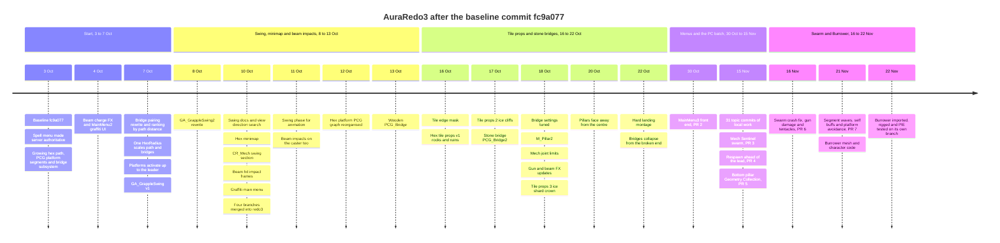
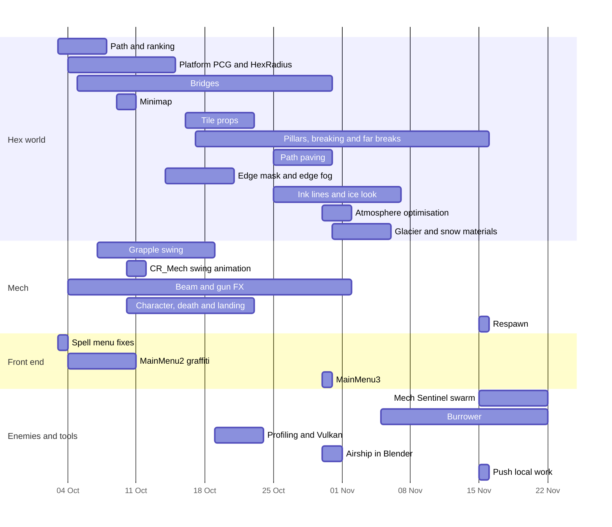

↑ [[Redo3 Changes Index]]

# Timeline

AuraRedo3 · 155 commits since `fc9a077` · 2026-10-03 to 2026-11-22 · times in UTC+8 (the PC's clock)

Every commit made since the baseline commit `fc9a077` "before start using claude." (2026-10-03 15:46), oldest first, with the page that explains it. 150 commits are on `redo3` (plus 20 merge commits) and 5 more are on the unmerged Burrower branch `claude/project-thread-78otz4`. How the branches and pull requests fit together is on [[Redo3 Branches and PRs]], and which thread did what is on [[Redo3 Threads]].

> [!note] The 2026-11-15 batch
> 31 commits are stamped 2026-11-15 14:18, and one more (`1e23b9d`, the glacier ice textures) 15:09. They hold work done on the PC between about 2026-10-18 and 2026-11-15 that had not been committed yet. The "Push local changes to GitHub" thread split it into one commit per topic on that day, so the commit time is when it was saved to git, not when the work happened. The topic pages give the real work dates from the threads.

## The whole run at a glance

## Work streams over time

When each area was worked on, from the threads' activity dates (not the commit stamps).

## Commits per page

| Page | Commits | First | Last |
|---|---|---|---|
| [[Redo3 Spell Menu Fixes]] | 4 | `aaaf14b` 2026-10-03 | `45f0aa8` 2026-10-03 |
| [[Redo3 Hex Path and Ranking]] | 6 | `17605e3` 2026-10-03 | `b95b254` 2026-10-07 |
| [[Redo3 Hex Platform PCG]] | 9 | `17605e3` 2026-10-03 | `cd6db8b` 2026-11-15 |
| [[Redo3 Hex Bridges]] | 18 | `17605e3` 2026-10-03 | `08a123a` 2026-11-15 |
| [[Redo3 Path Paving]] | 1 | `5ccdfef` 2026-11-15 | `5ccdfef` 2026-11-15 |
| [[Redo3 Hex Tile Props]] | 11 | `379dc3b` 2026-10-16 | `3d05747` 2026-11-15 |
| [[Redo3 Hex Pillars and Breaking]] | 11 | `fa6ad2f` 2026-10-18 | `1e23b9d` 2026-11-15 |
| [[Redo3 Hex Look and Atmosphere]] | 9 | `808d60c` 2026-10-16 | `32a308e` 2026-11-15 |
| [[Redo3 Hex Minimap]] | 3 | `a3513e0` 2026-10-10 | `0f9d516` 2026-10-10 |
| [[Redo3 Grapple Swing]] | 20 | `157aa06` 2026-10-07 | `d334e10` 2026-11-15 |
| [[Redo3 Mech Swing Animation]] | 8 | `3a3b09f` 2026-10-10 | `808d60c` 2026-10-16 |
| [[Redo3 Beam and Gun FX]] | 13 | `9c04634` 2026-10-04 | `57d2288` 2026-11-15 |
| [[Redo3 Mech Character]] | 10 | `ab6e9c4` 2026-10-10 | `b3b02ac` 2026-11-15 |
| [[Redo3 Menus and Settings]] | 9 | `9c04634` 2026-10-04 | `d11e55a` 2026-11-15 |
| [[Redo3 Burrower]] | 5 | `7fa2585` 2026-11-21 | `9727f1d` 2026-11-22 |
| [[Redo3 Engine Tools and Assets]] | 9 | `b9a224f` 2026-10-10 | `cd6db8b` 2026-11-15 |
| [[MechSentinel Index]] | 32 | `8dce75b` 2026-11-15 | `99ab259` 2026-11-21 |

Some commits touch more than one area, so they count on more than one page.

## Commits by day

### 2026-10-03 (Sat)

The baseline `fc9a077` "before start using claude." was made at 15:46. The first Claude work fixed the spell menu and added the growing hex path the same evening.

| Time | Commit | What changed | Page |
|---|---|---|---|
| 17:48 | `aaaf14b` | Make the server the source of truth for spell slot equipping | [[Redo3 Spell Menu Fixes]] |
| 17:49 | `76625c2` | Fix spell menu selection state around equipping | [[Redo3 Spell Menu Fixes]] |
| 17:50 | `a63041a` | Fix crashes from deleted Spell and Attribute menu controllers | [[Redo3 Spell Menu Fixes]] |
| 18:07 | `45f0aa8` | Validate spell point spending on the server | [[Redo3 Spell Menu Fixes]] |
| 20:34 | `17605e3` | Add growing hex path, PCG platform segments and bridge subsystem | [[Redo3 Hex Path and Ranking]], [[Redo3 Hex Bridges]], [[Redo3 Hex Platform PCG]] |

### 2026-10-04 (Sun)

| Time | Commit | What changed | Page |
|---|---|---|---|
| 19:43 | `9c04634` | NS_beamChargeFx.uasset, NS_beam and MainMenu2 Graffiti UI. | [[Redo3 Beam and Gun FX]], [[Redo3 Menus and Settings]] |

### 2026-10-07 (Wed)

The big `e7a2588` commit carries several days of work from the first threads (bridge pairing, platform replication, ranking, damage numbers, muzzle smoke).

| Time | Commit | What changed | Page |
|---|---|---|---|
| 07:02 | `e7a2588` | Rewrite hex bridge pairing, replicate platforms reliably, rank players by path distance, add Niagara damage numbers and muzzle smoke | [[Redo3 Hex Path and Ranking]], [[Redo3 Hex Bridges]], [[Redo3 Beam and Gun FX]], [[Redo3 Menus and Settings]] |
| 07:19 | `a7bd059` | Scale hex path, PCG layout space and bridge lengths with one HexRadius | [[Redo3 Hex Path and Ranking]], [[Redo3 Hex Platform PCG]], [[Redo3 Hex Bridges]] |
| 07:24 | `5bec016` | Qualify bridge trace constants so the unity build finds one definition | [[Redo3 Hex Bridges]] |
| 07:50 | `55f9c66` | Wire the hex PCG graph to layout space and scale bridge trace offsets | [[Redo3 Hex Platform PCG]], [[Redo3 Hex Bridges]] |
| 21:38 | `157aa06` | Add GA_GrappleSwing, a predicted Spider-Man style grapple swing ability | [[Redo3 Grapple Swing]] |
| 21:38 | `cbd8c04` | Activate hex platforms up to the ranking leader's distance | [[Redo3 Hex Path and Ranking]] |
| 23:03 | `3c75a1c` | Collapse platforms faster the further behind the lead they are | [[Redo3 Hex Path and Ranking]] |
| 23:15 | `b95b254` | Far platforms activate with faster rate , till lead player platform all platforms activate, GA_GrappleSwing_v1 | [[Redo3 Hex Path and Ranking]], [[Redo3 Grapple Swing]] |

### 2026-10-08 (Thu)

| Time | Commit | What changed | Page |
|---|---|---|---|
| 07:23 | `09decfd` | Add GA_GrappleSwing2, a rewritten grapple swing (v1 untouched) | [[Redo3 Grapple Swing]] |
| 07:36 | `0060049` | Fix GA_GrappleSwing2 compile errors on UE 5.8 | [[Redo3 Grapple Swing]] |
| 08:11 | `12423b1` | Add NetCore dependency for GA_GrappleSwing2's SerializePackedVector | [[Redo3 Grapple Swing]] |
| 08:23 | `3c35d35` | Add GA_GrappleSwing2 search diagnostics behind bDrawDebug | [[Redo3 Grapple Swing]] |
| 08:27 | `9d4ae99` | Fix GA_GrappleSwing2 review findings | [[Redo3 Grapple Swing]] |
| 08:27 | `0a09127` | Let GA_GrappleSwing2 hook WorldDynamic geometry | [[Redo3 Grapple Swing]] |

### 2026-10-09 (Fri)

| Time | Commit | What changed | Page |
|---|---|---|---|
| 08:23 | `725b68c` | Only activate GA_GrappleSwing2 while falling | [[Redo3 Grapple Swing]] |

### 2026-10-10 (Sat)

Busiest day before the batch. The minimap, grapple swing, platform activation and swing animation branches were merged into redo3; the beam impact branch followed on 11 Oct.

| Time | Commit | What changed | Page |
|---|---|---|---|
| 06:48 | `7d3c5b6` | Add GA_GrappleSwing2 documentation with mind map and flow diagrams | [[Redo3 Grapple Swing]] |
| 07:19 | `2dedc85` | Search for GA_GrappleSwing2 anchors along the view direction | [[Redo3 Grapple Swing]] |
| 08:00 | `a3513e0` | Add a hex platform minimap baked into one wrapping texture | [[Redo3 Hex Minimap]] |
| 10:39 | `079e1cc` | Turn GA_GrappleSwing2 momentum towards the view when shot against it | [[Redo3 Grapple Swing]] |
| 10:39 | `dfeab8d` | Search along the view only when looking against the motion | [[Redo3 Grapple Swing]] |
| 10:41 | `6235450` | Correct GA_GrappleSwing2 docs against the code | [[Redo3 Grapple Swing]] |
| 10:51 | `367eef8` | *Merge:* Merge claude/project-thread-13pepw into redo3 | [[Redo3 Branches and PRs]] |
| 10:51 | `bcf1566` | *Merge:* Merge claude/project-thread-9166ug into redo3 | [[Redo3 Branches and PRs]] |
| 10:51 | `dc10778` | *Merge:* Merge origin/claude/project-thread-8o9mos into redo3 | [[Redo3 Branches and PRs]] |
| 10:52 | `e038cc3` | Update GA_GrappleSwing2 docs for the look-direction attach | [[Redo3 Grapple Swing]] |
| 10:53 | `40bc15c` | *Merge:* Merge origin/claude/project-thread-9166ug into redo3 | [[Redo3 Branches and PRs]] |
| 11:28 | `ab6e9c4` | Only allow GA_Boost on the ground | [[Redo3 Mech Character]] |
| 11:28 | `73aa727` | Add GA_BPGrappleSwing2 and update ability, input and mech blueprints | [[Redo3 Grapple Swing]] |
| 11:28 | `b1f17f2` | Update the hex platform PCG graphs | [[Redo3 Hex Platform PCG]] |
| 11:28 | `8dd75d0` | Restyle the main menu with graffiti UI assets | [[Redo3 Menus and Settings]] |
| 11:28 | `b9a224f` | Update StartupMap | [[Redo3 Engine Tools and Assets]] |
| 12:16 | `0325be0` | Fix the minimap being placed off screen | [[Redo3 Hex Minimap]] |
| 12:46 | `0f9d516` | Place the minimap with one viewport slot | [[Redo3 Hex Minimap]] |
| 13:59 | `3a3b09f` | Add Event.Swing and set bIsSwinging in MyAnimInstance from it | [[Redo3 Mech Swing Animation]] |
| 14:36 | `146bc6e` | *Merge:* Merge origin/claude/project-thread-99vjzu into redo3 (Event.Swing, bIsSwinging) | [[Redo3 Branches and PRs]] |
| 14:43 | `22c482e` | Add CR_Mech swing section findings and preliminary design | [[Redo3 Mech Swing Animation]] |
| 15:27 | `9bfaf86` | Add beam hit impact (post process, FOV kick, camera shake) on the hit player's screen | [[Redo3 Beam and Gun FX]] |
| 15:29 | `39fd2f5` | Beam hit impact: drive an impact frames material by ImpactTime and Duration | [[Redo3 Beam and Gun FX]] |
| 15:49 | `ff14587` | Add swing section to CR_Mech and bind bIsSwinging in ABP_MyCharMech | [[Redo3 Mech Swing Animation]] |
| 15:52 | `cc0e80c` | Beam hit impact: review fixes for the impact frames | [[Redo3 Beam and Gun FX]] |
| 15:56 | `0fae26e` | Replace the CR_Mech swing notes with the reviewed design | [[Redo3 Mech Swing Animation]] |
| 16:05 | `eca7bb6` | Beam impact frames: caster post process + shake, and headless phase renders | [[Redo3 Beam and Gun FX]] |
| 17:29 | `3deb5fd` | Blend the CR_Mech swing in and out with SwingAlpha | [[Redo3 Mech Swing Animation]] |

### 2026-10-11 (Sun)

| Time | Commit | What changed | Page |
|---|---|---|---|
| 07:59 | `2a8abed` | Add GetGrappleSwing2Phase: where the character is in the arc, -1 to 1 | [[Redo3 Grapple Swing]], [[Redo3 Mech Swing Animation]] |
| 08:08 | `173a497` | *Merge:* Merge origin/claude/project-thread-99vjzu into redo3 (GetGrappleSwing2Phase) | [[Redo3 Branches and PRs]] |
| 08:52 | `c3cb456` | Rescale GetGrappleSwing2Phase: -1 where the rope caught, +1 where the auto release lets go | [[Redo3 Grapple Swing]], [[Redo3 Mech Swing Animation]] |
| 08:52 | `8142c94` | *Merge:* Merge origin/claude/project-thread-99vjzu into redo3 (rescaled GetGrappleSwing2Phase) | [[Redo3 Branches and PRs]] |
| 14:00 | `ece19a8` | Beam impacts: caster gets an FOV kick too, hit impact callable from any machine | [[Redo3 Beam and Gun FX]] |
| 14:00 | `8b23a51` | *Merge:* Merge claude/project-thread-8c5juy into redo3 (beam cast and hit impacts) | [[Redo3 Branches and PRs]] |
| 14:11 | `7b77a84` | Beam impacts: looser client gate for impacts the server sent | [[Redo3 Beam and Gun FX]] |
| 14:11 | `720c0e4` | *Merge:* Merge claude/project-thread-8c5juy into redo3 (beam impact client gate) | [[Redo3 Branches and PRs]] |

### 2026-10-12 (Mon)

| Time | Commit | What changed | Page |
|---|---|---|---|
| 09:15 | `620b1fe` | Reorganize hex platform PCG graph: sections left to right, named reroutes, straight wires | [[Redo3 Hex Platform PCG]] |

### 2026-10-13 (Tue)

| Time | Commit | What changed | Page |
|---|---|---|---|
| 10:52 | `4c227a0` | PCG_Bridge: wooden bridge with end towers, knee braces and torches | [[Redo3 Hex Bridges]] |

### 2026-10-16 (Fri)

| Time | Commit | What changed | Page |
|---|---|---|---|
| 07:29 | `808d60c` | swing phase anim , Hex tile edge mask , beam by claude | [[Redo3 Mech Swing Animation]], [[Redo3 Hex Look and Atmosphere]], [[Redo3 Beam and Gun FX]] |
| 07:37 | `379dc3b` | Hex platform tile props: PCG scatter of rocks/ruins, break into Geometry Collections on tile collapse | [[Redo3 Hex Tile Props]] |
| 08:22 | `ab708f7` | Hex tile props: prop meshes, fractured GCs, PCG_HexTileProps graph wired into BP_MyHexPlatform | [[Redo3 Hex Tile Props]] |
| 08:30 | `ca33354` | Hex tile props: consistent prop names and a laid-out PCG_HexTileProps | [[Redo3 Hex Tile Props]] |
| 08:56 | `7f31267` | Hex tile props: natural rock layout with AncientTechCity rocks | [[Redo3 Hex Tile Props]] |
| 09:10 | `e71e986` | *Merge:* Merge claude/project-thread-pca24g into redo3 (hex tile rocks and ruins) | [[Redo3 Branches and PRs]] |

### 2026-10-17 (Sat)

| Time | Commit | What changed | Page |
|---|---|---|---|
| 11:05 | `6e7c02a` | Hex tile props 2: ice cliffs and frozen rock formations replace the rock layer | [[Redo3 Hex Tile Props]] |
| 11:56 | `6444429` | Hex tile props 2: L_Showcase gate cliff replicas and bridge-to-centre walkways | [[Redo3 Hex Tile Props]] |
| 14:59 | `7a6f01e` | Hex tile props 2: deterministic frozen bridge paths, visible prop GCs, kitbash levels | [[Redo3 Hex Tile Props]], [[Redo3 Hex Bridges]] |
| 17:47 | `669297e` | PCG_Bridge2: stone bridge from the L_Showcase hall span | [[Redo3 Hex Bridges]] |
| 18:33 | `de9336e` | Hex bridges: stone bridges on the lower chain, fixed dip on the upper chain | [[Redo3 Hex Bridges]] |
| 18:54 | `86539d1` | PCG_SplineIHexPlatformsFromSpline: World_Bridges selects every MyHexBridge | [[Redo3 Hex Platform PCG]], [[Redo3 Hex Bridges]] |
| 19:46 | `2b8f15a` | PCG_Bridge2: edge stones set into the deck instead of floating beside it | [[Redo3 Hex Bridges]] |
| 19:54 | `ccb8ddf` | PCG_Bridge2: landings sunk into the tile and kept on it | [[Redo3 Hex Bridges]] |
| 20:03 | `19f78da` | Stone bridge landing: narrow it so it never hangs off the end tile | [[Redo3 Hex Bridges]] |

### 2026-10-18 (Sun)

| Time | Commit | What changed | Page |
|---|---|---|---|
| 11:59 | `c0adc6e` | Hex bridge settings: tune build delay, slope, bridge caps and cross-chain bridges | [[Redo3 Hex Bridges]] |
| 11:59 | `677acf1` | Hex tile props 2: rebuild ice mountain 01 and update PCG_HexTileProps2 | [[Redo3 Hex Tile Props]] |
| 11:59 | `fa6ad2f` | Hex pillar: update M_Pillar1 and the pillar meshes, add M_Pillar2 | [[Redo3 Hex Pillars and Breaking]] |
| 11:59 | `0fb796e` | Mech physics asset: joint limits for legs, arms and spine | [[Redo3 Mech Character]] |
| 11:59 | `2ffcb38` | Gun shot FX: update NS_GunShoot and the GunShootHit impact effect | [[Redo3 Beam and Gun FX]] |
| 11:59 | `3f71d59` | Beam FX: update NS_Claude_Beam and NS_ElectricBeamMy | [[Redo3 Beam and Gun FX]] |
| 11:59 | `8743374` | GA_GrappleSwing2: search for anchors along the facing direction instead of velocity | [[Redo3 Grapple Swing]] |
| 11:59 | `7a178e9` | Update StartupMap; show the environment in the asset preview scene | [[Redo3 Engine Tools and Assets]] |
| 12:02 | `cedd511` | Ignore the AncientTechCity and FrozenNorseEnvironment marketplace packs | [[Redo3 Engine Tools and Assets]] |
| 17:29 | `79bed11` | Hex tile props 3: ice shard crown on the platform rim | [[Redo3 Hex Tile Props]] |
| 18:34 | `f415ce4` | PCG_HexTileProps3: remove stale comment boxes, update the description | [[Redo3 Hex Tile Props]] |

### 2026-10-20 (Tue)

| Time | Commit | What changed | Page |
|---|---|---|---|
| 07:42 | `6a10353` | Hex platform: turn each pillar so +X faces away from the centre | [[Redo3 Hex Pillars and Breaking]] |

### 2026-10-22 (Thu)

| Time | Commit | What changed | Page |
|---|---|---|---|
| 12:55 | `afc2918` | MyCharPlayer: play the fall-to-roll montage on a hard landing after flying | [[Redo3 Mech Character]] |
| 15:55 | `8d98fd7` | Hex bridges collapse from the end whose tile broke; 3x wide stone bridges | [[Redo3 Hex Bridges]] |

### 2026-10-30 (Fri)

| Time | Commit | What changed | Page |
|---|---|---|---|
| 11:28 | `c4b51bd` | Add MainMenu3: Far Far West style front end, options and pause menu | [[Redo3 Menus and Settings]] |
| 15:16 | `14ed4e1` | Fix review findings in MainMenu3, the pause menu, options and sessions | [[Redo3 Menus and Settings]] |
| 18:07 | `f2ddd92` | Fix the clang build of MainMenu3 and add the menu style guide | [[Redo3 Menus and Settings]] |
| 18:13 | `477dba4` | Use GetActiveKeyProfile in SettingsMenu3, GetCurrentKeyProfile is deprecated | [[Redo3 Menus and Settings]] |

### 2026-11-15 (Sun)

The 31 commits at 14:18 and `1e23b9d` at 15:09 are the batch from the "Push local changes to GitHub" thread. The Mech Sentinel, respawn and bottom pillar commits came from their own branches and pull requests the same day.

| Time | Commit | What changed | Page |
|---|---|---|---|
| 10:23 | `a22e41b` | *Merge:* Merge claude/project-thread-hlg7ft (PR #2): MainMenu3 front end, options and pause menu | [[Redo3 Branches and PRs]] |
| 10:23 | `8874616` | *Merge:* Merge claude/project-thread-pca24g: hex tile props 3, ice shard crown on the platform rim | [[Redo3 Branches and PRs]] |
| 10:23 | `69cdf95` | *Merge:* Merge claude/project-thread-er95f6: turn each hex pillar so +X faces away from the centre | [[Redo3 Branches and PRs]] |
| 14:14 | `8dce75b` | Mech Sentinel swarm: Mass entities with GAS combat, replication and wave spawner (WIP, review fixes pending) | [[MechSentinel Index]] |
| 14:18 | `9dd0d5d` | MyCharBase: skip null startup abilities, set bIsDead on all machines | [[Redo3 Mech Character]] |
| 14:18 | `e5d0fec` | Vulkan: work around the swapchain crash and VRAM eviction slowdown | [[Redo3 Engine Tools and Assets]] |
| 14:18 | `9b3df08` | Edge fog: per-chain RVTs from M_Pillar1, RVT volumes follow the mech | [[Redo3 Hex Look and Atmosphere]] |
| 14:18 | `e3d8c35` | MyCharPlayer: start the hard landing montage at its roll section | [[Redo3 Mech Character]] |
| 14:18 | `ce1125d` | Add editor console commands for scripted material edits | [[Redo3 Engine Tools and Assets]] |
| 14:18 | `450006c` | Beam FX v8: textures erode the beam away; charge and release cues | [[Redo3 Beam and Gun FX]] |
| 14:18 | `f84c282` | Respawn FX v10: rebuilt against the reference with own materials | [[Redo3 Mech Character]] |
| 14:18 | `57d2288` | Gun shot cues: muzzle socket and hit offset for NDC_GunShootHit | [[Redo3 Beam and Gun FX]] |
| 14:18 | `9d6fb14` | Mech jetpack: Houdini thruster mesh in place of NS_ThursterFlash | [[Redo3 Mech Character]] |
| 14:18 | `2c1d78b` | Mech death: disintegrate FX, ragdoll, no move or look while dead | [[Redo3 Mech Character]] |
| 14:18 | `02703a2` | Add the AirExplo_ftc explosion mesh from Houdini with M_AirExplo | [[Redo3 Engine Tools and Assets]] |
| 14:18 | `3d05747` | Hex optimisation: thinner bridge debris, lighter GCs, prop LODs | [[Redo3 Hex Bridges]], [[Redo3 Hex Tile Props]], [[Redo3 Hex Pillars and Breaking]] |
| 14:18 | `613707b` | Add UMyHexPillarBreakSubsystem and height-matched top pillar GCs | [[Redo3 Hex Pillars and Breaking]] |
| 14:18 | `b5ff0ef` | Hex platforms: bottom chain, atmosphere variants, GC and far breaks | [[Redo3 Hex Pillars and Breaking]], [[Redo3 Hex Look and Atmosphere]], [[Redo3 Hex Platform PCG]] |
| 14:18 | `5ccdfef` | Pave hex bridge paths with stone slabs and a centre plaza | [[Redo3 Path Paving]] |
| 14:18 | `cf4ec00` | Ice look V2.1: in-material ink outlines, iteration MIs, blue mist | [[Redo3 Hex Look and Atmosphere]] |
| 14:18 | `bf8dbba` | Add M_HexIce pillar materials, built but kept unassigned | [[Redo3 Hex Look and Atmosphere]] |
| 14:18 | `ac1b069` | Fog fade: bottom pillars and stone bridges fade into the void | [[Redo3 Hex Look and Atmosphere]] |
| 14:18 | `5d2fd5b` | MainMenu3 hook-up: IA_Pause, rebindable keys, sound classes | [[Redo3 Menus and Settings]] |
| 14:18 | `d11e55a` | MainMenu3 widgets: main, pause and settings menus with OFL fonts | [[Redo3 Menus and Settings]] |
| 14:18 | `d334e10` | GA_BPGrappleSwing2: set grapple range and aim assist cone | [[Redo3 Grapple Swing]] |
| 14:18 | `0cc1993` | Stone bridges: back to v1 width with their own GCs and end torches | [[Redo3 Hex Bridges]] |
| 14:18 | `b895169` | Add SM_Airship, a stylized comic-ink airship modelled in Blender | [[Redo3 Engine Tools and Assets]] |
| 14:18 | `08a123a` | Lower-chain clouds as one cloud bank per platform; torches lose fire | [[Redo3 Hex Look and Atmosphere]], [[Redo3 Hex Bridges]] |
| 14:18 | `ff2437c` | Hex path PCG: floating small top platforms, bottom chain class | [[Redo3 Hex Platform PCG]] |
| 14:18 | `82f5399` | Enable Nanite and turn off dynamic GI in the renderer settings | [[Redo3 Engine Tools and Assets]] |
| 14:18 | `fa0ee5e` | Hex pillars: rock pillar bottoms, glacier ice and edge snow drifts | [[Redo3 Hex Pillars and Breaking]], [[Redo3 Hex Look and Atmosphere]] |
| 14:18 | `7b295de` | BP_MyHexPlatform: rock pillar bottoms, pillar and slab GCs, clouds | [[Redo3 Hex Pillars and Breaking]] |
| 14:18 | `5d3673b` | Resave GE_BoostCost and GE_HoverCost | [[Redo3 Mech Character]] |
| 14:18 | `cd6db8b` | Enable PCGNiagaraInterop; hide the asset preview environment again | [[Redo3 Engine Tools and Assets]], [[Redo3 Hex Platform PCG]] |
| 14:18 | `32a308e` | Update StartupMap: ice look lighting, fog floor, fog fade sync | [[Redo3 Hex Look and Atmosphere]] |
| 14:20 | `3ffe8f1` | Mech Sentinel swarm: review fixes | [[MechSentinel Index]] |
| 14:24 | `005aca9` | Hex platforms: bottom pillars break into a Geometry Collection | [[Redo3 Hex Pillars and Breaking]] |
| 14:27 | `d1b8b03` | Mech Sentinel source art: low-poly head, tentacle, claw tip and far LOD | [[MechSentinel Index]] |
| 14:30 | `3e4c700` | Bottom pillar Geometry Collection: GC_HexRockPillar_H100 + GC material | [[Redo3 Hex Pillars and Breaking]] |
| 14:38 | `df65128` | Mech Sentinel: Niagara ribbon tentacles that follow the head | [[MechSentinel Index]] |
| 14:51 | `b3b02ac` | Respawn dead players ahead of the lead after a fixed delay | [[Redo3 Mech Character]] |
| 14:53 | `5e11888` | AMyGameMode: move the sentinel swarm rules away from the end of the class | [[MechSentinel Index]] |
| 15:05 | `37fe470` | Hex platforms: ActivateHexLocal comment covers the bottom pillar Geometry Collection | [[Redo3 Hex Pillars and Breaking]] |
| 15:09 | `1e23b9d` | Add the T_GlacierIce textures for the rock pillar glacier sides | [[Redo3 Hex Pillars and Breaking]] |
| 15:38 | `7005c06` | Mech Sentinel: second review fixes | [[MechSentinel Index]] |
| 16:05 | `cba7cc4` | Mech Sentinel tentacles: fold in the editor build of NS_MechSentinelTentacles | [[MechSentinel Index]] |
| 16:33 | `38622c2` | Mech Sentinel GAS bridge: store GAS-applied extras, keep application order, no re-rolls | [[MechSentinel Index]] |
| 18:12 | `9f55fa9` | *Merge:* Merge redo3 into the respawn branch | [[Redo3 Branches and PRs]] |
| 19:31 | `3f4e20d` | Mech Sentinel: body and eye materials, spawning walkthrough | [[MechSentinel Index]] |
| 19:32 | `62a3ac2` | *Merge:* Merge redo3 into the Mech Sentinel PR | [[Redo3 Branches and PRs]] |
| 19:34 | `d1a2971` | Mech Sentinel: imported meshes, tentacle material and NS_MechSentinelTentacles | [[MechSentinel Index]] |
| 19:37 | `dc0567d` | *Merge:* Merge PR #3: Mech Sentinel swarm (Mass entities, GAS combat, replication, waves, Niagara tentacles) | [[Redo3 Branches and PRs]] |
| 19:45 | `098c3ca` | *Merge:* Merge pull request #4 from talal-jpg/claude/project-thread-dq7p8s | [[Redo3 Branches and PRs]] |
| 19:45 | `25efc1e` | *Merge:* Merge pull request #5 from talal-jpg/claude/project-thread-2426yz | [[Redo3 Branches and PRs]] |
| 20:16 | `6e61d84` | Mech Sentinel: demo map, entity config, swarm rules and gameplay effects | [[MechSentinel Index]] |
| 20:29 | `df1b5a2` | Mech Sentinel: GE_SentinelAttack as the default sentinel attack effect | [[MechSentinel Index]] |
| 21:30 | `6d1bd6b` | Mech Sentinel: fix the listen server crash and the Mass timing asserts | [[MechSentinel Index]] |
| 21:30 | `8e6923d` | Mech Sentinel: tentacles flow behind the head and catch up | [[MechSentinel Index]] |
| 21:30 | `def3eac` | Mech Sentinel: built-in damage effects; GA_GunShoot damages sentinels | [[MechSentinel Index]] |
| 21:30 | `5ccc654` | Mech Sentinel README: crash fix, timing rule, gun damage, built-in effects, tentacle model | [[MechSentinel Index]] |
| 22:20 | `1d1a2a7` | Mech Sentinel: review fixes for gun hits, spawner timing and tentacles | [[MechSentinel Index]] |

### 2026-11-16 (Mon)

| Time | Commit | What changed | Page |
|---|---|---|---|
| 02:42 | `56d888f` | Mech Sentinel: final review fixes for gun walls, kill timing and DespawnAll | [[MechSentinel Index]] |
| 03:36 | `e0b895e` | Mech Sentinel: gun walls traced from the shooter, characters are not walls | [[MechSentinel Index]] |
| 04:09 | `c5a64fa` | Mech Sentinel: exact gun docs on characters; spawner re-arms on re-show | [[MechSentinel Index]] |
| 07:38 | `21ba7cc` | *Merge:* Merge pull request #6 from talal-jpg/claude/project-thread-mwyd6w | [[Redo3 Branches and PRs]] |

### 2026-11-21 (Sat)

PR #7 merged the swarm's segment waves at 20:32. The two Burrower commits are on the unmerged Burrower branch.

| Time | Commit | What changed | Page |
|---|---|---|---|
| 14:50 | `e86e5e3` | Mech Sentinel: sentinel hits add the attacker's AttackDamage | [[MechSentinel Index]] |
| 14:50 | `235d551` | Mech Sentinel: a wave per path segment at its corners, wave curves | [[MechSentinel Index]] |
| 15:07 | `bd8369c` | Mech Sentinel: obstacle registry (first version) | [[MechSentinel Index]] |
| 15:47 | `658834c` | Mech Sentinel: sentinels buff themselves (armor, speed, damage) | [[MechSentinel Index]] |
| 15:47 | `5dce00d` | Mech Sentinel: live sentinels steer around platforms in 3D | [[MechSentinel Index]] |
| 15:47 | `a3467f9` | Mech Sentinel: editor script that sets the swarm up in StartupMap | [[MechSentinel Index]] |
| 15:48 | `06fedf9` | Mech Sentinel: processor order comment names the obstacle avoidance | [[MechSentinel Index]] |
| 15:53 | `419c8ee` | Mech Sentinel docs: damage link, segment waves, curves, self-buffs, obstacles, StartupMap | [[MechSentinel Index]] |
| 16:33 | `5e35ce4` | Mech Sentinel: review fixes (buff queue cap, platform radius, script save order) | [[MechSentinel Index]] |
| 16:45 | `7fa2585` | Burrower: UE skeletal mesh FBX with root, Rotor and pipe bone chains (Burrower branch, unmerged) | [[Redo3 Burrower]] |
| 16:45 | `a414ca9` | Burrower: character, per-player spawner, rotor tile cutting, anim instance, editor docs (Burrower branch, unmerged) | [[Redo3 Burrower]] |
| 20:04 | `c24350b` | Mech Sentinel: StartupMap swarm setup and buff colours in the body and eye materials | [[MechSentinel Index]] |
| 20:24 | `bdb89a0` | Mech Sentinel docs: StartupMap has one path lane | [[MechSentinel Index]] |
| 20:31 | `99ab259` | StartupMap: one path lane | [[MechSentinel Index]] |
| 20:32 | `68dd9e7` | *Merge:* Merge pull request #7 from talal-jpg/claude/project-thread-mwyd6w | [[Redo3 Branches and PRs]] |

### 2026-11-22 (Sun)

All three commits are on the unmerged Burrower branch `claude/project-thread-78otz4`.

| Time | Commit | What changed | Page |
|---|---|---|---|
| 00:45 | `5d5f2bc` | Burrower: import SK_Burrower, PA_Burrower, settings, editor scripts (Burrower branch, unmerged) | [[Redo3 Burrower]] |
| 01:02 | `a52a516` | Burrower: CR_Burrower, ABP_Burrower, BP_Burrower (Burrower branch, unmerged) | [[Redo3 Burrower]] |
| 01:26 | `9727f1d` | Burrower: PIE tested; Control Rig ragdoll on (fallback off) (Burrower branch, unmerged) | [[Redo3 Burrower]] |

## Related

- [[Redo3 Changes Index]]: the start page and the whole-project mind map.
- [[Redo3 Branches and PRs]]: branches, pull requests and how they merged.
- [[Redo3 Threads]]: every thread, what it asked for and what it made.

[[Redo3 Changes Index]] ← → [[Redo3 Branches and PRs]]
